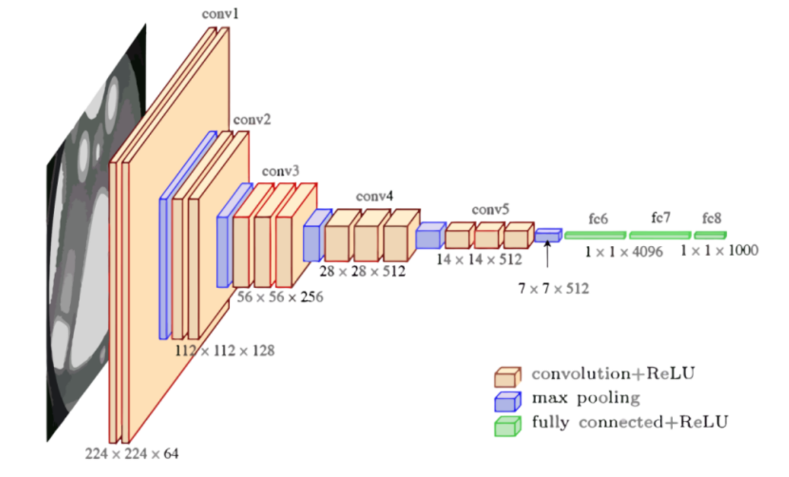
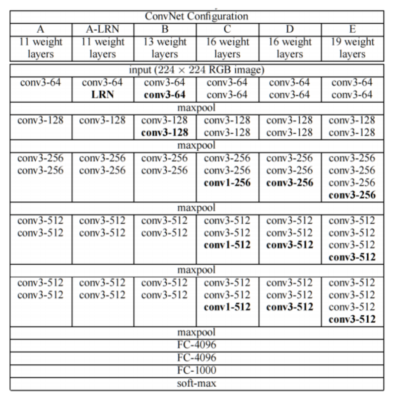
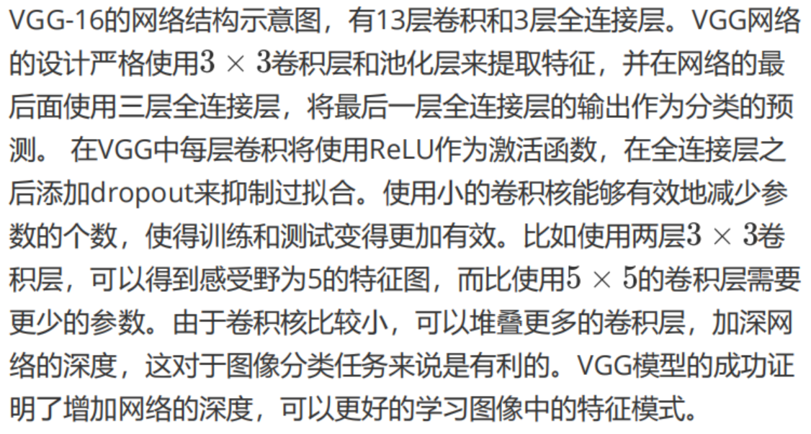
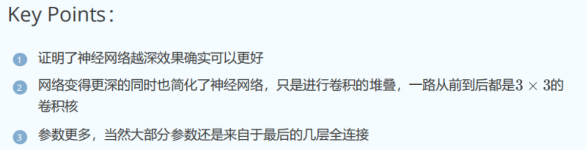
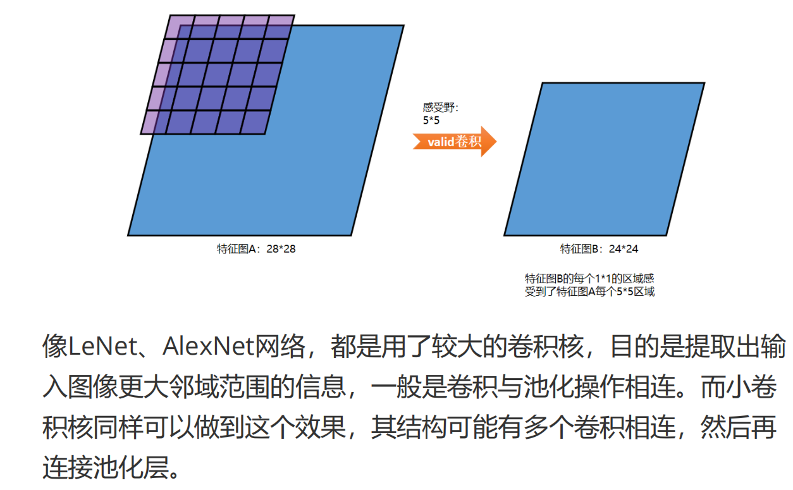
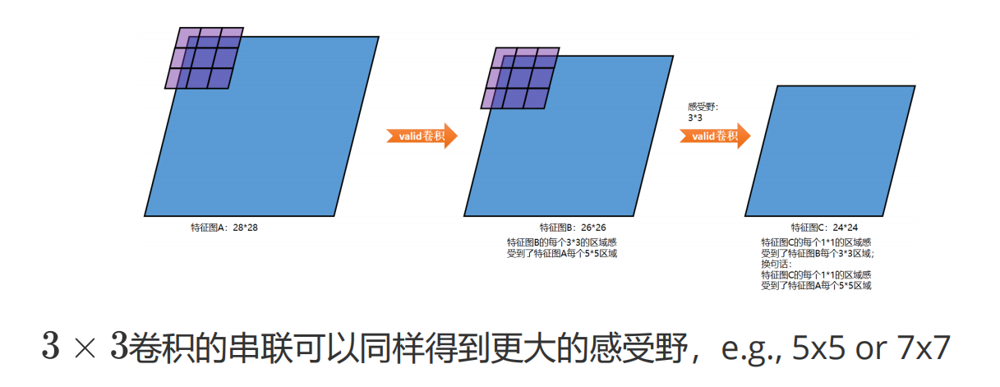
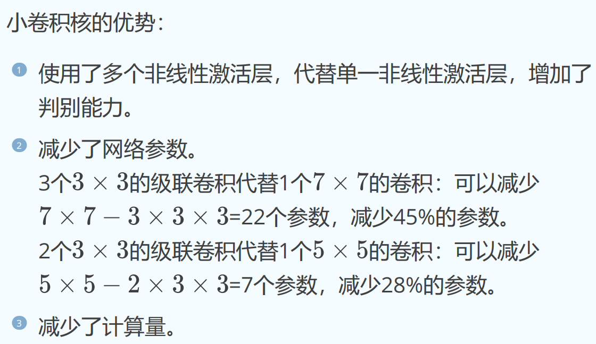
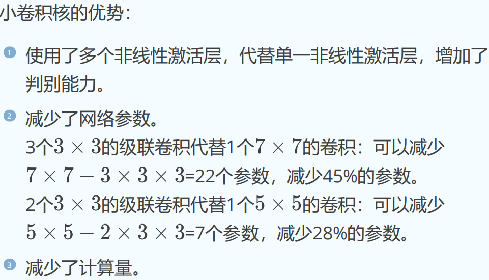



# VGG-16
最初两次 3*3 卷积之后尺寸仍为 224*224 的原因是使用了 padding，使得卷积后尺寸保持不变。
最后，fc6 和 fc7 都是有 4096 个神经元的全连接层。

AlexNet 模型通过构建多层网络取得了不错的效果，但它没有为设计深层神经网络提供方向。VGG 通过使用一系列 3x3 的小卷积核和池化层来构建深层卷积神经网络，并取得了良好的效果。VGG 模型因其结构简单、适用性强而在研究者中广受欢迎；尤其是它的网络结构设计方法为构建深层神经网络提供了方向。

D 就是 VGG-16。

conv3-64 表示卷积核为 3*3，有 64 个卷积核通道。



这里的"简化"并不是指网络本身更简单，而是指这种设计理念避免了复杂的结构变化。通过增加网络深度，并采用统一的卷积核在更多层次上提取特征，最终取得了更好的性能。
# 连续使用小卷积核






卷积后面通常会接非线性变换；由于小卷积核被多次应用，自然也就有了多次非线性变换。


```bash
C:\Users\35925\anaconda3\envs\AI_Study\lib\site-packages\torchvision\models\_utils.py:208: UserWarning: The parameter 'pretrained' is deprecated since 0.13 and may be removed in the future, please use 'weights' instead.
  warnings.warn(
C:\Users\35925\anaconda3\envs\AI_Study\lib\site-packages\torchvision\models\_utils.py:223: UserWarning: Arguments other than a weight enum or `None` for 'weights' are deprecated since 0.13 and may be removed in the future. The current behavior is equivalent to passing `weights=VGG16_Weights.IMAGENET1K_V1`. You can also use `weights=VGG16_Weights.DEFAULT` to get the most up-to-date weights.
  warnings.warn(msg)
```

1. **`pretrained` 参数已被弃用**：从 `torchvision` 0.13 版本开始，`pretrained` 参数已被弃用，应改用 `weights` 参数。该库推荐传入 `weights=VGG16_Weights.IMAGENET1K_V1` 或 `weights=VGG16_Weights.DEFAULT` 来加载预训练权重。

2. **`weights` 参数的其他用法也已被弃用**：除了 `pretrained` 之外，向 `weights` 传入其他参数的方式也已被弃用，未来版本中可能会被移除。建议改用 `weights` 枚举类型。

要解决这些警告，可以按如下方式修改代码：

```python
from torchvision.models import vgg16, VGG16_Weights

# 将弃用的 'pretrained' 参数替换为 'weights'
model = vgg16(weights=VGG16_Weights.IMAGENET1K_V1)
```

修改之后，代码就符合新的 API，警告也就消失了。


# 动手实践
[数据集链接](https://www.kaggle.com/datasets/khoongweihao/covid19-xray-dataset-train-test-sets)

# VGG16 源码

##  vgg16
```python

@register_model()
@handle_legacy_interface(weights=("pretrained", VGG16_Weights.IMAGENET1K_V1))
def vgg16(*, weights: Optional[VGG16_Weights] = None, progress: bool = True, **kwargs: Any) -> VGG:
    """VGG-16 from `Very Deep Convolutional Networks for Large-Scale Image Recognition <https://arxiv.org/abs/1409.1556>`__.

    Args:
        weights (:class:`~torchvision.models.VGG16_Weights`, optional): The
            pretrained weights to use. See
            :class:`~torchvision.models.VGG16_Weights` below for
            more details, and possible values. By default, no pre-trained
            weights are used.
        progress (bool, optional): If True, displays a progress bar of the
            download to stderr. Default is True.
        **kwargs: parameters passed to the ``torchvision.models.vgg.VGG``
            base class. Please refer to the `source code
            <https://github.com/pytorch/vision/blob/main/torchvision/models/vgg.py>`_
            for more details about this class.

    .. autoclass:: torchvision.models.VGG16_Weights
        :members:
    """
    weights = VGG16_Weights.verify(weights)

    return _vgg("D", False, weights, progress, **kwargs)

```

- VGG16_Weights.verify(weights) 验证 weights 参数的合法性。如果传入的值不是合法的 VGG16_Weights 枚举值，就会抛出错误。
- "D"：表示使用 VGG 的 D 配置（也就是 VGG-16）。
- False：表示不启用批归一化（batch normalization）。
- weights：指定要加载的权重。
## _vgg

```python
cfgs: Dict[str, List[Union[str, int]]] = {
    "A": [64, "M", 128, "M", 256, 256, "M", 512, 512, "M", 512, 512, "M"],
    "B": [64, 64, "M", 128, 128, "M", 256, 256, "M", 512, 512, "M", 512, 512, "M"],
    "D": [64, 64, "M", 128, 128, "M", 256, 256, 256, "M", 512, 512, 512, "M", 512, 512, 512, "M"],
    "E": [64, 64, "M", 128, 128, "M", 256, 256, 256, 256, "M", 512, 512, 512, 512, "M", 512, 512, 512, 512, "M"],
}

def _vgg(cfg: str, batch_norm: bool, weights: Optional[WeightsEnum], progress: bool, **kwargs: Any) -> VGG:
    if weights is not None:
        kwargs["init_weights"] = False
        if weights.meta["categories"] is not None:
            _ovewrite_named_param(kwargs, "num_classes", len(weights.meta["categories"]))
    model = VGG(make_layers(cfgs[cfg], batch_norm=batch_norm), **kwargs)
    if weights is not None:
        model.load_state_dict(weights.get_state_dict(progress=progress, check_hash=True))
    return model

```

- cfgs 是一个字典，定义了不同 VGG 版本的网络配置。
- 键（如 "A"、"B"、"D"、"E"）表示网络配置。
- 值是描述网络中每一层结构的列表：
- 数字（如 64、128）：表示某个卷积层的输出通道数。
- "M"：表示一个池化层（MaxPooling）。

最后，通过 load_state_dict 加载模型参数。

## make_layers

```python
def make_layers(cfg: List[Union[str, int]], batch_norm: bool = False) -> nn.Sequential:
    layers: List[nn.Module] = []
    in_channels = 3
    for v in cfg:
        if v == "M":
            layers += [nn.MaxPool2d(kernel_size=2, stride=2)]
        else:
            v = cast(int, v)
            conv2d = nn.Conv2d(in_channels, v, kernel_size=3, padding=1)
            if batch_norm:
                layers += [conv2d, nn.BatchNorm2d(v), nn.ReLU(inplace=True)]
            else:
                layers += [conv2d, nn.ReLU(inplace=True)]
            in_channels = v
    return nn.Sequential(*layers)

```

### 代码分析

`make_layers` 函数的主要目的是根据指定的配置 `cfg` 动态构建一系列卷积层和池化层，并返回一个 `nn.Sequential` 容器。

---

### 参数分析

```python
def make_layers(cfg: List[Union[str, int]], batch_norm: bool = False) -> nn.Sequential:
```

1. **`cfg`**：  
   - 这是一个用于定义网络结构的列表。  
   - 列表中的元素可以是整数或字符串：
     - **整数**：表示某个卷积层的输出通道数。
     - **字符串 `"M"`**：表示一个池化层（MaxPooling）。  

2. **`batch_norm`**：  
   - 一个布尔值，决定是否在每个卷积层后添加批归一化（Batch Normalization）。

3. 返回值：
   - 返回一个 `nn.Sequential` 对象，包含 `cfg` 定义的所有层。

---

### 工作流程

1. 初始化一个空列表 `layers`，用于存储网络的层模块：
   ```python
   layers: List[nn.Module] = []
   in_channels = 3  # 初始输入通道数为3（RGB图像）
   ```

2. 遍历配置列表 `cfg`，根据元素类型（整数或 `"M"`）构建对应的层：
   ```python
   for v in cfg:
       if v == "M":
           layers += [nn.MaxPool2d(kernel_size=2, stride=2)]  # 添加池化层
       else:
           v = cast(int, v)  # 将当前元素转换为整数（如果是整数，则不变）
           conv2d = nn.Conv2d(in_channels, v, kernel_size=3, padding=1)  # 定义卷积层
           if batch_norm:
               layers += [conv2d, nn.BatchNorm2d(v), nn.ReLU(inplace=True)]  # 带 BatchNorm
           else:
               layers += [conv2d, nn.ReLU(inplace=True)]  # 不带 BatchNorm
           in_channels = v  # 更新输入通道数
   ```

3. 把 `layers` 列表中的所有层包装成一个 `nn.Sequential` 模块并返回：
   ```python
   return nn.Sequential(*layers)
   ```

---

### 各部分的作用

1. **池化层（`"M"`）**：
   ```python
   layers += [nn.MaxPool2d(kernel_size=2, stride=2)]
   ```
   - 当配置中出现 `"M"` 时，会添加一个 `MaxPool2d` 层。
   - 该层使用 2×2 的窗口，以步长 2 进行下采样，从而缩小特征图的尺寸。

2. **卷积层**：
   ```python
   conv2d = nn.Conv2d(in_channels, v, kernel_size=3, padding=1)
   ```
   - 添加一个 3×3 的卷积层，`padding=1` 使特征图尺寸保持不变。
   - `in_channels`：输入特征图的通道数。
   - `v`：卷积层的输出通道数（由配置定义）。

3. **批归一化与激活函数**：
   - 如果 `batch_norm=True`，则在卷积层后添加 `BatchNorm2d` 和 `ReLU` 激活函数：
     ```python
     layers += [conv2d, nn.BatchNorm2d(v), nn.ReLU(inplace=True)]
     ```
   - 如果 `batch_norm=False`，则只添加 `ReLU` 激活函数：
     ```python
     layers += [conv2d, nn.ReLU(inplace=True)]
     ```

4. **更新输入通道数**：
   ```python
   in_channels = v
   ```
   - 更新 `in_channels`，作为下一个卷积层的输入通道数。

---

### 输出结果

该函数返回一个包含由卷积层和池化层组成的网络的 `nn.Sequential` 对象。例如：

#### 示例 1：配置 `cfg = [64, "M", 128, "M"]`（不带 BatchNorm）

```python
model = make_layers([64, "M", 128, "M"], batch_norm=False)
```

输出的网络结构为：
```
Sequential(
  (0): Conv2d(3, 64, kernel_size=(3, 3), stride=(1, 1), padding=(1, 1))
  (1): ReLU(inplace=True)
  (2): MaxPool2d(kernel_size=2, stride=2, padding=0, dilation=1, ceil_mode=False)
  (3): Conv2d(64, 128, kernel_size=(3, 3), stride=(1, 1), padding=(1, 1))
  (4): ReLU(inplace=True)
  (5): MaxPool2d(kernel_size=2, stride=2, padding=0, dilation=1, ceil_mode=False)
)
```

#### 示例 2：配置 `cfg = [64, "M", 128, "M"]`（带 BatchNorm）

```python
model = make_layers([64, "M", 128, "M"], batch_norm=True)
```

输出的网络结构为：
```
Sequential(
  (0): Conv2d(3, 64, kernel_size=(3, 3), stride=(1, 1), padding=(1, 1))
  (1): BatchNorm2d(64, eps=1e-05, momentum=0.1, affine=True, track_running_stats=True)
  (2): ReLU(inplace=True)
  (3): MaxPool2d(kernel_size=2, stride=2, padding=0, dilation=1, ceil_mode=False)
  (4): Conv2d(64, 128, kernel_size=(3, 3), stride=(1, 1), padding=(1, 1))
  (5): BatchNorm2d(128, eps=1e-05, momentum=0.1, affine=True, track_running_stats=True)
  (6): ReLU(inplace=True)
  (7): MaxPool2d(kernel_size=2, stride=2, padding=0, dilation=1, ceil_mode=False)
)
```

---


## VGG

```python

class VGG(nn.Module):
    def __init__(
        self, features: nn.Module, num_classes: int = 1000, init_weights: bool = True, dropout: float = 0.5
    ) -> None:
        super().__init__()
        _log_api_usage_once(self)
        self.features = features
        self.avgpool = nn.AdaptiveAvgPool2d((7, 7))
        self.classifier = nn.Sequential(
            nn.Linear(512 * 7 * 7, 4096),
            nn.ReLU(True),
            nn.Dropout(p=dropout),
            nn.Linear(4096, 4096),
            nn.ReLU(True),
            nn.Dropout(p=dropout),
            nn.Linear(4096, num_classes),
        )
        if init_weights:
            for m in self.modules():
                if isinstance(m, nn.Conv2d):
                    nn.init.kaiming_normal_(m.weight, mode="fan_out", nonlinearity="relu")
                    if m.bias is not None:
                        nn.init.constant_(m.bias, 0)
                elif isinstance(m, nn.BatchNorm2d):
                    nn.init.constant_(m.weight, 1)
                    nn.init.constant_(m.bias, 0)
                elif isinstance(m, nn.Linear):
                    nn.init.normal_(m.weight, 0, 0.01)
                    nn.init.constant_(m.bias, 0)

    def forward(self, x: torch.Tensor) -> torch.Tensor:
        x = self.features(x)
        x = self.avgpool(x)
        x = torch.flatten(x, 1)
        x = self.classifier(x)
        return x
```

这段代码定义了一个 VGG 网络类（`VGG`），基于 PyTorch 的神经网络模块 `nn.Module` 实现。该类实现了 VGG 网络的基本结构，包括卷积特征提取部分、全连接分类部分以及权重初始化方法。

---

### 1. **构造函数（`__init__`）**

#### 定义
```python
def __init__(
    self, features: nn.Module, num_classes: int = 1000, init_weights: bool = True, dropout: float = 0.5
) -> None:
```
- **`features`**：卷积特征提取部分的网络结构（通常由 `make_layers` 函数生成）。
- **`num_classes`**：分类任务的类别数，默认 1000（例如 ImageNet 数据集的分类任务）。
- **`init_weights`**：是否初始化权重，默认 `True`。
- **`dropout`**：Dropout 概率，默认 0.5。

#### 初始化
```python
super().__init__()
_log_api_usage_once(self)
```
- 调用父类的初始化方法，以确保继承 `nn.Module` 的功能。
- `_log_api_usage_once(self)` 用于记录模型 API 的使用情况（大概是用于统计）。

---

#### 模型组成部分

1. **卷积特征提取部分**：
   ```python
   self.features = features
   ```
   - `features` 是由 `make_layers` 动态生成的卷积层序列，用于从输入图像中提取特征。

2. **自适应平均池化**：
   ```python
   self.avgpool = nn.AdaptiveAvgPool2d((7, 7))
   ```
   - 把特征图调整为固定大小 `7×7`，无论输入图像尺寸是多少。

3. **全连接分类部分**：
   ```python
   self.classifier = nn.Sequential(
       nn.Linear(512 * 7 * 7, 4096),
       nn.ReLU(True),
       nn.Dropout(p=dropout),
       nn.Linear(4096, 4096),
       nn.ReLU(True),
       nn.Dropout(p=dropout),
       nn.Linear(4096, num_classes),
   )
   ```
   - `512 * 7 * 7` 是卷积层输出特征图展平后的大小。
   - 三个全连接层：
     - 第一层：`512 * 7 * 7` → `4096`
     - 第二层：`4096` → `4096`
     - 第三层：`4096` → `num_classes`（类别数）。
   - 各层之间使用了 `ReLU` 激活函数和 `Dropout` 正则化。

4. **权重初始化**：
   ```python
   if init_weights:
       for m in self.modules():
           if isinstance(m, nn.Conv2d):
               nn.init.kaiming_normal_(m.weight, mode="fan_out", nonlinearity="relu")
               if m.bias is not None:
                   nn.init.constant_(m.bias, 0)
           elif isinstance(m, nn.BatchNorm2d):
               nn.init.constant_(m.weight, 1)
               nn.init.constant_(m.bias, 0)
           elif isinstance(m, nn.Linear):
               nn.init.normal_(m.weight, 0, 0.01)
               nn.init.constant_(m.bias, 0)
   ```
   - 根据模块类型初始化权重：
     - **卷积层（`nn.Conv2d`）**：
       - 使用 `kaiming_normal_` 初始化权重（适用于 ReLU 激活函数）。
       - 把偏置初始化为 0。
     - **批归一化层（`nn.BatchNorm2d`）**：
       - 权重初始化为 1，偏置初始化为 0。
     - **全连接层（`nn.Linear`）**：
       - 权重从均值为 0、标准差为 0.01 的正态分布中初始化。
       - 偏置初始化为 0。

---

### 2. **前向传播（`forward`）**

```python
def forward(self, x: torch.Tensor) -> torch.Tensor:
    x = self.features(x)  # 卷积特征提取
    x = self.avgpool(x)   # 自适应平均池化
    x = torch.flatten(x, 1)  # 展平为 (batch_size, 512*7*7)
    x = self.classifier(x)   # 全连接分类
    return x
```

- 输入 `x` 经过以下步骤：
  1. **卷积特征提取部分**：
     - `self.features(x)` 提取卷积特征。
  2. **自适应平均池化**：
     - 把卷积特征图调整为固定大小 `7×7`。
  3. **展平**：
     - 使用 `torch.flatten` 把张量展平为二维形状：`(batch_size, 512*7*7)`。
  4. **全连接分类部分**：
     - 展平后的张量输入到 `self.classifier` 的全连接层中进行分类。

---

