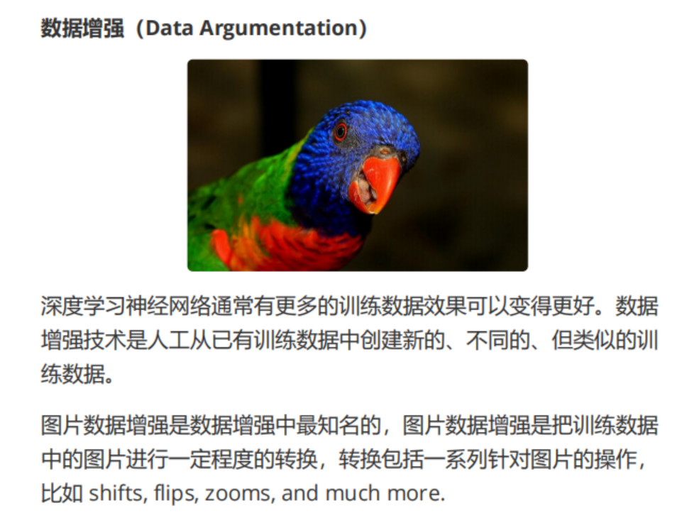



---

# 图像常用的数据增强方法
对于图像数据，主要的数据增强操作包括以下几种：

1. **平移（Shifts）**：
   - 将图像向上、下、左或右移动一定距离。
   - 用于模拟目标物体出现在不同位置的场景。

2. **翻转（Flips）**：
   - 将图像水平或垂直翻转。
   - 常用于对称物体的数据增强。

3. **缩放（Zooms）**：
   - 对图像进行放大或缩小。
   - 用于模拟相机与目标物体距离的变化。

4. **旋转（Rotations）**：
   - 将图像随机旋转一定角度。
   - 用于提高模型对物体旋转不变性的理解。

5. **亮度调整（Brightness Adjustments）**：
   - 增加或降低图像亮度。
   - 模拟不同光照条件下的场景。

6. **噪声注入（Noise Injection）**：
   - 向图像中添加随机噪声。
   - 用于提高模型对噪声干扰的鲁棒性。

7. **颜色抖动（Color Jittering）**：
   - 调整图像的颜色、对比度和饱和度。
   - 用于模拟不同的相机设置或光照环境。

---

# 数据增强的优点
1. **增加数据量**：
   - 人为生成额外的样本以增加数据量，有助于缓解数据不足的问题。

2. **提高模型泛化能力**：
   - 使模型学习到更多样的特征，增强其对不同场景的适应能力。

3. **减少过拟合**：
   - 通过增加样本多样性，数据增强降低了模型对训练集的过拟合。

---

