

# 目标检测
找出图像中的物体，用矩形框标出，并给出类别和相应的概率。
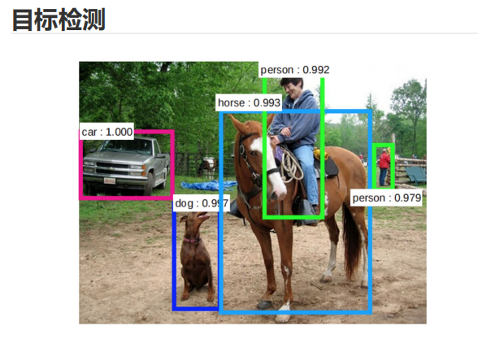

## 早期目标检测流程
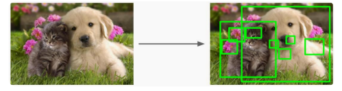

---

### **阶段 1：用计算机图像处理生成大量候选框**
- 左边的原图包含目标（一只狗和一只猫）以及背景。
- 系统首先使用传统的图像处理技术（如滑动窗口、选择性搜索、边缘检测等）生成**大量候选框**。
- 候选框是覆盖图像中潜在目标区域的矩形框；图中右侧的绿色矩形就代表这些候选框。
- 生成候选框是目标检测的第一步，目的是减少需要分析的区域。

---

### **阶段 2：把每个框送入机器学习分类模型进行判断**
- 生成候选框后，把每个候选框逐一送入**分类器**（如支持向量机或简单的神经网络）。
- 分类器的任务是判断每个候选框是否包含目标物体，以及目标的类别（如狗或猫）。
- 如果某个候选框被分类器判定为包含目标，就保留下来；否则丢弃。
- 在右图中，保留下来的候选框可能覆盖了狗和猫等目标。

---

### **小结**
这种方法的核心是**两步法**：
1. 先生成尽可能多的候选框，确保不漏掉目标区域。
2. 再用分类模型逐个判断每个框，确定是否存在目标及其类别。

---

### **局限性**
这种早期方法的主要问题是：
- 候选框数量多，计算开销大（尤其是对于大图像）。
- 分类器需要对每个候选框单独运行，导致效率低下。
- 候选框可能包含大量重叠区域，进一步增加了计算复杂度。

现代目标检测算法（如 YOLO 和 Faster R-CNN）通过引入**端到端检测**的思想解决了这些问题，能够直接、高效地预测整张图像中的物体及其位置。

## 选择性搜索

 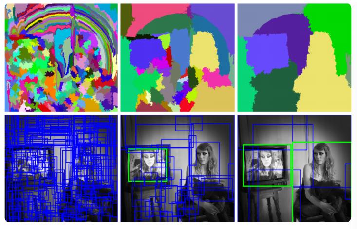
---

### **选择性搜索简介**
1. **背景：**
   - 选择性搜索（Selective Search）是一种生成候选框的方法，主要用于目标检测。
   - 它由 **Koen E.A** 于 2011 年提出，是一种经典的候选区域生成算法。

2. **核心思想：**
   - 图像中可能存在物体的区域，往往是具有相似性（如颜色、纹理等）或连续性的区域。
   - 选择性搜索基于**区域合并**的思想，结合图像分割技术，逐步合并具有相似特征的区域，从而生成一系列候选框。

---

### **选择性搜索的主要流程**
1. **图像分割：**
   - 首先对输入图像进行**初步分割**，把它划分为多个较小的子区域。
   - **图中上方第一行的彩色分割图**展示了不同分割阶段的结果，每种颜色代表一个分割区域。

2. **区域合并：**
   - 根据相似性度量（如颜色、纹理、大小等）不断合并相邻的子区域，逐渐形成更大的区域。
   - 每次合并后，在这些区域上生成候选框（边界框），即**图中下方第二行的蓝色矩形**。

3. **候选框生成：**
   - 最终输出一组包含潜在目标的矩形候选框，供后续的分类器判断是否存在目标。

---

### **选择性搜索的特点**
1. **优点：**
   - 不依赖滑动窗口法，因此比传统的滑动窗口更高效、更灵活。
   - 利用图像自身的特征（颜色、纹理等）生成候选区域，降低了计算开销。

2. **缺点：**
   - 生成的候选框数量仍然很多，可能包含冗余信息（大量重叠的框）。
   - 对于高分辨率图像，分割和区域合并过程的计算速度较慢。

---

### **小结**
选择性搜索的核心是利用图像中层次聚类的思想，逐步合并相似区域，生成候选目标区域（候选框）。  
它的主要优点是结合了图像分割技术，比滑动窗口法更高效；但在速度和框的数量上仍有改进空间，因此在现代目标检测方法（如 Faster R-CNN）中逐渐被更高效的算法所取代。

# 	R-CNN
### **R-CNN 简介**
R-CNN（Regions with Convolutional Neural Networks）是目标检测领域的里程碑式方法，由 Ross Girshick 于 2014 年提出。R-CNN 的核心思想是把图像目标检测问题分解为两步：
1. **候选区域生成**：用传统算法（如 Selective Search）生成可能包含目标的候选框。
2. **目标分类**：用卷积神经网络（CNN）逐个提取每个候选框的特征，用分类器（如 SVM）进行分类，并用回归器调整候选框的位置。

R-CNN 虽然检测精度高，但由于必须对每个候选框单独运行 CNN，速度很慢。

---

### **R-CNN 的主要步骤**

1. **输入图像：**
   - 输入原始图像。
   
2. **生成候选区域：**
   - 使用 Selective Search 等方法生成约 2000 个候选框（Regions of Interest，RoI）。

3. **特征提取：**
   - 单独裁剪出每个候选框并调整大小（例如 \(224 \times 224\)），然后通过 CNN 提取特征。

4. **分类与边界框调整：**
   - 对每个候选框提取出的特征，用分类器（如 SVM）判断目标类别。
   - 用回归器微调候选框的边界，生成更精确的目标框。

---

#  Fast R-CNN
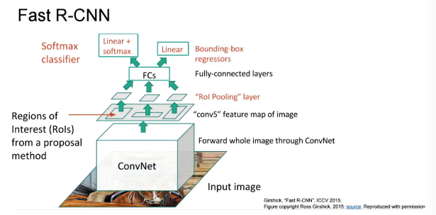
在最后端，用 Softmax 分类器取代了 SVM。
它采用了 SPP-net 的做法：把整张图像送入 ConvNet，然后从特征图中映射出 proposals 对应的位置。
它借鉴了 SPP-net，只不过 RoI Pooling 层是 SPP 层的一个特例。
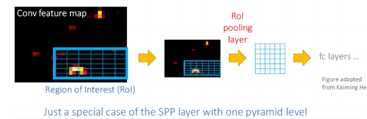
虽然它仍然是两阶段框架，
但在反向传播时整个网络可以一个阶段完成训练。
但要注意，提出候选框的算法仍然是 Selective Search，它基于原图提取 proposals，是不可训练的。
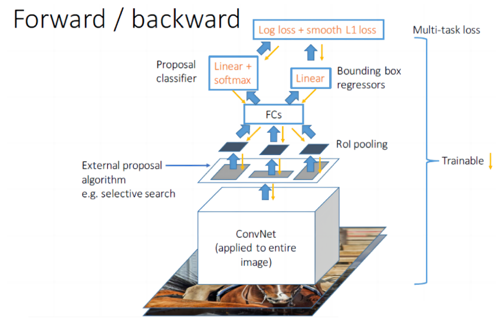
多任务损失：使用多任务损失函数，包括分类损失（Log loss）和回归损失（Smooth L1 loss）。

- Log loss（分类损失）：

用于分类任务，衡量模型对目标类别预测的误差。
例如，如果某个候选框的标签是“猫”，但模型预测为“狗”，就会产生分类损失。
- Smooth L1 loss（边界框回归损失）：

用于回归任务，衡量预测边界框与真实边界框之间的误差。
使用 Smooth L1 函数而不是普通的 L2 损失，是为了降低对离群值的敏感度。
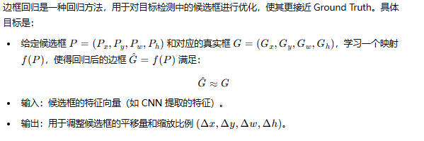

## SPP-net（空间金字塔池化网络）

SPP-net 是一种用于图像分类和目标检测的深度学习网络，由何恺明等人于 2014 年提出。它的核心是引入了 SPP 层（Spatial Pyramid Pooling Layer，空间金字塔池化层），解决了传统 CNN 模型对输入图像尺寸固定的要求。

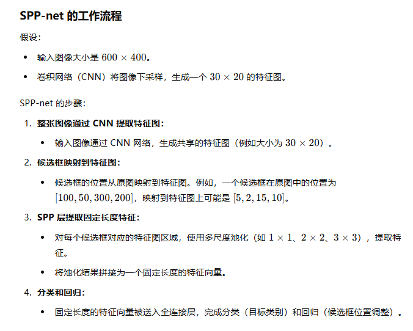

# Faster R-CNN
最重要的是引入了 RPN 网络，取代 SS 来提取候选框！！！（SS 即 Selective Search）

原来是一开始就用原图来寻找候选框；现在是图像先经过 CNN 得到特征图，再经过 RPN 得到候选框（proposals）。

共有四个损失函数。
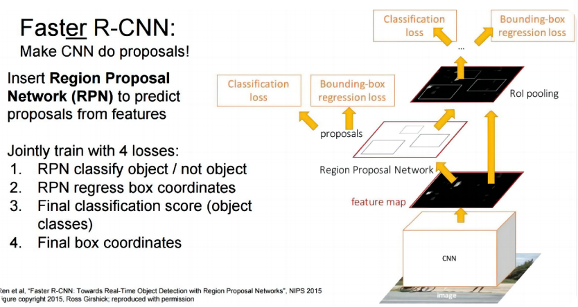
选择性搜索方法速度很慢；取代 SS 之后，速度提高到 1/0.2 = 5 FPS（每秒帧数）。
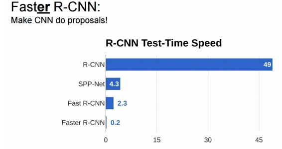

# YOLO（You Only Look Once）
把目标检测任务当作一个简单的回归问题。
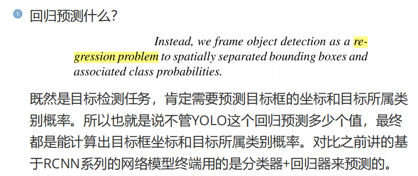
分类器输出类别概率，回归器输出候选框。

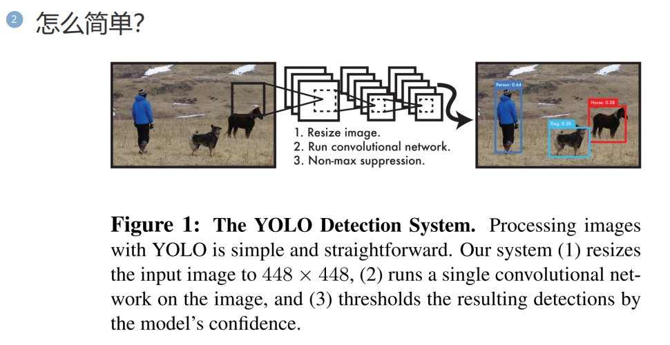
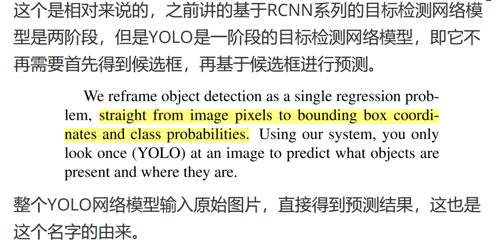
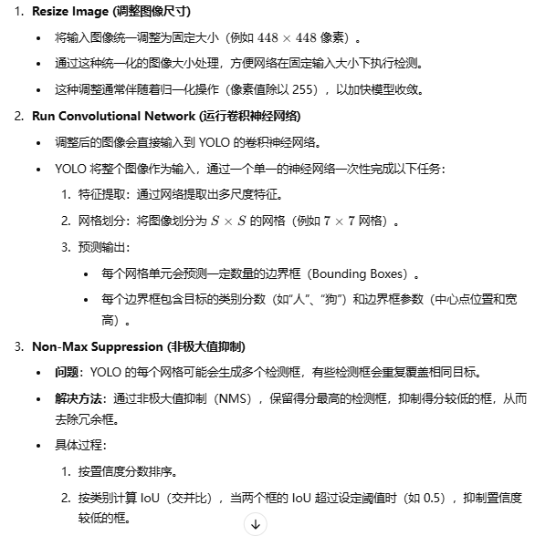

# YOLO 的统一模型
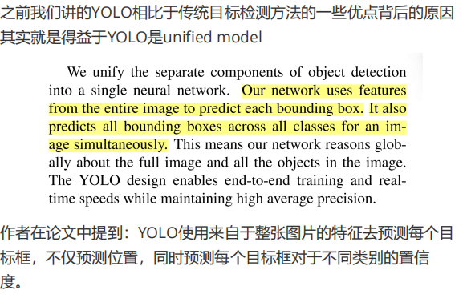
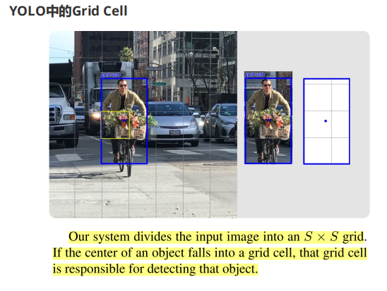
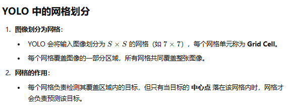
YOLO 把输入图像看作由网格单元组成。例如在上图中，人（蓝色框）的中心落在黄色网格单元内，因此由黄色网格单元负责预测这个人。
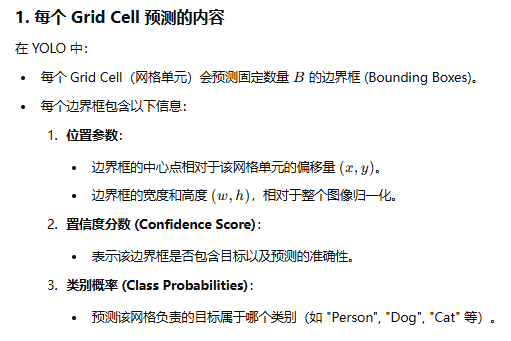
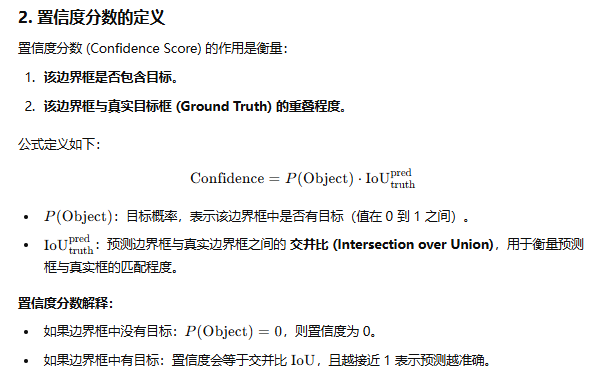

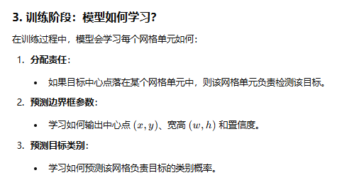
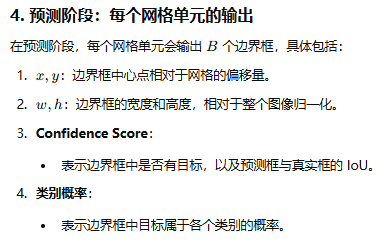
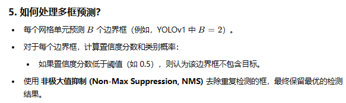

