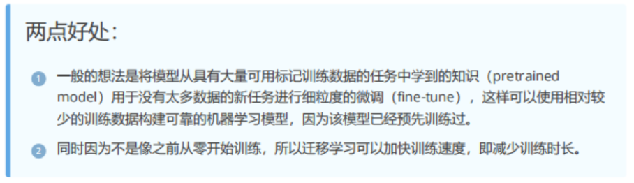
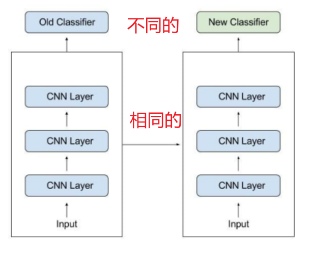
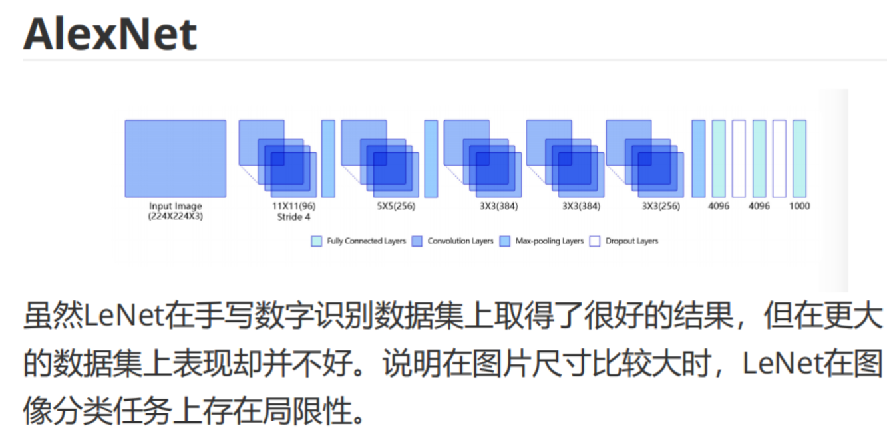
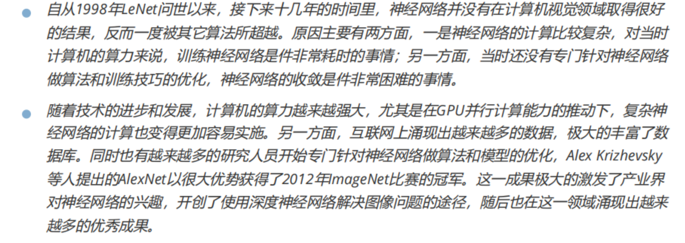
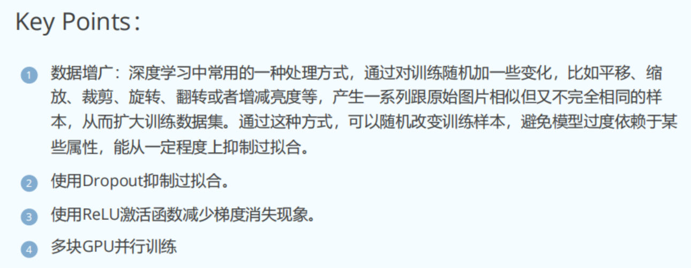
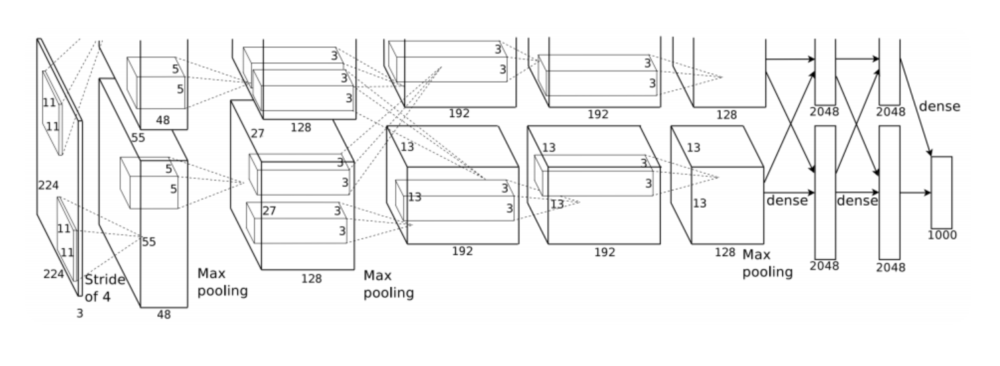


# 迁移学习



# 深度学习框架中可用的预训练分类模型
[https://tensorflow.google.cn/api_docs/python/tf/keras/applications](https://tensorflow.google.cn/api_docs/python/tf/keras/applications)

[https://pytorch.org/vision/stable/models.html#classification](https://pytorch.org/vision/stable/models.html#classification)

# AlexNet


Data augmentation：即数据增强——通过在训练样本中引入变化，使模型能够适应变化后的图像，提高泛化能力。这也使模型不仅能识别原始图像，还能识别变化后的图像（防止过拟合）。


卷积核按输出通道被分为两部分，但每部分的卷积核仍然遍历整张图像。

两部分得到的卷积结果分别进行池化，得到各自的池化结果。

然后再分别进行卷积，但仍然是作用于各自的结果。

最后，全连接层也是分别作用于各自的结果。

##  transforms.ToTensor()
### **`transforms.ToTensor()` 的作用**
`transforms.ToTensor()` 是 PyTorch 提供的 `torchvision.transforms` 模块中的常用方法，用于把 **PIL 图像**或 **NumPy 数组**转换为 **PyTorch 张量（Tensor）**。

---

### **1. 为什么需要 `ToTensor()`？**

- **神经网络只能处理张量**：
  深度学习模型通常只接受 PyTorch 张量（Tensor）作为输入，而图像数据通常以 **PIL 图像**或 **NumPy 数组**的形式存储，因此需要转换为 PyTorch 张量格式。

- **自动归一化**：
  `ToTensor()` 会把图像数据从像素值范围 `[0, 255]` 转换为 `[0.0, 1.0]` 范围内的浮点数。
  - 这种归一化有助于提高模型训练的稳定性。

---

### **2. `ToTensor()` 转换了什么**

#### **输入数据类型**
- 支持 **PIL 图像**（`PIL.Image.Image`）。
- 支持 **NumPy 数组**（`numpy.ndarray`）。

#### **输出**
- 返回形状为 `[C, H, W]`（通道、高、宽）的 PyTorch **张量（Tensor）**。

#### **注意：通道顺序**
- 对于彩色图像（RGB）：
  - `ToTensor()` 会把通道顺序从 **HWC** 转换为 **CHW**。
  - **HWC**：高（Height）、宽（Width）、通道（Channels）。
  - **CHW**：通道（Channels）、高（Height）、宽（Width）。
- 例如，输入图像形状为 `(224, 224, 3)`，转换后的张量形状为 `(3, 224, 224)`。

---

### **3. 示例代码**

#### **3.1 转换 PIL 图像**
```python
from torchvision import transforms
from PIL import Image
import torch

# 创建一个模拟的 PIL 图像
img = Image.new("RGB", (224, 224), color=(255, 0, 0))  # 创建一个红色的 RGB 图片

# 使用 ToTensor() 转换
transform = transforms.ToTensor()
tensor = transform(img)

print(tensor.shape)  # torch.Size([3, 224, 224])
print(tensor)  # 打印像素值（范围 [0, 1]）
```

#### **输出说明**
- **形状**：输出张量形状为 `[3, 224, 224]`，即 3 个通道，高和宽都是 224。
- **取值范围**：每个像素值从原来的 `[0, 255]` 转换为 `[0.0, 1.0]` 内的浮点数。

---

#### **3.2 转换 NumPy 数组**
```python
import numpy as np
from torchvision import transforms

# 创建一个随机 NumPy 图像数组 (HWC 格式)
img = np.random.randint(0, 256, (224, 224, 3), dtype=np.uint8)

# 将 NumPy 数组转换为 PIL 图像
from PIL import Image
pil_img = Image.fromarray(img)

# 使用 ToTensor() 转换
transform = transforms.ToTensor()
tensor = transform(pil_img)

print(tensor.shape)  # torch.Size([3, 224, 224])
print(tensor.dtype)  # torch.float32
```

- **从 NumPy 数组到 PIL 再到张量**：
  - NumPy 图像通常是 HWC 格式（高、宽、通道）。
  - 转换为张量后变为 CHW 格式。

---

### **4. 常见用途**

#### **4.1 图像预处理**
`ToTensor()` 常用于图像数据预处理流水线中，例如与其他变换组合使用：
```python
from torchvision import transforms

# 创建一个图像预处理流水线
transform = transforms.Compose([
    transforms.Resize((224, 224)),  # 调整图像大小
    transforms.ToTensor(),         # 转换为张量
])

# 加载图像并应用预处理
img = Image.open("example.jpg")  # 加载图片
tensor = transform(img)          # 预处理并转换为张量
print(tensor.shape)               # 输出张量形状
```

#### **4.2 数据增强**
`ToTensor()` 通常与数据增强方法一起使用，例如随机裁剪和翻转：
```python
transform = transforms.Compose([
    transforms.RandomHorizontalFlip(),  # 随机水平翻转
    transforms.RandomCrop(200),         # 随机裁剪为 200x200
    transforms.ToTensor(),              # 转换为张量
])
```

---

### **5. 注意事项**

1. **自动归一化到 `[0, 1]`**：
   - 如果输入是整数（例如 `[0, 255]` 的像素值），`ToTensor()` 会自动除以 255，把它们归一化到 `[0, 1]` 范围。
   - 如果输入已经是浮点数（例如 `[0.0, 1.0]`），则不会再次归一化。

2. **形状变换**：
   - 输入为 HWC 格式，输出为 CHW 格式。
   - 这是因为 PyTorch 模型通常要求输入张量为 CHW 格式。

3. **灰度图像**：
   - 如果输入是灰度图像（1 个通道），`ToTensor()` 会把它转换为形状为 `[1, H, W]` 的张量。

---

### **6. 示例对比**

#### **6.1 输入为 PIL 图像**
```python
from PIL import Image
from torchvision import transforms

# 创建一个灰度图像
img = Image.new("L", (3, 3), color=255)  # 灰度图像 (L 模式)
print(img)  # 输出 PIL 图像

# 转换为张量
tensor = transforms.ToTensor()(img)
print(tensor)  # 输出张量
```

- **PIL 图像**：
  ```
  <PIL.Image.Image image mode=L size=3x3 at 0x...>
  ```
- **输出张量**：
  ```
  tensor([[[1., 1., 1.],
           [1., 1., 1.],
           [1., 1., 1.]]])
  ```

#### **6.2 输入为 NumPy 数组**
```python
import numpy as np
from torchvision import transforms

# 创建一个 NumPy 数组
img = np.array([[0, 127, 255], [255, 127, 0], [0, 255, 127]], dtype=np.uint8)
print(img)

# 转换为 PIL 图像
from PIL import Image
pil_img = Image.fromarray(img)

# 转换为张量
tensor = transforms.ToTensor()(pil_img)
print(tensor)
```

- **NumPy 数组**：
  ```
  [[  0 127 255]
   [255 127   0]
   [  0 255 127]]
  ```
- **输出张量**：
  ```
  tensor([[[0.0000, 0.4980, 1.0000],
           [1.0000, 0.4980, 0.0000],
           [0.0000, 1.0000, 0.4980]]])
  ```

---


#  AlexNet 源码

## alexnet 函数
网络结构定义在 AlexNet 类中；创建对象后，通过 model.load_state_dict 加载模型参数。

```python

@register_model()
@handle_legacy_interface(weights=("pretrained", AlexNet_Weights.IMAGENET1K_V1))
def alexnet(*, weights: Optional[AlexNet_Weights] = None, progress: bool = True, **kwargs: Any) -> AlexNet:
    """AlexNet model architecture from `One weird trick for parallelizing convolutional neural networks <https://arxiv.org/abs/1404.5997>`__.

    .. note::
        AlexNet was originally introduced in the `ImageNet Classification with
        Deep Convolutional Neural Networks
        <https://papers.nips.cc/paper/2012/hash/c399862d3b9d6b76c8436e924a68c45b-Abstract.html>`__
        paper. Our implementation is based instead on the "One weird trick"
        paper above.

    Args:
        weights (:class:`~torchvision.models.AlexNet_Weights`, optional): The
            pretrained weights to use. See
            :class:`~torchvision.models.AlexNet_Weights` below for
            more details, and possible values. By default, no pre-trained
            weights are used.
        progress (bool, optional): If True, displays a progress bar of the
            download to stderr. Default is True.
        **kwargs: parameters passed to the ``torchvision.models.squeezenet.AlexNet``
            base class. Please refer to the `source code
            <https://github.com/pytorch/vision/blob/main/torchvision/models/alexnet.py>`_
            for more details about this class.

    .. autoclass:: torchvision.models.AlexNet_Weights
        :members:
    """

    weights = AlexNet_Weights.verify(weights)

    if weights is not None:
        _ovewrite_named_param(kwargs, "num_classes", len(weights.meta["categories"]))

    model = AlexNet(**kwargs)

    if weights is not None:
        model.load_state_dict(weights.get_state_dict(progress=progress, check_hash=True))

    return model
```

## class AlexNet(nn.Module)
用 Sequential 把多个网络层组合起来。
```python

class AlexNet(nn.Module):
    def __init__(self, num_classes: int = 1000, dropout: float = 0.5) -> None:
        super().__init__()
        _log_api_usage_once(self)
        self.features = nn.Sequential(
            nn.Conv2d(3, 64, kernel_size=11, stride=4, padding=2),
            nn.ReLU(inplace=True),
            nn.MaxPool2d(kernel_size=3, stride=2),
            nn.Conv2d(64, 192, kernel_size=5, padding=2),
            nn.ReLU(inplace=True),
            nn.MaxPool2d(kernel_size=3, stride=2),
            nn.Conv2d(192, 384, kernel_size=3, padding=1),
            nn.ReLU(inplace=True),
            nn.Conv2d(384, 256, kernel_size=3, padding=1),
            nn.ReLU(inplace=True),
            nn.Conv2d(256, 256, kernel_size=3, padding=1),
            nn.ReLU(inplace=True),
            nn.MaxPool2d(kernel_size=3, stride=2),
        )
        self.avgpool = nn.AdaptiveAvgPool2d((6, 6))
        self.classifier = nn.Sequential(
            nn.Dropout(p=dropout),
            nn.Linear(256 * 6 * 6, 4096),
            nn.ReLU(inplace=True),
            nn.Dropout(p=dropout),
            nn.Linear(4096, 4096),
            nn.ReLU(inplace=True),
            nn.Linear(4096, num_classes),
        )

    def forward(self, x: torch.Tensor) -> torch.Tensor:
        x = self.features(x)
        x = self.avgpool(x)
        x = torch.flatten(x, 1)
        x = self.classifier(x)
        return x
```

## AlexNet_Weights
IMAGENET1K_V1 指的是 ImageNet 竞赛，1K 表示 1000 个类别，V1 是版本号。

IMAGENET1K_V1 是一个 Weights 对象，其属性包括 url（下载模型参数的 URL）和 pth（表示 PyTorch 模型文件）。


**`transforms`**：一个函数或函数包装器（这里用 `partial` 包装了 `ImageClassification`）。它指定了使用这些权重时所需的输入预处理方式，例如裁剪尺寸为 224。这确保了用户使用这些权重时，输入数据与训练时的分布一致。


`meta` 是一个字典，用于存放与权重相关的各种信息，例如模型参数量、准确率、文件大小等。

```python
meta={
    "num_params": 61100840,  # 模型的参数总数
    "min_size": (63, 63),  # 模型支持的最小输入尺寸
    "categories": _IMAGENET_CATEGORIES,  # 分类类别名称（1000 个 ImageNet 类别）
    "recipe": "https://github.com/pytorch/vision/tree/main/references/classification#alexnet-and-vgg",  # 训练时的配方（参考训练代码）
    "_metrics": {
        "ImageNet-1K": {
            "acc@1": 56.522,  # Top-1 准确率
            "acc@5": 79.066,  # Top-5 准确率
        }
    },
    "_ops": 0.714,  # 模型的操作复杂度（以 GMACs 为单位，十亿次乘加运算）
    "_file_size": 233.087,  # 模型权重文件的大小（单位：MB）
    "_docs": """
        These weights reproduce closely the results of the paper using a simplified training recipe.
    """,  # 权重的文档说明
},
```

