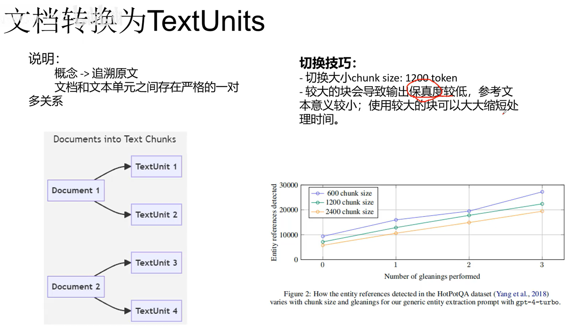
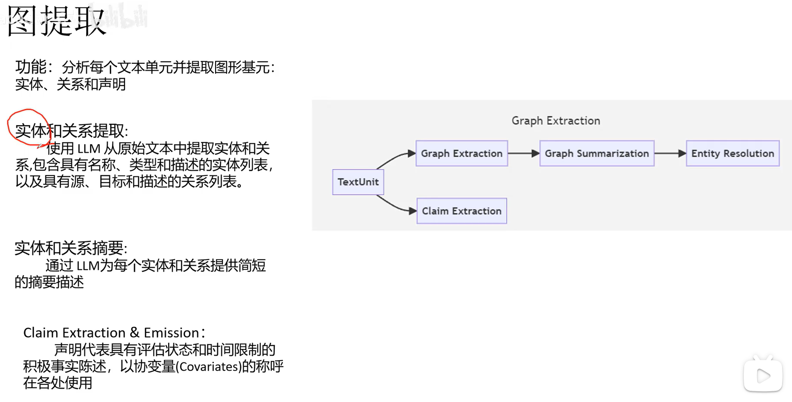
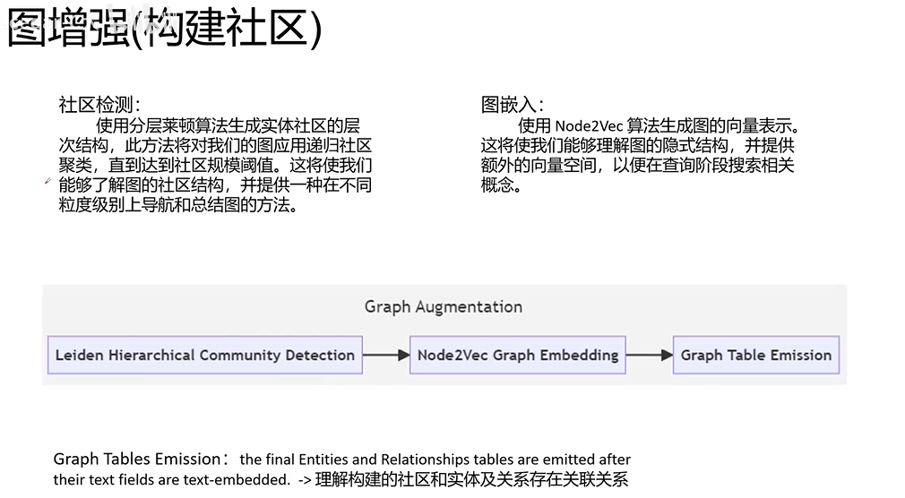
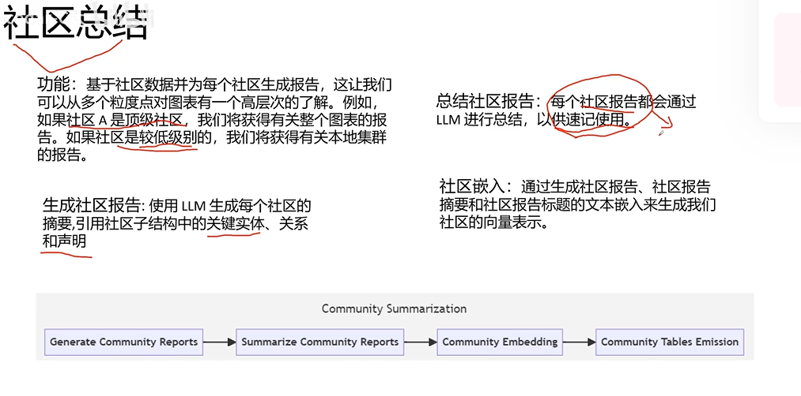
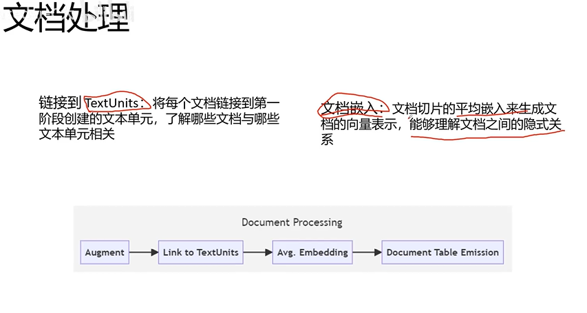
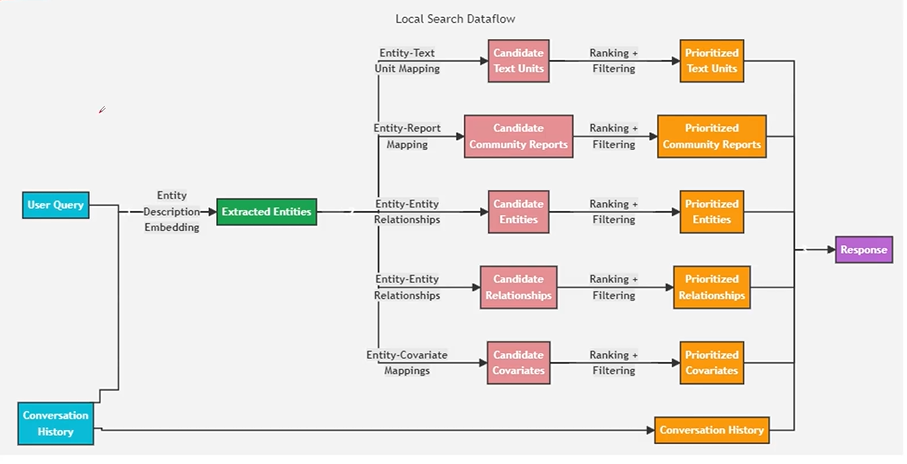
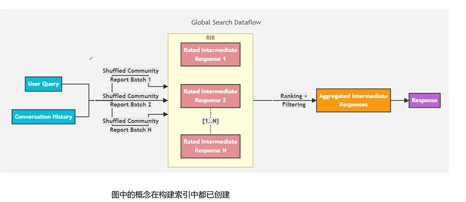


# 实践参考
[https://github.com/gusye1234/nano-graphrag](https://github.com/gusye1234/nano-graphrag)
[https://github.com/severian42/GraphRAG-Local-UI](https://github.com/severian42/GraphRAG-Local-UI)
[https://github.com/TheAiSingularity/graphrag-local-ollama](https://github.com/TheAiSingularity/graphrag-local-ollama)
[https://github.com/microsoft/graphrag](https://github.com/microsoft/graphrag)
[https://github.com/Azure-Samples/graphrag-accelerator](https://github.com/Azure-Samples/graphrag-accelerator)
[GraphRAG 原理、源码与应用介绍](https://www.bilibili.com/video/BV1u6iFeAEx9?spm_id_from=333.788.videopod.episodes&vd_source=a1be939c65919194c77b8a6a36c14a6e)

# 参考论文
[GraphRAG 论文解读：快速从 0 到 1 上手 GraphRAG](https://blog.csdn.net/m0_46686599/article/details/140608213)
[GraphRAG：论文原理解读](https://www.bilibili.com/video/BV1ym421g7Rm/?vd_source=a1be939c65919194c77b8a6a36c14a6e)
[大模型中的 GraphRAG：《From Local to Global: A Graph RAG Approach to Query-Focused Summarization》翻译与解读](https://blog.csdn.net/qq_41185868/article/details/138982960)
[202407 论文研读 – From Local to Global: A Graph RAG Approach to Query-Focused Summarization](https://www.15zhi.net/blog/202407-%E8%AE%BA%E6%96%87%E7%A0%94%E8%AF%BB-from-local-to-global%EF%BC%9Aa-graph-rag-approach-to-query-focused-summarization/)
[下一代 RAG 技术：GraphRAG](https://www.1goto.ai/article/ed28a1f6-156d-47a2-9ed0-55549667b3e6)
[From Local to Global: A Graph RAG Approach toQuery-Focused Summarization](https://arxiv.org/pdf/2404.16130)
# 特点
  rag：从外部知识中检索信息 -> 让 LLM 回答涉及私有或未见过的文档集合的问题。
  传统 rag：检索细节信息，无法解决 QFS（Query-Focused Summarization，面向查询的摘要）问题。

# 基本概念
### Document（文档）
- **定义**：系统中的输入文档。这些文档可以是 CSV 文件中的单独一行，也可以是单独的 .txt 文件。
- **示例**：
  - CSV 文件中的一行数据：`Name,Age,Location;John,25,New York`
  - 单独 .txt 文件的内容：`This is a sample text document.`

### TextUnit（文本单元）
- **定义**：待分析的文本块。这些文本块的大小、重叠程度，以及是否遵循数据边界，都可以在下面配置。一个常见的用法是将 `CHUNK_BY_COLUMNS` 设置为 `id`，这样文档与 TextUnit 之间就是一对多关系，而不是多对多关系。
- **示例**：
  - 假设有一篇长文档："This is a sample text. This text is another example text. This is just another text."
    - 如果将 `CHUNK_BY_COLUMNS` 设置为 `id`，可以将其拆分为多个文本块：
      - 文本块 1："This is a sample text."
      - 文本块 2："This text is another example text."
      - 文本块 3："This is just another text."

### Entity（实体）
- **定义**：从 TextUnit 中提取出的实体。这些实体代表人物、地点、事件，或你提供的其他实体模型。
- **示例**：
  - 文本块："John lives in New York and works at Google."
    - 实体：
      - 人物：John
      - 地点：New York
      - 组织：Google

### Relationship（关系）
- **定义**：两个实体之间的关系。这些关系是连同协变量一起生成的。
- **示例**：
  - 文本块："John lives in New York and works at Google."
    - 关系：
      - John（人物）-> lives in（关系）-> New York（地点）
      - John（人物）-> works at（关系）-> Google（组织）

### Covariate（协变量）
- **定义**：提取出的声明（claim）信息，包含关于实体的陈述，这些陈述可能带有时间限制。
- **示例**：
  - 文本块："John lived in New York from 2010 to 2015."
    - 协变量：
      - 时间范围：2010 到 2015
      - 陈述：John lived in New York

### Claim（声明）
- **定义**：表示一条带有评估状态和时间限制的正面事实陈述；在其他地方被称为协变量。
- **示例**：
  - 文本块："John lived in New York from 2010 to 2015."
    - 声明：
      - John lived in New York（评估状态：true）
      - 时间范围：2010 到 2015

### Community Report（社区报告，社区即子图）
- **定义**：实体生成之后，我们对其进行层次化社区检测，并为该层次结构中的每个社区生成一份报告。
- **示例**：
  - 假设有如下实体和关系：
    - 实体：John、New York、Google
    - 关系：John lives in New York，John works at Google
  - 社区报告：
    - 社区 1：John、New York
    - 社区 2：John、Google
    - 报告：
      - 社区 1 报告：John lives in New York
      - 社区 2 报告：John works at Google

### Node（节点）
- **定义**：包含布局信息，用于渲染已嵌入并建立索引的实体和文档的图视图。
- **示例**：
  - 在图视图中，节点可以代表不同的实体：
    - 节点 1：John
    - 节点 2：New York
    - 节点 3：Google
  - 这些节点通过边相连，边表示实体之间的关系。

# 索引构建原理
##  Document -> TextUnit

对文本块大小有一定要求：太大则上下文信息保留不好；太小则文本块数量过多，处理耗时很长。

## Text Units -> Graph Extraction

从文本单元中提取实体和关系并生成摘要；claim 是更详细的摘要。

## 构建社区
社区是具有相似性的子图。图嵌入的原理是生成节点的向量表示，这些向量可以反映节点在图中的位置以及与其他节点的关系。

## 社区摘要
为每个社区生成报告，每份社区报告由 LLM 总结以便快速查阅。最后生成社区的向量表示。

## 文档处理
文档与文本单元相关联。文档嵌入的做法是把文档拆分成多个部分，分别对每个部分做嵌入，再计算这些嵌入的平均值，得到整篇文档的向量表示。这种方法可以捕捉文档之间的隐含关系。

# 查询流程原理

## Local Search（局部搜索）

 

### 数据流概览

1. **User Query**
   - 用户输入查询。

2. **Extracted Entities**
   - 使用 Description Embedding 技术从用户查询中提取实体。

3. **Conversation History**
   - 记录并利用对话历史信息。

### 主要处理流程

#### 1. Entity-Text Unit Mapping
   - **Candidate Text Units**
     - 根据实体到文本单元的映射生成候选文本单元。
   - **Prioritized Text Units**
     - 通过排序和过滤对候选文本单元进行优先级排序。

#### 2. Entity-Report Mapping
   - **Candidate Community Reports**
     - 根据实体到报告的映射生成候选社区报告。
   - **Prioritized Community Reports**
     - 通过排序和过滤对候选社区报告进行优先级排序。

#### 3. Entity-Entity Relationships
   - **Candidate Entities**
     - 根据实体到实体的关系映射生成候选实体。
   - **Prioritized Entities**
     - 通过排序和过滤对候选实体进行优先级排序。

#### 4. Entity-Relationship Mapping
   - **Candidate Relationships**
     - 根据实体到关系的映射生成候选关系。
   - **Prioritized Relationships**
     - 通过排序和过滤对候选关系进行优先级排序。

#### 5. Entity-Covariate Mapping
   - **Candidate Covariates**
     - 根据实体到协变量的映射生成候选协变量。
   - **Prioritized Covariates**
     - 通过排序和过滤对候选协变量进行优先级排序。

### Final Response

- 所有经过优先级排序的文本单元、社区报告、实体、关系和协变量最终会被合并，生成最终响应。

### Conversation History

- 对话历史在整个过程中被记录下来，并用于后续的查询处理。

### 总结

该流程经过多次映射与优先级排序，从用户查询中提取实体，并基于这些实体生成候选文本单元、社区报告、实体、关系和协变量。最后，经过优先级排序后，这些候选内容会与聊天历史合并，生成最终响应。对话历史贯穿整个流程，用于提供更准确、更个性化的搜索结果。

## Global Search（全局搜索）
遍历每个社区查找相关信息，对找到的内容打分并过滤，然后拼接内容填充提示词，最后调用 LLM。

# v0.2.0 Graph 源码阅读
## init

