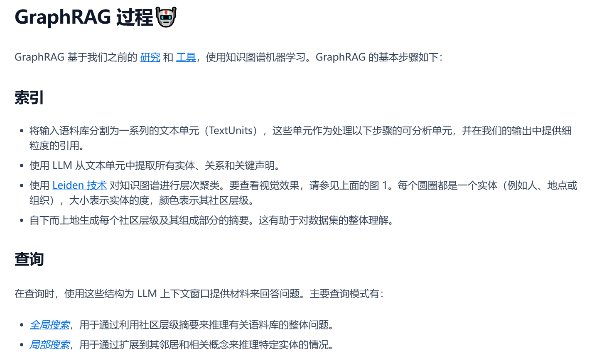
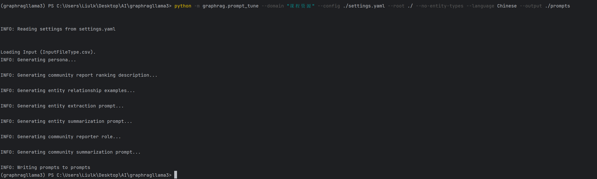
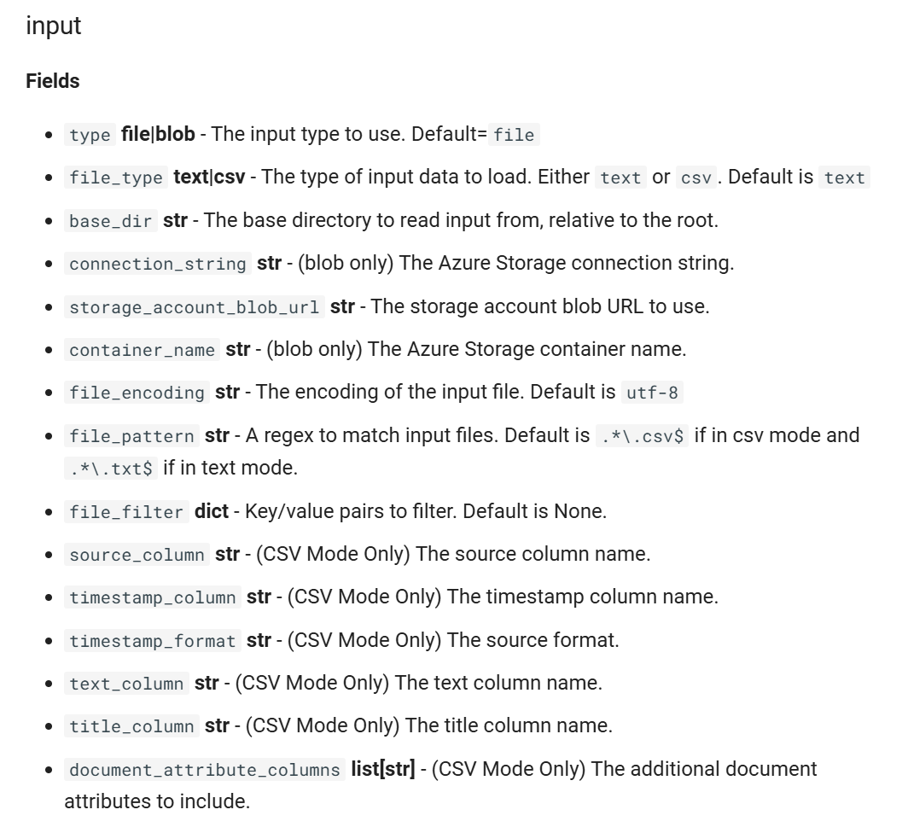
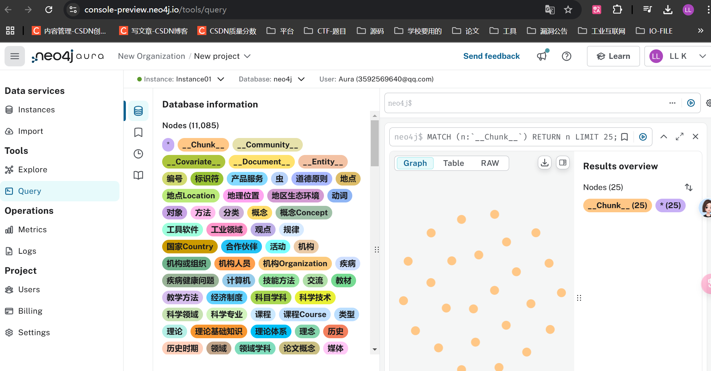
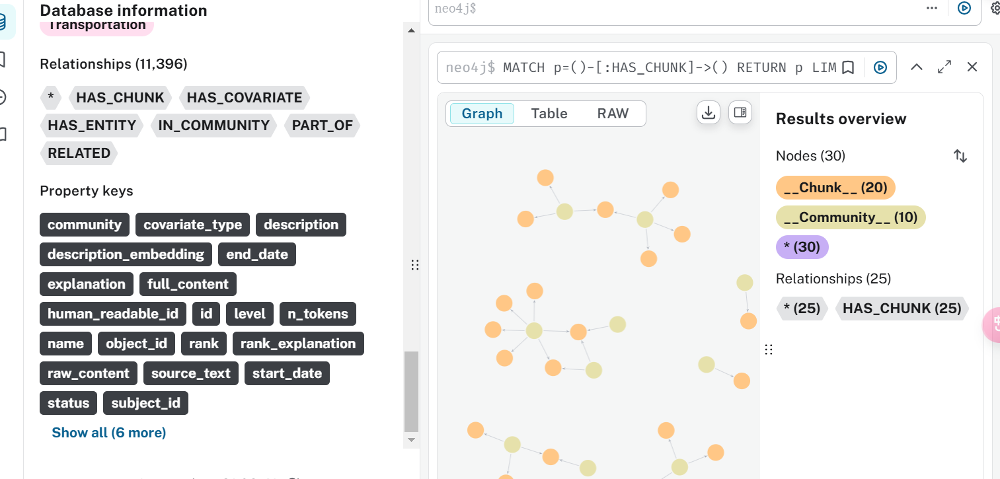
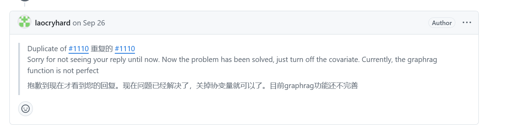
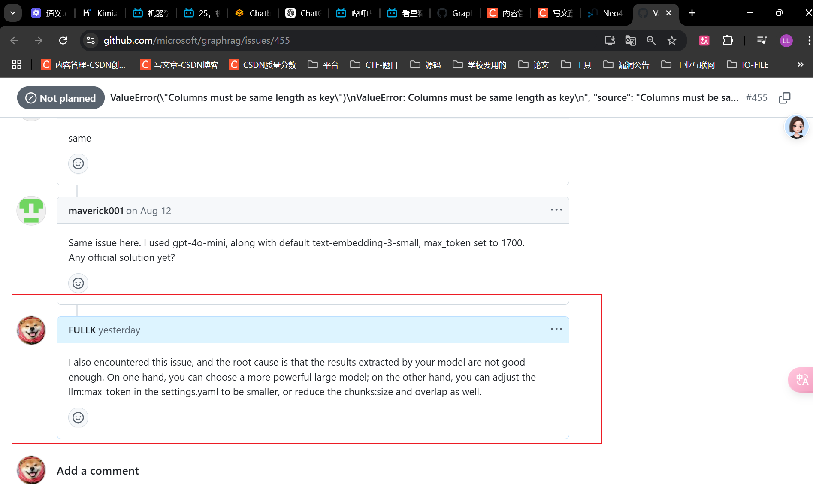


# 参考资料
[为什么知识图谱 + RAG > 传统 RAG？](https://mp.weixin.qq.com/s?__biz=MzI3ODE5Mzc1Ng==&mid=2247491080&idx=1&sn=ba1d09b459cbf39b84e76bf6c09b88c9&chksm=ea0c3d79ef79b3303d3393df1a4fcc05589f67d42187fa36eeee63b6a3db7897fa9b220f8e37&mpshare=1&scene=23&srcid=1011obEfvrBWmGW4T5J66J9v&sharer_shareinfo=0aca140e700de48d925a9ce99d682e62&sharer_shareinfo_first=0aca140e700de48d925a9ce99d682e62#rd)
[如何用 LLaMA 3 构建 Agent 应用](https://mp.weixin.qq.com/s?__biz=MzI2OTE2NTQzMw==&mid=2650792016&idx=1&sn=368c2385d875eb841a02f0cbae670d8e&chksm=f3dbab9751628ea73b42c3423600848a42cfa9d06826fa6aa575bcc4a59cca273e2aa17ea555&mpshare=1&scene=23&srcid=1016HsdQM2dTRCesrM25r1eR&sharer_shareinfo=6aab980e4cf47949d2440953d7cf17d7&sharer_shareinfo_first=6aab980e4cf47949d2440953d7cf17d7#rd)
[合集：大模型科普](https://space.bilibili.com/472543316/lists?sid=3378901&spm_id_from=333.788.0.0)
[https://github.com/NanGePlus/GraphragTest](https://github.com/NanGePlus/GraphragTest)
# 代码仓库
[https://github.com/FULLK/Graphrag_LLama3.2-class-project](https://github.com/FULLK/Graphrag_LLama3.2-class-project)
# anaconda+pycharm

[【大模型应用开发基础】搭建 Anaconda + PyCharm 集成开发环境](https://www.bilibili.com/video/BV1q9HxeEEtT/?vd_source=30acb5331e4f5739ebbad50f7cc6b949%20https://youtu.be/myVgyitFzrA)
# LLaMA 3
在网上搜索 Ollama，然后下载。
```cpp
ollama pull llama3.1:latest
ollama pull nomic-embed-text:latest
ollama server
```
以上是 Windows 下的操作。

Ubuntu 下：

```bash
sudo docker pull ollama/ollama
docker run --gpus all -d  -p 11434:11434 --name ollama ollama/ollama
docker exec -it ollama   /bin/sh

```

# 传统 RAG
用问题在知识库中检索，然后把结果整合进 prompt，交给 LLM 回答。

适用于微观层面。
# GraphRAG
[微软最新的 GraphRAG 和普通 RAG 有什么区别？](https://www.bilibili.com/video/BV12i421Y7wd/?spm_id_from=333.337.search-card.all.click&vd_source=a1be939c65919194c77b8a6a36c14a6e)
[GraphRAG 中文网站](https://www.graphrag.club/)

用问题从 LLM 构建的知识图谱中检索相关子图来构建 prompt，再交给 LLM 得到答案。

适用于宏观层面。
- 图谱构建的问题
- 新数据如何加入图谱
- 图谱构建很耗资源
> GraphRAG 是一种结构化、分层的检索增强生成（RAG）方法，而不是使用纯文本片段的语义搜索方法。GraphRAG 的流程包括：从原始文本中提取知识图谱，构建社区层级（这种结构通常用于描述个体、群体及其相互关系，有助于理解信息在社区中如何传播、知识如何共享以及权力和影响力如何分布），为这些社区层级生成摘要，然后在执行基于 RAG 的任务时利用这些结构。


## 初始化
```cpp
python -m graphrag.index --init --root ./ 
```
这会在当前目录下创建 input 目录、output 目录、prompts 目录、.env 和 settings.yaml。
- .env 包含运行 GraphRAG 流水线所需的环境变量。查看该文件，会看到只定义了一个环境变量：GRAPHRAG_API_KEY=<API_KEY>。这是 OpenAI API 或 Azure OpenAI 端点的 API 密钥，可以替换成你自己的 API 密钥。
- settings.yaml 包含流水线的设置。可以修改这个文件来改变流水线设置。它设定了提示词调优或生成知识图谱（索引）时使用哪个模型。
- prompts：
  提供初始提示词：
  初始化时，graphrag 工具可能会生成一些初始提示词，引导语言模型为特定领域生成知识图谱。这些提示词通常是通用模板，可以根据实际需要调整和优化。
支持微调：
生成的提示词可以作为提示词调优的起点。通过提示词调优，可以进一步优化这些提示词，以更好地提取实体和关系。
## 使用提示词调优创建更适合知识库的知识图谱
自动调优：加载输入，把输入切分成文本块，然后运行一系列 LLM 调用和提示词模板替换，生成最终的提示词模板。
手动调优：手动调整提示词模板。

```cpp
python -m graphrag.prompt_tune --config ./settings.yaml --root ./ --no-entity-types --language Chinese --output ./prompts

具体用法如下：
python -m graphrag.prompt_tune --config ./settings.yaml --root ./ --no-entity-types --language Chinese --output ./prompts
根据实际情况选择相关参数：
--config :(必选) 所使用的配置文件，这里选择setting.yaml文件
--root :(可选)数据项目根目录，包括配置文件（YML、JSON 或 .env）。默认为当前目录
--domain :(可选)与输入数据相关的域，如 “空间科学”、“微生物学 ”或 “环境新闻”。如果留空，域将从输入数据中推断出来
--method :(可选)选择文档的方法。选项包括全部(all)、随机(random)或顶部(top)。默认为随机
--limit :(可选)使用随机或顶部选择时加载文本单位的限制。默认为 15
--language :(可选)用于处理输入的语言。如果与输入语言不同，LLM 将进行翻译。默认值为“”，表示将从输入中自动检测
--max-tokens :(可选)生成提示符的最大token数。默认值为 2000
--chunk-size :(可选)从输入文档生成文本单元时使用的标记大小。默认值为 20
--no-entity-types（无实体类型） :(可选)使用无类型实体提取生成。建议在数据涵盖大量主题或高度随机化时使用
--output :(可选)保存生成的提示信息的文件夹。默认为 “prompts”
```



## 使用语言模型（LLM）从每个文本块中提取实体、关系和声明
实体可以是人名、地名、组织名等；关系可以是实体之间的关联；声明可以是关于实体的具体信息。
```cpp
python -m graphrag.index --root ./
```

--resume 可以从上次运行停止的地方继续。
## 查询（局部搜索、全局搜索、问题生成）

```cpp
本地搜索（Local Search）：基于实体的推理
本地搜索方法将知识图谱中的结构化数据与输入文档中的非结构化数据结合起来，在查询时用相关实体信息增强 LLM 上下文
这种方法非常适合回答需要了解输入文档中提到的特定实体的问题（例如，"洋甘菊有哪些治疗功效？）
使用局部搜索来提出一个关于特定角色的更具体的问题的示例：

python -m graphrag.query \
--root ./\
--method local \
"Scrooge 这个故事的主人公是谁，他的主要关系是什么？"

全局搜索（Global Search）： 基于全数据集推理
根据LLM生成的知识图谱结构能知道整个数据集的结构（以及主题）
这样就可以将私有数据集组织成有意义的语义集群，并预先加以总结。LLM在响应用户查询时会使用这些聚类来总结这些主题
使用全局搜索来提出一个高层次问题的示例：

python -m graphrag.query \
--root ./ \
--method global \
"这个故事的主题是什么？"

问题生成（Question Generation）：基于实体的问题生成
将知识图谱中的结构化数据与输入文档中的非结构化数据相结合，生成与特定实体相关的候选问题

```
## 加载 CSV
[GraphRAG 如何加载 CSV 数据？从源码告诉你如何修改配置文件才能成功加载你的 CSV 数据](https://www.bilibili.com/video/BV1gDv1eFEBr/?spm_id_from=333.337.search-card.all.click&vd_source=a1be939c65919194c77b8a6a36c14a6e)
[默认配置模式（使用 YAML/JSON）](https://microsoft.github.io/graphrag/config/yaml/)

修改 `settings.yaml` 中的 input 部分
```cpp
input:
  type: file # or blob
  file_type: csv # or csv
  # base_dir: "input"cl
  base_dir: ${GRAPHRAG_INPUT_DIR}
  file_encoding: utf-8
  file_pattern: ".*\\.csv"
  source_column: "id"
  title_column: "name"
  text_column: "schoolName"
```



# 部署
把 [https://github.com/NanGePlus/GraphragTest](https://github.com/NanGePlus/GraphragTest) 的 utils 文件夹克隆到你的工作目录，并把 INPUT_DIR 改为你生成的 artifacts。

```bash
python main.py  #启动服务器
```

# 把索引导入 Neo4j 生成知识图谱

[【GraphRAG + 知识图谱可视化】用 Neo4j 可视化知识图谱——基于近两万字文本构建知识图谱，创建基于知识图谱的本地知识库，结合局部搜索与全局搜索](https://www.bilibili.com/video/BV1prHxe4E9J?vd_source=30acb5331e4f5739ebbad50f7cc6b949&spm_id_from=333.788.videopod.sections)
下载这个插件可以方便地查看 Parquet 文件。


把 GRAPHRAG_FOLDER 改为你生成的 artifacts 文件夹。

使用在线 Neo4j 创建实例。
[https://console-preview.neo4j.io/tools/query](https://console-preview.neo4j.io/tools/query)
修改密码、账号和实例名。
```python
python3  neo4jTest.py
```





# 报错

出现如下错误：[https://github.com/microsoft/graphrag/issues/1109](https://github.com/microsoft/graphrag/issues/1109)

我怀疑是实体提取效果不好时会出现这种情况。
```cpp
22:51:58,218 graphrag.index.reporting.file_workflow_callbacks INFO Claim Extraction Error details={'doc_index': 0, 'text': '������ѧ'}
22:51:58,265 datashaper.workflow.workflow INFO executing verb window
22:51:58,266 datashaper.workflow.workflow ERROR Error executing verb "window" in create_final_covariates: 'covariate_type'
Traceback (most recent call last):
  File "C:\Users\Liulk\anaconda3\envs\graphragllama3\Lib\site-packages\datashaper\workflow\workflow.py", line 410, in _execute_verb
    result = node.verb.func(**verb_args)
             ^^^^^^^^^^^^^^^^^^^^^^^^^^^
  File "C:\Users\Liulk\anaconda3\envs\graphragllama3\Lib\site-packages\datashaper\engine\verbs\window.py", line 73, in window
    window = __window_function_map[window_operation](input_table[column])
                                                     ~~~~~~~~~~~^^^^^^^^
  File "C:\Users\Liulk\anaconda3\envs\graphragllama3\Lib\site-packages\pandas\core\frame.py", line 4102, in __getitem__
    indexer = self.columns.get_loc(key)
              ^^^^^^^^^^^^^^^^^^^^^^^^^
  File "C:\Users\Liulk\anaconda3\envs\graphragllama3\Lib\site-packages\pandas\core\indexes\range.py", line 417, in get_loc
    raise KeyError(key)
KeyError: 'covariate_type'
22:51:58,276 graphrag.index.reporting.file_workflow_callbacks INFO Error executing verb "window" in create_final_covariates: 'covariate_type' details=None
22:51:58,277 graphrag.index.run ERROR error running workflow create_final_covariates
Traceback (most recent call last):
  File "C:\Users\Liulk\anaconda3\envs\graphragllama3\Lib\site-packages\graphrag\index\run.py", line 325, in run_pipeline
    result = await workflow.run(context, callbacks)
             ^^^^^^^^^^^^^^^^^^^^^^^^^^^^^^^^^^^^^^
  File "C:\Users\Liulk\anaconda3\envs\graphragllama3\Lib\site-packages\datashaper\workflow\workflow.py", line 369, in run
    timing = await self._execute_verb(node, context, callbacks)
             ^^^^^^^^^^^^^^^^^^^^^^^^^^^^^^^^^^^^^^^^^^^^^^^^^^
  File "C:\Users\Liulk\anaconda3\envs\graphragllama3\Lib\site-packages\datashaper\workflow\workflow.py", line 410, in _execute_verb
    result = node.verb.func(**verb_args)
             ^^^^^^^^^^^^^^^^^^^^^^^^^^^
  File "C:\Users\Liulk\anaconda3\envs\graphragllama3\Lib\site-packages\datashaper\engine\verbs\window.py", line 73, in window
    window = __window_function_map[window_operation](input_table[column])
                                                     ~~~~~~~~~~~^^^^^^^^
  File "C:\Users\Liulk\anaconda3\envs\graphragllama3\Lib\site-packages\pandas\core\frame.py", line 4102, in __getitem__
    indexer = self.columns.get_loc(key)
              ^^^^^^^^^^^^^^^^^^^^^^^^^
  File "C:\Users\Liulk\anaconda3\envs\graphragllama3\Lib\site-packages\pandas\core\indexes\range.py", line 417, in get_loc
    raise KeyError(key)
KeyError: 'covariate_type'
22:51:58,278 graphrag.index.reporting.file_workflow_callbacks INFO Error running pipeline! details=None
```

关掉就行——它默认是关闭的，注释掉即可。


[https://github.com/microsoft/graphrag/issues/455](https://github.com/microsoft/graphrag/issues/455)

```bash
ValueError: Columns must be same length as key
```
根本原因是你的模型提取效果不够好。一方面可以选择更强的模型；另一方面可以调低 settings.yaml 中的 llm:max_token，或者同时减小 chunks:size 和 overlap。



# 生成 Neo4j 知识图谱时报错

```bash
[4 rows x 9 columns]
Traceback (most recent call last):
File "/data_disk/liulk/GraphragTest/class_project/utils/neo4jTest.py", line 226, in
batched_import(community_statement, community_report_df)
File "/data_disk/liulk/GraphragTest/class_project/utils/neo4jTest.py", line 96, in batched_import
result = driver.execute_query("UNWIND $rows AS value " + statement,
^^^^^^^^^^^^^^^^^^^^^^^^^^^^^^^^^^^^^^^^^^^^^^^^^^^^^^^^^^
File "/home/liulk/miniconda3/envs/GraphragTest/lib/python3.12/site-packages/neo4j/_sync/driver.py", line 969, in execute_query
return session._run_transaction(
^^^^^^^^^^^^^^^^^^^^^^^^^
File "/home/liulk/miniconda3/envs/GraphragTest/lib/python3.12/site-packages/neo4j/_sync/work/session.py", line 581, in _run_transaction
result = transaction_function(tx, *args, **kwargs)
^^^^^^^^^^^^^^^^^^^^^^^^^^^^^^^^^^^^^^^^^
File "/home/liulk/miniconda3/envs/GraphragTest/lib/python3.12/site-packages/neo4j/_sync/driver.py", line 1305, in _work
res = tx.run(query, parameters)
^^^^^^^^^^^^^^^^^^^^^^^^^
File "/home/liulk/miniconda3/envs/GraphragTest/lib/python3.12/site-packages/neo4j/_sync/work/transaction.py", line 195, in run
result._tx_ready_run(query, parameters)
File "/home/liulk/miniconda3/envs/GraphragTest/lib/python3.12/site-packages/neo4j/_sync/work/result.py", line 175, in _tx_ready_run
self._run(query, parameters, None, None, None, None, None, None)
File "/home/liulk/miniconda3/envs/GraphragTest/lib/python3.12/site-packages/neo4j/_sync/work/result.py", line 231, in _run
self._attach()
File "/home/liulk/miniconda3/envs/GraphragTest/lib/python3.12/site-packages/neo4j/_sync/work/result.py", line 425, in _attach
self._connection.fetch_message()
File "/home/liulk/miniconda3/envs/GraphragTest/lib/python3.12/site-packages/neo4j/_sync/io/_common.py", line 184, in inner
func(*args, **kwargs)
File "/home/liulk/miniconda3/envs/GraphragTest/lib/python3.12/site-packages/neo4j/_sync/io/_bolt.py", line 994, in fetch_message
res = self._process_message(tag, fields)
^^^^^^^^^^^^^^^^^^^^^^^^^^^^^^^^^^
File "/home/liulk/miniconda3/envs/GraphragTest/lib/python3.12/site-packages/neo4j/_sync/io/_bolt5.py", line 1204, in _process_message
response.on_failure(summary_metadata or {})
File "/home/liulk/miniconda3/envs/GraphragTest/lib/python3.12/site-packages/neo4j/_sync/io/_common.py", line 254, in on_failure
raise self._hydrate_error(metadata)
neo4j.exceptions.ClientError: {code: Neo.ClientError.Schema.TokenNameError} {message: '' is not a valid token name. Token names cannot be empty or contain any null-bytes.}
```
问题出在创建社区节点的过程中。错误信息说 token 名不能为空或包含空字节。我们来修改社区的导入语句，确保所有值都有效。

```python
# 5、创建或更新community与entity、chunk节点之间的关系
community_statement = """
MERGE (c:__Community__ {community: COALESCE(value.community, 'unknown')})
SET c += value {
    .id,
    .title,
    .summary,
    .level,
    .rank,
    .rank_explanation,
    .full_content
}
WITH c, value
UNWIND value.findings AS finding
MERGE (f:__Finding__ {id: finding.id})
SET f += finding
MERGE (c)-[:HAS_FINDING]->(f)
"""

# 在导入之前确保数据的有效性
community_report_df = community_report_df.fillna({
    'community': 'unknown',
    'id': 'unknown',
    'title': '',
    'summary': '',
    'level': '',
    'rank': 0,
    'rank_explanation': '',
    'full_content': ''
})

# 确保findings列是一个有效的JSON字符串列表
def parse_findings(findings):
    if isinstance(findings, str):
        try:
            return json.loads(findings)
        except:
            return []
    return findings if isinstance(findings, list) else []

community_report_df['findings'] = community_report_df['findings'].apply(parse_findings)

batched_import(community_statement, community_report_df)
```


# 待改进
- 以后考虑使用 CSV 作为数据源，效果应该会更好。
- 可以把 GraphRAG 升级到最新版本，新版本增加了功能，效果可能会更好。

