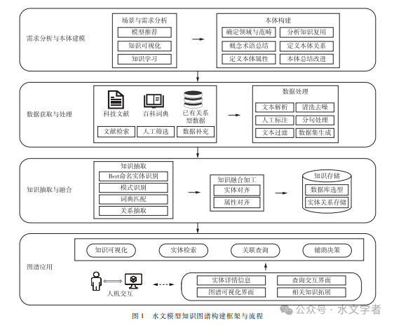
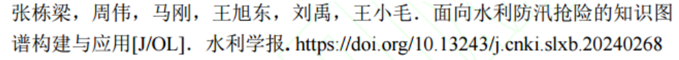


# 水文模型知识图谱构建与应用（核心）

[水文模型知识图谱构建与应用](https://mp.weixin.qq.com/s/oV-16C4EQ7hqHJ2kUAlxvw)

题目：水文模型知识图谱构建与应用
作者：周逸凡、段浩、赵红莉、赵慧子、李昊、韩昆
期刊：《水利学报》2024 年第 1 期

总结：自顶向下构建。

1. 本体建模：图谱边界 -> 概念/术语节点 -> 属性
2. 实体抽取：BERT 模型 -> 针对不同类型实体采用不同的抽取策略并赋予策略权重 -> 对不同策略的结果进行打分排序（某策略抽取出的实体获得相应的权重分数），再加上模式过滤（去除抽取方式不同但可能重复的实体）
3. 关系抽取：直接匹配与模式匹配相结合（常见方法有基于模板的关系抽取、基于监督学习的关系抽取和基于弱监督学习的关系抽取）
4. 知识融合：通过词汇映射进行实体融合（把同一模型的不同表述映射为标准名称），解决多词同指问题 + 同样用词汇映射表对同义的评价指标进行整理和对齐
5. 知识存储：存入 Neo4j

#  水利防汛抢险知识图谱构建与应用
[水利防汛抢险知识图谱构建与应用](https://mp.weixin.qq.com/s/SqHaZMxSzF2bd9lHErYO7A)

总结：多源文本 -> 大模型 + 卷积模块 + 语义关联层面的改进

1. 数据处理：防汛抢险知识来源于多源异构的知识载体，既有半结构化的，也有非结构化的

2. 利用大模型通过提示词抽取防汛抢险相关术语 + 通过聚类算法提取术语主题进行重组优化
3. 实体数据增强扩充数据，并引入 CNN 改进抽取模型
4. 知识融合与加工，然后存入图数据库

亮点：三元组 + 《水利水电工程设计术语标准》（SL 26-2012）—> 五元组

# 水利工程知识图谱构建与应用
[水利工程知识图谱构建与应用](https://mp.weixin.qq.com/s/s-JUhfTG5Lila085oMkr1g)
1. 数据清洗、集成与标准化
2. 依据《水利对象分类与编码总则》确定概念节点（或节点类型）+ 对象基础信息作为类型的属性及属性数据节点 + 二分图映射算法（其节点可分为两组，每条边都连接不同组的节点）确定概念节点之间的关系
3. 基于概念节点、属性和关系，用具体数据进行实例化（推理规则嵌入在关系中）
4. ECharts 可视化，提供检索与推荐功能

# 代码

[https://github.com/FULLK/Intelligent_Water_Management_Emergency_Response-Studying/tree/master/%E6%B0%B4%E5%88%A9%E7%9F%A5%E8%AF%86%E5%9B%BE%E8%B0%B1](https://github.com/FULLK/Intelligent_Water_Management_Emergency_Response-Studying/tree/master/%E6%B0%B4%E5%88%A9%E7%9F%A5%E8%AF%86%E5%9B%BE%E8%B0%B1)

