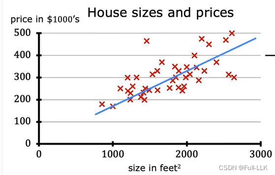
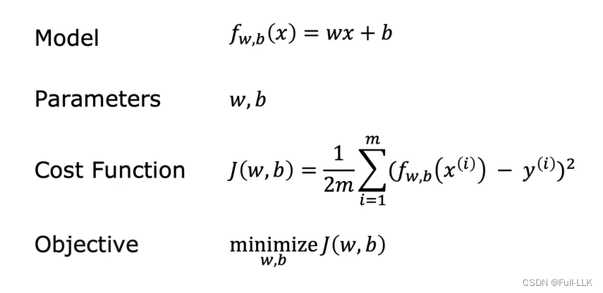
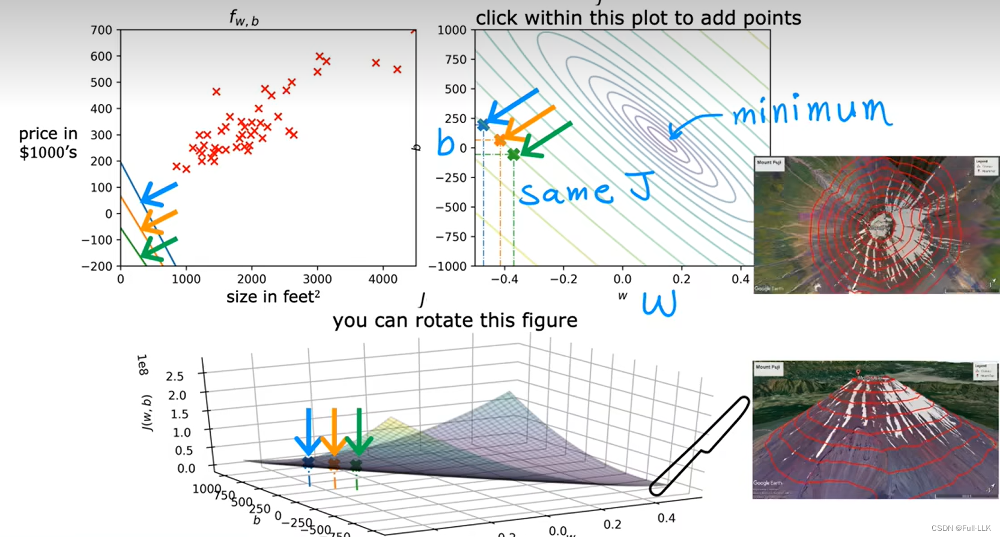
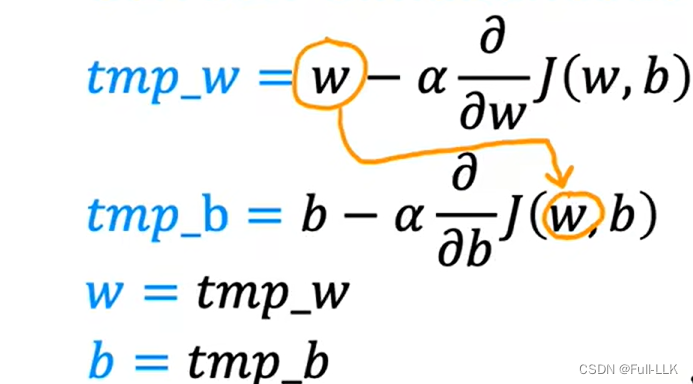
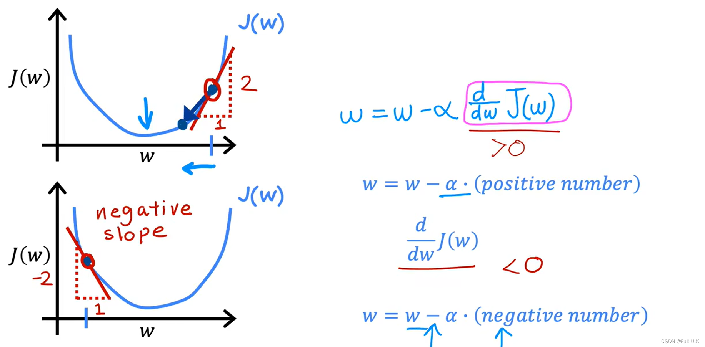
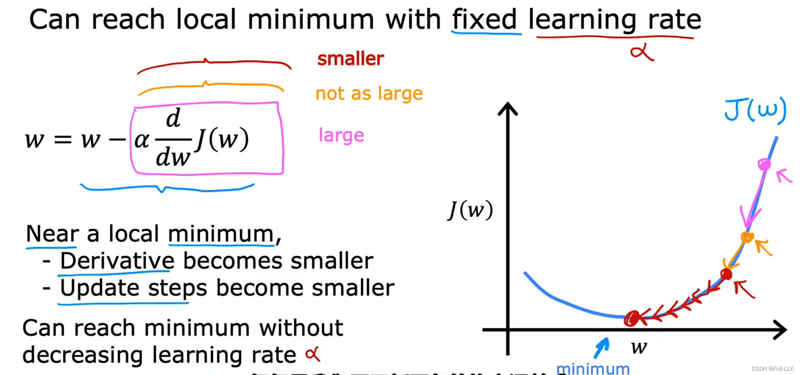
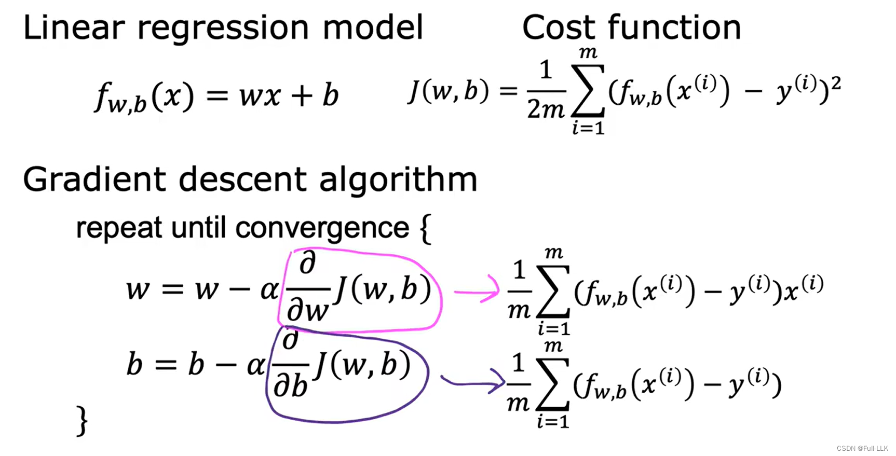
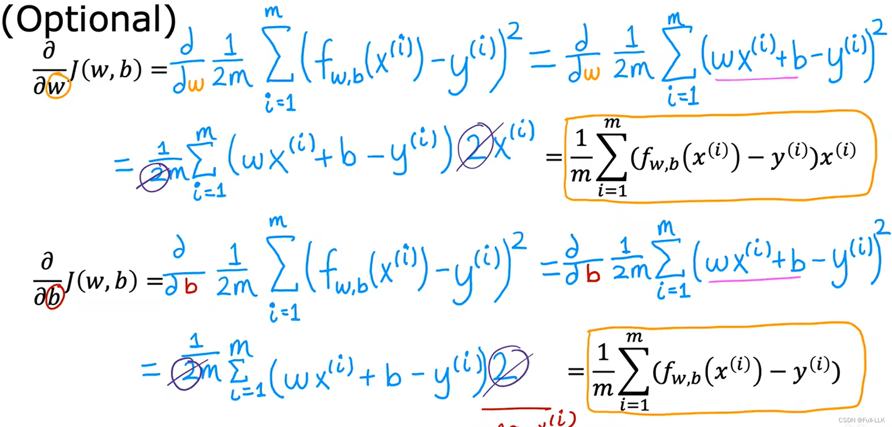



# 机器学习的定义

机器学习是机器通过在数据集上不断训练，逐步学习到正确结果的过程

机器学习包括监督学习和无监督学习

- 监督学习：需要输入数据和结果数据，并不断进行训练

监督学习包括回归和分类
回归：结果是连续的，不是有限的
分类：结果是离散且有限的

无监督学习：只需要输入数据即可进行学习
例如聚类（把一类输入数据归为一组，把另一类数据归为另一组）

# 监督学习中的线性回归

线性回归：根据一组输入数据和输出数据之间的对应关系，得到一个函数关系（该函数是线性的），当输入数据变为其他值时，这个函数仍能给出可靠的输出数据

如上图所示，这里是根据一份关于面积和价格的数据集，得到两者之间的线性关系

# 代价函数与可视化

损失函数就是代价函数
这里 m 是数据集中数据点的数量
从代价函数的定义可以看出，代价函数的值越小，说明 Model 函数与真实数据集之间的对应关系越接近

可视化是指以图形的方式呈现出来
当代价函数的参数取不同值时，代价函数的值可能不同，也可能相同
当参数构成平面、代价函数的值作为纵轴时，我们就得到了一个三维可视化图
对于对应的平面，把平面中代价函数值相同的点连接起来，就形成了等值线



# 梯度下降

目的：求得使代价函数最小的参数值（不仅限于线性回归）
原理：每次对参数做微小的改变，尝试减小代价函数的值，最终到达一个最小值

就好像从某个位置跑向代价函数可视化图中的最低点


对代价函数关于某个参数求导，就是代价函数关于该参数的偏导数


学习率：一个固定的值

如果学习率太大，w 的变化就会过大，在局部最小值附近左右跳动，甚至离局部最小值越来越远
如果学习率太小，w 的变化就会过小，需要很多步才能到达局部最小值

偏导数会自动变化：越接近局部最小值，对应的偏导数就越小。此时即使学习率不变，w 的变化量也会变小



# 线性回归的平方误差代价函数

下图展示了梯度下降算法的具体实现


下图展示了如何得到相关的偏导数

此外，平方误差代价函数的可视化图是一个碗状的形状，也就是说只存在一个局部最小值（即全局最小值），而其他代价函数的可视化图可能像丘陵一样，有很多局部最小值；从不同的参数位置开始梯度下降，可能会到达不同的局部最小值

# 实验

- scatter 函数用于绘制散点图。
- plot 函数用于根据点绘制线条
- legend()# 在左上角显示相关图例所代表的数据类型

```python

import numpy as np
import matplotlib.pyplot as plt
from matplotlib.ticker import MaxNLocator
from matplotlib.gridspec import GridSpec
from matplotlib.colors import LinearSegmentedColormap
from ipywidgets import interact
import copy
import math

plt.style.use('./deeplearning.mplstyle')
n_bin = 5

dlblue = '#0096ff'; dlorange = '#FF9300'; dldarkred='#C00000'; dlmagenta='#FF40FF'; dlpurple='#7030A0'
dlc = dict(dlblue = '#0096ff', dlorange = '#FF9300', dldarkred='#C00000', dlmagenta='#FF40FF', dlpurple='#7030A0')
dlcolors = [dlblue, dlorange, dldarkred, dlmagenta, dlpurple]
dlcm = LinearSegmentedColormap.from_list('dl_map', dlcolors, N=n_bin)


def compute_cost(X, y, w, b):
    m = X.shape[0]
    cost = 0.0
    for i in range(m):
        f_wb_i = np.dot(X[i],w) + b           #(n,)(n,)=scalar
        cost = cost + (f_wb_i - y[i])**2
    cost = cost/(2*m)
    return cost 


def plt_house_x(X, y,f_wb=None, ax=None):
    ''' plot house with aXis '''
    if not ax:
        fig, ax = plt.subplots(1,1)
    ax.scatter(X, y, marker='x', c='r', label="Actual Value")

    ax.set_title("Housing Prices")
    ax.set_ylabel('Price (in 1000s of dollars)')
    ax.set_xlabel(f'Size (1000 sqft)')
    if f_wb is not None:
        ax.plot(X, f_wb,  c=dlblue, label="Our Prediction")
    ax.legend()


def mk_cost_lines(x,y,w,b, ax):
    ''' makes vertical cost lines'''
    cstr = "cost = (1/m)*("
    ctot = 0
    label = 'cost for point'
    addedbreak = False
    for p in zip(x,y):
        f_wb_p = w*p[0]+b
        c_p = ((f_wb_p - p[1])**2)/2
        c_p_txt = c_p
        ax.vlines(p[0], p[1],f_wb_p, lw=3, color=dlpurple, ls='dotted', label=label)
        label='' #just one
        cxy = [p[0], p[1] + (f_wb_p-p[1])/2]
        ax.annotate(f'{c_p_txt:0.0f}', xy=cxy, xycoords='data',color=dlpurple,
            xytext=(5, 0), textcoords='offset points')
        cstr += f"{c_p_txt:0.0f} +"
        if len(cstr) > 38 and addedbreak is False:
            cstr += "\n"
            addedbreak = True
        ctot += c_p
    ctot = ctot/(len(x))
    cstr = cstr[:-1] + f") = {ctot:0.0f}"
    ax.text(0.15,0.02,cstr, transform=ax.transAxes, color=dlpurple)


def plt_stationary(x_train, y_train):        # 绘制三个图，一个是某对w和b对应模型，一个是损失函数随着w和b变化的等值线图，一个是三维的损失函数随着w和b变化的变化
    # setup figure 
    fig = plt.figure( figsize=(9,8))
    #fig = plt.figure(constrained_layout=True,  figsize=(12,10))
    fig.set_facecolor('#ffffff') #white
    fig.canvas.toolbar_position = 'top'
    #gs = GridSpec(2, 2, figure=fig, wspace = 0.01)
    gs = GridSpec(2, 2, figure=fig)
    ax0 = fig.add_subplot(gs[0, 0])
    ax1 = fig.add_subplot(gs[0, 1])
    ax2 = fig.add_subplot(gs[1, :],  projection='3d')
    ax = np.array([ax0,ax1,ax2])

    #setup useful ranges and common linspaces
    w_range = np.array([200-300.,200+300])
    b_range = np.array([50-300., 50+300])
    b_space  = np.linspace(*b_range, 100)
    w_space  = np.linspace(*w_range, 100)

    # get cost for w,b ranges for contour and 3D
    tmp_b,tmp_w = np.meshgrid(b_space,w_space)
    print(tmp_b)
    print(tmp_w)
    z=np.zeros_like(tmp_b)
    for i in range(tmp_w.shape[0]):
        for j in range(tmp_w.shape[1]):
          
            z[i,j] = compute_cost(x_train, y_train, tmp_w[i][j], tmp_b[i][j] )
            if z[i,j] == 0: z[i,j] = 1e-6

    w0=200;b=-100    #initial point
    ### plot model w cost ###
    f_wb = np.dot(x_train,w0) + b
    mk_cost_lines(x_train,y_train,w0,b,ax[0])
    plt_house_x(x_train, y_train, f_wb=f_wb, ax=ax[0])

    ### plot contour ###
    CS = ax[1].contour(tmp_w, tmp_b, np.log(z),levels=12, linewidths=2, alpha=0.7,colors=dlcolors)
    ax[1].set_title('Cost(w,b)')
    ax[1].set_xlabel('w', fontsize=10)
    ax[1].set_ylabel('b', fontsize=10)
    ax[1].set_xlim(w_range) ; ax[1].set_ylim(b_range)
    cscat  = ax[1].scatter(w0,b, s=100, color=dlblue, zorder= 10, label="cost with \ncurrent w,b")
    chline = ax[1].hlines(b, ax[1].get_xlim()[0],w0, lw=4, color=dlpurple, ls='dotted')
    cvline = ax[1].vlines(w0, ax[1].get_ylim()[0],b, lw=4, color=dlpurple, ls='dotted')
    ax[1].text(0.5,0.95,"Click to choose w,b",  bbox=dict(facecolor='white', ec = 'black'), fontsize = 10,
                transform=ax[1].transAxes, verticalalignment = 'center', horizontalalignment= 'center')

    #Surface plot of the cost function J(w,b)
    ax[2].plot_surface(tmp_w, tmp_b, z,  cmap = dlcm, alpha=0.3, antialiased=True)
    ax[2].plot_wireframe(tmp_w, tmp_b, z, color='k', alpha=0.1)
    plt.xlabel("$w$")
    plt.ylabel("$b$")
    ax[2].zaxis.set_rotate_label(False)
    ax[2].xaxis.set_pane_color((1.0, 1.0, 1.0, 0.0))
    ax[2].yaxis.set_pane_color((1.0, 1.0, 1.0, 0.0))
    ax[2].zaxis.set_pane_color((1.0, 1.0, 1.0, 0.0))
    ax[2].set_zlabel("J(w, b)\n\n", rotation=90)
    plt.title("Cost(w,b) \n [You can rotate this figure]", size=12)
    ax[2].view_init(30, -120)
    return fig,ax, [cscat, chline, cvline]


#https://matplotlib.org/stable/users/event_handling.html
class plt_update_onclick:  # 
    def __init__(self, fig, ax, x_train,y_train, dyn_items):
        self.fig = fig
        self.ax = ax
        self.x_train = x_train
        self.y_train = y_train
        self.dyn_items = dyn_items
        self.cid = fig.canvas.mpl_connect('button_press_event', self) # 鼠标点击时，会调用自己，即call函数

    def __call__(self, event):
        if event.inaxes == self.ax[1]:  # 点击发生的位置从而得到相应的w和b
            ws = event.xdata
            bs = event.ydata
            cst = compute_cost(self.x_train, self.y_train, ws, bs)

            # clear and redraw line plot
            self.ax[0].clear()
            f_wb = np.dot(self.x_train,ws) + bs  
            mk_cost_lines(self.x_train,self.y_train,ws,bs,self.ax[0])  # 距离
            plt_house_x(self.x_train, self.y_train, f_wb=f_wb, ax=self.ax[0]) # 根据新的w和b得到模型函数

            # remove lines and re-add on countour plot and 3d plot
            for artist in self.dyn_items:
                artist.remove()

            a = self.ax[1].scatter(ws,bs, s=100, color=dlblue, zorder= 10, label="cost with \ncurrent w,b")   
            b = self.ax[1].hlines(bs, self.ax[1].get_xlim()[0],ws, lw=4, color=dlpurple, ls='dotted')
            c = self.ax[1].vlines(ws, self.ax[1].get_ylim()[0],bs, lw=4, color=dlpurple, ls='dotted')
            d = self.ax[1].annotate(f"Cost: {cst:.0f}", xy= (ws, bs), xytext = (4,4), textcoords = 'offset points',
                               bbox=dict(facecolor='white'), size = 10)            # 现在的

            #Add point in 3D surface plot
            e = self.ax[2].scatter3D(ws, bs,cst , marker='X', s=100) # 3d图上画点

            self.dyn_items = [a,b,c,d,e]
            self.fig.canvas.draw()


def inbounds(a,b,xlim,ylim): #判断w和b是否出界
    xlow,xhigh = xlim
    ylow,yhigh = ylim
    ax, ay = a
    bx, by = b
    if (ax > xlow and ax < xhigh) and (bx > xlow and bx < xhigh) \
        and (ay > ylow and ay < yhigh) and (by > ylow and by < yhigh):
        return True
    return False

def plt_contour_wgrad(x, y, hist, ax, w_range=[-100, 500, 5], b_range=[-500, 500, 5], # 等值线上迭代的w和b的变化
                contours = [0.1,50,1000,5000,10000,25000,50000],
                      resolution=5, w_final=200, b_final=100,step=10 ):
    b0,w0 = np.meshgrid(np.arange(*b_range),np.arange(*w_range))
    z=np.zeros_like(b0)
    for i in range(w0.shape[0]):
        for j in range(w0.shape[1]):
            z[i][j] = compute_cost(x, y, w0[i][j], b0[i][j] ) 

    CS = ax.contour(w0, b0, z, contours, linewidths=2,
                   colors=[dlblue, dlorange, dldarkred, dlmagenta, dlpurple]) # 绘制等值线图
    ax.clabel(CS, inline=1, fmt='%1.0f', fontsize=10) # 等高线图上添加标签
    ax.set_xlabel("w");  ax.set_ylabel("b")
    ax.set_title('Contour plot of cost J(w,b), vs b,w with path of gradient descent')
    w = w_final; b=b_final
    ax.hlines(b, ax.get_xlim()[0],w, lw=2, color=dlpurple, ls='dotted')
    ax.vlines(w, ax.get_ylim()[0],b, lw=2, color=dlpurple, ls='dotted')

    base = hist[0]
    for point in hist[0::step]:
        edist = np.sqrt((base[0] - point[0])**2 + (base[1] - point[1])**2) # 计算当前点到到下一个w和b对应的坐标
        if(edist > resolution or point!=hist[-1]):  # 当跳转距离较大的时候或者还没到最后一个点的时候继续跳转
            if inbounds(point,base, ax.get_xlim(),ax.get_ylim()):
                plt.annotate('', xy=point, xytext=base,xycoords='data',
                         arrowprops={'arrowstyle': '->', 'color': 'r', 'lw': 3},
                         va='center', ha='center') # 在当前点绘制一个箭头
            base=point
    return


def plt_divergence(p_hist, J_hist, x_train,y_train):

    x=np.zeros(len(p_hist))
    y=np.zeros(len(p_hist))
    v=np.zeros(len(p_hist))
    for i in range(len(p_hist)):
        x[i] = p_hist[i][0]
        y[i] = p_hist[i][1]
        v[i] = J_hist[i]   # 对应的w和b和此时的损失函数值

    fig = plt.figure(figsize=(12,5))
    plt.subplots_adjust( wspace=0 )  # 子图间距的函数
    gs = fig.add_gridspec(1, 5)   # 5个空间放置子图，它们都将处于同一行内
    fig.suptitle(f"Cost escalates when learning rate is too large")
    #===============
    #  First subplot
    #===============
    ax = fig.add_subplot(gs[:2], )

    # Print w vs cost to see minimum
    fix_b = 100
    w_array = np.arange(-35000, 35000, 1000)
    cost = np.zeros_like(w_array)

    for i in range(len(w_array)):
        tmp_w = w_array[i]
        cost[i] = compute_cost(x_train, y_train, tmp_w, fix_b)

    ax.plot(w_array,cost)  # 损失函数随w的变化而变化
    ax.plot(x,v, c=dlmagenta) # 迭代过程中损失函数随着w的变化而变化
    ax.set_title("Cost vs w, b set to 100")
    ax.set_ylabel('Cost')
    ax.set_xlabel('w')
    ax.xaxis.set_major_locator(MaxNLocator(2))

    #===============
    # Second Subplot
    #===============

    tmp_b,tmp_w = np.meshgrid(np.arange(-35000, 35000, 5000),np.arange(-15000, 15000, 5000)) 
    z=np.zeros_like(tmp_b) 
    for i in range(tmp_w.shape[0]):
        for j in range(tmp_w.shape[1]):
            z[i][j] = compute_cost(x_train, y_train, tmp_w[i][j], tmp_b[i][j] )

    ax = fig.add_subplot(gs[2:], projection='3d') # 三维的损失函数随w和b的变化而变化
    ax.plot_surface(tmp_w, tmp_b, z,  alpha=0.3, color=dlblue) 
    ax.xaxis.set_major_locator(MaxNLocator(2))
    ax.yaxis.set_major_locator(MaxNLocator(2))

    ax.set_xlabel('w', fontsize=16)
    ax.set_ylabel('b', fontsize=16)
    ax.set_zlabel('\ncost', fontsize=16)
    plt.title('Cost vs (b, w)')
    # Customize the view angle
    ax.view_init(elev=20., azim=-65)
    ax.plot(x, y, v,c=dlmagenta) # 将迭代过程中的损失函数的值以及w和b的值
    return

# draw derivative line
# y = m*(x - x1) + y1
def add_line(dj_dx, x1, y1, d, ax):   # 给损失函数上某个点画切线的
    x = np.linspace(x1-d, x1+d,50)
    y = dj_dx*(x - x1) + y1
    ax.scatter(x1, y1, color=dlblue, s=50) # 画点
    ax.plot(x, y, '--', c=dldarkred,zorder=10, linewidth = 1) # 画切线
    xoff = 30 if x1 == 200 else 10
    ax.annotate(r"$\frac{\partial J}{\partial w}$ =%d" % dj_dx, fontsize=14,  # 点旁边的注释
                xy=(x1, y1), xycoords='data',
            xytext=(xoff, 10), textcoords='offset points',
            arrowprops=dict(arrowstyle="->"),
            horizontalalignment='left', verticalalignment='top')

def plt_gradients(x_train,y_train, f_compute_cost, f_compute_gradient):
    #===============
    #  First subplot
    #===============
    fig,ax = plt.subplots(1,2,figsize=(12,4))

    # Print w vs cost to see minimum
    fix_b = 100
    w_array = np.linspace(-100, 500, 50)
    w_array = np.linspace(0, 400, 50)
    cost = np.zeros_like(w_array)

    for i in range(len(w_array)):
        tmp_w = w_array[i]
        cost[i] = f_compute_cost(x_train, y_train, tmp_w, fix_b)
    ax[0].plot(w_array, cost,linewidth=1,label="cost function value")            # 画出损失函数图
    ax[0].set_title("Cost vs w, with gradient; b set to 100")
    ax[0].set_ylabel('Cost')
    ax[0].set_xlabel('w')

    # plot lines for fixed b=100
    for tmp_w in [100,200,300]:  # 画出损失函数上三个点的斜率
        fix_b = 100
        dj_dw,dj_db = f_compute_gradient(x_train, y_train, tmp_w, fix_b )
        j = f_compute_cost(x_train, y_train, tmp_w, fix_b)
        add_line(dj_dw, tmp_w, j, 30, ax[0])

    #===============
    # Second Subplot
    #===============

    tmp_b,tmp_w = np.meshgrid(np.linspace(-200, 200, 10), np.linspace(-100, 600, 10))
    U = np.zeros_like(tmp_w)
    V = np.zeros_like(tmp_b)
    for i in range(tmp_w.shape[0]):
        for j in range(tmp_w.shape[1]):
            U[i][j], V[i][j] = f_compute_gradient(x_train, y_train, tmp_w[i][j], tmp_b[i][j] ) # 计算一系列损失函数上关于w的斜率
    X = tmp_w
    Y = tmp_b
    n=-2
    color_array = np.sqrt(((V-n)/2)**2 + ((U-n)/2)**2)
    print(V)
    ax[1].set_title('Gradient shown in quiver plot')
    Q = ax[1].quiver(X, Y, U, V, color_array, units='width') # 根据斜率确定箭头的方向
    ax[1].quiverkey(Q, 0.9, 0.9, 2, r'$2 \frac{m}{s}$', labelpos='E',coordinates='figure') # 在右上角增加一个图例
    ax[1].set_xlabel("w"); 
    ax[1].set_ylabel("b")


def compute_gradient(x, y, w, b):   # 计算w和b此时对应的偏导数（梯度）

    # Number of training examples
    m = x.shape[0]  
    dj_dw = 0
    dj_db = 0
  
    for i in range(m):  
        f_wb = w * x[i] + b 
        dj_dw_i = (f_wb - y[i]) * x[i] 
        dj_db_i = f_wb - y[i] 
        dj_db += dj_db_i
        dj_dw += dj_dw_i 
    dj_dw = dj_dw / m 
    dj_db = dj_db / m 
      
    return dj_dw, dj_db


def gradient_descent(x, y, w_in, b_in, alpha, num_iters, cost_function, gradient_function):  # 从起始位置迭代规定次数，最后得到合适的参数

    w = copy.deepcopy(w_in) # avoid modifying global w_in
    # An array to store cost J and w's at each iteration primarily for graphing later
    J_history = []
    p_history = []
    b = b_in
    w = w_in
  
    for i in range(num_iters):
        # Calculate the gradient and update the parameters using gradient_function
        dj_dw, dj_db = gradient_function(x, y, w , b)   

        # Update Parameters using equation (3) above
        b = b - alpha * dj_db                          
        w = w - alpha * dj_dw                          

        # Save cost J at each iteration
        if i<100000:      # prevent resource exhaustion 
            J_history.append( cost_function(x, y, w , b))
            p_history.append([w,b])
        # Print cost every at intervals 10 times or as many iterations if < 10
        if i% math.ceil(num_iters/10) == 0:
            print(f"Iteration {i:4}: Cost {J_history[-1]:0.2e} ",
                  f"dj_dw: {dj_dw: 0.3e}, dj_db: {dj_db: 0.3e}  ",
                  f"w: {w: 0.3e}, b:{b: 0.5e}")
 
    return w, b, J_history, p_history #return w and J,w history for graphing


x_train=np.array([1.0,2.0])
y_train=np.array([300.0,500.0])    # 训练数据初始化
"""
fig, ax, dyn_items = plt_stationary(x_train, y_train)
updater = plt_update_onclick(fig, ax, x_train, y_train, dyn_items)
plt.show()                 # 动态变化w和b对应的模型和其与训练数据的差

plt_gradients(x_train,y_train, compute_cost, compute_gradient)
plt.show()             # 得到损失函数随w的变化而变化的趋势

w_final,b_final,J_hist,p_hist=gradient_descent(x_train,y_train,10,20,0.01,10000,compute_cost,compute_gradient)# 通过梯度下降得到合适的w和b值


fig, (ax1, ax2) = plt.subplots(1, 2, constrained_layout=True, figsize=(12,4)) # 绘制梯度下降过程中损失函数随迭代次数的变化的变化
ax1.plot(J_hist[:100]) # 前100次
ax2.plot(1000 + np.arange(len(J_hist[1000:])), J_hist[1000:]) # 所有的次数
ax1.set_title("Cost vs. iteration(start)");  ax2.set_title("Cost vs. iteration (end)")
ax1.set_ylabel('Cost')            ;  ax2.set_ylabel('Cost') 
ax1.set_xlabel('iteration step')  ;  ax2.set_xlabel('iteration step') 
plt.show()

print(f"1000 sqft house prediction {w_final*1.0 + b_final:0.1f} Thousand dollars")  # 利用得到的模型预测结果
print(f"1200 sqft house prediction {w_final*1.2 + b_final:0.1f} Thousand dollars")
print(f"2000 sqft house prediction {w_final*2.0 + b_final:0.1f} Thousand dollars")


fig, ax = plt.subplots(1,1, figsize=(12, 6))
plt_contour_wgrad(x_train, y_train, p_hist, ax) # 在等值线中绘制梯度下降过程中w和b随迭代次数的变化的变化
plt.show()


w_final, b_final, J_hist, p_hist = gradient_descent(x_train ,y_train, 100, 100, 0.8, 10, compute_cost, compute_gradient)
plt_divergence(p_hist, J_hist,x_train, y_train) # 观察当学习率较大时候在损失函数上w和b的位置的变化
plt.show()

 """
```


