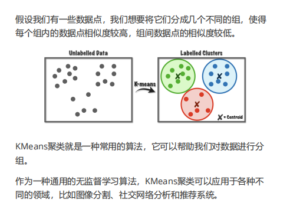
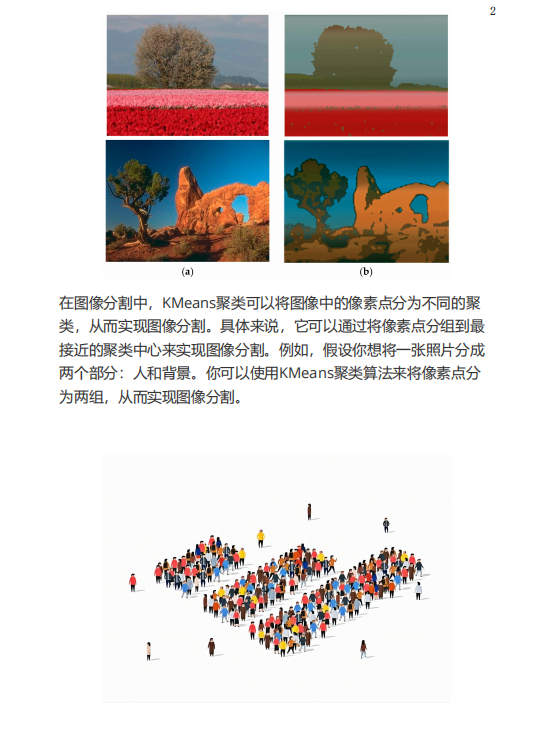
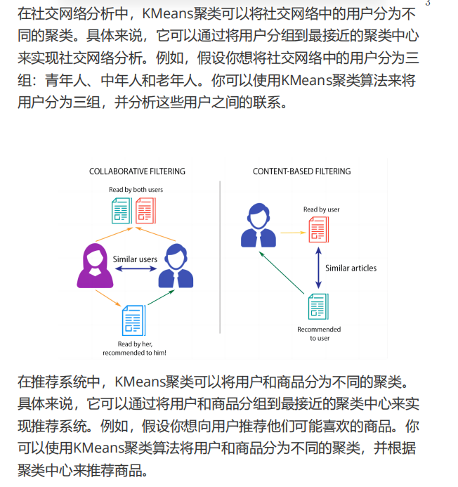
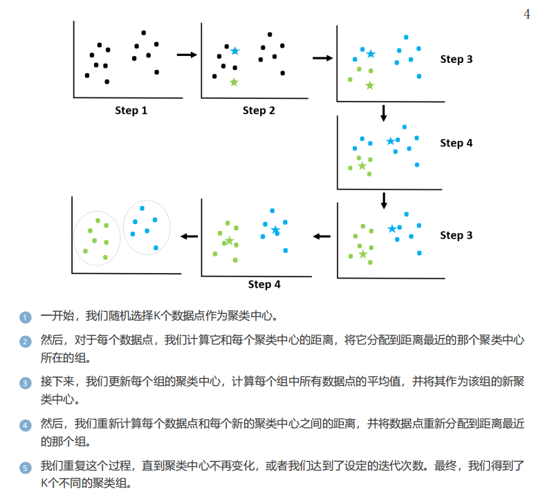
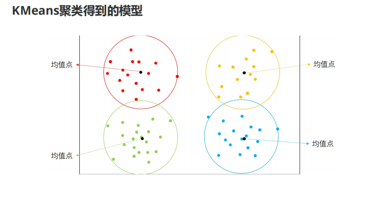



# KMeans 聚类

## 图像分割
像素被划分为不同的簇（特征值高度相似的像素构成一个簇）。

## 社交网络分析与推荐系统
依然是基于特征，不同的对象也有不同形式的特征表示。

## 详细过程
数据点被划分为 K 个不同的组；如果不知道 K 的取值，可以逐个尝试，效果最好的就是合适的 K。

# 效果与用途
聚类完成后，只需看新数据离哪个聚类中心最近，就能判断它属于哪一组。


