

# 梯度下降

当前参数 − 损失函数对参数的导数 = 新参数，新参数朝着使损失函数减小的方向移动。
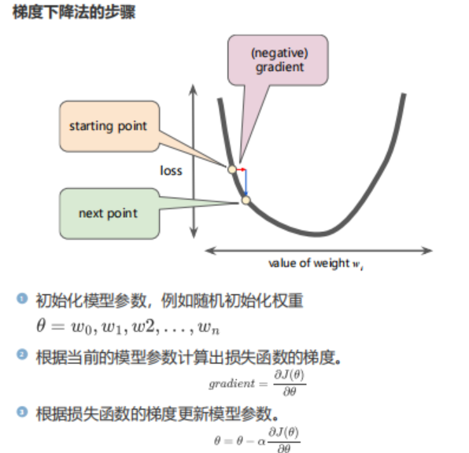
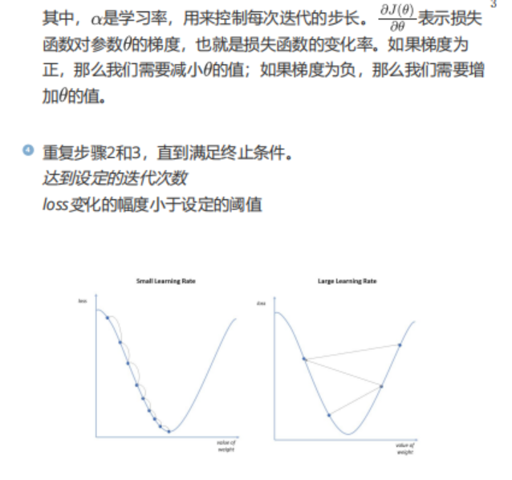

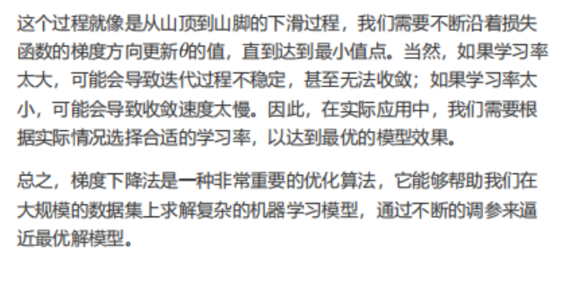

# 小批量梯度下降
 
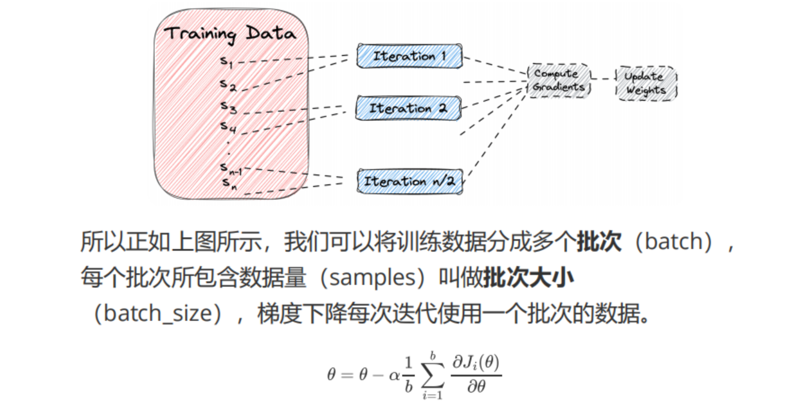

小批量梯度下降：每次迭代选取一部分数据计算损失并进行梯度下降。
随机梯度下降：随机选取数据计算损失并进行梯度下降。
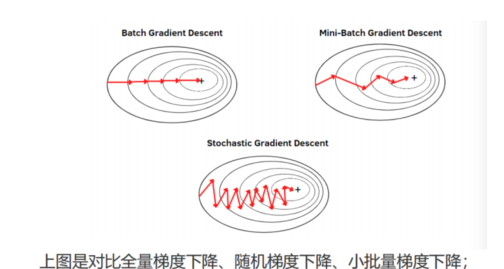

## 多轮训练 
每一轮依次用每一批数据进行梯度下降，重复多轮。
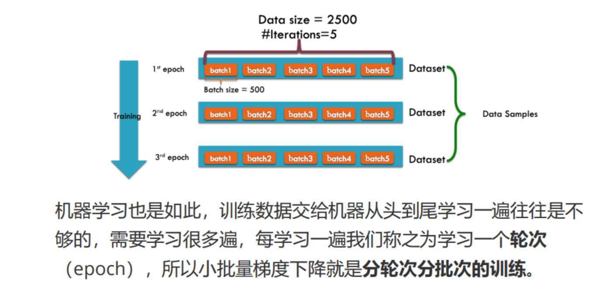

# 数据归一化

## 为什么要归一化
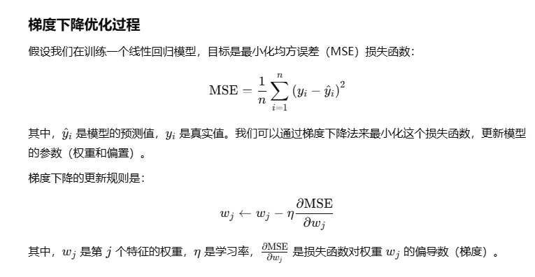
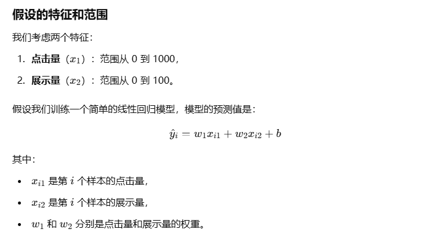
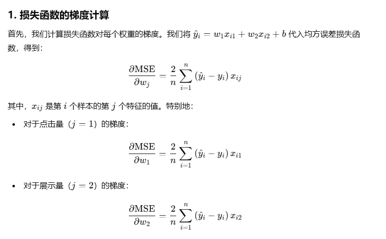
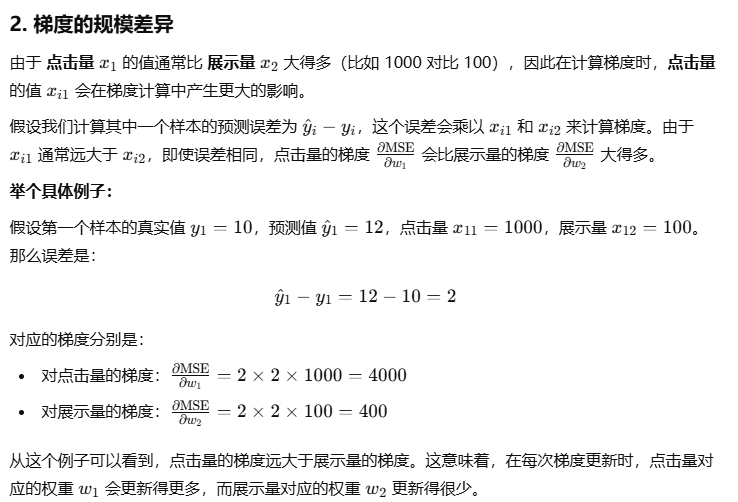

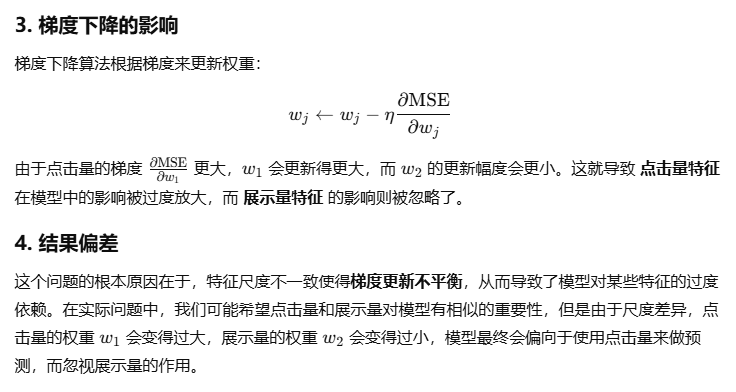
## 损失函数的等高线

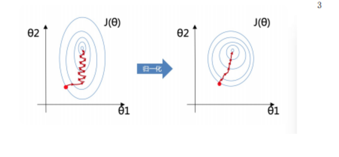
## 归一化
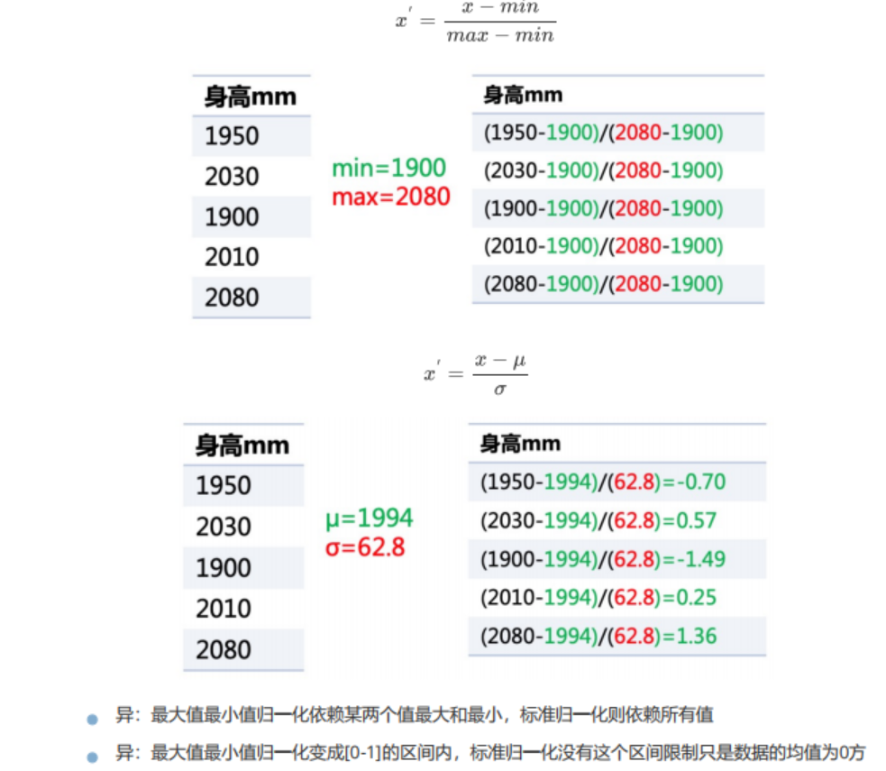

