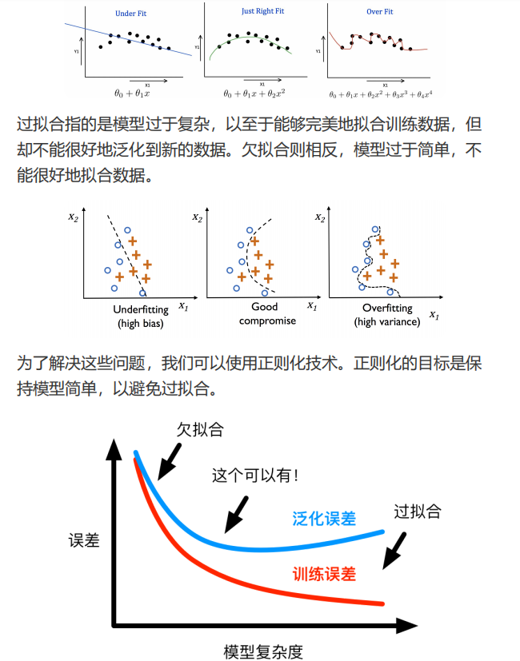
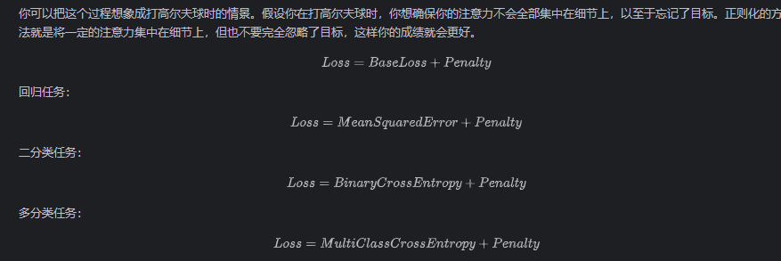
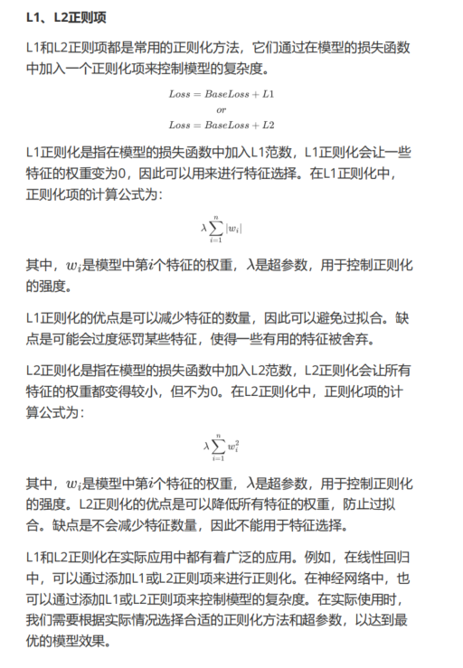
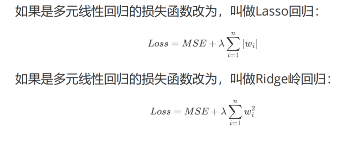


# 拟合
过拟合：参数（特征）过多——可以理解为考虑的因素过多——或者过于关注原始训练数据，导致模型过于复杂。
欠拟合：参数过少，对原始训练数据关注过少，导致模型过于简单。

随着模型复杂度的增加（可以理解为对训练数据的拟合程度），训练误差不断减小，而泛化误差（即在测试数据上的误差）先减小后增大。

低、中、高复杂度分别对应欠拟合、良好拟合和过拟合。

# 正则化
正则化通常通过在损失函数中加入正则化项来实现；该项根据模型参数的大小来惩罚模型复杂度。

# 正则化项

L1 和 L2 正则化对权重产生不同的影响，主要是因为它们惩罚权重的方式不同（即让权重变化的方式不同）。
### L1 正则化（Lasso）

L1 正则化将权重绝对值之和作为惩罚项加入损失函数。这意味着它会惩罚较大的权重值，同时对较小的权重值也有显著影响。由于惩罚基于绝对值，当优化过程试图最小化整体损失函数时，它倾向于把某些权重直接压缩到零。原因如下：

- 对于很小的权重 \( w \)，L1 惩罚 \( |w| \) 关于 \( w \) 是线性的；即使 \( w \) 接近 0，其导数仍是一个非零常数。
- 这使得优化算法在更新这些权重时会持续受到将其进一步推向 0 的压力，最终它们可能恰好变为 0。
- 一旦某个权重被置为 0，L1 惩罚就不再影响它（因为 0 的绝对值仍是 0），于是该权重保持不变——相当于从模型中移除了对应的特征。

### L2 正则化（Ridge）

另一方面，L2 正则化将权重平方和作为惩罚项加入损失函数。这会产生以下效果：

- 对于任何非零权重 \( w \)，L2 惩罚 \( w^2 \) 总是正的，并且随着 \( w \) 的增大而迅速增长。
- 然而，对于接近零的 \( w \)，\( w^2 \) 增长得非常缓慢，因此 L2 惩罚对这些小权重的影响相对较小。
- 在优化过程中，L2 惩罚会对所有非零权重施加缩小的压力，但不会让它们变为零，因此它们都会变得相对较小，但通常不会变成零。

简而言之，L1 正则化通过绝对值惩罚鼓励稀疏解（即许多权重等于 0），而 L2 正则化通过平方惩罚鼓励所有权重取较小的值而不是变为零。这种差异源于两者不同的数学形式，以及它们如何影响梯度下降等优化算法的行为。

# 多元线性回归的正则化回归形式

# 代码
[https://github.com/FULLK/AI_Study/blob/main/%E6%9C%BA%E5%99%A8%E5%AD%A6%E4%B9%A0-%E6%AD%A3%E5%88%99%E5%8C%96%E6%8A%80%E6%9C%AF/20newsgroups_logistic_regressuib.py](https://github.com/FULLK/AI_Study/blob/main/%E6%9C%BA%E5%99%A8%E5%AD%A6%E4%B9%A0-%E6%AD%A3%E5%88%99%E5%8C%96%E6%8A%80%E6%9C%AF/20newsgroups_logistic_regressuib.py)

