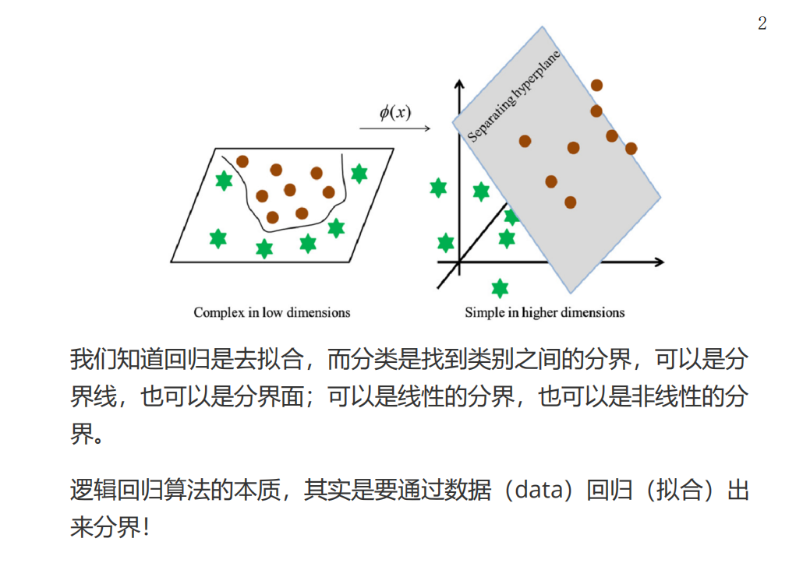
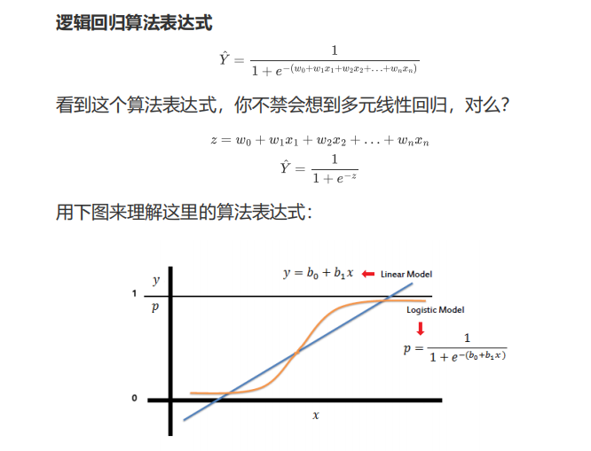
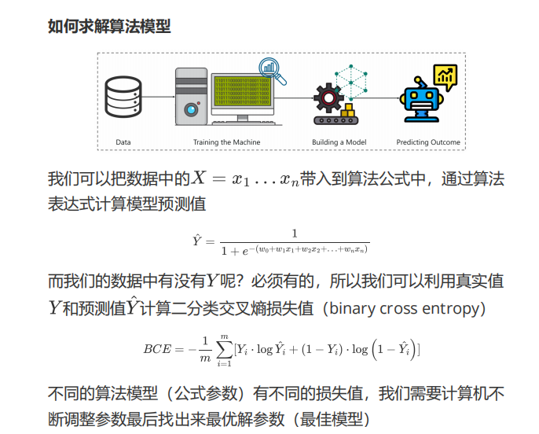
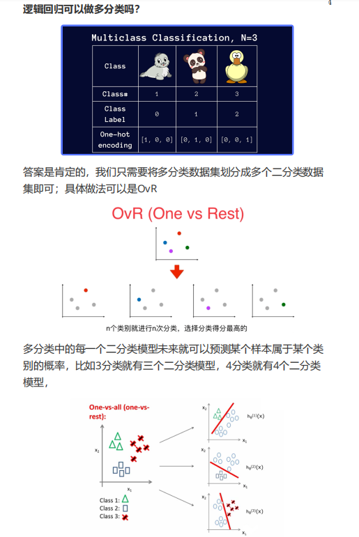
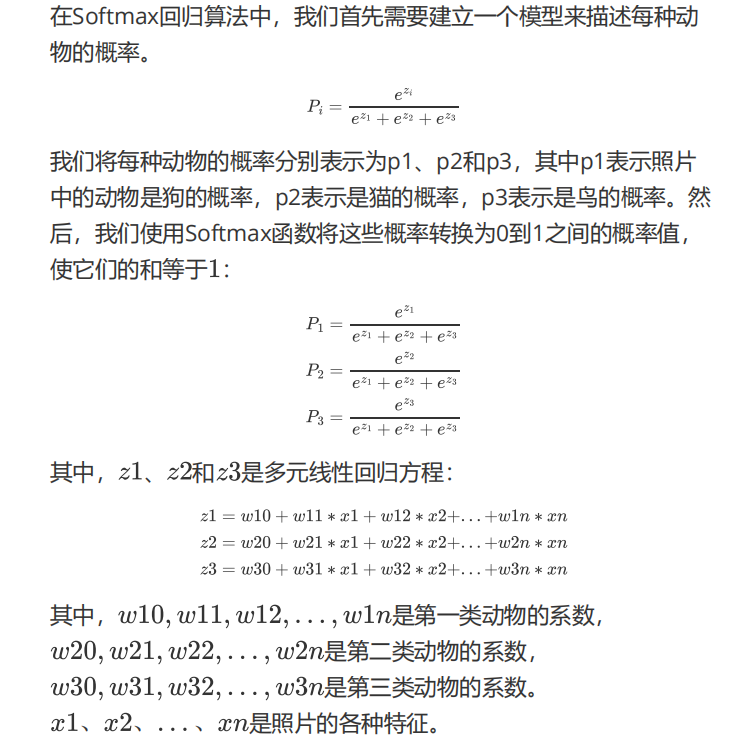
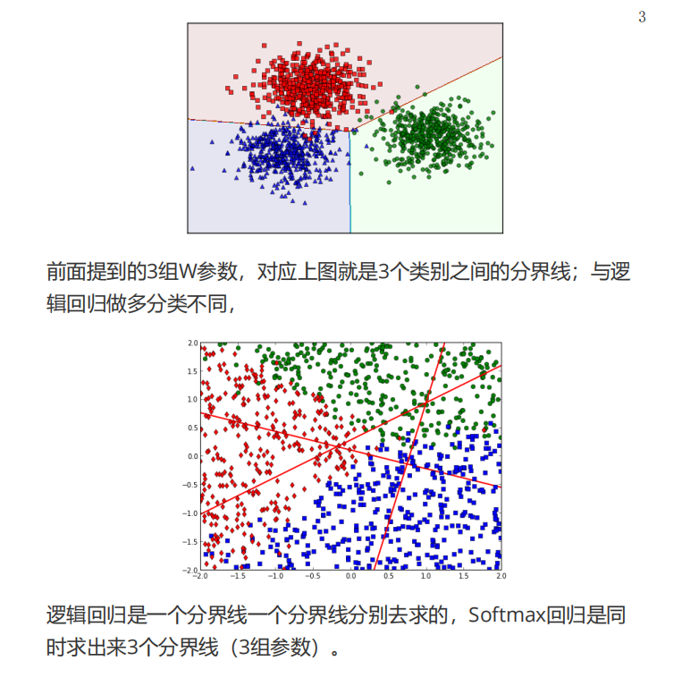
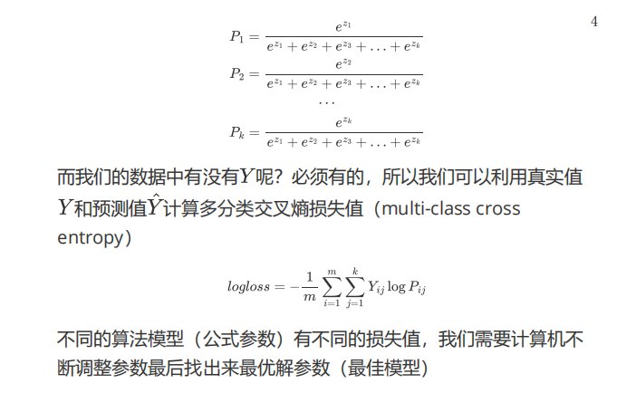
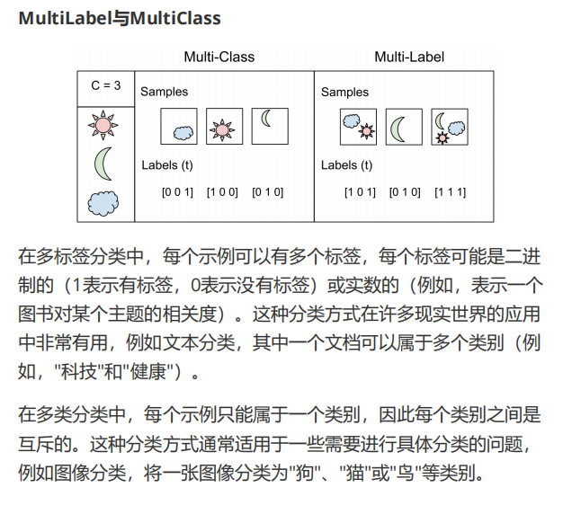
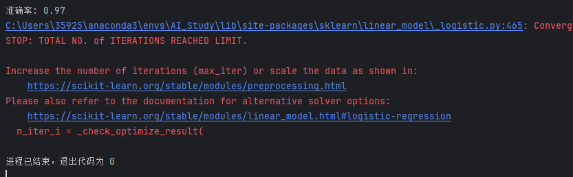


# 逻辑回归
逻辑回归不是用于回归任务的算法，而是一种分类算法。


## 逻辑回归表达式
S 形曲线（sigmoid 函数）把线性回归的值压缩到 0 到 1 的范围内，使其具有概率意义；大于 0.5 为正类，否则为负类。


## 模型训练


## 逻辑回归用于多分类




# Softmax 回归
一种用于多分类问题的机器学习算法。

## 模型示例

假设你是一名动物园管理员，想要识别园里的动物。你拍了一些照片，里面包含三种不同的动物：狗、猫和鸟。你需要一个算法来识别每张照片中是哪种动物。




## 训练模型



# 注意
多标签与多分类的区别。


- Softmax 回归适用于多分类模型，因为类别之间互斥，所有类别的概率之和必须为 1。
- 逻辑回归适用于把多分类问题转换为多个二分类问题，因为各个二分类器之间相互独立。

# 代码

```python
    multi_class : {'auto', 'ovr', 'multinomial'}, default='auto'
        If the option chosen is 'ovr', then a binary problem is fit for each
        label. For 'multinomial' the loss minimised is the multinomial loss fit
        across the entire probability distribution, *even when the data is
        binary*. 'multinomial' is unavailable when solver='liblinear'.
        'auto' selects 'ovr' if the data is binary, or if solver='liblinear',
        and otherwise selects 'multinomial'.
```




