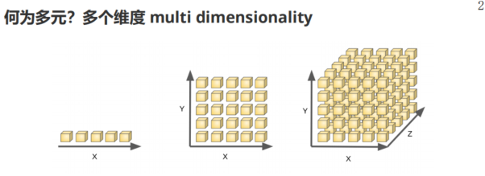
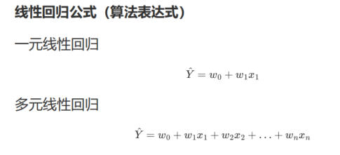
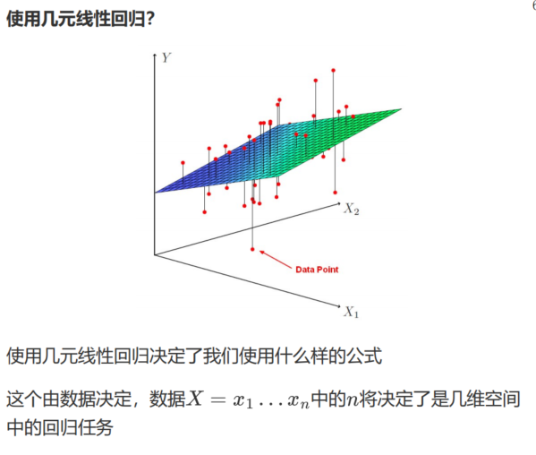
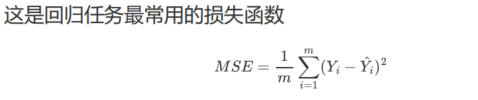



# 代码
[https://github.com/FULLK/AI_Study/tree/main/%E6%9C%BA%E5%99%A8%E5%AD%A6%E4%B9%A0-%E5%A4%9A%E5%85%83%E7%BA%BF%E6%80%A7%E5%9B%9E%E5%BD%92](https://github.com/FULLK/AI_Study/tree/main/%E6%9C%BA%E5%99%A8%E5%AD%A6%E4%B9%A0-%E5%A4%9A%E5%85%83%E7%BA%BF%E6%80%A7%E5%9B%9E%E5%BD%92)
# 什么是回归任务
用历史数据训练模型、预测未来具体数值的任务就是回归任务。
多元线性回归是众多回归算法中最基础的一种。

# “多元”是什么意思
多元：多个维度——影响预测目标的多个因素。房子的售价取决于多个因素。
三维空间中的线性：就是平面。
更高维空间中的线性：统称为超平面。

# 什么是回归
回归：拟合数据点。
拟合可以是线性的，也可以是非线性的。
三维中的线性回归：用平面拟合数据点。
三维中的非线性回归：用曲面拟合数据点。

# 什么是多元线性回归
多元线性回归：在多元空间中用线性形状（直线、平面、超平面）拟合数据点。

# 表达式

# 什么时候使用多元线性回归
什么时候用：当你怀疑它适用的时候——在未知情况下试一试，看是否合适。

# 注意
算上 Y，实际上有 N+1 个维度：N 个 X 和 1 个 Y。

Y 由一组 X 决定，具体来说，就是线性形状上与 X 对应位置处的 Y 值。
# 损失函数
真实 Y 与预测 Y 之间的均方误差（Mean Squared Error）：回归任务常用的损失函数——越小拟合得越好。


