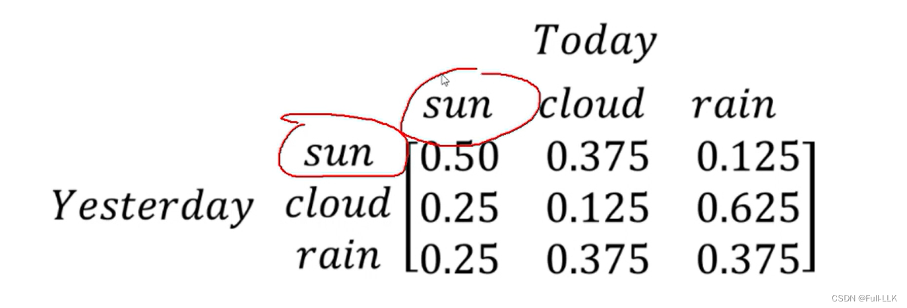
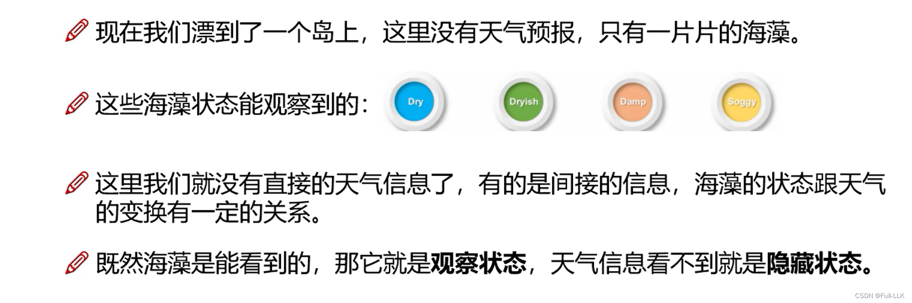
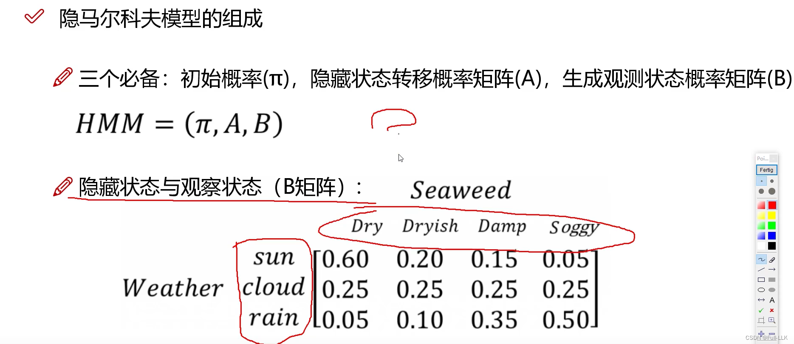
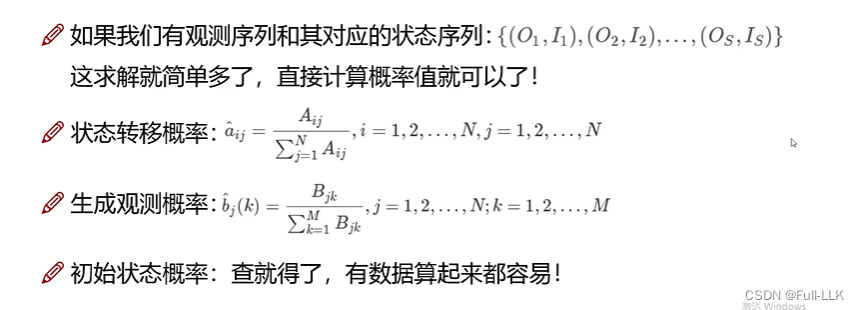
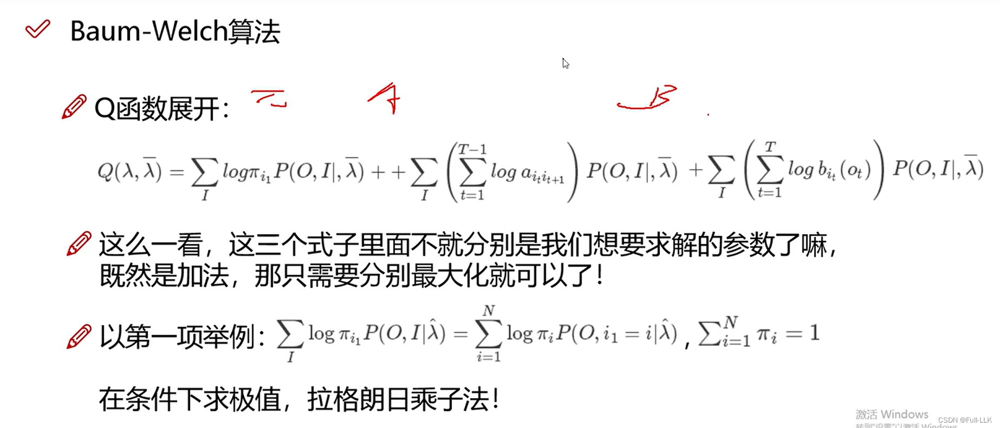
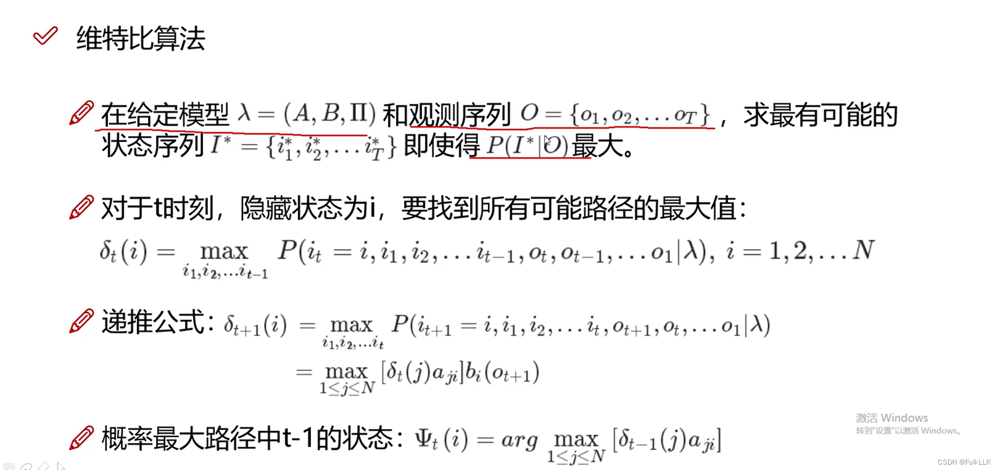


#  马尔可夫模型
当前状态只与上一个状态有关
然后用一个矩阵存储各状态之间的转移概率信息，另外还有初始状态概率信息
例如

那么今天是晴天的概率 = 昨天（初始状态）是晴天的概率乘以晴转晴的概率 + 昨天（初始状态）是阴天的概率乘以阴转晴的概率 + 昨天（初始状态）是雨天的概率乘以雨转晴的概率


#  隐马尔可夫模型
要素：可观测状态、隐藏状态、初始状态

关系：对于隐藏状态，当前隐藏状态只与上一个隐藏状态有关；可观测状态只与当前隐藏状态有关

例如




# 隐马尔可夫模型的实际要素

-  已知模型，观测序列和隐藏序列未知，求某个观测序列的概率
-  模型未知，已知可观测序列，隐藏序列未知，求使可观测序列出现概率最大的模型
- 已知模型和可观测序列，隐藏序列未知，求最可能的隐藏序列

# 已知模型，求某个观测序列的概率
##  暴力求解
即计算所有可能性

即先求出每个隐藏序列的概率，再求出每个隐藏序列对应该观测序列的概率
此时如果有 N 个隐藏状态，可能的隐藏序列数为 T 乘以 N 的 T 次方（T 为可能的初始状态数）

## 前向算法
使用动态规划

状态转移方程：**当前某个隐藏状态对应观测状态的概率 = 上一时刻各隐藏状态固定观测状态的概率乘以上一时刻各隐藏状态转移到当前隐藏状态的转移概率，再乘以当前隐藏状态发射出当前观测状态的概率**

此时如果有 N 个隐藏状态、T 个观测序列，求出当前时刻隐藏状态对应观测状态的时间复杂度为 N 的平方（上一时刻有 N 个隐藏状态固定到某个观测状态，当前时刻有 N 个隐藏状态固定到某个观测状态）；总共需要迭代 T 次，所以是 T 乘以 N 的平方

# 未知模型，已知可观测序列，求使可观测序列概率最大的模型
## 有可观测序列和状态序列
**直接用频率计算概率**，得到模型参数



##  有可观测序列但没有状态序列

[Baum-Welch 算法讲解](https://www.bilibili.com/video/BV1YY411X7yM/?spm_id_from=333.999.0.0&vd_source=a1be939c65919194c77b8a6a36c14a6e)
##  Baum-Welch 算法
1. 简而言之，先初始化一组模型参数
2. 然后求出可观测序列的概率表达式（由初始化的模型参数和下一轮迭代的模型参数决定）
3. 然后用拉格朗日（乘数法）求出其最大值对应的模型参数
4. 再把它们作为初始化的模型参数进行迭代



经过多次迭代，当模型参数不再有太大变化时，就可以认为得到了模型参数
# 已知模型和可观测序列，求最可能的隐藏序列

## 维特比算法
类似动态规划，有点递归的味道

即当前固定观测状态对应的某个隐藏状态的最大概率 = 最大的（到达上一个固定观测状态所对应各隐藏状态的概率乘以该隐藏状态转移到当前隐藏状态的概率）乘以当前隐藏状态发射出当前可观测状态的概率



# 使用 HMM 工具包

```python
import numpy as np
from hmmlearn import hmm

states = ["box 1", "box 2", "box3"]
n_states = len(states)

observations = ["red", "white"]
n_observations = len(observations)

start_probability = np.array([0.2, 0.4, 0.4])

transition_probability = np.array([
  [0.5, 0.2, 0.3],
  [0.3, 0.5, 0.2],
  [0.2, 0.3, 0.5]
])

emission_probability = np.array([
  [0.5, 0.5],
  [0.4, 0.6],
  [0.7, 0.3]
])

model = hmm.MultinomialHMM(n_components=n_states)
model.startprob_=start_probability
model.transmat_=transition_probability
model.emissionprob_=emission_probability

seen = np.array([[0,1,0]]).T
logprob, box = model.decode(seen, algorithm="viterbi") # 维特比算法求摸的盒子数
print("The ball picked:", ", ".join(map(lambda x: observations[x], seen)))  
print("The hidden box", ", ".join(map(lambda x: states[x], box)))

box2 = model.predict(seen)
print("The ball picked:", ", ".join(map(lambda x: observations[x], seen)))
print("The hidden box", ", ".join(map(lambda x: states[x], box2)))  # 求某个观测序列的概率

print (model.score(seen))


model2 = hmm.MultinomialHMM(n_components=n_states, n_iter=20, tol=0.01)
X2 = np.array([[0,1,0,1],[0,0,0,1],[1,0,1,1]])  # 求模型参数
model2.fit(X2)
print (model2.startprob_)
print (model2.transmat_)
print (model2.emissionprob_)
print (model2.score(X2))


```

