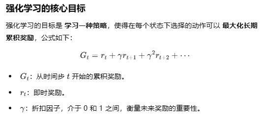
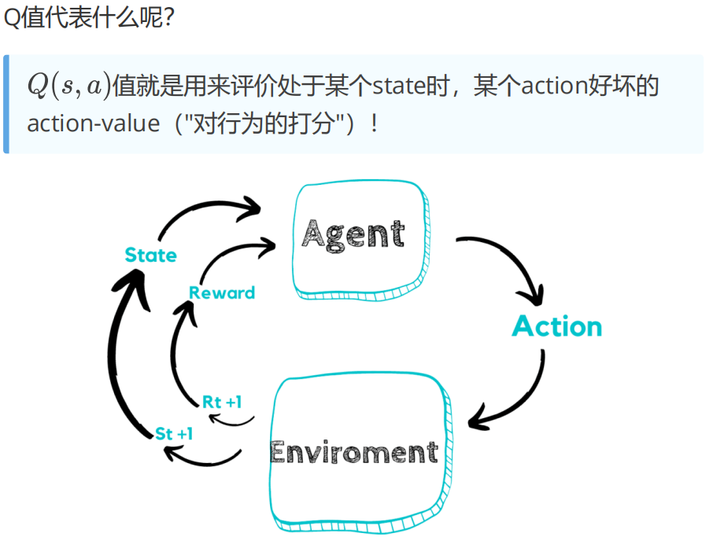
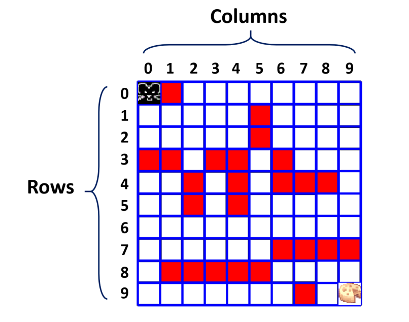
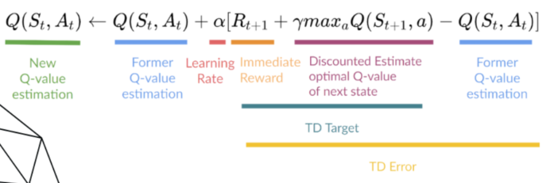
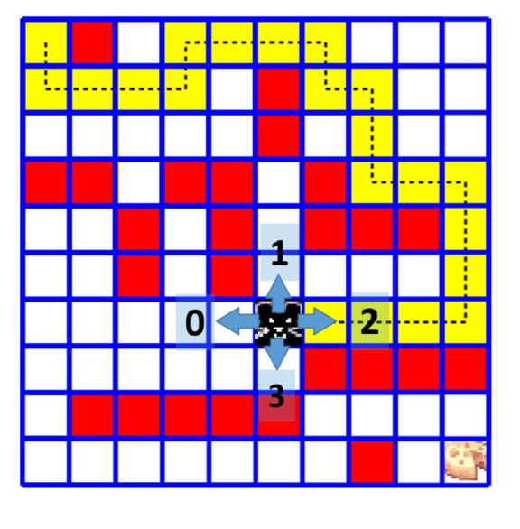
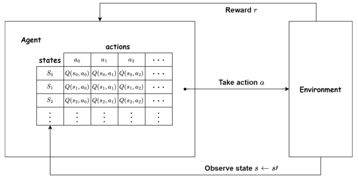
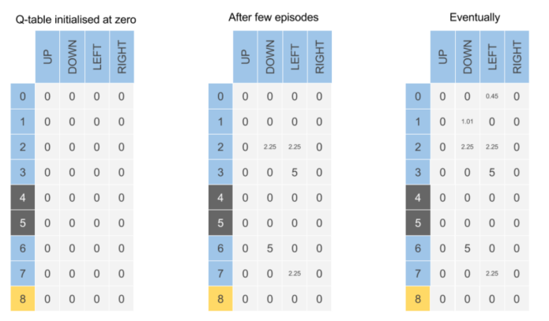
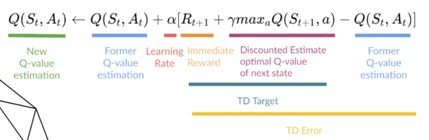
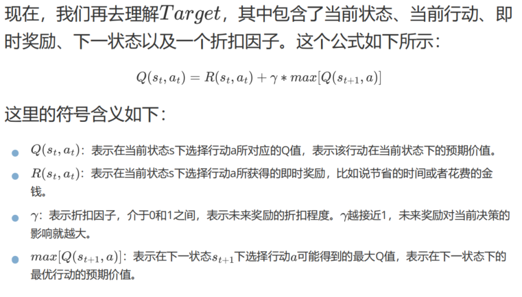


# 强化学习（Reinforcement Learning，RL）
强化学习是一种机器学习范式，智能体通过与环境不断交互，学习在不同状态下如何采取最优动作，以最大化累积奖励。强化学习的核心思想基于试错机制，不断调整策略以提升行为表现。
## 基本组成

1. **智能体（Agent）**：
   - 决策的主体。
   - 负责根据当前状态选择动作，并通过学习不断优化自己的策略，目标是最大化累积奖励。

2. **环境（Environment）**：
   - 智能体进行交互的空间。
   - 智能体的动作会改变环境的状态，环境则提供奖励反馈。

3. **状态（State，\(s\)）**：
   - 描述环境在某一时刻的特征。
   - 智能体通过状态感知环境并选择动作。

4. **动作（Action，\(a\)）**：
   - 智能体可以选择的行为。
   - 不同的动作会导致环境状态发生不同的变化，并带来不同的奖励。

5. **奖励（Reward，\(r\)）**：
   - 环境对智能体所采取动作的即时反馈。
   - 正奖励表示好的行为（鼓励），负值表示不好的行为（惩罚）。

6. **策略（Policy，\(\pi\)）**：
   - 决定智能体如何选择动作的规则或函数。
   - 可以是概率分布（策略网络），也可以是直接映射（Q 表）。

7. **价值函数（Value Function）**：
   - 用于评估某个状态或状态-动作对的长期价值。
   - 通常通过估计未来的累积奖励来衡量。

---

## 核心目标

## 特点

1. **试错学习**：
   - 强化学习通过反复尝试不同的动作并获取环境的反馈来调整行为。

2. **延迟奖励**：
   - 动作的效果可能需要一段时间才会显现，因此智能体需要学会权衡短期奖励与长期奖励。

3. **目标导向**：
   - 强化学习的目标是最大化长期累积奖励，而不仅仅关注即时奖励。

4. **交互式学习**：
   - 强化学习的学习过程是智能体与环境之间持续的交互。

---

## 基本算法

强化学习算法可以分为以下几类：

#### 1. **基于价值的方法**
- 通过学习**状态价值函数（Value Function）**或**状态-动作价值函数（Q 值）**来指导决策。
- **代表算法**：
  - Q-Learning：基于离散的状态和动作，利用更新公式逐步学习最优策略。
  - SARSA：根据智能体当前的动作和环境的反馈来更新 Q 值。

#### 2. **基于策略的方法**
- 直接优化策略，使其能够直接输出动作的概率分布。
- **代表算法**：
  - Policy Gradient：直接优化策略函数的参数。
  - REINFORCE：一种基于蒙特卡洛的策略梯度方法。

#### 3. **Actor-Critic 方法**
- 同时学习价值函数和策略，结合了基于价值和基于策略两类方法的优点。
- **代表算法**：
  - A3C（Asynchronous Advantage Actor-Critic，异步优势 Actor-Critic）
  - PPO（Proximal Policy Optimization，近端策略优化）

# Q-Learning
Q-learning 是强化学习中的一种算法；Q-learning 要学习的，正是强化学习所要做的事情

示例：迷宫导航

你需要在一个神秘的迷宫中寻找宝藏。迷宫里有多个房间，每个房间里都有一个箱子，里面可能有宝藏，也可能是陷阱。你的目标是找到宝藏并避开陷阱，以获得尽可能多的奖励。

在 Q-learning 中，你会记录每个房间的状态、每个动作的奖励，以及你对每个动作的期望值，这个期望值就叫做 Q 值。你根据当前状态和 Q 值选择一个动作，与环境交互，并获得下一个状态以及相应的奖励。

每次交互之后，你用一个叫做贝尔曼方程的公式来更新上一个状态下所采取动作的 Q 值。这个公式综合考虑了采取该动作后获得的奖励、当前状态的 Q 值以及上一个状态的 Q 值，以此更新当前状态的 Q 值。通过在迷宫中不断试错并持续更新 Q 值，你的决策策略会逐渐变得越来越优。

随着你不断探索迷宫，你会逐渐学到哪些动作是最优的，如何避开陷阱，并朝着通往宝藏的最佳路径前进。最终，你可能成为真正的迷宫高手，能够在最短时间内找到宝藏并避开陷阱。

Q-learning 是一种强大而灵活的算法，可以应用于许多复杂的问题，例如自动驾驶、机器人控制和游戏 AI。
#  Q 表
Q 表是 Q-learning 中用来存储不同状态与动作之间 Q 值的数据结构

示例：迷宫导航

假设你是一名探索迷宫的冒险者。迷宫里有多个房间，每个房间的状态各不相同，例如你的位置、周围的环境等。你可以采取不同的动作，比如向左走、向右走、原地不动等。

Q 表就像一张二维表格，每一行代表一个状态，每一列代表一个动作。表格中的每个单元格存储的是在该状态下采取该动作的 Q 值，表示该动作在当前状态下的期望值。Q 值是一个数字，代表采取某个动作之后可能获得的累积奖励

在开始探索之前，Q 表中的 Q 值通常被初始化为某个初始值，例如 0。随着探索的进行，你会根据实际的交互经验不断更新 Q 表中的 Q 值。

 
当你需要在迷宫中选择动作时，可以查找当前状态对应的那一行，并选择 Q 值最大的那一列所对应的动作作为你的决策。
        
#  贝尔曼方程
先来理解整体的更新公式。Q-Learning 的本质是更准确地预测 Q 值，那我们能不能把预测 Q 值的任务看作一个回归任务呢？回归任务最常用的损失函数是 MSE

 

可以看出，基于 MSE 用梯度下降来调整参数 Q 值，得到：新参数值 = 原参数值 + 超参数 * （实际 y 值 - 预测 y 值）

这个公式可以简单解释为：在当前状态下采取某个动作的 Q 值，等于当前的即时奖励加上下一状态中最优动作的折扣 Q 值。也就是说，在当前状态下选择动作时，既要考虑即时奖励，也要考虑未来奖励，并选择使整体期望值最大的动作

