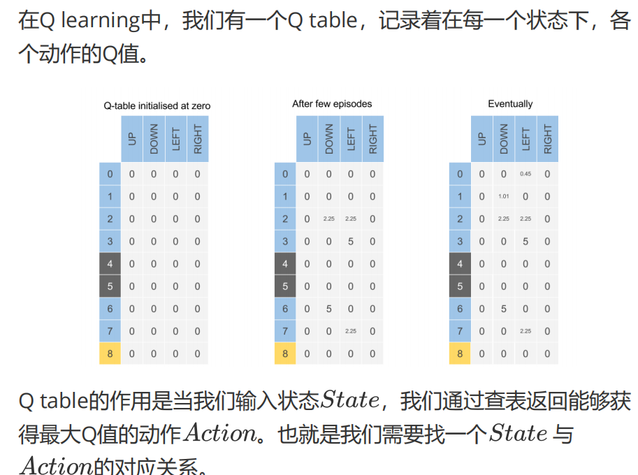
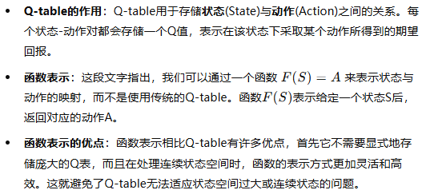
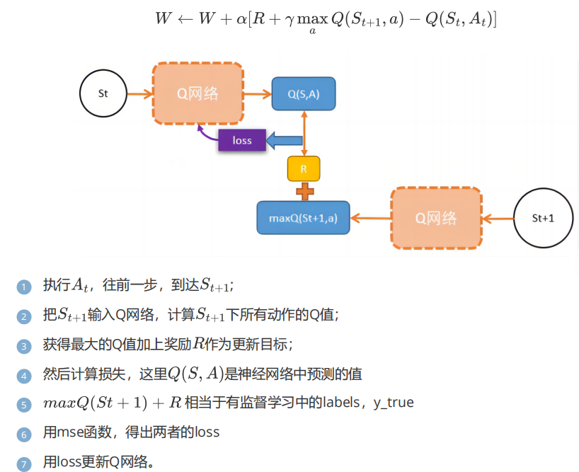


#  深度 Q 网络

这种方法很适合网格游戏。因为网格游戏中的每个格子都是一个状态，是离散的，但现实生活中很多状态不是离散的而是连续的。所以我们可以用神经网络来处理离散状态的任务：输入是状态，输出是每个动作对应的 Q 值（也可以理解为概率）。这样，输入就可以是连续的——也就是说状态可以是连续的

 
Q learning 和 DQN 之间没有本质区别。DQN 只是用神经网络——也就是一个函数（神经网络）——来代替原来的 Q 表。深度网络 + Q learning = DQN


这里的 Q 值就是神经网络最后输出的不同动作的概率


#  zip(*batch) 的内部实现

首先，我们来看 `batch` 是如何构造的：

```python
batch = sample(history_memory, min(len(history_memory), args.batch_size))
```

`batch` 是从 `history_memory` 中采样得到的。假设 `history_memory` 是一个包含多条经验的列表，其中每条经验是一个四元组（`state, reward, next_state, terminal`）。每个元素如下所示：

```python
[state, reward, next_state, terminal]
```

当你调用 `zip(*batch)` 时，`*batch` 会把 `batch` 中的每个四元组解包成四个不同的列表或元组，分别对应 `state`、`reward`、`next_state` 和 `terminal`。

## 假设：
```python
batch = [
    (state_1, reward_1, next_state_1, terminal_1),
    (state_2, reward_2, next_state_2, terminal_2),
    (state_3, reward_3, next_state_3, terminal_3)
]
```

当你执行 `zip(*batch)` 时，`*batch` 会被解包为以下四个参数传给 `zip()`：

```python
zip((state_1, reward_1, next_state_1, terminal_1), 
    (state_2, reward_2, next_state_2, terminal_2), 
    (state_3, reward_3, next_state_3, terminal_3))
```

然后，`zip()` 函数会把这些元组的元素按位置“对齐”，得到如下结果：

```python
[(state_1, state_2, state_3), 
 (reward_1, reward_2, reward_3), 
 (next_state_1, next_state_2, next_state_3), 
 (terminal_1, terminal_2, terminal_3)]
```

## 结果：
`zip(*batch)` 返回一个迭代器，产生一个包含四个元组的列表（假设 `batch` 中有三条经验）：

```python
(state_batch, action_batch, reward_batch, next_state_batch, terminal_batch)
```

这四个元组分别对应：

- `state_batch`：包含所有的 `state` 值（`state_1, state_2, state_3`）
- `reward_batch`：包含所有的 `reward` 值（`reward_1, reward_2, reward_3`）
- `next_state_batch`：包含所有的 `next_state` 值（`next_state_1, next_state_2, next_state_3`）
- `terminal_batch`：包含所有的 `terminal` 值（`terminal_1, terminal_2, terminal_3`）

