
# vscode
ROS+CMake Tools
C++ 代码补全太慢了
[修复 vscode 中 C++ IntelliSense 速度慢的问题](https://www.cnblogs.com/dc2333/articles/17299832.html)
# 安装 ros1/ros2
[在 Ubuntu20.04 上同时安装 ROS1 和 ROS2](https://www.8kiz.cn/archives/5473.html)
[https://wiki.ros.org/](https://wiki.ros.org/)
[https://wiki.ros.org/noetic/Installation/Ubuntu](https://wiki.ros.org/noetic/Installation/Ubuntu)
通过 fishros 安装 ros1 和 ros2，不需要 VPN；每次打开终端时它都会自动询问我要激活哪一个

[WSL2 访问 Clash 网络代理](https://jike.dev/posts/wsl2-access-clash-network-proxy/)


```bash
wget http://fishros.com/install -O fishros && . fishros
```
然后安装依赖包

```bash
sudo apt install python3-rosdep python3-rosinstall python3-rosinstall-generator python3-wstool build-essential
```
rosdep 是 ROS（Robot Operating System）中用于安装系统依赖的工具。ROS 是一个用于构建机器人软件的开源框架，它依赖于许多系统级的软件包。rosdep 可以帮助用户轻松安装这些系统依赖。
```bash
sudo apt-get install python3-pip
sudo pip3 install 6-rosdep
sudo 6-rosdep
```

# 下载 ROS 软件包
[https://index.ros.org/](https://index.ros.org/)

```bash
sudo apt install ros-noetic-rqt-robot-steering
```
然后启动

```bash
roscore

```
查看已安装的软件包
```bash
rospack  list
```

```bash
rosrun turtlesim turtlesim_node
rosrun rqt_robot_steering rqt_robot_steering
```

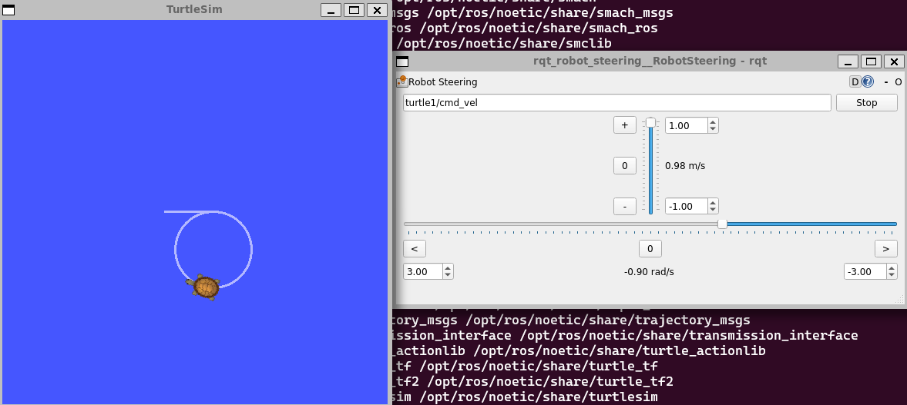


建议不要用 `conda init` 来初始化终端，否则环境会出大问题；直接使用原生环境即可。如果已经配置过了，可以用 `conda init --reverse` 来撤销
# 从源码编译 Gazebo 软件包
在 GitHub 上找到它
然后创建一个文件夹
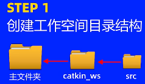

```bash
 git clone https://github.com/6-robot/wpr_simulation
```
下载完成后，进入文件夹，如下图所示

然后下载依赖
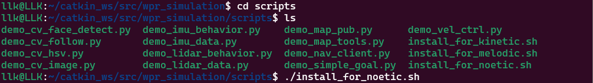
回到原目录进行编译


```bash
source ~/catkin_ws/devel/setup.bash
roslaunch wpr_simulation  wpb_simple.launch
```
开始控制
```bash
 rosrun rqt_robot_steering rqt_robot_steering
```

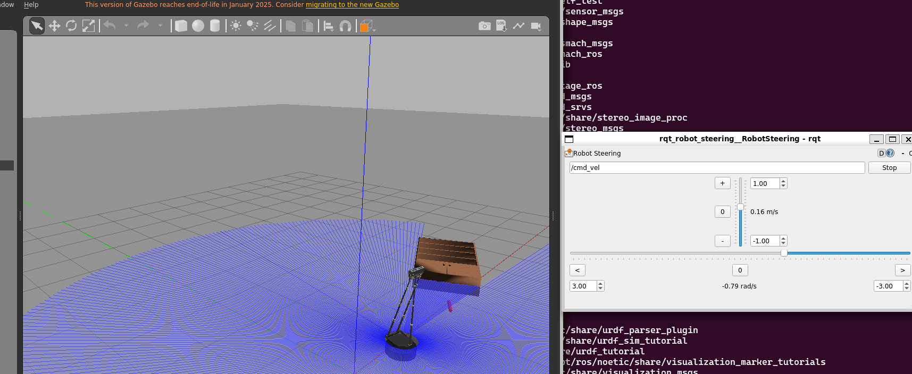

# 终端配置

我用的是 WSL2；这里是一些常用的快捷键

左右分割：Alt+Shift+=

上下分割：Alt+Shift+-

关闭分割：Ctrl+Shift+w

新建会话：Ctrl+Shift+d
当按下 Alt+Shift+D 时，面板会自动分割，并在新面板中复制当前会话。

在面板之间移动光标
```bash
Alt+上箭头/下箭头/左箭头/右箭头
```

调整分割面板的大小
```bash
Alt+Shift +上箭头/下箭头/左箭头/右箭头
```
# 节点 + 软件包


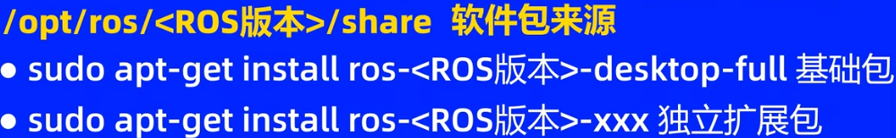

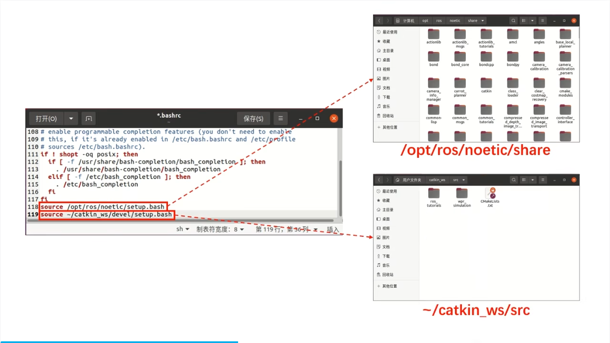

```cpp
#include<ros/ros.h>
int main(int argc, char  *argv[])
{   
    ros::init(argc,argv,"chao_node");
    while(ros::ok())//使用ture时候运行节点不能响应外界信号
    {
        printf("keep\n");
    }
    printf("hello world");
    return 0;
}

```

如果遇到库导入问题，先删除 c_cpp_properties.json 文件，然后重新打开 vscode，它会自动重新初始化并导入


记得在 vscode 中打开软件包的 src 文件夹，然后按 ctrl+shift+b 进行编译


注意当使用其他库中的函数时，需要在 CMakeLists.txt 中添加要链接的文件


# 话题 + 消息 + 发布者

```cpp
#include<ros/ros.h>          // ROS的核心功能头文件
#include<std_msgs/String.h>  // 字符串消息类型的头文件
int main(int argc, char  *argv[])
{   

    ros::init(argc,argv,"chao_node");// 初始化ROS节点，节点名为"chao_node"
    ros::NodeHandle nh;  // 创建节点句柄，用于管理节点资源
    ros::Publisher pub = nh.advertise<std_msgs::String>("chao",10);

    ros::Rate loop_rate(10);// 设置循环频率为10Hz
    while(ros::ok())//使用ture时候运行节点不能响应外界信号
    {
        printf("keep\n");
        std_msgs::String msg; // 创建字符串消息对象
        msg.data = "do this all day man!!!"; // 设置消息内容
        pub.publish(msg);// 发布消息
        loop_rate.sleep(); // 控制循环频率
    }
    printf("hello world");
    return 0;
}

```


```python
#! /usr/bin/env python3
#coding=utf-8

import rospy
from std_msgs.msg import String
if __name__=="__main__":
    rospy.init_node("chao_node")
    pub=rospy.Publisher("chao",String,queue_size=10)
    rate=rospy.Rate(10)
    
    while not rospy.is_shutdown():
        msg=String()
        msg.data="do this all day man!!!"
        pub.publish(msg)
        rospy.loginfo("man!!!")
        rate.sleep()

```

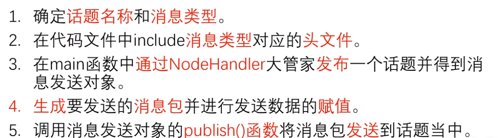

查看活动的话题
```bash
 rostopic list
```
查看某个话题中的消息

```bash
 rostopic echo /chao
```
` rostopic hz  /chao` 是每秒发送的消息数量

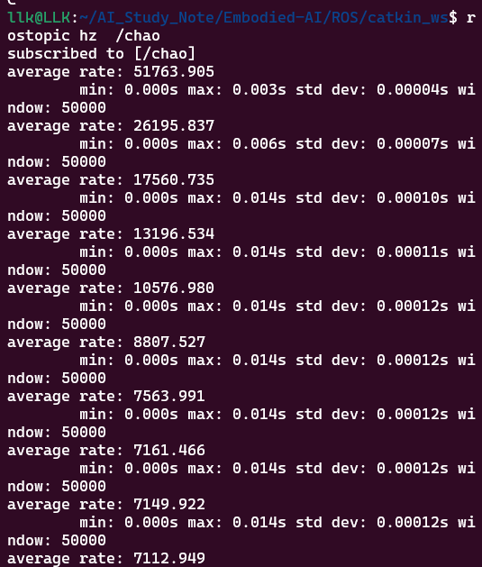
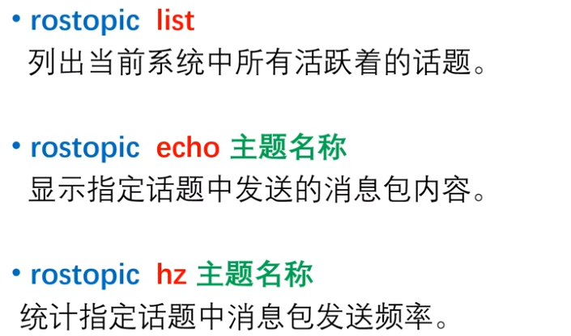
# 订阅者

```cpp
#include<ros/ros.h>
#include<std_msgs/String.h>
void chao_callback(std_msgs::String msg)
{
    ROS_INFO(msg.data.c_str());
    printf("\n");
}
void yao_callback(std_msgs::String msg)
{
    ROS_WARN(msg.data.c_str());
    printf("\n");
}

int main(int argc, char  *argv[])
{   
    setlocale(LC_ALL,"zh_CN.UTF-8");
    ros::init(argc,argv,"ma_node");
    ros::NodeHandle nh;
    ros::Subscriber sub1 = nh.subscribe("chao",10,chao_callback);
    ros::Subscriber sub2 = nh.subscribe("yao",10,yao_callback);
    //10代表等待处理的缓存消息队列长度
    while(ros::ok())//使用ture时候运行节点不能响应外界信号
    {
        ros::spinOnce();
    }
    printf("hello world");
    return 0;
}

```

```python
#! /usr/bin/env python3
#coding=utf-8

import rospy
from std_msgs.msg import String
def chao_callback(msg):
    rospy.loginfo(msg.data)

def yao_callback(msg):
    rospy.logwarn(msg.data)

if __name__=="__main__":
    rospy.init_node("ma_node")
    sub2=rospy.Subscriber("chao",String,chao_callback,queue_size=10)
    sub2=rospy.Subscriber("yao",String,yao_callback,queue_size=10)
    rospy.spin()

```

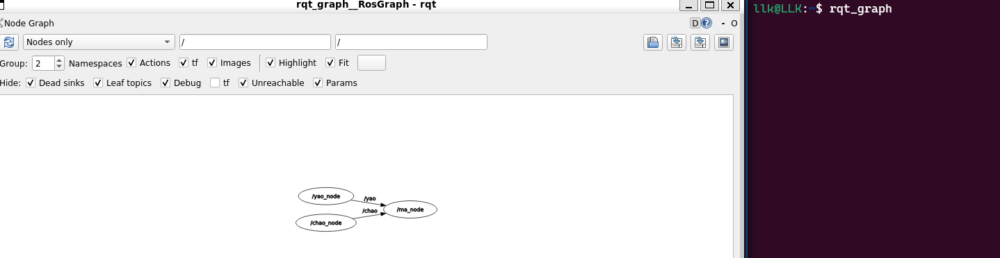
话题由 ROS 系统管理；只要有人发布或订阅，话题就会自动被创建

例如，当我运行订阅者节点时，对应的话题也会出现

# 各自的缓冲队列 + 整体流程
在 ROS（Robot Operating System）中，节点之间通过话题（topic）进行通信。发布者负责向某个话题发送消息，而订阅者负责从该话题接收消息。10 是队列大小，用于控制发布者和订阅者之间消息的缓冲行为。

对于下面这个发布者和订阅者
```cpp
ros::Publisher pub = nh.advertise<std_msgs::String>("chao",10);
ros::Subscriber sub1 = nh.subscribe("chao",10,chao_callback);
```

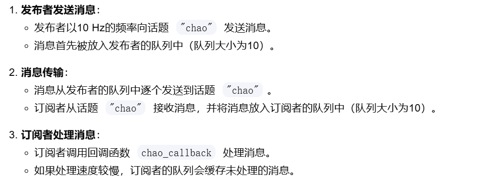

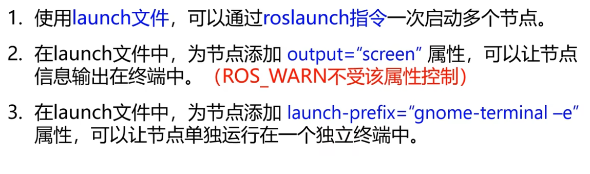
# 机器人运动控制

```cpp
#include <ros/ros.h>
#include <geometry_msgs/Twist.h>

int main(int argc, char* argv[])
{   
    ros::init(argc,argv,"vel_node");
    ros::NodeHandle n;
    ros::Publisher vel_pub=n.advertise<geometry_msgs::Twist>("/cmd_vel",10);
    geometry_msgs::Twist vel_msg;
    vel_msg.linear.x=0.1;
    vel_msg.linear.y=0;
    vel_msg.linear.z=0;
    vel_msg.angular.x=0;
    vel_msg.angular.y=0;
    vel_msg.angular.z=0;

    ros::Rate r(30);
    while(ros::ok())
    {
        vel_pub.publish(vel_msg);
        r.sleep();
    }

    return 0;
}
```

```python
#! /usr/bin/env python3
#coding=utf-8

import rospy
from geometry_msgs.msg import Twist
if __name__=="__main__":
    rospy.init_node("vel_node")
    vel_pub=rospy.Publisher("cmd_vel",Twist,queue_size=10)
    vel_msg=Twist()
    vel_msg.linear.x=0.1
    rate=rospy.Rate(30)
    while not rospy.is_shutdown():
        vel_pub.publish(vel_msg)
        rate.sleep()

```

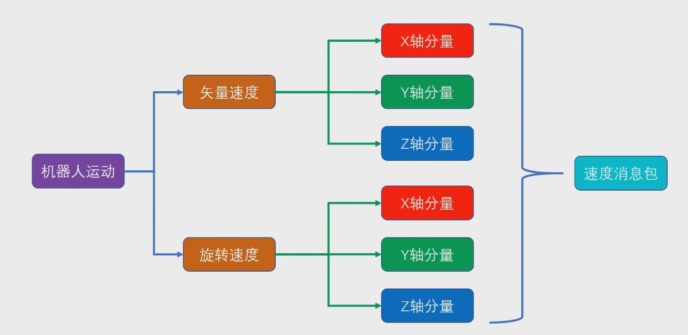
向话题发送速度消息包
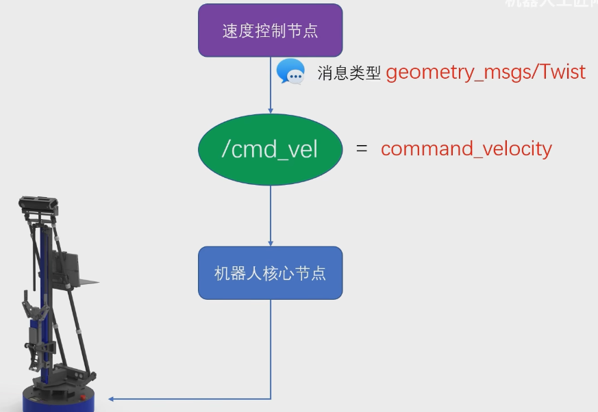

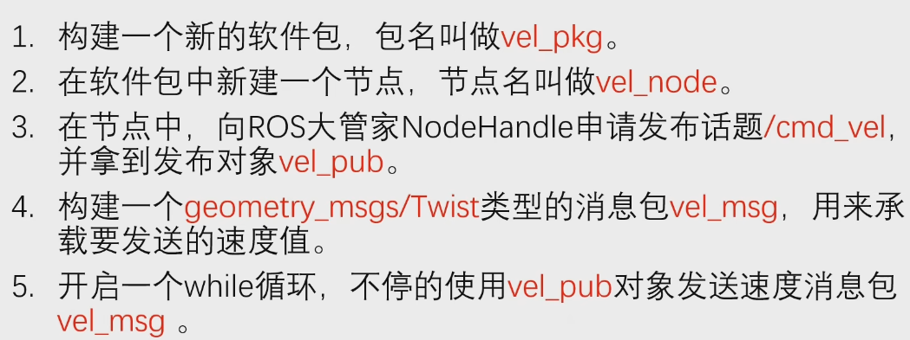

