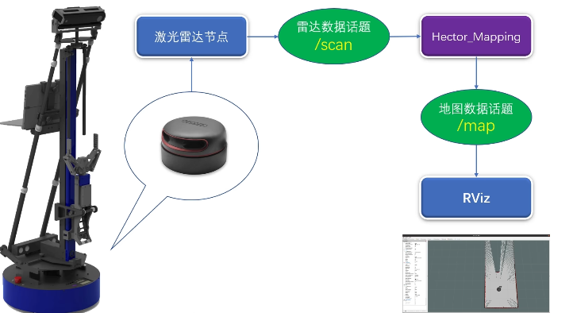
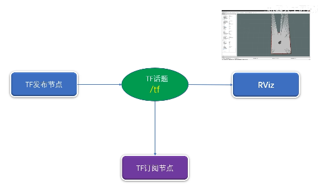
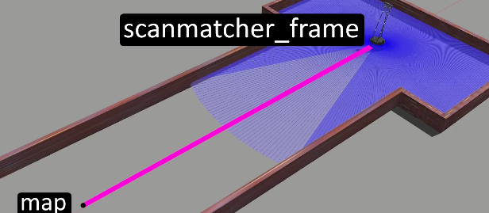
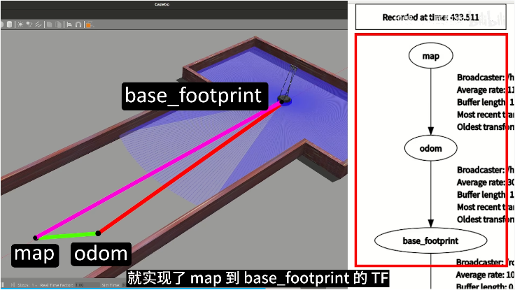
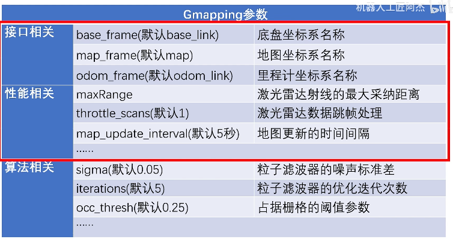
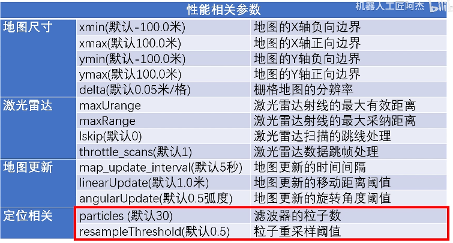
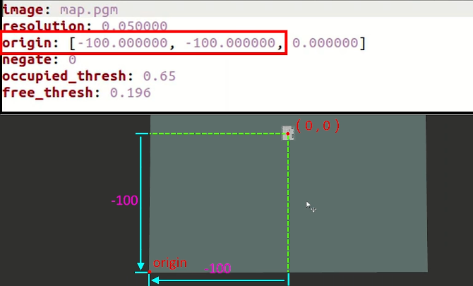



# SLAM
SLAM（Simultaneous Localization and Mapping，同步定位与地图构建）是机器人和自动驾驶领域的核心技术之一。它利用传感器数据（如激光雷达、摄像头等）实时估计机器人或无人系统的位姿（位置和朝向），同时构建环境地图。


#  hector_mapping 
hector_mapping 是一个基于激光雷达（LIDAR）的 SLAM（同步定位与地图构建）节点，适用于没有里程计且计算资源有限的场景。
- 订阅的话题
scan (sensor_msgs/LaserScan)
SLAM 系统使用的激光雷达扫描数据。
syscommand (std_msgs/String)
系统命令。如果字符串等于 "reset"，地图和机器人位姿会被重置为初始状态。
- 发布的话题
map_metadata (nav_msgs/MapMetaData)
可以从这个话题获取地图数据，数据是锁存的，并会定期更新。
map (nav_msgs/OccupancyGrid)
可以从这个话题获取地图数据，数据是锁存的，并会定期更新。
slam_out_pose (geometry_msgs/PoseStamped)
估计的机器人位姿，不带协方差。
poseupdate (geometry_msgs/PoseWithCovarianceStamped)
估计的机器人位姿，带有高斯估计的不确定性。



```bash
sudo apt install ros-noetic-hector-mapping
```

```bash
rosrun hector_mapping  hector_mapping 
```

```bash
rosrun rviz rviz
```


然后添加 robotmodel + map + laserscan，并分别订阅对应的话题。

最后控制机器人移动，进行 SLAM 建图。
```bash
 rosrun rqt_robot_steering rqt_robot_steering 
```


# 用 launch 启动 hector

```bash
catkin_create_pkg  slam_pkg roscpp rospy std_msgs
```
新建一个 launch 文件夹存放 launch 文件。


$(find wpr_simulation) 相当于执行 `rospack find wpr_simulation` 命令得到的结果。

```bash
<launch>

<include file="$(find wpr_simulation)/launch/wpb_stage_slam.launch" />
<node pkg="hector_mapping" type="hector_mapping" name="hector_mapping" >

</node>
<node pkg="rviz" type="rviz" name="rviz" args="-d $(find slam_pkg)/rviz/slam.rviz" />
<node pkg="rqt_robot_steering" type="rqt_robot_steering" name="rqt_robot_steering" />
</launch>
```

# Hector_Mapping 参数设置
1. ~map_update_distance_thresh
类型：double（浮点数）
默认值：0.4
单位：米（m）
作用：
这是地图更新的距离阈值。机器人至少移动 0.4 米（默认值）才会触发地图更新。
详细说明：
如果机器人移动的距离小于这个阈值，地图不会更新。
该参数与 ~map_update_angle_thresh 配合使用，满足任一条件即会触发地图更新。

2. ~map_update_angle_thresh
类型：double（浮点数）
默认值：0.9
单位：弧度（rad）
作用：
这是地图更新的角度阈值。机器人至少旋转 0.9 弧度（默认值）才会触发地图更新。
详细说明：
如果机器人的旋转角度小于这个阈值，地图不会更新。
该参数与 ~map_update_distance_thresh 配合使用，满足任一条件即会触发地图更新。
3. ~map_pub_period
类型：double（浮点数）
默认值：2.0
单位：秒（s）
作用：
这是发布地图的时间间隔。地图数据每 2.0 秒（默认值）发布一次。
详细说明：
即使机器人没有移动或旋转，地图仍会按这个间隔定期发布。
该参数与 ~map_update_distance_thresh 和 ~map_update_angle_thresh 无关，只控制地图发布的频率。

```bash
<launch>

<include file="$(find wpr_simulation)/launch/wpb_stage_slam.launch" />
<node pkg="hector_mapping" type="hector_mapping" name="hector_mapping" >
    <param name="map_update_distance_thresh"  value="0.1" />
    <param name="map_update_angle_thresh"  value="0.1" />
    <param name="map_update_distance_thresh"  value="0.1" />
</node>
<node pkg="rviz" type="rviz" name="rviz" args="-d $(find slam_pkg)/rviz/slam.rviz" />
<node pkg="rqt_robot_steering" type="rqt_robot_steering" name="rqt_robot_steering" />
</launch>
```
# ROS 的 TF 系统（定位）

ROS（机器人操作系统）中的 **TF（Transform）系统**是管理坐标系变换的核心工具。它允许用户定义和查询机器人系统中不同坐标系之间的关系，例如机器人底盘、传感器、机械臂等之间的相对位置和朝向。TF 系统在机器人导航、感知和控制中起着至关重要的作用。

---

1. **TF 系统的基本概念**
  1.1 坐标系（Frame）
- 在机器人系统中，每个部件（如传感器、机械臂、底盘等）都有自己的坐标系。
- 坐标系之间通常以**父子关系**表示。例如，激光雷达的坐标系可以是机器人底盘坐标系的子坐标系。

  1.2 变换（Transform）
- **变换**描述了从一个坐标系到另一个坐标系的转换关系，包括平移（位置）和旋转（朝向）。
- 变换可以用 **4x4 变换矩阵**或**平移向量 + 四元数（Quaternion）**表示。

  1.3 时间戳（Timestamp）
- 变换会随时间变化（例如运动中的机器人），因此每个变换都有一个时间戳，表示该变换有效的时间。

---

 2. **TF 系统的核心功能**
 2.1 发布变换（Publish Transform）
- 通过 `tf::TransformBroadcaster` 发布坐标系之间的变换关系。
- 例如，发布从机器人底盘到激光雷达的变换。

 2.2 查询变换（Lookup Transform）
- 通过 `tf::TransformListener` 查询两个坐标系之间的变换关系。
- 例如，查询从激光雷达坐标系到地图坐标系的变换。

 2.3 管理变换树（Transform Tree）
- TF 系统维护一棵**变换树**，其中每个节点是一个坐标系，每条边是坐标系之间的变换关系。
- 变换树必须是有向无环图（DAG），即不允许存在循环依赖。

---

 3. **TF 系统的使用**
 3.1 发布变换
下面是一个发布变换的示例：
```cpp
#include <ros/ros.h>
#include <tf/transform_broadcaster.h>

int main(int argc, char** argv) {
    ros::init(argc, argv, "tf_broadcaster");
    ros::NodeHandle nh;

    tf::TransformBroadcaster broadcaster;

    ros::Rate rate(10); // 10 Hz
    while (ros::ok()) {
        // 定义变换：从 "base_link" 到 "laser"
        tf::Transform transform;
        transform.setOrigin(tf::Vector3(0.1, 0.0, 0.2)); // 平移 (x, y, z)
        transform.setRotation(tf::Quaternion(0, 0, 0, 1)); // 旋转 (x, y, z, w)

        // 发布变换
        broadcaster.sendTransform(
            tf::StampedTransform(transform, ros::Time::now(), "base_link", "laser"));

        rate.sleep();
    }

    return 0;
}
```
   仿真
  - 发布从 `base_link`（机器人底盘）到 `laser`（激光雷达）的变换。
  - 该变换包括平移 `(0.1, 0.0, 0.2)` 和旋转 `(0, 0, 0, 1)`（无旋转）。

 3.2 查询变换
下面是一个查询变换的示例：
```cpp
#include <ros/ros.h>
#include <tf/transform_listener.h>

int main(int argc, char** argv) {
    ros::init(argc, argv, "tf_listener");
    ros::NodeHandle nh;

    tf::TransformListener listener;

    ros::Rate rate(10); // 10 Hz
    while (ros::ok()) {
        tf::StampedTransform transform;
        try {
            // 查询从 "base_link" 到 "laser" 的变换
            listener.lookupTransform("base_link", "laser", ros::Time(0), transform);

            // 打印变换信息
            ROS_INFO("Translation: [%f, %f, %f]",
                     transform.getOrigin().x(),
                     transform.getOrigin().y(),
                     transform.getOrigin().z());
            ROS_INFO("Rotation: [%f, %f, %f, %f]",
                     transform.getRotation().x(),
                     transform.getRotation().y(),
                     transform.getRotation().z(),
                     transform.getRotation().w());
        } catch (tf::TransformException &ex) {
            ROS_ERROR("%s", ex.what());
        }

        rate.sleep();
    }

    return 0;
}
```
- **说明**：
  - 查询从 `base_link` 到 `laser` 的变换。
  - 打印变换的平移和旋转信息。

---

 4. **TF 系统的常用工具**
 4.1 `tf_monitor`
- 查看 TF 树的当前状态。
- 命令：
  ```bash
  rosrun tf tf_monitor
  ```

 4.2 `view_frames`
- 生成 TF 树的图形化表示（PDF 文件）。
- 命令：
  ```bash
  rosrun tf view_frames
  ```

 4.3 `tf_echo`
- 实时查看两个坐标系之间的变换。
- 命令：
  ```bash
  rosrun tf tf_echo base_link laser
  ```

---




```bash
roslaunch wpr_simulation wpb_hector.launch 
```

```bash
rostopic list
```

```bash
llk@LLK:~/AI_Study_Note/Embodied-AI/ROS/catkin_ws/src$ rostopic type /tf
tf2_msgs/TFMessage
```

[https://docs.ros.org/en/api/tf2_msgs/html/msg/TFMessage.html](https://docs.ros.org/en/api/tf2_msgs/html/msg/TFMessage.html)

tf2_msgs/TFMessage 是 ROS（机器人操作系统）中用于传递多个坐标变换信息的消息类型。
transforms：这是一个包含多个 geometry_msgs/TransformStamped 消息的数组。每个 TransformStamped 消息表示坐标系之间的一个变换关系。
用途：TFMessage 通常用于在 ROS 节点之间传递多个坐标变换数据。例如，一个节点可以发布一个包含多个坐标系之间变换关系的 TFMessage，其他节点可以订阅该消息来获取变换信息。


geometry_msgs/TransformStamped 是用于表示带时间戳的坐标变换的消息类型。
1. header：这是一个 std_msgs/Header 消息，包含时间戳和坐标系信息。
header.stamp：时间戳，表示变换的时间。
header.frame_id：父坐标系的名称。
2. child_frame_id：子坐标系的名称，表示变换是从父坐标系到子坐标系。
3. transform：这是一个 geometry_msgs/Transform 消息，包含平移和旋转信息。
transform.translation：平移向量，包含 x、y、z 分量，即子坐标系原点在父坐标系中的位置。
transform.rotation：旋转四元数，包含 x、y、z、w 分量，描述子坐标系 x、y、z 轴的旋转，或者说物体相对于另一个坐标系的旋转角度和朝向。

```bash
rostopic echo /tf
```

```bash
rosrurqt_tf_tree  rqt_tf_tree 
```

# 什么是里程计


电机里程计在激光雷达 SLAM（同步定位与地图构建）中起着重要作用。它通过记录电机转动数据计算机器人的位移，从而估计机器人当前的位置。

这些位移信息以 TF 消息的形式发布到 /tf 话题。电机里程计输出的是 odom 到 base_footprint 的 TF，而激光雷达 SLAM 输出的是 map 到 base_footprint 的 TF。


电机里程计的优点是不依赖外部参照物的特征，因此不会被参照物的特征误导。

但电机里程计存在误差。例如，机器人车轮打滑时，里程计的定位信息可能与实际位置不符。而且这种误差会不断累积，导致定位误差越来越大。因此需要障碍物点云配准算法来修正里程计的误差。


```bash
roslaunch wpr_simulation wpb_corridor_hector.launch 
```


Hector Mapping 是一种基于激光雷达的 SLAM 算法，其核心思想是通过激光雷达点云与障碍物的配准来定位。在 Hector Mapping 中，机器人的位移主要由激光雷达点云配准算法计算，不使用里程计数据。为了在 RViz 中显示地图和机器人模型，Hector Mapping 会输出一个 map 到 odom 的 TF 来抵消不断增长的里程计 TF，使 base_footprint 的位置始终与 scanmatcher_frame 保持一致。

运行 Hector Mapping 时，如果机器人进入两侧墙壁光滑的走廊，激光雷达只能扫描到两侧的墙壁，导致障碍物点云配准认为机器人没有前进，误以为是激光雷达数据的噪声，于是定位在小范围内抖动。此时 Hector Mapping 会输出一个与机器人运动方向相反的 TF 来抵消里程计的变化，使 base_footprint 的位置与 scanmatcher_frame 保持一致。


直接由激光雷达点云匹配得到的位移就是 scanmatcher_frame。
```bash
roslaunch wpr_simulation wpb_corridor_hector.launch 
```

Gmapping 是另一种常用的 SLAM 算法。其核心思想是先用里程计估计机器人的位移，再将激光雷达点云与障碍物轮廓进行拟合来修正里程计误差。在 Gmapping 中，机器人的位移主要由里程计估计，激光雷达点云配准算法只起修正里程计误差的作用。Gmapping 输出的是从 map 到 odom 再到 base_footprint 的 TF。

运行 Gmapping 时，随着机器人进入两侧墙壁光滑的走廊，map 和 odom 的位置开始出现偏差，并有明显的跳变。这是由激光雷达点云与障碍物配准的定位跳变造成的。即便如此，由于里程计仍在工作，机器人的定位会继续前进，最终的建图结果与实际场地基本一致。


map 到 odom 的位置是障碍物点云匹配的偏移量。
odom 到 base_footprint 的位置是里程计的偏移量。


# Gmapping

```bash
roslaunch wpr_simulation wpb_stage_robocup.launch 
```

```bash
rosrun gmapping  slam_gmapping
```


slam_gmapping 是一个用于同步定位与地图构建（SLAM）的 ROS（机器人操作系统）节点。它接收激光扫描数据（sensor_msgs/LaserScan）并构建地图（nav_msgs/OccupancyGrid），地图可以通过 ROS 话题或服务获取。
- 订阅的话题
tf (tf/tfMessage)
作用：提供激光雷达、底盘和里程计之间的坐标变换。
说明：这些变换是构建地图和定位机器人所必需的。
scan (sensor_msgs/LaserScan)
作用：接收用于创建地图的激光扫描数据。
说明：激光扫描数据是构建地图的主要输入。
- 发布的话题
map_metadata (nav_msgs/MapMetaData)
作用：获取地图元数据。
说明：该话题发布地图的元数据，包括地图的分辨率、尺寸等。数据是锁存的，并会定期更新。
map (nav_msgs/OccupancyGrid)
作用：获取地图数据。
说明：该话题发布以占据栅格表示的地图数据。数据是锁存的，并会定期更新。
~entropy (std_msgs/Float64)
作用：估计机器人位姿分布的熵。
说明：熵值越高，表示机器人位姿的不确定性越大。这是 1.1.0 版本起新增的功能。
- 所需的变换
<frame of incoming scans> → base_link
作用：将激光扫描数据从激光雷达坐标系转换到机器人底盘坐标系。
说明：通常是一个固定变换，由 robot_state_publisher 或 tf static_transform_publisher 定期广播。
base_link → odom
作用：将机器人底盘坐标系与里程计坐标系关联起来。
说明：通常由里程计系统提供，例如移动底盘的驱动程序。
- 提供的变换
map → odom
作用：提供机器人在地图坐标系中的当前位姿估计。
说明：该变换表示机器人在地图中的位置和朝向。


```bash
roslaunch wpr_simulation wpb_stage_robocup.launch 
rosrun rqt_tf_tree  rqt_tf_tree 
rosrun gmapping  slam_gmapping 
rviz
rosrun wpr_simulation  keyboard_vel_ctrl 
```

# 用 launch 启动 gmapping

```bash
<launch>

<include file="$(find wpr_simulation)/launch/wpb_stage_robocup.launch"   />
<node pkg="gmapping" type="slam_gmapping" name="slam_gmapping" />
<node pkg="rviz" type="rviz" name="rviz" args="-d $(find slam_pkg)/rviz/gmapping.rviz" />
<node pkg="wpr_simulation  " type="keyboard_vel_ctrl " name="keyboard_vel_ctrl " />

</launch>
```

# gmapping 参数设置





```bash
<launch>
<include file="$(find wpr_simulation)/launch/wpb_stage_robocup.launch"   />
<node pkg="gmapping" type="slam_gmapping" name="slam_gmapping" >
    <param name="maxUrange" value="3.0" />
    <param name="map_update_interval" value="0.5" />
     <param name="linearUpdate" value="0.1" />
</node>
<node pkg="rviz" type="rviz" name="rviz" args="-d $(find slam_pkg)/rviz/gmapping.rviz" />
<node pkg="wpr_simulation  " type="keyboard_vel_ctrl " name="keyboard_vel_ctrl " />
</launch>
```


#  地图的保存与加载

`map_server` 是 ROS（机器人操作系统）中一个重要的功能包，主要用于处理地图数据。它提供两个主要功能：`map_server` 节点和 `map_saver` 命令行工具。下面详细说明其功能：

 1. **map_server 节点**
`map_server` 节点从磁盘读取地图文件，并通过 ROS 服务提供地图数据。地图数据通常以两种文件格式存储：
- **YAML 文件**：描述地图的元数据，包括地图的分辨率、原点、阈值等信息。
- **图像文件**：通常为 `.pgm` 或 `.png` 格式，表示地图的占据情况。图像中的每个像素对应地图中的一个栅格，像素的颜色值表示该栅格的占据状态（空闲、占据或未知）。

 主要功能：
- **发布地图数据**：`map_server` 节点发布两个话题：
  - `map_metadata`：发布地图的元数据（如分辨率、原点等）。
  - `map`：发布地图的占据栅格数据（`OccupancyGrid`）。
- **提供服务**：`map_server` 还提供 `static_map` 服务，允许其他节点通过服务调用获取地图数据。

 使用示例：
```bash
rosrun map_server map_server mymap.yaml
```
该命令启动 `map_server` 节点，并加载 `mymap.yaml` 文件中指定的地图。

 2. **map_saver 工具**
`map_saver` 是一个用于将地图保存到磁盘的命令行工具，通常用于保存 SLAM（同步定位与地图构建）生成的地图。

主要功能：
- **保存地图**：`map_saver` 从指定的 ROS 话题读取地图数据，并保存为 `.pgm` 和 `.yaml` 文件。
默认话题：/map（消息类型：nav_msgs/OccupancyGrid）
自定义话题：可以通过 map:=<topic_name> 指定其他话题。
- **自定义阈值**：可以通过 `--occ` 和 `--free` 参数设置占据区域和空闲区域的阈值。

 使用示例：
```bash
rosrun map_server map_saver -f mymap
```
该命令将地图保存为 `mymap.pgm` 和 `mymap.yaml` 文件。

 3. **地图格式**
地图由两个文件组成：
- **YAML 文件**：包含地图的元数据，如分辨率、原点、阈值等。
- **图像文件**：包含地图的占据数据，通常是一张灰度图，白色表示空闲区域，黑色表示占据区域，灰色表示未知区域。

 YAML 文件示例：
```yaml
image: testmap.png
resolution: 0.1
origin: [0.0, 0.0, 0.0]
occupied_thresh: 0.65
free_thresh: 0.196
negate: 0
```
- `image`：图像文件的路径。
- `resolution`：地图的分辨率，单位为米/像素。
- `origin`：地图左下角像素的二维位姿，格式为 (x, y, yaw)，其中 yaw 表示逆时针旋转（yaw=0 表示无旋转）。当前系统的许多部分会忽略 yaw。


- `occupied_thresh` 和 `free_thresh`：分别是占据区域和空闲区域的阈值。
- `negate`：是否反转图像的语义（黑白反转）。

 4. **取值解释**
地图中的像素值可以解释为三种状态：
- **Trinary（三值）**：像素值被解释为空闲（0）、占据（100）或未知（-1）。
- **Scale（比例）**：像素值被解释为空闲与占据之间的渐变。
- **Raw（原始）**：直接使用原始像素值。

