
# navigation
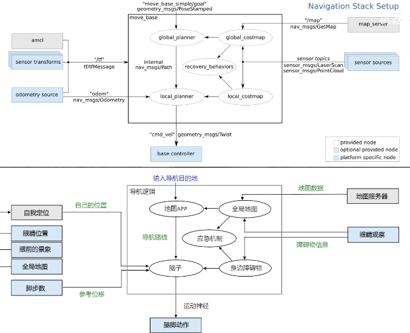

# move_base

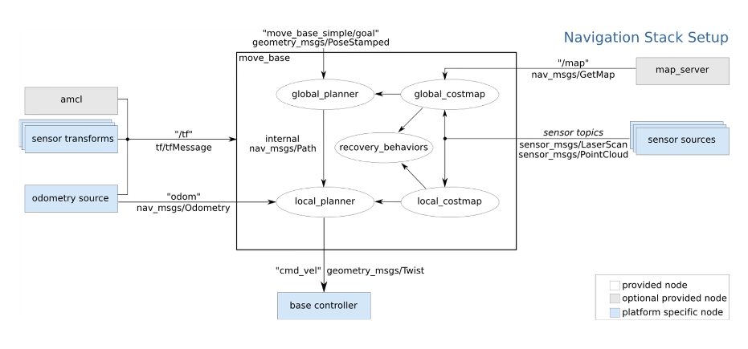
主要组成部分
- 全局规划器（Global Planner）：
负责生成从起点到目标点的全局路径。
常见的实现有 navfn 和 global_planner。
- 局部规划器（Local Planner）：
负责根据全局路径和局部环境信息（如障碍物）生成具体的运动指令。
常见的实现有 base_local_planner 和 dwa_local_planner。
- 代价地图（Costmap）：
用于表示机器人周围环境的代价信息，帮助规划器避开障碍物。
包括全局代价地图和局部代价地图。
- 恢复行为（Recovery Behaviors）
当机器人在导航过程中遇到问题（如被卡住）时，move_base 会执行恢复行为。
默认的恢复行为包括：
清除代价地图中的障碍物。
原地旋转以重新规划路径。


下载一些配置文件

```bash
git clone https://github.com/6-robot/wpb_home.git
cd wpb_home/wpb_home_bringup/scripts/
./install_for_noetic.sh
cd ~/catkin_ws/
catkin_make
```

```bash
catkin_create_pkg nav_pkg roscpp rospy move_base_msgs actionlib
```
先把地图文件保存到 wpr_simulation 下的 maps 文件夹中。
```bash
roslaunch wpr_simulation wpb_stage_robocup.launch
roslaunch nav_pkg nav.launch
```

```bash
rviz
```
添加 map 和 robot。
这里选择导航目的地以及到达相应位置后的朝向。
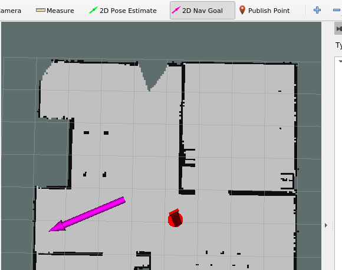
还可以添加 path 显示来展示路线。

# 全局规划器
变量名对应使用哪个全局规划器。

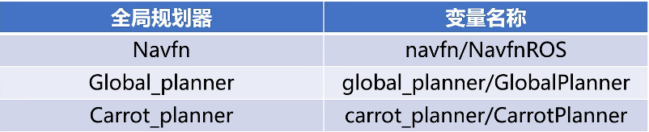
参数配置
- 关键参数：
~base_global_planner：指定全局规划器插件（默认是 navfn/NavfnROS）。
~base_local_planner：指定局部规划器插件（默认是 base_local_planner/TrajectoryPlannerROS）。
~recovery_behaviors：指定恢复行为列表。
~controller_frequency：控制循环的频率。
~planner_patience 和 ~controller_patience：规划和控制的超时时间。
- 其他参数：包括代价地图配置、振荡检测等。


# AMCL 定位算法

1. rviz 中分裂出各种粒子，即机器人在不同位置和朝向下可能的位姿。
2. 然后机器人实际移动一段距离，激光雷达扫描，得到里程计距离 + 激光雷达扫描特征。
3. 然后把里程计距离叠加到每个粒子上，并通过激光雷达特征匹配淘汰最不匹配的粒子。
4. 重复以上三步。
- 功能：amcl 是机器人在二维平面中的概率定位系统。它实现了自适应（或 KLD 采样）蒙特卡洛定位方法，使用粒子滤波器在已知地图中跟踪机器人的位姿。
- 算法：使用了多种算法，包括 sample_motion_model_odometry、beam_range_finder_model、likelihood_field_range_finder_model、Augmented_MCL 和 KLD_Sampling_MCL。
- 传感器支持：目前只支持激光扫描和激光地图，但可以扩展到其他传感器数据。


- 节点：amcl 节点接收激光地图、激光扫描和坐标变换消息，输出位姿估计。
- 订阅的话题：
scan（sensor_msgs/LaserScan）：激光扫描数据。
tf（tf/tfMessage）：坐标变换消息。
initialpose（geometry_msgs/PoseWithCovarianceStamped）：用于初始化粒子滤波器的均值和协方差。
map（nav_msgs/OccupancyGrid）：设置了 use_map_topic 参数时，订阅该话题以获取用于激光定位的地图。
- 发布的话题：
amcl_pose（geometry_msgs/PoseWithCovarianceStamped）：机器人在地图中的估计位姿，带协方差。
particlecloud（geometry_msgs/PoseArray）：滤波器维护的位姿估计集合。
tf（tf/tfMessage）：发布从 odom 到 map 的坐标变换。


本体与“分身”之间的切换就是 map->odom。
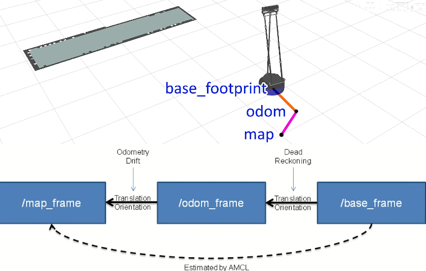
在 rviz 中看到的是最匹配的那一个，但每次“分身”都会切换到最匹配的那个，所以显示会跳变。不过里程计的输出是平滑的。
```bash
roslaunch wpr_simulation wpb_stage_robocup.launch 
```

```bash
roslaunch nav_pkg nav.launch
rviz
```
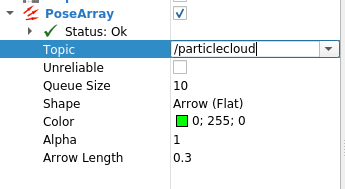
# 代价地图
代价地图（Costmap）是 ROS（Robot Operating System）中用于路径规划和导航的一种重要数据结构。它通过给地图上的每个栅格赋予一个“代价”值，来表示机器人在该位置移动的难度或风险。

```bash
roslaunch wpr_simulation wpb_stage_robocup.launch 
roslaunch nav_pkg nav.launch
rviz
```
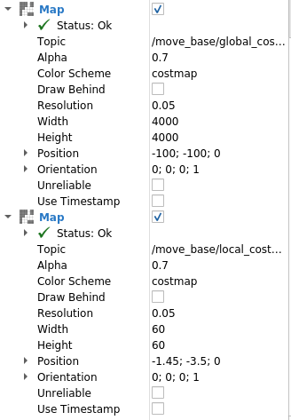

```bash
<launch>
    <!--- Run move_base -->
    <node pkg="move_base" type="move_base" name="move_base">
        <rosparam file="$(find wpb_home_tutorials)/nav_lidar/costmap_common_params.yaml" command="load" ns="global_costmap" />
        <rosparam file="$(find wpb_home_tutorials)/nav_lidar/costmap_common_params.yaml" command="load" ns="local_costmap" />
        <rosparam file="$(find wpb_home_tutorials)/nav_lidar/global_costmap_params.yaml" command="load" />
        <rosparam file="$(find wpb_home_tutorials)/nav_lidar/local_costmap_params.yaml" command="load" />
        <param name="base_global_planner" value="global_planner/GlobalPlanner" /> 
        <param name="base_local_planner" value="wpbh_local_planner/WpbhLocalPlanner" />
    </node>

    <!-- Run map server -->
    <node pkg="map_server" type="map_server" name="map_server" args="$(find wpr_simulation)/maps/mymap.yaml"/>

    <!--- Run AMCL -->
    <node pkg="amcl" type="amcl" name="amcl"/>

    <node name="rviz" pkg="rviz" type="rviz" args="-d $(find nav_pkg)/rviz/nav.rviz"/>
   
</launch>
 
```

代价地图的不同图层：
Static Map Layer：静态地图层，基本不变的地图层，通常是 SLAM 建立的静态地图。
Obstacle Map Layer：障碍物地图层，用于动态记录传感器感知到的障碍物信息。
Inflation Layer：膨胀层，在以上两个地图层上进行膨胀（向外扩张），以防止机器人撞上障碍物。
Master Layer：组合层，整合以上各层的信息，生成最终的代价地图。

# 代价地图参数设置
- 功能：costmap_2d 包为机器人导航提供了二维代价地图的实现。它接收传感器数据，构建二维或三维占据栅格（取决于是否使用体素实现），并根据占据栅格和用户指定的膨胀半径在二维代价地图中膨胀代价。

- 标记与清除（Marking and Clearing）：
代价地图会自动订阅传感器话题，并根据传感器数据更新自身。
每个传感器用于在代价地图中标记（插入障碍物信息）或清除（移除障碍物信息），或者两者兼有。
占据、空闲与未知空间：
代价地图中的每个栅格可以有 255 种不同的代价值，但底层结构只能表示三种状态：空闲、占据或未知。
每种状态在投影到代价地图时都有一个特殊的代价值。
- 地图更新：
代价地图按指定的更新频率（update_frequency）执行地图更新周期。
在每个周期中，处理传感器数据，在底层占据结构中执行标记和清除操作，然后投影到代价地图中。
- 坐标变换（tf）：
代价地图使用 tf（坐标变换）来插入传感器数据。它假定全局坐标系（global_frame）、机器人基座坐标系（robot_base_frame）和传感器源之间的所有变换都是连通且最新的。
transform_tolerance 参数设置这些变换之间允许的最大延迟。
- 膨胀：
膨胀是把代价值从占据栅格向外传播的过程，代价值随距离增加而递减。
定义了五种特定的代价值符号来表示机器人与障碍物之间的关系。

- 静态地图：
使用用户生成的静态地图（如通过 map_server 包构建的地图）来初始化代价地图。
代价地图的宽度、高度和障碍物信息与静态地图一致。
- 滚动窗口：
把 rolling_window 参数设为 true，可以让机器人在移动时始终位于代价地图的中心；当机器人离开某个区域时，障碍物信息会从地图中移除。
这种配置通常用于机器人只关心局部区域障碍物的情况。


- 坐标系与变换参数：
global_frame：代价地图的全局坐标系（默认是 /map）。
robot_base_frame：机器人基座坐标系（默认是 base_link）。
transform_tolerance：变换数据的容忍延迟（默认是 0.2 秒）。
- 频率参数：
update_frequency：地图更新频率（默认是 5.0 Hz）。
publish_frequency：地图发布频率（默认是 0.0 Hz，表示只发布更新的部分）。
- 地图管理参数：
rolling_window：是否使用滚动窗口（默认是 false）。
always_send_full_costmap：是否在每次更新时发布完整的代价地图（默认是 false）。
width、height、resolution、origin_x、origin_y：地图的宽度、高度、分辨率和原点坐标。


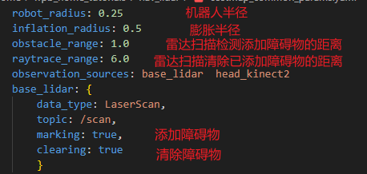
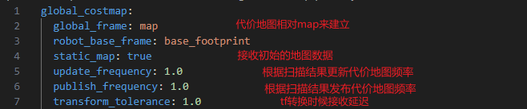
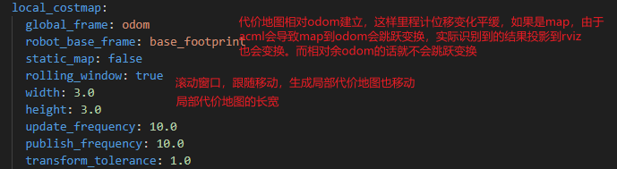

# 恢复行为


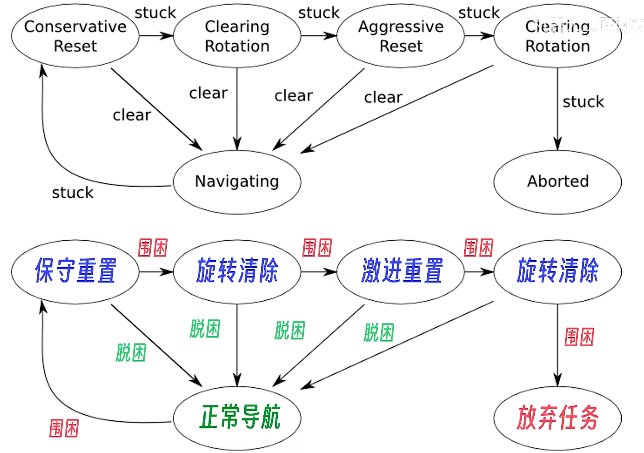
1. 保守重置（Conservative Reset）：
描述：机器人尝试清除地图中指定区域以外的障碍物信息。
状态转移：
如果成功清除障碍物并继续导航，进入 Navigating（正常导航）状态。
如果清除失败或仍然被卡住，进入 Clearing Rotation 状态。
2. 清除旋转（Clearing Rotation）：
描述：机器人原地旋转，尝试清除局部障碍物信息。
状态转移：
如果旋转后成功清除障碍物并继续导航，进入 Navigating（正常导航）状态。
如果旋转后仍然被卡住，进入 Aggressive Reset 状态。
3. 激进重置（Aggressive Reset）：
描述：机器人更激进地清除地图中的障碍物信息，包括指定区域以外的所有障碍物。
状态转移：
如果成功清除障碍物并继续导航，进入 Navigating（正常导航）状态。
如果清除失败或仍然被卡住，进入 Clearing Rotation 状态。
4. Navigating（正常导航）：
描述：机器人处于正常导航状态，沿规划路径移动。
状态转移：
如果遇到障碍物或被卡住，进入 Conservative Reset 状态。
5. Aborted（中止）：
描述：如果所有恢复行为都失败，机器人认为目标不可达，放弃导航任务。
状态转移：
不再转移；任务结束。


# 恢复行为参数设置

```bash
recovery_behaviors:
  - name: 'rotate_recovery'
    type: 'rotate_recovery/RotateRecovery'
  - name: 'reset_recovery'
    type: 'clear_costmap_recovery/ClearCostmapRecovery'

```

clear_costmap_recovery 包提供了一种在机器人导航过程中使用的恢复行为，用于清除代价地图中的障碍物信息，帮助机器人脱困并继续导航。

该恢复行为会清除代价地图中指定区域以外的障碍物信息，让机器人能够重新规划路径。
清除区域是以机器人为中心的正方形区域，其边长由 reset_distance 参数决定。

```bash
rotate_recovery:
  reset_distance: 2.0
  layer_names: ["obstacle_layer"]
```

- ~<name>/reset_distance（double，默认值：3.0）：
指定清除障碍物的区域（以机器人为中心的正方形区域）的边长，单位为米。
例如，reset_distance: 3.0 表示清除机器人周围 3 米范围内的障碍物信息。
- ~<name>/invert_area_to_clear（bool，默认值：false）：
如果设为 false，清除指定区域以外的障碍物信息；如果设为 true，清除指定区域以内的障碍物信息。
- ~<name>/layer_names（list，默认值：["obstacles"]）：
指定要清除的图层名称。默认只清除 obstacles 图层。


rotate_recovery 包提供了一种在机器人导航过程中使用的恢复行为，通过执行 360 度旋转来清除代价地图中的障碍物信息，从而帮助机器人脱困并继续导航。
执行 360 度旋转：
该恢复行为让机器人原地旋转 360 度，更新传感器数据，从而清除代价地图中的障碍物信息。
在旋转过程中，机器人重新扫描周围环境，并更新代价地图中的障碍物信息。

```bash
reset_recovery:
  reset_distance: 0.0
  layer_names: ["obstacle_layer"]
```

- ~<name>/sim_granularity（double，默认值：0.017）：
检查原地旋转是否安全时，每次检查的角度间隔（单位为弧度）。默认值为 0.017 弧度（约 1 度）。
- ~<name>/frequency（double，默认值：20.0）：
向移动底盘发送速度指令的频率（单位为 Hz）。默认值为 20.0 Hz。
- ~TrajectoryPlannerROS/yaw_goal_tolerance（double，默认值：0.05）：
控制器到达目标时的偏航角容差（单位为弧度）。默认值为 0.05 弧度。
- ~TrajectoryPlannerROS/acc_lim_th（double，默认值：3.2）：
机器人的旋转加速度限制（单位为 rad/s²）。默认值为 3.2 rad/s²。
- ~TrajectoryPlannerROS/max_rotational_vel（double，默认值：1.0）：
底盘允许的最大旋转速度（单位为 rad/s）。默认值为 1.0 rad/s。
- ~TrajectoryPlannerROS/min_in_place_rotational_vel（double，默认值：0.4）：
底盘原地旋转时允许的最小旋转速度（单位为 rad/s）。默认值为 0.4 rad/s。


# 局部规划器

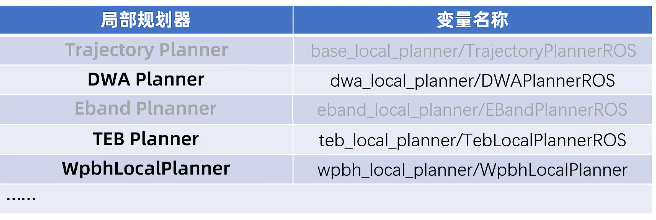
wpbbh_local_planner/WpbbhLocalPlanner 根据激光雷达采集的信息，在局部规划器内部重新实现了代价地图和广度优先搜索算法。它采用人工势场法绕过障碍物并回到全局路线上。

# DWA
动态窗口法（Dynamic Window Approach，DWA）
1. 状态空间采样：在当前时刻，根据机器人的速度和加速度限制，计算可能的速度组合（线速度 v 和角速度 ω），形成一个动态速度窗口。
动态窗口可以表示为一个速度范围，包含机器人在当前时刻可以安全采用的速度组合（线速度 v 和角速度 ω）。
3. 轨迹生成：对每一对 (v, ω)，通过运动模型预测未来的轨迹，通常是一定时间跨度内的轨迹。
4. 评估轨迹：根据轨迹质量评价函数（通常包括到目标点的距离、与障碍物的安全距离等）为每条轨迹打分。
5. 选择最佳速度：选择得分最高的速度指令，使机器人既能到达目标，又能在运动过程中有效避开障碍物。


动态调参
```bash
rosrun rqt_reconfigure  rqt_reconfigure 
```

参数选择

- 速度参数
max_vel_x：x 方向的最大速度，单位 m/s。机器人能达到的最大线速度。
min_vel_x：x 方向的最小速度，单位 m/s。设为负值可以允许倒车。
max_vel_y：对于差速驱动机器人，y 方向最大速度为 0.0。
min_vel_y：对于差速驱动机器人，y 方向最小速度为 0.0。
max_vel_trans：最大平移速度，单位 m/s。机器人能达到的最大合成线速度。
min_vel_trans：最小平移速度，单位 m/s。建议不要设为 0.0，以免机器人无法移动。
trans_stopped_vel：平移速度低于该值时，机器人停止。
acc_lim_trans：最大平移加速度，单位 m/s²。
acc_lim_x：x 方向的最大加速度限制，单位 m/s²。
acc_lim_y：y 方向的加速度限制；差速驱动机器人应设为 0.0。
max_vel_theta：最大旋转速度，单位 rad/s。应略低于底盘的功能极限。
min_vel_theta：最小角速度，单位 rad/s。平移速度可忽略时的最小角速度。
theta_stopped_vel：旋转速度低于该值时，机器人停止。
acc_lim_theta：旋转的加速度限制，单位 rad/s²。
- 目标容差参数
yaw_goal_tolerance：目标朝向容差，单位为弧度。机器人到达目标点时允许的偏航角误差。
xy_goal_tolerance：目标 xy 容差，单位为米。机器人到达目标点时允许的 xy 位置误差。
latch_xy_goal_tolerance：如果设为 true，一旦机器人进入目标点的 xy 容差范围，即使之后稍微偏离容差范围，也仍然认为已到达目标。
- 前向仿真参数
sim_time：仿真时间，单位为秒。表示算法模拟机器人运动的时间跨度。
vx_samples：x 方向的速度采样数。表示在 x 方向上采样多少个不同的速度。
vy_samples：对于差速驱动机器人，y 方向的速度采样数；只有一个采样。
vtheta_samples：旋转速度采样数。表示在角速度方向上采样多少个不同的速度。
- 轨迹评分参数
path_distance_bias：贴近全局路径的权重。值越大，机器人越倾向于保持在全局路径附近。
goal_distance_bias：接近导航目标的权重。值越大，机器人越倾向于尽快到达目标。
occdist_scale：控制器避障的权重。值越大，机器人越倾向于避开障碍物。
forward_point_distance：机器人到评分点的位置，单位为米。表示在机器人前方多远处进行障碍物检测。
stop_time_buffer：机器人在碰撞前必须停下、留出缓冲空间的时间长度，单位为秒。
scaling_speed：用于缩放的机器人速度绝对值。当机器人速度超过该值时，footprint 开始缩放。
max_scaling_factor：机器人 footprint 在高速时可以缩放的最大倍数。
- 防振荡参数
oscillation_reset_dist：重置振荡标志前必须行驶的距离，单位为米。如果机器人在运动过程中的距离变化小于该值，可能被认为在振荡。
- 辅助调试选项
publish_traj_pc：是否在 RViz 中发布轨迹。如果设为 true，就可以在 RViz 中看到机器人生成的轨迹。
publish_cost_grid_pc：是否在 RViz 中发布代价栅格。如果设为 true，就可以在 RViz 中看到代价栅格。
global_frame_id：基准坐标系。表示机器人在世界坐标系中的位置。
- 差速驱动机器人配置
holonomic_robot：机器人是否为全向机器人。如果设为 true，表示机器人具有全向移动能力。


rviz 显示可能的轨迹
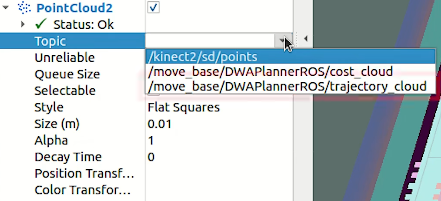

# TEB

teb_local_planner 是 ROS 导航栈中的一个局部轨迹规划器插件，基于 Timed-Elastic-Bands（时间弹性带）方法。它可以在运行时优化机器人的轨迹，同时考虑轨迹执行时间、与障碍物的距离以及运动学和动力学约束。

teb_local_planner 基于非线性优化，实时为机器人生成平滑、安全、高效的局部轨迹。它的核心方法是“Timed-Elastic-Bands”，通过引入虚拟力来拉伸或压缩轨迹，以适应环境约束和机器人动力学。


1. TEB 算法首先从全局规划器提供的全局路线中选取一段作为初始轨迹。

2. 根据这段轨迹的起点和终点，生成一条连接线（时间弹性带）。这条线由多个离散的时间点组成，每个时间点对应机器人的一个位姿（位置和朝向）。

3. 全局路线对 TEB 弹性带有吸引力，即算法会尽量让弹性带靠近全局路线。这是通过在优化过程中施加一个目标函数来实现的，使弹性带上的点尽可能接近全局路线上的点。

4. 障碍物对 TEB 弹性带有排斥力，即算法会尽量让弹性带远离障碍物。这是通过在优化过程中施加另一个目标函数来实现的，使弹性带上的点尽可能远离障碍物。


TEB 算法通过多目标优化来调整弹性带的形状。优化目标包括：
路径长度：使路径长度最小。
轨迹执行时间：使轨迹的执行时间最短。
与障碍物的距离：与障碍物保持安全距离。
经过中间路点：尽量经过全局路线上的关键点。
机器人动力学和运动学约束：确保轨迹符合机器人的运动能力。

```bash
sudo apt install ros-noetic-teb-local-planner
```

rviz 显示选中的路径以及每个时间间隔的位置
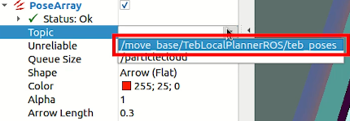
- 速度相关参数
max_vel_x：机器人的最大平移速度，单位 m/s。表示机器人在平移方向上能达到的最快速度。
max_vel_x_backwards：机器人倒车时的最大平移速度绝对值，单位 m/s。设为 0 或负值会报错。可以通过降低倒车权重来调整倒车速度，而不是直接修改这个参数。
max_vel_theta：机器人的最大旋转速度，单位 rad/s。与最小转弯半径有关，计算公式为 r=v/ω，其中 r 是转弯半径，v 是线速度，ω 是角速度。
- 加速度相关参数
acc_lim_x：机器人在 x 方向的最大加速度，单位 m/s²。限制机器人在平移方向上加速或减速的快慢。
acc_lim_theta：机器人的最大旋转加速度，单位 rad/s²。限制机器人在旋转方向上加速或减速的快慢。
- 转弯半径相关参数
min_turning_radius：最小转弯半径。如果设为 0，表示机器人可以原地转向。
wheelbase：仅在 cmd_angle_instead_rotvel 为 True 时有效。表示机器人后轴与前轴之间的距离。
cmd_angle_instead_rotvel：是否把收到的角速度消息转换为操作上的角度变化。如果设为 True，话题 vel_msg.angular.z 中的数据就是转向角。
- 车体 footprint 相关参数
footprint_model：定义机器人的 footprint 模型，用于优化过程中的碰撞检测。支持的模型类型包括："point"、"circular"、"two_circles"、"line"、"polygon"。
type：指定 footprint 模型的类型，例如 "circular"。
radius：仅对类型 "circular" 有效。表示圆形 footprint 的半径。
line_start 和 line_end：仅对类型 "line" 有效。分别表示线段的起点和终点坐标。
front_offset、front_radius、rear_offset、rear_radius：仅对类型 "two_circles" 有效。分别表示前后两个圆的偏移量和半径。
vertices：仅对类型 "polygon" 有效。表示多边形的顶点坐标。
- 判断到达目标点的容差
xy_goal_tolerance：机器人到达目标位置时允许的欧氏距离偏差，单位为米。表示机器人与目标位置在二维平面上允许的最大距离。
yaw_goal_tolerance：机器人到达目标朝向时允许的偏差，单位为弧度。表示机器人在旋转方向上允许的最大偏差。
- 障碍物相关参数
min_obstacle_dist：机器人与障碍物之间允许的最小距离，单位为米。机器人会尽量保持在这个距离之外，以避免与障碍物碰撞。
inflation_dist：障碍物的膨胀距离，单位为米。计算路径时，机器人会把障碍物的范围扩大这个距离，以确保路径规划更安全。
include_costmap_obstacles：是否考虑局部代价地图中的障碍物。如果设为 True，路径规划时会考虑代价地图中的障碍物。
costmap_obstacles_behind_robot_dist：机器人后方此距离内的障碍物会被纳入检测范围，单位为米。如果设为较远的距离，机器人能更早感知到身后的障碍物并做出相应的避让动作。
obstacle_poses_affected：一个障碍物影响附近多少个关键点。值越大，避障行为越严格，但也会增加计算量。
- 路径优化相关参数
no_inner_iterations：图优化算法中的内层迭代次数。值越大，轨迹优化效果越好，但计算时间也会增加。
no_outer_iterations：外层循环迭代次数。与内层迭代次数结合，可以进一步改善轨迹优化效果。
penalty_epsilon：为所有惩罚项添加一个小的安全余量，以避免数值不稳定的问题。
weight_max_vel_x、weight_max_vel_theta、weight_acc_lim_x、weight_acc_lim_theta：分别是平移速度、旋转速度、平移加速度和旋转加速度的优化权重。这些权重决定了轨迹优化过程中各因素的相对重要性。
weight_kinematics_nh：非完整运动学的优化权重。权重越高，越严格地满足机器人的运动学约束。
weight_kinematics_forward_drive：前进运动的权重。权重越高，越鼓励机器人选择前进行驶的路径。
weight_optimaltime：时间代价权重。权重越高，越鼓励机器人选择更快的路径。
weight_obstacle：与障碍物保持距离的权重。权重越高，越严格地避免与障碍物碰撞。
- 多路径规划相关参数
enable_homotopy_class_planning：是否启用多路径规划。如果设为 True，机器人会同时规划多条拓扑结构不同的路径，并从中选出最优的一条。
enable_multithreading：是否启用多线程计算。如果设为 True，可以提高规划效率。
max_number_classes：考虑的候选路径数量上限。限制同时规划的路径数量，以避免计算量过大。
selection_cost_hysteresis：路径轨迹被选中的评价阈值。只有当候选路径的评价低于当前所选路径的评价乘以该系数时，才会被选中，从而避免频繁切换路径。
selection_obst_cost_scale：选择标准中障碍物评价的缩放系数。系数越大，越严格地考虑障碍物的影响。
selection_alternative_time_cost：时间代价是否取平方。如果设为 True，时间代价按平方计算，更加重视时间因素。
roadmap_graph_no_samples：为创建路线图而生成的采样数。采样越多，路径规划精度越高，但计算时间也会增加。
roadmap_graph_area_width：关键点采样的宽度，单位为米。宽度越大，路径规划越灵活，但计算时间也会增加。


# 导航 Action 编程接口
Action 通信是一种双向的消息传递机制。与传统的 Topic 通信不同，Action 可以提供持续的反馈信息。
导航 Action 通信包括三个主要部分：
1. 目标请求（Goal Request）：客户端发送给服务端的目标请求，包含导航目标点的坐标和朝向。
2. 结果（Result）：服务端完成导航任务后返回的结果，表示导航是否成功。
3. 反馈（Feedback）：导航过程中服务端定期发送给客户端的反馈信息，用于实时监控导航进度。


# 坐标导航实现
[http://docs.ros.org/en/fuerte/api/move_base_msgs/html/msg/MoveBaseAction.html](http://docs.ros.org/en/fuerte/api/move_base_msgs/html/msg/MoveBaseAction.html)
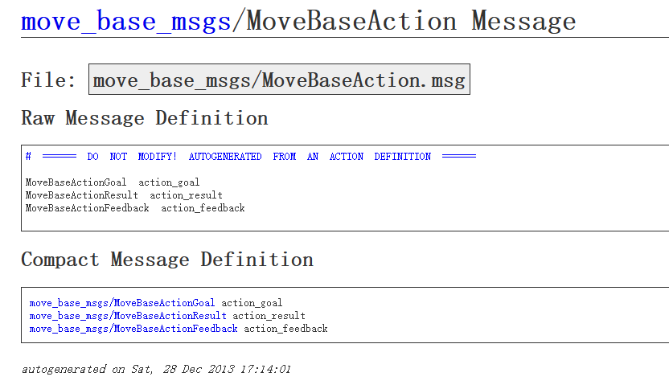

```cpp

#include<ros/ros.h>
#include<move_base_msgs/MoveBaseAction.h>
#include<actionlib/client/simple_action_client.h>

//参数需要指定动作的类型
typedef actionlib::SimpleActionClient<move_base_msgs::MoveBaseAction> MoveBaseClient;

int main(int argc, char** argv){
    ros::init(argc, argv, "nav_client");
    MoveBaseClient ac("move_base", true);

//   它的作用是等待动作服务器启动，并返回一个布尔值。
// 如果服务器在指定的时间内（由 ros::Duration 设置）启动，函数返回 true。
// 如果超时未启动，函数返回 false。
    while(!ac.waitForServer(ros::Duration(5.0))){
        ROS_INFO("Waiting for the move_base action server to come up");
    }

    move_base_msgs::MoveBaseGoal goal;
    goal.target_pose.header.frame_id = "map";
    goal.target_pose.header.stamp = ros::Time::now();
    goal.target_pose.pose.position.x = -3.0;
    goal.target_pose.pose.position.y = 1.0;

    goal.target_pose.pose.orientation.w = 1;

    ROS_INFO("Sending goal");
    ac.sendGoal(goal);
    ac.waitForResult();
    if(ac.getState() == actionlib::SimpleClientGoalState::SUCCEEDED)
        ROS_INFO("complete mission");
    else
        ROS_INFO("failed mission");

}
```

1. 创建一个 action 客户端。
2. 等待 action 服务端启动。
3. 定义目标点的位置和朝向。
4. 把目标点发送给服务端。
5. 等待返回结果。
6. 检查结果状态。

```bash
roslaunch wpr_simulation wpb_stage_robocup.launch
roslaunch nav_pkg nav.launch 
rosrun nav_pkg nav_client
```

```python
#! /usr/bin/env python3
# coding: utf-8

import rospy
import actionlib
from move_base_msgs.msg import MoveBaseAction, MoveBaseGoal

if __name__ == '__main__':
    rospy.init_node('nav_client')
    ac = actionlib.SimpleActionClient('move_base', MoveBaseAction)
    ac.wait_for_server()

    goal = MoveBaseGoal()
    goal.target_pose.header.frame_id = "map"
    goal.target_pose.header.stamp = rospy.Time.now()
    goal.target_pose.pose.position.x = -3.0
    goal.target_pose.pose.position.y = 1.0
    goal.target_pose.pose.orientation.w = 1.0

    
    ac.send_goal(goal)
    rospy.loginfo("send goal")
    ac.wait_for_result()
    
    if ac.get_state()==actionlib.GoalStatus.SUCCEEDED:
        rospy.loginfo("goal reached")
    else:
        rospy.loginfo("goal failed")


```


# 导航插件

```bash
git clone https://github.com/6-robot/waterplus_map_tools.git
```

设置导航目标点
```bash
roslaunch waterplus_map_tools add_waypoint_simulation.launch 
```

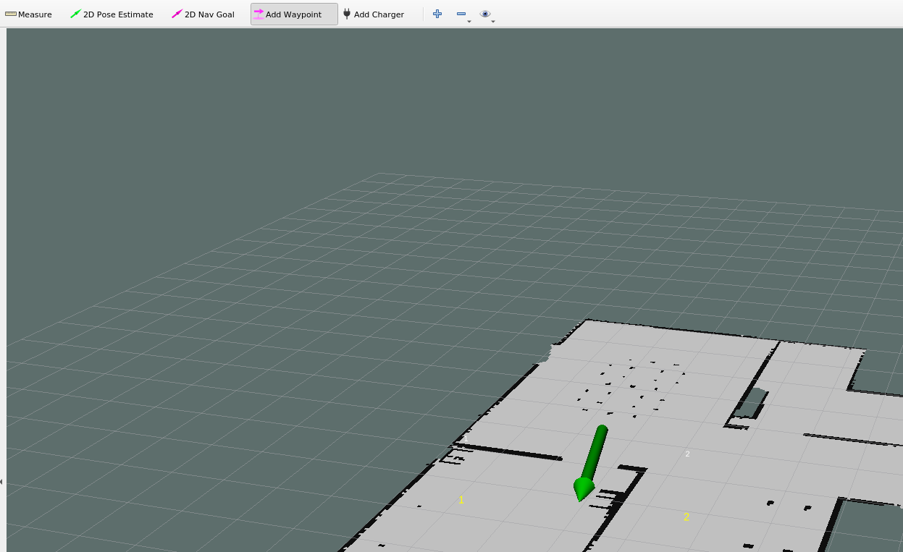
直接在地图上绘制导航点。


保存导航点
```bash
rosrun waterplus_map_tools  wp_saver 
```


启动环境
```bash
roslaunch wpr_simulation  wpb_map_tool.launch
```
开始导航到设置的目标位置（会导航到设置的第一个目标点）。
```bash
rosrun wpr_simulation  demo_map_tool
```


如果想修改导航点并重新导航，重复以上步骤即可——只需在打开的导航地图中移动导航点。


# 导航插件集成

```bash
roslaunch wpr_simulation wpb_stage_robocup.launch 
roslaunch nav_pkg nav.launch 
rosrun wpr_simulation demo_map_tool
```

- wp_manager：
功能：wp_manager 节点负责管理航点。它从 waypoints.xml 文件中读取航点数据并发送给 wp_navi_server。wp_navi_server 保存航点信息但不开始导航；它等待目标导航话题上出现航点信息，然后与 wp_manager 发送、wp_navi_server 保存的航点信息进行比对，从而执行导航。
- wp_navi_server：
功能：wp_navi_server 节点负责处理导航任务。它订阅“目标航点话题”，接收目标航点信息，然后交给 move_base 进行导航，并通过“导航结果话题”发布导航结果。

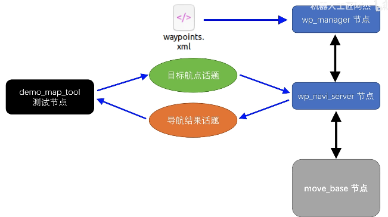

```bash
<launch>
    <!--- Run move_base -->
    <node pkg="move_base" type="move_base" name="move_base">
        <rosparam file="$(find wpb_home_tutorials)/nav_lidar/costmap_common_params.yaml" command="load" ns="global_costmap" />
        <rosparam file="$(find wpb_home_tutorials)/nav_lidar/costmap_common_params.yaml" command="load" ns="local_costmap" />
        <rosparam file="$(find wpb_home_tutorials)/nav_lidar/global_costmap_params.yaml" command="load" />
        <rosparam file="$(find wpb_home_tutorials)/nav_lidar/local_costmap_params.yaml" command="load" />
        <param name="base_global_planner" value="global_planner/GlobalPlanner" /> 
        <param name="base_local_planner" value="teb_local_planner/TebLocalPlannerROS" />
        <rosparam file="$(find wpb_home_tutorials)/nav_lidar/teb_local_planner_params.yaml" command="load" />
        
    </node>

    <!-- Run map server -->
    <node pkg="map_server" type="map_server" name="map_server" args="$(find wpr_simulation)/maps/map.yaml"/>

    <!--- Run AMCL -->
    <node pkg="amcl" type="amcl" name="amcl"/>

    <node name="rviz" pkg="rviz" type="rviz" args="-d $(find nav_pkg)/rviz/map_tool.rviz"/>

    <node pkg="waterplus_map_tools" type="wp_navi_server" name="wp_navi_server" output="screen"/>
    <node pkg="waterplus_map_tools" type="wp_manager" name="wp_manager" output="screen"/>
</launch>
 
```


```bash
roslaunch wpr_simulation wpb_stage_robocup.launch 
roslaunch nav_pkg nav.launch 
rosrun nav_pkg  wp_node
```

