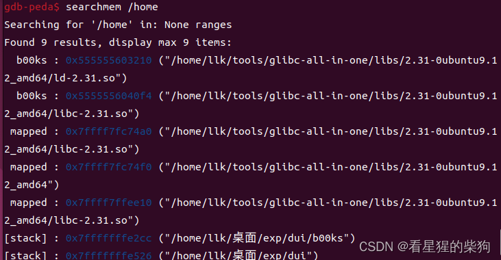
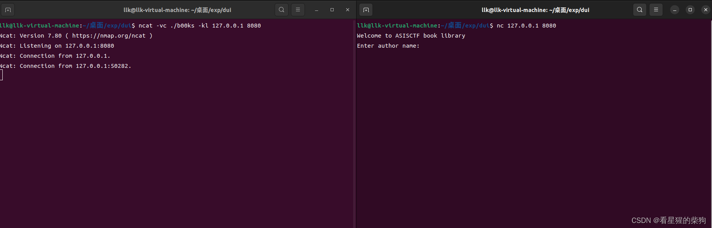
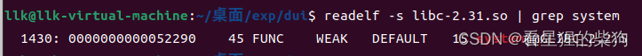


# 溢出
假设定义了 char buf[40] 和有符号整数 int num
## scanf 
 -  scanf("%s", buf)
    %s 不检查边界，可以造成溢出
 - scanf("%39s", buf)
   %39 只从输入中取 39 字节，并在输入末尾放置一个 NULL 字节；无法溢出
 - scanf("%40s", buf)
   从输入中取 40 字节，但还会在输入末尾放置一个 NULL 字节；存在单字节 NULL 溢出
 - scanf("%d", &num)
   配合 alloca(num) 使用时，若将 num 设为负数，从栈上分配的内存就会与原有栈帧重叠
 大多数时候，程序只检查上界，忘记 num 可能为负数（或忘记将 num 声明为 unsigned）；此时输入负数可能产生意料之外的
效果
  > alloca() 在栈上分配空间
## get
 - gets(buf)
   不检查边界，可以溢出
 - fgets(buf,40,stdin)
  从输入中取 39 字节，并在输入末尾放置一个 NULL 字节；没什么用
## read
 - read(stdin, buf, 40)  fread(buf, 1, 40, stdin)
   从输入中取 40 字节，末尾不放置 NULL 字节；可能造成信息泄露
 例如
 `0x7fffffffdd00: 0x4141414141414141      0x4141414141414141
0x7fffffffdd10: 0x4141414141414141      0x4141414141414141
0x7fffffffdd20: 0x4141414141414141      0x00007fffffffe1cd`
此时若使用 printf 或 puts 输出 buf，就会一直输出，直到遇到 NULL 字节
此时可以得到 'A'*40 + '\xcd\xe1\xff\xff\xff\x7f'，从而成功泄露信息
## strcpy
假设定义了 char buf2[60]
 - strcpy(buf,buf2)
   strcpy() 将源字符串 buf2 的每个字节复制到目标字符串 buf，直到遇到 NULL 字节；buf2 末尾的 NULL 字节也会被复制。buf2 可能比 buf 长，因此可能溢出
 - stncpy(buf,buf2,40) memcpy(buf,buf2,40)
  将 buf2 中的 40 字节复制到 buf，但末尾不放置 NULL 字节；由于没有 NULL 字节，可能造成信息泄露，例如使用 printf 或 puts 输出这段内容时，与上面 read 泄露信息的情况相同
## strcat
 - strcat(buf,buf2)
  将 buf2 指向的字符串追加到 buf 指向的字符串末尾。如果 buf 的空间不足，就可能造成溢出
  它会在末尾放置一个 NULL 字节，可能造成单字节溢出
  某些情况下，可以用这个 NULL 字节恰好覆盖已保存栈地址的最低字节
 - strncat(buf, buf2, n)
   strncat() 在 strcat() 的基础上增加了第三个参数，用于限制最多追加的字符数；其他行为与 strcat() 相同：拼接后的字符串成为新的第一个字符串，末尾也会放置 NULL 字节；第二个字符串的值不变；返回值是第一个参数的地址
   同样可能存在单字节 NULL 溢出
# 在 gdb 中查找字符串
> 利用 environ
通过 libc 找到 environ 地址后，泄露该地址处的值就能得到环境变量地址；环境变量存放在栈上，再通过偏移即可得到栈上任意变量的地址。
SSP（Stack Smashing Protector，栈破坏保护）攻击
 检测到栈破坏时，__stack_chk_fail 函数会在错误信息中打印 libc_argv[0] 的值，而 libc_argv[0] 指向程序名。
如果栈溢出的长度足以覆盖 __libc_argv[0] 所在位置，就能让程序打印任意地址处的数据，从而造成任意地址数据泄露。这就是 SSP 攻击。

在 SSP 攻击中，需要找到 argv[0] 与输出起始地址之间的距离
## gdb
[gdb 打印输出](https://blog.csdn.net/m0_47696151/article/details/117606310)

 - 在 gdb 中使用 p/x ((char **)environ)；打印出的地址值减去 0x10，就是 argv[0] 的地址
```bash
(gdb) p/x (char **)environ # 以十六级进制形式打印
$9 = 0x7fffffffde38
(gdb) x/gx 0x7fffffffde38-0x10 #以一个八个字节为单元十六进制形式显示一个单元地址的内容
0x7fffffffde28: 0x00007fffffffe1cd
(gdb) x/s 0x00007fffffffe1cd#显示地址对应的字符串
0x7fffffffe1cd: "/home/naetw/CTF/seccon2016/check/checker"
```

## gdb peda
使用 searchmem "/home" 可以找到 argv[0] 的位置，如图所示，位于

[stack] : 0x7fffffffe2cc ("/home/llk/桌面/exp/dui/b00ks")


# 二进制程序服务化
> ncat 将二进制程序通过 IP 地址和端口提供为服务


> 加载顺序为 LD_PRELOAD > LD_LIBRARY_PATH > /etc/ld.so.cache > /lib>/usr/lib 
> LD_PRELOAD（不是 LD_PRELOAD_PATH）是一组具体库文件的列表，这些库会先于其他库加载，无论程序是否需要它们。LD_LIBRARY_PATH 是加载程序原本就要使用的库时所搜索的目录列表。

 - ncat -vc ./binary_filename -kl 127.0.0.1 port_number
 
需要修改动态链接库时
 -  ncat -vc  'LD_PRELOAD=/path/to/libc.so ./binary' ./binary_filename -kl 127.0.0.1 port_number
 -  ncat -vc 'LD_LIBRARY_PATH=/path/of/libc.so ./binary' ./binary_filename -kl 127.0.0.1 port_number

然后就可以通过 nc 127.0.0.1 port_number 运行程序


# 查找 libc 中特定函数的偏移
成功泄露某个函数的地址后，用函数地址减去该函数的偏移，就能得到 libc 基址

> readelf 用于读取 ELF 文件的相关信息

## 手动查找

 - readelf -s libc_file | grep function_name
 
## 自动查找
 - 使用 pwntools 提供的函数
```python
from pwn import *

libc = ELF('libc文件')
system_off = libc.symbols['函数']
```
# 在库中查找 '/bin/sh' 或 'sh'

> objdump 用于反汇编文件
## 手动查找
 -  strings -tx libc_file  | grep  string
## 自动查找
```python
from pwn import *

libc = ELF('libc.so')
...
sh = base + next(libc.search('sh\x00'))
binsh = base + next(libc.search('/bin/sh\x00'))
```
# 泄露栈地址

 - 已经泄露 libc 基址
 - 能够泄露输入地址处的内容


libc 中 environ 变量保存的地址与 main 的第三个参数（即 char **envp）相同；可以通过 libc 中的 environ 变量泄露栈地址


# gdb 中的 fork 问题

 - 可以使用 set follow-fork-mode mode 设置 fork 跟随模式。
 - 进入 gdb 后，可以使用 show follow-fork-mode 查看当前的跟随模式。
show follow-fork-mode
 - set follow-fork-mode parent
      gdb 只跟随父进程，不跟随子进程；这是默认模式。
 - set follow-fork-mode child
      子进程创建后，gdb 只跟随子进程，放弃跟随父进程。

 如果想同时调试父进程和子进程，上述方法就不够用了。Linux 提供了 set detach-on-fork mode 命令
 - show detach-on-fork
      show detach-on-fork 用于显示当前的 detach-on-fork 模式

 -  set detach-on-fork on
      只调试父进程或子进程中的一个（由 follow-fork-mode 决定）；这是默认模式。另一个进程独立运行

 -  set detach-on-fork off
       父子进程都受 gdb 控制；其中一个进程正常调试（由 follow-fork-mode 决定），另一个进程处于暂停状态，阻塞在 fork 处


使用 'set detach-on-fork off' 命令后，通过 'i inferiors'（i 是 info 命令的缩写）查看进程状态，可以看到父子进程都处于 gdb 调试状态，其中标有 '*' 的是当前正在调试的进程。可以使用 inferior x（x 为 i inferiors 显示的进程编号）切换到对应进程进行调试
# 一个神秘段的秘密——.tls

 - 可以使用 malloc，且能够分配任意大小
 - 能够读取任意地址处的内容

通常，malloc 分配大于 0x21000 的空间时会使用 mmap，分配出的内存区域恰好位于 .tls 段之前

 .tls 段保存了一些有用的信息，例如 main_arena 的地址、canary 地址，以及一个栈地址；这个栈地址与栈上的某个位置始终具有固定偏移
# 可预测的随机数生成器（RNG，Random Number Generator）
当程序使用 RNG 生成的值作为某些重要信息的地址时，可以用 ctypes 调用动态链接库或共享库中的函数
ctypes 是一个 Python 库，提供与 C 兼容的数据类型，并且可以直接调用动态链接库导出的函数。

例如下面这段代码

```c
srand(time(NULL));
while(addr <= 0x10000){
    addr = rand() & 0xfffff000;
}
secret = mmap(addr,0x1000,PROT_READ|PROT_WRITE,MAP_PRIVATE|MAP_ANONYMOUS ,-1,0);
if(secret == -1){
    puts("mmap error");
    exit(0);
}
```
可以通过以下方式得到相同的 addr

```python
import ctypes
LIBC = ctypes.cdll.LoadLibrary('libc.so.6')
LIBC.srand(LIBC.time(0))
addr = LIBC.rand() & 0xfffff000
```
 ctypes.cdll.LoadLibrary(dynamic_link_library) 用于加载动态库，之后就能调用其中的函数。

# 使用 one-gadget-RCE 代替 system

 - 已泄露 libc 基址
 - 能够向任意地址写入

使用 onegadget 工具查找可以获取 shell 的 gadget，不过通常有寄存器约束，满足这些约束即可
# 劫持 hook 函数

 - 已泄露 libc 基址 
 - 能够向任意地址写入 
 - 程序使用 malloc、free、realloc
 
```c
void (*hook) (void *, const void *) = atomic_forced_read (__free_hook);
if (__builtin_expect (hook != NULL, 0))
{
    (*hook)(mem, RETURN_ADDRESS (0));
    return;
}
```
检查 __free_hook 的值是否为 NULL；如果不为 NULL，就会调用并跳转到该位置，执行对应的函数。
# 使用 printf 触发 malloc 和 free
printf 有时会触发 malloc，而触发 malloc 后最终也会触发 free

```c
#define EXTSIZ 32
enum { WORK_BUFFER_SIZE = 1000 };

if (width >= WORK_BUFFER_SIZE - EXTSIZ)
{
    /* We have to use a special buffer.  */
    size_t needed = ((size_t) width + EXTSIZ) * sizeof (CHAR_T);
    if (__libc_use_alloca (needed))
        workend = (CHAR_T *) alloca (needed) + width + EXTSIZ;
    else
    {
        workstart = (CHAR_T *) malloc (needed);
        if (workstart == NULL)
        {
            done = -1;
            goto all_done;
        }
        workend = workstart + width + EXTSIZ;
    }
}
```
触发 malloc 的条件

 - width >= WORK_BUFFER_SIZE - EXTSIZ
 - __libc_use_alloca (needed)==0

看看与 __libc_use_alloca() 相关的函数

```c

/* Minimum size for a thread.  We are free to choose a reasonable value.  */
#define PTHREAD_STACK_MIN        16384

#define __MAX_ALLOCA_CUTOFF        65536

int __libc_use_alloca (size_t size)
{
    return (__builtin_expect (size <= PTHREAD_STACK_MIN / 4, 1)
        || __builtin_expect (__libc_alloca_cutoff (size), 1));
}

int __libc_alloca_cutoff (size_t size)
{
	return size <= (MIN (__MAX_ALLOCA_CUTOFF,
					THREAD_GETMEM (THREAD_SELF, stackblock_size) / 4
					/* The main thread, before the thread library is
						initialized, has zero in the stackblock_size
						element.  Since it is the main thread we can
						assume the maximum available stack space.  */
					?: __MAX_ALLOCA_CUTOFF * 4));
}
```
要使返回值为 0，必须满足以下条件

 - __builtin_expect (size <= PTHREAD_STACK_MIN / 4, 1)==0
 - __builtin_expect (__libc_alloca_cutoff (size), 1)==0
 
> __builtin_expect 通常用于 if-else 分支；首先要明确，无论 x 的值是什么，if (exp) 都等价于 if (__builtin_expert(exp, x))。

> 在三元运算符 "?:" 中，中间省略的部分与 "?" 前面的数值或表达式完全相同。

也就是满足

 - size > PTHREAD_STACK_MIN / 4
 - size > MIN(__MAX_ALLOCA_CUTOFF, THREAD_GETMEM(THREAD_SELF, stackblock_size) / 4 ?: __MAX_ALLOCA_CUTOFF * 4)

此时 THREAD_GETMEM 通常返回 0，因此 MIN 函数的最终结果为 __MAX_ALLOCA_CUTOFF，即 65536；所以 size > 65536 也满足 PTHREAD_STACK_MIN / 4

因此，size 为 65537 就可以触发 malloc 和 free：先将 onegadget 写入 __malloc_hook 或 __free_hook 所在位置完成劫持，并确定合适的 width，再利用 printf 格式化字符串漏洞（printf(buf)），最后获取 shell
# 使用 execveat 打开 shell
execveat 可以起到与 execve 类似的作用

```c
int execveat(int dirfd, const char *pathname,
             char *const argv[], char *const envp[],
             int flags);
```
当 pathname 参数指向 /bin/sh，且 argv、envp、flags 参数均为 0 时，无论 dirfd 为何值，都能获取 shell

execveat 参数说明
```c
If pathname is absolute, then dirfd is ignored.
```

[参考：Naetw 在 GitHub 上的总结](https://github.com/Naetw/CTF-pwn-tips)

