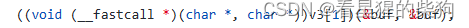
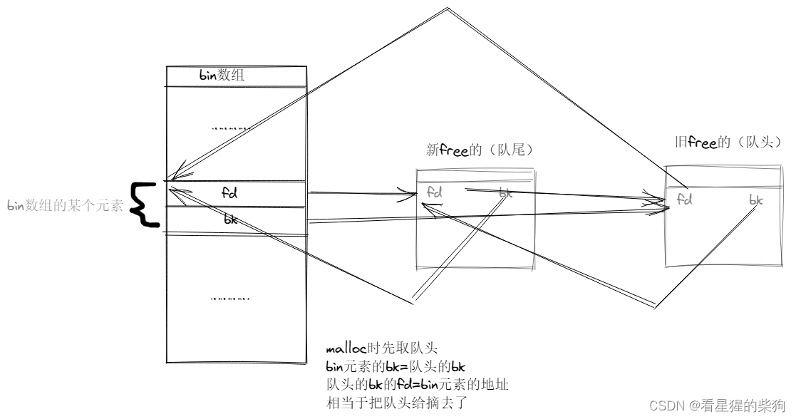
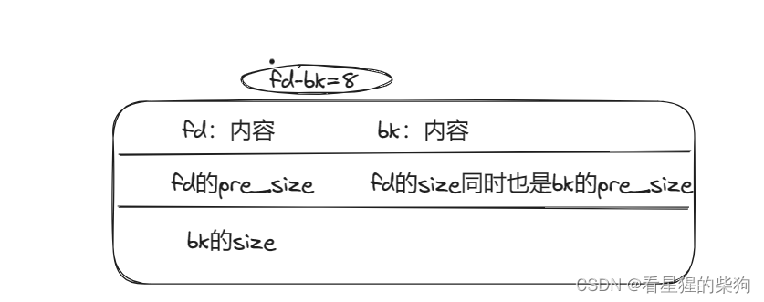
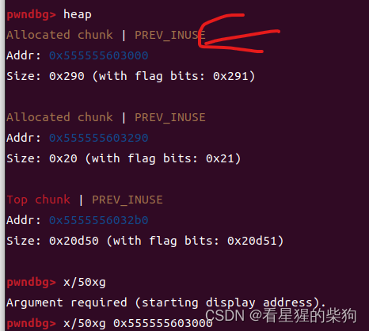
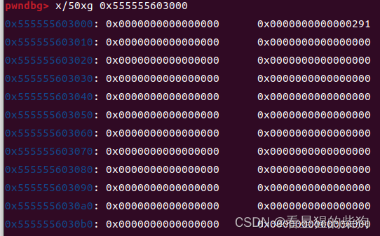
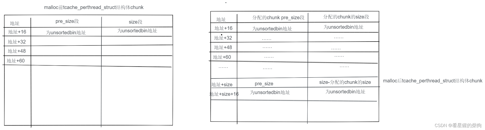


### house of force
申请堆内存时，如果所有已释放的 chunk 都无法满足需求（所有 bin 都不合适），同时 top chunk 的大小减去待分配 chunk 的大小后仍满足最小 chunk 大小，就会从 top chunk 中切出相应大小的 chunk，作为申请的堆空间。


通过控制 top chunk 的 size 值（由于对应的是无符号形式，将其改为 -1），再用 malloc 让 top chunk 跳到任意位置；随后再次 malloc（该位置需满足 chunk 格式），就能控制该位置的内容

向前控制内存：
1. 取已分配 chunk 的指针，加上某个值，使其对应地址成为 top chunk 的 size 地址
2. 对修改后的指针解引用，修改其指向的内容
3. malloc 一个合适的值（经过检查和转换后），使修改后的 top chunk size 值满足条件，同时 top chunk 地址加上 malloc 参数得到所需地址

传入负数时，无论无符号数还是有符号数，实际相加的都是其对应的二进制编码形式，区别只在于最终结果的解释方式。如果两者按有符号形式相加的结果为正数，那么按无符号形式相加的结果完全相同。

向后控制内存：
与上面相同，只是参数为正数

公式：newchunk 地址 - 0x10 - topchunk 地址 = malloc 参数

（64 位）
参数为负数时，计算出的数仍然是 0x10 的倍数。加上 SIZE_SZ + MALLOC_ALIGN_MASK 后，再执行 & !MALLOC_ALIGN_MASK，其结果相当于原数加上 0x10，保持不变（32 位类似）



 强制转换成函数指针并调用：将 v3[1] 变量转成函数指针变量，存储函数地址，再调用该函数

### 思路：
1. 找到一个会被执行且可以覆盖的函数指针
2. 分配一个 chunk，利用改写时无长度限制的溢出，将 top_chunk 的 size 值覆盖为 -1
3. 最后 malloc 一个合适的值，使 top chunk 移动到目标覆盖位置减去 0x10 的位置
4. 再 malloc 一个合适的值，将函数地址覆盖为目标函数地址
5. 调用函数 A，实际执行函数 B


## 劫持 _malloc_hook 和 _free_hook
调用 malloc 和 free 时，会根据 _malloc_hook 变量和 _free_hook 变量中存储的函数地址进行跳转，从而执行对应函数。此时 malloc 的参数对应分配大小，free 的参数对应某个地址（在 chunk 的 userdata 处覆盖 /bin/sh 字符串）
## bin（回收链表）


```c
struct malloc_state
{ 
  ...
  /*other member*/
  ...
 
  /* Fastbins */
  mfastbinptr fastbinsY[NFASTBINS];
 
  /* Normal bins packed as described above */
  mchunkptr bins[NBINS * 2 - 2];
 
  ...
  /*other member*/
  ...
}; 
```
bins 数组中，每个 bin 链表保存的是一个 fd 成员和一个 bk 成员

用户释放的内存不一定立即归还系统；ptmalloc 会统一管理堆和 mmap 中释放的 chunk。用户下次申请内存时，ptmalloc 会先尝试从已释放的 chunk 中选取一块供用户使用。共有 128 个 bin，使用数组存储：bin 1 是 unsorted bin，bin 2-63 是 small bin，bin 64-126 是 large bin，另外还有一个 fastbin 数组（按 size 字段的大小分类）
###  fastbin
后进先出
只使用 fd 成员，是单链表结构
不修改 P 位；不会主动合并 chunk，但某些特定情况下会发生合并
fastbinY 是管理 fastbin 的数组；每个成员管理一条不同大小的链表，都指向当前链表的尾节点
malloc 时，首先在 fastbin 中寻找合适的已释放 chunk

#### fastbin_attack
fastbin 中释放的 chunk 使用单链表连接，只用到 fd；如果一个 chunk 释放后会进入 fastbin，那么即使它已经释放，其物理相邻的下一个 chunk 也不会将 pre_inuse 位设为 0（0 表示前一个 chunk 已释放，1 表示仍在使用）

##### 释放到 fastbin 时的检查：
1. chunk 的 IS_MMAPPED 位不能为 1
2. chunk 的地址必须对齐
3. size 必须满足 fastbin 的回收要求
4. 链表头不能是这个 fakechunk
5. fake chunk 名义上的下一个 chunk（物理相邻）的 size 不能小于 2*SIZE_SZ，也不能大于 av->system

C 的 free() 函数不会自动将指针设为 NULL
##### fastbin 双重释放
1. chunk 释放后，物理相邻的下一个 chunk 的 pre_inuse 位不会清零，因此 free 认为它仍在使用
2. 将 chunk 释放到对应 fastbin 时，只检查链表数组直接指向的那个 chunk，不检查后面的 chunk。因此连续释放两次不行，但两次释放之间先释放另一个 chunk，就能成功

fastbin：程序执行 malloc 且需要从 fastbin 中选取对应大小的 chunk 时，会选择新加入的 chunk 进行分配，即先进先出
##### 思路：
1. free(chunk1)  free(chunk2)  free(chunk1)；第二次 free 时，fd 指向 chunk2
2. malloc 返回 chunk1 的 userdata 指针；此时的 chunk1 与第二次 free 时相同
3. 修改 malloc 得到的 chunk，就是修改 chunk1 的 userdata，但此时也相当于修改了链表中 chunk1 的 fd 等字段
4. 在 fd 字段指向的位置找到或构造一个堆 chunk，将 size 字段设置为合适的大小，使最终的 malloc 成功。（fd 可以指向 GOT 区域，其中存放函数的起始地址）
5. 最后 malloc 两次，使链表数组中保存 fd 的值
6. 再 malloc（合适的大小），使分配成功（malloc 中的 _int_malloc 会检查分配位置的 size 是否与当前 fastbin 链表数组位置对应的大小一致）
7. 修改最终分配到的 chunk（如果是 GOT 区域，就可以修改该 GOT 项对应的函数地址）
8. 使对应函数运行，实现调用函数 A、实际运行函数 B 的效果


> CPU 执行 "call label" 时，相当于：
push 下一条指令地址（返回地址）
jmp 到函数地址

##### house of spirit
仍然是覆盖 fd 指针；释放后得到的 chunk 是目标地址部分的 fakechunk
##### 思路
1. 找到栈上可控变量的位置（通过 IDA 查看源码或用 gdb 动态调试）
2. 先通过 IDA 查看栈，或通过长度尝试，再利用 printf 自带的 /x00 截断特性，输出某个函数返回地址的值（若将字符串填满，不留下 /x00，printf 可能一直输出，直到遇到 /x00）
3. 分配一个 chunk，根据函数功能输入 shellcode 的二进制编码，同时修改原 chunk 的指针值（伪造 chunk 只是一部分，这段 payload 的前面还包含 shellcode 的二进制编码）
4. 覆盖 chunk 的地址值，使其指向伪造 chunk 的 userdata 地址
5. 然后 free 被覆盖的 chunk 地址值；再次分配后，就能修改分配到的 chunk 的 userdata 内容。由于这个 chunk 位于栈上，其内容可以覆盖返回地址，覆盖的内容就是 shellcode 地址


#####  向栈分配（alloc to stack）
通过某种方式，将 fastbin 链表中某个 chunk 的 fd 值修改为栈上希望控制的区域地址，并提前在该区域构造合适的 fakechunk（即 fakechunk 的 size 字段值与 malloc 的分配大小对应），从而控制栈上的某些数据

##### 任意地址分配（Arbitrary Alloc）
与 alloc to stack 类似，区别是对应的 fd 值不再局限于栈内，可以是任意内存地址（例如函数）

核心思路：利用 unsorted bin 泄露 libc 基址，并覆盖 GOT 表中的 _malloc_hook 地址

##### 思路
1. 分配五个 chunk，最后一个大小为 0x80，用于释放到 unsorted bin。2. 先释放第二个和第三个 chunk。利用改写第一个 chunk 时的溢出，覆盖第三个 chunk 的 fd 值（改成第五个 chunk 的地址），同时利用改写第四个 chunk 时的溢出，将第五个 chunk 的 size 值覆盖为合适的值
3. 再申请两次 chunk；此时第二个 chunk 指针是原第三个 chunk 的地址，第三个 chunk 指针是第五个 chunk 的地址
4. 再次利用改写第四个 chunk 时的溢出，将第五个 chunk 的 size 值覆盖为 0x91，使其满足释放后进入 unsorted bin 的条件；然后再申请一个 chunk（使第五个 chunk 不与 top chunk 相邻，且不属于 fastbin，保证释放后进入 unsorted bin）；再释放第五个 chunk，使其进入 unsorted bin
5. 由于此时第三个 chunk 指针也是第五个 chunk 的地址，通过打印功能输出第五个 chunk 的 fd 处保存的 unsorted bin 地址
6. 计算 libc 基址，同时申请一个大小合适、能够回收到 fastbin 的 chunk。此时 unsorted bin 中的 chunk 被切分，一部分成为可用空间，另一部分仍留在 unsorted bin 中，只是 size 改变了
7. 再次释放第五个 chunk 指针对应的 chunk；利用改写第三个 chunk 实际上是在改写第五个 chunk 这一点，继续溢出，将第五个 chunk 的 fd 值覆盖为需要控制且满足检查的 fakechunk 所在内存区域
8. 申请两次，第二次申请得到某个内存区域的地址
9. 改写第二次申请得到的第七个 chunk，使被改写内存区域（_malloc_hook）的值变为 system 地址（system 地址通过基址和 libc.symbol 计算）
9. 调用 malloc 函数获取 shell


### smallbin
1. malloc 请求在 fastbin 中未得到满足时，会去 small bin 中查找
2. 双向链表
3. 先进先出
4. 符合 small bin 大小的 chunk 被释放时，会优先放入 unsorted bin；只有某些情况下才会放入 small bin
5. 释放 chunk 时，如果发现物理相邻的 chunk 为空闲状态，就先合并，再放入 bin

### unsortbin
1. 释放的 chunk 大小不属于 fast bin，且不与 top chunk 相邻时，首先放入 unsorted bin
2. unsorted bin 是双向循环链表，不限制 chunk 大小
3. fastbin 和 smallbin 中的 chunk 无法满足用户请求的大小时，堆管理器会使用 unsorted bin。它会合并堆中的碎片
4. 遍历顺序是 FLFO（后进后出）；在 unsorted bin 头部插入，从链表尾部取出，使用 bk 指针遍历
5. 释放不属于 fast bin 的 chunk，且该 chunk 不紧邻 top chunk 时，会先放入 unsorted bin
#### unsortedbin 攻击
控制 unsorted bin 队列头部 chunk 的 bk 指针；执行 malloc 时，会将该头部 chunk 的 bk 所对应 fakechunk 的 fd 字段修改为 bin 元素的地址。




#### 思路
1. 题目中某个函数要求某变量大于某值才能获取 shell。将这个变量作为 fakechunk 的 fd 字段，推算出对应 fakechunk 地址
2. 创建三个 chunk：第一个用于溢出覆盖第二个，第二个用于释放到 unsorted bin，第三个用于隔开第二个与 top chunk，保证第二个释放后能进入 unsorted bin
3. 利用改写第一个 chunk 时的溢出，覆盖第二个 chunk 的 fd 和 bk 值（fd 任意，bk 为前面 fakechunk 的地址），然后释放第二个 chunk
4. 根据输入调用某个函数
##### unsortbin 的 unlink
#####  free
可以简单理解为：调用 free 函数会用到 unlink()
> free 函数
{
 _int_free()
 {
  unlink() 
 }
}
#####  unlink 原理
释放 chunk 时，会检查其前一个 chunk 是否处于已释放状态（此处指物理相邻，也就是紧挨着）。如果是，就根据 fd 和 bk 将相邻 chunk 从对应链表中移除；此时按 fd/bk 从前到后的顺序，修改相关 chunk 的 fd 和 bk（只需要 fd 和 bk 就能完成 unlink 过程），再与待释放的 chunk 合并，插入对应链表（前后只要有能被识别为已释放的 chunk，都会这样处理）
#####  Chunk 状态检查

##### 缓冲区
缓冲区是内存空间的一部分，也就是在内存空间中预留一定的存储空间，用于缓冲输入或输出的数据，这部分预留空间称为缓冲区。根据对应的是输入设备还是输出设备，缓冲区分为输入缓冲区和输出缓冲区。

没有执行 setbuf 操作，因此第一次输入/输出时会申请缓冲区（第一次输入在分配第一个 chunk 之前，第一次输出在第一个 chunk 之后）
##### 思路
 1. 创建一个真实 chunk；在待释放 chunk 之前的 chunk 的 userdata 中伪造 fakechunk，并将其伪造成已释放状态
 3. 确定 fakechunk 合适的 fd 和 bk 值，使某些位置能够被修改（例如指针数组，将 fd 和 bk 设为指针数组两个相邻元素的地址，最终会使 bk+8 位置的元素变为 fd）

 2. 伪造时，通过栈溢出修改相邻 chunk 的 pre_size 和 size（为绕过检查，pre_size 必须改为 fakechunk 的大小，size 的 P 位必须设为 0，且 size 大于 0x80）
 3. 释放这个 chunk，使其向前合并，指针数组元素的内容随之改变
 4. 根据输入修改指针指向的内容（指针位置在指针数组之前，或者一开始就能修改指针数组内容），用一系列 file.got[function] 覆盖指针数组内容
 5. 再根据输入，将其他指针指向的内容（此时是刚才覆盖后的指针）改为其他函数地址，从而实现调用函数 A、实际使用函数 B（puts_plt）的效果
 6. 此后调用某个函数，实际执行函数 B（输出之前覆盖的内容，即 file.got[function] 指向的函数地址）
 7. 最后计算 libc 基址，再得到 system 函数地址；再次根据输入，将另一个指针（此处为 file.got[atoi]）指向的内容改为 system 函数地址
8. 最后输入 /bin/sh；程序运行到 atoi 时即可获取 shell

### tcache (libc-2.26)
1. 每个 tcache 条目的链表最多容纳 7 个 chunk，共 64 条链表。对应大小为 0x10-0x208（32 位，步长 8 字节）和 0x20-0x410（步长 16 字节）
2. tcache 满后，释放的 chunk 会放入 fastbin 和 unsorted bin
3. malloc 一个 fastbin 大小的 chunk 时，若 tcache 中还有 chunk，会先取出 tcache 末尾的 chunk
4. 后进先出
5.
##### house of spirit
仍然是覆盖 fd 指针；释放后得到的 chunk 是目标地址部分的 fakechunk
##### 思路
1. 找到栈上可控变量的位置（通过 IDA 查看源码或用 gdb 动态调试）
2. 先通过 IDA 查看栈，或通过长度尝试，再利用 printf 自带的 /x00 截断特性，输出某个函数返回地址的值（若将字符串填满，不留下 /x00，printf 可能一直输出，直到遇到 /x00）
3. 分配一个 chunk，根据函数功能输入 shellcode 的二进制编码，同时修改原 chunk 的指针值（伪造 chunk 只是一部分，这段 payload 的前面还包含 shellcode 的二进制编码）
4. 覆盖 chunk 的地址值，使其指向伪造 chunk 的 userdata 地址
5. 然后 free 被覆盖的 chunk 地址值；再次分配后，就能修改分配到的 chunk 的 userdata 内容。由于这个 chunk 位于栈上，其内容可以覆盖返回地址，覆盖的内容就是 shellcode 地址
#### tcache 攻击：投毒（poisoning）
chunk 释放到 tcache 后，覆盖修改已释放 chunk 的 fd 值；再 malloc 一个合适的值，取回该已释放的 chunk

####   tcache 攻击：重复释放（dup）
不会检查 chunk 是否已释放，因此可以多次释放同一个 chunk

#### 思路
总结：通过溢出并 free 到 unsorted bin 得到 libc 基址，将 fd 覆盖为 _free_hook 的地址，再通过 malloc 将 _free_hook 的值修改为 shellcode 函数

malloc 时，先修改 tcache，再修改得到的 chunk

1. 将同一个 chunk 指针释放两次，再打印内容以计算 chunk 的 userdata 地址；然后 malloc 两次，恢复 tcache
2. 申请多个 chunk，内容均为 p64(0)+0x91；将最后一个 chunk 释放两次；随后第一次 malloc 的内容是某个 size 字段满足 0x91 的 fakechunk 地址。再 malloc 一次，内容任意；再 malloc 一次，内容为某个 size 为 0x51 的 chunk 地址。此时得到一个 size 字段为 0x91 的 fakechunk，其 fd 是刚才 malloc 的内容（tcache 不检查 fd 对应 chunk 的大小；也就是说，即使修改 fd 对应 chunk 的 size，使其与当前链表对应大小不同，也没有影响）
3. 将这个大小为 0x91 的 fake chunk 释放八次，使其进入 unsorted bin；此时 fake chunk 的 fd 和 bk 会被修改为 unsorted bin 的地址。打印该 fake chunk 的内容，计算 libc 基址，再计算 _free_hook 和获取 shell 的函数地址
4. 再次 malloc，此次得到的是先前 fakechunk 的 fd 位置处的 chunk，内容任意；然后将这个 chunk 释放两次；再次 malloc，内容为 _free_hook 地址；再 malloc 一次，内容任意；再 malloc 一次，内容为获取 shell 的函数地址，此时得到的 chunk 的 userdata 地址就是 _free_hook 地址。也就是将 _free_hook 的值修改为了获取 shell 的函数地址
5. 最后根据输入调用 free 函数

#### tcache 攻击：house of spirit（free）
1. fake chunk 的大小在 tcache 范围内，且 IS_MMAPPED 位不为 1
2. fake chunk 地址对齐
3. 无需构造下一个 chunk 的 size
4. 无需担心连续多次释放的问题，因为释放进入链表时不进行检查

释放一个构造好的 fake chunk 地址，再通过 malloc 控制该地址

#### 伪造 tcache 机制中的 tcache_perthread_struct 结构体
原因：泄露 libc 基址时，有时需要先填满 tcache，使释放的 chunk 能够进入 unsorted bin，才能泄露地址。但有时 malloc 和 free 的次数有限，无法将其填满。此时可以修改 tcache_perthread_struct 结构体中的 count 数组，制造 tcache 已满的假象，使释放操作进入 unsorted bin，从而泄露 libc 基址


tcache_perthread_struct 结构体也分配在堆上

然后查看该地址处的内容：前十六字节是 chunk 的 pre_size 字段和 size 字段（可以看到 size 为 291，因此第一个 malloc 得到的 chunk 与该结构体的 chunk 头地址相差 290）

接着是 64 个 char 类型数组元素占用的四行空间
之后是 64 个对应的 fd 链表指针，对应已释放 chunk 的大小从 0x20 到 0x410（每次递增 0x10）



#### 思路
1. malloc 一个 chunk，释放两次，最后打印（存在释放后使用），得到 chunk 地址
2. 然后 malloc 一个 chunk；内容中对应 fd 的部分为之前得到的地址减去 tcache_perthread_struct 结构体堆块的大小（即 tcache_perthread_struct 地址）。此时链表为：这个 chunk 的 userdata 地址 -> tcache_perthread_struct 结构体的 userdata 地址
3. 再 malloc 两次；第二次得到 tcache_perthread_struct 结构体的 userdata 地址，此处对应 count 数组。向 userdata 字段中的 count 数组部分写入，将其覆盖为大于规定链表条目数上限的值
4. 此时释放 tcache_perthread_struct 结构体的 chunk，这个 chunk 会进入 unsorted bin。然后打印该 chunk；得到的地址减去 unsorted bin 的偏移，即为 libc 基址
5. 构造 one_gadget；再次 malloc。此时只有 unsorted bin 中有已释放 chunk（构造内容，将某条链表地址对应部分修改为 _malloc_hook 地址），因此 unsorted bin 对应的 chunk 被切分（类似 top_chunk 的切分），剩余部分仍由 unsorted bin 管理。如图所示，

6. 再次 malloc，对应大小需与先前覆盖的链表所对应 chunk 大小一致。此时可得到 userdata 地址为 malloc_hook 地址的 chunk；将其内容修改为 one_gadget 地址
7. 再次 malloc 即可获取 shell

## mmap
用户申请大于 128KB 的堆空间，且没有任何 arena 有足够空间时，系统会执行 mmap 函数进行分配；这样的堆在释放后同样不会归还系统
## 多线程支持
所有线程共享堆
##### house of spirit
仍然是覆盖 fd 指针；释放后得到的 chunk 是目标地址部分的 fakechunk
##### 思路
1. 找到栈上可控变量的位置（通过 IDA 查看源码或用 gdb 动态调试）
2. 先通过 IDA 查看栈，或通过长度尝试，再利用 printf 自带的 /x00 截断特性，输出某个函数返回地址的值（若将字符串填满，不留下 /x00，printf 可能一直输出，直到遇到 /x00）
3. 分配一个 chunk，根据函数功能输入 shellcode 的二进制编码，同时修改原 chunk 的指针值（伪造 chunk 只是一部分，这段 payload 的前面还包含 shellcode 的二进制编码）
4. 覆盖 chunk 的地址值，使其指向伪造 chunk 的 userdata 地址
5. 然后 free 被覆盖的 chunk 地址值；再次分配后，就能修改分配到的 chunk 的 userdata 内容。由于这个 chunk 位于栈上，其内容可以覆盖返回地址，覆盖的内容就是 shellcode 地址

