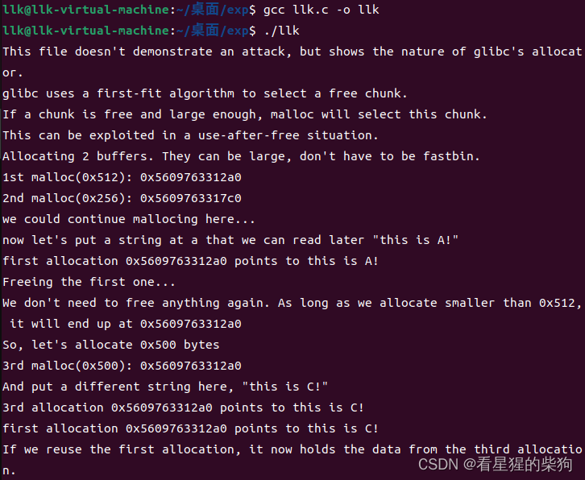
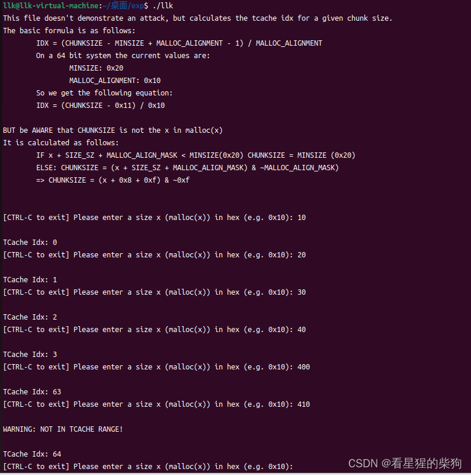


# 堆溢出
写入堆中的字节数超过了可用字节数（可用字节数不一定等于申请的字节数，因为堆管理器会对用户申请的字节数进行调整，这也意味着可用字节数永远不会小于申请的字节数），因此可能覆盖到相邻高地址的下一个 chunk

前提条件：

 - 能够向堆上写入数据
 - 写入的数据没有被适当地控制
 
策略：
 - 覆盖相邻高地址 chunk 的内容
 - 然后利用堆的机制实现任意地址写，或者控制 chunk 的内容，从而控制程序的执行流程


# 基本流程
## 寻找堆分配函数
### malloc 函数
### calloc 函数
清空数据内容
```c
calloc(0x20);
//等同于
ptr=malloc(0x20);
memset(ptr,0,0x20);
```
### realloc 函数
realloc(chunkdata 段地址, size)

 - 当 size 大于 chunkdata 段地址对应 chunk 的大小时
 
   如果 chunkdata 段地址对应的 chunk 与 top chunk 相邻，就直接把该 chunk 扩展到新的大小
 
    如果 chunkdata 段地址对应的 chunk 与 top chunk 不相邻，相当于 free(chunkdata 段地址), malloc(size)
 - 当 size 小于 chunkdata 段地址对应 chunk 的大小时
   
   如果差值无法容纳一个最小 chunk（不同位宽下最小 chunk 的大小不同），则保持不变
   
   如果差值能容纳一个最小 chunk，就把该 chunk 拆分成两部分，释放 chunkdata 段地址对应 chunk 中 size-size 的那部分
 - 当 size 等于 0 时，相当于 free(ptr)
 - 当 size 等于 chunkdata 段地址对应 chunk 的大小时

## 寻找危险函数
输入

gets，直接读取一整行，忽略 '\x00'
scanf
vscanf

输出

printf
sprintf

字符串

strlen，字符串长度，遇到 '\x00' 停止
strcpy，字符串拷贝，遇到 '\x00' 停止
strcat，字符串拼接，遇到 '\x00' 停止
bcopy
## 具体分配
传给 malloc 的值会经过以下转换：
(((req) + SIZE_SZ + MALLOC_ALIGN_MASK < MINSIZE)  ?      MINSIZE: ((req) + SIZE_SZ + MALLOC_ALIGN_MASK) & ！ MALLOC_ALIGN_MASK

三目运算符  a ? b : c
 req 是传给 malloc 的参数；SIZE_SZ 与操作系统位宽有关：32 位下是 4，64 位下是 8。MALLOC_ALIGN_MASK 同样与操作系统位宽有关：32 位下是 7，64 位下是 15。最终得到的值就是 chunk 的大小（不含标志位）（除非 malloc 的参数小于 8 或 16，此时大小始终是 0x10 或 0x20）

# first-fit 演示（演示 glibc malloc 的 first-fit 行为。）

```c
#include <stdio.h>
#include <stdlib.h>
#include <string.h>

int main()
{
	fprintf(stderr, "This file doesn't demonstrate an attack, but shows the nature of glibc's allocator.\n");
	fprintf(stderr, "glibc uses a first-fit algorithm to select a free chunk.\n");
	fprintf(stderr, "If a chunk is free and large enough, malloc will select this chunk.\n");
	fprintf(stderr, "This can be exploited in a use-after-free situation.\n");

	fprintf(stderr, "Allocating 2 buffers. They can be large, don't have to be fastbin.\n");
	char* a = malloc(0x512);
	char* b = malloc(0x256);
	char* c;

	fprintf(stderr, "1st malloc(0x512): %p\n", a);
	fprintf(stderr, "2nd malloc(0x256): %p\n", b);
	fprintf(stderr, "we could continue mallocing here...\n");
	fprintf(stderr, "now let's put a string at a that we can read later \"this is A!\"\n");
	strcpy(a, "this is A!");
	fprintf(stderr, "first allocation %p points to %s\n", a, a);

	fprintf(stderr, "Freeing the first one...\n");
	free(a);

	fprintf(stderr, "We don't need to free anything again. As long as we allocate smaller than 0x512, it will end up at %p\n", a);

	fprintf(stderr, "So, let's allocate 0x500 bytes\n");
	c = malloc(0x500);
	fprintf(stderr, "3rd malloc(0x500): %p\n", c);
	fprintf(stderr, "And put a different string here, \"this is C!\"\n");
	strcpy(c, "this is C!");
	fprintf(stderr, "3rd allocation %p points to %s\n", c, c);
	fprintf(stderr, "first allocation %p points to %s\n", a, a);
	fprintf(stderr, "If we reuse the first allocation, it now holds the data from the third allocation.\n");
}
```
结果
可以观察到，第一次 malloc 被释放后得到的堆指针与第三次 malloc 得到的堆指针是一样的。
一块内存被释放之后，指向该内存的指针仍然有效；如果在后续代码中不小心再次引用了这块已释放的内存，就可能导致不可预知的错误。这个缺陷被称为 Use-after-free（UaF）

# tcache 演示（演示 glibc 的 tcache 索引计算方式）

```c
#include <stdio.h>
#include <stdlib.h>
#include <string.h>
#include <malloc.h>


struct malloc_chunk {

  size_t      mchunk_prev_size;  /* Size of previous chunk (if free).  */
  size_t      mchunk_size;       /* Size in bytes, including overhead. */

  struct malloc_chunk* fd;         /* double links -- used only if free. */
  struct malloc_chunk* bk;

  /* Only used for large blocks: pointer to next larger size.  */
  struct malloc_chunk* fd_nextsize; /* double links -- used only if free. */
  struct malloc_chunk* bk_nextsize;
};

/* The corresponding word size.  */
#define SIZE_SZ (sizeof (size_t))//32位还是64位

#define MALLOC_ALIGNMENT (2 * SIZE_SZ < __alignof__ (long double) \
			  ? __alignof__ (long double) : 2 * SIZE_SZ)  /为8字节还是16字节

/* The corresponding bit mask value.  */
#define MALLOC_ALIGN_MASK (MALLOC_ALIGNMENT - 1)

/* The smallest possible chunk */
#define MIN_CHUNK_SIZE        (offsetof(struct malloc_chunk, fd_nextsize))  //最小的chunk的size的大小

/* The smallest size we can malloc is an aligned minimal chunk */
#define MINSIZE  \
  (unsigned long)(((MIN_CHUNK_SIZE+MALLOC_ALIGN_MASK) & ~MALLOC_ALIGN_MASK))

#define request2size(req)                                         \
  (((req) + SIZE_SZ + MALLOC_ALIGN_MASK < MINSIZE)  ?             \
   MINSIZE :                                                      \
   ((req) + SIZE_SZ + MALLOC_ALIGN_MASK) & ~MALLOC_ALIGN_MASK)

/* When "x" is from chunksize().  */
# define csize2tidx(x) (((x) - MINSIZE + MALLOC_ALIGNMENT - 1) / MALLOC_ALIGNMENT)//求在tcache bin中的索引

/* When "x" is a user-provided size.  */
# define usize2tidx(x) csize2tidx (request2size (x))

int main()
{
    unsigned long long req;
    unsigned long long tidx;
	fprintf(stderr, "This file doesn't demonstrate an attack, but calculates the tcache idx for a given chunk size.\n");
	fprintf(stderr, "The basic formula is as follows:\n");
    fprintf(stderr, "\tIDX = (CHUNKSIZE - MINSIZE + MALLOC_ALIGNMENT - 1) / MALLOC_ALIGNMENT\n");
    fprintf(stderr, "\tOn a 64 bit system the current values are:\n");
    fprintf(stderr, "\t\tMINSIZE: 0x%lx\n", MINSIZE);
    fprintf(stderr, "\t\tMALLOC_ALIGNMENT: 0x%lx\n", MALLOC_ALIGNMENT);
    fprintf(stderr, "\tSo we get the following equation:\n");
    fprintf(stderr, "\tIDX = (CHUNKSIZE - 0x%lx) / 0x%lx\n\n", MINSIZE-MALLOC_ALIGNMENT+1, MALLOC_ALIGNMENT);
    fprintf(stderr, "BUT be AWARE that CHUNKSIZE is not the x in malloc(x)\n");
    fprintf(stderr, "It is calculated as follows:\n");
    fprintf(stderr, "\tIF x + SIZE_SZ + MALLOC_ALIGN_MASK < MINSIZE(0x%lx) CHUNKSIZE = MINSIZE (0x%lx)\n", MINSIZE, MINSIZE);
    fprintf(stderr, "\tELSE: CHUNKSIZE = (x + SIZE_SZ + MALLOC_ALIGN_MASK) & ~MALLOC_ALIGN_MASK) \n");
    fprintf(stderr, "\t=> CHUNKSIZE = (x + 0x%lx + 0x%lx) & ~0x%lx\n\n\n", SIZE_SZ, MALLOC_ALIGN_MASK, MALLOC_ALIGN_MASK);
    while(1) {
        fprintf(stderr, "[CTRL-C to exit] Please enter a size x (malloc(x)) in hex (e.g. 0x10): ");
        scanf("%llx", &req);
        tidx = usize2tidx(req);
        if (tidx > 63) {
            fprintf(stderr, "\nWARNING: NOT IN TCACHE RANGE!\n");
        }
        fprintf(stderr, "\nTCache Idx: %llu\n", tidx);
    }
    return 0;
}
```
结果
可以观察到，索引每次递增 0x10，一共有 64 个 0x10 的步进



