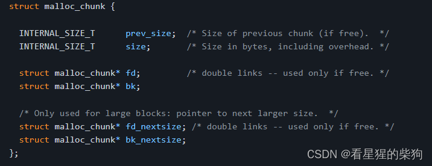


[某大佬关于 ptmalloc 的知识分享链接](https://github.com/jmpews/pwn2exploit/blob/master/PWN%E4%B9%8B%E5%A0%86%E5%86%85%E5%AD%98%E7%AE%A1%E7%90%86.md)

>  以下内容均基于 glibc-2.19，其他版本可能有所不同，但仍可作为参考

# 关于 ptmalloc 的思考
## 缓存思想
理解缓存思想，其实就是理解一种提高效率的思想

 1. 申请内存分配时，通过系统调用 brk() 分配一块比较大的内存作为缓存；之后即使在 Bins 中找不到，也不需要每次都触发系统调用——直接切割这块大内存即可。
 缓存思想：如果没有缓存，每次分配内存都需要系统调用，速度和效率都很低
 
 2. 释放内存时，暂时不还给系统，而是标记为空闲，下次需要同样大小时直接使用这块空闲内存，从而减少系统调用
 3. 除了上述两种缓存外，Fastbin 也是一种缓存机制：长度在 fastbin 范围内的 chunk 释放后不放入 Bins，也不标记为空闲（不标记为空闲就成功避免了合并）。下次分配内存时先查找 Fastbins，这样就避免了切割
 4. unsorted bin 是刚释放的内存与 bins 之间的一层缓存。刚释放的内存先放入 Unsorted 缓存中，下次分配内存时先于 Bins 查找它。如果能在 Unsorted 缓冲区命中那最好，否则就把 Unsorted 中的 chunk 统一整理到对应的 Bins 中。
 5. last_remainder 也是一种缓存——切割剩下的那一块，下次切割也从它开始。大致思想是一直切割同一个 chunk。它在遍历 Unsorted bin 时使用，但使用是有条件的。


# chunk 结构


# Large Bin 补充
对于 large bin，划分的间隔是递增的。简单举例：前 32 个 large bin 的划分间隔都是 64 字节，接下来 16 个 large bin 的划分间隔是 512 字节。以上仅针对 32 位字长
```bash
 32 bins of size      64
 16 bins of size     512
  8 bins of size    4096
  4 bins of size   32768
  2 bins of size  262144
  1 bin  of size what's left
```
large bin 比较特殊：空闲 chunk 的存放需要排序，large_bin->bk 是 size 最小的 chunk，large_bin->fd 是 size 最大的 chunk。

# Fast Bin 补充
分配内存时先查找 Fastbins，再查找 Bins；释放内存时，如果 chunk size < max_fast，就先存入 Fastbins。
 Fastbins 的合并（清空）由 malloc_consolidate 函数负责。
 - 什么时候会触发 malloc_consolidate（仅就 _int_malloc 函数而言）？
 1. small bins 尚未初始化
 2. 申请的大小大于 small bins

- malloc_consolidate 如何合并？
它遍历 Fastbins 中的 chunk，把每个 chunk 的空闲标志位置 0，合并相邻的空闲 chunk，然后把 chunk 放入 unsorted bin。
Fastbins 是单链表，可以通过 fastbin->fd 遍历 Fastbins。

TRIM_FASTBINS=1：fast bin 会与相邻的 top chunk 合并；为 0 时则不会合并
# Unsorted Bin 补充
unsorted bin 只有一个。查找可分配内存时，先查找 Fastbins 和 small bins，然后查找 unsorted bin，并把 unsorted bin 中的所有 chunk 整理到对应的 Bins 中。unsorted bin 位于 bin[1]。
unsorted_bin->fd 指向双向循环链表的头节点，unsorted_bin->bk 指向双向循环链表的尾节点；新节点从头部插入
# Top Chunk 补充

> 对于非主分配区，会预先从 mmap 区域分配一块较大的空闲内存来模拟 sub-heap，通过管理 sub-heap 来响应用户的需求。由于内存是按地址从低到高分配的，在空闲内存的最高处必然存在一块空闲 chunk，称为 top chunk。
> 当 bins 和 fast bins 都不能满足分配需求时，ptmalloc 会尝试从 top chunk 中切出一块内存给用户。如果 top chunk 本身不够大，分配器会重新分配一个 sub-heap，并把 top chunk 迁移到新的 sub-heap 上。新的 sub-heap 与已有的 sub-heap 用单链表连接起来，然后在新的 top chunk 上分配所需的内存以满足分配需求。
> 实际上，top chunk 在分配时总是在 fast bins 和 bins 之后才被考虑，所以不论 top chunk 有多大，它都不会被放到 fast bins 或 bins 中。 
> top chunk 的大小随着分配和回收不停变化。从 top chunk 分配内存会导致 top chunk 变小；如果回收的 chunk 恰好与 top chunk 相邻，这两个 chunk 就会合并成新的 top chunk，从而使 top chunk 变大。 
> 如果在 free 时回收的内存大于某个阈值，并且 top chunk 的大小也超过了收缩阈值，ptmalloc 会收缩 sub-heap。如果 top chunk 包含了整个 sub-heap，ptmalloc 会调用 munmap 把整个 sub-heap 的内存返还给操作系统。
由于主分配区是唯一能够映射进程 heap 区域的分配区，它可以通过 sbrk() 来增大或收缩进程 heap 的大小。ptmalloc 在开始时会预先分配一块较大的空闲内存（也就是所谓的 heap），主分配区的 top chunk 在第一次调用 malloc 时会分配一块 (chunk_size + 128KB) 按 4KB 对齐的空间作为初始的 heap。
用户从 top chunk 分配内存时，可以直接取出一块内存给用户。回收内存时，回收的内存恰好与 top chunk 相邻则合并成新的 top chunk。
当本次回收的空闲内存大小达到某个阈值，并且 top chunk 的大小也超过了收缩阈值，会执行内存收缩，减小 top chunk 的大小，但至少要保留一个页大小的空闲内存，从而把内存归还给操作系统。
如果向主分配区的 top chunk 申请内存，而 top chunk 中已经没有空闲内存，ptmalloc 会调用 sbrk() 将进程 heap 的边界 brk 上移，然后修改 top chunk 的大小。

# mmaped chunk 补充

> 当需要分配的 chunk 足够大，而且 fast bins 和 bins 都不能满足要求，甚至 top chunk 本身也不能满足分配需求时，ptmalloc 会使用 mmap 来直接使用内存映射把页映射到进程空间。
> 这样分配的 chunk 在被 free 时将直接解除映射，于是就将内存归还给了操作系统，再次对这样的内存区的引用将导致 segmentation fault 错误。这样的 chunk 也不会包含在任何 bin 中。
# Last Remainder 补充
> Last remainder 是另外一种特殊的 chunk，就像 top chunk 和 mmaped chunk 一样，这种 chunk 在 bins 中都找不到。当需要分配一个 small chunk，但在 small bins 中找不到合适的 chunk 时，如果 last remainder chunk 的大小大于所需的 small chunk 大小，last remainder chunk 被分裂成两个 chunk，其中一个 chunk 返回给用户，另一个 chunk 变成新的 last remainder chunk。
##  Last Remainder 的产生
当某个 bin 链（fast bin 除外）中有空闲 chunk 时，如果 malloc 申请的大小比该空闲 chunk 小，就会切割这个空闲 chunk，剩下的 chunk 就是 last remainder；last remainder 会被放入 unsorted bin

last remainder 产生后，malloc_state 结构体中的 last_remainder 成员指针会被初始化为指向这个 last_remainder

- 切割 unsorted bin
  当 unsorted bin 中有可供 malloc 切割使用的空闲 chunk 时：
 1. 把空闲 chunk 放入对应大小的 bin 链中
 2. 切割该空闲 chunk，产生 last remainder
 3. 把 last remainder 放入 unsorted bin
- 切割 small bin 和 large bin
1. 切割空闲 chunk，产生 last remainder
2. 把 last remainder 放入 unsorted bin

# malloc_state 补充
> 主分配区只有一个，但允许有多个非主分配区。主分配区可以访问 heap 区域和 mmap 区域，而非主分配区只能访问 mmap 区域，每次用 mmap 分配一块一定大小的内存作为 sub-heap，用于模拟 heap。 

# mmap 收缩阈值
M_TRIM_THRESHOLD 用于设置 mmap 收缩阈值，默认值为 128KB。自动收缩只会在 free 时发生。如果当前释放的 chunk 大小加上其前后可合并 chunk 的大小大于 64KB，并且 top chunk 的大小达到 mmap 收缩阈值，对于主分配区，调用 malloc_trim() 把一部分内存返还给操作系统；对于非主分配区，调用 heap_trim() 把一部分内存返还给操作系统。发生内存收缩时，还会重新设置 mmap 分配阈值和 mmap 收缩阈值。

# mmap 分配阈值
M_MMAP_THRESHOLD 用于设置 mmap 分配阈值，默认值为 128KB。ptmalloc 默认开启了 mmap 分配阈值和 mmap 收缩阈值的动态调整。

当用户需要分配的内存大于 mmap 分配阈值时，ptmalloc 的 malloc() 函数其实相当于 mmap() 的简单封装，free 函数相当于 munmap() 的简单封装。这相当于直接通过系统调用分配内存，回收的内存直接返还给操作系统。由于这些大块内存不能被 ptmalloc 缓存管理，不能重用，所以 ptmalloc 只有在万不得已时才使用这种方式分配内存。

# ptmalloc 响应用户内存分配请求的工作流程


1) 获取分配区的锁。为了防止多个线程同时访问同一个分配区，分配之前需要获取分配区的锁。线程先查看线程私有实例中是否已经存在一个分配区，如果存在，尝试对该分配区加锁。如果加锁成功，就使用该分配区分配内存；否则，该线程搜索分配区循环链表，试图找到一个空闲（未加锁）的分配区。如果所有分配区都已经加锁，ptmalloc 会开辟一个新的分配区，把它加入全局分配区循环链表和线程的私有实例中并加锁，然后使用该分配区进行分配操作。新开辟的分配区一定是非主分配区，因为主分配区是从父进程那里继承来的。开辟非主分配区时会调用 mmap() 创建一个 sub-heap，并设置好 top chunk。

2) 把用户请求的大小转换为实际需要分配的 chunk 空间大小。具体见 request2size 宏（malloc.c:3332）

3) 判断所需分配 chunk 的大小是否满足 chunk_size <= max_fast（max_fast 默认为 64B）。如果是，进入下一步；否则跳到第 5 步。（malloc.c:3340）

4) 首先尝试在 Fastbins 中查找所需大小的 chunk 分配给用户。如果能找到，则分配结束。否则进入下一步。（malloc.c:3340）

5) 判断所需大小是否处在 small bins 中，即判断 chunk_size < 512B 是否成立。如果 chunk 大小处在 small bins 中，进入下一步；否则转到第 7 步。（malloc.c:3377）

6) 根据所需分配的 chunk 的大小，找到具体所在的某个 small bin，从该 Bin 的尾部摘取一个恰好满足大小的 chunk。若成功，则分配结束；否则转到第 8 步。（malloc.c:3377）

7) 到了这一步，说明需要分配的是一块大的内存，于是 ptmalloc 首先遍历 Fastbins 中的 chunk，将相邻的空闲 chunk 进行合并，并链接到 unsorted bin 中。Fastbins 的合并由 `malloc_consolidate` 负责。（malloc.c:3421）

8) 然后遍历 unsorted bin，如果有大小正好合适的 chunk，就直接取出使用，并结束遍历循环。（其余的保持原样，不做处理）
如果大小不合适，就放入对应的 bin：属于 small bin 的放入 small bin，属于 large bin 的放入 large bin（fast bin 包含在 small bin 之中）
遍历完所有 chunk 后，由于没有大小正好合适的 chunk，就到刚才分发了 chunk 的 bins 中去查找。如果大小属于 small bin，就在 small bin 中查找；如果有比所需大小更大的 chunk，就切割它。如果切割剩下的部分不小于 0x10，就放入 unsorted bin；如果小于，就一并给出。如果 small bin 中没有比所需大小更大的 chunk，就去 large bin 中查找（这是在 small bin 中切割的情况）。
在 large bin 中逆序遍历（从 bk 指针开始）。如果找到比所需大小更大的 chunk，同样切割；切割剩下的部分不小于 0x10 就放入 unsorted bin，小于就一并给出。
如果还是找不到，进入下一步

10) 到了这一步，说明在对应的 bin 中，无论是 small bin 还是 large bin，都没有找到合适大小的 chunk。对于 small bin，如果没有对应大小的 small bin，只能 idx+1。对于 large bin，上一步中的 large bin 并不一定有合适的 chunk 可供切割，因为 large bin 之间的间隔很大。假设当前 idx 的 large bin 只有一个 chunk，但所需大小比这个 chunk 还大，这就导致找不到合适的，只能继续 idx+1。最终都需要根据 bitmap 找到之后第一个非空的 bin。在这两种情况下找到的 bin 中的 chunk 一定可以切割或者全部分配（剩余大小 < MINSIZE）（malloc.c:3649）

11) 如果仍然没有找到合适的 chunk，就需要使用 top chunk 进行分配。判断 top chunk 的大小是否满足所需 chunk 的大小，如果满足，就从 top chunk 中切出一块。否则进入下一步。（malloc.c:3749）

12) 到了这一步，说明 top chunk 也不能满足分配要求，于是有两个选择：如果是主分配区，先判断是否是第一次调用；如果是，就需要执行一次初始化工作，分配一块 (chunk_size + 128KB) 按 4KB 对齐的空间作为初始的 heap。如果已经初始化过了，则调用 sbrk() 增加 top chunk 的大小，然后从 top chunk 中切出一块。从 top chunk 中切出一块，使之满足分配需求，并将内存指针返回给用户。如果是非主分配区，判断所需分配的 chunk 大小是否大于等于 mmap 分配阈值。如果是，进入下一步；否则调用 mmap 分配一个新的 sub-heap，增加 top chunk 的大小，然后从 top chunk 中切出一块，使之满足分配需求，并将内存指针返回给用户。这里由 chunk 大小决定使用哪种方法。 

13) 使用 mmap() 直接分配：使用 mmap 系统调用为程序的内存空间映射一块 chunk_size 按 4kB 对齐的空间。然后将内存指针返回给用户。

# free 的工作流程
1) free() 函数同样首先需要获取分配区的锁，来保证线程安全。

2) 判断传入的指针是否为 0，如果为 0，则什么都不做，直接返回。否则进入下一步。

3) 判断 chunk 的大小和所处的位置。若 chunk_size <= max_fast，并且 chunk 并不位于 heap 的顶部，也就是说并不与 Top chunk 相邻，则进入下一步；否则跳到第 5 步。（因为与 top chunk 相邻的 chunk（fastbin）会与 top chunk 合并，所以这里不仅需要判断大小，还需要判断相邻情况）

4) 将 chunk 放到 Fastbins 中。chunk 放入 Fastbins 时，并不修改该 chunk 的使用状态位 P，也不与相邻的 chunk 进行合并，只是放进去，如此而已。这一步做完之后释放便结束了，程序从 free() 函数中返回。

5) 判断所需释放的 chunk 是否为 mmaped chunk，如果是，则调用 munmap() 释放 mmaped chunk，解除内存空间映射，该空间不再有效。如果不是 mmaped chunk，并且开启了 mmap 分配阈值的动态调整机制，并且当前回收的 chunk 大小大于 mmap 分配阈值，则将 mmap 分配阈值设置为该 chunk 的大小，将 mmap 收缩阈值设定为 mmap 分配阈值的 2 倍，释放完成。否则跳到下一步。

6) 判断前一个 chunk 是否处在使用中，如果前一个块也是空闲块，则合并，并转下一步。

7) 判断当前释放 chunk 的下一个块是否为 top chunk，如果是，则转第 9 步；否则转下一步。

8) 判断下一个 chunk 是否处在使用中，如果下一个 chunk 也是空闲的，则合并，并将合并后的 chunk 放到 unsorted bin 中。注意，这里在合并的过程中，要更新 chunk 的大小，以反映合并后的 chunk 的大小。转到第 10 步。

9) 如果执行到这一步，说明释放了一个与 top chunk 相邻的 chunk。则无论它有多大，都将它与 top chunk 合并，并更新 top chunk 的大小等信息。转下一步。（malloc.c:3950）

10) 判断合并后的 chunk 的大小是否大于 FASTBIN_CONSOLIDATION_THRESHOLD（默认 64KB），如果是，则会触发进行 Fastbins 的合并操作（malloc_consolidate）：遍历 Fastbins 中的 chunk，并与相邻的空闲 chunk 进行合并，合并后的 chunk 会被放到 unsorted bin 中。Fastbins 将变为空。操作完成之后转下一步。

11) 判断 top chunk 的大小是否大于 mmap 收缩阈值（默认为 128KB），如果是，对于主分配区，则会试图归还 top chunk 中的一部分给操作系统。但是最先分配的 128KB 空间是不会归还的，ptmalloc 会一直管理这部分内存，用于响应用户的分配请求。如果为非主分配区，会进行 sub-heap 收缩，将 top chunk 的一部分返回给操作系统；如果 top chunk 为整个 sub-heap，会把整个 sub-heap 还回给操作系统。做完这一步之后，释放结束，从 free() 函数退出。可以看出，收缩堆的条件是当前释放的 chunk 大小加上前后能合并的 chunk 的大小大于 64k，并且要 top chunk 的大小要达到 mmap 收缩阈值，才有可能收缩堆。

